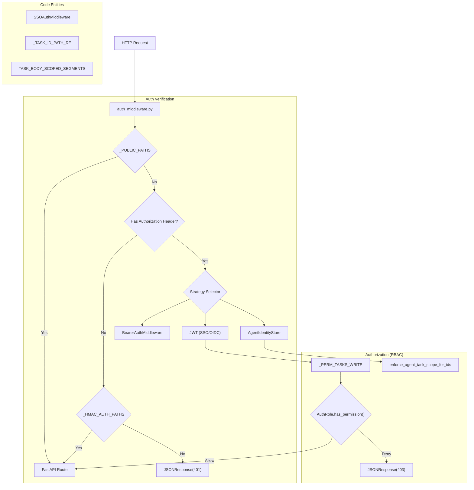
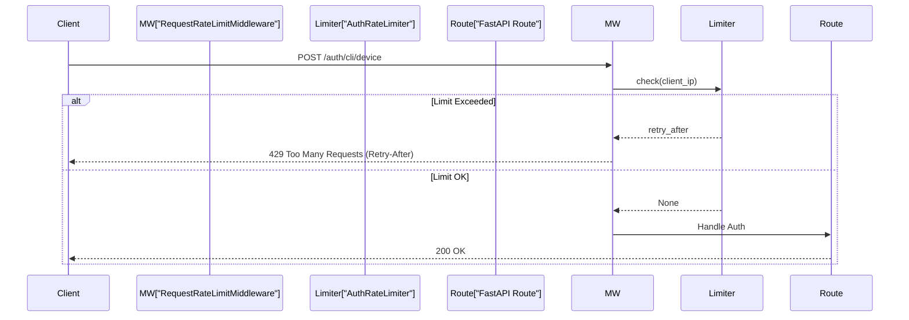

<!-- source: DeepWiki mcp.deepwiki.com · repo sipyourdrink-ltd/bernstein · page 5.1 Authentication, Authorization, and Rate Limiting · fetched 2026-10-27 -->

# Authentication, Authorization, and Rate Limiting

Relevant source files

The following files were used as context for generating this wiki page:

- [.github/workflows/ci-weekly-digest.yml](.github/workflows/ci-weekly-digest.yml)
- [.github/workflows/spiffe-extra-e2e.yml](.github/workflows/spiffe-extra-e2e.yml)
- [docs/orchestration/federation.md](docs/orchestration/federation.md)
- [docs/reference/spiffe-workload-identity.md](docs/reference/spiffe-workload-identity.md)
- [docs/security/secrets-broker.md](docs/security/secrets-broker.md)
- [scripts/ci_weekly_digest.py](scripts/ci_weekly_digest.py)
- [src/bernstein/cli/commands/citation_cmd.py](src/bernstein/cli/commands/citation_cmd.py)
- [src/bernstein/cli/commands/secrets_cmd.py](src/bernstein/cli/commands/secrets_cmd.py)
- [src/bernstein/compliance/owasp_skills.py](src/bernstein/compliance/owasp_skills.py)
- [src/bernstein/core/admission/models.py](src/bernstein/core/admission/models.py)
- [src/bernstein/core/approval/gate.py](src/bernstein/core/approval/gate.py)
- [src/bernstein/core/identity/grants.py](src/bernstein/core/identity/grants.py)
- [src/bernstein/core/identity/spiffe/binding.py](src/bernstein/core/identity/spiffe/binding.py)
- [src/bernstein/core/identity/spiffe/grant_identity.py](src/bernstein/core/identity/spiffe/grant_identity.py)
- [src/bernstein/core/orchestration/federation.py](src/bernstein/core/orchestration/federation.py)
- [src/bernstein/core/orchestration/federation_contract.py](src/bernstein/core/orchestration/federation_contract.py)
- [src/bernstein/core/quality/citation_verifier.py](src/bernstein/core/quality/citation_verifier.py)
- [src/bernstein/core/security/auth_middleware.py](src/bernstein/core/security/auth_middleware.py)
- [src/bernstein/core/security/auth_rate_limiter.py](src/bernstein/core/security/auth_rate_limiter.py)
- [src/bernstein/core/security/blocking_hooks.py](src/bernstein/core/security/blocking_hooks.py)
- [src/bernstein/core/security/claude_tool_result_injection.py](src/bernstein/core/security/claude_tool_result_injection.py)
- [src/bernstein/core/security/command_allowlist.py](src/bernstein/core/security/command_allowlist.py)
- [src/bernstein/core/security/permission_policy.py](src/bernstein/core/security/permission_policy.py)
- [src/bernstein/core/security/promptware_detector.py](src/bernstein/core/security/promptware_detector.py)
- [src/bernstein/core/security/secrets_broker.py](src/bernstein/core/security/secrets_broker.py)
- [src/bernstein/core/server/server_middleware.py](src/bernstein/core/server/server_middleware.py)
- [tests/integration/quality/__init__.py](tests/integration/quality/__init__.py)
- [tests/integration/quality/test_citation_verifier_http.py](tests/integration/quality/test_citation_verifier_http.py)
- [tests/property/test_citation_verifier_properties.py](tests/property/test_citation_verifier_properties.py)
- [tests/scripts/spiffe_extra_e2e_check.py](tests/scripts/spiffe_extra_e2e_check.py)
- [tests/unit/cli/test_audit_verify_grants.py](tests/unit/cli/test_audit_verify_grants.py)
- [tests/unit/cli/test_secrets_grants_cli.py](tests/unit/cli/test_secrets_grants_cli.py)
- [tests/unit/identity/test_grants.py](tests/unit/identity/test_grants.py)
- [tests/unit/orchestration/test_federation.py](tests/unit/orchestration/test_federation.py)
- [tests/unit/quality/test_citation_verifier.py](tests/unit/quality/test_citation_verifier.py)
- [tests/unit/security/test_promptware_detector.py](tests/unit/security/test_promptware_detector.py)
- [tests/unit/security/test_secrets_broker.py](tests/unit/security/test_secrets_broker.py)
- [tests/unit/test_agent_turn_state.py](tests/unit/test_agent_turn_state.py)
- [tests/unit/test_auth_rate_limiter.py](tests/unit/test_auth_rate_limiter.py)
- [tests/unit/test_background_query_throttling.py](tests/unit/test_background_query_throttling.py)
- [tests/unit/test_ci_weekly_digest.py](tests/unit/test_ci_weekly_digest.py)
- [tests/unit/test_ci_weekly_digest_workflow_yaml.py](tests/unit/test_ci_weekly_digest_workflow_yaml.py)
- [tests/unit/test_diff_render.py](tests/unit/test_diff_render.py)
- [tests/unit/test_lessons.py](tests/unit/test_lessons.py)
- [tests/unit/test_oauth_refresh.py](tests/unit/test_oauth_refresh.py)
- [tests/unit/test_permission_policy.py](tests/unit/test_permission_policy.py)
- [tests/unit/test_slo.py](tests/unit/test_slo.py)
- [tests/unit/test_slo_extended.py](tests/unit/test_slo_extended.py)
- [tests/unit/test_sonar_regex_hygiene.py](tests/unit/test_sonar_regex_hygiene.py)
- [tests/unit/test_sonar_s8495_typing_annotations.py](tests/unit/test_sonar_s8495_typing_annotations.py)
- [tests/unit/test_sse.py](tests/unit/test_sse.py)
- [tests/unit/test_unattended_retry.py](tests/unit/test_unattended_retry.py)

Bernstein employs a multi-layered security model to protect the task server and orchestrator. This includes a secure-by-default middleware pipeline, robust Role-Based Access Control (RBAC), SSO integration via OIDC and SAML, and granular rate limiting to prevent resource exhaustion.

## Authentication Architecture

The authentication logic is primarily driven by the `AuthService` and enforced via `auth_middleware.py` [src/bernstein/core/security/auth_middleware.py:1-12](). It replaces simple bearer checks with a multi-strategy approach:

1.  **SSO (OIDC/SAML):** Integration with enterprise Identity Providers for web dashboard access.
2.  **Device Authorization Flow:** RFC 8628 flow for authenticating the Bernstein CLI [src/bernstein/core/server/server_middleware.py:60-65]().
3.  **Zero-Trust Agent Identity:** Per-agent, task-scoped JWTs that restrict an API client's access to only the tasks it is assigned to [src/bernstein/core/security/auth_middleware.py:22-30]().
4.  **Legacy Bearer Tokens:** Backward-compatible token support for simple deployments [src/bernstein/core/server/server_middleware.py:92-103]().
5.  **HMAC Authentication:** Shared-secret validation for webhooks (GitHub, GitLab, Slack) [src/bernstein/core/server/server_middleware.py:77-85]().

### Authentication Data Flow

The following diagram illustrates how a request is authenticated and authorized through the system.

**Auth Pipeline and Entity Mapping**

**Sources:** [src/bernstein/core/security/auth_middleware.py:3-116](), [src/bernstein/core/server/server_middleware.py:30-103]()

## Authorization and RBAC

Bernstein implements RBAC via `AuthRole` and permission strings. Every write operation is mapped to a specific permission. The system is **fail-closed**: authentication is required by default unless `BERNSTEIN_AUTH_DISABLED=1` is set [src/bernstein/core/security/auth_middleware.py:15-20]().

### Zero-Trust Task Scoping
For agent-issued tokens, the middleware extracts the `task_id` from the URL path using `_TASK_ID_PATH_RE` [src/bernstein/core/security/auth_middleware.py:116-116]() and verifies it against the `task_ids` claim in the JWT [src/bernstein/core/security/auth_middleware.py:22-30](). 

*   **Path-addressed:** Matches `/tasks/{id}/...` and versioned mirrors like `/api/v1/tasks/...` [src/bernstein/core/security/auth_middleware.py:29-36]().
*   **Body-addressed:** Routes like `batch-ops` or `claim-batch` that name tasks in the request body are validated via `enforce_agent_task_scope_for_ids` [src/bernstein/core/security/auth_middleware.py:37-41]().
*   **Collection Exemptions:** Read-only queries like `/tasks/search` or `/tasks/counts` are exempt from task-id binding [src/bernstein/core/security/auth_middleware.py:140-150]().

**Sources:** [src/bernstein/core/security/auth_middleware.py:22-55](), [src/bernstein/core/security/auth_middleware.py:116-140]()

## Credential Grants and Secrets Broker

To avoid leaking static credentials into logs or transcripts, Bernstein uses a **Secrets Broker** that mints short-lived, per-task tokens [src/bernstein/core/security/secrets_broker.py:1-12]().

### Scoped Grants
Before a worker spawns, the orchestrator writes a **scoped grant** [src/bernstein/core/identity/grants.py:1-12]().
*   **Audit Anchoring:** Grants are recorded in an HMAC-chained ledger [src/bernstein/core/identity/grants.py:22-30]().
*   **Redaction:** Both the token ID and raw backing value are registered with the redactor to scrub them from agent transcripts [src/bernstein/core/security/secrets_broker.py:57-61]().
*   **Backends:** Supports Vault, AWS, GCP, MacOS Keychain, and Linux Keyring [src/bernstein/core/security/secrets_broker.py:40-42]().

**Sources:** [src/bernstein/core/security/secrets_broker.py:1-61](), [src/bernstein/core/identity/grants.py:1-63]()

## Rate Limiting

Bernstein uses a two-tier rate limiting strategy to protect against resource exhaustion and brute-force attacks.

### 1. Auth Endpoint Protection
The `AuthRateLimiter` targets sensitive authentication routes (e.g., `/auth/cli/device`). It uses a sliding window (default 10 requests per 60 seconds) per IP address [tests/unit/test_auth_rate_limiter.py:22-35]().

### 2. Global Request Buckets
The `RequestRateLimitMiddleware` enforces configurable buckets for all API traffic.

*   **Read Bucket:** High-throughput for `GET` requests (default 300 RPM) [tests/unit/test_auth_rate_limiter.py:171-172]().
*   **Write Bucket:** Restricted for `POST/PUT/DELETE` (default 30 RPM) [tests/unit/test_auth_rate_limiter.py:165-172]().
*   **SSE Slow-Client Protection:** The `SSEBus` limits reconnects (3 per window) to prevent DoS from flapping clients [tests/unit/test_sse.py:179-194]().

**Request Limiting Flow**

**Sources:** [src/bernstein/core/security/auth_rate_limiter.py](), [tests/unit/test_auth_rate_limiter.py:112-134](), [tests/unit/test_sse.py:179-194]()

## Permission Policy and Guardrails

The `PermissionProfile` system provides a fail-closed default for tool dispatch [src/bernstein/core/security/permission_policy.py:1-12]().

*   **Profiles:** Includes `read-only`, `builder`, and `reviewer` [src/bernstein/core/security/permission_policy.py:58-62]().
*   **Tool Allowlist:** Restricts agents to specific tools (e.g., `fs.read`, `git.log`) [src/bernstein/core/security/permission_policy.py:116-126]().
*   **Path/Host Filtering:** Prevents agents from accessing sensitive files (e.g., `.env`, `.sdd/runtime`) or unauthorized network hosts [src/bernstein/core/security/permission_policy.py:148-151]().

**Sources:** [src/bernstein/core/security/permission_policy.py:1-164]()

---

