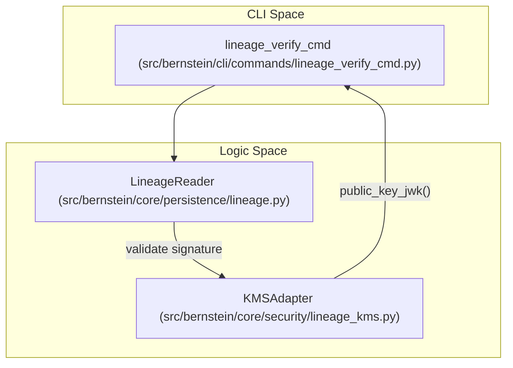
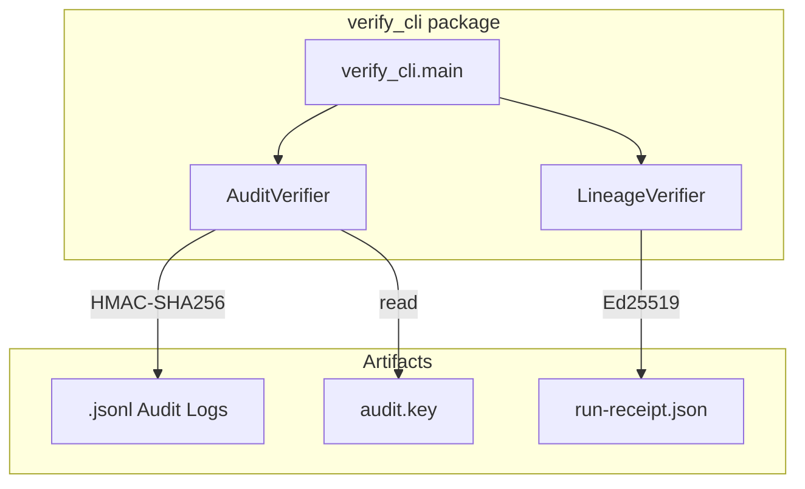

<!-- source: DeepWiki mcp.deepwiki.com · repo sipyourdrink-ltd/bernstein · page 5.3 Audit Chain, Lineage, and Compliance · fetched 2026-10-27 -->

# Audit Chain, Lineage, and Compliance

Relevant source files

The following files were used as context for generating this wiki page:

- [.importlinter](.importlinter)
- [README.zh-Hans.md](README.zh-Hans.md)
- [README.zh-TW.md](README.zh-TW.md)
- [docs/operations/security-and-identity.md](docs/operations/security-and-identity.md)
- [src/bernstein/cli/commands/evidence_cmd.py](src/bernstein/cli/commands/evidence_cmd.py)
- [src/bernstein/cli/commands/lineage_cmd.py](src/bernstein/cli/commands/lineage_cmd.py)
- [src/bernstein/cli/commands/lineage_replay_cmd.py](src/bernstein/cli/commands/lineage_replay_cmd.py)
- [src/bernstein/compliance/eu_ai_act.py](src/bernstein/compliance/eu_ai_act.py)
- [src/bernstein/core/evidence/bundle.py](src/bernstein/core/evidence/bundle.py)
- [src/bernstein/core/evidence/completion_gate.py](src/bernstein/core/evidence/completion_gate.py)
- [src/bernstein/core/evidence/output_diff.py](src/bernstein/core/evidence/output_diff.py)
- [src/bernstein/core/lineage/__init__.py](src/bernstein/core/lineage/__init__.py)
- [src/bernstein/core/lineage/entry.py](src/bernstein/core/lineage/entry.py)
- [src/bernstein/core/lineage/signed_write.py](src/bernstein/core/lineage/signed_write.py)
- [src/bernstein/core/orchestration/AGENTS.md](src/bernstein/core/orchestration/AGENTS.md)
- [src/bernstein/core/persistence/lineage.py](src/bernstein/core/persistence/lineage.py)
- [src/bernstein/core/routes/batch_ops.py](src/bernstein/core/routes/batch_ops.py)
- [src/bernstein/core/routes/task_a2a.py](src/bernstein/core/routes/task_a2a.py)
- [src/bernstein/core/routes/task_cluster.py](src/bernstein/core/routes/task_cluster.py)
- [src/bernstein/core/security/AGENTS.md](src/bernstein/core/security/AGENTS.md)
- [src/bernstein/core/security/agent_card_signer.py](src/bernstein/core/security/agent_card_signer.py)
- [src/bernstein/core/security/audit.py](src/bernstein/core/security/audit.py)
- [src/bernstein/core/security/audit_head_signature.py](src/bernstein/core/security/audit_head_signature.py)
- [src/bernstein/core/security/audit_integrity.py](src/bernstein/core/security/audit_integrity.py)
- [src/bernstein/core/security/audit_pack.py](src/bernstein/core/security/audit_pack.py)
- [src/bernstein/core/security/auth.py](src/bernstein/core/security/auth.py)
- [src/bernstein/core/security/compliance.py](src/bernstein/core/security/compliance.py)
- [src/bernstein/core/security/dlp_scanner.py](src/bernstein/core/security/dlp_scanner.py)
- [src/bernstein/core/security/lineage_kms.py](src/bernstein/core/security/lineage_kms.py)
- [src/bernstein/core/security/plan_approval.py](src/bernstein/core/security/plan_approval.py)
- [src/bernstein/core/security/resource_limits.py](src/bernstein/core/security/resource_limits.py)
- [src/bernstein/core/security/sandbox_profiles.py](src/bernstein/core/security/sandbox_profiles.py)
- [src/bernstein/core/security/sigstore_attestation.py](src/bernstein/core/security/sigstore_attestation.py)
- [tests/property/test_capability_matrix_bughunt.py](tests/property/test_capability_matrix_bughunt.py)
- [tests/unit/adapters/test_base_lineage_hook.py](tests/unit/adapters/test_base_lineage_hook.py)
- [tests/unit/adapters/test_base_spine_writes.py](tests/unit/adapters/test_base_spine_writes.py)
- [tests/unit/lineage/test_spine.py](tests/unit/lineage/test_spine.py)
- [tests/unit/lineage/test_spine_deprecations.py](tests/unit/lineage/test_spine_deprecations.py)
- [tests/unit/test_adapter_consistency.py](tests/unit/test_adapter_consistency.py)
- [tests/unit/test_agent_card_signer.py](tests/unit/test_agent_card_signer.py)
- [tests/unit/test_audit.py](tests/unit/test_audit.py)
- [tests/unit/test_audit_chain_byteflip_regression.py](tests/unit/test_audit_chain_byteflip_regression.py)
- [tests/unit/test_audit_integrity.py](tests/unit/test_audit_integrity.py)
- [tests/unit/test_audit_key.py](tests/unit/test_audit_key.py)
- [tests/unit/test_auth_middleware_task_scope_indirect.py](tests/unit/test_auth_middleware_task_scope_indirect.py)
- [tests/unit/test_auth_middleware_task_scope_routes.py](tests/unit/test_auth_middleware_task_scope_routes.py)
- [tests/unit/test_compliance_engine.py](tests/unit/test_compliance_engine.py)
- [tests/unit/test_fingerprint_determinism.py](tests/unit/test_fingerprint_determinism.py)
- [tests/unit/test_lineage_record_v1.py](tests/unit/test_lineage_record_v1.py)
- [tests/unit/test_lineage_regulatory_verify.py](tests/unit/test_lineage_regulatory_verify.py)
- [tests/unit/test_memo_store_concurrency.py](tests/unit/test_memo_store_concurrency.py)
- [tests/unit/test_quality_gate_regressions.py](tests/unit/test_quality_gate_regressions.py)
- [tests/unit/test_sigstore_attestation.py](tests/unit/test_sigstore_attestation.py)
- [tests/unit/test_soc2_report.py](tests/unit/test_soc2_report.py)
- [tests/unit/test_spawner_failures.py](tests/unit/test_spawner_failures.py)
- [tests/unit/test_vault_injector.py](tests/unit/test_vault_injector.py)

Bernstein implements a multi-layered verification architecture designed to satisfy high-stakes regulatory requirements (EU AI Act, DORA, NIS2) and institutional security standards (SOC 2). The system maintains a tamper-evident record of every agent decision, command execution, and file modification through HMAC-chained logs and Ed25519 signatures.

## Tamper-Evident Audit Chain

The audit system is built on an append-only, HMAC-SHA256 chained log. Every record is cryptographically linked to its predecessor, ensuring that any modification or deletion of past events invalidates the entire subsequent chain [src/bernstein/core/security/audit.py:1-5]().

### Security and Key Management
The HMAC key is stored outside the `.sdd/` directory (typically `$XDG_STATE_HOME/bernstein/audit.key`) to prevent an attacker with write access to the logs from rotating the signing key [src/bernstein/core/security/audit.py:7-11](). The key file must have `0600` permissions; looser permissions trigger a hard error [src/bernstein/core/security/audit.py:12-14]().

### Audit Event Types
The chain records critical lifecycle events including:
*   **Sandbox Events**: `SANDBOX_SESSION_CREATE`, `SANDBOX_EXEC_START` (with command SHA-256), and `SANDBOX_SESSION_DESTROY` [src/bernstein/core/security/audit.py:101-116]().
*   **Replay Events**: `REPLAY_STEP`, `REPLAY_FORK`, and `REPLAY_EXPORT` to correlate audit trails with agent journals [src/bernstein/core/security/audit.py:80-93]().
*   **Chain Integrity**: `EVENT_CHAIN_TORN_RECORD` is emitted if the log is sealed after a crash or corruption, documenting the exact byte offset of the tear [src/bernstein/core/security/audit.py:125-132]().

**Sources:** [src/bernstein/core/security/audit.py:1-140](), [src/bernstein/core/security/AGENTS.md:1-29]()

---

## Artifact Lineage (v1/v2)

Lineage tracking provides a "producer-to-output" trail, mapping every file modification back to the specific agent, prompt, and input artifacts that created it [src/bernstein/cli/commands/lineage_cmd.py:1-7]().

### Lineage Versions
*   **v1 (Standard)**: Records the producer, prompt SHA, and token costs.
*   **v2 (Compliance-Grade)**: Adds a `regulatory_class` field and an Ed25519 signature (RFC 8037) for DORA and EU AI Act Article 12 evidence [src/bernstein/cli/commands/lineage_cmd.py:5-7]().

### Lineage KMS Adapters
Lineage v2 signatures use pluggable KMS adapters to support diverse key storage environments [src/bernstein/core/security/lineage_kms.py:1-12]():
*   `FileBasedKMSAdapter`: Reads PEM/raw Ed25519 from disk [src/bernstein/core/security/lineage_kms.py:163-178]().
*   `EnvBasedKMSAdapter`: Reads keys from environment variables (e.g., K8s Secrets) [src/bernstein/core/security/lineage_kms.py:47-49]().
*   `HSMKMSAdapter`: A protocol-compliant stub for PKCS#11 / Cloud-HSM integrations [src/bernstein/core/security/lineage_kms.py:50-54]().

**Lineage Verification Flow**

**Sources:** [src/bernstein/cli/commands/lineage_cmd.py:1-22](), [src/bernstein/core/security/lineage_kms.py:84-155]()

---

## Agent Card Signing (Detached JWS)

For Agent-to-Agent (A2A) v1.0 federation, Bernstein uses `AgentIdentityCard` instances signed with Ed25519 in a detached JSON Web Signature (JWS) format (RFC 7515) [src/bernstein/core/security/agent_card_signer.py:1-12]().

### Implementation Details
*   **Canonicalization**: Implements RFC 8785 (JCS) to ensure deterministic JSON encoding before signing [src/bernstein/core/security/agent_card_signer.py:118-147]().
*   **Detached JWS**: The signature is generated over the JCS-canonicalized bytes but stored in a detached format where the payload segment is empty [src/bernstein/core/security/agent_card_signer.py:8-12]().
*   **Verification**: `verify_agent_card` checks the Ed25519 signature against the provided public key and card body [src/bernstein/core/security/agent_card_signer.py:51-52]().

**Sources:** [src/bernstein/core/security/agent_card_signer.py:1-160](), [tests/unit/test_agent_card_signer.py:88-105]()

---

## Sigstore and SLSA-3 Attestations

Bernstein provides non-repudiable proof of task completions using Sigstore/Rekor, providing third-party immutable timestamping [src/bernstein/core/security/sigstore_attestation.py:1-10]().

1.  **Attestation Payload**: Includes the `task_id`, `agent_id`, `diff_sha256`, and the current `event_hmac` from the audit log [src/bernstein/core/security/sigstore_attestation.py:88-104]().
2.  **Keyless Signing**: Uses Fulcio CA and Rekor transparency logs when the `sigstore` package is available [src/bernstein/core/security/sigstore_attestation.py:3-5]().
3.  **Local Fallback**: If offline or `sigstore` is missing, the system falls back to a local Ed25519 signature stored in an attestation bundle [src/bernstein/core/security/sigstore_attestation.py:12-16]().
4.  **Security**: The `verify_local_attestation` function enforces strict path containment to prevent path-traversal attacks via the `public_key_file` field [src/bernstein/core/security/sigstore_attestation.py:32-48]().

**Sources:** [src/bernstein/core/security/sigstore_attestation.py:1-165](), [tests/unit/test_sigstore_attestation.py:1-20]()

---

## Standalone Auditor: `bernstein-verify`

The `verify_cli/` package provides an air-gap-safe standalone auditor (pip wheel) that contains no `bernstein.*` imports to ensure it can be audited independently of the main orchestrator.

**Auditor Component Map**

### Compliance Mappings and Evidence
Bernstein includes logic to generate evidence packs for specific regulatory regimes:
*   **EU AI Act**: Mappings for Article 12 (Logging) and Article 13 (Transparency) [src/bernstein/cli/commands/lineage_cmd.py:5-7]().
*   **DORA / NIS2**: Continuous lineage trails and sandbox execution logs [src/bernstein/core/security/audit.py:101-116]().
*   **SOC 2**: The HMAC-chained audit log serves as primary evidence for Change Management and Logical Access controls [src/bernstein/core/security/AGENTS.md:1-5]().

**Sources:** [src/bernstein/core/security/audit.py:1-15](), [src/bernstein/cli/commands/lineage_cmd.py:1-20](), [src/bernstein/core/security/sigstore_attestation.py:29-59]()

---

