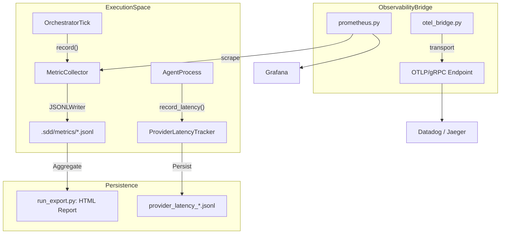

<!-- source: DeepWiki mcp.deepwiki.com · repo sipyourdrink-ltd/bernstein · page 6.1 Metrics, Tracing, and Alerting · fetched 2026-10-27 -->

# Metrics, Tracing, and Alerting

<details>
<summary>Relevant source files</summary>

The following files were used as context for generating this wiki page:

- [.github/workflows/ci-macos-nightly.yml](.github/workflows/ci-macos-nightly.yml)
- [.github/workflows/docs-observability-snapshot.yml](.github/workflows/docs-observability-snapshot.yml)
- [.github/workflows/mutation-fixed.yml](.github/workflows/mutation-fixed.yml)
- [.github/workflows/pr-observability-summary.yml](.github/workflows/pr-observability-summary.yml)
- [docs/api/supervisor.md](docs/api/supervisor.md)
- [docs/observability/otlp-export.md](docs/observability/otlp-export.md)
- [docs/observability/snapshots/.gitkeep](docs/observability/snapshots/.gitkeep)
- [docs/observability/unified-doctor.md](docs/observability/unified-doctor.md)
- [docs/operations/observability-overview.md](docs/operations/observability-overview.md)
- [docs/sdd/otel-journal-bridge.md](docs/sdd/otel-journal-bridge.md)
- [scripts/observability/build_pr_summary.py](scripts/observability/build_pr_summary.py)
- [scripts/observability/gate.py](scripts/observability/gate.py)
- [scripts/observability/render_trends.py](scripts/observability/render_trends.py)
- [src/bernstein/cli/commands/analyze_cmd.py](src/bernstein/cli/commands/analyze_cmd.py)
- [src/bernstein/cli/commands/credential_cmd.py](src/bernstein/cli/commands/credential_cmd.py)
- [src/bernstein/cli/commands/doctor/__init__.py](src/bernstein/cli/commands/doctor/__init__.py)
- [src/bernstein/cli/commands/doctor/_render.py](src/bernstein/cli/commands/doctor/_render.py)
- [src/bernstein/cli/commands/doctor/backends.py](src/bernstein/cli/commands/doctor/backends.py)
- [src/bernstein/cli/commands/doctor/code_scanning.py](src/bernstein/cli/commands/doctor/code_scanning.py)
- [src/bernstein/cli/commands/doctor/observe.py](src/bernstein/cli/commands/doctor/observe.py)
- [src/bernstein/cli/commands/export_cmd.py](src/bernstein/cli/commands/export_cmd.py)
- [src/bernstein/cli/commands/supervisor_cmd.py](src/bernstein/cli/commands/supervisor_cmd.py)
- [src/bernstein/cli/commands/telemetry_cmd.py](src/bernstein/cli/commands/telemetry_cmd.py)
- [src/bernstein/core/cost/cost_anomaly.py](src/bernstein/core/cost/cost_anomaly.py)
- [src/bernstein/core/lineage/c2pa.py](src/bernstein/core/lineage/c2pa.py)
- [src/bernstein/core/observability/custom_metrics.py](src/bernstein/core/observability/custom_metrics.py)
- [src/bernstein/core/observability/incident_timeline.py](src/bernstein/core/observability/incident_timeline.py)
- [src/bernstein/core/observability/llm_watcher.py](src/bernstein/core/observability/llm_watcher.py)
- [src/bernstein/core/observability/metric_collector.py](src/bernstein/core/observability/metric_collector.py)
- [src/bernstein/core/observability/otel_bridge.py](src/bernstein/core/observability/otel_bridge.py)
- [src/bernstein/core/observability/otel_projection.py](src/bernstein/core/observability/otel_projection.py)
- [src/bernstein/core/observability/postmortem.py](src/bernstein/core/observability/postmortem.py)
- [src/bernstein/core/observability/provider_latency.py](src/bernstein/core/observability/provider_latency.py)
- [src/bernstein/core/observability/run_export.py](src/bernstein/core/observability/run_export.py)
- [src/bernstein/core/orchestration/manager.py](src/bernstein/core/orchestration/manager.py)
- [src/bernstein/core/orchestration/manager_prompts.py](src/bernstein/core/orchestration/manager_prompts.py)
- [src/bernstein/core/orchestration/supervisor_aggregator.py](src/bernstein/core/orchestration/supervisor_aggregator.py)
- [src/bernstein/core/orchestration/supervisor_receipt.py](src/bernstein/core/orchestration/supervisor_receipt.py)
- [src/bernstein/core/protocols/ssh_backend.py](src/bernstein/core/protocols/ssh_backend.py)
- [src/bernstein/core/routes/predictive.py](src/bernstein/core/routes/predictive.py)
- [src/bernstein/core/routes/provider_latency.py](src/bernstein/core/routes/provider_latency.py)
- [src/bernstein/core/routing/route_decision.py](src/bernstein/core/routing/route_decision.py)
- [src/bernstein/core/sandbox/snapshot.py](src/bernstein/core/sandbox/snapshot.py)
- [src/bernstein/core/security/approval.py](src/bernstein/core/security/approval.py)
- [src/bernstein/core/tasks/task_spawn_bridge.py](src/bernstein/core/tasks/task_spawn_bridge.py)
- [src/bernstein/evolution/__init__.py](src/bernstein/evolution/__init__.py)
- [src/bernstein/evolution/detector.py](src/bernstein/evolution/detector.py)
- [src/bernstein/evolution/observability_signals.py](src/bernstein/evolution/observability_signals.py)
- [src/bernstein/tui/status_bar.py](src/bernstein/tui/status_bar.py)
- [src/bernstein/tui/worker_badges.py](src/bernstein/tui/worker_badges.py)
- [tests/integration/test_approval_workflow_e2e.py](tests/integration/test_approval_workflow_e2e.py)
- [tests/integration/test_supervisor_chain_roundtrip.py](tests/integration/test_supervisor_chain_roundtrip.py)
- [tests/unit/cli/doctor/test_observe.py](tests/unit/cli/doctor/test_observe.py)
- [tests/unit/observability/test_gate.py](tests/unit/observability/test_gate.py)
- [tests/unit/test_adapter_cmd.py](tests/unit/test_adapter_cmd.py)
- [tests/unit/test_approval.py](tests/unit/test_approval.py)
- [tests/unit/test_approval_gates.py](tests/unit/test_approval_gates.py)
- [tests/unit/test_approval_workflow.py](tests/unit/test_approval_workflow.py)
- [tests/unit/test_complexity_advisor.py](tests/unit/test_complexity_advisor.py)
- [tests/unit/test_cost_anomaly.py](tests/unit/test_cost_anomaly.py)
- [tests/unit/test_credential_cmd.py](tests/unit/test_credential_cmd.py)
- [tests/unit/test_doctor_otel_export.py](tests/unit/test_doctor_otel_export.py)
- [tests/unit/test_evolution.py](tests/unit/test_evolution.py)
- [tests/unit/test_incident_timeline.py](tests/unit/test_incident_timeline.py)
- [tests/unit/test_lineage_c2pa.py](tests/unit/test_lineage_c2pa.py)
- [tests/unit/test_manager.py](tests/unit/test_manager.py)
- [tests/unit/test_observability_signals.py](tests/unit/test_observability_signals.py)
- [tests/unit/test_otel_bridge.py](tests/unit/test_otel_bridge.py)
- [tests/unit/test_predictive_alerts.py](tests/unit/test_predictive_alerts.py)
- [tests/unit/test_provider_latency.py](tests/unit/test_provider_latency.py)
- [tests/unit/test_repo_analyzer.py](tests/unit/test_repo_analyzer.py)
- [tests/unit/test_run_export.py](tests/unit/test_run_export.py)
- [tests/unit/test_sonar_s3358_nested_ternary.py](tests/unit/test_sonar_s3358_nested_ternary.py)
- [tests/unit/test_supervisor_aggregator.py](tests/unit/test_supervisor_aggregator.py)
- [tests/unit/test_telemetry_export_otel_cmd.py](tests/unit/test_telemetry_export_otel_cmd.py)
- [tests/unit/test_telemetry_verify_span_cmd.py](tests/unit/test_telemetry_verify_span_cmd.py)

</details>


Bernstein implements a multi-layered observability stack designed to monitor deterministic multi-agent orchestration. This includes Prometheus-compatible metrics, real-time agent heartbeats, SLO tracking with error budgets, and an advisory layer (LLMWatcher) for behavior anomaly detection.

## Metrics Architecture

The system utilizes a `MetricsCollector` to aggregate telemetry across task lifecycles and agent executions [src/bernstein/core/observability/metric_collector.py:1-5](). Metrics are exposed via a Prometheus-compatible `/metrics` endpoint on the task server.

### MetricsCollector and Persistence
The `MetricsCollector` writes metric points to per-day JSONL files within the `.sdd/metrics/` directory [src/bernstein/core/observability/metric_collector.py:106-111](). It supports three privacy levels—`FULL`, `STANDARD`, and `MINIMAL`—to control the redaction of identifiers like `task_id` and `cost_usd` [src/bernstein/core/observability/metric_collector.py:86-101]().

Key metric types collected include:
*   **Task Metrics:** Start/end times, success status, token usage (prompt vs completion), cost in USD, and git impact (lines added/deleted) [src/bernstein/core/observability/metric_collector.py:128-149]().
*   **Agent Metrics:** Total tasks completed/failed per agent session and source attribution [src/bernstein/core/observability/metric_collector.py:152-167]().
*   **Provider Health:** Tracking of latency (p50/p95/p99) and rate limit status [src/bernstein/core/observability/metric_collector.py:170-181]().
*   **Latency Tracking:** The `PercentileTracker` uses a sliding window to compute real-time performance signals [src/bernstein/core/observability/metric_collector.py:196-207]().

### Data Flow: Code to Prometheus
The following diagram illustrates how internal state is transformed into observability signals.

**Figure 1: Telemetry Data Flow**

Sources: [src/bernstein/core/observability/metric_collector.py:60-75](), [src/bernstein/core/observability/otel_bridge.py:9-18](), [src/bernstein/core/observability/provider_latency.py:11-20]()

## OpenTelemetry and Journal-Anchored Tracing

Bernstein treats the OTLP wire path as a transport for the deterministic span projection of the run's Merkle-chained event journal [docs/observability/otlp-export.md:9-13]().

### Journal-Anchored Spans
Unlike traditional tracing where IDs are random, Bernstein spans are derived from the journal:
*   **Span IDs:** Generated as `H("otel.span", entry_hash)` [docs/observability/otlp-export.md:15-16]().
*   **Trace IDs:** Derived from the run's first entry hash (the anchor) [src/bernstein/core/observability/otel_bridge.py:115-120]().
*   **Evidence:** Every span carries `bernstein.journal.entry_hash` and `bernstein.audit.anchor` [src/bernstein/core/observability/otel_bridge.py:22-26]().

### Verification and Backfilling
Because the projection is a pure function of the journal, the `bernstein telemetry export-otel` command can backfill a completed run with byte-identical trace and span IDs [docs/observability/otlp-export.md:89-92](). The `verify-span` command allows operators to prove a span's authenticity by recomputing its identity from the local journal [docs/observability/otlp-export.md:109-115]().

Sources: [src/bernstein/core/observability/otel_bridge.py:33-42](), [docs/observability/otlp-export.md:19-27]()

## LLMWatcher and Anomaly Detection

The `LLMWatcher` acts as an advisory layer that inspects agent-to-LLM traffic for behavioral anomalies [src/bernstein/core/observability/llm_watcher.py](). It monitors for:
*   **Retry Spirals:** Detects when an agent repeatedly executes the same failing command.
*   **Behavior Anomalies:** Sudden shifts in token density or tool usage patterns.
*   **Cascading Failures:** The system includes a circuit breaker that halts the orchestrator if consecutive tick failures exceed the safety threshold [src/bernstein/core/defaults.py:53-54]().

## Provider Latency and Degradation Alerting

The `ProviderLatencyTracker` monitors the performance of external LLM providers (Anthropic, OpenAI, etc.) [src/bernstein/core/observability/provider_latency.py]().

*   **Baseline Tracking:** It establishes a baseline p99 latency after 10 samples [tests/unit/test_provider_latency.py:133-138]().
*   **Degradation Alerts:** A `DegradationAlert` is triggered if the current p99 exceeds the baseline by a configured ratio (e.g., 2.0x) [tests/unit/test_provider_latency.py:149-159]().
*   **Persistence:** Latency data is persisted to `provider_latency_YYYYMMDD.jsonl` to survive orchestrator restarts [tests/unit/test_provider_latency.py:101-110]().

## Incident Timeline and Run Reports

Bernstein generates comprehensive post-run reports and timelines for auditability.

### Run Export
The `run_export.py` module renders a self-contained HTML report (under 500KB) containing [src/bernstein/core/observability/run_export.py:25-43]():
*   **Task Summary:** Success/failure status, duration, and cost per task [src/bernstein/core/observability/run_export.py:142-152]().
*   **Model Efficiency:** Rollup of cost and token usage by model variant [src/bernstein/core/observability/run_export.py:169-188]().
*   **Timeline:** A visual offset map of when each task was active [src/bernstein/core/observability/run_export.py:159-166]().

### Incident Timeline Implementation
The following diagram maps the relationship between the `ExportReport` data structure and the underlying `.sdd` state.

**Figure 2: Report Generation Data Mapping**
```mermaid
classDiagram
    class ExportReport {
        +str goal
        +str run_id
        +float total_cost_usd
        +List~TaskRow~ task_rows
        +List~TimelineEntry~ timeline_entries
    }
    class TaskRow {
        +str title
        +str role
        +str status
        +bool janitor_passed
    }
    
    ExportReport --* TaskRow : contains
    
    subgraph "SDD_Files"
        SummaryJSON[".sdd/runs/{id}/summary.json"]
        TasksJSONL[".sdd/archive/tasks.jsonl"]
        CostsJSON[".sdd/metrics/costs_{id}.json"]
    end

    SummaryJSON ..> ExportReport : "goal, duration"
    TasksJSONL ..> TaskRow : "status, janitor_passed"
    CostsJSON ..> ExportReport : "total_cost_usd"
```
Sources: [src/bernstein/core/observability/run_export.py:82-106](), [src/bernstein/core/observability/run_export.py:131-150](), [src/bernstein/core/observability/run_export.py:176-188]()

## Telemetry Control and Consent

Operators control the telemetry surface via the `bernstein telemetry` command group [src/bernstein/cli/commands/telemetry_cmd.py:5-12]().

*   **Opt-in/Opt-out:** `telemetry on` and `telemetry off` manage the local `install_id` and global enabled flag [src/bernstein/cli/commands/telemetry_cmd.py:100-128]().
*   **Redaction Rules:** The system strictly redacts file paths (hashed), agent output (dropped), and secrets [src/bernstein/cli/commands/telemetry_cmd.py:80-87]().
*   **Side Channel:** A Sentry-compatible side channel can be configured via `BERNSTEIN_TELEMETRY_DSN` for operator-visible event streams [src/bernstein/cli/commands/telemetry_cmd.py:144-160]().

Sources: [src/bernstein/cli/commands/telemetry_cmd.py:59-77](), [src/bernstein/core/telemetry/consent.py]()

---

