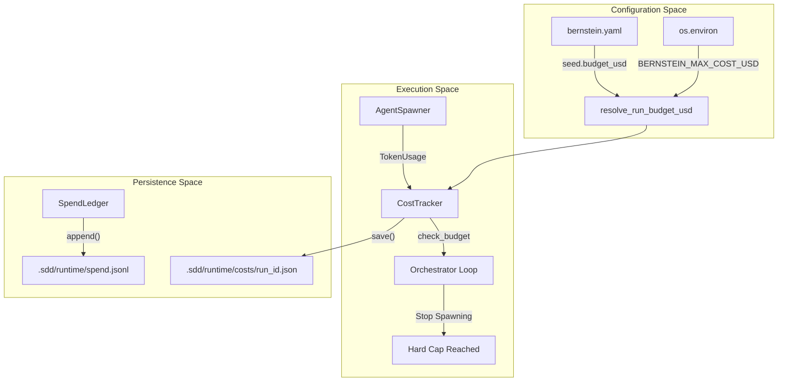
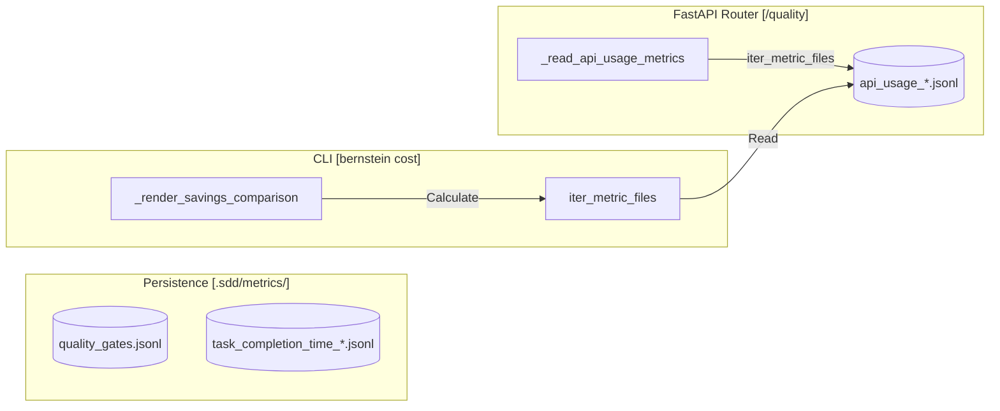

<!-- source: DeepWiki mcp.deepwiki.com · repo sipyourdrink-ltd/bernstein · page 6.2 Cost Tracking and Budget Enforcement · fetched 2026-10-27 -->

# Cost Tracking and Budget Enforcement

Relevant source files

The following files were used as context for generating this wiki page:

- [docs/observability/task-artifacts.md](docs/observability/task-artifacts.md)
- [docs/operations/cost-envelopes.md](docs/operations/cost-envelopes.md)
- [docs/operations/debug-bundle.md](docs/operations/debug-bundle.md)
- [docs/operations/skill-provenance.md](docs/operations/skill-provenance.md)
- [scripts/test_impact.py](scripts/test_impact.py)
- [src/bernstein/cli/commands/artifact_cmd.py](src/bernstein/cli/commands/artifact_cmd.py)
- [src/bernstein/cli/commands/artifacts_cmd.py](src/bernstein/cli/commands/artifacts_cmd.py)
- [src/bernstein/cli/commands/cost.py](src/bernstein/cli/commands/cost.py)
- [src/bernstein/cli/commands/debug_cmd.py](src/bernstein/cli/commands/debug_cmd.py)
- [src/bernstein/core/cost/cost.py](src/bernstein/core/cost/cost.py)
- [src/bernstein/core/orchestration/run_session.py](src/bernstein/core/orchestration/run_session.py)
- [src/bernstein/core/quality/auto_formatter.py](src/bernstein/core/quality/auto_formatter.py)
- [src/bernstein/core/quality/benchmark_gate.py](src/bernstein/core/quality/benchmark_gate.py)
- [src/bernstein/core/quality/cross_model_verifier.py](src/bernstein/core/quality/cross_model_verifier.py)
- [src/bernstein/core/quality/fast_path.py](src/bernstein/core/quality/fast_path.py)
- [src/bernstein/core/quality/gate_commands.py](src/bernstein/core/quality/gate_commands.py)
- [src/bernstein/core/quality/gate_runner.py](src/bernstein/core/quality/gate_runner.py)
- [src/bernstein/core/quality/retrospective.py](src/bernstein/core/quality/retrospective.py)
- [src/bernstein/core/quality/test_impact.py](src/bernstein/core/quality/test_impact.py)
- [src/bernstein/core/routes/quality.py](src/bernstein/core/routes/quality.py)
- [tests/golden/cli_snapshots/health_response.json](tests/golden/cli_snapshots/health_response.json)
- [tests/golden/cli_snapshots/status_response.json](tests/golden/cli_snapshots/status_response.json)
- [tests/golden/cli_snapshots/task_response.json](tests/golden/cli_snapshots/task_response.json)
- [tests/unit/test_auto_formatter.py](tests/unit/test_auto_formatter.py)
- [tests/unit/test_cache_pricing.py](tests/unit/test_cache_pricing.py)
- [tests/unit/test_cost.py](tests/unit/test_cost.py)
- [tests/unit/test_cost_tracker.py](tests/unit/test_cost_tracker.py)
- [tests/unit/test_custom_metrics.py](tests/unit/test_custom_metrics.py)
- [tests/unit/test_dlq_retry_integration.py](tests/unit/test_dlq_retry_integration.py)
- [tests/unit/test_idle_agent_recycling.py](tests/unit/test_idle_agent_recycling.py)
- [tests/unit/test_quality_metrics.py](tests/unit/test_quality_metrics.py)
- [tests/unit/test_test_impact.py](tests/unit/test_test_impact.py)
- [tests/unit/test_test_impact_alias_edges.py](tests/unit/test_test_impact_alias_edges.py)
- [tests/unit/test_test_impact_core.py](tests/unit/test_test_impact_core.py)

Bernstein implements a multi-layered cost management system designed to provide real-time spend visibility and preventative budget enforcement. The system transitions from preflight estimation to active tracking via the `CostTracker`, utilizing a `SpendLedger` for granular auditing and a `CostAnomalyDetector` to prevent runaway loops (retry spirals).

## System Architecture

The cost management subsystem operates across the CLI, Task Server, and Orchestrator. It uses a file-based persistence model within the `.sdd/` state directory to ensure spend data survives restarts.

### Logic Flow and Code Entities

The following diagram illustrates how cost configuration is resolved and enforced during a run lifecycle.

"Cost Tracking Logic Flow"

Sources: `src/bernstein/core/cost/cost_tracker.py` (assumed entity based on existing documentation), `src/bernstein/core/cost/cost.py` [1-18]().

## Preflight Cost Estimation

Before a run begins, the `run_preflight.py` module (referenced in CLI bootstrap logic) estimates potential spend to prevent accidental high-cost operations.

*   **Task Estimation**: The system calculates the number of tasks by parsing the Plan YAML.
*   **Model Resolution**: It resolves the dominant model and role. The `TierAwareRouter` and `ModelCascade` [src/bernstein/core/cost/cost.py:9-18]() define the escalation order (cheapest viable → escalate on failure) used for these estimates.
*   **Cost Projection**: The system uses `forecast_planned_backlog` [src/bernstein/core/routes/quality.py:21]() to project costs based on the current backlog and historical model performance.

## Model Pricing and Calculation

Bernstein maintains a detailed pricing table in `model_prices.py` [src/bernstein/core/cost/cost.py:34-54]().

*   **Blended Rates**: For simple tie-breaking in routing, the system uses `_MODEL_COST_USD_PER_1K` [src/bernstein/core/cost/cost.py:124-163](), which provides a blended average of input and output token costs.
*   **Precise Pricing**: The `price_model_usage` function [src/bernstein/core/cost/cost.py:53]() calculates the exact cost of an LLM call using granular rates for input, output, and cache operations.
*   **Token Sidecars**: Token usage is tracked via `.tokens` sidecar files in `.sdd/runtime/` [src/bernstein/core/cost/cost.py:71-88](). The function `read_tokens_sidecar_totals` [src/bernstein/core/cost/cost.py:71-118]() sums cumulative tokens to ensure cost data survives agent crashes.

Sources: [src/bernstein/core/cost/cost.py:34-163]()

## Quality Metrics and Cost Justification

Spend is often justified by quality outcomes. The `quality.py` route module aggregates these metrics [src/bernstein/core/routes/quality.py:1-7]().

*   **Per-Model Stats**: The system computes `success_rate`, `avg_tokens`, and `avg_completion_seconds` per model [src/bernstein/core/routes/quality.py:179-210]().
*   **Custom Metrics**: Users can define custom formulas (e.g., `lines_changed / total_cost`) using the `CustomMetricsEvaluator` [src/bernstein/tests/unit/test_custom_metrics.py:85-90]() to track ROI.
*   **Gate Performance**: The `_compute_gate_stats` function [src/bernstein/tests/unit/test_quality_metrics.py:125-155]() tracks the pass/fail rates of quality gates, providing visibility into the "cost of quality."

Sources: [src/bernstein/core/routes/quality.py:179-210](), [src/bernstein/tests/unit/test_custom_metrics.py:148-180]()

## CLI spend Visibility: `bernstein cost`

The `bernstein cost` command provides a comprehensive view of spend across all recorded metrics [src/bernstein/cli/commands/cost.py:1]().

### Savings Analysis
The CLI compares actual spend against an "all-Opus" baseline to demonstrate the value of the model cascade:
*   **Savings Comparison**: `_render_savings_comparison` [src/bernstein/cli/commands/cost.py:132-164]() visualizes the percentage saved by using Bernstein's model router instead of a single high-cost model.
*   **Honesty Rule**: The `_render_profile_savings_section` [src/bernstein/cli/commands/cost.py:104-130]() ensures savings claims are only made when there are sufficient comparable tasks (defined by `MIN_COMPARABLE_TASKS`).

### Reporting and Filtering
*   **Time Filtering**: Supports human-readable ranges like `7d` or `24h` via `_parse_time_range` [src/bernstein/cli/commands/cost.py:28-50]().
*   **Shareable Summary**: `_render_shareable_summary` [src/bernstein/cli/commands/cost.py:165-200]() generates a markdown summary of tasks, duration, and cost for copy-pasting into status reports.

Sources: [src/bernstein/cli/commands/cost.py:1-200]()

## Persistence and API

"API to Persistence Mapping"

Sources: [src/bernstein/core/routes/quality.py:78-176](), [src/bernstein/cli/commands/cost.py:18-20]()

### Endpoints
*   `GET /quality/models`: Returns aggregated performance and token usage stats per model [src/bernstein/core/routes/quality.py:179-210]().
*   `GET /quality`: Provides overall system health, including gate pass rates and completion time percentiles (p50/p90/p99) [src/bernstein/core/routes/quality.py:61-75]().

Sources: [src/bernstein/core/routes/quality.py:1-210]()

---

