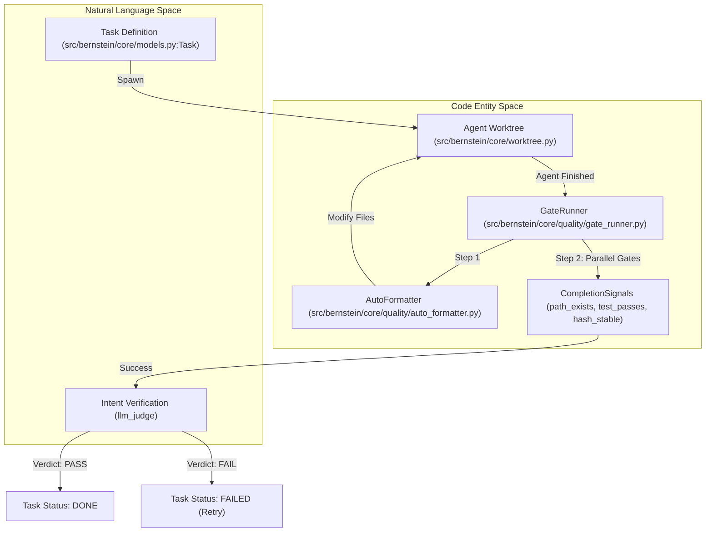
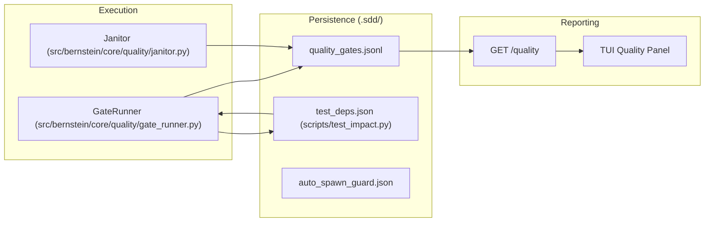

<!-- source: DeepWiki mcp.deepwiki.com · repo sipyourdrink-ltd/bernstein · page 7 Quality Gates and Verification · fetched 2026-10-27 -->

# Quality Gates and Verification

Relevant source files

The following files were used as context for generating this wiki page:

- [docs/operations/artifacts.md](docs/operations/artifacts.md)
- [docs/sdd/upgrade-task-ownership.md](docs/sdd/upgrade-task-ownership.md)
- [scripts/test_impact.py](scripts/test_impact.py)
- [src/bernstein/core/cost/cost.py](src/bernstein/core/cost/cost.py)
- [src/bernstein/core/lineage/artifact_record.py](src/bernstein/core/lineage/artifact_record.py)
- [src/bernstein/core/lineage/figure_grounding.py](src/bernstein/core/lineage/figure_grounding.py)
- [src/bernstein/core/orchestration/orchestrator_evolve.py](src/bernstein/core/orchestration/orchestrator_evolve.py)
- [src/bernstein/core/orchestration/run_session.py](src/bernstein/core/orchestration/run_session.py)
- [src/bernstein/core/quality/auto_formatter.py](src/bernstein/core/quality/auto_formatter.py)
- [src/bernstein/core/quality/benchmark_gate.py](src/bernstein/core/quality/benchmark_gate.py)
- [src/bernstein/core/quality/cross_model_verifier.py](src/bernstein/core/quality/cross_model_verifier.py)
- [src/bernstein/core/quality/fast_path.py](src/bernstein/core/quality/fast_path.py)
- [src/bernstein/core/quality/gate_commands.py](src/bernstein/core/quality/gate_commands.py)
- [src/bernstein/core/quality/gate_runner.py](src/bernstein/core/quality/gate_runner.py)
- [src/bernstein/core/quality/janitor.py](src/bernstein/core/quality/janitor.py)
- [src/bernstein/core/quality/retrospective.py](src/bernstein/core/quality/retrospective.py)
- [src/bernstein/core/quality/test_impact.py](src/bernstein/core/quality/test_impact.py)
- [src/bernstein/core/tasks/batch_api.py](src/bernstein/core/tasks/batch_api.py)
- [src/bernstein/core/tasks/figures.py](src/bernstein/core/tasks/figures.py)
- [src/bernstein/evolution/applicator.py](src/bernstein/evolution/applicator.py)
- [tests/unit/cli/test_artifact_verify_cmd.py](tests/unit/cli/test_artifact_verify_cmd.py)
- [tests/unit/lineage/test_artifact_record.py](tests/unit/lineage/test_artifact_record.py)
- [tests/unit/lineage/test_figure_grounding.py](tests/unit/lineage/test_figure_grounding.py)
- [tests/unit/tasks/data/figure_tokenizer_vectors.json](tests/unit/tasks/data/figure_tokenizer_vectors.json)
- [tests/unit/tasks/test_figure_tokenizer.py](tests/unit/tasks/test_figure_tokenizer.py)
- [tests/unit/tasks/test_models_serialization.py](tests/unit/tasks/test_models_serialization.py)
- [tests/unit/test_auto_formatter.py](tests/unit/test_auto_formatter.py)
- [tests/unit/test_batch_api.py](tests/unit/test_batch_api.py)
- [tests/unit/test_janitor.py](tests/unit/test_janitor.py)
- [tests/unit/test_orchestrator_evolve_upgrade_tasks.py](tests/unit/test_orchestrator_evolve_upgrade_tasks.py)
- [tests/unit/test_test_impact.py](tests/unit/test_test_impact.py)
- [tests/unit/test_test_impact_alias_edges.py](tests/unit/test_test_impact_alias_edges.py)
- [tests/unit/test_test_impact_core.py](tests/unit/test_test_impact_core.py)

Bernstein employs a multi-layered verification pipeline designed to ensure that autonomous agent contributions meet production standards before they are merged. This system transitions tasks from "Natural Language Space" (intent) to "Code Entity Space" (verified implementation) by enforcing strict completion signals and automated quality gates.

The verification engine, known as the **Janitor**, orchestrates various checks—ranging from simple file existence to complex LLM-based intent verification—to provide a deterministic guarantee of task completion.

## The Quality Pipeline

The quality pipeline is integrated into the `Orchestrator` tick loop and the `GateRunner`. When an agent signals completion, the system executes a series of verification steps defined in the task's `CompletionSignal` array or the global `QualityGatesConfig`.

### Verification Workflow
The following diagram illustrates how the `GateRunner` bridges the gap between an agent's work in a `Worktree` and the final `TaskStore` state.

**Diagram: Quality Gate Execution Flow**

Sources: [src/bernstein/core/quality/gate_runner.py:76-138](), [src/bernstein/core/quality/janitor.py:222-245](), [src/bernstein/core/models.py:26-33]()

## Key Components

### The Janitor and Gate Runner
The `GateRunner` is the primary engine for executing the quality pipeline. It handles incremental execution, caching results based on file content hashes, and enforcing "hard blocks" on required gates like linting or type-checking.
*   **Janitor:** The internal logic in `src/bernstein/core/quality/janitor.py` that validates completed work against defined signals. It performs **Attribution Analysis** to ensure that the work (commits/diffs) actually belongs to the task being judged [src/bernstein/core/quality/janitor.py:77-117]().
*   **GateRunner:** An asynchronous runner that executes `GatePipelineStep` definitions. It supports parallel execution of gates and integrates with `test_impact.py` to run only affected tests [src/bernstein/core/quality/gate_runner.py:111-126]().

For details, see [Janitor, Gate Runner, and Completion Signals](#7.1).

### Completion Signals
Tasks in Bernstein are not considered complete until their specific `completion_signals` are satisfied. These are evaluated by the `evaluate_signal` function [src/bernstein/core/quality/janitor.py:20-24](). Supported types include:
*   `path_exists`: Verifies specific files or glob patterns exist [tests/unit/test_janitor.py:50-81]().
*   `test_passes`: Runs a specific test suite command and checks the return code.
*   `llm_judge`: Uses a cross-model verifier (typically Claude Sonnet) to compare the implementation against the requirement [src/bernstein/core/quality/janitor.py:56-62]().
*   **Artifact Signals**: Specialized signals like `hash_stable` or `schema_valid` used for non-coding tasks that produce reports or datasets [src/bernstein/core/quality/janitor.py:119-127]().

### Quality Metrics and Test Impact
The system employs `TestImpactAnalyzer` to optimize the verification loop. By mapping dotted module names to test files, Bernstein avoids running the full test suite for every change [src/bernstein/core/quality/test_impact.py:108-121]().

**Table: Quality Metric Indicators**
| Metric | Code Symbol | Description |
| :--- | :--- | :--- |
| **Impact Analysis** | `affected_tests` | List of tests impacted by a specific file change [src/bernstein/core/quality/test_impact.py:78-85](). |
| **Judge Verdict** | `JudgeVerdict` | The structured output (PASS/FAIL/RETRY) from an LLM Judge [src/bernstein/core/models.py:30](). |
| **Cache Hit** | `cache_hits` | Number of gate results retrieved from the hash-cache [src/bernstein/core/quality/gate_runner.py:134](). |
| **Attribution** | `_attribute_task_work` | Logic ensuring the task actually produced the claimed diff [src/bernstein/core/quality/janitor.py:168-172](). |

Sources: [src/bernstein/core/quality/test_impact.py:78-85](), [src/bernstein/core/quality/janitor.py:133-150](), [src/bernstein/core/quality/gate_runner.py:127-138]()

## Benchmarking and Evaluation

Bernstein includes a robust evaluation harness for measuring agent performance against standardized benchmarks like **SWE-Bench** and internal **ProgramBench** suites. This allows developers to run "head-to-head" comparisons between different model configurations or prompt templates.

For details, see [Benchmarking and Evaluation](#7.2).

## Verification Architecture

The verification system is designed to be tamper-evident. Every gate result is recorded, contributing to the overall **Audit Chain**. Artifact-mode tasks extend this by requiring a signed lineage receipt for non-code outputs like reports [docs/operations/artifacts.md:58-64]().

**Diagram: Verification Data Lineage**

Sources: [src/bernstein/core/quality/gate_runner.py:127-137](), [scripts/test_impact.py:12-15](), [src/bernstein/core/tasks/auto_spawn_guard.py:21-25]()

## Sub-pages
- [Janitor, Gate Runner, and Completion Signals](#7.1) — Technical details on the verification engine, signal types, and the parallel gate pipeline.
- [Benchmarking and Evaluation](#7.2) — Overview of ProgramBench, SWE-Bench integration, and the automated evaluation harness.

---

