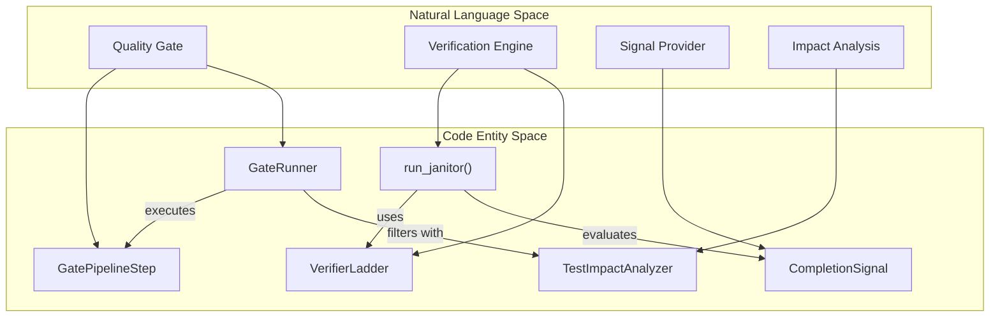
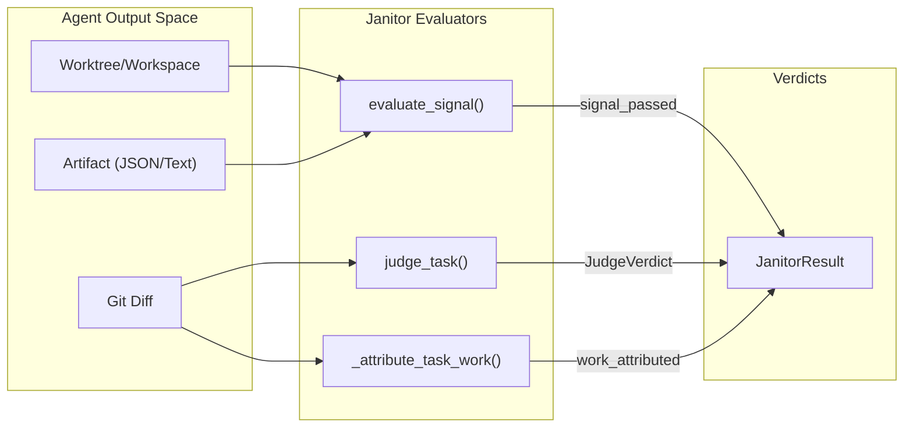

<!-- source: DeepWiki mcp.deepwiki.com · repo sipyourdrink-ltd/bernstein · page 7.1 Janitor, Gate Runner, and Completion Signals · fetched 2026-10-27 -->

# Janitor, Gate Runner, and Completion Signals

Relevant source files

The following files were used as context for generating this wiki page:

- [docs/operations/artifacts.md](docs/operations/artifacts.md)
- [docs/sdd/upgrade-task-ownership.md](docs/sdd/upgrade-task-ownership.md)
- [scripts/test_impact.py](scripts/test_impact.py)
- [src/bernstein/core/cost/cost.py](src/bernstein/core/cost/cost.py)
- [src/bernstein/core/lineage/artifact_record.py](src/bernstein/core/lineage/artifact_record.py)
- [src/bernstein/core/lineage/figure_grounding.py](src/bernstein/core/lineage/figure_grounding.py)
- [src/bernstein/core/orchestration/orchestrator_evolve.py](src/bernstein/core/orchestration/orchestrator_evolve.py)
- [src/bernstein/core/orchestration/run_session.py](src/bernstein/core/orchestration/run_session.py)
- [src/bernstein/core/quality/auto_formatter.py](src/bernstein/core/quality/auto_formatter.py)
- [src/bernstein/core/quality/benchmark_gate.py](src/bernstein/core/quality/benchmark_gate.py)
- [src/bernstein/core/quality/cross_model_verifier.py](src/bernstein/core/quality/cross_model_verifier.py)
- [src/bernstein/core/quality/fast_path.py](src/bernstein/core/quality/fast_path.py)
- [src/bernstein/core/quality/gate_commands.py](src/bernstein/core/quality/gate_commands.py)
- [src/bernstein/core/quality/gate_runner.py](src/bernstein/core/quality/gate_runner.py)
- [src/bernstein/core/quality/janitor.py](src/bernstein/core/quality/janitor.py)
- [src/bernstein/core/quality/retrospective.py](src/bernstein/core/quality/retrospective.py)
- [src/bernstein/core/quality/test_impact.py](src/bernstein/core/quality/test_impact.py)
- [src/bernstein/core/tasks/batch_api.py](src/bernstein/core/tasks/batch_api.py)
- [src/bernstein/core/tasks/figures.py](src/bernstein/core/tasks/figures.py)
- [src/bernstein/evolution/applicator.py](src/bernstein/evolution/applicator.py)
- [tests/pentest/test_incident_containment.py](tests/pentest/test_incident_containment.py)
- [tests/unit/cli/test_artifact_verify_cmd.py](tests/unit/cli/test_artifact_verify_cmd.py)
- [tests/unit/lineage/test_artifact_record.py](tests/unit/lineage/test_artifact_record.py)
- [tests/unit/lineage/test_figure_grounding.py](tests/unit/lineage/test_figure_grounding.py)
- [tests/unit/tasks/data/figure_tokenizer_vectors.json](tests/unit/tasks/data/figure_tokenizer_vectors.json)
- [tests/unit/tasks/test_figure_tokenizer.py](tests/unit/tasks/test_figure_tokenizer.py)
- [tests/unit/tasks/test_models_serialization.py](tests/unit/tasks/test_models_serialization.py)
- [tests/unit/test_auto_formatter.py](tests/unit/test_auto_formatter.py)
- [tests/unit/test_batch_api.py](tests/unit/test_batch_api.py)
- [tests/unit/test_commit_signing.py](tests/unit/test_commit_signing.py)
- [tests/unit/test_compaction_pipeline.py](tests/unit/test_compaction_pipeline.py)
- [tests/unit/test_coordinator_dashboard.py](tests/unit/test_coordinator_dashboard.py)
- [tests/unit/test_cross_agent_consistency.py](tests/unit/test_cross_agent_consistency.py)
- [tests/unit/test_cross_platform_ci.py](tests/unit/test_cross_platform_ci.py)
- [tests/unit/test_data_generators.py](tests/unit/test_data_generators.py)
- [tests/unit/test_gate_runner.py](tests/unit/test_gate_runner.py)
- [tests/unit/test_janitor.py](tests/unit/test_janitor.py)
- [tests/unit/test_orchestrator_evolve_upgrade_tasks.py](tests/unit/test_orchestrator_evolve_upgrade_tasks.py)
- [tests/unit/test_postmortem.py](tests/unit/test_postmortem.py)
- [tests/unit/test_quality_gates.py](tests/unit/test_quality_gates.py)
- [tests/unit/test_quality_gates_v2.py](tests/unit/test_quality_gates_v2.py)
- [tests/unit/test_security_incident_response.py](tests/unit/test_security_incident_response.py)
- [tests/unit/test_slo_cmd.py](tests/unit/test_slo_cmd.py)
- [tests/unit/test_test_impact.py](tests/unit/test_test_impact.py)
- [tests/unit/test_test_impact_alias_edges.py](tests/unit/test_test_impact_alias_edges.py)
- [tests/unit/test_test_impact_core.py](tests/unit/test_test_impact_core.py)
- [tests/unit/test_worktree.py](tests/unit/test_worktree.py)

The Bernstein verification subsystem ensures that agent outputs meet deterministic quality standards before they are merged into the main codebase. This is achieved through a multi-layered pipeline consisting of the **Janitor** verification engine, the **Gate Runner** execution environment, and a variety of **Completion Signals** that define success criteria.

## Overview of Verification Pipeline

The verification process is triggered when an agent transitions a task to a state indicating work completion. The system uses a deterministic approach, moving away from LLM-based coordination toward verifiable code execution [src/bernstein/core/quality/janitor.py:1-6]().

### Data Flow: Agent to Merge
1.  **Completion Signal Evaluation**: The Janitor validates completed work against defined completion signals such as `path_exists`, `test_passes`, or `api_responds` [src/bernstein/core/quality/janitor.py:27-33]().
2.  **Work Attribution**: Before accepting work, the Janitor attributes concrete repo work to the specific task being judged by checking git commits and `owned_files` [src/bernstein/core/quality/janitor.py:65-81]().
3.  **Gate Runner Execution**: The `GateRunner` executes a configured `pipeline` of steps (linting, type-checking, tests) in parallel while preserving report order [src/bernstein/core/gate_runner.py:33-65]().
4.  **Final Verdict**: The `run_janitor` function performs the final audit, integrating results from all signals and the `VerifierLadder` [src/bernstein/core/quality/janitor.py:34-40]().

### System Component Association
The following diagram bridges the natural language concepts to the specific code entities implementing them.

**Verification System Architecture**

Sources: [src/bernstein/core/gate_runner.py:12-14](), [src/bernstein/core/quality/janitor.py:27-40](), [src/bernstein/core/quality/test_impact.py:7-18]()

---

## The Gate Runner and Pipeline

The `GateRunner` is responsible for executing the `QualityGatesConfig`. It supports a modern `pipeline` of `GatePipelineStep` objects that define the CI-in-a-box experience for agents [src/bernstein/core/gate_runner.py:12-14]().

### Key Features
*   **Parallel Execution**: The runner uses `asyncio` to run independent gates simultaneously while ensuring that "required" gates block the overall pass status [tests/unit/test_gate_runner.py:33-65]().
*   **Test Impact Analysis**: To optimize speed, the `TestImpactAnalyzer` performs incremental analysis to select only the tests affected by a specific change [src/bernstein/core/quality/test_impact.py:1-5]().
*   **Caching**: Results are cached based on the content hash of the affected files. If a file's content hasn't changed, the gate result is reused [tests/unit/test_gate_runner.py:154-182]().
*   **Timeouts**: Gates support timeouts; a timeout on a `required` gate blocks the task, while an optional gate failure allows the task to proceed [tests/unit/test_gate_runner.py:106-136]().

### Test Impact Analysis Implementation
The analyzer builds a directed graph of imports to determine reachability. It handles:
*   **Dotted Imports**: Maps source file paths to dotted module names [src/bernstein/core/quality/test_impact.py:108-121]().
*   **Module Aliases**: Discovers module-level redirect tables to follow legacy dotted paths [src/bernstein/core/quality/test_impact.py:43-61]().
*   **Workflow Dependencies**: Automatically selects tests that pin GitHub Actions workflows if the workflow YAML is modified [src/bernstein/core/quality/test_impact.py:36-41]().

Sources: [src/bernstein/core/quality/test_impact.py:161-171](), [tests/unit/test_gate_runner.py:33-150]()

---

## Completion Signals and Specialized Gates

Bernstein utilizes various signals to determine if a task is truly "Done".

### 1. File and Path Signals
*   **path_exists**: Verifies a file or directory was created. Supports glob patterns (e.g., `packages/*/test.ts`) and an opt-in fuzzy basename fallback [tests/unit/test_janitor.py:50-89]().
*   **file_contains**: Checks for specific strings or patterns within a file, providing evidence of real work [src/bernstein/core/quality/janitor.py:104-117]().

### 2. Artifact Mode Criteria
For non-coding tasks (reports, datasets), Bernstein uses **Artifact Mode**. The Janitor evaluates signals against the produced artifact's canonical bytes rather than the filesystem [docs/operations/artifacts.md:58-63]().
*   **hash_stable**: Verifies the artifact matches a specific SHA256 content hash [docs/operations/artifacts.md:83-84]().
*   **schema_valid**: Ensures JSON/JSONL output adheres to a declared schema [src/bernstein/core/quality/janitor.py:127-127]().
*   **figures_grounded**: Proves figures in a report trace back to signed sources [src/bernstein/core/quality/janitor.py:113-115]().

### 3. LLM Judge
When signals are ambiguous, the Janitor can invoke an **LLM Judge** (typically Claude Sonnet). The judge receives the task description and the `git diff` to provide a verdict [src/bernstein/core/quality/janitor.py:48-62]().
*   **Confidence Threshold**: Verdicts below 0.7 confidence are flagged for human review [src/bernstein/core/quality/janitor.py:60-60]().
*   **Retry Logic**: The system supports retries if the judge provides a malformed response [src/bernstein/core/quality/janitor.py:49-49]().

**Completion Signal Flow**

Sources: [src/bernstein/core/quality/janitor.py:168-172](), [src/bernstein/core/quality/janitor.py:27-33](), [docs/operations/artifacts.md:9-16]()

---

## Janitor Logic and Verification Tiers

The Janitor is the final authority on task completion. It prevents "rubber-stamping" of empty work by enforcing strict attribution rules.

### Work Attribution
To prevent misattribution, the Janitor ensures that the task being judged actually produced changes. It rejects any non-research task that has an empty attributed diff [src/bernstein/core/quality/janitor.py:65-81]().
*   **Nontrivial Signals**: If a task has no attributed diff but passes a "nontrivial" signal (like `test_passes` or `figures_grounded`), it may be accepted with a warning instead of a hard rejection [src/bernstein/core/quality/janitor.py:96-117]().

### Verifier Ladder
For sensitive operations, the Janitor uses a `VerifierLadder` to record evidence at different tiers of rigor:
*   **TierRecord**: Captures the specific verifier used, the timestamp, and the canonical hash of the state [src/bernstein/core/quality/verifier_ladder.py:35-40]().
*   **Upgrade Verification**: For `UPGRADE_PROPOSAL` tasks, the Janitor performs specialized verification of the upgrade execution before allowing a merge [src/bernstein/core/quality/janitor.py:3-4]().

### Diminishing Returns and Evolve Mode
In `evolve` mode, the Janitor's results feed back into the `AdaptiveGovernor`. If multiple cycles pass with no successful changes (consecutive empty cycles), the system applies an exponential backoff to the evolution loop [src/bernstein/core/orchestration/orchestrator_evolve.py:154-162]().

Sources: [src/bernstein/core/quality/janitor.py:82-92](), [src/bernstein/core/orchestration/orchestrator_evolve.py:74-88](), [src/bernstein/core/quality/verifier_ladder.py:34-40]()

---

