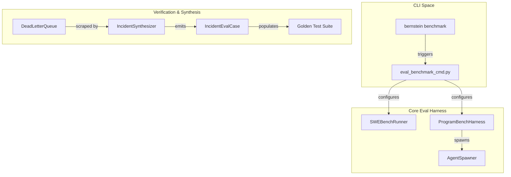

<!-- source: DeepWiki mcp.deepwiki.com · repo sipyourdrink-ltd/bernstein · page 7.2 Benchmarking and Evaluation · fetched 2026-10-27 -->

# Benchmarking and Evaluation

<details>
<summary>Relevant source files</summary>

The following files were used as context for generating this wiki page:

- [benchmarks/bench_orchestrator.py](benchmarks/bench_orchestrator.py)
- [benchmarks/bench_task_store.py](benchmarks/bench_task_store.py)
- [benchmarks/swe_bench/run.py](benchmarks/swe_bench/run.py)
- [docs/assets/ascii_logo.md](docs/assets/ascii_logo.md)
- [docs/eval/yaml-harness.md](docs/eval/yaml-harness.md)
- [docs/operations/audit-diagnose.md](docs/operations/audit-diagnose.md)
- [docs/quality/consensus-scoring.md](docs/quality/consensus-scoring.md)
- [docs/security/audit-log.md](docs/security/audit-log.md)
- [src/bernstein/cli/commands/audit_cmd.py](src/bernstein/cli/commands/audit_cmd.py)
- [src/bernstein/cli/commands/eval_benchmark_cmd.py](src/bernstein/cli/commands/eval_benchmark_cmd.py)
- [src/bernstein/compliance/__init__.py](src/bernstein/compliance/__init__.py)
- [src/bernstein/compliance/evidence_pack.py](src/bernstein/compliance/evidence_pack.py)
- [src/bernstein/core/communication/direct.py](src/bernstein/core/communication/direct.py)
- [src/bernstein/core/devops/trend_scan.py](src/bernstein/core/devops/trend_scan.py)
- [src/bernstein/core/lifecycle/hook_filter.py](src/bernstein/core/lifecycle/hook_filter.py)
- [src/bernstein/core/persistence/action_cache.py](src/bernstein/core/persistence/action_cache.py)
- [src/bernstein/core/quality/pr_review_aggregator.py](src/bernstein/core/quality/pr_review_aggregator.py)
- [src/bernstein/core/quality/review_consensus.py](src/bernstein/core/quality/review_consensus.py)
- [src/bernstein/core/replay/diagnose.py](src/bernstein/core/replay/diagnose.py)
- [src/bernstein/core/replay/diagnose_signals.py](src/bernstein/core/replay/diagnose_signals.py)
- [src/bernstein/core/replay/diagnosis_receipt.py](src/bernstein/core/replay/diagnosis_receipt.py)
- [src/bernstein/core/replay/diff.py](src/bernstein/core/replay/diff.py)
- [src/bernstein/core/routes/api_v1.py](src/bernstein/core/routes/api_v1.py)
- [src/bernstein/eval/__init__.py](src/bernstein/eval/__init__.py)
- [src/bernstein/eval/incident_synthesizer.py](src/bernstein/eval/incident_synthesizer.py)
- [tests/chaos/README.md](tests/chaos/README.md)
- [tests/chaos/test_server_restart.py](tests/chaos/test_server_restart.py)
- [tests/conftest.py](tests/conftest.py)
- [tests/integration/README.md](tests/integration/README.md)
- [tests/integration/conftest.py](tests/integration/conftest.py)
- [tests/integration/test_criterion_profile_routing.py](tests/integration/test_criterion_profile_routing.py)
- [tests/integration/test_full_lifecycle.py](tests/integration/test_full_lifecycle.py)
- [tests/integration/test_openclaw_bridge_flow.py](tests/integration/test_openclaw_bridge_flow.py)
- [tests/integration/test_plan_execution.py](tests/integration/test_plan_execution.py)
- [tests/unit/core/replay/test_diagnose.py](tests/unit/core/replay/test_diagnose.py)
- [tests/unit/core/replay/test_diagnose_cli.py](tests/unit/core/replay/test_diagnose_cli.py)
- [tests/unit/eval/test_yaml_runner.py](tests/unit/eval/test_yaml_runner.py)
- [tests/unit/quality/test_pr_review_aggregator.py](tests/unit/quality/test_pr_review_aggregator.py)
- [tests/unit/quality/test_review_consensus.py](tests/unit/quality/test_review_consensus.py)
- [tests/unit/test_app_factory_isolation.py](tests/unit/test_app_factory_isolation.py)
- [tests/unit/test_direct_channels.py](tests/unit/test_direct_channels.py)
- [tests/unit/test_evidence_pack.py](tests/unit/test_evidence_pack.py)
- [tests/unit/test_sonar_regex_concision.py](tests/unit/test_sonar_regex_concision.py)
- [tests/unit/test_task_store.py](tests/unit/test_task_store.py)

</details>


Bernstein provides a comprehensive evaluation framework designed to measure agent performance, orchestration latency, and merge success rates. This system spans from local unit-level benchmarks to large-scale integration with industry standards like SWE-Bench and ProgramBench.

## ProgramBench

`ProgramBench` is Bernstein's internal sandbox for high-fidelity agent evaluation using a partial-credit subprocess assertion model. It allows for testing agents against specific coding problems where success is measured by the number of passing assertions in a hardened environment.

### Implementation Details
- **Sandbox Isolation**: Execution occurs within the `SandboxBackend` infrastructure (Docker, E2B, or Worktree) to prevent side effects during evaluation [src/bernstein/cli/commands/eval_benchmark_cmd.py:179-190]().
- **Partial Credit**: The `ProgramBenchHarness` parses subprocess output to assign scores based on the ratio of successful assertions, allowing for "partial credit" even if a task is not fully resolved [src/bernstein/cli/commands/eval_benchmark_cmd.py:195-201]().
- **Data Flow**:
    1. The `ProgramBenchHarness` initializes with a problem specification [src/bernstein/cli/commands/eval_benchmark_cmd.py:204-209]().
    2. An agent is spawned via the `AgentSpawner` into a dedicated worktree.
    3. The agent attempts the task, and the harness executes the verification script to capture `stdout`/`stderr`.
    4. Results are persisted to `.sdd/metrics/programbench_results.jsonl` [src/bernstein/cli/commands/eval_benchmark_cmd.py:228-230]().

### Component Association
| Natural Language Concept | Code Entity | File Reference |
|:---|:---|:---|
| Eval Sandbox | `ProgramBenchHarness` | [src/bernstein/cli/commands/eval_benchmark_cmd.py:196-196]() |
| Result Container | `TaskResult` | [src/bernstein/cli/commands/eval_benchmark_cmd.py:197-197]() |
| Persistence Logic | `save_results` | [src/bernstein/cli/commands/eval_benchmark_cmd.py:200-200]() |

**Sources:** [src/bernstein/cli/commands/eval_benchmark_cmd.py](), [src/bernstein/core/spawner.py:46-46]()

---

## SWE-Bench Integration

Bernstein supports the **SWE-Bench** (Software Engineering Benchmark) for evaluating agents on real-world GitHub issues.

- **Harness**: The `SWEBenchRunner` maps SWE-Bench tasks into Bernstein `Task` models and handles dataset loading (lite vs. full subsets) [src/bernstein/cli/commands/eval_benchmark_cmd.py:53-57]().
- **Execution**: The `run_instance` method executes the standard orchestrator tick loop, measuring how multi-agent coordination improves solve rates [src/bernstein/cli/commands/eval_benchmark_cmd.py:81-82]().
- **Metrics**: Aggregates `resolve_rate`, `cost_per_task`, and `time_per_task` [src/bernstein/cli/commands/eval_benchmark_cmd.py:94-101]().
- **Reporting**: Generates per-model breakdowns to compare different LLM backends [src/bernstein/cli/commands/eval_benchmark_cmd.py:103-118]().

**Sources:** [src/bernstein/cli/commands/eval_benchmark_cmd.py](), [benchmarks/swe_bench/run.py]()

---

## The Eval Harness

The evaluation harness is a three-tier system used to run comparative benchmarks (A/B testing) between different models or adapter configurations.

### 1. ab_runner
The `ab_runner` executes the same task across two different configurations and captures performance metrics, cost, and result quality [src/bernstein/cli/commands/eval_benchmark_cmd.py:4-5]().

### 2. Scenario Runner
The `scenario_runner` loads complex multi-step workflows to test the orchestrator's ability to handle dependencies and merge conflicts. It is often used to benchmark `TaskStore` performance and persistence latency [benchmarks/bench_task_store.py:1-10]().

### 3. Incident Synthesizer
The `IncidentSynthesizer` converts dead-letter queue (DLQ) entries and CI failures into regression eval cases [src/bernstein/eval/incident_synthesizer.py:1-7]().
- **Minimization**: Keeps only the smallest prompt/tool sequence that reproduces a failure [src/bernstein/eval/incident_synthesizer.py:12-15]().
- **Severity**: Ranks incidents from `P0` (security/data loss) to `P2` (flaky) [src/bernstein/eval/incident_synthesizer.py:24-29]().

### Eval Data Flow

**Sources:** [src/bernstein/cli/commands/eval_benchmark_cmd.py](), [src/bernstein/eval/incident_synthesizer.py](), [benchmarks/bench_task_store.py]()

---

## Golden Test Suite

The Golden Test Suite consists of curated tasks with known "perfect" solutions.

- **Incident-to-Eval**: Failed tasks are automatically synthesized into new regression tests under `src/bernstein/eval/cases/incidents/` [src/bernstein/eval/incident_synthesizer.py:5-7]().
- **Redaction**: The `IncidentSynthesizer` uses the `pii_output_gate` to ensure no sensitive data enters the benchmark corpus [src/bernstein/eval/incident_synthesizer.py:53-54]().
- **Determinism**: The suite relies on stable content hashes for de-duplication [src/bernstein/eval/incident_synthesizer.py:18-20]().

**Sources:** [src/bernstein/eval/incident_synthesizer.py](), [src/bernstein/core/security/pii_output_gate.py]()

---

## Audit and Compliance Verification

Bernstein provides specialized tools to verify the integrity of the evaluation and production environment.

- **Audit Chain**: Uses HMAC-SHA256 (RFC 2104) to sign every orchestrator action, ensuring evaluation results haven't been tampered with [src/bernstein/cli/commands/audit_cmd.py:3-8]().
- **Merkle Seal**: The `seal` command computes a Merkle root across audit files to provide a cryptographic checkpoint of the system state [src/bernstein/cli/commands/audit_cmd.py:121-129]().
- **Evidence Packs**: The `build_evidence_pack` function generates reviewer-friendly zip bundles mapped to standards like the **EU AI Act** (Article 12/13/15) [src/bernstein/compliance/evidence_pack.py:1-5]().

### System Component Map
```mermaid
graph LR
    subgraph "Natural Language Space"
        "Benchmark Run"
        "Audit Verification"
        "Compliance Export"
    end

    subgraph "Code Entity Space"
        "Benchmark Run" --> EB_CMD["eval_benchmark_cmd.py"]
        "Audit Verification" --> AUD_CMD["audit_cmd.py"]
        "Compliance Export" --> EVP["evidence_pack.py"]
        
        AUD_CMD --> MS["Merkle Seal"]
        EB_CMD --> PB["ProgramBenchHarness"]
        EVP --> AC["Audit Chain"]
    end
```

**Sources:** [src/bernstein/cli/commands/audit_cmd.py](), [src/bernstein/compliance/evidence_pack.py](), [docs/security/audit-log.md]()

---

