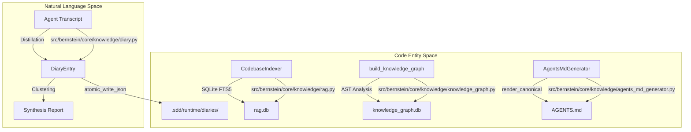
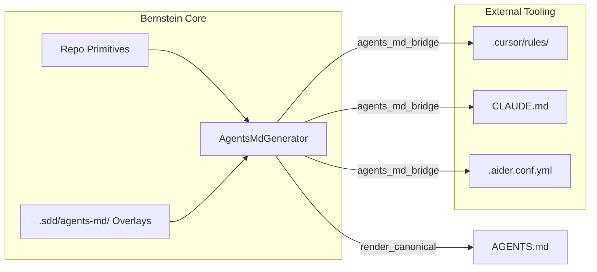

<!-- source: DeepWiki mcp.deepwiki.com · repo sipyourdrink-ltd/bernstein · page 9.1 Knowledge Base and Memory Layer · fetched 2026-10-27 -->

# Knowledge Base and Memory Layer

Relevant source files

The following files were used as context for generating this wiki page:

- [.cursor/rules/directory-context.mdc](.cursor/rules/directory-context.mdc)
- [docs/concepts/fingerprint-memoization.md](docs/concepts/fingerprint-memoization.md)
- [src/bernstein/adapters/AGENTS.md](src/bernstein/adapters/AGENTS.md)
- [src/bernstein/adapters/mock.py](src/bernstein/adapters/mock.py)
- [src/bernstein/cli/AGENTS.md](src/bernstein/cli/AGENTS.md)
- [src/bernstein/core/knowledge/agents_md_generator.py](src/bernstein/core/knowledge/agents_md_generator.py)
- [src/bernstein/core/knowledge/knowledge_graph.py](src/bernstein/core/knowledge/knowledge_graph.py)
- [src/bernstein/core/knowledge/rag.py](src/bernstein/core/knowledge/rag.py)
- [src/bernstein/core/lineage/AGENTS.md](src/bernstein/core/lineage/AGENTS.md)
- [src/bernstein/core/persistence/fingerprint.py](src/bernstein/core/persistence/fingerprint.py)
- [src/bernstein/core/routes/observability.py](src/bernstein/core/routes/observability.py)
- [src/bernstein/core/routes/status_dashboard.py](src/bernstein/core/routes/status_dashboard.py)
- [tests/unit/test_agents_md_generator.py](tests/unit/test_agents_md_generator.py)
- [tests/unit/test_audit_004_guards_removed.py](tests/unit/test_audit_004_guards_removed.py)
- [tests/unit/test_cli_demo.py](tests/unit/test_cli_demo.py)
- [tests/unit/test_fingerprint.py](tests/unit/test_fingerprint.py)
- [tests/unit/test_knowledge_graph.py](tests/unit/test_knowledge_graph.py)
- [tests/unit/test_lifecycle_transitions.py](tests/unit/test_lifecycle_transitions.py)
- [tests/unit/test_mock_adapter.py](tests/unit/test_mock_adapter.py)
- [tests/unit/test_queue_depth_tracking.py](tests/unit/test_queue_depth_tracking.py)
- [tests/unit/test_quickstart_poll.py](tests/unit/test_quickstart_poll.py)
- [tests/unit/test_rag_memo_invalidation.py](tests/unit/test_rag_memo_invalidation.py)
- [tests/unit/test_sonar_final_style_hygiene.py](tests/unit/test_sonar_final_style_hygiene.py)
- [tests/unit/test_status_dashboard_task_rows.py](tests/unit/test_status_dashboard_task_rows.py)
- [tests/unit/test_task_store_property.py](tests/unit/test_task_store_property.py)
- [tests/unit/test_tick_concurrency.py](tests/unit/test_tick_concurrency.py)
- [tests/unit/test_timeout_behavior.py](tests/unit/test_timeout_behavior.py)

The Knowledge Base and Memory Layer provides Bernstein with a persistent, cross-task cognitive state. Unlike simple agent logs, this layer distills raw transcripts into structured insights, manages a long-term semantic store in SQLite, and synchronizes project-wide conventions across multiple AI coding assistants via RAG and canonical documentation generation.

## Architectural Overview

The memory system is partitioned into three functional tiers:
1.  **Episodic Memory (The Knowledge Diary):** Per-task reflections captured at the end of every task lifecycle.
2.  **Semantic Memory (SQLite Store):** A persistent, queryable database for long-term learnings, impact analysis, and cross-task knowledge.
3.  **Project Context (AGENTS.md):** A generated "Single Source of Truth" that bridges the Bernstein internal state with external agent environments (Cursor, Claude Code, Aider).

### Data Flow: From Transcript to Knowledge

The following diagram illustrates how raw agent activity and codebase structure are transformed into structured knowledge.

**Knowledge Transformation Pipeline**

Sources: [src/bernstein/core/knowledge/diary.py:1-18](), [src/bernstein/core/knowledge/rag.py:1-10](), [src/bernstein/core/knowledge/knowledge_graph.py:1-12](), [src/bernstein/core/knowledge/agents_md_generator.py:1-16]()

---

## Codebase Indexing and RAG

Bernstein uses a lightweight, local RAG (Retrieval-Augmented Generation) system to help agents navigate large codebases without exhaustive searching.

### CodebaseIndexer (SQLite FTS5)
The `CodebaseIndexer` implements keyword search using SQLite's FTS5 (BM25 ranking). It processes files with `INDEXABLE_EXTENSIONS` [src/bernstein/core/knowledge/rag.py:32-53]() while ignoring noisy directories like `.git` or `node_modules` [src/bernstein/core/knowledge/rag.py:56-74]().

*   **AST-Aware Chunking:** For Python files, `_extract_python_chunks` uses the `ast` module to split source code into logical units (functions and classes) [src/bernstein/core/knowledge/rag.py:112-170]().
*   **BM25 Ranking:** Search results return a `SearchResult` containing file paths, line ranges, and relevance scores [src/bernstein/core/knowledge/rag.py:80-99]().

### Knowledge Graph and Impact Analysis
The `knowledge_graph.py` module builds a SQLite-backed semantic graph of the codebase to perform impact analysis [src/bernstein/core/knowledge/knowledge_graph.py:1-12]().

*   **Node Kinds:** Nodes represent `file`, `function`, `class`, or `method` [src/bernstein/core/knowledge/knowledge_graph.py:28-28]().
*   **Edge Kinds:** Relationships include `defines`, `imports`, `calls`, and `inherits` [src/bernstein/core/knowledge/knowledge_graph.py:29-29]().
*   **Impact Query:** The `query_impact` function allows agents to see downstream files affected by a change in a specific module [src/bernstein/core/knowledge/knowledge_graph.py:69-82]().

Sources: [src/bernstein/core/knowledge/rag.py:112-170](), [src/bernstein/core/knowledge/knowledge_graph.py:28-66]()

---

## Fingerprint Memoization

To ensure performance and correctness during expensive recomputes (like RAG re-embedding or graph extraction), Bernstein uses a content-addressed fingerprinting system.

### The Invalidation Rule
The cache key is derived as: `hash(canonicalized_input) XOR hash(function_AST)` [src/bernstein/core/persistence/fingerprint.py:4-4](). This ensures that if the logic of the extractor changes (e.g., a bug fix in the parser), the cache is automatically invalidated [src/bernstein/core/persistence/fingerprint.py:6-9]().

### Code Dependencies
Call sites can declare dependencies on external modules using `depends_on`. For example, the knowledge graph memoization depends on the `ast_symbol_graph` module [src/bernstein/core/knowledge/knowledge_graph.py:113-118](). If any code in `ast_symbol_graph.py` changes, the `file_sha` alone is no longer enough to hit the cache [docs/concepts/fingerprint-memoization.md:62-80]().

Sources: [src/bernstein/core/persistence/fingerprint.py:1-28](), [docs/concepts/fingerprint-memoization.md:1-22]()

---

## AGENTS.md and Bridge Generation

To prevent context drift between different AI tools (e.g., Cursor rules vs. Aider config), the `AgentsMdGenerator` derives a canonical `AGENTS.md` file from the repository's source of truth.

### Generation Logic
The generator walks the repository and builds `AgentsMdSection` records from:
*   Module docstrings and `pyproject.toml` metadata.
*   The `PACKAGE_META` map for architectural overview [src/bernstein/core/knowledge/agents_md_generator.py:124-136]().
*   Custom overlays stored in `.sdd/agents-md/`.

### Multi-Agent Context Mapping
The `agents_md_bridge` (companion to the generator) translates the canonical IR into tool-specific formats:
*   **Cursor:** Generates `.cursor/rules/*.mdc` with appropriate `target_globs` [src/bernstein/core/knowledge/agents_md_generator.py:101-103]().
*   **Claude Code:** Formats rules for Anthropic's CLI agent.
*   **Aider:** Syncs `.aider.conf.yml` conventions.

**Context Synchronization Diagram**

Sources: [src/bernstein/core/knowledge/agents_md_generator.py:1-45](), [src/bernstein/core/knowledge/agents_md_generator.py:85-117]()

---

## Memory Observability

The `observability.py` route provides live insights into agent performance and memory effectiveness.

*   **EffectivenessScorer:** Tracks how successful different model/role configurations are based on historical task outcomes [src/bernstein/core/routes/observability.py:157-161]().
*   **Context Recommendations:** The `RecommendationEngine` (exposed via `/observability/recommendations`) suggests relevant files or memories for current tasks based on active session context [src/bernstein/core/routes/observability.py:17-17]().

Sources: [src/bernstein/core/routes/observability.py:157-184](), [src/bernstein/core/routes/status_dashboard.py:143-160]()

---

## CLI Commands

The memory and knowledge systems are managed via two primary CLI groups:

### `bernstein memory`
*   `add`: Manually insert a fact into the SQLite store.
*   `list`: View stored memories with filtering.
*   `search`: Perform a RAG-based search over the codebase index.

### `bernstein knowledge`
*   `graph build`: Trigger a full rebuild of the `knowledge_graph.db`.
*   `impact <file>`: Query the knowledge graph for downstream impact of a file change.
*   `sync`: Regenerate the canonical `AGENTS.md` and sync all bridge files (Cursor, Claude, etc.) [src/bernstein/core/knowledge/agents_md_generator.py:55-55]().

Sources: [src/bernstein/cli/graph_cmd.py:11-12](), [src/bernstein/core/knowledge/agents_md_generator.py:1-16]()

---

