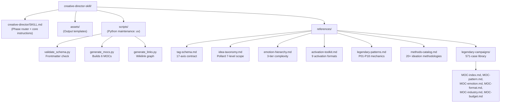
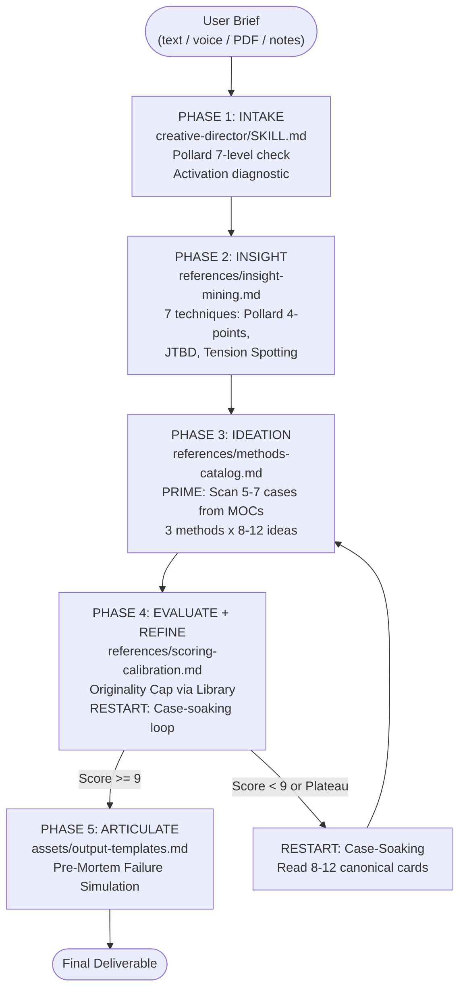
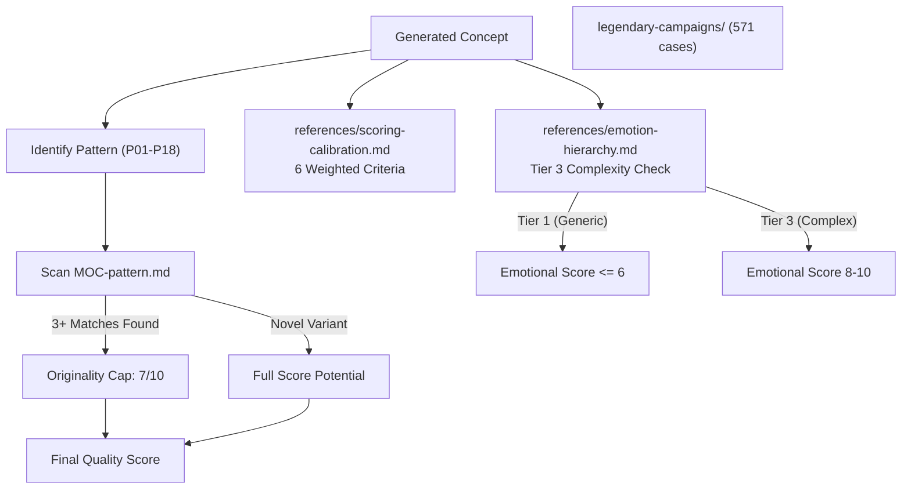

<!-- source: DeepWiki mcp.deepwiki.com · repo smixs/creative-director-skill · page 1 Overview · fetched 2026-10-27 -->

# Overview

Relevant source files

The following files were used as context for generating this wiki page:

- [LICENSE](LICENSE)
- [NOTICE](NOTICE)
- [README.md](README.md)
- [README.ru.md](README.ru.md)
- [creative-director/SKILL.md](creative-director/SKILL.md)

This page describes what the Creative Director Skill repository is, what problem it solves, and how its components fit together at a high level. For detailed documentation of any specific phase or module, follow the links in the relevant sections below.

---

## Purpose

The Creative Director Skill v2.0 is a structured, AI-executable creative process implemented entirely in markdown files. It accepts a brief in any format — text, voice transcript, PDF, raw notes — and runs a five-phase pipeline that produces scored, refined advertising concepts in a presentation-ready format.

It is not a general brainstorming prompt. It enforces the workflow discipline used by top-tier advertising agencies (Droga5, Wieden+Kennedy, Mother): insight before ideas, structured methodology over free association, and **calibration against the canon** of 571 legendary campaigns to ensure originality.

The repository is platform-agnostic. The entire logic lives in markdown files with no runtime dependencies. It works with Claude Projects, Claude Code, Cursor, Windsurf, or any AI agent that accepts structured instructions. For details on integration and invocation, see [Getting Started](#1.1).

Sources: [README.md:1-16](), [creative-director/SKILL.md:1-16]()

---

## What's New in v2.0

Version 2.0 introduces a massive expansion of the underlying data and evaluation frameworks:

*   **571-Case Library:** A structured database of legendary campaigns (1950–2025) used for pattern calibration and originality benchmarking [README.md:35]().
*   **17-Axis Schema:** Every card in the library is tagged across 17 axes (pattern, industry, emotion, budget, etc.) [README.md:36]().
*   **6 MOCs (Maps of Content):** Automated indices for fast lookup by pattern, emotion, format, industry, budget, and chronology [README.md:37]().
*   **Pollard 7-Level Taxonomy:** Replaces the 3-level system to precisely define idea scope (Business, Brand, Tagline, Advertising, Campaign, Non-advertising, Execution) [README.md:40]().
*   **3-Tier Emotion Hierarchy:** A system for moving from generic "happy" ads to Tier 3 complex, contradictory emotions like "bittersweet pride" [README.md:41]().
*   **Activation Toolkit:** Specific logic for non-advertising ideas and PR stunts with a "remove the campaign" diagnostic test [README.md:42]().
*   **Empirical Originality Cap:** If 3+ canonical cases use the same mechanic, the originality score is capped at 7 to prevent AI hallucination of "newness" [README.md:57]().
*   **Case-Soaking RESTART:** A recovery loop for when ideation plateaus, requiring the system to read 8-12 canonical cards to reset its standards [README.md:58]().
*   **Pre-Mortem:** A final failure-simulation step before delivery to surface likely risks [README.md:43]().

Sources: [README.md:33-43]()

---

## Repository File Structure

**Diagram: File tree mapped to system roles**

Sources: [README.md:81-97](), [README.ru.md:81-97]()

`SKILL.md` is the sole orchestration point [creative-director/SKILL.md:27-37](). It sequences operations and delegates to reference modules. The `scripts/` directory contains Python tools managed via `uv` to maintain the integrity of the campaign library and its MOCs [README.md:39](). For a detailed map of all reference files, see [Reference Files Guide](#7.1). For details on the maintenance scripts, see [Maintenance Scripts](#7.2).

---

## The Five-Phase Pipeline

**Diagram: Phase sequence with Canon Calibration**

Sources: [README.md:50-59](), [creative-director/SKILL.md:27-133]()

### Phase Summary

| Phase | Core Logic File | Key V2.0 Addition |
|---|---|---|
| **1 · Intake** | `SKILL.md` | Pollard 7-level `idea_type` classification [creative-director/SKILL.md:52-62]() |
| **2 · Insight** | `references/insight-mining.md` | Cultural/Category/Human Tension spotting [creative-director/SKILL.md:78-81]() |
| **3 · Ideation** | `references/methods-catalog.md` | **Canon Priming**: Scanning relevant MOCs before generating [creative-director/SKILL.md:99]() |
| **4 · Evaluate** | `references/scoring-calibration.md` | **Originality Cap**: 3+ existing cases = max score 7 [README.md:57]() |
| **5 · Articulate** | `assets/output-templates.md` | **Pre-Mortem**: Simulate failure before final delivery [README.md:43]() |

For a high-level description of the entire creative pipeline, see [Creative Process](#2). Each phase is detailed in its respective child page (e.g., [Phase 1: Intake](#2.1)).

---

## Evaluation & Originality Calibration

**Diagram: Empirical Originality and Scoring**

Sources: [README.md:57](), [creative-director/SKILL.md:143-149]()

The system uses three parallel scoring approaches:
1.  **6 Weighted Criteria:** Originality (0.25), Strategic Fit (0.20), Emotional Response (0.20), Feasibility (0.15), Scalability (0.10), Simplicity (0.10) [creative-director/SKILL.md:143-149]().
2.  **HumanKind Scale:** 1–10 scale measuring human impact [README.md:57]().
3.  **Grey Scale:** 1–10 scale measuring creative "heat" [README.md:57]().

For a detailed reference on scoring and calibration, see [Evaluation System](#4).

---

## Methodology Credits

The system is built on published methodologies from named practitioners:

*   **SIT / TRIZ** — Jacob Goldenberg / Genrich Altshuller
*   **Lateral Thinking / PO** — Edward de Bono
*   **7-Level Taxonomy / Four Points** — Mark Pollard [creative-director/SKILL.md:77]()
*   **JTBD** — Clayton Christensen [creative-director/SKILL.md:78]()
*   **Storytelling** — Nancy Duarte (Sparkline), Pixar (Story Spine)
*   **Creative Constitution** — Voskresensky / IKRA

Sources: [README.md:26-27](), [creative-director/SKILL.md:77-78]()

---

## License

The Creative Director Skill is licensed under the Creative Commons Attribution 4.0 International (CC BY 4.0) license [LICENSE:1-2](). Any use, copy, or derivative of this skill, including the 571-case legendary campaigns library, must credit Serge Shima as the author [NOTICE:4-9](). For full details, see [Licensing and Attribution](#1.2).

Sources: [LICENSE:1-2](), [NOTICE:4-9]()

---

