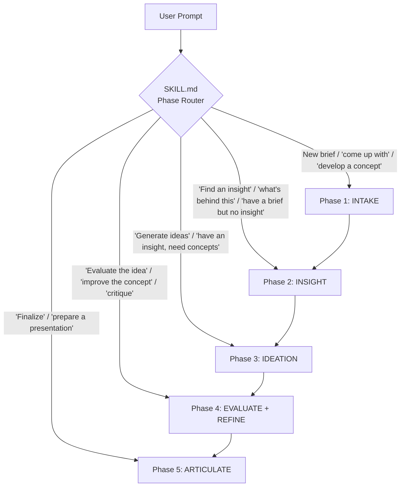

<!-- source: DeepWiki mcp.deepwiki.com · repo smixs/creative-director-skill · page 1.1 Getting Started · fetched 2026-10-27 -->

# Getting Started

<details>
<summary>Relevant source files</summary>

The following files were used as context for generating this wiki page:

- [README.md](README.md)
- [README.ru.md](README.ru.md)
- [creative-director/SKILL.md](creative-director/SKILL.md)

</details>


This page covers how to install the Creative Director Skill into a supported AI environment and how to invoke it. It includes all five invocation modes, example prompts, and a reference for structuring a brief. For a conceptual explanation of what the skill does and why it works the way it does, see [Overview](#1). For a detailed walkthrough of the five phases the skill executes after it receives a brief, see [Ideation Methods Reference](#3).

---

## Supported Platforms

The skill is implemented entirely in Markdown. There is no compiled code, no server, and no API key required beyond your chosen AI platform. Any AI agent that accepts structured system instructions can run it.

| Platform | Integration Method |
|---|---|
| **Claude Projects** | Upload all files to the Project knowledge base. |
| **Claude Code** | Clone repo; files are read from the working directory. |
| **Cursor / Windsurf** | Clone repo; files are read from the working directory. |
| **GPTs / Gemini** | Provide `SKILL.md` as system context; include reference files in context window. |

**Known Limitation (Claude Projects):** In Project mode, Claude may auto-trigger the skill instructions if the system prompt is set to follow the `SKILL.md` file. Ensure the context window includes the `references/` directory for full functionality.

Sources: [README.md:11-16](), [creative-director/SKILL.md:5-12]()

---

## Installation

### Step 1: Clone the Repository

```bash
git clone https://github.com/smixs/creative-director-skill.git
```

All operational files live under `creative-director/`. The root-level `README.md` and `README.ru.md` are documentation only.

### Step 2: Platform-Specific Setup

**Claude Projects**
Upload every file inside `creative-director/` to the Project's knowledge base. `SKILL.md` is the entry point. It references other files using `[[wikilinks]]`, which Claude Projects resolves automatically across the uploaded knowledge base.

**Claude Code / Cursor / Windsurf**
Copy or keep the `creative-director/` folder in your project. The AI agent reads the files from the filesystem.

Sources: [README.md:83-97](), [creative-director/SKILL.md:52-52]()

---

## File Layout and Entry Point

The diagram below maps the file structure to the function each file serves during execution, bridging the natural language request to specific code-like markdown entities.

**Diagram: System Architecture and Data Flow**

```mermaid
graph TD
    subgraph "Entry Point"
        SKILL["creative-director/SKILL.md"]
    end

    subgraph "Phase 1: Intake"
        TAX["references/idea-taxonomy.md"]
        ACT["references/activation-toolkit.md"]
    end

    subgraph "Phase 2: Insight"
        IM["references/insight-mining.md"]
    end

    subgraph "Phase 3: Ideation"
        MSM["references/method-selection-matrix.md"]
        MC["references/methods-catalog.md"]
        MOC_IND["references/legendary-campaigns/MOC-industry.md"]
        MOC_BUD["references/legendary-campaigns/MOC-budget.md"]
        MOC_EMO["references/legendary-campaigns/MOC-emotion.md"]
        LP["references/legendary-patterns.md"]
        SF["references/storytelling-frameworks.md"]
    end

    subgraph "Phase 4: Evaluate"
        SC["references/scoring-calibration.md"]
        CC["references/creative-constitution.md"]
        TAX_P4["references/idea-taxonomy.md"]
        LP_P4["references/legendary-patterns.md"]
    end

    SKILL -->|"classify via Pollard 7-level"| TAX
    SKILL -->|"activation diagnostic"| ACT
    SKILL -->|"load techniques"| IM
    SKILL -->|"prime against MOCs"| MOC_IND
    SKILL -->|"prime against MOCs"| MOC_BUD
    SKILL -->|"prime against MOCs"| MOC_EMO
    SKILL -->|"select triplet"| MSM
    MSM -->|"execute method"| MC
    SKILL -->|"tension test"| LP
    SKILL -->|"load storytelling frameworks"| SF
    SKILL -->|"score ideas"| SC
    SKILL -->|"apply feedback rules"| CC
    SKILL -->|"idea level check"| TAX_P4
    SKILL -->|"pattern calibration / Pre-Mortem"| LP_P4
```



Sources: [creative-director/SKILL.md:40-128](), [README.md:50-59](), [README.md:83-97]()

---

## Invocation Modes

The `Phase Router` in `SKILL.md` determines the starting point based on user input.

**Diagram: Invocation Mode Routing**



Sources: [creative-director/SKILL.md:27-37]()

### Mode 1: Full Creative Cycle
Provide a brief. The skill runs all five phases sequentially.
*   **Prompt:** "Come up with a campaign for [brand]. Target audience: [who]. Business objective: [objective]. Communication objective: [objective]. Constraints: [constraints]."

### Mode 2: Insight Mining Only
Skips to Phase 2 to find the human truth or tension.
*   **Prompt:** "Find a consumer insight for [category]. The context is [context]. Target audience: [who]."

### Mode 3: Evaluate an Existing Idea
Jumps to Phase 4 to score a concept against the 6 weighted criteria and HumanKind scale.
*   **Prompt:** "Evaluate this concept: [description]. The brief objective was [goal]. Target audience: [who]. Product: [product]."

### Mode 4: Quick Ideation
Rapid generation of concepts (often 5-8) without the full recursive refinement loop.
*   **Prompt:** "Need 5 quick concepts for [brand] social media posts about [topic]. The insight is [insight]."

### Mode 5: Activation / PR-Stunt
Specifically targets the `non_advertising` level of the Pollard taxonomy.
*   **Prompt:** "Develop a PR-stunt or brand utility for [brand] that solves [problem]. Target audience: [who]. Business objective: [objective]."

Sources: [creative-director/SKILL.md:32-37](), [README.md:50-59]()

---

## What to Include in a Brief

The `Phase 1: INTAKE` process extracts specific DNA from your prompt. Including these fields reduces follow-up questions.

| Field | Code Reference / Taxonomy | Requirement |
|---|---|---|
| **Product/Brand** | `Product/brand, category` | Mandatory |
| **Target Audience** | `Target audience (who makes the decision? age, income, what frustrates them?)` | Mandatory |
| **Objectives** | `Business objective and communication objective` | Mandatory |
| **Constraints** | `Constraints (budget, channels, timelines, tone of voice, must-have elements)` | Recommended |
| **Competitive Context** | `Competitive context` | Recommended |
| **Required Idea Level** | `Pollard 7-level taxonomy` | Determined by skill, can be specified |
| **Activation Test** | `non_advertising` vs `execution` | If brief mentions activation/stunt/utility |

**Pollard 7-Level Taxonomy Reference:**
The skill classifies every request into one of these levels: `business`, `brand`, `tagline`, `advertising`, `campaign`, `non_advertising`, or `execution`. This is detailed in `[[references/idea-taxonomy.md]]`. The skill also performs an `Activation diagnostic` if the brief mentions activation/stunt/utility, using `[[references/activation-toolkit.md]]`.

Sources: [creative-director/SKILL.md:40-66](), [creative-director/references/idea-taxonomy.md:1-15](), [creative-director/references/activation-toolkit.md:1-10]()

---

## Known Limitations

*   **Auto-trigger:** In Claude Projects, the AI may start the process as soon as a brief-like document is uploaded.
*   **Unverified URLs:** All `source_url` fields in the `legendary-campaigns/` library are unverified due to environment egress blocks during the enrichment phase.
*   **Static Library:** The 571-case library is a static markdown collection. To update it, you must run the maintenance scripts in `creative-director/scripts/`.
*   **No Media/Production:** The skill is a creative director, not a media planner or producer. It does not handle budget allocation or production timelines.

Sources: [creative-director/SKILL.md:14-16](), [README.md:27-28]()

---

