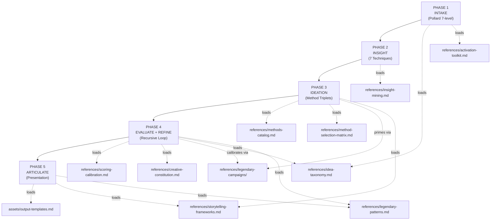
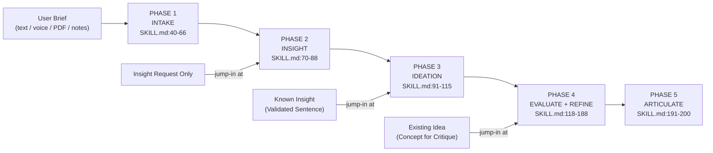
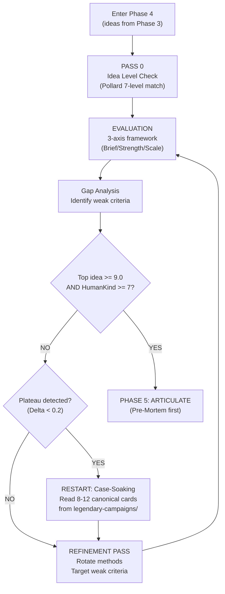

<!-- source: DeepWiki mcp.deepwiki.com · repo smixs/creative-director-skill · page 2 Creative Process · fetched 2026-10-27 -->

# Creative Process

Relevant source files

The following files were used as context for generating this wiki page:

- [README.md](README.md)
- [assets/pipeline-phases.webp](assets/pipeline-phases.webp)
- [creative-director/SKILL.md](creative-director/SKILL.md)

This page describes the five-phase creative pipeline as a whole: how the phases connect, the valid entry points that allow bypassing earlier phases, the recursive refinement loop in Phase 4, and the conditions that terminate the loop. It is the navigational parent for the individual phase pages.

For platform integration and invocation examples, see [Getting Started](#1.1). For the detailed scoring system that operates inside Phase 4, see [Evaluation System](#4). For output format selection in Phase 5, see [Output & Narrative Formats](#6).

---

## Pipeline Overview

The creative process is defined in [`creative-director/SKILL.md`](creative-director/SKILL.md) as a five-phase sequence. Each phase maps to a distinct set of reference files that the orchestrator loads when that phase executes.

**Five-Phase Pipeline — File Mapping**

Sources: [`creative-director/SKILL.md:27-200`](), [`README.md:37-43`]()

---

## Phase Router

Before executing any phase, `SKILL.md` determines the starting phase from the user's request context. This logic is defined at [`creative-director/SKILL.md:27-36`]().

**Phase Router — Trigger Conditions**

| Trigger pattern | Starting phase |
|---|---|
| New brief / request / "come up with" / "develop a concept" | Phase 1: INTAKE |
| "Find an insight" / "what's behind this" / have a brief but no insight | Phase 2: INSIGHT |
| "Generate ideas" / have an insight, need concepts | Phase 3: IDEATION |
| "Evaluate the idea" / "improve the concept" / "critique" | Phase 4: EVALUATE + REFINE |
| "Finalize" / "prepare a presentation" | Phase 5: ARTICULATE |
| Full cycle (standard request) | Phase 1 → 2 → 3 → 4 → 5 |

Sources: [`creative-director/SKILL.md:27-36`]()

---

## Entry Points

The pipeline supports multiple valid entry points. A user can jump in at Phase 2, 3, or 4 depending on what they already have. The default entry is Phase 1.

**Pipeline Entry Points**

Sources: [`creative-director/SKILL.md:27-36`](), [`README.md:61`]()

---

## Phase Summaries

| Phase | Label | Primary output | Reference files loaded |
|---|---|---|---|
| 1 | INTAKE | Extracted brief DNA, `idea_type` (Pollard 7-level) | `references/idea-taxonomy.md`, `references/activation-toolkit.md` |
| 2 | INSIGHT | Standardized insight sentence + tension | `references/insight-mining.md` |
| 3 | IDEATION | 8–12 ideas (primed against canon) | `references/methods-catalog.md`, `references/method-selection-matrix.md`, `references/storytelling-frameworks.md` |
| 4 | EVALUATE + REFINE | Scored top-3, RESTART (case-soaking), Pre-Mortem | `references/scoring-calibration.md`, `references/creative-constitution.md`, `references/legendary-campaigns/`, `references/idea-taxonomy.md`, `references/legendary-patterns.md` |
| 5 | ARTICULATE | Formatted deliverable with narrative framing | `assets/output-templates.md`, `references/storytelling-frameworks.md`, `references/legendary-patterns.md` |

Each phase is documented in detail in its own child page: [Phase 1: Intake](#2.1), [Phase 2: Insight Mining](#2.2), [Phase 3: Ideation](#2.3), [Phase 4: Evaluate & Refine](#2.4), [Phase 5: Articulate](#2.5).

Sources: [`creative-director/SKILL.md:40-200`]()

---

## The Recursive Refinement Loop (Phase 4)

Phase 4 is non-linear. After an initial evaluation, the system refines ideas through up to 5 passes. If a plateau is reached, it triggers a **RESTART** via **Case-Soaking**.

**Phase 4 Recursive Loop & Restart Logic**

Sources: [`creative-director/SKILL.md:118-188`](), [`README.md:42`]()

---

## Exit Conditions

Three conditions terminate the recursive loop and advance to Phase 5. These are defined at [`creative-director/SKILL.md:183-188`]().

| Condition | Label | Action |
|---|---|---|
| Top idea score `>= 9.0` AND `HumanKind >= 7` | **(a) Threshold met** | Exit immediately; deliver final output |
| 5 passes completed without reaching threshold | **(b) Max passes** | Deliver best available with honest assessment |
| Two consecutive passes with score delta `< 0.2` | **(c) Plateau** | Trigger RESTART or exit with plateau note |

Sources: [`creative-director/SKILL.md:183-188`]()

---

## Anti-Pitfall Rules

Several hard constraints enforce process integrity. These are defined at [`creative-director/SKILL.md:251-262`]().

| Rule | Scope | What it prevents |
|---|---|---|
| **Insight-first** | Phase 2 | No ideation without a validated consumer tension. |
| **Structural methods** | Phase 3 | Prevents "free association" by forcing SIT, TRIZ, etc. |
| **Empirical Originality Cap** | Phase 4 | If 3+ canonical cases use the mechanic, score is capped at 7. |
| **Anti-inflation rules** | Phase 4 | No 9+ scores without naming a real-world benchmark. |
| **Kill Your Darlings** | Phase 4 | The system must argue against its own favorite ideas. |
| **Pre-Mortem** | Phase 5 | Simulating failure modes before final delivery. |

Sources: [`creative-director/SKILL.md:251-262`](), [`README.md:52-60`]()

---

## Idea Level Scope (Pollard 7-Level)

The system uses the **Pollard 7-level taxonomy** to ensure the creative output matches the business requirement. Mismatches (e.g., an `execution` for a `brand` brief) are flagged at Phase 4 PASS 0.

| Level | Description | Lifespan |
|---|---|---|
| `business` | What the company does that is novel | Foundational |
| `brand` | What the company stands for | 5-10+ years |
| `tagline` | Brand idea compressed to ≤5 words | 5-10+ years |
| `advertising` | Central thought across all comms | 3-5 years |
| `campaign` | Seasonal or product-specific expression | 3-12 months |
| `non_advertising` | Activation/utility that lives without ads | Variable |
| `execution` | Specific channel/format mechanic | Days-weeks |

Sources: [`creative-director/references/idea-taxonomy.md:7-141`](), [`creative-director/SKILL.md:52-62`]()

---

