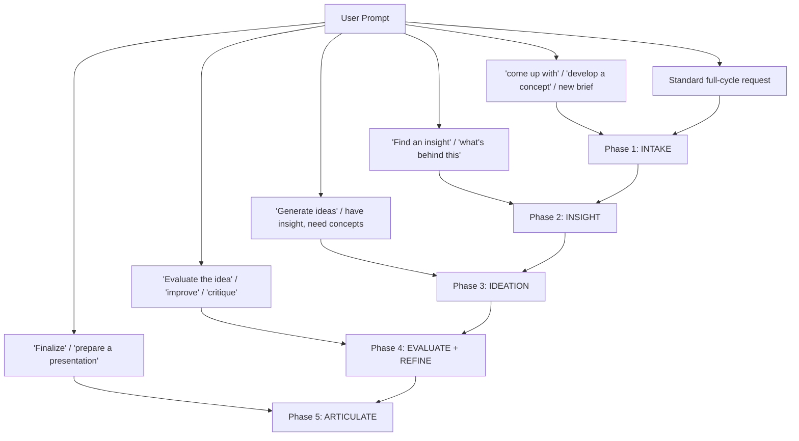
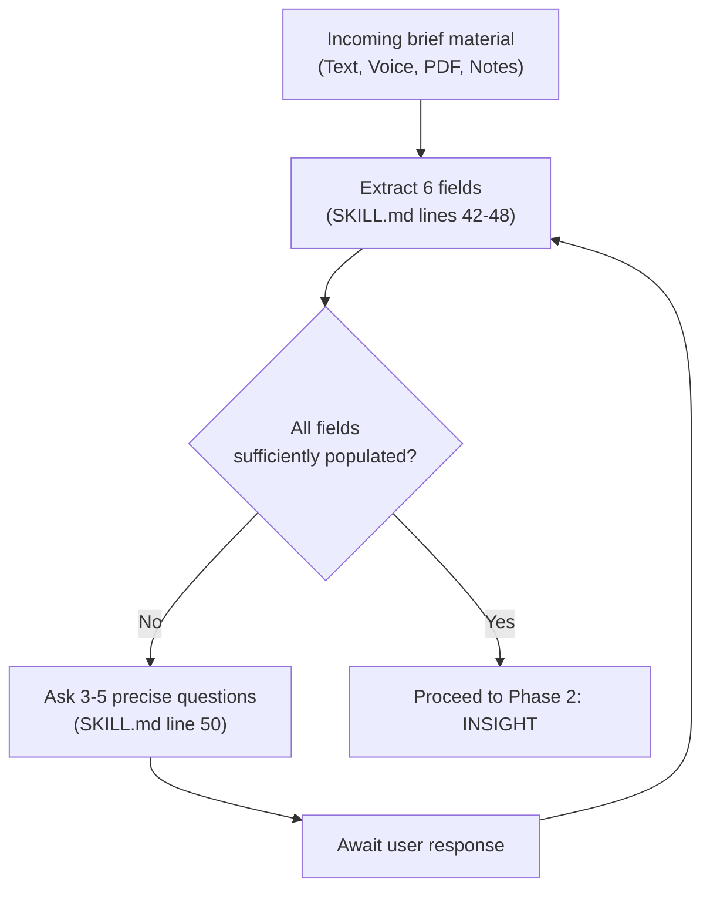
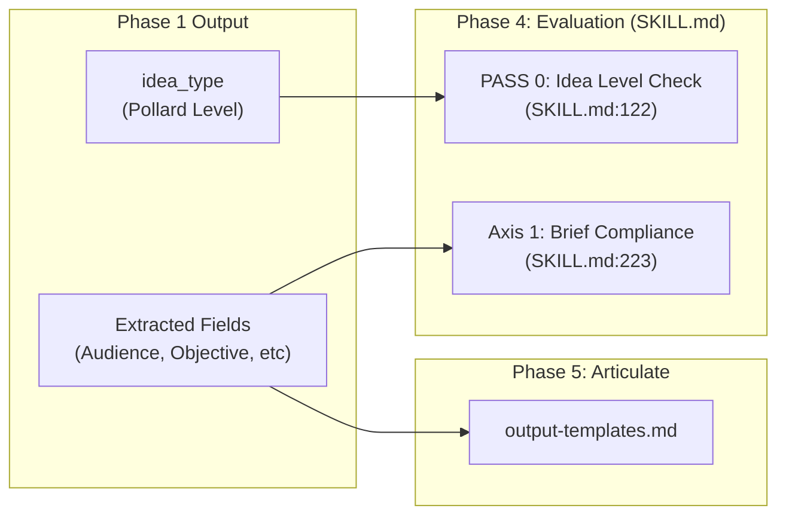

<!-- source: DeepWiki mcp.deepwiki.com · repo smixs/creative-director-skill · page 2.1 Phase 1: Intake · fetched 2026-10-27 -->

# Phase 1: Intake

Relevant source files

The following files were used as context for generating this wiki page:

- [creative-director/SKILL.md](creative-director/SKILL.md)
- [creative-director/references/activation-toolkit.md](creative-director/references/activation-toolkit.md)
- [creative-director/references/idea-taxonomy.md](creative-director/references/idea-taxonomy.md)

Phase 1: Intake is the first phase of the five-phase creative pipeline. Its purpose is to parse an incoming brief — in any format — and extract the structured information the system needs to proceed. This phase identifies the product DNA, audience tensions, and determines the required idea scope using the **Pollard 7-level taxonomy**.

---

## Role in the Pipeline

Phase 1 is triggered whenever the system receives a new brief or a request that implies starting from scratch. The phase router in `SKILL.md` routes any prompt containing phrases like "come up with," "develop a concept," or a raw brief to this phase first.

**Diagram: Phase Router Decision Tree (SKILL.md)**

Sources: [creative-director/SKILL.md:27-37]()

---

## Extracted Fields

The system systematically extracts six categories of information from the incoming material. All fields are required to establish the strategic "anchor" before ideation begins.

| Field | What Is Extracted | Code Reference |
|---|---|---|
| **Product / Category** | Product name, brand, and industry vertical. | [creative-director/SKILL.md:43-43]() |
| **Target Audience** | Decision-maker profile: age, income, and frustrations/pain points. | [creative-director/SKILL.md:44-44]() |
| **Objectives** | Both the Business Objective and the Communication Objective. | [creative-director/SKILL.md:45-45]() |
| **Constraints** | Budget, channels, timelines, tone of voice, and must-have elements. | [creative-director/SKILL.md:46-46]() |
| **Competitive Context** | Key competitors and category conventions. | [creative-director/SKILL.md:47-47]() |
| **Idea Level** | Classification using the Pollard 7-level taxonomy. | [creative-director/SKILL.md:48-48]() |

Sources: [creative-director/SKILL.md:42-48]()

---

## Handling Incomplete Data

If the incoming material does not provide enough information to populate all fields, the system does not proceed. Instead, it asks **3–5 precise questions**. The questioning style is designed to avoid "strategic fluff" by targeting specific data points.

> **Rule:** Not "tell me about the TA," but "who makes the purchase decision? age, income, main pain point?"

Sources: [creative-director/SKILL.md:50-50]()

**Diagram: Intake Completeness Gate**

Sources: [creative-director/SKILL.md:42-50]()

---

## The Pollard 7-Level Taxonomy

A core function of Intake is mapping the brief to the `idea_type` enum defined in the 17-axis schema. This prevents "level mismatch"—where a client asks for a brand platform but receives a single execution. The full reference for this taxonomy is `references/idea-taxonomy.md`.

| Level (`idea_type`) | When Required | Lifespan |
|---|---|---|
| `business` | New venture, repositioning the entire company. | Years (foundational) |
| `brand` | Rebranding, brand platform development. | 5–10+ years |
| `tagline` | Crystallizing the brand idea into ≤5 words. | 5–10+ years |
| `advertising` | Central creative thought across all communications. | 3–5 years |
| `campaign` | Seasonal campaign, product launch, promo. | 3–12 months |
| `non_advertising` | Activation/utility/cultural object that lives without ads. | Varies |
| `execution` | One-off channel/format/mechanic. | Days–weeks |

Sources: [creative-director/references/idea-taxonomy.md:7-143](), [creative-director/SKILL.md:52-62]()

### Activation Diagnostic Test

When a brief mentions an activation, stunt, or utility, the system applies a specific diagnostic test to distinguish between a standalone concept and a mere ad vehicle. This test is detailed in `references/activation-toolkit.md`.

> **The Test:** "Remove the campaign — does it still have meaning?"
> - **Yes:** Classified as `non_advertising`. The thing has standalone value (e.g., *Spotify Wrapped*).
> - **No:** Classified as `execution`. It is a creative vehicle for an ad message (e.g., *Oreo-patterned referee jerseys*).

Sources: [creative-director/references/activation-toolkit.md:9-28](), [creative-director/SKILL.md:64-64]()

---

## Data Flow & Downstream Impact

The output of Phase 1 is a structured brief summary that serves as the "source of truth" for the recursive refinement loop.

**Diagram: Intake Output to Code Entities**

Sources: [creative-director/SKILL.md:122-128](), [creative-director/SKILL.md:223-224]()

1.  **Phase 2 (Insight):** Uses audience pain points and competitive context to find tensions.
2.  **Phase 4 (Evaluate):** Uses the `idea_type` in **PASS 0** to verify if generated ideas match the required level (e.g., ensuring a `brand` brief didn't result in a mere `execution`). This check is performed at [creative-director/SKILL.md:122-128]().
3.  **Phase 5 (Articulate):** Populates the "Brief Summary" section of the final deliverable.

Sources: [creative-director/SKILL.md:122-128]()

---

