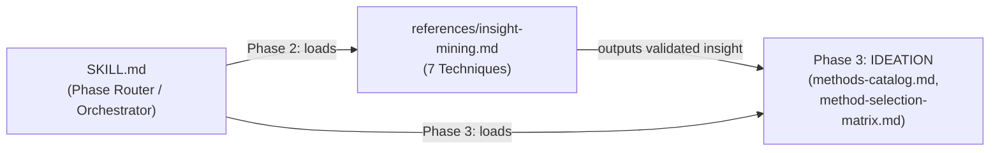

<!-- source: DeepWiki mcp.deepwiki.com · repo smixs/creative-director-skill · page 2.2 Phase 2: Insight Mining · fetched 2026-10-27 -->

# Phase 2: Insight Mining

<details>
<summary>Relevant source files</summary>

The following files were used as context for generating this wiki page:

- [creative-director/SKILL.md](creative-director/SKILL.md)
- [creative-director/references/insight-mining.md](creative-director/references/insight-mining.md)

</details>


Phase 2 is the mandatory insight discovery step in the five-phase creative pipeline. It transforms the structured brief extracted in Phase 1 into a single, validated insight sentence that anchors all ideation work in Phase 3. This page documents the seven techniques applied, the output format, and the quality gate that must be passed before proceeding.

For the overall pipeline flow and how phases connect, see [Creative Process](). For the Intake phase that produces the inputs consumed here, see [Phase 1: Intake](). For what happens to the validated insight downstream, see [Phase 3: Ideation]().

---

## Role in the Pipeline

Phase 2 is enforced as a hard prerequisite. The system's core principle is "insight before ideas." [creative-director/SKILL.md:21]()

The Phase Router in `SKILL.md` determines when Phase 2 runs:

| Trigger condition | Starting phase |
|---|---|
| New brief / "come up with" / "develop a concept" | Phase 1 → **Phase 2** → Phase 3 |
| "Find an insight" / "what's behind this" / brief but no insight | **Phase 2** directly |
| Already have an insight | Jump to Phase 3 |
| Already have an idea | Jump to Phase 4 |

[creative-director/SKILL.md:29-36]()

When Phase 2 is the entry point (e.g., a user requests insight mining only), the pipeline terminates after outputting the validated insight rather than continuing to ideation.

**Sources:** [creative-director/SKILL.md:21](), [creative-director/SKILL.md:29-36]()

---

## Inputs and Outputs

**Inputs consumed from Phase 1:**
- Product/brand and category.
- Target audience definition (decision-maker, age, income, pain points).
- Business objective and communication objective.
- Constraints (budget, channels, tone).
- Competitive context.
- Required idea level from **Pollard 7-level taxonomy**.

[creative-director/SKILL.md:42-52]()

**Output produced for Phase 3:**
- One validated insight sentence in the canonical format: `"[Audience] wants [X], but [Y stands in the way], because [Z]"`

[creative-director/SKILL.md:87]()

---

## Reference File

Phase 2 loads a single primary reference module:

```
Load: [[references/insight-mining.md]]
```

[creative-director/SKILL.md:72]()

This file contains the full specification for all seven techniques. `SKILL.md` references it at runtime; no other file loads `insight-mining.md` directly.

**Diagram: insight-mining.md loading and scope**



**Sources:** [creative-director/SKILL.md:72-88](), [creative-director/SKILL.md:91-93]()

---

## The Seven Techniques

`insight-mining.md` defines seven techniques applied in sequence. The first five form an ordered pipeline; techniques 6 and 7 act as a validation gate and a formatter.

**Diagram: technique sequence in insight-mining.md**

```mermaid
flowchart TD
    T1["1. Mark Pollard Four Points\nProblem → Insight → Advantage → Strategy"]
    T2["2. JTBD\nFunctional / Social / Emotional job layers"]
    T3["3. Tension Spotting\nCultural / Category / Human tension"]
    T4["4. HMW\n3 formulations: broad / medium / narrow"]
    T5["5. Abstraction Laddering\nOptimal rung: one above obvious"]
    T6["6. Assumption Mapping\n2x2: importance vs confidence"]
    T7["7. Insight Quality Test\n6-point checklist"]
    FMT["Insight Format\n\"[Audience] wants [X], but [Y], because [Z]\""]

    T1 --> T2
    T2 --> T3
    T3 --> T4
    T4 --> T5
    T5 --> T6
    T6 --> T7
    T7 -->|"passes all 6 checks"| FMT
    T7 -->|"fails 2+ checks"| T1
```

**Sources:** [creative-director/SKILL.md:74-88](), [creative-director/references/insight-mining.md:1-157]()

---

### Technique 1: Mark Pollard Four Points

A four-step sequential framework used to establish strategic logic. Each step must be derived from the previous one.

| Step | Definition |
|---|---|
| **Problem** | The real human or business problem, not a symptom. |
| **Insight** | A hidden truth everyone feels but no one has articulated. |
| **Advantage** | The single specific brand strength relevant to the insight. |
| **Strategy** | One directive sentence: *what* to do, not *how*. |

[creative-director/SKILL.md:76](), [creative-director/references/insight-mining.md:7-26]()

---

### Technique 2: JTBD (Jobs To Be Done)

Reframes the question from "what does the product do?" to "what job does the consumer hire this communication for?" Three job layers are analyzed:

- **Functional**: The physical action performed.
- **Social**: How it shapes external perception.
- **Emotional**: The internal feeling it produces.

[creative-director/SKILL.md:77](), [creative-director/references/insight-mining.md:29-44]()

---

### Technique 3: Tension Spotting

Finds the gap between how things should be and how they actually are. Three tension types are specified:

| Type | Definition |
|---|---|
| **Cultural** | What society says vs. what it actually does. |
| **Category** | What the category promises vs. what it delivers. |
| **Human** | What a person wants vs. what stands in the way. |

[creative-director/SKILL.md:78-81](), [creative-director/references/insight-mining.md:49-67]()

---

### Technique 4: HMW (How Might We)

Produces three question formulations at different levels of abstraction: **Broad**, **Medium**, and **Narrow**. The medium level is typically the most productive for campaign ideation.

[creative-director/SKILL.md:82](), [creative-director/references/insight-mining.md:70-91]()

The three HMW formulations generated here serve a downstream purpose: if Phase 4 reaches a scoring plateau or fails to meet the threshold, the system can **RESTART** with a *different* HMW from this set. [creative-director/SKILL.md:179-180]()

---

### Technique 5: Abstraction Laddering

Navigates the ladder between concrete and abstract to find the optimal problem frame.
- Moving **up** ("why?"): expands the solution space.
- Moving **down** ("how exactly?"): narrows to specifics.
**Rule**: The optimal rung is typically one level above the obvious.

[creative-director/SKILL.md:83](), [creative-director/references/insight-mining.md:94-110]()

---

### Technique 6: Assumption Mapping

Surfaces and stress-tests assumptions embedded in the brief. Assumptions are mapped on a 2x2 matrix of **Importance** vs **Confidence**. The "High Importance / Low Confidence" quadrant is the priority zone for insight mining.

[creative-director/references/insight-mining.md:113-127]()

---

### Technique 7: Insight Quality Test

A six-point checklist that acts as the quality gate.
- **Does this refresh one's view of the world?**
- **Does the person hear it and say "yes, exactly, but I've never put it that way"?**

[creative-director/SKILL.md:85](), [creative-director/references/insight-mining.md:130-142]()

---

## Output: The Insight Format

A validated insight is expressed as a single sentence in this canonical structure:

```
"[Audience] wants [X], but [Y stands in the way], because [Z]"
```

[creative-director/SKILL.md:87]()

The three-part structure enforces completeness:
- **X** — the desire.
- **Y** — the barrier.
- **Z** — the reason for the barrier (the "why" that provides depth).

**Sources:** [creative-director/SKILL.md:87](), [creative-director/references/insight-mining.md:145-156]()

---

## Data Flow Through the Technique Sequence

**Diagram: data entities flowing through insight-mining.md techniques**

```mermaid
flowchart TD
    BRIEF_DATA["Brief Data\n(product, audience, objective,\nconstraints, competitive context)"]

    subgraph IM_FILE["references/insight-mining.md"]
        MP["Mark Pollard Four Points\nProblem / Insight / Advantage / Strategy"]
        JTBD["JTBD\nFunctional / Social / Emotional jobs"]
        TS["Tension Spotting\nCultural / Category / Human tension"]
        HMW["HMW\nbroad / medium / narrow formulations"]
        AL["Abstraction Laddering\nup x2 → down x1"]
        AM["Assumption Mapping\n2x2 importance vs confidence"]
        QT["Insight Quality Test\n6-point checklist"]
    end

    INSIGHT_FMT["Validated Insight\n\"[Audience] wants X, but Y, because Z\""]
    PHASE3["Phase 3: IDEATION\n(methods-catalog.md)"]
    PHASE4["Phase 4: EVALUATE + REFINE\n(HMW restart pool)"]

    BRIEF_DATA --> MP
    MP --> JTBD
    JTBD --> TS
    TS --> HMW
    HMW --> AL
    AL --> AM
    AM --> QT
    QT -->|"passes"| INSIGHT_FMT
    QT -->|"fails 2+ checks"| MP

    INSIGHT_FMT --> PHASE3
    HMW -->|"HMW pool retained for restart"| PHASE4
```

**Sources:** [creative-director/references/insight-mining.md:1-157](), [creative-director/SKILL.md:72-88](), [creative-director/SKILL.md:176-182]()

---

