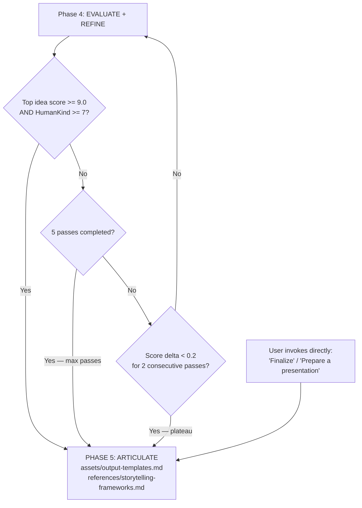
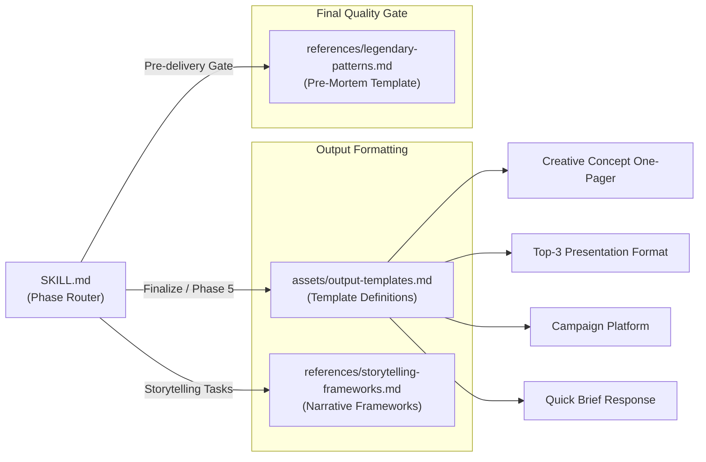
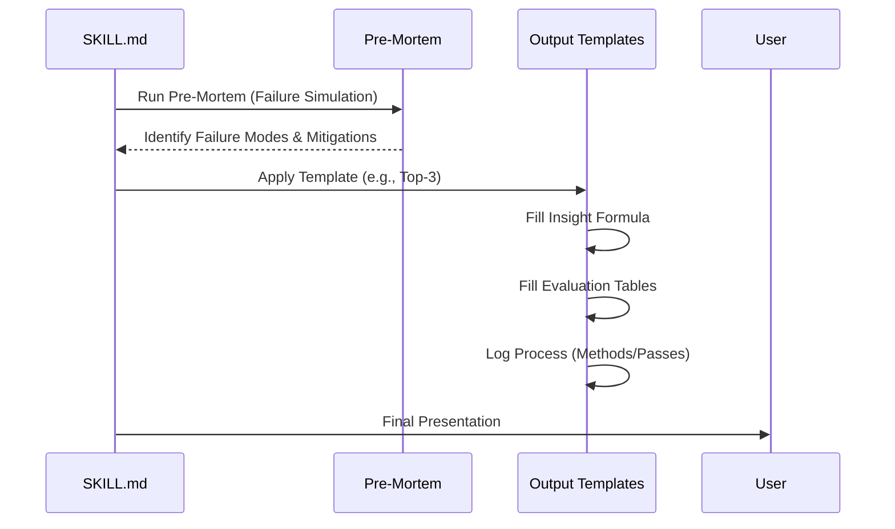

<!-- source: DeepWiki mcp.deepwiki.com · repo smixs/creative-director-skill · page 2.5 Phase 5: Articulate · fetched 2026-10-27 -->

# Phase 5: Articulate

Relevant source files

The following files were used as context for generating this wiki page:

- [creative-director/SKILL.md](creative-director/SKILL.md)
- [creative-director/assets/output-templates.md](creative-director/assets/output-templates.md)

Phase 5 is the final stage of the creative pipeline. Its purpose is to format the surviving top concepts into a structured deliverable using a predefined output template. This page documents the entry conditions, template selection logic, the four templates in `assets/output-templates.md`, the application of storytelling frameworks from `references/storytelling-frameworks.md`, and the mandatory **Pre-Mortem** step that precedes final delivery.

This page covers the formatting and output layer. For the evaluation logic that determines which concepts reach Phase 5, see [Phase 4: Evaluate & Refine](#3.4).

---

## Entry Conditions

Phase 5 is triggered from three exit paths in Phase 4, or directly by the user.

**Diagram: Entry Paths into Phase 5**

Sources: [creative-director/SKILL.md:178-200](), [creative-director/SKILL.md:34-36]()

---

## Module Dependencies

Phase 5 orchestrates the final output by loading template definitions and narrative frameworks.

**Diagram: Phase 5 Code Entity Map**

Sources: [creative-director/SKILL.md:35-36](), [creative-director/SKILL.md:191-200](), [creative-director/SKILL.md:202-205]()

---

## Pre-Mortem Step

Before final articulation, the system must perform a **Pre-Mortem**. This is a psychological safety check where the system imagines the campaign has failed and works backward to identify the most likely causes.

The Pre-Mortem uses the template defined in `legendary-patterns.md` [creative-director/references/legendary-patterns.md:251-263]():
1. **The Post-Mortem from the Future**: Imagine it is one year later and the campaign was a disaster.
2. **Failure Modes**: List 3-5 specific reasons why (e.g., "The cultural tension was too niche," "The mechanic was too complex for a 6-second skip").
3. **Mitigation**: Adjust the final articulation to address these risks.

Sources: [creative-director/SKILL.md:202-205](), [creative-director/references/legendary-patterns.md:251-263]()

---

## Template Selection

The template is chosen based on the task type identified during Phase 1 or the specific user request.

| Request Type | Template |
|---|---|
| Full creative brief (standard full cycle) | **Top-3 Presentation Format** |
| Single idea elaboration | **Creative Concept One-Pager** |
| Strategic platform / major campaign | **Campaign Platform** |
| Social post, banner, simple execution | **Quick Brief Response** |

Sources: [creative-director/assets/output-templates.md:198-207](), [creative-director/SKILL.md:195-199]()

---

## The Four Templates

### 1. Creative Concept One-Pager
Template for presenting a single idea with full development [creative-director/assets/output-templates.md:7-9]().

**Key Components:**
- **Insight**: One sentence following the `[audience] wants [X], but [Y stands in the way], because [Z]` format [creative-director/assets/output-templates.md:15]().
- **Idea**: The essence of the concept in one sentence [creative-director/assets/output-templates.md:18]().
- **Key Visual / Hero Execution**: Describes what the person sees in the first 3 seconds [creative-director/assets/output-templates.md:23-24]().
- **How It Lives**: Specific actions across multiple channels [creative-director/assets/output-templates.md:26-29]().
- **3 Executions**: Detailed descriptions of three specific executions [creative-director/assets/output-templates.md:31-34]().
- **Evaluation**: Includes scores (weighted, HumanKind, Grey) and a rationale [creative-director/assets/output-templates.md:36-40]().

Sources: [creative-director/assets/output-templates.md:7-47]()

### 2. Top-3 Presentation Format (Primary)
The primary working template for responding to a creative brief, presenting three ideas with scores, discarded directions, a recommendation, and a process description [creative-director/assets/output-templates.md:50-53]().

**Key Components:**
- **Brief**: A summary paragraph of the product/brand, target audience, objective, constraints, and channels [creative-director/assets/output-templates.md:57-58]().
- **Insight & Tension**: Insight follows the `[audience] wants X, but Y, because Z` format, and tension identifies cultural, category, or human tension [creative-director/assets/output-templates.md:61-64]().
- **Idea Structure**: For each of the three ideas, it includes Concept, Visualization, Media/Channels, Tagline, and a detailed evaluation table with scores for Originality, Strategic Fit, Emotional Response, Feasibility, Scalability, Simplicity, Weighted Score, HumanKind, and Grey, along with a rationale [creative-director/assets/output-templates.md:68-88]().
- **Discarded Directions**: At least two directions that were explored and why they were discarded [creative-director/assets/output-templates.md:102-105]().
- **Recommendation**: Which idea to develop, why, and what's needed next [creative-director/assets/output-templates.md:107-108]().
- **Process**: Records methods used, recursion passes, and the stop reason [creative-director/assets/output-templates.md:110-113]().

Sources: [creative-director/assets/output-templates.md:50-113]()

### 3. Campaign Platform
Template for a strategic campaign platform, used when the task requires a systemic approach including architecture, channel matrix, and results measurement [creative-director/assets/output-templates.md:123-125]().

**Key Components:**
- **Strategic Foundation**: Objective, Insight, Territory, and Positioning [creative-director/assets/output-templates.md:129-133]().
- **Concept**: Big Idea, Tagline, Visual Language, and Tone of Voice (with example phrase) [creative-director/assets/output-templates.md:135-139]().
- **Campaign Architecture**: A table mapping Big Idea, Campaign Ideas, and Key Executions to their respective channels [creative-director/assets/output-templates.md:141-147]().
- **Execution Matrix**: A table detailing Channel, Format, Essence, and KPI for each execution [creative-director/assets/output-templates.md:149-152]().
- **Measurement**: How Awareness, Engagement, Conversion, and Brand Lift will be measured [creative-director/assets/output-templates.md:154-158]().
- **Evaluation**: Score, HumanKind, Grey, and rationale [creative-director/assets/output-templates.md:160-161]().

Sources: [creative-director/assets/output-templates.md:123-162]()

### 4. Quick Brief Response
A lightweight format for quick tasks, presenting five concepts with scores and a recommendation [creative-director/assets/output-templates.md:171-174]().

**Key Components:**
- **Brief**: A short task description [creative-director/assets/output-templates.md:176]().
- **Insight**: One sentence [creative-director/assets/output-templates.md:178]().
- **5 Concepts**: Each with a name, 1-2 line description, and score [creative-director/assets/output-templates.md:181-185]().
- **Recommendation**: Which concept to choose and why [creative-director/assets/output-templates.md:188]().

Sources: [creative-director/assets/output-templates.md:171-189]()

---

## Storytelling Frameworks

If the task involves narrative (e.g., film scripts, long-form drama), Phase 5 applies one of six frameworks from `storytelling-frameworks.md` to structure the "Visualization" or "How it Lives" sections. The `SKILL.md` [creative-director/SKILL.md:96-96]() loads `references/storytelling-frameworks.md` for such tasks.

| Framework | Best For |
|---|---|
| **Story Spine** | Quick cause-and-effect (Pixar 8-line) |
| **Sparkline** | Contrast between "What is" and "What could be" |
| **Freytag's Pyramid** | Classic 5-act dramatic arc |
| **Monroe's Motivated Sequence** | Persuasion and Direct Response (5 stages) |
| **Hero's Journey** | Brand as the "Guide" for the customer "Hero" |

Sources: [creative-director/SKILL.md:96-96](), [creative-director/references/storytelling-frameworks.md:1-131]()

---

## Final Output Structure

Regardless of the template, the `SKILL.md` orchestration ensures the final response follows this logical flow:

**Diagram: Articulation Flow**

Sources: [creative-director/SKILL.md:292-311](), [creative-director/SKILL.md:202-205]()

---

