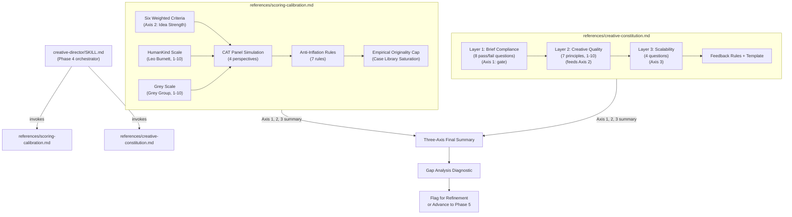
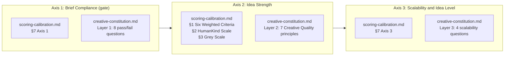

<!-- source: DeepWiki mcp.deepwiki.com · repo smixs/creative-director-skill · page 4 Evaluation System · fetched 2026-10-27 -->

# Evaluation System

Relevant source files

The following files were used as context for generating this wiki page:

- [assets/scoring-loop.webp](assets/scoring-loop.webp)
- [assets/why-averaged.webp](assets/why-averaged.webp)
- [creative-director/references/creative-constitution.md](creative-director/references/creative-constitution.md)

This page describes the complete evaluation architecture used in Phase 4 of the creative pipeline. It covers how the three parallel scoring systems operate, how they combine into a three-axis final summary, the empirical originality cap, and how the sub-systems relate to each other.

For the per-criterion scoring descriptors, calibration anchors, and anti-inflation rules, see [Scoring Calibration](#4.1). For the brief compliance checklist, creative quality principles, and feedback template, see [Creative Constitution](#4.2). For how Phase 4 uses this system recursively, see [Phase 4: Evaluate & Refine](#2.4).

---

## Overview

The evaluation system is implemented across two reference files:

| File | Role |
|---|---|
| `creative-director/references/scoring-calibration.md` | Six weighted criteria rubric, HumanKind Scale, Grey Scale, calibration anchors, anti-inflation rules, CAT panel simulation, and empirical originality cap. |
| `creative-director/references/creative-constitution.md` | Brief Compliance gate (Layer 1), Creative Quality principles (Layer 2), Scalability assessment (Layer 3), feedback rules and template. |

Both files are invoked during Phase 4 by `creative-director/SKILL.md`. They share an evaluation layer — the three-axis summary defined in `scoring-calibration.md` maps directly to the three layers of `creative-constitution.md`.

Sources: [creative-director/references/scoring-calibration.md:1-5](), [creative-director/references/creative-constitution.md:1-4]()

---

## System Architecture

**Diagram: Evaluation Sub-System Interactions**

Sources: [creative-director/references/scoring-calibration.md:197-249](), [creative-director/references/creative-constitution.md:1-10]()

---

## Three Parallel Scoring Systems

When a concept enters Phase 4, three scoring systems run independently before being combined.

### 1. Six Weighted Criteria

Defined in `scoring-calibration.md`. Each criterion is scored 1–10 and then multiplied by its weight to produce a single **Weighted Score**. For details on each criterion, see [Scoring Calibration](#4.1).

| Criterion | Weight | What It Measures |
|---|---|---|
| Originality | 0.25 | Novelty for the category and culture |
| Strategic Fit | 0.20 | Brief alignment and audience relevance |
| Emotional Response | 0.20 | Strength and specificity of the emotional reaction |
| Feasibility | 0.15 | Realizability within budget, timeline, resources |
| Scalability | 0.10 | Potential across time, channels, and markets |
| Simplicity | 0.10 | Speed of comprehension on first contact |

Interpretation thresholds from `scoring-calibration.md` [creative-director/references/scoring-calibration.md:207-212](): **8+** (Excellent), **6–7** (Good), **5–6** (Average), **Below 5** (Weak).

### 2. HumanKind Scale (Leo Burnett)

Defined in `scoring-calibration.md` [creative-director/references/scoring-calibration.md:77-94](). A 1–10 scale evaluating the idea's impact on people and culture. A score of **7+** (HumanKind Act) is considered Cannes-shortlist level. For detailed descriptors, see [Scoring Calibration](#4.1).

### 3. Grey Scale (Grey Group)

Defined in `scoring-calibration.md` [creative-director/references/scoring-calibration.md:98-115](). Focuses on the quality of the creative work itself, ranging from **1** (Toxic) to **10** (Grand Prix / Best in the World). For detailed descriptors, see [Scoring Calibration](#4.1).

Sources: [creative-director/references/scoring-calibration.md:7-115]()

---

## Three-Axis Final Summary

After the three parallel scoring systems produce their scores, the results are mapped onto three axes. This structure appears in `scoring-calibration.md` section 7 [creative-director/references/scoring-calibration.md:197-249]() and mirrors the three layers of `creative-constitution.md`.

**Diagram: Three-Axis Summary — File Mapping**

### Axis 1: Brief Compliance (Pass/Fail Gate)

This is a **binary filter**. Any single failure eliminates the concept from further evaluation. The eight questions from `creative-constitution.md` Layer 1 [creative-director/references/creative-constitution.md:7-82]() define the checkpoints, including: Is there an idea? Does it suit the audience? Is the brand voice preserved? For a detailed breakdown of these questions, see [Creative Constitution](#4.2).

### Axis 2: Idea Strength

The combined output of the Weighted Score, HumanKind Scale, and Grey Scale. The seven Creative Quality principles from `creative-constitution.md` Layer 2 [creative-director/references/creative-constitution.md:85-176]() (Insight Depth, Surprise, Simplicity, etc.) feed into this axis. For a detailed breakdown of these principles, see [Creative Constitution](#4.2).

### Axis 3: Scalability and Idea Level

Assesses the potential for development across time and channels. The **Idea Level Matching** check ensures the proposed concept matches the scope required by the brief (Big Idea vs. Campaign Idea vs. Execution Idea) [creative-director/references/scoring-calibration.md:224-249](). For details on the scalability questions, see [Creative Constitution](#4.2).

Sources: [creative-director/references/scoring-calibration.md:197-249](), [creative-director/references/creative-constitution.md:7-213]()

---

## Gap Analysis & Empirical Originality Cap

### Gap Analysis Diagnostic
After scores are combined, a gap analysis detects divergence between the CD, Strategist, Consumer, and Jury perspectives [creative-director/references/scoring-calibration.md:165-194](). If the discrepancy exceeds 2 points, a diagnostic flag is raised (e.g., "Clever but doesn't matter to people"). For more on the CAT Panel Simulation, see [Scoring Calibration](#4.1).

### Empirical Originality Cap
A critical feature in v2.0 is the **Empirical Originality Cap** [creative-director/references/scoring-calibration.md:133-142](). If an idea matches a pattern in the case library (e.g., P01-P18) that has reached high saturation (50+ cases), its Originality score is hard-capped.
*   **Saturation > 50 cases**: Originality cap = 6.
*   **Saturation > 100 cases**: Originality cap = 4.

This forces the system to move beyond "advertising clichés" and seek truly novel territories. For more on the originality cap and saturation, see [Scoring Calibration](#4.1).

Sources: [creative-director/references/scoring-calibration.md:133-142](), [creative-director/references/scoring-calibration.md:165-194]()

---

## Anti-Inflation Rules & Feedback

The system applies seven rules to prevent systematic score inflation [creative-director/references/scoring-calibration.md:145-162](), such as the **Specificity Test** (replace the brand with a competitor) and the **"Would I share this?" Test**. For a full list of anti-inflation rules, see [Scoring Calibration](#4.1).

Final feedback must follow the structured template in `creative-constitution.md` [creative-director/references/creative-constitution.md:247-283](), including a "GUT REACTION", "ON-BRIEF" status, and the "YES BUT WHAT IF..." forward-looking direction. For details on the feedback rules and template, see [Creative Constitution](#4.2).

Sources: [creative-director/references/scoring-calibration.md:145-162](), [creative-director/references/creative-constitution.md:247-283]()

---

