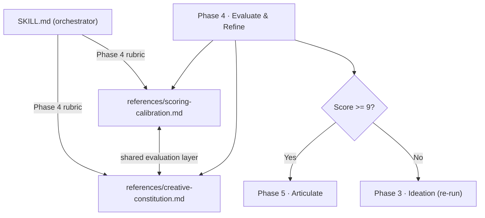
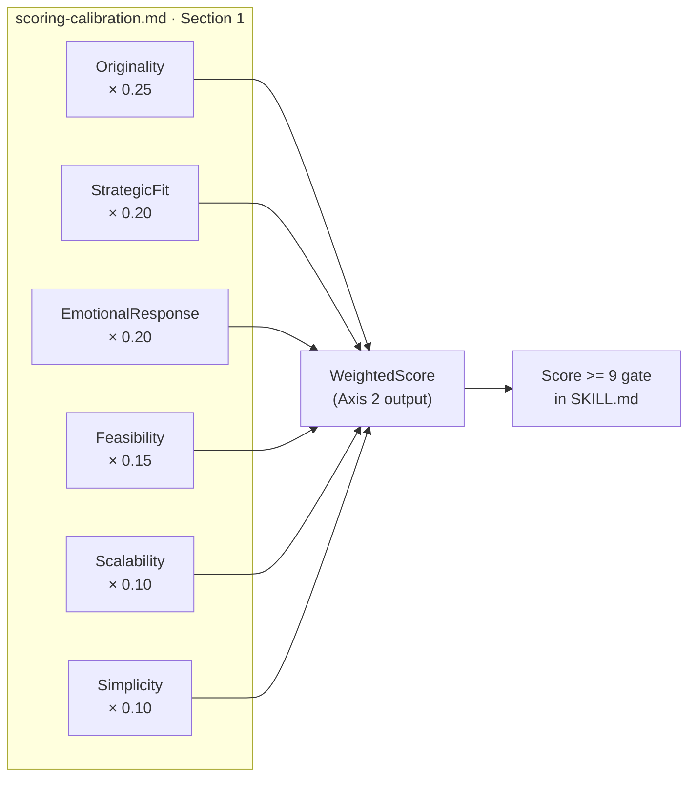
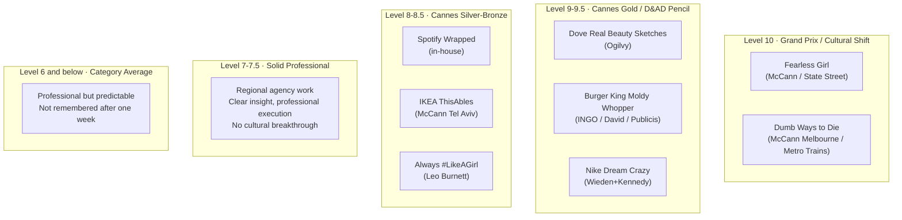
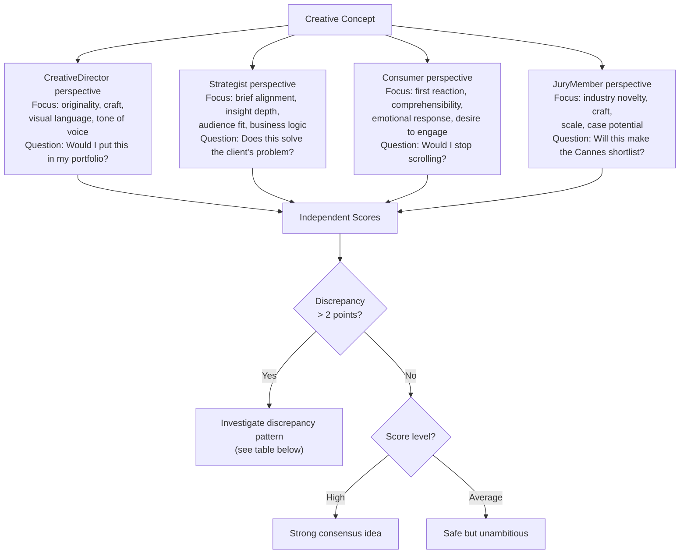
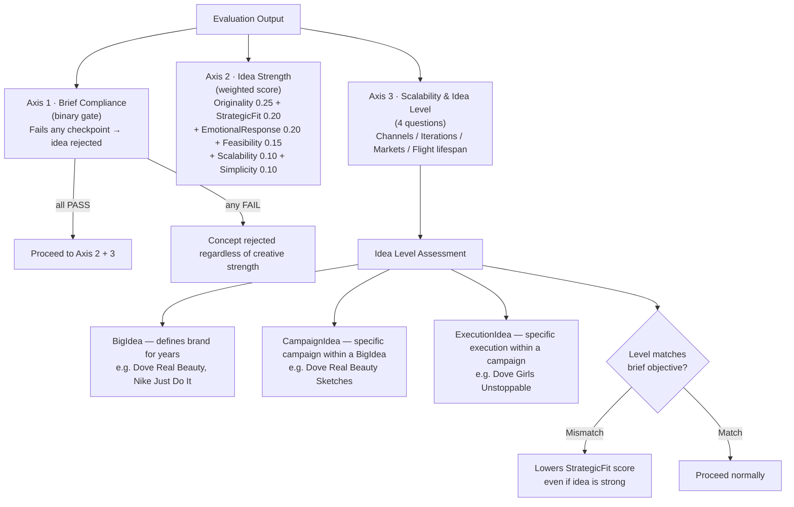

<!-- source: DeepWiki mcp.deepwiki.com · repo smixs/creative-director-skill · page 4.1 Scoring Calibration · fetched 2026-10-27 -->

# Scoring Calibration

<details>
<summary>Relevant source files</summary>

The following files were used as context for generating this wiki page:

- [assets/scoring-loop.webp](assets/scoring-loop.webp)
- [assets/why-averaged.webp](assets/why-averaged.webp)
- [creative-director/references/emotion-hierarchy.md](creative-director/references/emotion-hierarchy.md)

</details>


## Purpose and Scope

This page documents the rubric defined in [creative-director/references/scoring-calibration.md](), which is the reference used during Phase 4 (Evaluate & Refine) to score creative concepts. It covers:

- Per-criterion descriptors for the six weighted criteria.
- HumanKind Scale (Leo Burnett) level definitions.
- Grey Scale (Grey Group) level definitions.
- Calibration anchors from real-world campaigns.
- Seven anti-inflation rules, including the empirical saturation cap.
- Four-perspective panel simulation (Consensual Assessment Technique).
- Three-axis final summary structure.

This page is specifically about *how scores are assigned and validated*. For the broader evaluation architecture — how the three scoring systems interact, what the Brief Compliance gate checks, and how scores feed back into the refinement loop — see the Evaluation System overview at [5](). For the Creative Constitution's complementary rubric (Brief Compliance gate, Creative Quality principles, Scalability questions, mandatory feedback rules), see [5.2]().

Sources: [creative-director/references/scoring-calibration.md:1-5]()

---

## Where This File Fits

`scoring-calibration.md` is loaded by `SKILL.md` during Phase 4. It is one of two evaluation references; the other is `creative-constitution.md`. The two share an evaluation layer.

**Diagram: scoring-calibration.md in the Phase 4 Evaluation Stack**



Sources: [creative-director/references/scoring-calibration.md:1-5]()

---

## 1. Six Weighted Criteria

The weighted score is computed as:

```
Total = Originality     × 0.25
      + Strategic Fit   × 0.20
      + Emotional Response × 0.20
      + Feasibility     × 0.15
      + Scalability     × 0.10
      + Simplicity      × 0.10
```

Interpretation thresholds: **8+** excellent · **6–7** good · **5–6** average · **below 5** weak.

**Diagram: Six Criteria — Weights and File Mapping**



Sources: [creative-director/references/scoring-calibration.md:207-218]()

---

### 1.1 Originality (weight 0.25)

Evaluates novelty for the category and culture. Highest weight because category-template work fails regardless of other criteria.

| Score | Descriptor | Calibration Signal |
|-------|------------|-------------------|
| 1–2 | Pure category template. Any brand could run it. | Bank + handshake, car on mountain road |
| 3 | Minimal differentiation; doesn't exceed genre conventions | Different font, identical thought |
| 4–5 | Noticeable attempt; viewer guesses the payoff | Expected twist, "not bad for the category" |
| 6–7 | Fresh authorial voice; a competitor can't swap their logo in without losing meaning | |
| 8–9 | Unexpected; nothing like it existed in category; people retell it | Burger King "Whopper Detour" |
| 10 | Creates a new genre or format; changes category rules | Dove Real Beauty, Old Spice "The Man Your Man Could Smell Like" |

Sources: [creative-director/references/scoring-calibration.md:9-19]()

---

### 1.2 Strategic Fit (weight 0.20)

Evaluates alignment between the idea and the brief's objective, audience, and business logic.

| Score | Descriptor | Calibration Signal |
|-------|------------|-------------------|
| 1–2 | Doesn't solve the brief's objective; brand could be swapped without change | Idea exists in a vacuum |
| 3 | Formally touches the topic but misses audience or objective | Answering the wrong question |
| 4–5 | Formally on-brief but imprecise; insight is superficial | Audience too broad/narrow |
| 6–7 | Clearly on-brief; audience relevant, objective addressed, insight works | Satisfies the client |
| 8–9 | On-brief AND adds something the client needed but didn't ask for | Always #LikeAGirl |
| 10 | Redefines the task entirely | Apple "Think Different" |

Sources: [creative-director/references/scoring-calibration.md:20-30]()

---

### 1.3 Emotional Response (weight 0.20)

Evaluates strength and specificity of the emotional reaction produced. The `emotional_response` score is directly tied to the [emotion-hierarchy.md:81-91]() tier system.

| Tier | `emotional_response` score range |
|------|----------------------------------|
| Tier 1 | ≤ 6 |
| Tier 2 | 6 – 8 |
| Tier 3 | 8 – 10 |

Score 9+ requires a Tier 3 emotion. If the nominated emotion cannot be expressed as a compound (two tensions in coexistence), the score cannot exceed 8 regardless of execution quality.

| Score | Descriptor | Calibration Signal |
|-------|------------|-------------------|
| 1–2 | No reaction; viewer scrolls past without finishing | Wall of text, boredom |
| 3 | Noticed but no feeling; background noise | |
| 4–5 | Slight interest or smile; forgotten within a minute | Unnamed "positive" feeling |
| 6–7 | Specific named emotion (curiosity, nostalgia, pride, surprise); remembered one day | |
| 8–9 | Strong reaction: laughter, tears, anger, "lump in throat," "goosebumps" | Thai Life Insurance ads |
| 10 | Cultural moment; people discuss and share for years | John Lewis Christmas |

Sources: [creative-director/references/scoring-calibration.md:31-41](), [creative-director/references/emotion-hierarchy.md:81-91]()

---

### 1.4 Feasibility (weight 0.15)

Evaluates realizability given budget, timeline, and available resources.

| Score | Descriptor | Calibration Signal |
|-------|------------|-------------------|
| 1–2 | Unrealizable with given constraints; requires non-existent tech or 10× budget | |
| 3 | Technically possible but compromises destroy the idea's essence | |
| 4–5 | Theoretically possible; risky, expensive, many dependencies | Production eats entire budget |
| 6–7 | Realizable with reasonable effort; clear plan, understood risks | |
| 8–9 | Elegantly realizable; minimal dependencies, maximum control | "Share a Coke" — print names on cans |
| 10 | Executable tomorrow with minimal resources for maximum impact | "Why hasn't anyone done this before?" |

Sources: [creative-director/references/scoring-calibration.md:42-52]()

---

### 1.5 Scalability (weight 0.10)

Evaluates potential for development across time, channels, and markets.

| Score | Descriptor | Calibration Signal |
|-------|------------|-------------------|
| 1–2 | One-time execution; no series, no development | Done and forgotten |
| 3 | Can repeat 1–2 times with diminishing returns | Second time won't surprise |
| 4–5 | 2–3 variations; limited to one channel; market adaptation is problematic | |
| 6–7 | Season-long series; works across 3+ channels; adaptable with localization | |
| 8–9 | Platform for years; infinite series; international without losing meaning | Spotify Wrapped |
| 10 | Cultural platform that outgrows advertising | Nike "Just Do It" (30+ years), Red Bull Stratos |

Sources: [creative-director/references/scoring-calibration.md:53-63]()

---

### 1.6 Simplicity (weight 0.10)

Evaluates how quickly the idea is understood without aid.

| Score | Descriptor | Calibration Signal |
|-------|------------|-------------------|
| 1–2 | Requires instructions; complex mechanics; three steps, two conditions | |
| 3 | Understandable with effort; need to reread or ask | |
| 4–5 | Understandable after explanation; doesn't self-read | |
| 6–7 | Immediately understandable; 30 seconds; a nuance unfolds | |
| 8–9 | One sentence or one image; can be retold in 5 seconds | |
| 10 | So simple it seems obvious in retrospect | Coca-Cola "Share a Coke" — names on cans |

Sources: [creative-director/references/scoring-calibration.md:64-74]()

---

## 2. HumanKind Scale (Leo Burnett)

A second-pass filter applied after the six criteria. Evaluates cultural and human impact.

> **Important calibration note:** Most professional work falls in the 4–6 range. A score of 7+ is Cannes shortlist territory. Do not inflate.

| Score | Level | Description | Anchor Example |
|-------|-------|-------------|----------------|
| 1 | Destructive | Actively harms the brand; people reject or boycott | Pepsi Kendall Jenner |
| 2 | No Idea | Formal budget fulfillment; product in frame, logo at end | Typical stock-photo banner "20% off" |
| 3 | Invisible | No interest, no emotion; wallpaper; cliché | Bank ad "we're close by" with handshake |
| 4 | No Brand Purpose | Some idea but unclear why the brand exists | Product demo with no "why" |
| 5 | Brand Purpose | Mission clear, meaningful communication, no breakthrough | IKEA "The Wonderful Everyday" |
| 6 | Intelligent Idea | Smart, engaging, not channel-bound; idea bigger than the format | Burger King "Whopper Detour" |
| 7 | HumanKind Act | Changes thoughts, feelings, or actions; highest craft | Nike "Dream Crazy" (Kaepernick) |
| 8 | Changes Thinking | Useful, becomes part of people's lives; they're grateful | Spotify Wrapped |
| 9 | Changes Living | Inspires lifestyle change; people act differently | Dove "Real Beauty" (full campaign) |
| 10 | Changes the World | Global social change | Theoretical ceiling |

Sources: [creative-director/references/scoring-calibration.md:77-94]()

---

## 3. Grey Scale (Grey Group)

An alternative scale focused on craft quality rather than cultural impact. Run in parallel with the HumanKind Scale.

> **Calibration note:** The median for a quality agency is 5–6. Consistently higher scores indicate you are flattering, not evaluating.

| Score | Level | Description |
|-------|-------|-------------|
| 1 | Toxic | Harms brand and people; offensive or dangerous |
| 2 | Careless | Sloppy, unprofessional; visible errors |
| 3 | Dull | Boring, predictable; no response whatsoever |
| 4 | Expected | Category-expected; not embarrassing but not proud |
| 5 | Capable | Professional but unremarkable; solid without ambition |
| 6 | Gratifying | Pleasant; something hooks; above average |
| 7 | Original | Fresh, memorable; potential for local festivals |
| 8 | Best in category | Best of year in category; competitors are envious; Cannes shortlist |
| 9 | Best in show | Cannes shortlist / D&AD Pencil; industry talks about it |
| 10 | Best in the world | Grand Prix; sets standard for years |

Sources: [creative-director/references/scoring-calibration.md:98-116]()

---

## 4. Calibration Anchors

Fixed-point real campaigns used for comparison during every evaluation. Before assigning any score, mentally compare the concept against the campaign at that level.

**Diagram: Anchor Campaigns by Score Level**



Sources: [creative-director/references/scoring-calibration.md:119-142]()

---

## 5. Anti-Inflation Rules

Seven rules applied to every evaluation batch. AI models have a systematic tendency to inflate scores. These rules are constraints, not suggestions.

| Rule | Name | Description |
|------|------|-------------|
| 1 | **Real Analogues Test** | Before assigning 9+, name 3 real Cannes-winning campaigns at that level. Is the idea genuinely comparable? |
| 2 | **Batch Control** | If all ideas in a batch score 8+, recalibrate the entire batch from scratch. |
| 3 | **Normal Distribution** | Average score for a batch of 10 ideas must be 5–6. |
| 4 | **Specificity Test** | Replace brand with competitor. If it works identically — Originality is 5 at most. |
| 5 | **"Would I share this?"** | Mentally show to a non-advertising friend. No mention at dinner → score below 7. |
| 6 | **First Reaction** | Record initial score. If it rises > 2 points after analysis, you are rationalizing. |
| 7 | **Empirical Saturation Cap** | If the idea uses a pattern with >20 cases in the library (e.g., P15), cap Originality at 7. |

Sources: [creative-director/references/scoring-calibration.md:145-162]()

---

## 6. Multi-Perspective Panel (CAT Simulation)

The Consensual Assessment Technique requires independent evaluation from four simulated perspectives before comparing results. Discrepancies are diagnostic signals, not errors.

**Diagram: Four-Perspective Evaluation Flow**



Sources: [creative-director/references/scoring-calibration.md:165-194]()

### Discrepancy Pattern Table

| Pattern | Diagnosis |
|---------|-----------|
| CD high, Consumer low | "Advertising idea" — industry loves it, people don't |
| Consumer high, Jury low | Mass appeal without creative novelty; it works but doesn't surprise |
| Strategist high, CD low | Strategically sound but dull in execution; needs better craft |
| Jury high, Strategist low | "Festival work" — created for awards, not business |

Sources: [creative-director/references/scoring-calibration.md:188-194]()

---

## 7. Three-Axis Final Summary

The final evaluation output is organized on three axes, each serving a distinct function.

**Diagram: Three-Axis Summary Structure (scoring-calibration.md Section 7)**



Sources: [creative-director/references/scoring-calibration.md:197-249]()

---

