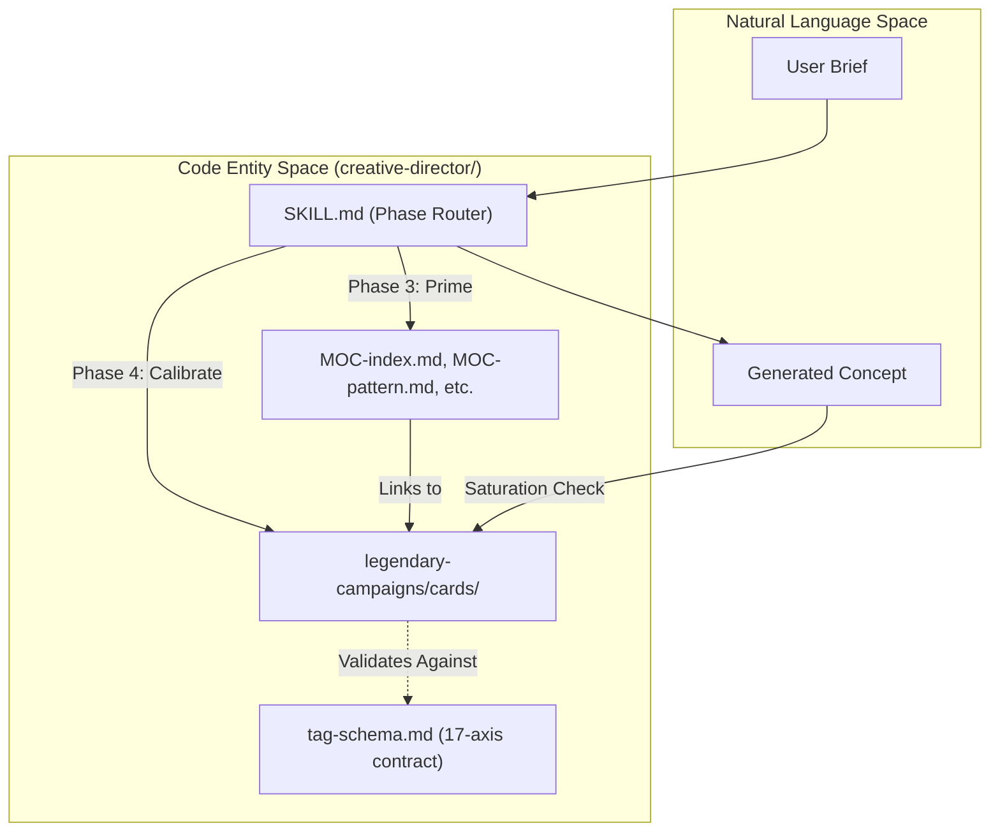
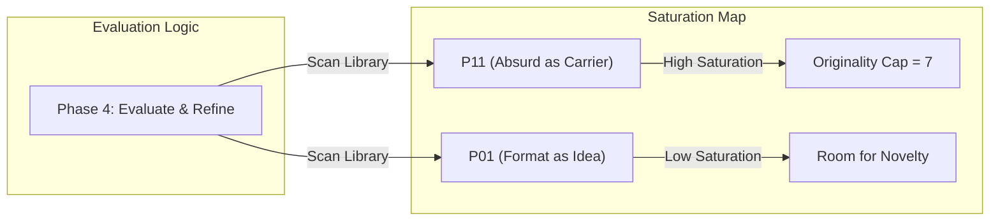

<!-- source: DeepWiki mcp.deepwiki.com · repo smixs/creative-director-skill · page 5 Legendary Campaigns Library · fetched 2026-10-27 -->

# Legendary Campaigns Library

Relevant source files

The following files were used as context for generating this wiki page:

- [assets/case-library.webp](assets/case-library.webp)
- [creative-director/references/legendary-campaigns/MOC-index.md](creative-director/references/legendary-campaigns/MOC-index.md)
- [creative-director/references/legendary-campaigns/README.md](creative-director/references/legendary-campaigns/README.md)

The **Legendary Campaigns Library** is a curated repository of 571 advertising campaigns spanning from 1950 to 2025, tagged across 17 axes [creative-director/references/legendary-campaigns/README.md:3](). It serves as the empirical foundation for the `creative-director` skill, moving the AI from "hallucinated creativity" to "case-based reasoning" [creative-director/references/legendary-campaigns/README.md:3-4](). By grounding every generation in the "canon" of advertising, the system ensures that ideas are not just novel in a vacuum, but original relative to the history of the industry.

## Purpose and Integration
The library is not a passive reference but is deeply integrated into the five-phase creative pipeline.

*   **Pattern Calibration:** Every new idea is mapped against the 18 core creative patterns (P01–P18) to determine its structural lineage. For details, see [P01–P18 Pattern Reference](#5.1).
*   **Originality Benchmarking:** The system uses the library to detect "saturation." If an idea uses a mechanic already represented by 3+ canonical cases, its originality score is empirically capped.
*   **Case-Soaking (RESTART):** When ideation plateaus or fails to meet quality thresholds, the system triggers a "RESTART" where it "soaks" in 8–12 relevant cards to re-calibrate its sense of what a strong insight feels like.

### System Data Flow
The following diagram illustrates how the library entities interact with the core execution logic.

Sources: [creative-director/references/legendary-campaigns/README.md:1-18]()

## Card Anatomy
Every campaign in the library is documented as a markdown "card" with a standardized structure to ensure machine-readability and consistent analysis [creative-director/references/legendary-campaigns/README.md:20-29]().

| Section | Description |
|:---|:---|
| **17-Axis Frontmatter** | YAML metadata including `pattern`, `industry`, `emotion_tier`, `budget`, and `idea_type` [creative-director/references/legendary-campaigns/README.md:22](). |
| **Insight** | The human truth the campaign exploits (one sentence) [creative-director/references/legendary-campaigns/README.md:24](). |
| **Mechanic** | What was actually executed [creative-director/references/legendary-campaigns/README.md:25](). |
| **Why it worked** | Psychological / cultural / structural reason [creative-director/references/legendary-campaigns/README.md:26](). |
| **Steal** | Pattern-level borrow strategy [creative-director/references/legendary-campaigns/README.md:27](). |
| **Related** | Auto-generated wikilinks (pattern hub + 2 sibling cards + emotion match) [creative-director/references/legendary-campaigns/README.md:28-29](). |

Sources: [creative-director/references/legendary-campaigns/README.md:20-29]()

## The Six MOCs (Maps of Content)
To facilitate rapid lookup during the "Priming" step of Phase 3, the library is indexed across six dimensions [creative-director/references/legendary-campaigns/README.md:10-15](). These files are auto-generated by `scripts/generate_mocs.py` [creative-director/references/legendary-campaigns/MOC-index.md:3](). For details, see [Maps of Content (MOCs)](#5.3).

1.  **MOC-index:** Chronological list of all 571 cases [creative-director/references/legendary-campaigns/MOC-index.md:1-7]().
2.  **MOC-pattern:** Grouped by the P01–P18 mechanics [creative-director/references/legendary-campaigns/README.md:11]().
3.  **MOC-emotion:** Organized by the 3-tier emotion hierarchy [creative-director/references/legendary-campaigns/README.md:12]().
4.  **MOC-format:** Grouped by category (film/integrated/stunt_pr/...) [creative-director/references/legendary-campaigns/README.md:13]().
5.  **MOC-industry:** Grouped by industry vertical [creative-director/references/legendary-campaigns/README.md:14]().
6.  **MOC-budget:** Grouped by budget (low/medium/high) [creative-director/references/legendary-campaigns/README.md:15]().

Sources: [creative-director/references/legendary-campaigns/README.md:10-15](), [creative-director/references/legendary-campaigns/MOC-index.md:3]()

## Originality Pressure & Saturation
The library tracks the "saturation" of creative patterns. This creates "originality pressure" on the AI: if a pattern is overused (e.g., P11: Absurd as Carrier), the system requires a higher degree of structural novelty to award a high originality score [creative-director/references/legendary-campaigns/README.md:48-58]().

Sources: [creative-director/references/legendary-campaigns/README.md:48-58]()

## Confidence & Quality System
Not all data in the library is equal. Every card contains a `quality` and `confidence` field to signal its reliability [creative-director/references/legendary-campaigns/README.md:60-69]():

*   **`canonical`**: ★ in source list + full pattern-file content [creative-director/references/legendary-campaigns/README.md:64]().
*   **`full`**: Non-★ but well-documented from training knowledge [creative-director/references/legendary-campaigns/README.md:65]().
*   **`stub_enriched`**: Limited source detail, sections constructed from inference [creative-director/references/legendary-campaigns/README.md:66]().
*   **`stub_minimal`**: `verification_required: true`, sections may have TODOs [creative-director/references/legendary-campaigns/README.md:67]().

Cards with `confidence: low` should be cross-checked against external sources before citing in client work [creative-director/references/legendary-campaigns/README.md:69]().

Sources: [creative-director/references/legendary-campaigns/README.md:60-69]()

---

### Child Pages
- [P01–P18 Pattern Reference](#5.1) — Detailed reference for all 18 creative patterns (P01–P18) from `legendary-patterns.md`: core mechanic, why it works, canonical examples, stealing strategy, and saturation count for each. Also covers the Pre-Mortem template.
- [Campaign Cards by Brand](#5.2) — Reference guide to the 571 campaign cards organized by brand/industry cluster (Nike, Apple, Coca-Cola, Burger King, Adidas, Budweiser, Burberry, British Airways, Beats, Axe and 50+ others). Explains `ripgrep` cross-axis filtering and navigating the flat `cards/` namespace.
- [Maps of Content (MOCs)](#5.3) — Reference for the six generated indexes — MOC-index, MOC-pattern, MOC-emotion, MOC-format, MOC-industry, MOC-budget: what each slices by, how they are regenerated, and how the skill uses them for priming and saturation checks.

---

