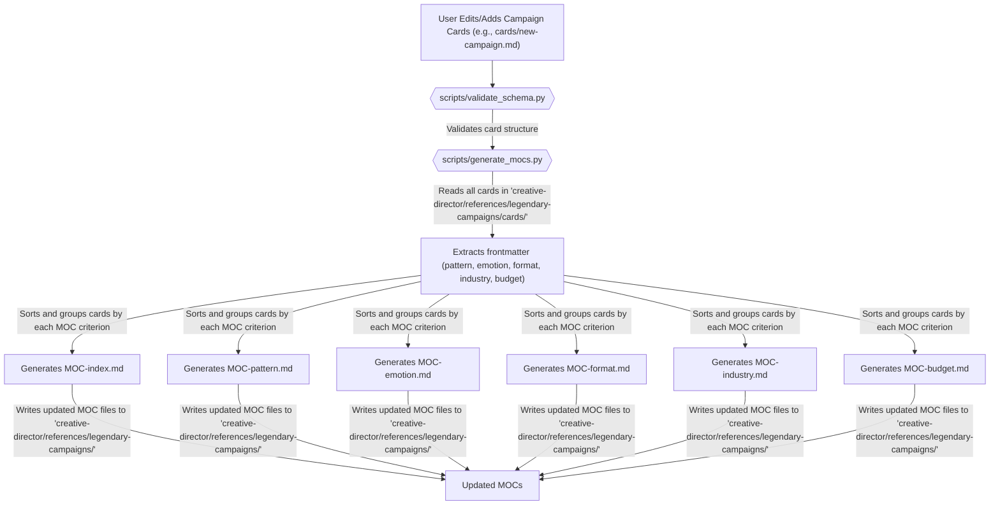
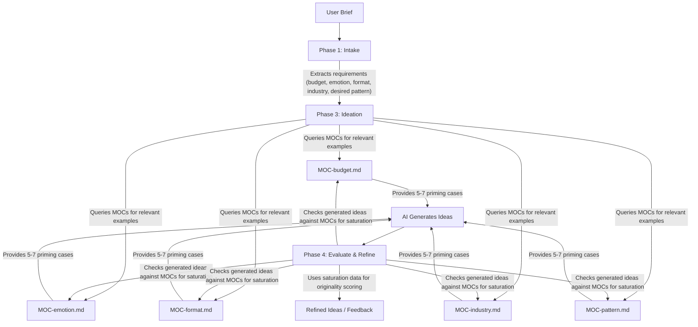

<!-- source: DeepWiki mcp.deepwiki.com · repo smixs/creative-director-skill · page 5.3 Maps of Content (MOCs) · fetched 2026-10-27 -->

# Maps of Content (MOCs)

Relevant source files

The following files were used as context for generating this wiki page:

- [creative-director/references/legendary-campaigns/MOC-budget.md](creative-director/references/legendary-campaigns/MOC-budget.md)
- [creative-director/references/legendary-campaigns/MOC-emotion.md](creative-director/references/legendary-campaigns/MOC-emotion.md)
- [creative-director/references/legendary-campaigns/MOC-format.md](creative-director/references/legendary-campaigns/MOC-format.md)
- [creative-director/references/legendary-campaigns/MOC-index.md](creative-director/references/legendary-campaigns/MOC-index.md)
- [creative-director/references/legendary-campaigns/MOC-industry.md](creative-director/references/legendary-campaigns/MOC-industry.md)
- [creative-director/references/legendary-campaigns/MOC-pattern.md](creative-director/references/legendary-campaigns/MOC-pattern.md)

This page details the six Maps of Content (MOCs) used within the Creative Director Skill. These MOCs are automatically generated indexes of the 571 legendary campaign cards, slicing the library by different attributes. They serve as crucial tools for priming the AI during ideation and for performing saturation checks to ensure originality.

## Overview of MOCs

The Creative Director Skill utilizes six distinct MOCs, each categorizing the legendary campaign cards based on a specific facet of the campaigns. These MOCs are:

*   `MOC-index.md`: A comprehensive index of all campaign cards, ordered chronologically by year, then alphabetically by brand and campaign name. [creative-director/references/legendary-campaigns/MOC-index.md:1-581]()
*   `MOC-pattern.md`: Organizes campaigns by their primary creative pattern (P01-P18). This MOC is vital for understanding and applying structural ideation methods. [creative-director/references/legendary-campaigns/MOC-pattern.md:1-1098]()
*   `MOC-emotion.md`: Categorizes campaigns by the dominant emotion they evoke, using the skill's 3-tier emotion hierarchy. This is used for emotional priming and ensuring emotional resonance. [creative-director/references/legendary-campaigns/MOC-emotion.md:1-586]()
*   `MOC-format.md`: Groups campaigns by their primary media format (e.g., film, OOH/print, digital product). This helps in selecting relevant examples for specific output formats. [creative-director/references/legendary-campaigns/MOC-format.md:1-596]()
*   `MOC-industry.md`: Arranges campaigns by the industry they belong to (e.g., alcohol, automotive, tech). This is useful for industry-specific priming and competitive analysis. [creative-director/references/legendary-campaigns/MOC-industry.md:1-628]()
*   `MOC-budget.md`: Classifies campaigns by their estimated budget level (low, medium, high). This allows for budget-appropriate ideation and reference. [creative-director/references/legendary-campaigns/MOC-budget.md:1-586]()

Each MOC file explicitly states that it is auto-generated and should not be edited by hand [creative-director/references/legendary-campaigns/MOC-budget.md:3]().

### MOC Structure

Each MOC file follows a consistent structure:
1.  A header indicating the MOC type.
2.  A note about auto-generation.
3.  The total number of cards indexed.
4.  Categorized sections (e.g., "## low (70 cases)" for `MOC-budget.md` [creative-director/references/legendary-campaigns/MOC-budget.md:7](), "## P01 (6 cases)" for `MOC-pattern.md` [creative-director/references/legendary-campaigns/MOC-pattern.md:7]()).
5.  Within each section, a list of campaign cards, each formatted as a wikilink to its respective card file, followed by the brand, year, format, emotion, budget, and awards. For example: `[[cards/metro-trains-dumb-ways-to-die-2012.md|Dumb Ways to Die]] — Metro Trains Melbourne · 2012 · film · melancholic_joy · low · cannes_grand_prix` [creative-director/references/legendary-campaigns/MOC-budget.md:8]().

## Regeneration Process

The MOCs are dynamically generated by the `generate_mocs.py` script [creative-director/references/legendary-campaigns/MOC-budget.md:3](). This script ensures that the MOCs are always up-to-date with any changes or additions to the legendary campaign cards.

### Diagram: MOC Regeneration Workflow

Sources:
[creative-director/references/legendary-campaigns/MOC-budget.md:3]()

## Usage in the Skill

The MOCs play a critical role in two main aspects of the Creative Director Skill: priming and saturation checks.

### Priming

During the Ideation phase (Phase 3), the AI is "primed" with 5-7 relevant cases from the legendary campaigns library. The MOCs facilitate the selection of these cases by allowing the skill to quickly identify campaigns that match specific criteria from the brief. For example:

*   If the brief specifies a "low" budget, `MOC-budget.md` can be queried to retrieve relevant low-budget campaigns.
*   If a particular emotional tone is desired, `MOC-emotion.md` helps find campaigns that successfully evoked that emotion.
*   If the task requires a specific media format, `MOC-format.md` provides examples.
*   If the AI is struggling with a particular creative pattern, `MOC-pattern.md` can provide examples of that pattern in action.

This targeted priming helps the AI generate ideas that are aligned with the brief's requirements and leverage proven creative strategies.

### Saturation Checks

The MOCs are also instrumental in performing "saturation checks" during the Evaluate & Refine phase (Phase 4). Each MOC implicitly tracks the "saturation" of certain creative attributes. For instance, `MOC-pattern.md` contains a count of how many campaigns fall under each pattern (e.g., "P01 (6 cases)" [creative-director/references/legendary-campaigns/MOC-pattern.md:7](), "P02 (15 cases)" [creative-director/references/legendary-campaigns/MOC-pattern.md:15]()). This information, combined with the `legendary-patterns.md` file, helps in:

*   **Identifying overused patterns**: If a generated idea heavily relies on a pattern that is already highly saturated in the library, it might be flagged for lower originality.
*   **Encouraging novel combinations**: By understanding which patterns are less saturated or how different attributes combine, the skill can guide the AI towards more original and less conventional ideas.
*   **Empirical Originality Cap**: The saturation data from MOCs contributes to the "empirical originality cap" mechanism, which prevents the AI from endlessly generating variations of already common ideas.

### Diagram: MOCs in Skill Workflow

Sources:
[creative-director/references/legendary-campaigns/MOC-budget.md:7]()
[creative-director/references/legendary-campaigns/MOC-emotion.md:7]()
[creative-director/references/legendary-campaigns/MOC-format.md:7]()
[creative-director/references/legendary-campaigns/MOC-industry.md:7]()
[creative-director/references/legendary-campaigns/MOC-pattern.md:7]()

---

