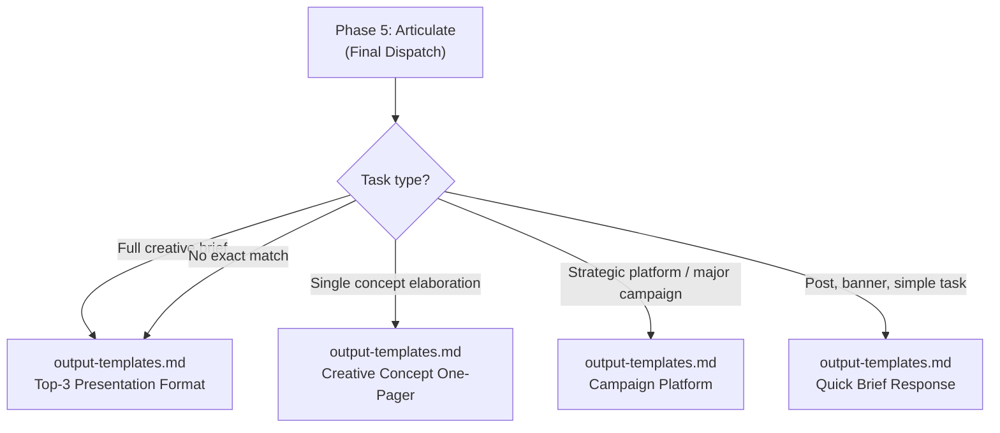
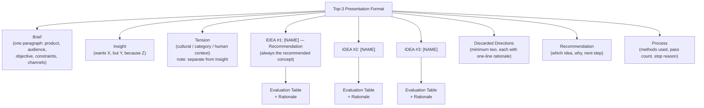
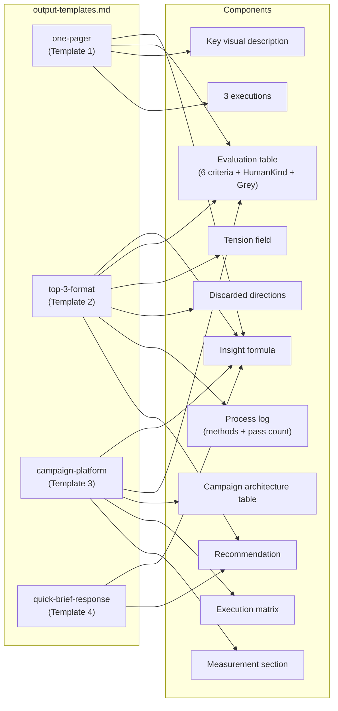

<!-- source: DeepWiki mcp.deepwiki.com · repo smixs/creative-director-skill · page 6.1 Output Templates · fetched 2026-10-27 -->

# Output Templates

<details>
<summary>Relevant source files</summary>

The following files were used as context for generating this wiki page:

- [creative-director/assets/output-templates.md](creative-director/assets/output-templates.md)

</details>


This page documents the four output presentation formats defined in `creative-director/assets/output-templates.md`. These templates are the final delivery layer of the creative pipeline — they are invoked exclusively during **Phase 5: Articulate** based on task type. For details on how Phase 5 selects and applies these templates, see [Phase 5: Articulate](). For the narrative framing layer that can be layered on top of output text, see [Storytelling Frameworks]().

---

## Role in the Pipeline

Output templates sit at the terminal end of the five-phase creative pipeline. The system routes to `assets/output-templates.md` only after evaluation is complete and at least one concept has cleared the scoring threshold (or the maximum pass/plateau exit condition has been triggered).

**Template selection diagram:**



Sources: [creative-director/assets/output-templates.md:198-207]()

---

## Template Selection Reference

| Situation | Template |
|-----------|----------|
| Full creative brief | Top-3 Presentation Format |
| Presenting a single idea in depth | Creative Concept One-Pager |
| Strategic platform / major campaign | Campaign Platform |
| Social post, banner, simple task | Quick Brief Response |
| No exact match | Top-3 Presentation (default) |

When no situation fits exactly, the Top-3 Presentation Format is used as the base and adapted to context [creative-director/assets/output-templates.md:207-207]().

Sources: [creative-director/assets/output-templates.md:198-207]()

---

## Template 1: Creative Concept One-Pager

**Purpose:** Present a single idea with full development in one document. Used when elaborating on a specific concept selected from a prior session, or when a client requests a deep-dive on one direction [creative-director/assets/output-templates.md:7-9]().

**Sections:**

| Field | Content rule |
|---|---|
| `[CONCEPT NAME]` | Heading — the name of the concept [creative-director/assets/output-templates.md:12-12]() |
| `Insight` | Strictly follows formula: "the audience wants X, but Y prevents them, because Z" [creative-director/assets/output-templates.md:15-15]() |
| `Idea` | One sentence — the essence of the concept [creative-director/assets/output-templates.md:18-18]() |
| `Tagline` | Optional; include only if applicable [creative-director/assets/output-templates.md:21-21]() |
| `Key Visual / Hero Execution` | Describes what the viewer sees in the **first 3 seconds** — a specific frame or scene, not an abstract mood [creative-director/assets/output-templates.md:24-24]() |
| `How It Lives` | Channel-by-channel breakdown of what specifically happens in each medium [creative-director/assets/output-templates.md:26-29]() |
| `3 Executions` | Three concrete executions, each named and described in 2–3 lines [creative-director/assets/output-templates.md:31-34]() |
| `Evaluation` | Weighted score, HumanKind score, Grey level, plus a rationale in 2–3 lines [creative-director/assets/output-templates.md:36-40]() |

**Filling rules:**
- The insight must follow the "wants X, but Y, because Z" formula exactly [creative-director/assets/output-templates.md:44-44]().
- Key Visual must describe a specific frame or scene — not mood or atmosphere [creative-director/assets/output-templates.md:45-45]().
- Evaluation rationale is mandatory; scores without rationale are treated as incomplete [creative-director/assets/output-templates.md:46-46]().

Sources: [creative-director/assets/output-templates.md:7-47]()

---

## Template 2: Top-3 Presentation Format

**Purpose:** The primary working template for a full creative brief response. Delivers three scored ideas, discarded directions, a recommendation, and a process log [creative-director/assets/output-templates.md:50-52](). This is the default template when task type is ambiguous [creative-director/assets/output-templates.md:207-207]().

**Structure diagram:**



**Per-idea evaluation table:**

| Criterion | Score |
|-----------|-------|
| Originality | X.X |
| Strategic Fit | X.X |
| Emotional Response | X.X |
| Feasibility | X.X |
| Scalability | X.X |
| Simplicity | X.X |
| **Weighted Score** | **X.X** |
| HumanKind | X |
| Grey | [level] |

**Filling rules:**
- Idea #1 is always the recommended concept. If a different idea is the recommendation, reorder so it appears first [creative-director/assets/output-templates.md:116-116]().
- `Tension` is distinct from `Insight`: Insight describes the audience; Tension describes the cultural or category context [creative-director/assets/output-templates.md:117-117]().
- At least two discarded directions must be listed, each with a one-line explanation of why it was rejected [creative-director/assets/output-templates.md:118-118]().
- The `Process` section logs which ideation methods were applied, how many recursion passes ran, and the stop reason (`9+ threshold` / `max passes` / `plateau`) [creative-director/assets/output-templates.md:109-113]().

Sources: [creative-director/assets/output-templates.md:50-119]()

---

## Template 3: Campaign Platform

**Purpose:** Strategic campaign architecture for large-scale briefs requiring a systemic approach: multi-level idea hierarchy, channel matrix, and measurement framework [creative-director/assets/output-templates.md:122-124]().

**Structure:**

| Section | Contents |
|---|---|
| `Strategic Foundation` | Business + communication objective; Insight formula; Creative territory; Positioning statement [creative-director/assets/output-templates.md:129-133]() |
| `Concept` | Big Idea (one sentence); Tagline; Visual Language description; Tone of Voice (3–4 adjectives + one example phrase) [creative-director/assets/output-templates.md:135-139]() |
| `Campaign Architecture` | Table mapping idea levels (Big Idea → Campaign Ideas → Key Executions) to channels [creative-director/assets/output-templates.md:141-147]() |
| `Execution Matrix` | Per-channel table: format, essence of what happens, KPI [creative-director/assets/output-templates.md:149-152]() |
| `Measurement` | How to measure Awareness, Engagement, Conversion, Brand Lift [creative-director/assets/output-templates.md:154-158]() |
| `Evaluation` | Score / HumanKind / Grey + rationale [creative-director/assets/output-templates.md:160-161]() |

**Filling rules:**
- Strategic Foundation is always populated first. Without it, the concept section has no grounding [creative-director/assets/output-templates.md:165-165]().
- Every row in the Execution Matrix must be actionable — vague descriptions are not acceptable [creative-director/assets/output-templates.md:166-166]().
- Tone of Voice must include an example phrase. Adjectives alone are insufficient [creative-director/assets/output-templates.md:167-167]().

Sources: [creative-director/assets/output-templates.md:122-168]()

---

## Template 4: Quick Brief Response

**Purpose:** Lightweight format for simple, fast-turnaround tasks (social posts, banners, short messages). Compensates for brevity by delivering five concepts instead of three [creative-director/assets/output-templates.md:171-173]().

**Structure:**

```
## Brief: [short task description — one line]
## Insight: [one sentence]
## 5 Concepts:
1. **[Name]**: [description in 1-2 lines] | Score: X.X
2. **[Name]**: [description in 1-2 lines] | Score: X.X
3. **[Name]**: [description in 1-2 lines] | Score: X.X
4. **[Name]**: [description in 1-2 lines] | Score: X.X
5. **[Name]**: [description in 1-2 lines] | Score: X.X
## Recommendation: [number] — [why]
```

**Filling rules:**
- Brief must fit in one line. If it requires more explanation, the Top-3 Presentation Format should be used instead [creative-director/assets/output-templates.md:192-192]().
- Always five concepts — not three. The higher volume offsets the reduced depth per concept [creative-director/assets/output-templates.md:193-193]().
- Recommendation is mandatory. A list without a recommendation is not a deliverable [creative-director/assets/output-templates.md:194-194]().

Sources: [creative-director/assets/output-templates.md:171-195]()

---

## Template Structural Comparison

The following diagram maps the four templates against their key structural components, illustrating what each includes and omits.

**Template component coverage:**



Sources: [creative-director/assets/output-templates.md:1-207]()

---

## Insight Formula

All four templates require an `Insight` field. The formula is consistent across every template [creative-director/assets/output-templates.md:44-44]():

> **The audience wants X, but Y prevents them, because Z.**

This is not a free-form statement. Deviating from the formula is treated as an incomplete fill.

Sources: [creative-director/assets/output-templates.md:15, 61, 131, 178]()

---

## Evaluation Fields

Templates 1, 2, and 3 include an evaluation block. The scoring fields map directly to the systems documented in the [Evaluation System]():

| Field | Source system |
|---|---|
| Weighted Score (X.X / 10) | Six weighted criteria — see [Scoring Calibration]() |
| HumanKind (X / 10) | Leo Burnett HumanKind Scale — see [Scoring Calibration]() |
| Grey ([level]) | Grey Group Grey Scale — see [Scoring Calibration]() |
| Rationale | Required explanation per concept; enforced by [Creative Constitution]() |

The Quick Brief Response (Template 4) records only the weighted score inline per concept — it does not include HumanKind or Grey level entries due to its lightweight nature [creative-director/assets/output-templates.md:182-186]().

Sources: [creative-director/assets/output-templates.md:36-40, 75-88, 160-162, 182-186]()

---

