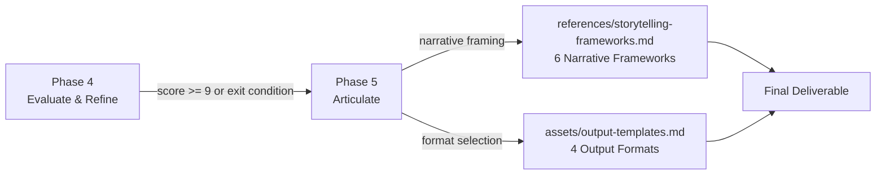
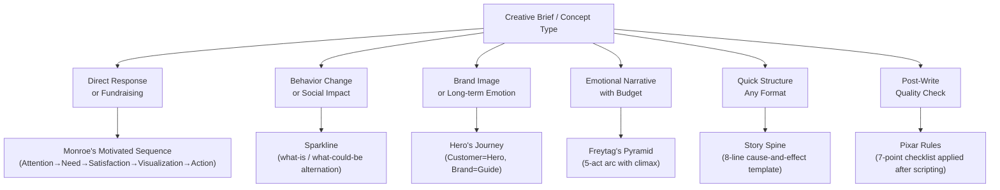
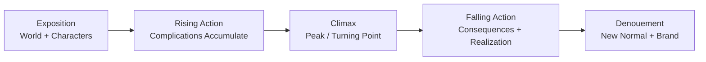
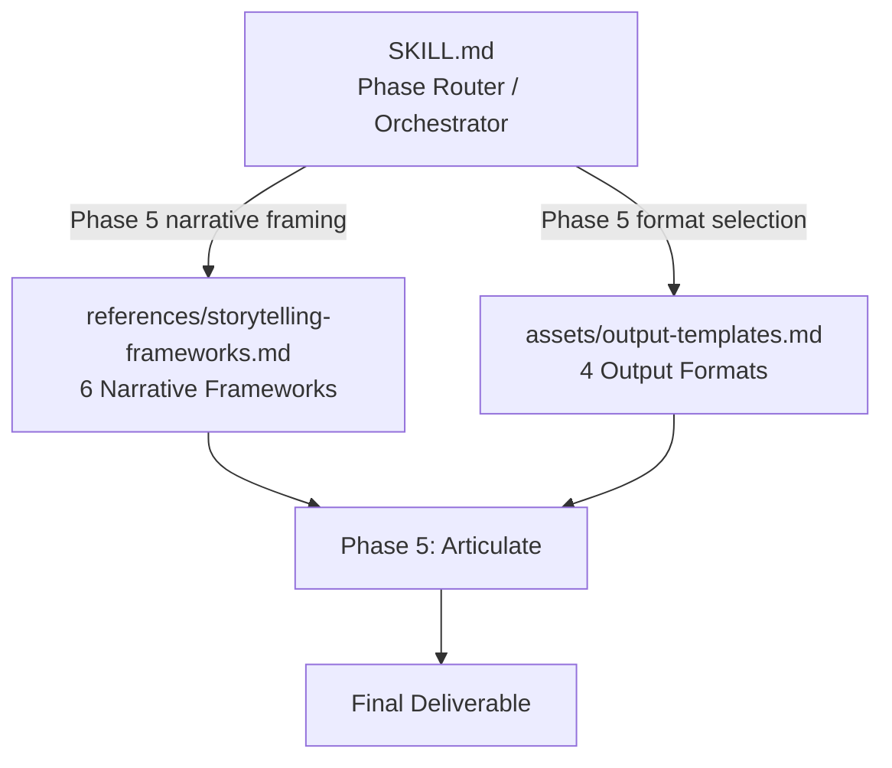

<!-- source: DeepWiki mcp.deepwiki.com · repo smixs/creative-director-skill · page 6.2 Storytelling Frameworks · fetched 2026-10-27 -->

# Storytelling Frameworks

Relevant source files

The following files were used as context for generating this wiki page:

- [README.md](README.md)
- [creative-director/assets/output-templates.md](creative-director/assets/output-templates.md)

This page documents the six narrative frameworks defined in `creative-director/references/storytelling-frameworks.md`. These frameworks are applied during **Phase 5: Articulate** to structure and present final creative concepts. They are practical templates, not theory — each is intended to be applied directly to a brief and a validated concept.

For coverage of *how* Phase 5 selects and applies these frameworks within the output, see [Phase 3.5: Articulate](). For the output formats that narrative framing is applied to, see [Output Templates]().

---

## Role in the Pipeline

`storytelling-frameworks.md` is loaded by `SKILL.md` exclusively during Phase 5. It is not consulted during ideation or evaluation. It serves as a narrative structural layer that wraps the core idea to make it "pitch-ready" or "production-ready."

**Figure: storytelling-frameworks.md in the Five-Phase Pipeline**

Sources: [creative-director/references/storytelling-frameworks.md:1-3](), [SKILL.md:53-59]()

---

## Framework Overview

Six frameworks are defined. Each serves a distinct persuasion or narrative goal.

| # | Framework | Author / Origin | Primary Purpose | Format Suitability |
|---|-----------|-----------------|-----------------|-------------------|
| 1 | **Story Spine** | Kenn Adams / Pixar | Cause-and-effect narrative assembly | 15 / 30 / 60 sec |
| 2 | **Sparkline** | Nancy Duarte — *Resonate* | Contrast-driven behavior change | 15 / 30 / 60 sec |
| 3 | **Freytag's Pyramid** | Gustav Freytag | Emotional climax storytelling | 30 / 60 sec |
| 4 | **Monroe's Motivated Sequence** | Alan Monroe | Action / direct response persuasion | 15 / 30 / 60 sec |
| 5 | **Pixar Rules** | Pixar / Emma Coats | Post-write quality checklist | Any (post-check) |
| 6 | **Hero's Journey** | Joseph Campbell / Donald Miller | Brand-as-guide, long-term image | 30 / 60 sec |

Sources: [creative-director/references/storytelling-frameworks.md:7-131]()

---

## Framework Selection Map

**Figure: Use-Case to Framework Routing**

Sources: [creative-director/references/storytelling-frameworks.md:27-28](), [creative-director/references/storytelling-frameworks.md:48-49](), [creative-director/references/storytelling-frameworks.md:69-70](), [creative-director/references/storytelling-frameworks.md:90-91](), [creative-director/references/storytelling-frameworks.md:109-110](), [creative-director/references/storytelling-frameworks.md:130-131]()

---

## Framework Details

### 1. Story Spine

[creative-director/references/storytelling-frameworks.md:7-28]()

**Origin:** Kenn Adams, popularized by Pixar.

**Mechanism:** An eight-line sequential template where each line is causally linked to the previous. The constraint forces logical plot continuity and eliminates disconnected scenes.

| Line | Prompt | Role |
|------|--------|------|
| 1 | Once upon a time… | Hero + world establishment |
| 2 | Every day… | Status quo / routine |
| 3 | But one day… | Inciting incident — brand entry point |
| 4 | Because of that… | First consequence |
| 5 | Because of that… | Second consequence, escalation |
| 6 | Because of that… | Third consequence, peak tension |
| 7 | Until finally… | Climax / resolution |
| 8 | And ever since… | New normal |

**Timing guidance:**
- **15 sec:** Only lines 3–7. Enter at conflict; no time for exposition.
- **30 sec:** All 8 lines. Lines 1–2: ~5–7 sec; chain: 15–18 sec; finale: 5–7 sec.
- **60 sec:** All 8, expanded. Expand "because of that" to 4–5 links, each a separate scene.

Sources: [creative-director/references/storytelling-frameworks.md:7-28]()

---

### 2. Sparkline

[creative-director/references/storytelling-frameworks.md:31-49]()

**Origin:** Nancy Duarte, *Resonate*.

**Mechanism:** Rhythmic alternation between "what is" (present pain) and "what could be" (desired future). Each alternation amplifies contrast. The brand closes as the bridge between the two states.

| Stage | Content |
|-------|---------|
| 1 | What is — recognizable current pain |
| 2 | What could be — first glimmer of possibility |
| 3 | What is — deeper pain, more specific |
| 4 | What could be — clearer future vision |
| 5 | New reality — brand as the enabling transition |

**Timing guidance:**
- **15 sec:** 1 switch. What is (5s) → What could be (7s) → Brand (3s).
- **30 sec:** 2 switches. Building rhythm of contrasts.
- **60 sec:** 3–4 switches. Each cycle deepens both pain and hope.

Sources: [creative-director/references/storytelling-frameworks.md:31-49]()

---

### 3. Freytag's Pyramid

[creative-director/references/storytelling-frameworks.md:52-70]()

**Origin:** Gustav Freytag, 19th century.

**Mechanism:** Classic five-act arc. Requires a defined emotional climax; scripts without a peak moment are considered unmemorable. The brand typically appears during the falling action — when the viewer is at maximum emotional openness.

**Timing guidance:**
- **15 sec:** Climax at 8–10 sec mark. Exposition compressed to 3–4 sec; denouement 2–3 sec.
- **30 sec:** Climax at 18–22 sec mark. Room for proper rising action and emotional falling action.
- **60 sec:** Full pyramid. Exposition up to 15s; rising action 20s; climax 5–8s; falling + denouement 15–20s.

Sources: [creative-director/references/storytelling-frameworks.md:52-70]()

---

### 4. Monroe's Motivated Sequence

[creative-director/references/storytelling-frameworks.md:73-91]()

**Origin:** Alan Monroe, 1930s.

**Mechanism:** A five-stage persuasion funnel. Each stage is a prerequisite for the next. Unlike narrative frameworks, this one explicitly drives toward a specific viewer action.

| Stage | Function |
|-------|----------|
| 1. Attention | Hook — shocking fact, question, or micro-story |
| 2. Need | Identify and personalize the problem |
| 3. Satisfaction | Present the solution (product/brand) |
| 4. Visualization | Show life *with* the solution — the "try-on" moment |
| 5. Action | Clear, unambiguous CTA |

**Timing guidance:**
- **15 sec:** Attention + Need + Action. Solution implied through brand; 3 beats only.
- **30 sec:** All 5 compressed. Visualization: one vivid scene.
- **60 sec:** All 5, extended. Visualization stage can occupy 15–20 sec.

Sources: [creative-director/references/storytelling-frameworks.md:73-91]()

---

### 5. Pixar Rules (Top 7 for Advertising)

[creative-director/references/storytelling-frameworks.md:94-110]()

**Origin:** Pixar team, collected by Emma Coats.

**Mechanism:** Not a narrative structure. A seven-point post-write quality checklist applied *after* a script or concept is complete.

| # | Rule | Advertising Application |
|---|------|------------------------|
| 1 | Admire struggle, not success | Show the character's effort, not just the win |
| 2 | Polar opposites | Build conflict through contrast with strengths |
| 3 | End before middle | Write from punchline backward |
| 4 | Simplify and focus | Every frame must carry weight in short formats |
| 5 | Essence | If not expressible in one sentence, the plot is loose |
| 6 | Discount first 5 ideas | The real concept lives past the obvious iterations |
| 7 | Opinions | Neutral characters are invisible to audiences |

Sources: [creative-director/references/storytelling-frameworks.md:94-110]()

---

### 6. Hero's Journey

[creative-director/references/storytelling-frameworks.md:113-131]()

**Origin:** Joseph Campbell (monomyth); advertising adaptation by Donald Miller (*StoryBrand*).

**Core principle:** The customer is the hero. The brand is the guide. A brand that casts itself as the hero loses the audience.

| Stage | Role |
|-------|------|
| 1. Ordinary World | Customer's current context |
| 2. Call to Adventure | Problem or opportunity disrupting status quo |
| 3. Meeting the Guide | Brand appears — as mentor/tool, not protagonist |
| 4. Crossing the Threshold | Customer takes first step with the product |
| 5. Transformation | Life has changed; customer is different |
| 6. Return with the Gift | New status quo; ability to share the story |

Sources: [creative-director/references/storytelling-frameworks.md:113-131]()

---

## Cross-Framework Timing Reference

A consolidated reference for ad format constraints across all applicable frameworks.

| Framework | 15 sec | 30 sec | 60 sec |
|-----------|--------|--------|--------|
| Story Spine | Lines 3–7 only | Full 8 lines | Expand chain to 4–5 links |
| Sparkline | 1 switch | 2 switches | 3–4 switches |
| Freytag's Pyramid | Climax at 8–10s | Climax at 18–22s | Climax at ~35–43s |
| Monroe's Motivated Sequence | 3 stages (Att/Need/Action) | All 5, compressed | All 5, Visualization 15–20s |
| Pixar Rules | Post-check (any) | Post-check (any) | Post-check (any) |
| Hero's Journey | Not recommended | Stages 1, 2, 4, 5 | All 6 stages |

Sources: [creative-director/references/storytelling-frameworks.md:21-27](), [creative-director/references/storytelling-frameworks.md:42-48](), [creative-director/references/storytelling-frameworks.md:63-69](), [creative-director/references/storytelling-frameworks.md:84-91](), [creative-director/references/storytelling-frameworks.md:125-130]()

---

## File Location and System Role

**Figure: storytelling-frameworks.md in the Module Dependency Graph**

- **File:** `creative-director/references/storytelling-frameworks.md`
- **Invoked by:** `SKILL.md` during Phase 5 only.
- **Does not call** any other reference file; it is a terminal dependency.
- **Parallel module at Phase 5:** `assets/output-templates.md`.

Sources: [creative-director/references/storytelling-frameworks.md:1-6](), [SKILL.md:53-59]()

---

