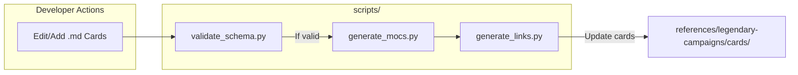

<!-- source: DeepWiki mcp.deepwiki.com · repo smixs/creative-director-skill · page 7 System Architecture · fetched 2026-10-27 -->

# System Architecture

<details>
<summary>Relevant source files</summary>

The following files were used as context for generating this wiki page:

- [README.md](README.md)
- [creative-director/SKILL.md](creative-director/SKILL.md)
- [creative-director/references/legendary-campaigns/README.md](creative-director/references/legendary-campaigns/README.md)

</details>


This page describes the technical structure of the Creative Director Skill repository: how files are organized, how `SKILL.md` acts as the sole orchestration point, the role of the 571-case library, and the maintenance pipeline that ensures schema integrity. For details on the five-phase process, see [Creative Process](#2). For details on the evaluation scoring system, see [Evaluation System](#4).

---

## Repository Layout

The repository is structured as a modular, platform-agnostic system where logic is separated from data (the campaign library) and orchestration.

```
creative-director/
├── SKILL.md                          ← Orchestrator + Phase Router
├── assets/
│   └── output-templates.md           ← Phase 5 presentation formats
├── scripts/                          ← Maintenance scripts (Python/uv)
│   ├── validate_schema.py            ← Frontmatter validator
│   ├── generate_mocs.py              ← MOC rebuilder
│   └── generate_links.py             ← Wikilink generator
└── references/
    ├── tag-schema.md                 ← 17-axis frontmatter contract
    ├── idea-taxonomy.md              ← Pollard 7-level taxonomy
    ├── emotion-hierarchy.md          ← Tier 1/2/3 + 30+ specific emotion values
    ├── activation-toolkit.md         ← 9 activation formats + Non-ad vs Execution test
    ├── legendary-patterns.md         ← P01-P18 mechanics + Pre-Mortem template
    ├── insight-mining.md             ← Phase 2 techniques
    ├── methods-catalog.md            ← Phase 3 method library
    ├── method-selection-matrix.md    ← Phase 3 routing logic
    ├── scoring-calibration.md        ← Phase 4 scoring rubrics
    ├── creative-constitution.md      ← Phase 4 evaluation framework
    ├── storytelling-frameworks.md    ← Phase 5 narrative framing
    ├── legendary-campaigns/          ← 571-case library
    │   ├── MOC-*.md                  ← 6 Maps of Content
    │   └── cards/                    ← Individual campaign files
    └── ...                           ← Other reference modules
```

Sources: [README.md:83-97](), [creative-director/references/legendary-campaigns/README.md:7-18]()

---

## SKILL.md as the Sole Orchestrator

`creative-director/SKILL.md` is the primary entry point. It contains the **Phase Router**, which inspects user intent to determine the entry phase [creative-director/SKILL.md:27-36](), and acts as a module loader using `[[wikilink]]` directives to pull in specific reference files only when needed.

**Diagram: System Orchestration and Data Flow**

```mermaid
graph TD
    "User Prompt" --> S["creative-director/SKILL.md\n(Phase Router)"]
    
    subgraph "Phase Logic"
        S -->|"Phase 1"| IT["references/idea-taxonomy.md"]
        S -->|"Phase 1"| AT["references/activation-toolkit.md"]
        S -->|"Phase 2"| IM["references/insight-mining.md"]
        S -->|"Phase 3"| MC["references/methods-catalog.md"]
        S -->|"Phase 3"| MSM["references/method-selection-matrix.md"]
        S -->|"Phase 3"| SF["references/storytelling-frameworks.md"]
        S -->|"Phase 4"| SC["references/scoring-calibration.md"]
        S -->|"Phase 4"| CC["references/creative-constitution.md"]
        S -->|"Phase 5"| OT["assets/output-templates.md"]
    end

    subgraph "Knowledge & Calibration"
        S -->|"Priming/Saturation"| MOC["references/legendary-campaigns/MOC-*.md"]
        MOC -->|"Lookup"| CARDS["references/legendary-campaigns/cards/*.md"]
        CARDS -.->|"Validated by"| TS["references/tag-schema.md"]
        S -->|"Pattern Reference"| LP["references/legendary-patterns.md"]
        S -->|"Emotion Reference"| EH["references/emotion-hierarchy.md"]
    end
```

Sources: [creative-director/SKILL.md:27-37](), [creative-director/SKILL.md:53](), [creative-director/SKILL.md:65](), [creative-director/SKILL.md:72-73](), [creative-director/SKILL.md:94-96](), [creative-director/SKILL.md:100](), [creative-director/SKILL.md:115]()

---

## The 17-Axis Frontmatter Contract

The system relies on a strict metadata contract defined in `tag-schema.md`. Every campaign card in the library must adhere to this schema to ensure the AI can perform precise filtering (e.g., by budget, emotion tier, or Pollard 7-level idea type).

| Axis Type | Key Fields | Purpose |
|---|---|---|
| **Structural** | `id`, `pattern`, `idea_type` | Identification and mechanical classification. |
| **Strategic** | `industry`, `goal`, `insight_domain` | Matching cases to the current brief's context. |
| **Creative** | `emotion`, `emotion_tier`, `risk` | Calibrating the "feeling" and safety of ideas. |
| **Commercial** | `budget`, `duration`, `channel` | Ensuring feasibility within constraints. |
| **Quality** | `quality_score`, `awards`, `scalability` | Benchmarking against the best in the industry. |

Sources: [README.md:35-36](), [creative-director/references/tag-schema.md:7-33](), [creative-director/references/tag-schema.md:118-126]()

---

## Maintenance Pipeline

To keep the 571-case library healthy and navigable, the system uses three Python scripts managed via `uv` [README.md:39]().

1.  **`validate_schema.py`**: Validates all card frontmatter against the enums and types in `tag-schema.md` [README.md:88]().
2.  **`generate_mocs.py`**: Scans the `cards/` directory and rebuilds the six Maps of Content (Index, Pattern, Emotion, Format, Industry, Budget) [README.md:89]().
3.  **`generate_links.py`**: Idempotently generates the `## Related` section for every card, creating wikilinks to pattern hubs and sibling campaigns [README.md:90]().

**Diagram: Maintenance Script Pipeline**



Sources: [creative-director/references/legendary-campaigns/README.md:76-83]()

---

## Platform-Agnostic Design

The system is designed for maximum portability. It uses standard Markdown and YAML, making it compatible with any modern AI environment:

*   **Claude Projects:** Upload the folder; the model uses `SKILL.md` as the system prompt and navigates references via the knowledge base.
*   **Claude Code / Cursor / Windsurf:** The agent reads the files directly from the local workspace.
*   **LLM API (GPT-4/Gemini):** Files can be attached as context or concatenated into a long-context prompt.

The `[[wikilink]]` syntax acts as a universal retrieval hint for the model to "load" the relevant module during specific phases [creative-director/SKILL.md:72-120]().

Sources: [README.md:1-16](), [creative-director/references/legendary-campaigns/README.md:30-47]()

---

## Extending the System

The modular architecture allows for individual components to be swapped or updated with minimal friction:

*   **Add Campaigns:** Add a new `.md` file to `cards/` and run the maintenance pipeline.
*   **Modify Schema:** Update `tag-schema.md`, adjust cards, and re-validate.
*   **Update Methods:** Edit `methods-catalog.md` to add new creative techniques without touching the evaluation logic.
*   **Swap Evaluation:** Replace `scoring-calibration.md` to use a different agency's internal scoring rubric.

For deep dives into specific files, see:
*   [Reference Files Guide](#7.1) — Detailed map of every reference file.
*   [Maintenance Scripts](#7.2) — Technical reference for Python automation.

Sources: [creative-director/references/tag-schema.md:3-4](), [creative-director/references/legendary-campaigns/README.md:76-83]()

---

