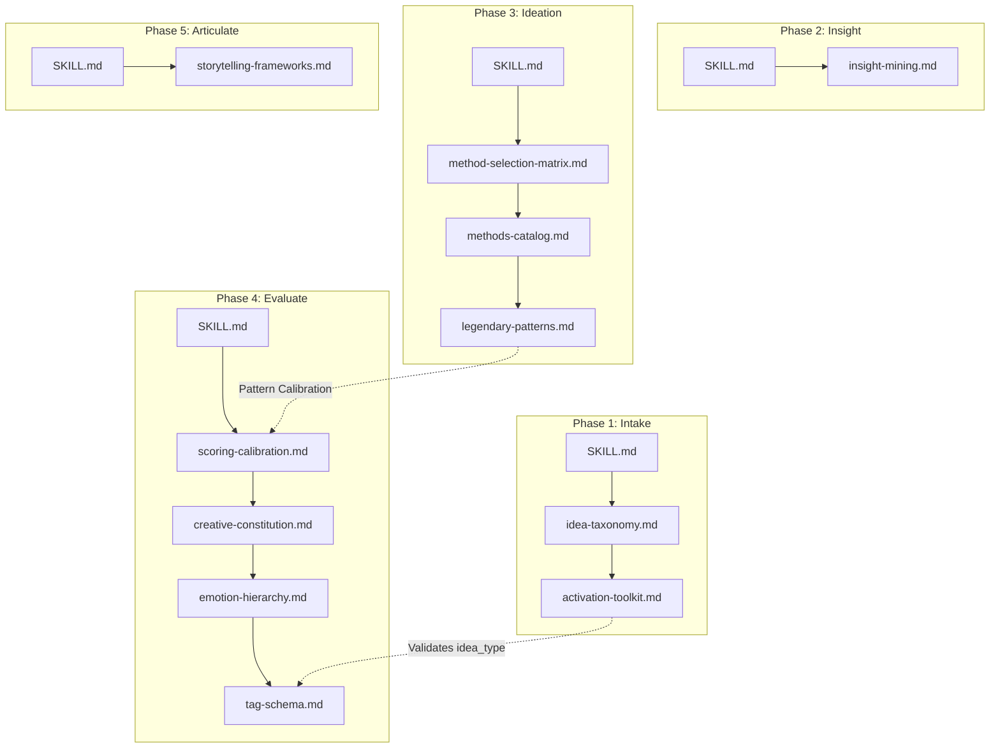
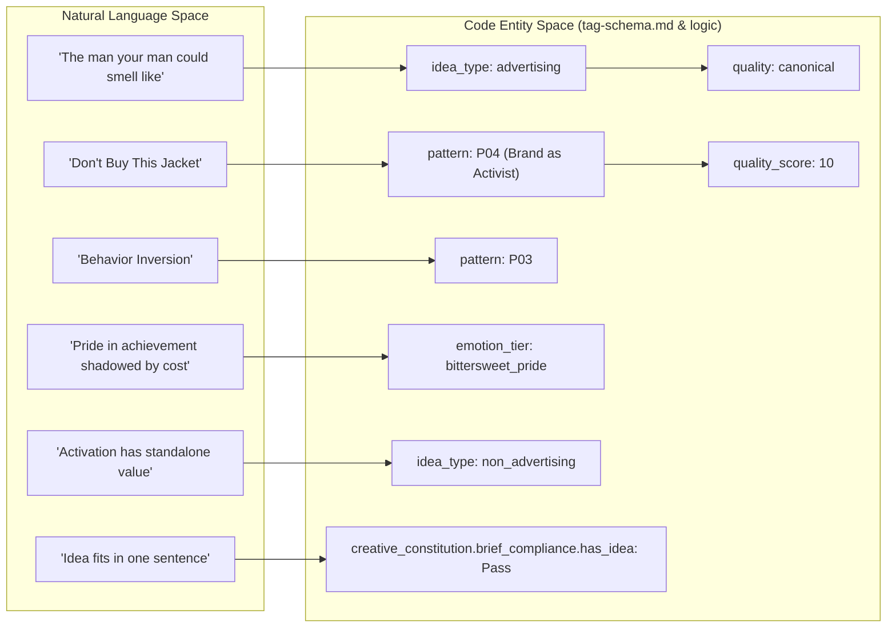

<!-- source: DeepWiki mcp.deepwiki.com · repo smixs/creative-director-skill · page 7.1 Reference Files Guide · fetched 2026-10-27 -->

# Reference Files Guide

Relevant source files

The following files were used as context for generating this wiki page:

- [creative-director/references/activation-toolkit.md](creative-director/references/activation-toolkit.md)
- [creative-director/references/creative-constitution.md](creative-director/references/creative-constitution.md)
- [creative-director/references/emotion-hierarchy.md](creative-director/references/emotion-hierarchy.md)
- [creative-director/references/idea-taxonomy.md](creative-director/references/idea-taxonomy.md)
- [creative-director/references/insight-mining.md](creative-director/references/insight-mining.md)

This page provides a detailed technical map of the reference files located in `creative-director/references/`. These files constitute the "knowledge base" and "contractual logic" of the Creative Director Skill, governing everything from metadata validation to the selection of creative methodologies.

## Reference Architecture Overview

The reference files are not merely documentation; they are active components that the system loads during specific phases of the creative pipeline. They provide the enums, scoring rubrics, and structural templates that transform raw LLM output into professional-grade creative strategy.

### System Data Flow

The following diagram illustrates how reference files are ingested across the five-phase pipeline.

**Diagram: Reference File Ingestion Pipeline**

Sources: [creative-director/references/tag-schema.md:1-40](), [creative-director/references/idea-taxonomy.md:1-10](), [creative-director/references/activation-toolkit.md:1-17]()

---

## 1. Core Taxonomy & Contracts

These files define the fundamental structure of the data and the "rules of the game" for what constitutes an idea.

### `tag-schema.md` (The Frontmatter Contract)
This is the single source of truth for the 17-axis metadata schema used in the `legendary-campaigns/cards/`. It defines strict enums for fields like `industry`, `pattern` (P01–P18), `idea_type`, and `emotion_tier`.
*   **Implementation:** Used by `scripts/validate_schema.py` to ensure all 571+ cards remain valid and queryable.
*   **Key Enums:** `industry` (25+ values), `pattern` (18 values), `media_epoch`, and `risk`.
*   **Sources:** [creative-director/references/tag-schema.md:1-213]()

### `idea-taxonomy.md` (Pollard 7-Level)
Based on Mark Pollard's framework, this file prevents "level-mixing" (e.g., providing an execution when a brand idea was requested).
*   **Levels:** Business, Brand, Tagline, Advertising, Campaign, Non-advertising, Execution.
*   **Function:** Used in **Phase 1** to categorize the brief and in **Phase 4** to ensure the generated idea matches the required scope. The `idea_type` field in card frontmatter maps directly to this taxonomy [creative-director/references/idea-taxonomy.md:7]().
*   **Sources:** [creative-director/references/idea-taxonomy.md:1-143]()

### `emotion-hierarchy.md`
Provides a 3-tier hierarchy of 30+ emotional values.
*   **Tier 1:** Generic/Forgettable emotions like `happy`, `sad`, `angry` [creative-director/references/emotion-hierarchy.md:7-17]().
*   **Tier 2:** Specific/Memorable emotions like `nostalgic`, `defiant`, `proud` [creative-director/references/emotion-hierarchy.md:22-43]().
*   **Tier 3:** Complex/Greatness emotions, which are two emotions in unresolved tension, such as `bittersweet_pride`, `ironic_sincerity` [creative-director/references/emotion-hierarchy.md:46-62]().
*   **Function:** Used to tag ideas with emotional resonance and match them against the `emotion` field in the `tag-schema.md`. In Phase 4, for the "Emotional Response" scoring criterion, the tier determines the score range [creative-director/references/emotion-hierarchy.md:81-91](). During Pre-Mortem, Tier 1 emotions are flagged as a risk [creative-director/references/emotion-hierarchy.md:126-127]().
*   **Sources:** [creative-director/references/emotion-hierarchy.md:1-135]()

---

## 2. Strategy & Ideation Toolkits

These files govern the "how" of the creative process—the specific techniques used to find insights and generate concepts.

### `insight-mining.md`
Contains the executable instructions for the seven primary insight techniques.
*   **Techniques:** Mark Pollard's Four Points [creative-director/references/insight-mining.md:7-24](), JTBD (Jobs To Be Done) for Advertising [creative-director/references/insight-mining.md:28-45](), Tension Spotting [creative-director/references/insight-mining.md:48-67](), HMW (How Might We) [creative-director/references/insight-mining.md:70-91](), Abstraction Laddering [creative-director/references/insight-mining.md:94-109](), and Assumption Mapping [creative-director/references/insight-mining.md:112-123]().
*   **Standard Format:** The document implicitly guides towards a structured insight format by detailing how to identify problems, insights, advantages, and strategies.
*   **Sources:** [creative-director/references/insight-mining.md:1-123]()

### `methods-catalog.md`
A comprehensive library of 20+ ideation methodologies.
*   **Structural Templates:** SIT/Goldenberg (Subtraction, Task Unification), SCAMPER, TRIZ.
*   **Association:** Bisociation, Random Entry, Forced Connections.
*   **Inversion:** Reverse Brainstorming, Provocation PO.
*   **Sources:** [creative-director/references/methods-catalog.md:1-131]()

### `method-selection-matrix.md`
The logic engine that decides which methods to use. It maps 12 different task types (e.g., "Low Budget Stunt" vs. "Brand Repositioning") to specific "Method Triplets" to ensure variety and rotation across passes.
*   **Sources:** [creative-director/references/method-selection-matrix.md:1-50]() (Note: Reference based on summary in Overview).

---

## 3. Evaluation & Pattern Logic

These files provide the "Critical Director" persona with the tools to judge and refine work.

### `legendary-patterns.md` (P01–P18)
Defines the 18 recurring patterns found in award-winning work.
*   **Function:** Used for **Pattern Calibration**. If an idea falls into a highly saturated pattern (e.g., P03 Behavior Inversion with 44 cases), the system triggers an "Originality Pressure" warning.
*   **Pre-Mortem:** Includes a template to identify failure modes before finalization.
*   **Sources:** [creative-director/references/legendary-patterns.md:1-115]()

### `scoring-calibration.md`
The definitive rubric for the three scoring systems.
*   **HumanKind Scale (1–10):** Focuses on "Changing Behavior."
*   **Grey Scale (1–10):** Focuses on "The Idea" vs "The Execution."
*   **Weighted Criteria:** Six axes including Originality, Tension, and Simplicity.
*   **Sources:** [creative-director/references/tag-schema.md:200-202]()

### `creative-constitution.md`
A structured set of principles for evaluating and critiquing creative work, based on the Voskresensky/IKRA approach [creative-director/references/creative-constitution.md:4]().
*   **Layer 1: Brief Compliance (pass/fail):** Eight mandatory questions that act as filters. If an idea fails even one, it's not ready for creative quality evaluation [creative-director/references/creative-constitution.md:7-10](). Examples include "Is there an idea?" [creative-director/references/creative-constitution.md:11-19]() and "Does it convey the intended message?" [creative-director/references/creative-constitution.md:20-28]().
*   **Function:** Ensures foundational requirements are met before deeper evaluation.
*   **Sources:** [creative-director/references/creative-constitution.md:1-82]()

### `activation-toolkit.md`
A specialized guide for "Non-advertising" ideas.
*   **The Critical Test:** "Remove the campaign—does the activation still have meaning?" [creative-director/references/activation-toolkit.md:13](). This test determines if an idea is `non_advertising` or `execution` [creative-director/references/activation-toolkit.md:15-16]().
*   **9 Formats:** Describes formats like Experiential [creative-director/references/activation-toolkit.md:36-50](), Shopper & Retail [creative-director/references/activation-toolkit.md:53-65](), Promo [creative-director/references/activation-toolkit.md:68-81](), PR Stunts [creative-director/references/activation-toolkit.md:84-96](), and Creative Commerce [creative-director/references/activation-toolkit.md:100-112](). Each format includes mechanics, best use cases, pattern triggers, canonical examples, and risks.
*   **Function:** Used in Phase 1 Intake when the brief mentions activation, and in Phase 4 when `idea_type` has been tagged [creative-director/references/activation-toolkit.md:28-29]().
*   **Sources:** [creative-director/references/activation-toolkit.md:1-117]()

### `storytelling-frameworks.md`
This file is not provided in the given content, but based on the table of contents, it would contain reference for narrative frameworks.

---

## Technical Mapping: Code to Concept

The following diagram maps the Natural Language concepts found in the reference files to the specific Code Entities (enums and logic) used by the system.

**Diagram: Concept to Code Entity Mapping**

Sources: [creative-director/references/tag-schema.md:88-106](), [creative-director/references/idea-taxonomy.md:68-85](), [creative-director/references/legendary-patterns.md:51-81](), [creative-director/references/emotion-hierarchy.md:52](), [creative-director/references/activation-toolkit.md:15](), [creative-director/references/creative-constitution.md:15]()

## Interrelation Summary Table

| File | Primary Phase | Interdependence |
| :--- | :--- | :--- |
| `tag-schema.md` | Phase 4 (Eval) | Validates `legendary-campaigns/` cards |
| `idea-taxonomy.md` | Phase 1 (Intake) | Sets the `idea_type` for the whole run |
| `emotion-hierarchy.md` | Phase 4 (Eval) | Influences `emotional_response` score; used in Pre-Mortem |
| `insight-mining.md` | Phase 2 (Insight) | Provides techniques for insight generation |
| `methods-catalog.md` | Phase 3 (Ideation) | Executed by `method-selection-matrix.md` |
| `method-selection-matrix.md` | Phase 3 (Ideation) | Selects method triplets for ideation |
| `scoring-calibration.md` | Phase 4 (Eval) | Defines rubrics for idea evaluation |
| `creative-constitution.md` | Phase 4 (Eval) | Provides pass/fail criteria and quality principles |
| `legendary-patterns.md`| Phase 4 (Eval) | Used for Pattern Calibration vs Library |
| `activation-toolkit.md`| Phase 1 & 3 | Triggers `non_advertising` logic |
| `storytelling-frameworks.md` | Phase 5 (Articulate) | Provides narrative structures for output |

Sources: [creative-director/references/tag-schema.md:1-33](), [creative-director/references/idea-taxonomy.md:1-8](), [creative-director/references/activation-toolkit.md:1-17](), [creative-director/references/emotion-hierarchy.md:124-127](), [creative-director/references/insight-mining.md:1-4](), [creative-director/references/creative-constitution.md:1-4]()

---

