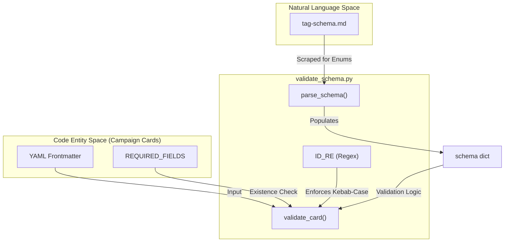
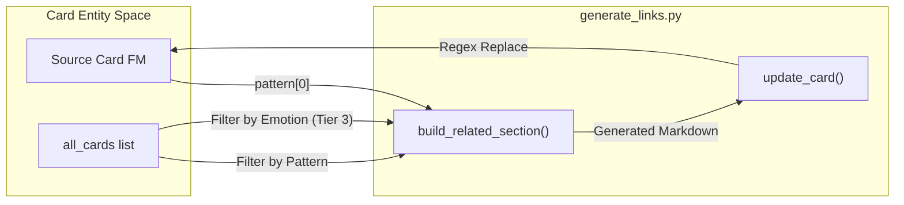

<!-- source: DeepWiki mcp.deepwiki.com · repo smixs/creative-director-skill · page 7.2 Maintenance Scripts · fetched 2026-10-27 -->

# Maintenance Scripts

Relevant source files

The following files were used as context for generating this wiki page:

- [README.md](README.md)
- [creative-director/references/legendary-campaigns/MOC-index.md](creative-director/references/legendary-campaigns/MOC-index.md)
- [creative-director/references/legendary-campaigns/README.md](creative-director/references/legendary-campaigns/README.md)

The Creative Director Skill utilizes a suite of Python maintenance scripts located in `creative-director/scripts/` to ensure the integrity and navigability of the 571-case campaign library. These scripts enforce the 17-axis frontmatter contract defined in `tag-schema.md`, regenerate the six Maps of Content (MOCs), and idempotently update cross-references between campaign cards.

## Run Pipeline

The maintenance workflow follows a strict sequential pipeline to maintain data consistency. Developers should run these scripts after adding new cards or modifying existing metadata.

1.  **Edit/Add Cards**: Modify markdown files in `references/legendary-campaigns/cards/`.
2.  **Validate Schema**: Run `validate_schema.py` to catch enum mismatches or missing required fields.
3.  **Regenerate MOCs**: Run `generate_mocs.py` to rebuild the six index files.
4.  **Regenerate Links**: Run `generate_links.py` to update the `## Related` sections within each card.

### Dependency Management (PEP 723)
All scripts use PEP 723 inline dependency metadata [creative-director/scripts/validate_schema.py:1-4](), allowing them to be executed via `uv run` without manual environment management. They primarily depend on `pyyaml` for frontmatter parsing.
Sources: [README.md:39](), [creative-director/scripts/validate_schema.py:1-4]()

---

## Schema Validation (`validate_schema.py`)

The `validate_schema.py` script acts as the primary gatekeeper for the library's data quality. It parses the natural language definitions in `tag-schema.md` to extract valid enum values and applies them to every card in the library.

### Key Logic and Constraints
-   **Required Fields**: Enforces the presence of 23 mandatory keys [creative-director/scripts/validate_schema.py:18-23]().
-   **Dynamic Enum Extraction**: It uses regex to scrape allowed values directly from the markdown headers and bullet points in `tag-schema.md` [creative-director/scripts/validate_schema.py:53-104]().
-   **Cardinality Checks**: Validates that list fields (like `pattern` or `emotion`) contain the correct number of entries (e.g., 1–3 patterns) [creative-director/scripts/validate_schema.py:26-31]().
-   **Type Safety**: Ensures `year` is an integer between 1950–2025 and `quality_score` is 1–10 [creative-director/scripts/validate_schema.py:138-147]().

### Diagram: Schema Validation Flow
This diagram illustrates how `validate_schema.py` bridges the "Natural Language Space" of the schema document to the "Code Entity Space" of the card frontmatter.

Sources: [creative-director/scripts/validate_schema.py:14-23](), [creative-director/scripts/validate_schema.py:53-104](), [creative-director/scripts/validate_schema.py:107-163]()

---

## MOC Generation (`generate_mocs.py`)

The `generate_mocs.py` script aggregates data across the entire library to rebuild the six primary Maps of Content located in `references/legendary-campaigns/`.

### Implementation Details
The script parses all cards and groups them into specialized dictionaries to generate the following files:
1.  **MOC-index**: Sorted by Year (DESC) and Quality Score (DESC) [creative-director/scripts/generate_mocs.py:78-89]().
2.  **MOC-pattern**: Grouped by P01–P18 patterns [creative-director/scripts/generate_mocs.py:91-112]().
3.  **MOC-emotion**: Grouped by `emotion_tier` (3 → 2 → 1) [creative-director/scripts/generate_mocs.py:115-133]().
4.  **MOC-format**: Grouped by media category [creative-director/scripts/generate_mocs.py:136-154]().
5.  **MOC-industry**: Alphabetical grouping by industry [creative-director/scripts/generate_mocs.py:157-171]().
6.  **MOC-budget**: Grouped by low/medium/high [creative-director/scripts/generate_mocs.py:174-192]().

### Data Flow
The script uses `load_cards()` to create a list of dictionaries representing the frontmatter of every card [creative-director/scripts/generate_mocs.py:195-208](). This list is then passed to specific generators (e.g., `generate_moc_pattern`) which return formatted markdown lines for writing to disk.
Sources: [creative-director/scripts/generate_mocs.py:15-20](), [creative-director/scripts/generate_mocs.py:44-59](), [creative-director/scripts/generate_mocs.py:78-192](), [creative-director/references/legendary-campaigns/MOC-index.md:3]()

---

## Link Generation (`generate_links.py`)

The `generate_links.py` script maintains the relational integrity of the library by idempotently updating the `## Related` section at the bottom of every campaign card.

### Relationship Logic
The script builds links based on three criteria [creative-director/scripts/generate_links.py:29-61]():
-   **Pattern Link**: A link to the primary pattern's section in `MOC-pattern.md`.
-   **Siblings**: The top two cards (by `quality_score`) that share the same primary pattern.
-   **Emotion Match**: For Tier 3 (high-intensity) cards, it finds another Tier 3 card sharing the same specific emotion.

### Idempotent Updates
The `update_card()` function uses a regex pattern `^## Related\b.*?(?=^## |\Z)` to locate the existing Related section and replace it, or append a new one if it does not exist [creative-director/scripts/generate_links.py:64-78]().

### Diagram: Link Association Logic
This diagram shows how the script associates disparate card entities into a relational graph.

Sources: [creative-director/scripts/generate_links.py:29-61](), [creative-director/scripts/generate_links.py:64-78]()

---

## Extending the System

### Adding New Cards
To add a card, create a new `.md` file in `references/legendary-campaigns/cards/`. Ensure the filename matches the `id` field in the frontmatter. Run the full pipeline to integrate the card into the MOCs and link it to siblings.
Sources: [creative-director/references/legendary-campaigns/README.md:76-83]()

### Modifying the Schema
To add a new industry or media category:
1.  Update the bulleted list in `references/tag-schema.md`.
2.  Run `validate_schema.py` to ensure existing cards remain compliant.
3.  If adding a new MOC axis, a new `generate_moc_x` function must be added to `generate_mocs.py`.
Sources: [creative-director/scripts/validate_schema.py:53-104](), [creative-director/scripts/generate_mocs.py:15-20]()

---

