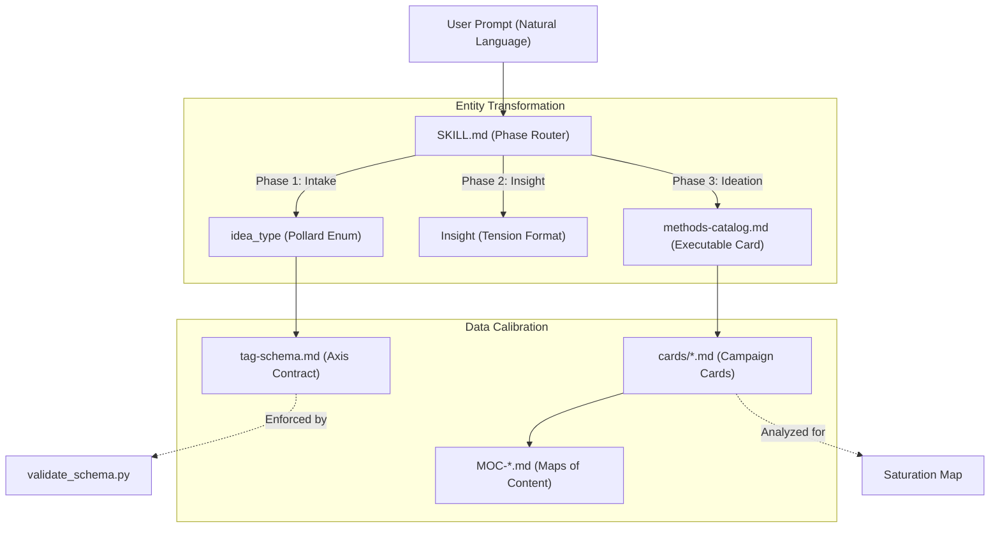

<!-- source: DeepWiki mcp.deepwiki.com · repo smixs/creative-director-skill · page 8 Glossary · fetched 2026-10-27 -->

# Glossary

Relevant source files

The following files were used as context for generating this wiki page:

- [README.md](README.md)
- [creative-director/SKILL.md](creative-director/SKILL.md)
- [creative-director/references/emotion-hierarchy.md](creative-director/references/emotion-hierarchy.md)
- [creative-director/references/idea-taxonomy.md](creative-director/references/idea-taxonomy.md)
- [creative-director/references/legendary-campaigns/README.md](creative-director/references/legendary-campaigns/README.md)

This page provides definitions for codebase-specific terms, domain concepts, and technical jargon used within the **Creative Director Skill v2.0**. It serves as a bridge between advertising industry strategy and the technical implementation of the five-phase creative pipeline.

## System Orchestration

### SKILL.md
The primary entry point and "brain" of the repository. It contains the system prompt, instructions, and the logic for the **Phase Router**. It orchestrates the flow of data between different reference files and governs the recursive refinement loop.
[creative-director/SKILL.md:1-17]()

### Phase Router
The logic block within `SKILL.md` that determines the system's entry point based on the user's prompt. It maps natural language requests to one of the five pipeline phases (Intake, Insight, Ideation, Evaluate, Articulate).
[creative-director/SKILL.md:27-38]()

### MOC (Map of Content)
Markdown files that serve as indices for the 571-case library. They allow the system to quickly "scan the canon" by grouping campaign cards by specific axes like pattern, emotion, or industry.
[creative-director/references/legendary-campaigns/README.md:10-15]()

### uv (PEP 723)
The Python package installer and resolver used to run the maintenance scripts. The scripts use inline metadata (PEP 723) to manage dependencies without requiring a global virtual environment.
[creative-director/README.md:39]()

---

## Strategic Frameworks

### Pollard 7-level Taxonomy
A framework created by Mark Pollard used to classify the "level" of a creative idea. This prevents "level mismatch" (e.g., delivering a one-off execution when the client asked for a brand platform). The `idea_type` field in card frontmatter maps directly to this taxonomy.
[creative-director/references/idea-taxonomy.md:1-8]()

| Level | `idea_type` Enum | Focus |
| :--- | :--- | :--- |
| **Business** | `business` | What the company does that is novel. |
| **Brand** | `brand` | What the company stands for. |
| **Tagline** | `tagline` | The brand idea in ≤ 5 words. |
| **Advertising** | `advertising` | The central thought governing all comms. |
| **Campaign** | `campaign` | Subset of the ad idea for a specific window. |
| **Non-advertising** | `non_advertising` | A useful object/behavior (not an ad). |
| **Execution** | `execution` | Specific channel/format/style decisions. |

**Sources:** [creative-director/references/idea-taxonomy.md:7-142](), [creative-director/SKILL.md:52-62]()

### Big/Campaign/Execution Idea
These are specific `idea_type` values within the Pollard 7-level taxonomy, representing different scopes of creative work.
*   **Big Idea:** Often corresponds to `brand` or `advertising` idea, a foundational concept.
*   **Campaign Idea:** A specific application of an advertising idea for a limited period.
*   **Execution Idea:** The concrete manifestation of a campaign idea in a specific channel or format.
[creative-director/SKILL.md:49]()

### Insight & Tension
An **Insight** is a "human truth" formatted as: *"[audience] wants [X], but [Y stands in the way], because [Z]"*.
A **Tension** is the friction point that makes the insight powerful. The system identifies three types:
*   **Cultural:** Society's expectations vs. reality.
*   **Category:** What the industry promises vs. delivers.
*   **Human:** Internal conflict within the consumer.
The `Tension test` is applied to each generated idea in Phase 3 to check if it carries an unresolved tension.
[creative-director/SKILL.md:78-88](), [creative-director/SKILL.md:115-116]()

### HMW (How Might We)
A problem-framing technique used in Phase 2 (Insight Mining) to rephrase insights into actionable questions. The skill generates 3 formulations at different levels of abstraction (broad / medium / narrow).
[creative-director/SKILL.md:83-83]()

### JTBD (Jobs To Be Done)
A framework used in Phase 2 (Insight Mining) to understand what "job" a consumer hires a product or communication to do.
[creative-director/SKILL.md:78-78]()

### Abstraction Laddering
A technique used in Phase 2 (Insight Mining) to choose the optimal "rung" between abstract and concrete for an insight, ensuring it is neither too vague nor too specific.
[creative-director/SKILL.md:84-84]()

### P01-P18
Refers to the 18 creative patterns or mechanics documented in `legendary-patterns.md`. These patterns are used for priming, pattern calibration, and originality benchmarking.
[creative-director/README.md:36]()

### non_advertising vs execution
A diagnostic test within the `activation toolkit` to determine the true nature of an activation idea. If removing the campaign still leaves the activation with meaning, it's a `non_advertising` idea; otherwise, it's an `execution`.
[creative-director/SKILL.md:65-65]()

### activation toolkit
A reference file (`activation-toolkit.md`) containing 9 activation formats and the `non_advertising` vs `execution` test.
[creative-director/README.md:42]()

---

## Technical Entity Space

### Card & Frontmatter
A **Card** is a single markdown file in `legendary-campaigns/cards/` representing a real-world advertising campaign. Each card contains **Frontmatter**: a YAML block of 17 metadata axes (e.g., `pattern`, `emotion_tier`, `quality_score`) used for filtering and calibration.
[creative-director/references/legendary-campaigns/README.md:21-22]()

### 17-Axis Schema
The authoritative contract defined in `tag-schema.md`. It dictates the required fields and allowed enum values for every campaign card. The `validate_schema.py` script enforces this contract.
[creative-director/README.md:36]()

### quality_score
A field within the 17-axis schema that represents the overall quality assessment of a campaign card.
[creative-director/references/tag-schema.md:40-42]()

### emotion_tier
A field within the 17-axis schema that categorizes the emotional complexity of a campaign's core emotion into Tier 1 (Generic), Tier 2 (Specific), or Tier 3 (Complex/Greatness). This directly influences the `emotional_response` score.
[creative-director/references/emotion-hierarchy.md:1-120]()

### insight_domain
A field within the 17-axis schema that classifies the primary domain of the insight (e.g., `human_nature`, `cultural_trend`, `category_truth`).
[creative-director/references/tag-schema.md:40-42]()

### media_epoch
A field within the 17-axis schema that categorizes the historical media context in which a campaign was launched (e.g., `broadcast_era`, `digital_native`).
[creative-director/references/tag-schema.md:40-42]()

### Saturation Map
A table within `legendary-campaigns/README.md` that indicates the density of campaigns for each P01-P18 pattern, informing the `originality cap`.
[creative-director/references/legendary-campaigns/README.md:48-58]()

### Originality Cap
An empirical limit placed on an idea's `originality` score (usually capped at 7/10) if the **Saturation Map** shows 3+ canonical cases in the library using the same mechanic/pattern.
[creative-director/references/legendary-campaigns/README.md:48-58]()

### Steal
A section within each campaign card that describes a pattern-level borrowing strategy, indicating how the core mechanic or insight can be adapted.
[creative-director/references/legendary-campaigns/README.md:27]()

### Mechanic
A section within each campaign card that describes what was actually executed in the campaign.
[creative-director/references/legendary-campaigns/README.md:26]()

### wikilinks
Internal links within markdown files, denoted by `[[filename]]` or `[[filename#section]]`, used to connect related reference files and campaign cards. The `generate_links.py` script rebuilds these links.
[creative-director/README.md:39]()

### stub/full/canonical
These are `quality` values for campaign cards, indicating their completeness and authority:
*   `canonical`: Gold standard, fully documented, often award-winning.
*   `full`: Well-documented, but not necessarily canonical.
*   `stub_enriched`: Limited source detail, sections constructed from inference.
*   `stub_minimal`: Minimal detail, `verification_required: true`.
[creative-director/references/legendary-campaigns/README.md:64-68]()

### confidence
A field within campaign cards (`high/medium/low`) indicating the reliability of the card's content. Cards with `confidence: low` require manual verification.
[creative-director/references/legendary-campaigns/README.md:62-69]()

### System Data Flow
The following diagram illustrates how natural language inputs are transformed into structured code entities through the pipeline.

**Title: Natural Language to Code Entity Mapping**

**Sources:** [creative-director/SKILL.md:27-48](), [creative-director/references/tag-schema.md:1-42](), [creative-director/references/legendary-campaigns/README.md:1-18]()

---

## Evaluation & Refinement

### Case-Soaking & RESTART
A recovery mechanism used in Phase 4 when ideation plateaus. The system "soaks" in 8-12 canonical cards from the library to re-calibrate its sense of quality before a **RESTART** (generating a fresh batch of ideas).
[creative-director/README.md:58]()

### Pre-Mortem
A step performed before final delivery where the system simulates failure modes for the recommended idea, asking "Why did this fail?" to surface risks like brief non-compliance or cultural backlash. This is also a template in `legendary-patterns.md`.
[creative-director/README.md:44]()

### Pattern Calibration
A step in Phase 4 where a new idea is compared against its closest P01-P18 pattern in the library to articulate how it differs and ensure originality.
[creative-director/references/legendary-campaigns/README.md:46-46]()

### HumanKind Scale
A 1–10 scale (by Leo Burnett) measuring an idea's impact on human behavior, used as one of the scoring systems in Phase 4.
[creative-director/SKILL.md:56]()

### Grey Scale
A 1–10 scale measuring the "business" or "rational" strength of an idea, used as one of the scoring systems in Phase 4.
[creative-director/SKILL.md:56]()

### Brief Compliance
A pass/fail gate in Phase 4, consisting of eight questions to ensure the idea directly addresses the brief's requirements.
[creative-director/references/creative-constitution.md:1-8]()

### Gap Analysis
A process within Phase 4 evaluation where the system identifies weaknesses in an idea's scoring criteria and targets them for recursive refinement.
[creative-director/SKILL.md:57]()

### Pipeline Execution Logic
The diagram below shows the recursive relationship between the evaluation criteria and the library.

**Title: Evaluation and Calibration Loop**

**Sources:** [creative-director/SKILL.md:118-135](), [creative-director/references/scoring-calibration.md:1-74](), [creative-director/references/legendary-campaigns/README.md:48-58]()

---

## Creative Methodologies

### SIT (Systematic Inventive Thinking)
A **Structural Template** method for ideation that relies on "Closed World" principles, transforming existing product elements rather than inventing from zero.
[creative-director/SKILL.md:103]()

### SCAMPER
A **Structural Template** method for ideation, an acronym for Substitute, Combine, Adapt, Modify (Magnify, Minify), Put to another use, Eliminate, Reverse/Rearrange.
[creative-director/SKILL.md:103]()

### TRIZ (Theory of Inventive Problem Solving)
A **Structural Template** method for ideation that uses a contradiction matrix and 40 inventive principles to solve technical problems, adapted for creative challenges.
[creative-director/SKILL.md:103]()

### Bisociation
An **Association/Collision** method that forces a "donor world" or an unrelated matrix of thought onto the product to spark novel intersections.
[creative-director/SKILL.md:104]()

### Synectics
An **Association/Collision** method that uses analogies (personal, direct, symbolic, fantasy) to make the strange familiar and the familiar strange, fostering new perspectives.
[creative-director/SKILL.md:104]()

### Oblique Strategies
An **Inversion/Perturbation** method, a set of cards with aphorisms or cryptic remarks designed to break creative blocks by encouraging lateral thinking.
[creative-director/SKILL.md:105]()

### Provocation PO
An **Inversion/Perturbation** method from Edward de Bono's Lateral Thinking, where "PO" (as in "suppose") is used to introduce a statement that is known to be false or impossible, to generate new ideas.
[creative-director/SKILL.md:105]()

### Simplicity as Violence
A core principle of the skill: "The best ideas can be explained in one sentence." If an idea requires complex instructions or multiple steps, it is "killed" or refined.
[creative-director/SKILL.md:21]()

### Kill Your Darlings
A Phase 4 instruction where the AI must argue against its own favorite ideas to identify hidden weaknesses or "flabby" logic.
[creative-director/README.md:77]()

---
**Sources:**
* [creative-director/SKILL.md]()
* [creative-director/README.md]()
* [creative-director/references/tag-schema.md]()
* [creative-director/references/idea-taxonomy.md]()
* [creative-director/references/emotion-hierarchy.md]()
* [creative-director/references/methods-catalog.md]()
* [creative-director/references/scoring-calibration.md]()
* [creative-director/references/creative-constitution.md]()
* [creative-director/references/legendary-campaigns/README.md]()
* [creative-director/references/legendary-patterns.md]()
* [creative-director/references/activation-toolkit.md]()