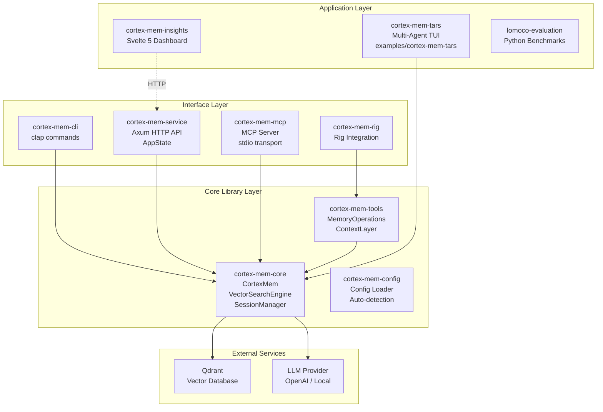
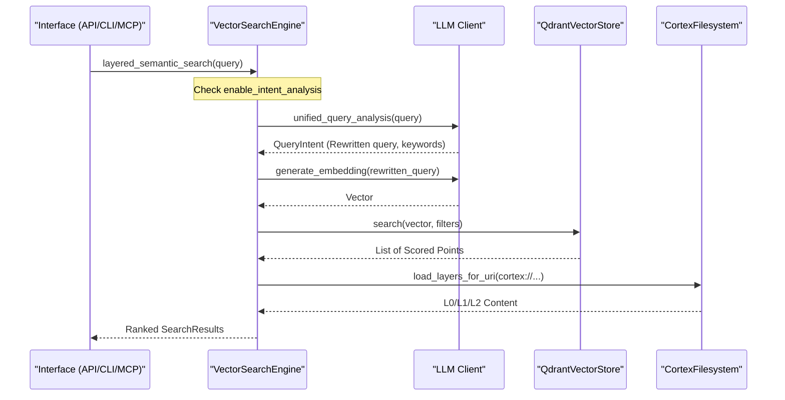

<!-- source: DeepWiki mcp.deepwiki.com · repo sopaco/cortex-mem · page 1 Overview · fetched 2026-10-27 -->

# Overview

Relevant source files

The following files were used as context for generating this wiki page:

- [Cargo.toml](Cargo.toml)
- [README.md](README.md)
- [README_zh.md](README_zh.md)
- [cortex-mem-config/Cargo.toml](cortex-mem-config/Cargo.toml)
- [cortex-mem-core/Cargo.toml](cortex-mem-core/Cargo.toml)
- [cortex-mem-core/src/incremental_memory_updater.rs](cortex-mem-core/src/incremental_memory_updater.rs)
- [cortex-mem-core/src/llm/prompts.rs](cortex-mem-core/src/llm/prompts.rs)
- [cortex-mem-core/src/search/vector_engine.rs](cortex-mem-core/src/search/vector_engine.rs)
- [cortex-mem-mcp/Cargo.toml](cortex-mem-mcp/Cargo.toml)
- [cortex-mem-rig/Cargo.toml](cortex-mem-rig/Cargo.toml)
- [cortex-mem-service/Cargo.toml](cortex-mem-service/Cargo.toml)
- [cortex-mem-service/src/handlers/automation.rs](cortex-mem-service/src/handlers/automation.rs)
- [cortex-mem-service/src/handlers/search.rs](cortex-mem-service/src/handlers/search.rs)
- [cortex-mem-service/src/handlers/sessions.rs](cortex-mem-service/src/handlers/sessions.rs)
- [cortex-mem-service/src/routes/automation.rs](cortex-mem-service/src/routes/automation.rs)
- [cortex-mem-service/src/state.rs](cortex-mem-service/src/state.rs)
- [cortex-mem-tools/Cargo.toml](cortex-mem-tools/Cargo.toml)
- [examples/@memclaw/bin-darwin-arm64/bin/README.md](examples/@memclaw/bin-darwin-arm64/bin/README.md)
- [examples/cortex-mem-tars/config.example.toml](examples/cortex-mem-tars/config.example.toml)
- [examples/locomo-evaluation/eval.py](examples/locomo-evaluation/eval.py)
- [litho.docs/en/2.Architecture.md](litho.docs/en/2.Architecture.md)
- [litho.docs/en/3.Workflow.md](litho.docs/en/3.Workflow.md)
- [litho.docs/en/4.Deep-Exploration/Core Infrastructure Domain.md](litho.docs/en/4.Deep-Exploration/Core Infrastructure Domain.md)
- [litho.docs/en/4.Deep-Exploration/Extraction Engine Domain.md](litho.docs/en/4.Deep-Exploration/Extraction Engine Domain.md)
- [litho.docs/en/4.Deep-Exploration/Search Engine Domain.md](litho.docs/en/4.Deep-Exploration/Search Engine Domain.md)

This document provides a high-level introduction to the **Cortex Memory** system, its purpose, main components, and architectural approach. For detailed architectural patterns and component interactions, see [System Architecture](#1.1). For specific feature capabilities, see [Key Features](#1.2). For installation and usage instructions, see [Getting Started](#2).

## Purpose and Scope

**Cortex Memory** is an AI-native memory framework built with Rust that enables AI agents to maintain persistent, context-aware long-term memory across sessions. It moves beyond simple chat history by providing a **hierarchical three-tier memory architecture** (L0 Abstract → L1 Overview → L2 Detail) that automatically extracts, organizes, and optimizes information.

The system utilizes a hybrid storage architecture combining **virtual-filesystem** durability (using the `cortex://` URI scheme) with vector-based **semantic search** via Qdrant.

**Sources:** [README.md:13-32](), [README.md:103-116]()

## What is Cortex-Mem?

Cortex Memory is a complete framework for giving AI applications a "brain" that remembers. It is organized into three architectural layers:

**Core Library Layer** - Foundational components:
| Component | Purpose | Key Modules |
|-----------|---------|-------------|
| `cortex-mem-core` | Central engine for processing, search, and events. | `CortexMem`, `VectorSearchEngine`, `SessionManager`, `MemoryEventCoordinator` |
| `cortex-mem-config` | Configuration management and validation. | `Config`, `QdrantConfig`, `LLMConfig`, `EmbeddingConfig` |
| `cortex-mem-tools` | Shared abstractions and payload structures. | `MemoryOperations`, `ContextLayer` |

**Interface Layer** - Access points:
| Component | Purpose | Protocol/Tech |
|-----------|---------|--------------|
| `cortex-mem-cli` | Command-line interface for administration. | Rust (clap) |
| `cortex-mem-service` | Multi-tenant REST API server. | Rust (axum) |
| `cortex-mem-mcp` | Model Context Protocol server for AI agents. | Rust, stdio transport |
| `cortex-mem-rig` | Integration for the Rig agent framework. | Rust (rig-core) |

**Application Layer** - Complete applications:
| Component | Purpose | Technology |
|-----------|---------|------------|
| `cortex-mem-tars` | Multi-agent TUI with audio and persistent memory. | Rust (ratatui) |
| `cortex-mem-insights` | Web dashboard for monitoring and visualization. | Svelte 5, TypeScript |
| `lomoco-evaluation` | Benchmarking framework for memory systems. | Python |

**Sources:** [Cargo.toml:1-12](), [README.md:103-132](), [litho.docs/en/2.Architecture.md:178-200]()

## Ecosystem Overview

**Cortex Memory Ecosystem Architecture**

The ecosystem is built around `cortex-mem-core`, which provides the `CortexMem` runtime. All interfaces depend on this core to interact with the underlying filesystem and vector store.

**Sources:** [cortex-mem-service/src/state.rs:15-41](), [litho.docs/en/2.Architecture.md:180-210]()

## Three-Domain Architecture

Cortex Memory organizes its logic into three functional domains:

1.  **Configuration Domain**: Handled by `cortex-mem-config`, it manages `config.toml` and environment variables to initialize the system.
2.  **Core Memory Domain**: Centered in `cortex-mem-core`, this domain manages the `CortexMem` struct [cortex-mem-service/src/state.rs:17](), which orchestrates the `SessionManager`, `VectorSearchEngine`, and the event-driven `MemoryEventCoordinator`.
3.  **Tool Support Domain**: Includes `cortex-mem-tools` and `cortex-mem-rig`, providing standardized ways for external applications to invoke memory operations.

**Sources:** [litho.docs/en/2.Architecture.md:11-32](), [cortex-mem-service/src/state.rs:99-126]()

## Memory Lifecycle & Workflows

**Memory Retrieval & Search Flow**

The system uses a sophisticated pipeline for both storage and retrieval:

*   **Ingestion**: When a message is added via `SessionManager::add_message` [cortex-mem-service/src/handlers/sessions.rs:156](), it triggers a `MemoryEvent`. The `MemoryEventCoordinator` handles asynchronous extraction and indexing.
*   **Search**: The `VectorSearchEngine` performs "Layered Semantic Search". It can use an LLM for `unified_query_analysis` [cortex-mem-core/src/llm/prompts.rs:136]() to rewrite queries for better recall before querying Qdrant.
*   **Optimization**: A background `MemoryCleanupService` implements the Ebbinghaus forgetting curve to archive low-strength memories [README.md:115]().

**Sources:** [cortex-mem-core/src/search/vector_engine.rs:81-116](), [cortex-mem-service/src/handlers/search.rs:81-90](), [litho.docs/en/3.Workflow.md:131-170]()

## Technology Stack

| Layer | Technologies | Purpose |
|-------|-------------|---------|
| **Runtime** | Rust 1.86+, Tokio | Performance, safety, and async I/O. |
| **Storage** | Qdrant, Local Filesystem | Hybrid Vector + Markdown (`cortex://`) storage. |
| **Web API** | Axum 0.7 | High-performance REST service. |
| **Frontend** | Svelte 5, TypeScript | Modern, reactive dashboard (Insights). |
| **AI/ML** | Rig-core, OpenAI-compatible APIs | Embeddings and structured fact extraction. |

**Sources:** [Cargo.toml:14-70](), [litho.docs/en/2.Architecture.md:33-68]()

## Integration Patterns

1.  **Direct Library**: Use `CortexMemBuilder` to embed memory directly into Rust apps.
2.  **REST API**: Connect via `cortex-mem-service` [cortex-mem-service/src/handlers/search.rs:17]().
3.  **MCP**: Use with Claude or Cursor via `cortex-mem-mcp`.
4.  **Rig Framework**: Use `cortex-mem-rig` to give Rig agents long-term memory.
5.  **OpenClaw**: Integrate via the `MemClaw` plugin.

**Sources:** [README.md:103-132](), [cortex-mem-service/src/state.rs:128-152]()

## Getting Started

1.  **Prerequisites**: Install Rust 1.86+, Qdrant (Docker recommended), and obtain an LLM API key.
2.  **Configuration**: Set up `config.toml` with your `[qdrant]`, `[llm]`, and `[embedding]` settings [cortex-mem-service/src/state.rs:52]().
3.  **Execution**: Start the service or use the CLI to begin storing and searching memories.

For detailed steps, see [Getting Started](#2).

**Sources:** [README.md:134-184]()

---

