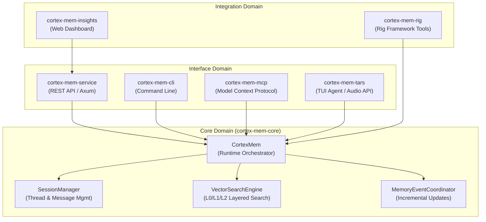
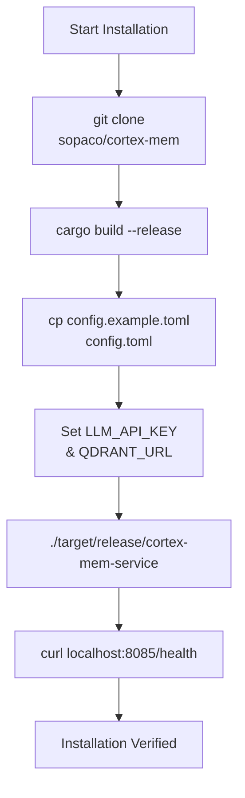

<!-- source: DeepWiki mcp.deepwiki.com · repo sopaco/cortex-mem · page 2 Getting Started · fetched 2026-10-27 -->

# Getting Started

<details>
<summary>Relevant source files</summary>

The following files were used as context for generating this wiki page:

- [Cargo.toml](Cargo.toml)
- [README.md](README.md)
- [README_zh.md](README_zh.md)
- [cortex-mem-config/Cargo.toml](cortex-mem-config/Cargo.toml)
- [cortex-mem-core/Cargo.toml](cortex-mem-core/Cargo.toml)
- [cortex-mem-core/src/incremental_memory_updater.rs](cortex-mem-core/src/incremental_memory_updater.rs)
- [cortex-mem-core/src/llm/prompts.rs](cortex-mem-core/src/llm/prompts.rs)
- [cortex-mem-core/src/search/vector_engine.rs](cortex-mem-core/src/search/vector_engine.rs)
- [cortex-mem-mcp/Cargo.toml](cortex-mem-mcp/Cargo.toml)
- [cortex-mem-rig/Cargo.toml](cortex-mem-rig/Cargo.toml)
- [cortex-mem-service/Cargo.toml](cortex-mem-service/Cargo.toml)
- [cortex-mem-service/src/handlers/automation.rs](cortex-mem-service/src/handlers/automation.rs)
- [cortex-mem-service/src/handlers/search.rs](cortex-mem-service/src/handlers/search.rs)
- [cortex-mem-service/src/handlers/sessions.rs](cortex-mem-service/src/handlers/sessions.rs)
- [cortex-mem-service/src/routes/automation.rs](cortex-mem-service/src/routes/automation.rs)
- [cortex-mem-service/src/state.rs](cortex-mem-service/src/state.rs)
- [cortex-mem-tools/Cargo.toml](cortex-mem-tools/Cargo.toml)
- [examples/@memclaw/bin-darwin-arm64/bin/README.md](examples/@memclaw/bin-darwin-arm64/bin/README.md)
- [examples/cortex-mem-tars/config.example.toml](examples/cortex-mem-tars/config.example.toml)
- [examples/locomo-evaluation/eval.py](examples/locomo-evaluation/eval.py)

</details>


This guide provides a high-level overview of setting up and running the Cortex Memory system for the first time. It covers essential prerequisites, installation steps, configuration requirements, and initial verification. Built with Rust, Cortex Memory provides a hierarchical three-tier memory architecture (L0 Abstract → L1 Overview → L2 Detail) that automatically extracts and optimizes information for AI agents.

For detailed installation instructions, see [Installation](#2.1). For comprehensive configuration options, see [Configuration](#2.2). For hands-on usage examples, see [Quick Start Examples](#2.3).

## Prerequisites

Before installing Cortex Memory, ensure your development environment meets the following requirements:

| Component | Requirement | Purpose |
|-----------|-------------|---------|
| **Rust** | Version 1.86 or higher | Required for building (Edition 2024) [Cargo.toml:16-17]() |
| **Qdrant** | Running instance (ports 6333/6334) | Vector database for semantic search [examples/cortex-mem-tars/config.example.toml:11-12]() |
| **LLM API Key** | OpenAI compatible | Fact extraction, summarization, and embeddings [examples/cortex-mem-tars/config.example.toml:17-38]() |
| **Data Directory** | Write permissions | Storing `cortex://` virtual filesystem markdown files [README.md:105-106]() |

Sources: [Cargo.toml:16-17](), [examples/cortex-mem-tars/config.example.toml:11-38](), [README.md:105-106]()

## System Components Overview

The system is a modular monolith consisting of multiple crates. The central orchestrator is the `CortexMem` runtime, which coordinates the `SessionManager`, `VectorSearchEngine`, and `MemoryEventCoordinator`.

**Cortex Memory Component Architecture**



| Component | Type | Primary Role |
|-----------|------|--------------|
| `cortex-mem-core` | Library | Core logic, storage abstraction, and AI processing [Cargo.toml:4]() |
| `cortex-mem-service` | Binary | High-performance REST API for multi-tenant deployments [Cargo.toml:8]() |
| `cortex-mem-cli` | Binary | Administrative tool for manual memory management [Cargo.toml:9]() |
| `cortex-mem-tars` | App | Multi-agent TUI with persistent memory and audio support [Cargo.toml:11]() |

Sources: [Cargo.toml:4-11](), [cortex-mem-service/src/state.rs:15-35]()

## Installation Methods

Cortex Memory is typically built from source using Cargo to ensure all features are optimized for your environment.

**Installation Process and Verification**



For specific installation commands and dependency setup for Qdrant, see [Installation](#2.1).

Sources: [README.md:323-334](), [examples/cortex-mem-tars/config.example.toml:1-43]()

## Configuration Structure

The system uses a hierarchical configuration approach. The `config.toml` file is the primary source, defining how the `CortexMemBuilder` assembles the runtime.

**Configuration Loading and Runtime Assembly**

```mermaid
graph LR
    subgraph "Configuration (cortex-mem-config)"
        TOML["config.toml"]
        ENV["Env Vars"]
    end

    subgraph "Runtime Builder"
        BUILDER["CortexMemBuilder"]
    end

    subgraph "Runtime (cortex-mem-core)"
        RT["CortexMem Instance"]
        LLM["LLMClient"]
        VStore["VectorStore"]
    end

    TOML --> BUILDER
    ENV --> BUILDER
    BUILDER -->|build()| RT
    RT --> LLM
    RT --> VStore
```

Key configuration sections include:
- `[qdrant]`: Connection details for the vector database [examples/cortex-mem-tars/config.example.toml:11-14]().
- `[llm]`: API base URL and keys for the reasoning engine [examples/cortex-mem-tars/config.example.toml:26-38]().
- `[embedding]`: Model selection for vector generation [examples/cortex-mem-tars/config.example.toml:17-23]().
- `[cortex]`: Global settings like `enable_intent_analysis` [cortex-mem-service/src/state.rs:34-35]().

For a full field reference, see [Configuration](#2.2).

Sources: [cortex-mem-service/src/state.rs:134-150](), [examples/cortex-mem-tars/config.example.toml:11-58]()

## First Steps & Verification

Once installed, you can verify the system by interacting with the `cortex-mem-service`.

### 1. Initialize the Runtime
The `AppState` in the service layer automatically bootstraps the vector store and ensures collections exist upon startup [cortex-mem-service/src/state.rs:67-68]().

### 2. Add a Memory
Memories are stored via the `SessionManager`. Adding a message to a session triggers the `MemoryEventCoordinator` to perform background extraction and L0/L1 layer generation [cortex-mem-service/src/handlers/sessions.rs:152-156]().

### 3. Search Memories
The `VectorSearchEngine` supports layered semantic search. It can optionally use an LLM for intent analysis to rewrite queries for better recall [cortex-mem-core/src/search/vector_engine.rs:109-116]().

```bash
# Example search request via curl
curl -X POST http://localhost:8085/memories/search \
  -H "Content-Type: application/json" \
  -d '{"query": "What did the user say about Rust?", "limit": 5}'
```

For detailed usage patterns and code snippets, see [Quick Start Examples](#2.3).

Sources: [cortex-mem-service/src/state.rs:67-68](), [cortex-mem-service/src/handlers/sessions.rs:152-156](), [cortex-mem-core/src/search/vector_engine.rs:109-116]()

---

