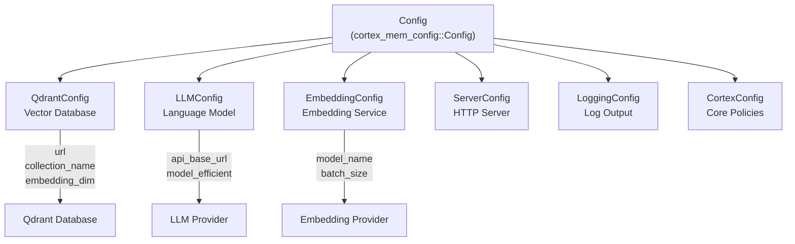
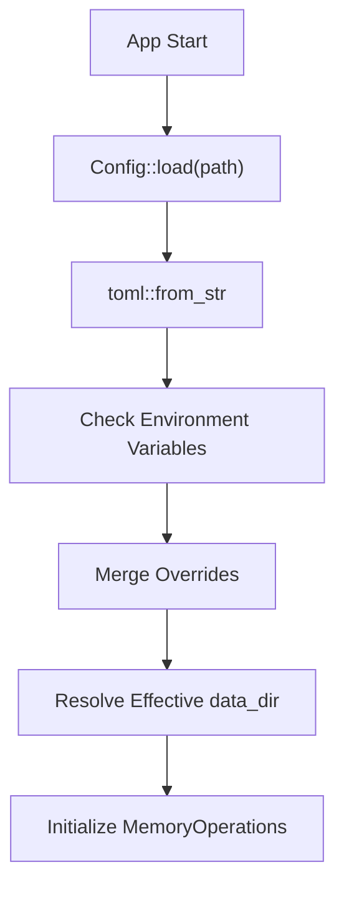

<!-- source: DeepWiki mcp.deepwiki.com · repo sopaco/cortex-mem · page 2.2 Configuration · fetched 2026-10-27 -->

# Configuration

<details>
<summary>Relevant source files</summary>

The following files were used as context for generating this wiki page:

- [cortex-mem-cli/README.md](cortex-mem-cli/README.md)
- [cortex-mem-cli/src/main.rs](cortex-mem-cli/src/main.rs)
- [cortex-mem-cli/tests/cli_commands_test.rs](cortex-mem-cli/tests/cli_commands_test.rs)
- [cortex-mem-config/README.md](cortex-mem-config/README.md)
- [cortex-mem-config/src/lib.rs](cortex-mem-config/src/lib.rs)
- [cortex-mem-core/README.md](cortex-mem-core/README.md)
- [cortex-mem-core/src/config.rs](cortex-mem-core/src/config.rs)
- [cortex-mem-mcp/README.md](cortex-mem-mcp/README.md)
- [cortex-mem-rig/README.md](cortex-mem-rig/README.md)
- [cortex-mem-rig/src/lib.rs](cortex-mem-rig/src/lib.rs)
- [cortex-mem-service/README.md](cortex-mem-service/README.md)
- [cortex-mem-tools/README.md](cortex-mem-tools/README.md)
- [examples/cortex-mem-tars/README.md](examples/cortex-mem-tars/README.md)
- [examples/cortex-mem-tars/src/config.rs](examples/cortex-mem-tars/src/config.rs)
- [examples/cortex-mem-tars/src/infrastructure.rs](examples/cortex-mem-tars/src/infrastructure.rs)

</details>


## Purpose and Scope

This document describes the configuration system in Cortex Memory, covering the structure of `config.toml`, configuration loading mechanisms, validation, and auto-detection features. Configuration is the foundational layer that initializes all system components including the vector database connection, LLM integration, memory management policies, and service endpoints.

Cortex Memory employs a unified configuration structure across its ecosystem (Core, CLI, MCP, and TARS), allowing for shared settings while supporting application-specific overrides.

**Sources:** [cortex-mem-config/src/lib.rs:5-14](), [cortex-mem-core/README.md:47-80]()

---

## Configuration File Format

Cortex Memory uses TOML (Tom's Obvious, Minimal Language) for configuration. The main configuration file is typically named `config.toml` and contains multiple sections corresponding to different subsystems.

**Sources:** [cortex-mem-config/src/lib.rs:128-135](), [cortex-mem-cli/src/main.rs:17-19]()

---

## Configuration Structure

The configuration system is built around a hierarchical `Config` struct defined in the `cortex-mem-config` crate.



**Title:** Configuration Entity Mapping

**Sources:** [cortex-mem-config/src/lib.rs:5-14](), [examples/cortex-mem-tars/src/config.rs:88-114]()

---

## Configuration Sections

### Qdrant Configuration (`[qdrant]`)

Configures the connection to the Qdrant vector database.

| Field | Type | Required | Default | Description |
|-------|------|----------|---------|-------------|
| `url` | String | Yes | - | Qdrant server URL (e.g., `http://localhost:6334`) |
| `collection_name` | String | Yes | - | Collection name for memory vectors |
| `embedding_dim` | Integer | No | None | Dimension of vectors (e.g., 1536) |
| `timeout_secs` | Integer | No | 30 | Request timeout in seconds |
| `api_key` | String | No | None | Optional API key for Qdrant Cloud/Auth |

**Sources:** [cortex-mem-config/src/lib.rs:67-75](), [examples/cortex-mem-tars/src/config.rs:89-95]()

### LLM Configuration (`[llm]`)

Configures the Large Language Model service used for fact extraction and intent analysis.

| Field | Type | Required | Default | Description |
|-------|------|----------|---------|-------------|
| `api_base_url` | String | Yes | - | LLM service API endpoint |
| `api_key` | String | Yes | - | Authentication key |
| `model_efficient` | String | Yes | - | Model ID for extraction (e.g., `gpt-4o-mini`) |
| `temperature` | Float | No | 0.7 | Sampling temperature |
| `max_tokens` | Integer | No | 2000 | Maximum tokens per request |

**Sources:** [cortex-mem-config/src/lib.rs:103-110](), [cortex-mem-cli/src/main.rs:241-247]()

### Embedding Configuration (`[embedding]`)

Configures the embedding generation service for vector search.

| Field | Type | Required | Default | Description |
|-------|------|----------|---------|-------------|
| `api_base_url` | String | No | OpenAI V1 | API endpoint for embeddings |
| `api_key` | Yes | - | Authentication key |
| `model_name` | No | text-embedding-3-small | Embedding model identifier |
| `batch_size` | No | 10 | Texts per batch request |
| `timeout_secs` | No | 30 | Request timeout |

**Sources:** [cortex-mem-config/src/lib.rs:78-100]()

### Cortex Core Configuration (`[cortex]`)

Defines data storage and processing behavior.

| Field | Type | Required | Default | Description |
|-------|------|----------|---------|-------------|
| `data_dir` | String | No | See Hierarchy | Root directory for memory files |
| `enable_intent_analysis` | Boolean | No | true | Enable LLM-based query rewriting |

**Sources:** [cortex-mem-config/src/lib.rs:17-39]()

---

## Configuration Hierarchy and Data Directory Detection

Cortex Memory uses a multi-level hierarchy to determine the effective `data_dir` (where `cortex://` files are stored) and configuration values.

### Data Directory Priority

The `data_dir` is resolved using the following priority (highest to lowest):

1.  **Environment Variable**: `CORTEX_DATA_DIR` [cortex-mem-config/src/lib.rs:60-63]()
2.  **Explicit Config**: The `data_dir` field in `config.toml` [cortex-mem-config/src/lib.rs:49-53]()
3.  **Application Default**:
    *   **CLI**: Directory containing the `config.toml` file [cortex-mem-cli/src/main.rs:212-227]()
    *   **TARS**: System-specific application data directory (e.g., `~/Library/Application Support/com.cortex-mem.tars`) [examples/cortex-mem-tars/src/config.rs:44-48]()

### Loading Logic



**Title:** Configuration Resolution Flow

**Sources:** [cortex-mem-config/src/lib.rs:129-135](), [cortex-mem-cli/src/main.rs:198-228](), [examples/cortex-mem-tars/src/config.rs:66-85]()

---

## Auto-Detection and Management Features

### TARS Auto-Configuration

The TARS application includes a `ConfigManager` that automatically generates a default `config.toml` if one is not found in the system application data directory. It also ensures the `data_dir` is explicitly set to the application data path to maintain consistency between the UI and the core library.

**Sources:** [examples/cortex-mem-tars/src/config.rs:86-119]()

### Bot Configuration (`bots.json`)

Specifically for the TARS application, bot profiles are managed in a separate `bots.json` file. This allows for multi-agent isolation where each bot can have its own `agent_id` (used as a tenant ID in the core system).

| Field | Description |
|-------|-------------|
| `id` | Unique UUID for the bot |
| `name` | Display name in the TUI |
| `system_prompt` | The personality/instructions for the agent |
| `access_password` | Optional protection for the bot profile |

**Sources:** [examples/cortex-mem-tars/src/config.rs:9-16](), [examples/cortex-mem-tars/src/config.rs:55-58]()

---

## Technical Implementation Details

### Key Classes

*   **`cortex_mem_config::Config`**: The primary data structure for parsing and holding settings [cortex-mem-config/src/lib.rs:7-14]().
*   **`cortex_mem_tars::ConfigManager`**: Orchestrates configuration for the TUI, handling both the core `config.toml` and the TARS-specific `bots.json` [examples/cortex-mem-tars/src/config.rs:35-39]().
*   **`cortex_mem_tools::MemoryOperations`**: The consumer of these configurations, initialized with resolved URLs, keys, and paths [cortex-mem-tools/README.md:87-98]().

### LLM Intent Analysis Toggle

The `enable_intent_analysis` flag in `CortexConfig` significantly impacts performance. When `true`, vector search includes an LLM call for query rewriting (~15-25s latency). When `false`, it uses raw query vectors (< 500ms latency).

**Sources:** [cortex-mem-config/src/lib.rs:24-38]()

---

## Configuration Example

```toml
[qdrant]
url = "http://localhost:6334"
collection_name = "cortex_mem"
embedding_dim = 1536
timeout_secs = 30

[embedding]
api_base_url = "https://api.openai.com/v1"
api_key = "sk-..."
model_name = "text-embedding-3-small"

[llm]
api_base_url = "https://api.openai.com/v1"
api_key = "sk-..."
model_efficient = "gpt-4o-mini"
temperature = 0.1
max_tokens = 4096

[cortex]
data_dir = "./my-memories"
enable_intent_analysis = false
```

**Sources:** [examples/cortex-mem-tars/README.md:87-133](), [cortex-mem-cli/README.md:225-248]()

---

