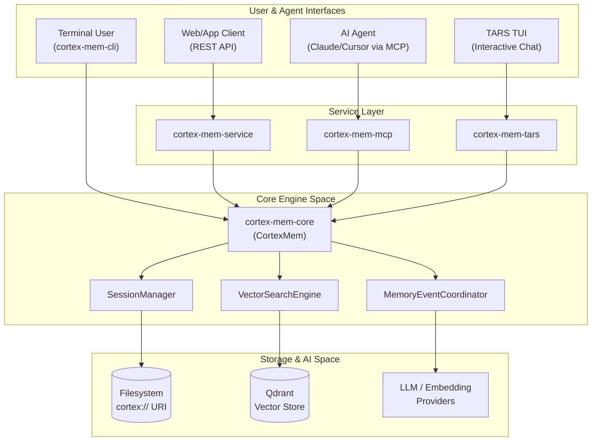
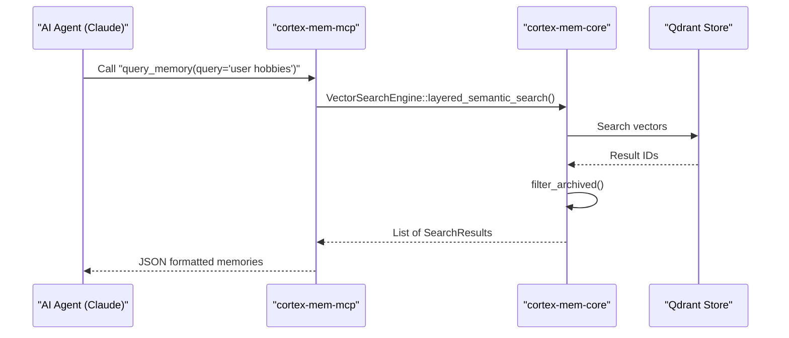

<!-- source: DeepWiki mcp.deepwiki.com · repo sopaco/cortex-mem · page 2.3 Quick Start Examples · fetched 2026-10-27 -->

# Quick Start Examples

<details>
<summary>Relevant source files</summary>

The following files were used as context for generating this wiki page:

- [README.md](README.md)
- [README_zh.md](README_zh.md)
- [cortex-mem-cli/Cargo.toml](cortex-mem-cli/Cargo.toml)
- [cortex-mem-cli/README.md](cortex-mem-cli/README.md)
- [cortex-mem-cli/src/commands/add.rs](cortex-mem-cli/src/commands/add.rs)
- [cortex-mem-cli/src/commands/delete.rs](cortex-mem-cli/src/commands/delete.rs)
- [cortex-mem-cli/src/commands/get.rs](cortex-mem-cli/src/commands/get.rs)
- [cortex-mem-cli/src/commands/layers.rs](cortex-mem-cli/src/commands/layers.rs)
- [cortex-mem-cli/src/commands/list.rs](cortex-mem-cli/src/commands/list.rs)
- [cortex-mem-cli/src/commands/mod.rs](cortex-mem-cli/src/commands/mod.rs)
- [cortex-mem-cli/src/commands/search.rs](cortex-mem-cli/src/commands/search.rs)
- [cortex-mem-cli/src/commands/session.rs](cortex-mem-cli/src/commands/session.rs)
- [cortex-mem-cli/src/commands/tenant.rs](cortex-mem-cli/src/commands/tenant.rs)
- [cortex-mem-cli/tests/cli_commands_test.rs](cortex-mem-cli/tests/cli_commands_test.rs)
- [cortex-mem-config/README.md](cortex-mem-config/README.md)
- [cortex-mem-core/README.md](cortex-mem-core/README.md)
- [cortex-mem-core/src/incremental_memory_updater.rs](cortex-mem-core/src/incremental_memory_updater.rs)
- [cortex-mem-core/src/llm/prompts.rs](cortex-mem-core/src/llm/prompts.rs)
- [cortex-mem-core/src/search/vector_engine.rs](cortex-mem-core/src/search/vector_engine.rs)
- [cortex-mem-mcp/README.md](cortex-mem-mcp/README.md)
- [cortex-mem-rig/README.md](cortex-mem-rig/README.md)
- [cortex-mem-service/README.md](cortex-mem-service/README.md)
- [cortex-mem-service/src/handlers/automation.rs](cortex-mem-service/src/handlers/automation.rs)
- [cortex-mem-service/src/handlers/search.rs](cortex-mem-service/src/handlers/search.rs)
- [cortex-mem-service/src/handlers/sessions.rs](cortex-mem-service/src/handlers/sessions.rs)
- [cortex-mem-service/src/routes/automation.rs](cortex-mem-service/src/routes/automation.rs)
- [cortex-mem-service/src/state.rs](cortex-mem-service/src/state.rs)
- [cortex-mem-tools/README.md](cortex-mem-tools/README.md)
- [examples/@memclaw/bin-darwin-arm64/bin/README.md](examples/@memclaw/bin-darwin-arm64/bin/README.md)
- [examples/cortex-mem-tars/README.md](examples/cortex-mem-tars/README.md)
- [examples/locomo-evaluation/eval.py](examples/locomo-evaluation/eval.py)

</details>


This page provides practical, working examples for storing, searching, and managing memories using the Cortex Memory system. It covers multiple interfaces: the Rust programmatic API (`cortex-mem-core`), the Command Line Interface (`cortex-mem-cli`), the HTTP REST API (`cortex-mem-service`), and AI agent protocols (MCP).

**Prerequisites:** Ensure you have a running Qdrant instance (default port 6334) and have configured your LLM/Embedding API keys in `config.toml`.

---

## Interface Overview

The Cortex Memory framework is designed as a modular monolith where multiple interfaces consume a shared core.

Title: Cortex Memory Interface Architecture

Sources: [README.md:138-184](), [cortex-mem-service/src/state.rs:15-41](), [cortex-mem-mcp/README.md:1-15]()

---

## Command Line Interface (CLI)

The `cortex-mem-cli` is the fastest way to interact with the system for debugging or manual memory management.

### Common Commands
| Action | Command | Description |
| :--- | :--- | :--- |
| **Create Session** | `cortex-mem session create my-thread` | Initializes a new conversation thread [cortex-mem-cli/README.md:31-31]() |
| **Add Message** | `cortex-mem add -t my-thread "User likes Rust"` | Stores a message in the session timeline [cortex-mem-cli/README.md:34-34]() |
| **Search** | `cortex-mem search "programming preferences"` | Semantic search across all memories [cortex-mem-cli/README.md:37-37]() |
| **Close Session** | `cortex-mem session close my-thread` | Triggers LLM fact extraction and L0/L1 generation [cortex-mem-cli/README.md:157-160]() |

### Example: Storing and Extracting a Fact
```bash
# 1. Start a session
cortex-mem session create research-session --title "AI Research"

# 2. Add context
cortex-mem add -t research-session "We are investigating vector databases like Qdrant."

# 3. Finalize and extract memories
# This triggers the MemoryEventCoordinator to run LLM extraction
cortex-mem session close research-session
```
Sources: [cortex-mem-cli/README.md:152-167]()

---

## HTTP API Usage

The `cortex-mem-service` provides a RESTful interface for web applications. It uses `axum` handlers to interact with the `CortexMem` runtime.

### Storing a Message
**Endpoint:** `POST /sessions/:thread_id/messages`
```bash
curl -X POST http://localhost:3000/sessions/dev-chat/messages \
  -H "Content-Type: application/json" \
  -d '{
    "role": "user",
    "content": "I prefer using dark mode in my IDE."
  }'
```
This call invokes `add_message` in `cortex-mem-service/src/handlers/sessions.rs`, which emits a `LayerUpdateNeeded` event to the `MemoryEventCoordinator` [cortex-mem-service/src/handlers/sessions.rs:123-193]().

### Semantic Search
**Endpoint:** `POST /search`
```bash
curl -X POST http://localhost:3000/search \
  -H "Content-Type: application/json" \
  -d '{
    "query": "What are the user IDE preferences?",
    "limit": 5,
    "min_score": 0.7
  }'
```
The service uses a multi-stage search pipeline:
1. **Intent Analysis**: LLM rewrites the query for better recall [cortex-mem-service/src/handlers/search.rs:79-79]().
2. **Layered Search**: Queries L0 (Abstract), L1 (Overview), and L2 (Detail) vectors [cortex-mem-service/src/handlers/search.rs:81-84]().
3. **Lexical Fallback**: If vector search yields few results, it performs a keyword search on the filesystem [cortex-mem-service/src/handlers/search.rs:172-182]().

Sources: [cortex-mem-service/src/handlers/sessions.rs:123-167](), [cortex-mem-service/src/handlers/search.rs:17-107]()

---

## Using with an AI Agent (MCP)

The Model Context Protocol (MCP) allows agents like Claude or Cursor to use Cortex Memory as a toolset.

Title: MCP Tool Data Flow

Sources: [cortex-mem-mcp/README.md:52-100](), [cortex-mem-core/src/search/vector_engine.rs:139-199]()

### Agent Tool Examples
Agents can autonomously call these tools:
- **`store_memory`**: Used by the agent to "remember" a fact during a conversation [cortex-mem-mcp/README.md:18-30]().
- **`get_abstract`**: Used to quickly scan the L0 layer (~100 tokens) to see if a session is relevant before reading the full content [cortex-mem-mcp/README.md:215-224]().
- **`query_memory`**: Performs semantic search across `user`, `agent`, or `session` scopes [cortex-mem-mcp/README.md:52-73]().

---

## Programmatic Rust Example

For developers building directly on the core library, the `CortexMem` struct is the entry point.

```rust
use cortex_mem_core::{CortexMemBuilder, MessageRole};
use std::path::Path;

#[tokio::main]
async fn main() -> anyhow::Result<()> {
    // 1. Initialize the runtime
    let cortex = CortexMemBuilder::new(Path::new("./data"))
        .with_qdrant(qdrant_config)
        .with_llm(llm_client)
        .build()
        .await?;

    let session_mgr = cortex.session_manager();
    let session_mgr = session_mgr.read().await;

    // 2. Store a memory in a session
    session_mgr.add_message(
        "session-123", 
        MessageRole::User, 
        "Remind me to check the Qdrant logs tomorrow."
    ).await?;

    // 3. Search memories via the VectorSearchEngine
    let engine = cortex.vector_engine().unwrap();
    let results = engine.semantic_search("What should I check tomorrow?", &default_options).await?;
    
    Ok(())
}
```
Sources: [cortex-mem-service/src/state.rs:128-152](), [cortex-mem-core/src/search/vector_engine.rs:73-107]()

---

## Summary of Memory Layers

When using the `search` or `get` commands, you can specify which layer of detail you need. This is critical for managing LLM context windows.

| Layer | Code Entity | Token Size | Best For |
| :--- | :--- | :--- | :--- |
| **L0 (Abstract)** | `.abstract.md` | ~100 | Relevance filtering [cortex-mem-core/src/llm/prompts.rs:5-8]() |
| **L1 (Overview)** | `.overview.md` | ~500-2000 | Decision making & planning [cortex-mem-core/src/llm/prompts.rs:34-37]() |
| **L2 (Full)** | `.md` (Original) | Varies | Deep analysis & extraction [README.md:109-109]() |

Sources: [cortex-mem-core/src/llm/prompts.rs:5-87](), [README.md:200-206]()

---

