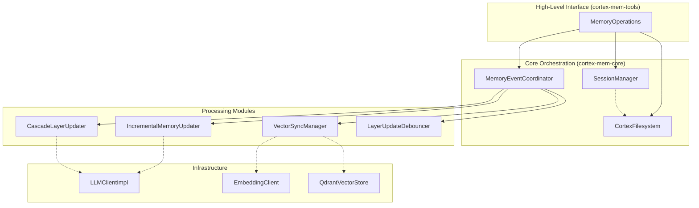
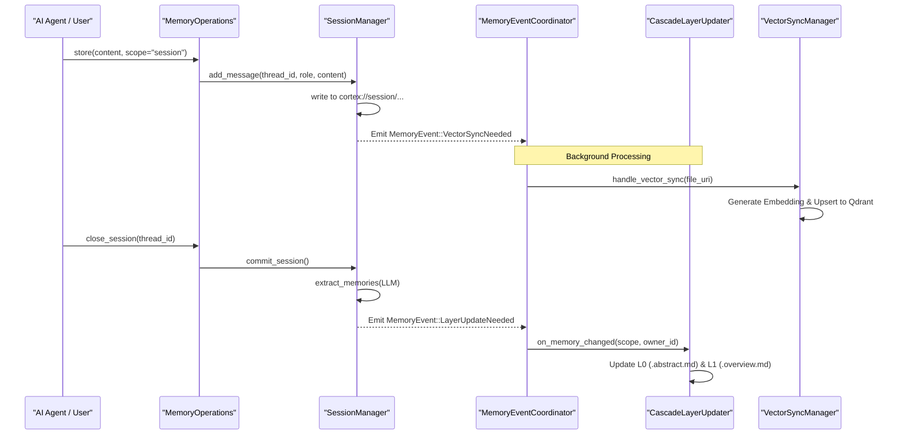

<!-- source: DeepWiki mcp.deepwiki.com · repo sopaco/cortex-mem · page 3.1 Memory Manager · fetched 2026-10-27 -->

# Memory Manager

<details>
<summary>Relevant source files</summary>

The following files were used as context for generating this wiki page:

- [cortex-mem-core/src/automation/layer_generator.rs](cortex-mem-core/src/automation/layer_generator.rs)
- [cortex-mem-core/src/automation/manager.rs](cortex-mem-core/src/automation/manager.rs)
- [cortex-mem-core/src/cascade_layer_updater.rs](cortex-mem-core/src/cascade_layer_updater.rs)
- [cortex-mem-core/src/layers/generator.rs](cortex-mem-core/src/layers/generator.rs)
- [cortex-mem-core/src/layers/manager.rs](cortex-mem-core/src/layers/manager.rs)
- [cortex-mem-core/src/lib.rs](cortex-mem-core/src/lib.rs)
- [cortex-mem-core/src/llm/client.rs](cortex-mem-core/src/llm/client.rs)
- [cortex-mem-core/src/memory_event_coordinator.rs](cortex-mem-core/src/memory_event_coordinator.rs)
- [cortex-mem-core/src/session/extraction.rs](cortex-mem-core/src/session/extraction.rs)
- [cortex-mem-core/src/session/manager.rs](cortex-mem-core/src/session/manager.rs)
- [cortex-mem-core/src/session/message.rs](cortex-mem-core/src/session/message.rs)
- [cortex-mem-tools/src/operations.rs](cortex-mem-tools/src/operations.rs)
- [cortex-mem-tools/src/tools/storage.rs](cortex-mem-tools/src/tools/storage.rs)
- [examples/cortex-mem-tars/src/agent.rs](examples/cortex-mem-tars/src/agent.rs)
- [examples/cortex-mem-tars/src/app.rs](examples/cortex-mem-tars/src/app.rs)

</details>


## Purpose and Scope

The `MemoryManager` (often accessed via the `MemoryOperations` facade in higher-level tools) is the central orchestrator of the Cortex Memory system. It coordinates all memory operations including session management, multi-layered storage (L0/L1/L2), semantic search, and AI-powered background processing. It manages the interaction between the virtual filesystem, vector stores, and the asynchronous event system that handles memory evolution.

This page documents the implementation details of the orchestration layer, the lifecycle of memory events, and how specialized modules like the `MemoryEventCoordinator` ensure data consistency and intelligence.

Sources: [cortex-mem-core/src/lib.rs:48-53](), [cortex-mem-tools/src/operations.rs:23-51]()

## Component Architecture

The system follows a modular architecture where high-level operations are decoupled from low-level storage and AI processing through an event-driven core.

### MemoryManager Orchestration (Code Entity Space)

The following diagram bridges the conceptual "Memory Management" with the actual Rust structs and traits used in the codebase.


Sources: [cortex-mem-tools/src/operations.rs:29-51](), [cortex-mem-core/src/memory_event_coordinator.rs:62-89](), [cortex-mem-core/src/lib.rs:90-121]()

### The MemoryOperations Facade
In the `cortex-mem-tools` crate, `MemoryOperations` acts as the primary entry point for all interfaces (CLI, MCP, TARS). It encapsulates the `SessionManager` for conversation handling and the `MemoryEventCoordinator` for background tasks.

**Key Components in `MemoryOperations`:**
- `filesystem`: The `CortexFilesystem` providing `cortex://` URI abstraction [cortex-mem-tools/src/operations.rs:30]().
- `session_manager`: Handles active chat threads and message persistence [cortex-mem-tools/src/operations.rs:31]().
- `event_coordinator`: Manages the background event loop for indexing and layer generation [cortex-mem-tools/src/operations.rs:50]().

Sources: [cortex-mem-tools/src/operations.rs:29-51]()

## Memory Lifecycle and Event Flow

The system uses an asynchronous event-driven model to ensure that heavy AI operations (like embedding or summarization) do not block the user-facing chat interface.

### Data Flow: From Message to Long-Term Memory

When a message is stored, it triggers a cascade of events managed by the `MemoryEventCoordinator`.



Sources: [cortex-mem-tools/src/tools/storage.rs:75-147](), [cortex-mem-core/src/memory_event_coordinator.rs:215-260](), [cortex-mem-core/src/automation/manager.rs:152-168]()

### Memory Event Coordinator (MEC)
The `MemoryEventCoordinator` is the "brain" of the background system. It listens on an `mpsc::unbounded_channel` for `MemoryEvent` variants [cortex-mem-core/src/memory_event_coordinator.rs:129]().

**Core Responsibilities:**
1. **Debouncing**: Uses `LayerUpdateDebouncer` to batch multiple file changes in the same directory, reducing LLM calls by up to 90% [cortex-mem-core/src/memory_event_coordinator.rs:7-9]().
2. **Incremental Updates**: Dispatches to `IncrementalMemoryUpdater` for granular changes [cortex-mem-core/src/memory_event_coordinator.rs:134]().
3. **Layer Cascading**: Triggers `CascadeLayerUpdater` to refresh summaries (L0/L1) from the leaf file up to the root directory [cortex-mem-core/src/cascade_layer_updater.rs:183-202]().
4. **Vector Synchronization**: Coordinates with `VectorSyncManager` to ensure the Qdrant vector store matches the filesystem state [cortex-mem-core/src/memory_event_coordinator.rs:156]().

Sources: [cortex-mem-core/src/memory_event_coordinator.rs:55-89](), [cortex-mem-core/src/memory_event_coordinator.rs:163-173]()

## Key Implementation Details

### Multi-Layer Memory Management
The `MemoryManager` coordinates three distinct layers of memory granularity:
- **L2 (Original)**: Full text stored as Markdown files in the filesystem.
- **L1 (Overview)**: Structured summaries (~2000 tokens) generated by the `OverviewGenerator` [cortex-mem-core/src/automation/layer_generator.rs:35-40]().
- **L0 (Abstract)**: Concise multi-topic abstracts (~100 tokens) for broad context, generated by the `AbstractGenerator` [cortex-mem-core/src/automation/layer_generator.rs:25-32]().

### Session Management & Extraction
The `SessionManager` tracks `SessionMetadata` (thread ID, participants, message counts) [cortex-mem-core/src/session/manager.rs:19-33](). Upon session closure, it utilizes the `MemoryExtractor` to distill raw chat logs into structured `ExtractedMemories` including:
- **Preferences**: User habits and likes [cortex-mem-core/src/session/extraction.rs:72-77]().
- **Entities**: People, projects, and tools mentioned [cortex-mem-core/src/session/extraction.rs:80-86]().
- **Events/Cases**: Important decisions or solved problems [cortex-mem-core/src/session/extraction.rs:89-104]().

Sources: [cortex-mem-core/src/session/manager.rs:187-214](), [cortex-mem-core/src/session/extraction.rs:15-40]()

### Initialization Example
Initializing the `MemoryManager` (via `MemoryOperations`) requires setting up the infrastructure stack:

```rust
// From cortex-mem-tools/src/operations.rs:100-113
let ops = MemoryOperations::new(
    data_dir,
    tenant_id,
    llm_client,
    qdrant_url,
    qdrant_collection,
    qdrant_api_key,
    embedding_api_base_url,
    embedding_api_key,
    embedding_model_name,
    embedding_dim,
    user_id,
    enable_intent_analysis,
).await?;
```
This constructor internally initializes the `CortexFilesystem`, connects to `QdrantVectorStore`, sets up the `EmbeddingClient`, and starts the `MemoryEventCoordinator` background loop [cortex-mem-tools/src/operations.rs:114-190]().

Sources: [cortex-mem-tools/src/operations.rs:100-190]()

## Optimization Mechanisms

The `MemoryManager` employs several strategies to maintain performance and reduce costs:

| Optimization | Module | Description |
| :--- | :--- | :--- |
| **Debouncing** | `LayerUpdateDebouncer` | Batches L0/L1 updates for 30s to prevent redundant LLM calls [cortex-mem-core/src/memory_event_coordinator.rs:7-9](). |
| **Content Hashing** | `CascadeLayerUpdater` | Skips regeneration if the source content hash hasn't changed [cortex-mem-core/src/cascade_layer_updater.rs:158-177](). |
| **LLM Caching** | `LlmResultCache` | Reuses LLM outputs for identical prompts/content (Phase 3) [cortex-mem-core/src/cascade_layer_updater.rs:9-10](). |
| **Batch Indexing** | `AutomationManager` | Collects session updates and indexes them in batches rather than per-message [cortex-mem-core/src/automation/manager.rs:105-108](). |

Sources: [cortex-mem-core/src/memory_event_coordinator.rs:33-42](), [cortex-mem-core/src/cascade_layer_updater.rs:126-130](), [cortex-mem-core/src/automation/manager.rs:15-24]()

---

