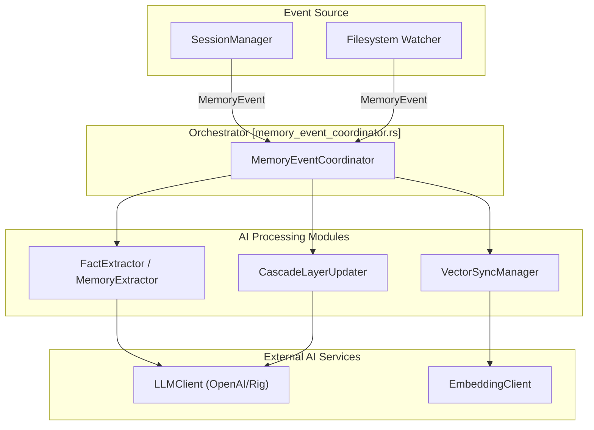
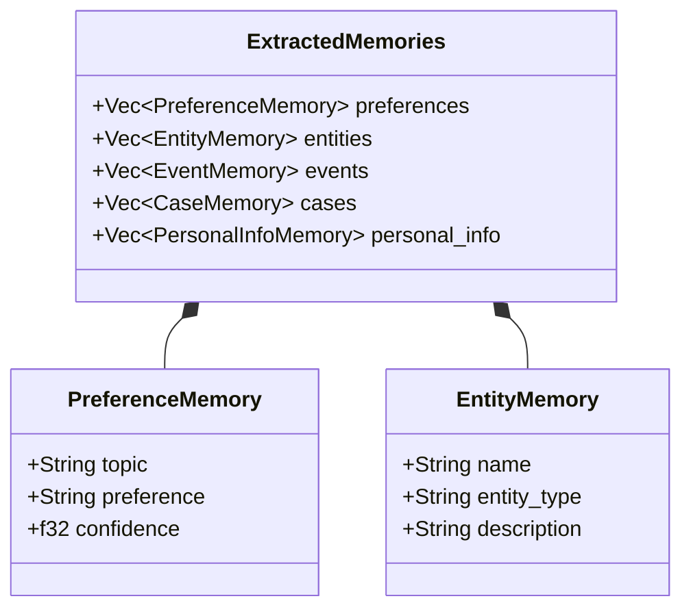

<!-- source: DeepWiki mcp.deepwiki.com · repo sopaco/cortex-mem · page 3.3 LLM Client & AI Processing · fetched 2026-10-27 -->

# LLM Client & AI Processing

Relevant source files

The following files were used as context for generating this wiki page:

- [README.md](README.md)
- [README_zh.md](README_zh.md)
- [cortex-mem-core/src/automation/layer_generator.rs](cortex-mem-core/src/automation/layer_generator.rs)
- [cortex-mem-core/src/automation/manager.rs](cortex-mem-core/src/automation/manager.rs)
- [cortex-mem-core/src/cascade_layer_updater.rs](cortex-mem-core/src/cascade_layer_updater.rs)
- [cortex-mem-core/src/incremental_memory_updater.rs](cortex-mem-core/src/incremental_memory_updater.rs)
- [cortex-mem-core/src/layers/generator.rs](cortex-mem-core/src/layers/generator.rs)
- [cortex-mem-core/src/layers/manager.rs](cortex-mem-core/src/layers/manager.rs)
- [cortex-mem-core/src/llm/client.rs](cortex-mem-core/src/llm/client.rs)
- [cortex-mem-core/src/llm/prompts.rs](cortex-mem-core/src/llm/prompts.rs)
- [cortex-mem-core/src/memory_event_coordinator.rs](cortex-mem-core/src/memory_event_coordinator.rs)
- [cortex-mem-core/src/search/vector_engine.rs](cortex-mem-core/src/search/vector_engine.rs)
- [cortex-mem-core/src/session/extraction.rs](cortex-mem-core/src/session/extraction.rs)
- [cortex-mem-core/src/session/message.rs](cortex-mem-core/src/session/message.rs)
- [cortex-mem-service/src/handlers/automation.rs](cortex-mem-service/src/handlers/automation.rs)
- [cortex-mem-service/src/handlers/search.rs](cortex-mem-service/src/handlers/search.rs)
- [cortex-mem-service/src/handlers/sessions.rs](cortex-mem-service/src/handlers/sessions.rs)
- [cortex-mem-service/src/routes/automation.rs](cortex-mem-service/src/routes/automation.rs)
- [cortex-mem-service/src/state.rs](cortex-mem-service/src/state.rs)
- [examples/@memclaw/bin-darwin-arm64/bin/README.md](examples/@memclaw/bin-darwin-arm64/bin/README.md)
- [examples/locomo-evaluation/eval.py](examples/locomo-evaluation/eval.py)

## Purpose and Scope

The LLM Client and AI Processing layer serves as the intelligence backbone of the Cortex Memory system. It handles all interactions with external Large Language Models for tasks including semantic embedding generation, structured fact extraction, memory classification, and hierarchical layer summarization.

This module is primarily implemented in `cortex-mem-core` and is orchestrated by the `MemoryEventCoordinator` to ensure that as memories are added or updated, the corresponding AI processing (indexing, extraction, and summarization) happens automatically and efficiently.

## Architecture & Data Flow

The AI processing pipeline bridges raw natural language input to structured code entities and storage.

### AI Processing Orchestration

The `MemoryEventCoordinator` acts as the central hub, receiving events and dispatching them to specialized AI modules.

**Sources:** [cortex-mem-core/src/memory_event_coordinator.rs:62-89](), [cortex-mem-core/src/automation/manager.rs:51-59]()

### LLM Client Implementation

The system utilizes the `rig` framework to interface with LLMs. The `LLMClient` trait defines the contract for all AI operations, while `LLMClientImpl` provides the concrete implementation.

| Component | Code Entity | Role |
| :--- | :--- | :--- |
| **Trait** | `LLMClient` | Defines methods for completion, fact extraction, and structured analysis. |
| **Implementation** | `LLMClientImpl` | Wraps `rig::providers::openai::Client` to execute calls. |
| **Config** | `LLMConfig` | Stores `api_base_url`, `api_key`, and `model_efficient`. |
| **Extraction Model** | `MemoryExtractionResponse` | The schema for raw LLM memory extraction (facts, decisions, entities). |

**Sources:** [cortex-mem-core/src/llm/client.rs:6-13](), [cortex-mem-core/src/llm/client.rs:66-87](), [cortex-mem-core/src/llm/client.rs:93-96]()

## Fact Extraction

Fact extraction is the process of converting unstructured conversation logs into structured memory objects. This is handled by the `MemoryExtractor`.

### Extraction Logic
When a session is closed or a trigger is received, the `MemoryExtractor` performs the following:
1.  **Prompt Construction**: Joins messages and applies "Critical Language Rules" to ensure the output matches the conversation's dominant language. [cortex-mem-core/src/session/extraction.rs:203-216]()
2.  **LLM Call**: Invokes `llm_client.complete()` with the constructed prompt. [cortex-mem-core/src/session/extraction.rs:183-183]()
3.  **Parsing**: Deserializes the JSON response into an `ExtractedMemories` struct containing preferences, entities, events, cases, and personal info. [cortex-mem-core/src/session/extraction.rs:15-40]()

### Memory Schema Mapping

**Sources:** [cortex-mem-core/src/session/extraction.rs:15-40](), [cortex-mem-core/src/session/extraction.rs:73-86]()

## Hierarchical Layer Processing (L0/L1)

Cortex Memory uses a three-tier architecture (L0 Abstract, L1 Overview, L2 Detail). The AI processing layer is responsible for generating the L0 and L1 summaries from L2 (raw) data.

### Cascade Layer Update
The `CascadeLayerUpdater` handles the generation of these summaries. To minimize costs and latency, it implements:
*   **Debouncing**: The `LayerUpdateDebouncer` batches multiple file changes in the same directory, reducing LLM calls by 70-90%. [cortex-mem-core/src/memory_event_coordinator.rs:6-9]()
*   **Caching**: The `LLMResultCache` stores recent summary results to avoid redundant processing of unchanged content. [cortex-mem-core/src/memory_event_coordinator.rs:38-42]()

### Layer Generators
*   **AbstractGenerator (L0)**: Generates highly condensed summaries (~100 tokens) for quick context loading. [cortex-mem-core/src/automation/layer_generator.rs:48-52]()
*   **OverviewGenerator (L1)**: Generates medium-length summaries (~1500 tokens) providing a thematic overview of a directory or session. [cortex-mem-core/src/automation/layer_generator.rs:53-56]()

**Sources:** [cortex-mem-core/src/cascade_layer_updater.rs:148-153](), [cortex-mem-core/src/automation/layer_generator.rs:72-78]()

## Search & Intent Analysis

Before performing a vector search, the system can use the LLM to analyze the user's intent.

### VectorSearchEngine Intent Logic
The `VectorSearchEngine` can be configured with `with_intent_analysis(true)`. [cortex-mem-core/src/search/vector_engine.rs:109-116]()
1.  **Query Rewriting**: The LLM rewrites the user's raw query into an `EnhancedQueryIntent`.
2.  **Threshold Tuning**: Based on the intent (e.g., "Personal" vs "Factual"), the engine adjusts the similarity threshold.
3.  **Layer Selection**: Determines whether to search L0, L1, or L2 layers based on the query's breadth.

**Sources:** [cortex-mem-core/src/search/vector_engine.rs:57-71](), [cortex-mem-service/src/state.rs:99-126]()

## Configuration and Tuning

AI processing is tuned via the `config.toml` file, which maps to internal configuration structs.

| Config Struct | Key Fields | Impact |
| :--- | :--- | :--- |
| `LLMConfig` | `temperature`, `max_tokens` | Controls LLM creativity and response length. [cortex-mem-core/src/llm/client.rs:6-13]() |
| `CoordinatorConfig` | `enable_debounce`, `enable_cache` | Toggles optimization features for layer updates. [cortex-mem-core/src/memory_event_coordinator.rs:32-42]() |
| `LayerGenerationConfig`| `batch_size`, `delay_ms` | Controls the pace of background layer generation. [cortex-mem-core/src/automation/layer_generator.rs:11-22]() |

**Sources:** [cortex-mem-core/src/llm/client.rs:15-28](), [cortex-mem-core/src/memory_event_coordinator.rs:44-53]()

---

