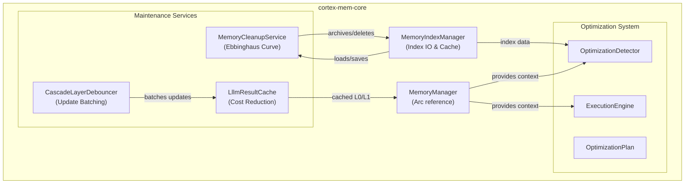
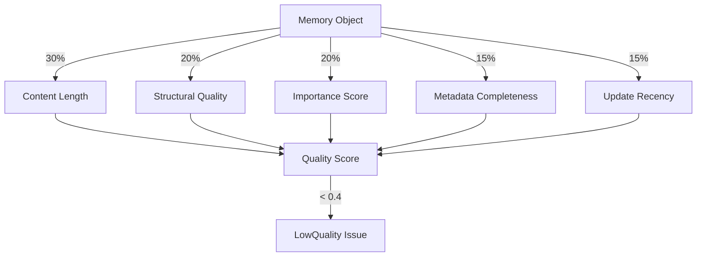

<!-- source: DeepWiki mcp.deepwiki.com · repo sopaco/cortex-mem · page 3.5 Optimization Engine · fetched 2026-10-27 -->

# Optimization Engine

Relevant source files

The following files were used as context for generating this wiki page:

- [cortex-mem-core/src/cascade_layer_debouncer.rs](cortex-mem-core/src/cascade_layer_debouncer.rs)
- [cortex-mem-core/src/llm_result_cache.rs](cortex-mem-core/src/llm_result_cache.rs)
- [cortex-mem-core/src/memory_cleanup.rs](cortex-mem-core/src/memory_cleanup.rs)
- [cortex-mem-core/src/memory_index_manager.rs](cortex-mem-core/src/memory_index_manager.rs)

The Optimization Engine is responsible for detecting memory quality issues and executing optimization operations to maintain system health. It analyzes stored memories for duplicates, low-quality content, outdated information, misclassifications, and space inefficiency, then generates and executes remediation plans.

In addition to proactive quality analysis, the engine handles the lifecycle of memories through automated cleanup and debounced layer updates to ensure the long-term sustainability of the memory space.

## System Architecture

The Optimization Engine consists of several primary components that work together to maintain memory quality and manage the "forgetting" process:

**Sources:** [cortex-mem-core/src/memory_cleanup.rs:75-80](), [cortex-mem-core/src/cascade_layer_debouncer.rs:68-76](), [cortex-mem-core/src/llm_result_cache.rs:113-125]()

## Memory Cleanup & Forgetting

The `MemoryCleanupService` implements a "forgetting" mechanism based on the **Ebbinghaus Forgetting Curve**. It scans memory indices to identify low-strength memories for archiving or permanent deletion.

### Forgetting Logic
Memory strength is computed using metadata (access frequency and recency). The service transitions memories through states based on configurable thresholds:

| Threshold | Default Value | Action |
|-----------|---------------|--------|
| `archive_threshold` | 0.1 | Memory strength below this marks `archived = true` |
| `delete_threshold` | 0.02 | Archived memory strength below this triggers permanent deletion |

**Sources:** [cortex-mem-core/src/memory_cleanup.rs:21-38](), [cortex-mem-core/src/memory_cleanup.rs:113-121]()

### Vector Synchronization
When a memory is deleted during cleanup, the `MemoryCleanupService` uses the `VectorSyncManager` to ensure all associated vectors (across L0, L1, and L2 layers) are removed from the vector store (e.g., Qdrant). This prevents "ghost" memories from appearing in semantic search results.

**Sources:** [cortex-mem-core/src/memory_cleanup.rs:6-8](), [cortex-mem-core/src/memory_cleanup.rs:158-175]()

## Cascade Layer Debouncing

To reduce LLM API costs and redundant processing, the `CascadeLayerDebouncer` manages the timing of layer updates (L0/L1 synthesis).

### How Debouncing Works
When a file change occurs, instead of immediately triggering an LLM-heavy layer update, the request is registered with the debouncer.

1.  **Request Merging**: Multiple updates for the same directory URI within the `debounce_secs` window (default 30s) are merged into one.
2.  **Force Update**: If updates continue to arrive, a `max_delay_secs` (default 120s) forces execution to ensure the index eventually reflects changes.
3.  **Batch Execution**: The `process_due_updates` function is called periodically to execute all "due" requests.

**Sources:** [cortex-mem-core/src/cascade_layer_debouncer.rs:7-22](), [cortex-mem-core/src/cascade_layer_debouncer.rs:45-52](), [cortex-mem-core/src/cascade_layer_debouncer.rs:128-156]()

## LLM Result Cache

The `LlmResultCache` provides an additional layer of optimization by caching LLM-generated content for L0/L1 layers.

-   **Keying**: Uses content hashes as cache keys.
-   **Eviction**: Implements **LRU (Least Recently Used)** eviction when the cache reaches `max_entries` (default 1000).
-   **Expiration**: Supports **TTL (Time-To-Live)** (default 1 hour) to ensure content doesn't become stale.

**Sources:** [cortex-mem-core/src/llm_result_cache.rs:3-9](), [cortex-mem-core/src/llm_result_cache.rs:37-45](), [cortex-mem-core/src/llm_result_cache.rs:192-212]()

## OptimizationDetector

`OptimizationDetector` scans the memory store to identify various quality and efficiency issues. It requires an `Arc<MemoryManager>` reference to access memory operations and LLM capabilities.

### Issue Detection Methods

The detector implements specialized detection strategies:

| Detection Method | Issue Type | Key Algorithm | Threshold |
|------------------|------------|---------------|-----------|
| `detect_duplicates` | `IssueKind::Duplicate` | Semantic similarity via embeddings | 0.85 cosine similarity |
| `detect_quality_issues` | `IssueKind::LowQuality` | Multi-factor quality scoring | 0.4 quality score |
| `detect_outdated_issues` | `IssueKind::Outdated` | Time-based decay analysis | 180 days |
| `detect_classification_issues` | `IssueKind::PoorClassification` | LLM-based type verification | N/A |
| `detect_space_inefficiency` | `IssueKind::SpaceInefficient` | Size/importance ratio analysis | 10KB + 0.3 importance |

**Sources:** [cortex-mem-core/src/memory/optimization_detector.rs:115-496]()

#### Quality Evaluation Algorithm

The quality evaluator uses a weighted scoring system based on content length, structural quality (sentences/paragraphs), and importance scores.

**Sources:** [cortex-mem-core/src/memory/optimization_detector.rs:543-602]()

## ExecutionEngine

`ExecutionEngine` translates optimization plans into concrete memory operations. It batches actions and provides retry logic for resilience.

### Action Implementations

#### Merge Action
The merge operation combines duplicate memories using LLM-generated content synthesis. It builds a prompt containing all duplicate contents and asks the LLM to create a coherent, consolidated version while preserving key facts.

**Sources:** [cortex-mem-core/src/memory/execution_engine.rs:173-226](), [cortex-mem-core/src/memory/execution_engine.rs:325-353]()

#### Reclassify Action
Type reclassification uses the `LLMClient::classify_memory` method to verify if a memory is correctly categorized (e.g., as a "Fact", "Entity", or "Relationship").

**Sources:** [cortex-mem-core/src/memory/execution_engine.rs:266-293](), [cortex-mem-core/src/memory/execution_engine.rs:391-452]()

## Memory Index Management

The `MemoryIndexManager` serves as the persistence layer for optimization metadata. It handles the `load_index` and `save_index` operations for `.memory_index.json` files.

-   **Caching**: Maintains an in-memory cache of indices to speed up frequent access during optimization scans.
-   **Consistency**: Includes an `invalidate_cache` method to ensure that if one service (like `MemoryCleanupService`) modifies the index, other services see the changes.
-   **Hashing**: Provides `calculate_content_hash` using SHA-256 for stable change detection across platforms.

**Sources:** [cortex-mem-core/src/memory_index_manager.rs:20-24](), [cortex-mem-core/src/memory_index_manager.rs:103-107](), [cortex-mem-core/src/memory_index_manager.rs:185-190]()

---

