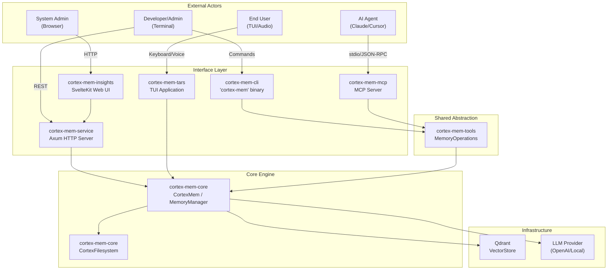
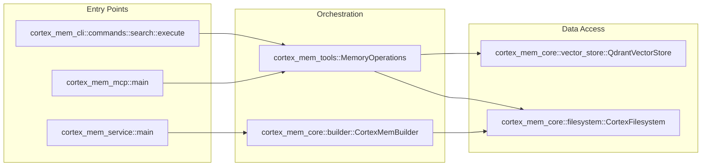
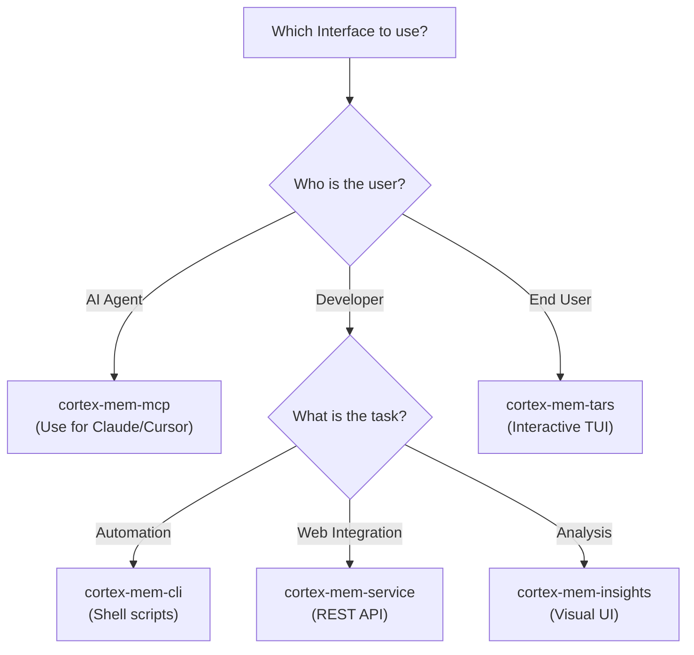

<!-- source: DeepWiki mcp.deepwiki.com · repo sopaco/cortex-mem · page 4 Service Interfaces · fetched 2026-10-27 -->

# Service Interfaces

Relevant source files

The following files were used as context for generating this wiki page:

- [cortex-mem-cli/Cargo.toml](cortex-mem-cli/Cargo.toml)
- [cortex-mem-cli/src/commands/add.rs](cortex-mem-cli/src/commands/add.rs)
- [cortex-mem-cli/src/commands/delete.rs](cortex-mem-cli/src/commands/delete.rs)
- [cortex-mem-cli/src/commands/get.rs](cortex-mem-cli/src/commands/get.rs)
- [cortex-mem-cli/src/commands/layers.rs](cortex-mem-cli/src/commands/layers.rs)
- [cortex-mem-cli/src/commands/list.rs](cortex-mem-cli/src/commands/list.rs)
- [cortex-mem-cli/src/commands/mod.rs](cortex-mem-cli/src/commands/mod.rs)
- [cortex-mem-cli/src/commands/search.rs](cortex-mem-cli/src/commands/search.rs)
- [cortex-mem-cli/src/commands/session.rs](cortex-mem-cli/src/commands/session.rs)
- [cortex-mem-cli/src/commands/tenant.rs](cortex-mem-cli/src/commands/tenant.rs)
- [cortex-mem-core/src/builder.rs](cortex-mem-core/src/builder.rs)
- [cortex-mem-core/src/embedding/client.rs](cortex-mem-core/src/embedding/client.rs)
- [cortex-mem-core/src/filesystem/operations.rs](cortex-mem-core/src/filesystem/operations.rs)
- [cortex-mem-insights/src/lib/api.ts](cortex-mem-insights/src/lib/api.ts)
- [cortex-mem-insights/src/lib/pages/Dashboard.svelte](cortex-mem-insights/src/lib/pages/Dashboard.svelte)
- [cortex-mem-insights/src/lib/pages/Search.svelte](cortex-mem-insights/src/lib/pages/Search.svelte)
- [cortex-mem-insights/src/lib/stores/search.ts](cortex-mem-insights/src/lib/stores/search.ts)
- [cortex-mem-insights/src/lib/stores/tenant.ts](cortex-mem-insights/src/lib/stores/tenant.ts)
- [cortex-mem-mcp/src/main.rs](cortex-mem-mcp/src/main.rs)
- [cortex-mem-service/src/main.rs](cortex-mem-service/src/main.rs)
- [cortex-mem-tools/src/errors.rs](cortex-mem-tools/src/errors.rs)
- [cortex-mem-tools/src/lib.rs](cortex-mem-tools/src/lib.rs)
- [cortex-mem-tools/src/types.rs](cortex-mem-tools/src/types.rs)
- [examples/locomo-evaluation/benchmark/index.html](examples/locomo-evaluation/benchmark/index.html)

## Purpose and Scope

This document provides an overview of the primary service interfaces that expose Cortex Memory functionality. Each interface provides access to the same core memory management capabilities through different protocols and interaction models, allowing for integration with AI agents, web applications, command-line scripts, and interactive terminal environments.

For detailed documentation on specific interfaces, see:
- **HTTP API Service**: [HTTP API Service](#4.1) — RESTful access for web and mobile integrations.
- **MCP Server**: [MCP Server](#4.2) — Standardized tool access for LLM agents (Claude, Cursor).
- **CLI**: [Command Line Interface](#4.3) — Local management and shell scripting.
- **Web Dashboard**: [Web Dashboard](#4.4) — Visual monitoring and memory browsing.
- **TARS Application**: [TARS Application](#4.5) — Interactive multi-agent TUI with audio support.

---

## Interface Architecture

The Cortex Memory ecosystem is designed as a modular monolith where multiple front-end interfaces interact with a shared logic layer. This layer is primarily encapsulated in `cortex-mem-core` and the `cortex-mem-tools` abstraction.

### System Interface Topology

**Sources:** [cortex-mem-mcp/src/main.rs:108-121](), [cortex-mem-service/src/main.rs:134-140](), [cortex-mem-core/src/builder.rs:74-83]()

---

## Interface Comparison

Each interface is optimized for specific latency, protocol, and user requirements.

| Interface | Protocol | Primary Use Case | Entry Point |
|-----------|----------|------------------|-------------|
| **CLI** | CLI Args | Batch imports, local debugging, shell scripts | `cortex-mem-cli/src/main.rs` |
| **HTTP API** | REST / JSON | Custom web apps, remote service integration | `cortex-mem-service/src/main.rs` |
| **MCP** | JSON-RPC (stdio) | Direct tool usage by LLMs (Claude Desktop) | `cortex-mem-mcp/src/main.rs` |
| **Insights** | Web (HTTP) | Visualizing memory clusters and system health | `cortex-mem-insights/src/lib/api.ts` |
| **TARS** | TUI / API | Multi-agent chat with persistent context | `cortex-mem-tars/src/main.rs` |

### Code Entity Mapping

The following diagram bridges the high-level interface concepts to specific code entities within the repository.

**Sources:** [cortex-mem-mcp/src/main.rs:108-110](), [cortex-mem-service/src/main.rs:130-132](), [cortex-mem-cli/src/commands/search.rs:7-14](), [cortex-mem-core/src/builder.rs:20-28]()

---

## Shared Core Integration

All interfaces rely on `MemoryOperations` or `CortexMemBuilder` to initialize the underlying memory engine. This ensures that features like **Automatic Layer Generation (L0/L1/L2)** and **Semantic Search** behave identically across all platforms.

### Common Capabilities Matrix

| Feature | CLI | HTTP | MCP | Insights | TARS |
|---------|-----|------|-----|----------|------|
| **Semantic Search** | ✅ | ✅ | ✅ | ✅ | ✅ |
| **Layered Read (L0-L2)** | ✅ | ✅ | ✅ | ✅ | ✅ |
| **Tenant Switching** | ✅ | ✅ | ❌ | ✅ | ✅ |
| **Auto-triggering** | ❌ | ❌ | ✅ | ❌ | ✅ |
| **Health Monitoring** | ❌ | ✅ | ❌ | ✅ | ✅ |

---

## Interface Selection Guidelines

### Decision Tree

### Key Considerations

1.  **Multi-Tenancy**: The HTTP Service and CLI support explicit tenant isolation via `--tenant` or URL paths [cortex-mem-service/src/main.rs:26-27]().
2.  **Protocol Overhead**: Use the CLI or direct library integration for high-performance local tasks; use the HTTP API for distributed systems.
3.  **Agentic Workflow**: The MCP server is the recommended way to give "long-term memory" to LLMs, as it provides standardized tool definitions [cortex-mem-mcp/src/main.rs:15-18]().
4.  **Persistent Sessions**: TARS and the HTTP Service manage session lifecycles, making them ideal for long-running conversations [cortex-mem-tools/src/types.rs:213-220]().

**Sources:** [cortex-mem-mcp/src/main.rs:19-56](), [cortex-mem-service/src/main.rs:20-49](), [cortex-mem-tools/src/types.rs:175-191]()

---

