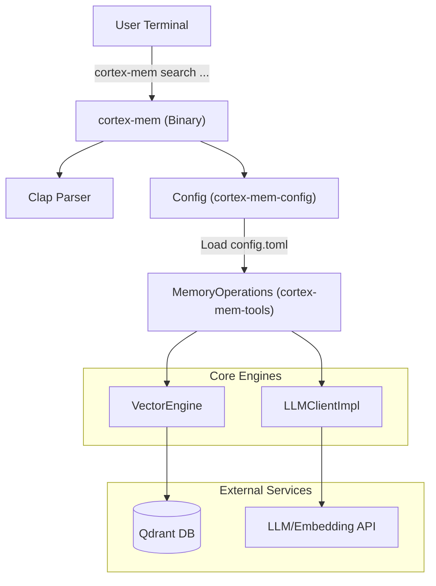
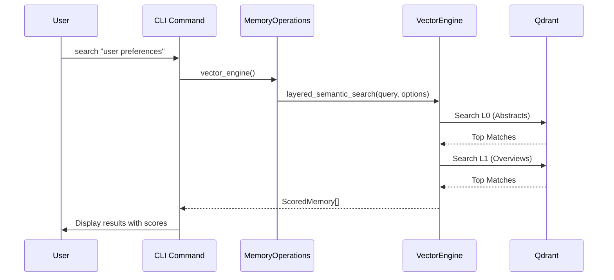

<!-- source: DeepWiki mcp.deepwiki.com · repo sopaco/cortex-mem · page 4.3 Command Line Interface · fetched 2026-10-27 -->

# Command Line Interface

<details>
<summary>Relevant source files</summary>

The following files were used as context for generating this wiki page:

- [cortex-mem-cli/Cargo.toml](cortex-mem-cli/Cargo.toml)
- [cortex-mem-cli/src/commands/add.rs](cortex-mem-cli/src/commands/add.rs)
- [cortex-mem-cli/src/commands/delete.rs](cortex-mem-cli/src/commands/delete.rs)
- [cortex-mem-cli/src/commands/get.rs](cortex-mem-cli/src/commands/get.rs)
- [cortex-mem-cli/src/commands/layers.rs](cortex-mem-cli/src/commands/layers.rs)
- [cortex-mem-cli/src/commands/list.rs](cortex-mem-cli/src/commands/list.rs)
- [cortex-mem-cli/src/commands/mod.rs](cortex-mem-cli/src/commands/mod.rs)
- [cortex-mem-cli/src/commands/search.rs](cortex-mem-cli/src/commands/search.rs)
- [cortex-mem-cli/src/commands/session.rs](cortex-mem-cli/src/commands/session.rs)
- [cortex-mem-cli/src/commands/tenant.rs](cortex-mem-cli/src/commands/tenant.rs)
- [cortex-mem-cli/src/main.rs](cortex-mem-cli/src/main.rs)
- [cortex-mem-config/src/lib.rs](cortex-mem-config/src/lib.rs)
- [cortex-mem-core/src/config.rs](cortex-mem-core/src/config.rs)
- [cortex-mem-rig/src/lib.rs](cortex-mem-rig/src/lib.rs)
- [examples/cortex-mem-tars/src/config.rs](examples/cortex-mem-tars/src/config.rs)
- [examples/cortex-mem-tars/src/infrastructure.rs](examples/cortex-mem-tars/src/infrastructure.rs)

</details>


## Purpose and Scope

The `cortex-mem-cli` (compiled as the `cortex-mem` binary) provides a powerful terminal-based interface for managing the Cortex Memory system. It allows developers and administrators to interact directly with the memory filesystem, perform semantic searches, manage multi-tenant environments, and trigger session processing pipelines.

Unlike the high-level TARS TUI or the Web Dashboard, the CLI is designed for precision operations, scripting, and system maintenance. It interfaces with the core logic through the `MemoryOperations` abstraction [cortex-mem-cli/src/main.rs:5-5]().

---

## Overview

The CLI is built using the `clap` library for robust argument parsing [cortex-mem-cli/src/main.rs:2-2](). It serves as a thin wrapper around `cortex_mem_tools::MemoryOperations`, which orchestrates the interaction between the local file-based storage and the vector database [cortex-mem-cli/src/main.rs:251-267]().

**Key Capabilities:**
- **Hierarchical Access**: Supports tiered retrieval (L0 Abstract, L1 Overview, L2 Full Content) [cortex-mem-cli/src/main.rs:83-94]().
- **Session Lifecycle**: Manual control over session creation and synchronous closing/indexing [cortex-mem-cli/src/commands/session.rs:57-73]().
- **Vector Maintenance**: Tools for reindexing, pruning stale vectors, and checking index status [cortex-mem-cli/src/main.rs:165-178]().
- **Multi-Tenancy**: Built-in support for tenant isolation and listing [cortex-mem-cli/src/main.rs:181-184]().

**Sources:** [cortex-mem-cli/src/main.rs:1-128](), [cortex-mem-cli/Cargo.toml:1-35]()

---

## Architecture and Data Flow

### System Integration Diagram
The CLI bridges user commands to the underlying memory infrastructure by initializing a `MemoryOperations` instance with configuration loaded from `config.toml`.


**Sources:** [cortex-mem-cli/src/main.rs:187-267](), [cortex-mem-config/src/lib.rs:7-14]()

### Search Execution Flow
When a user executes a `search` command, the CLI utilizes the `layered_semantic_search` capability of the `VectorEngine`.


**Sources:** [cortex-mem-cli/src/commands/search.rs:46-56](), [cortex-mem-cli/src/commands/search.rs:60-72]()

---

## Command Reference

### Global Arguments
Every command supports these global flags [cortex-mem-cli/src/main.rs:16-31]():
- `--config`, `-c`: Path to the configuration file (defaults to `config.toml`).
- `--tenant`: Tenant identifier for data isolation (defaults to `default`).
- `--verbose`, `-v`: Enables DEBUG level logging.

### Core Commands

#### `add`
Adds a message to a specific thread.
- **Usage**: `cortex-mem add --thread <ID> --role <user|assistant|system> <CONTENT>`
- **Implementation**: Calls `operations.add_message` which returns the unique URI [cortex-mem-cli/src/commands/add.rs:16-16]().

#### `search`
Performs semantic vector search across tiered memory layers.
- **Usage**: `cortex-mem search <QUERY> --limit 10 --min-score 0.4 --scope <session|user|agent>`
- **Behavior**: Constructs a `cortex://` scope URI and executes a `layered_semantic_search` [cortex-mem-cli/src/commands/search.rs:31-56]().

#### `get`
Retrieves a specific memory file or its generated layers.
- **Usage**: `cortex-mem get <URI> [--abstract-only | --overview]`
- **Tiered Access**:
    - `--abstract-only`: Returns the L0 `.abstract.md` [cortex-mem-cli/src/commands/get.rs:25-25]().
    - `--overview`: Returns the L1 `.overview.md` [cortex-mem-cli/src/commands/get.rs:16-16]().
    - Default: Returns the full L2 content [cortex-mem-cli/src/commands/get.rs:34-34]().

#### `session`
Manages conversation sessions and their processing pipeline.
- `list`: Lists all sessions in the current tenant [cortex-mem-cli/src/commands/session.rs:9-9]().
- `create`: Initializes a new thread [cortex-mem-cli/src/commands/session.rs:30-34]().
- `close`: **Synchronously** triggers the extraction, layer generation, and indexing pipeline [cortex-mem-cli/src/commands/session.rs:57-67]().

#### `vector`
Administrative tools for the vector database.
- `reindex`: Cleans stale vectors and re-syncs all local files to Qdrant [cortex-mem-cli/src/main.rs:170-170]().
- `prune`: Removes vectors that no longer have corresponding files on disk [cortex-mem-cli/src/main.rs:173-178]().

**Sources:** [cortex-mem-cli/src/main.rs:34-128](), [cortex-mem-cli/src/commands/search.rs:7-75](), [cortex-mem-cli/src/commands/session.rs:1-73]()

---

## Configuration Management

The CLI follows a specific hierarchy to determine the `data_dir` (where memory files are stored) [cortex-mem-cli/src/main.rs:214-227]():
1. `data_dir` field in the provided `config.toml`.
2. `CORTEX_DATA_DIR` environment variable.
3. The directory containing the `config.toml` file.

### Example `config.toml`
```toml
[cortex]
data_dir = "./storage"
enable_intent_analysis = true

[qdrant]
url = "http://localhost:6334"
collection_name = "cortex_mem"
embedding_dim = 1536

[llm]
api_base_url = "https://api.openai.com/v1"
api_key = "sk-..."
model_efficient = "gpt-4o-mini"
```
**Sources:** [cortex-mem-config/src/lib.rs:7-39](), [examples/cortex-mem-tars/src/config.rs:88-114]()

---

## Scripting Examples

### Batch Indexing
To ensure a newly populated data directory is fully indexed in the vector store:
```bash
# Force a full re-sync of the default tenant
cortex-mem --tenant default vector reindex
```

### Automated Session Closing
A cron job can be used to close inactive sessions, triggering the LLM-powered memory extraction:
```bash
# Close a specific thread and wait for indexing
cortex-mem session close "thread_abc_123"
```

### Searching from External Scripts
The CLI output can be parsed by other tools for integration:
```bash
# Search for user preferences and extract URIs
cortex-mem search "What does the user like?" --limit 5 | grep "cortex://"
```

**Sources:** [cortex-mem-cli/src/main.rs:165-178](), [cortex-mem-cli/src/commands/session.rs:57-73]()

---

