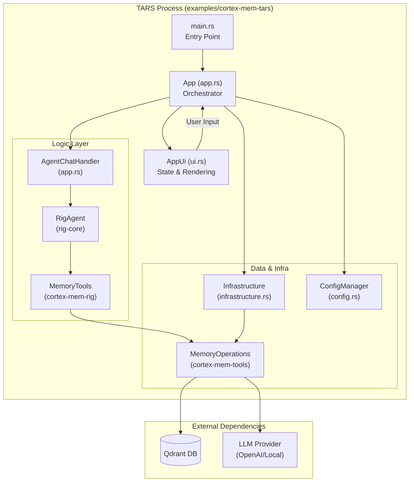
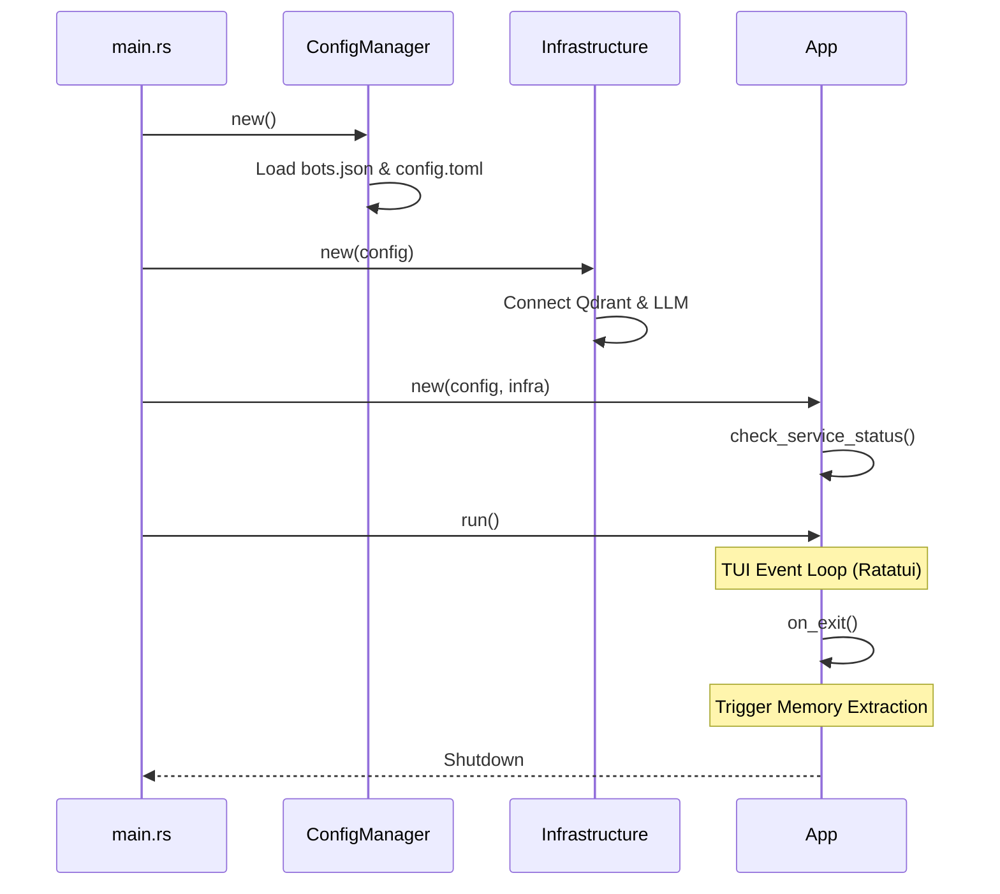

<!-- source: DeepWiki mcp.deepwiki.com · repo sopaco/cortex-mem · page 4.5 TARS Application · fetched 2026-10-27 -->

# TARS Application

Relevant source files

The following files were used as context for generating this wiki page:

- [Cargo.lock](Cargo.lock)
- [cortex-mem-cli/src/main.rs](cortex-mem-cli/src/main.rs)
- [cortex-mem-config/src/lib.rs](cortex-mem-config/src/lib.rs)
- [cortex-mem-core/src/config.rs](cortex-mem-core/src/config.rs)
- [cortex-mem-core/src/lib.rs](cortex-mem-core/src/lib.rs)
- [cortex-mem-core/src/session/manager.rs](cortex-mem-core/src/session/manager.rs)
- [cortex-mem-rig/src/lib.rs](cortex-mem-rig/src/lib.rs)
- [cortex-mem-tools/src/operations.rs](cortex-mem-tools/src/operations.rs)
- [cortex-mem-tools/src/tools/storage.rs](cortex-mem-tools/src/tools/storage.rs)
- [examples/cortex-mem-tars/.gitignore](examples/cortex-mem-tars/.gitignore)
- [examples/cortex-mem-tars/Cargo.lock](examples/cortex-mem-tars/Cargo.lock)
- [examples/cortex-mem-tars/Cargo.toml](examples/cortex-mem-tars/Cargo.toml)
- [examples/cortex-mem-tars/src/agent.rs](examples/cortex-mem-tars/src/agent.rs)
- [examples/cortex-mem-tars/src/app.rs](examples/cortex-mem-tars/src/app.rs)
- [examples/cortex-mem-tars/src/config.rs](examples/cortex-mem-tars/src/config.rs)
- [examples/cortex-mem-tars/src/infrastructure.rs](examples/cortex-mem-tars/src/infrastructure.rs)
- [examples/cortex-mem-tars/src/lib.rs](examples/cortex-mem-tars/src/lib.rs)
- [examples/cortex-mem-tars/src/logger.rs](examples/cortex-mem-tars/src/logger.rs)
- [examples/cortex-mem-tars/src/main.rs](examples/cortex-mem-tars/src/main.rs)
- [examples/cortex-mem-tars/src/ui.rs](examples/cortex-mem-tars/src/ui.rs)

## Purpose and Scope

This document provides a comprehensive technical guide to **cortex-mem-tars**, a terminal-based demonstration application for the Cortex Memory framework. TARS (Thinking And Reasoning System) features a multi-agent TUI (Terminal User Interface) with persistent memory, tenant isolation, and optional audio integration. It serves as a reference implementation for integrating `cortex-mem-core` and `cortex-mem-rig` into interactive applications.

For specific details on the interface components, see [TUI Interface & State Management](#4.5.1). For details on agent configuration and the multi-bot system, see [Multi-Agent System](#4.5.2). For details on the audio transcription server, see [Audio Integration API](#4.5.3).

**Sources:** [examples/cortex-mem-tars/src/main.rs:20-25](), [examples/cortex-mem-tars/Cargo.toml:1-8]()

---

## Architecture Overview

TARS is built as a modular application that directly consumes the Cortex Memory stack. Unlike the standalone service mode, TARS embeds the memory engine to provide a low-latency, self-contained experience.

### System Components

**Key Architectural Entities:**

| Entity | File | Role |
|:---|:---|:---|
| `App` | [examples/cortex-mem-tars/src/app.rs:28-51]() | Holds the application state, message channels, and infrastructure references. |
| `AppUi` | [examples/cortex-mem-tars/src/ui.rs:120-168]() | Manages the Ratatui-based TUI state, including message history, input buffers, and modals. |
| `Infrastructure` | [examples/cortex-mem-tars/src/infrastructure.rs:7-10]() | Initializes global `MemoryOperations` and validates service connectivity. |
| `ConfigManager` | [examples/cortex-mem-tars/src/config.rs:35-39]() | Manages `config.toml` (system) and `bots.json` (agent profiles). |
| `MemoryOperations` | [cortex-mem-tools/src/operations.rs:29-51]() | The primary interface used by TARS for tenant-isolated memory management. |

**Sources:** [examples/cortex-mem-tars/src/app.rs:28-51](), [examples/cortex-mem-tars/src/ui.rs:120-168](), [examples/cortex-mem-tars/src/infrastructure.rs:7-10](), [examples/cortex-mem-tools/src/operations.rs:29-51]()

---

## Application Lifecycle

TARS follows a strict lifecycle to ensure memory is properly indexed and extracted, especially during shutdown.

### Initialization and Execution Flow

1.  **Bootstrapping**: The `main` function initializes the `ConfigManager` to locate data directories and bot profiles [examples/cortex-mem-tars/src/main.rs:33-41]().
2.  **Infrastructure Validation**: `Infrastructure::new` establishes connections to the vector database and LLM provider [examples/cortex-mem-tars/src/infrastructure.rs:16-52]().
3.  **Service Check**: Before starting the TUI, `App::check_service_status` verifies the LLM API is responsive [examples/cortex-mem-tars/src/app.rs:117-155]().
4.  **Graceful Exit**: On shutdown, `App::on_exit` is called to ensure session memories are extracted and layers are generated [examples/cortex-mem-tars/src/main.rs:89-105]().

**Sources:** [examples/cortex-mem-tars/src/main.rs:28-110](), [examples/cortex-mem-tars/src/infrastructure.rs:16-52](), [examples/cortex-mem-tars/src/app.rs:117-155]()

---

## Memory Integration Strategy

TARS utilizes a "Tenant-per-Bot" isolation strategy. While the `Infrastructure` layer initializes a global context, each specific bot session creates a unique `MemoryOperations` instance.

### Bot-Specific Agent Construction

When a user selects a bot, TARS constructs a `RigAgent` using `create_memory_agent`. This function performs the following:
- Configures a `cortex_mem_core::llm::LLMClient` [examples/cortex-mem-tars/src/agent.rs:66-74]().
- Initializes `MemoryTools` via `cortex-mem-rig` with the bot's unique `agent_id` [examples/cortex-mem-tars/src/agent.rs:83-97]().
- Sets up a system prompt that includes the `cortex://` URI schema documentation [examples/cortex-mem-tars/src/agent.rs:155-183]().

**Sources:** [examples/cortex-mem-tars/src/agent.rs:57-106](), [examples/cortex-mem-tars/src/agent.rs:155-183]()

---

## Child Pages

For deep technical dives into specific TARS subsystems, refer to the following pages:

*   **[TUI Interface & State Management](#4.5.1)**: Explains the `AppUi` state machine, Markdown rendering via `tui-markdown`, and the custom theme system.
*   **[Multi-Agent System](#4.5.2)**: Details how `BotConfig` objects are managed in `bots.json` and how the `agent_id` provides logical isolation in the vector store.
*   **[Audio Integration API](#4.5.3)**: Documents the optional Whisper-based transcription listener and the TARS API server modes.

**Sources:** [examples/cortex-mem-tars/src/ui.rs:18-24](), [examples/cortex-mem-tars/src/config.rs:9-16](), [examples/cortex-mem-tars/src/app.rs:45-51]()

---

