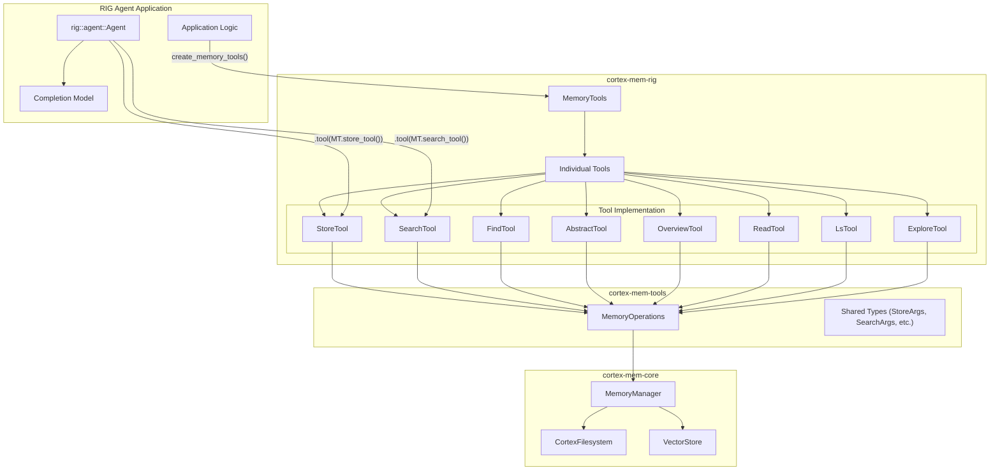
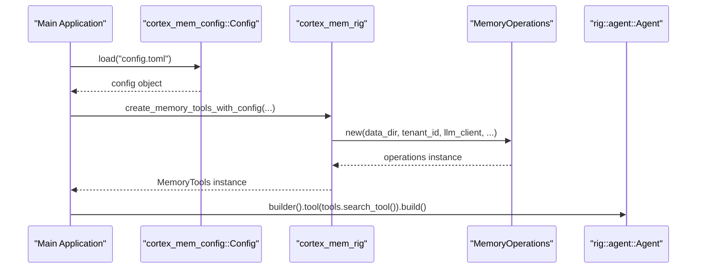
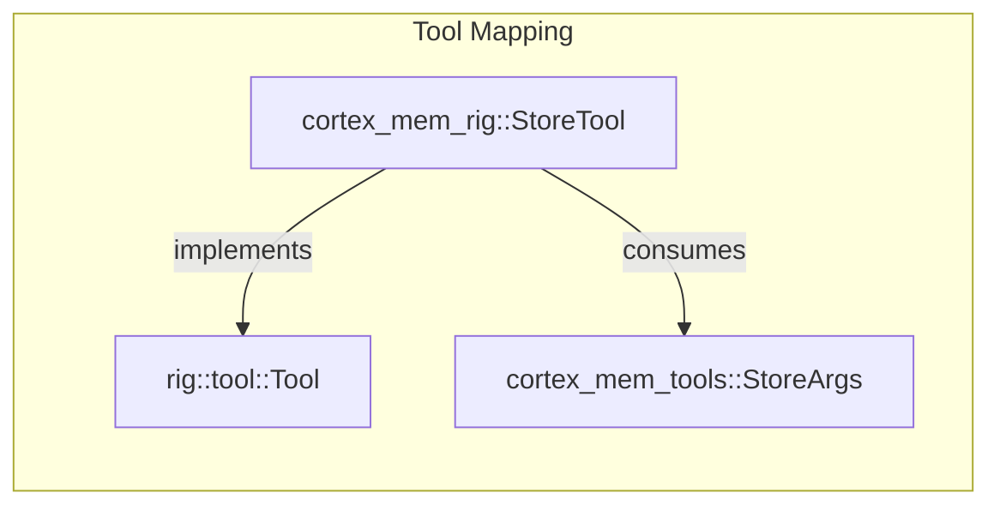

<!-- source: DeepWiki mcp.deepwiki.com · repo sopaco/cortex-mem · page 5.1 RIG Framework Integration · fetched 2026-10-27 -->

# RIG Framework Integration

<details>
<summary>Relevant source files</summary>

The following files were used as context for generating this wiki page:

- [cortex-mem-cli/src/main.rs](cortex-mem-cli/src/main.rs)
- [cortex-mem-config/src/lib.rs](cortex-mem-config/src/lib.rs)
- [cortex-mem-core/src/config.rs](cortex-mem-core/src/config.rs)
- [cortex-mem-core/src/filesystem/operations.rs](cortex-mem-core/src/filesystem/operations.rs)
- [cortex-mem-mcp/src/main.rs](cortex-mem-mcp/src/main.rs)
- [cortex-mem-rig/src/lib.rs](cortex-mem-rig/src/lib.rs)
- [cortex-mem-tools/src/errors.rs](cortex-mem-tools/src/errors.rs)
- [cortex-mem-tools/src/lib.rs](cortex-mem-tools/src/lib.rs)
- [cortex-mem-tools/src/types.rs](cortex-mem-tools/src/types.rs)
- [examples/cortex-mem-tars/src/config.rs](examples/cortex-mem-tars/src/config.rs)
- [examples/cortex-mem-tars/src/infrastructure.rs](examples/cortex-mem-tars/src/infrastructure.rs)

</details>


This document provides a comprehensive guide for integrating `cortex-mem` with the RIG AI agent framework. It covers the architecture of the `cortex-mem-rig` crate, tool registration, the `MemoryTools` collection, and autonomous memory usage within RIG agents.

## Purpose and Architecture

The `cortex-mem-rig` crate provides RIG-compatible tools that enable AI agents to interact with the Cortex Memory system. It acts as an integration layer between the RIG framework's `Tool` trait and the `cortex-mem-tools` shared operations layer. This ensures that RIG agents can leverage semantic memory, tiered access (L0/L1/L2), and multi-tenant isolation while maintaining consistency with other interfaces like the MCP server.

### Integration Layer Architecture



**Sources:** [cortex-mem-rig/src/lib.rs:1-135](), [cortex-mem-tools/src/lib.rs:1-19]()

### Code Entity Mapping

| Component | Code Entity | Location |
|-----------|-------------|----------|
| Tool Collection | `MemoryTools` struct | [cortex-mem-rig/src/lib.rs:10-12]() |
| Operations Orchestrator | `MemoryOperations` | [cortex-mem-tools/src/operations.rs:9-9]() |
| RIG Tool Factory | `create_memory_tools` | [cortex-mem-rig/src/lib.rs:66-68]() |
| Multi-tenant Init | `create_memory_tools_with_config` | [cortex-mem-rig/src/lib.rs:105-118]() |
| Shared Argument Types | `StoreArgs`, `SearchArgs`, `LsArgs` | [cortex-mem-tools/src/types.rs:68-191]() |

**Sources:** [cortex-mem-rig/src/lib.rs:1-135](), [cortex-mem-tools/src/types.rs:1-221]()

## MemoryTools Collection

The `MemoryTools` struct serves as a factory for generating RIG-compatible tool instances. It holds an `Arc<MemoryOperations>` to share state and connection pools (like Qdrant and LLM clients) across all tools registered to an agent.

### Available Tools

| Tool Method | Return Type | Purpose |
|-------------|-------------|---------|
| `abstract_tool()` | `AbstractTool` | Retrieves L0 (Abstract) layer of a memory |
| `overview_tool()` | `OverviewTool` | Retrieves L1 (Overview) layer of a memory |
| `read_tool()` | `ReadTool` | Retrieves L2 (Full Content) layer of a memory |
| `search_tool()` | `SearchTool` | Full semantic search with optional intent analysis |
| `find_tool()` | `FindTool` | Simple semantic search returning only L0 snippets |
| `ls_tool()` | `LsTool` | Lists memories at a specific URI (VFS style) |
| `explore_tool()` | `ExploreTool` | Graph-like exploration of related memories |
| `store_tool()` | `StoreTool` | Persists new content into the memory system |

**Sources:** [cortex-mem-rig/src/lib.rs:24-63]()

## Initialization and Configuration

To integrate with RIG, you must first initialize the underlying `MemoryOperations`. This requires configuration for the vector store (Qdrant), embedding models, and the LLM used for fact extraction.

### Initialization Sequence



**Sources:** [cortex-mem-rig/src/lib.rs:105-135](), [examples/cortex-mem-tars/src/infrastructure.rs:12-60]()

### Multi-Tenant Setup

The `cortex-mem-rig` crate supports tenant isolation, allowing a single application to manage separate memory spaces for different users or bots. This is achieved by passing a `tenant_id` during tool creation.

```rust
// Example of creating tools for a specific tenant
let tools = create_memory_tools_with_config(
    data_dir,
    "user_tenant_123", // tenant_id for isolation
    llm_client,
    &qdrant_url,
    &collection_name,
    None, // api_key
    &emb_url,
    &emb_key,
    &emb_model,
    Some(1536), // dimension
    Some("user_123".to_string()), // user_id for metadata
    true, // enable_intent_analysis
).await?;
```

**Sources:** [cortex-mem-rig/src/lib.rs:105-118](), [cortex-mem-core/src/filesystem/operations.rs:47-52]()

## Tool Registration and Usage

Once the `MemoryTools` instance is created, individual tools can be registered with a RIG agent.

### Agent Registration

RIG agents use the `.tool()` method to register capabilities. The `cortex-mem-rig` tools implement the necessary traits to be used directly.



**Sources:** [cortex-mem-rig/src/lib.rs:60-62](), [cortex-mem-tools/src/types.rs:174-191]()

### Shared Argument Structures

The tools use standardized argument structures defined in `cortex-mem-tools`. These structures are designed to be easily serialized/deserialized by the LLM during tool calling.

- **SearchArgs**: Includes `query`, `recursive` (bool), `scope` (URI), and `limit`. [cortex-mem-tools/src/types.rs:70-76]()
- **StoreArgs**: Includes `content`, `thread_id`, `scope` ("session", "user", "agent"), and `auto_generate_layers`. [cortex-mem-tools/src/types.rs:174-191]()
- **LsArgs**: Includes `uri` and `recursive`. [cortex-mem-tools/src/types.rs:122-127]()

## Data Flow: From Agent to Memory

When an agent decides to use a memory tool, the data flows through several layers of abstraction before reaching the disk or vector database.

1. **LLM Decision**: The LLM generates a tool call with arguments (e.g., `StoreArgs`).
2. **RIG Dispatch**: The RIG framework calls the `call()` method on the registered tool (e.g., `StoreTool`).
3. **Operations Layer**: The tool delegates to `MemoryOperations::store_memory()`. [cortex-mem-tools/src/operations.rs:9-9]()
4. **Core Processing**: `MemoryManager` orchestrates fact extraction and embedding generation.
5. **VFS Persistence**: The `CortexFilesystem` writes the raw content and generated layers (L0/L1) to the tenant-isolated directory structure. [cortex-mem-core/src/filesystem/operations.rs:189-199]()
6. **Vector Indexing**: The embedding is stored in Qdrant, associated with the file URI.

**Sources:** [cortex-mem-rig/src/lib.rs:1-68](), [cortex-mem-core/src/filesystem/operations.rs:97-111]()

## Autonomous Memory Usage

The integration enables agents to autonomously manage their long-term memory. By providing the agent with the `search_tool` and `store_tool`, the agent can:

- **Recall**: Search for past interactions or facts when a user asks a question.
- **Learn**: Explicitly store important information discovered during a conversation.
- **Organize**: Use the `ls_tool` and `explore_tool` to browse their own memory hierarchy.

The `enable_intent_analysis` flag in `CortexConfig` determines if the system uses an additional LLM call to rewrite queries and detect search intent before performing vector lookups. [cortex-mem-config/src/lib.rs:18-39]()

**Sources:** [cortex-mem-config/src/lib.rs:18-39](), [cortex-mem-rig/src/lib.rs:117-117]()

---

