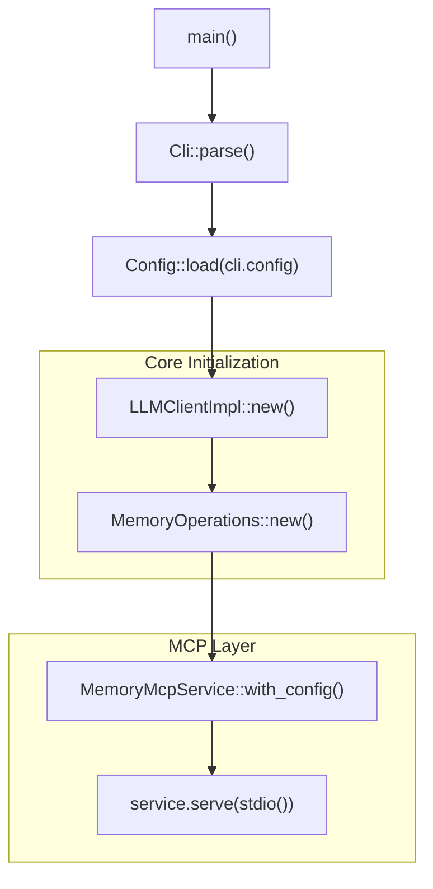
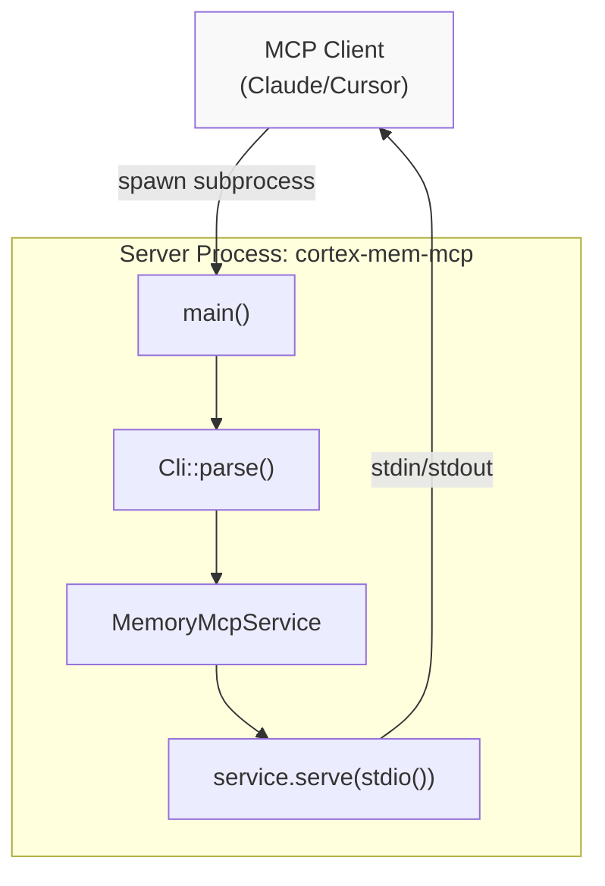
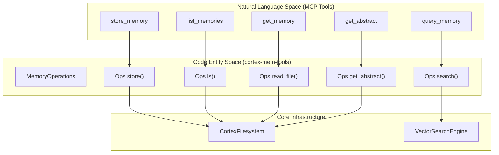
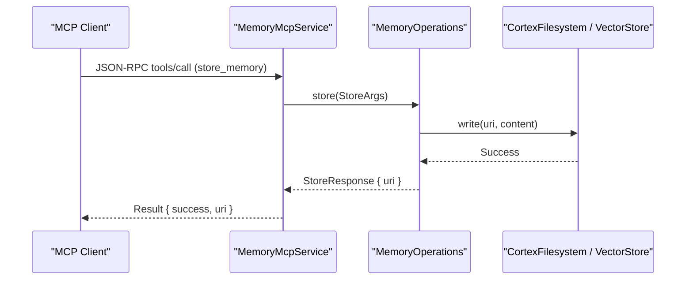

<!-- source: DeepWiki mcp.deepwiki.com · repo sopaco/cortex-mem · page 5.2 MCP Client Integration · fetched 2026-10-27 -->

# MCP Client Integration

<details>
<summary>Relevant source files</summary>

The following files were used as context for generating this wiki page:

- [cortex-mem-cli/README.md](cortex-mem-cli/README.md)
- [cortex-mem-cli/tests/cli_commands_test.rs](cortex-mem-cli/tests/cli_commands_test.rs)
- [cortex-mem-config/README.md](cortex-mem-config/README.md)
- [cortex-mem-core/README.md](cortex-mem-core/README.md)
- [cortex-mem-core/src/filesystem/operations.rs](cortex-mem-core/src/filesystem/operations.rs)
- [cortex-mem-mcp/README.md](cortex-mem-mcp/README.md)
- [cortex-mem-mcp/skill/SKILL.md](cortex-mem-mcp/skill/SKILL.md)
- [cortex-mem-mcp/src/main.rs](cortex-mem-mcp/src/main.rs)
- [cortex-mem-rig/README.md](cortex-mem-rig/README.md)
- [cortex-mem-service/README.md](cortex-mem-service/README.md)
- [cortex-mem-tools/README.md](cortex-mem-tools/README.md)
- [cortex-mem-tools/src/errors.rs](cortex-mem-tools/src/errors.rs)
- [cortex-mem-tools/src/lib.rs](cortex-mem-tools/src/lib.rs)
- [cortex-mem-tools/src/types.rs](cortex-mem-tools/src/types.rs)
- [examples/cortex-mem-tars/README.md](examples/cortex-mem-tars/README.md)

</details>


This guide explains how AI agents (Claude, Cursor, and custom MCP clients) connect to the Cortex Memory system through the Model Context Protocol (MCP). It covers stdio transport configuration, tool schemas, and usage patterns for autonomous memory operations.

---

## Overview

The `cortex-mem-mcp` binary implements an MCP server that exposes memory operations through stdio transport. AI agents invoke the server as a subprocess and communicate via JSON-RPC messages over stdin/stdout.

**Architecture:**
- **Transport**: stdio (standard input/output) [cortex-mem-mcp/src/main.rs:150-153]()
- **Protocol**: MCP v2024-11-05 over JSON-RPC 2.0
- **Server Implementation**: `MemoryMcpService` [cortex-mem-mcp/src/main.rs:142-143]()
- **Tools**: Six core memory tools for AI assistants [cortex-mem-mcp/README.md:7-15]()

**Target Clients:**
- Claude Desktop
- Cursor IDE
- Custom MCP implementations

Sources: [cortex-mem-mcp/src/main.rs:59-164](), [cortex-mem-mcp/README.md:1-15]()

---

## Server Configuration

### Command-Line Arguments

The `cortex-mem-mcp` binary is configured primarily through CLI arguments defined in the `Cli` struct [cortex-mem-mcp/src/main.rs:19-56]().

| Argument | Default | Description |
|----------|---------|-------------|
| `--config` / `-c` | `config.toml` | Path to configuration file [cortex-mem-mcp/src/main.rs:21-22]() |
| `--tenant` | `default` | Tenant ID for memory isolation [cortex-mem-mcp/src/main.rs:25-26]() |
| `--user` | `None` | Default user identity for memories [cortex-mem-mcp/src/main.rs:33-34]() |
| `--auto-trigger-threshold`| `10` | Messages before auto-extraction [cortex-mem-mcp/src/main.rs:37-38]() |
| `--auto-trigger-interval` | `300` | Min seconds between extractions [cortex-mem-mcp/src/main.rs:41-42]() |
| `--no-auto-trigger` | `false` | Disable the auto-trigger feature [cortex-mem-mcp/src/main.rs:49-50]() |
| `--log-file` | `None` | Path to write logs (stdio is for MCP) [cortex-mem-mcp/src/main.rs:54-55]() |

Sources: [cortex-mem-mcp/src/main.rs:14-56]()

---

### Initialization Sequence

The server initializes by loading the configuration and setting up `MemoryOperations`, which acts as the high-level API for all memory tasks [cortex-mem-mcp/src/main.rs:108-121]().



**Server Initialization Flow**

Sources: [cortex-mem-mcp/src/main.rs:60-153]()

---

## stdio Transport Protocol

MCP clients communicate with the server through standard input/output streams using JSON-RPC 2.0 messages.

**Process Lifecycle:**



**stdio Message Exchange**

Sources: [cortex-mem-mcp/src/main.rs:59-164]()

---

## MCP Tool Definitions

The server exposes tools defined in `MemoryOperations` [cortex-mem-tools/src/operations.rs:9](). These tools map directly to AI agent capabilities.

### Tool-to-Code Mapping

The following diagram bridges the Natural Language Space (Tools) to the Code Entity Space (Implementation).



**MCP Tool Mapping**

Sources: [cortex-mem-mcp/README.md:7-15](), [cortex-mem-tools/src/operations.rs:36-217](), [cortex-mem-tools/README.md:16-54]()

---

## Tool Details & Schemas

### 1. store_memory
Stores new content into the memory system [cortex-mem-mcp/README.md:18-29]().

| Parameter | Type | Required | Default | Description |
|-----------|------|----------|---------|-------------|
| `content` | string | Yes | - | Content to store |
| `thread_id`| string | No | `"default"` | Session identifier |
| `role` | string | No | `"user"` | user, assistant, or system |

**Implementation:** Calls `MemoryOperations::store()` [cortex-mem-tools/src/operations.rs:177-185]().

### 2. query_memory
Performs semantic vector search across tiered layers (L0/L1/L2) [cortex-mem-mcp/README.md:52-64]().

| Parameter | Type | Required | Default | Description |
|-----------|------|----------|---------|-------------|
| `query` | string | Yes | - | Search string |
| `thread_id`| string | No | - | Filter by session |
| `scope` | string | No | `"session"`| session, user, or agent |
| `limit` | number | No | `10` | Max results |

**Implementation:** Calls `MemoryOperations::search()` [cortex-mem-tools/src/operations.rs:153-159]().

### 3. get_abstract
Retrieves the L0 summary (~100 tokens) for quick relevance checking [cortex-mem-mcp/README.md:215-224]().

**Implementation:** Calls `MemoryOperations::get_abstract()` [cortex-mem-tools/src/operations.rs:109-113]().

Sources: [cortex-mem-mcp/README.md:16-241](), [cortex-mem-tools/src/types.rs:35-203]()

---

## Request Processing Pipeline

The flow of data from an MCP request to the underlying storage:



**Data Flow Sequence**

Sources: [cortex-mem-mcp/src/main.rs:141-153](), [cortex-mem-tools/src/operations.rs:177-185](), [cortex-mem-core/src/filesystem/operations.rs:189-199]()

---

## Client Integration Examples

### Claude Desktop Configuration
To integrate with Claude Desktop, edit the `claude_desktop_config.json` file [cortex-mem-mcp/README.md:275-277]().

```json
{
  "mcpServers": {
    "cortex-memory": {
      "command": "cortex-mem-mcp",
      "args": [
        "--config", "/path/to/config.toml",
        "--tenant", "my-project-tenant",
        "--log-file", "/path/to/mcp.log"
      ]
    }
  }
}
```

### Cursor IDE Configuration
In Cursor settings, add a new MCP server with the command:
`cortex-mem-mcp --config /path/to/config.toml` [cortex-mem-mcp/skill/SKILL.md:163-174]().

---

## Usage Patterns

### Autonomous Memory Extraction
The `cortex-mem-mcp` server includes an `AutoTriggerConfig` [cortex-mem-mcp/src/main.rs:127-132](). This allows the server to automatically trigger memory processing based on:
1. **Message Count**: When a threshold of messages is reached [cortex-mem-mcp/src/main.rs:37-38]().
2. **Inactivity**: When the agent has been idle for a specific duration [cortex-mem-mcp/src/main.rs:45-46]().

This is managed by the `start_inactivity_checker()` method in `MemoryMcpService` [cortex-mem-mcp/src/main.rs:146]().

### Tiered Access (L0/L1/L2)
Agents are encouraged to follow a tiered retrieval pattern:
1. **L0 (Abstract)**: Use `get_abstract` or `list_memories` with `include_abstracts: true` to quickly scan relevance [cortex-mem-tools/README.md:143]().
2. **L1 (Overview)**: Use `get_overview` for a structured summary (~2000 tokens) [cortex-mem-tools/README.md:144]().
3. **L2 (Full)**: Use `get_memory` only when deep analysis of the original content is required [cortex-mem-tools/README.md:145]().

Sources: [cortex-mem-mcp/src/main.rs:126-147](), [cortex-mem-tools/README.md:139-146]()

---

