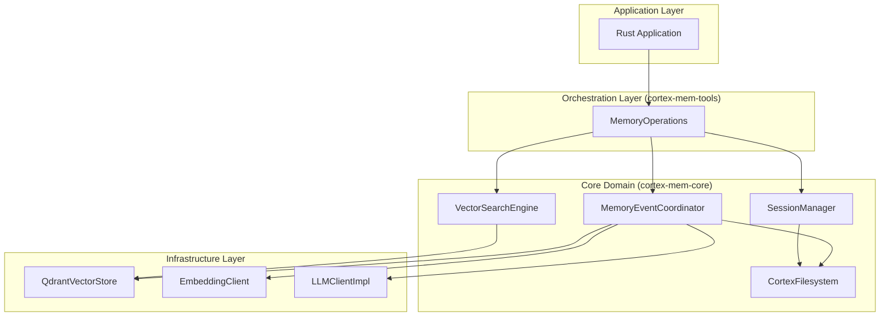
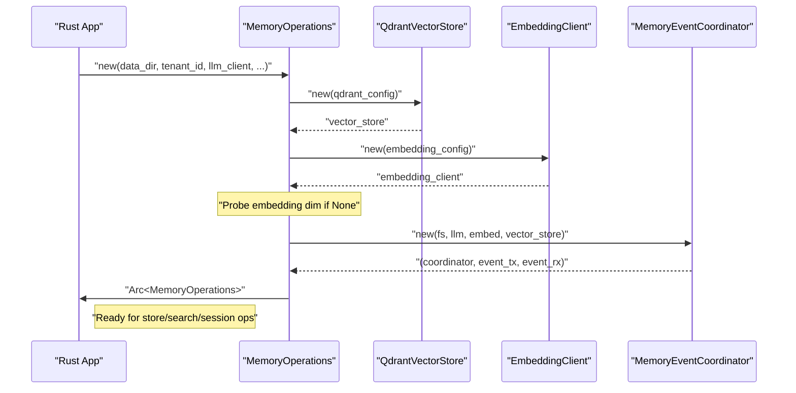

<!-- source: DeepWiki mcp.deepwiki.com · repo sopaco/cortex-mem · page 5.4 Direct Library Integration · fetched 2026-10-27 -->

# Direct Library Integration

<details>
<summary>Relevant source files</summary>

The following files were used as context for generating this wiki page:

- [Cargo.toml](Cargo.toml)
- [cortex-mem-cli/src/main.rs](cortex-mem-cli/src/main.rs)
- [cortex-mem-config/Cargo.toml](cortex-mem-config/Cargo.toml)
- [cortex-mem-config/src/lib.rs](cortex-mem-config/src/lib.rs)
- [cortex-mem-core/Cargo.toml](cortex-mem-core/Cargo.toml)
- [cortex-mem-core/src/config.rs](cortex-mem-core/src/config.rs)
- [cortex-mem-core/src/lib.rs](cortex-mem-core/src/lib.rs)
- [cortex-mem-core/src/session/manager.rs](cortex-mem-core/src/session/manager.rs)
- [cortex-mem-mcp/Cargo.toml](cortex-mem-mcp/Cargo.toml)
- [cortex-mem-rig/Cargo.toml](cortex-mem-rig/Cargo.toml)
- [cortex-mem-rig/src/lib.rs](cortex-mem-rig/src/lib.rs)
- [cortex-mem-service/Cargo.toml](cortex-mem-service/Cargo.toml)
- [cortex-mem-tools/Cargo.toml](cortex-mem-tools/Cargo.toml)
- [cortex-mem-tools/src/operations.rs](cortex-mem-tools/src/operations.rs)
- [cortex-mem-tools/src/tools/storage.rs](cortex-mem-tools/src/tools/storage.rs)
- [examples/cortex-mem-tars/config.example.toml](examples/cortex-mem-tars/config.example.toml)
- [examples/cortex-mem-tars/src/agent.rs](examples/cortex-mem-tars/src/agent.rs)
- [examples/cortex-mem-tars/src/app.rs](examples/cortex-mem-tars/src/app.rs)
- [examples/cortex-mem-tars/src/config.rs](examples/cortex-mem-tars/src/config.rs)
- [examples/cortex-mem-tars/src/infrastructure.rs](examples/cortex-mem-tars/src/infrastructure.rs)

</details>


## Purpose and Scope

This guide covers using the `cortex-mem-core` and `cortex-mem-tools` libraries directly in Rust applications. While `cortex-mem-core` provides the foundational logic for filesystem operations, session management, and vector syncing, `cortex-mem-tools` offers a high-level `MemoryOperations` orchestrator that simplifies initialization and provides a unified API for common memory tasks.

Direct integration is the preferred method for high-performance Rust applications, such as the TARS TUI or custom agent frameworks, where low latency and deep control over the memory lifecycle are required.

Sources: [cortex-mem-core/src/lib.rs:1-53](), [cortex-mem-tools/src/operations.rs:23-51]()

---

## Initialization Architecture

The system uses a multi-layered initialization approach. High-level operations depend on a configured `LLMClient`, a `VectorStore` (Qdrant), and an `EmbeddingClient`.

### Component Relationship



Sources: [cortex-mem-tools/src/operations.rs:29-51](), [cortex-mem-core/src/memory_event_coordinator.rs:20-45]()

### Initialization Sequence

The `MemoryOperations::new` constructor handles the complex wiring of background event loops and infrastructure connections.



Sources: [cortex-mem-tools/src/operations.rs:100-185](), [cortex-mem-core/src/memory_event_coordinator.rs:48-80]()

---

## Core Usage Patterns

### Initializing MemoryOperations

To use the library, you must first initialize the `MemoryOperations` struct. This requires providing configuration for both the LLM (for reasoning/extraction) and the Embedding/Vector store (for retrieval).

```rust
use cortex_mem_tools::MemoryOperations;
use cortex_mem_core::llm::{LLMClientImpl, LLMConfig};
use std::sync::Arc;

// 1. Setup LLM Client
let llm_config = LLMConfig {
    api_base_url: "https://api.openai.com/v1".to_string(),
    api_key: "your-key".to_string(),
    model_efficient: "gpt-4o-mini".to_string(),
    temperature: 0.1,
    max_tokens: 4096,
};
let llm_client = Arc::new(LLMClientImpl::new(llm_config)?);

// 2. Initialize Operations
let operations = MemoryOperations::new(
    "./data",               // Base data directory
    "my_tenant",            // Tenant ID for isolation
    llm_client,             // Shared LLM client
    "http://localhost:6334",// Qdrant URL
    "cortex_mem",           // Collection name
    None,                   // Qdrant API Key
    "https://api.openai.com/v1", // Embedding API Base
    "your-key",             // Embedding API Key
    "text-embedding-3-small",// Embedding Model
    Some(1536),             // Dimension (Optional, will probe if None)
    Some("user_1".into()),  // Default User ID
    true,                   // Enable Intent Analysis
).await?;
```

Sources: [cortex-mem-tools/src/operations.rs:100-154](), [examples/cortex-mem-tars/src/agent.rs:64-97]()

### Storing Memories (Asynchronous Layering)

Storing content via `MemoryOperations::store` triggers an asynchronous pipeline. The content is written to the `CortexFilesystem` immediately, while L0 (Abstract) and L1 (Overview) layers are generated in the background by the `MemoryEventCoordinator`.

```rust
use cortex_mem_tools::types::StoreArgs;

let args = StoreArgs {
    content: "The project deadline is set for next Friday.".to_string(),
    scope: "user".to_string(), // "user", "session", or "agent"
    user_id: Some("user_1".to_string()),
    agent_id: None,
    thread_id: "".to_string(),
    auto_generate_layers: Some(true),
};

let response = operations.store(args).await?;
println!("Memory stored at URI: {}", response.uri);
```

Sources: [cortex-mem-tools/src/tools/storage.rs:16-44](), [cortex-mem-tools/src/tools/storage.rs:156-170]()

### Semantic Search

The `VectorSearchEngine` is used to perform semantic queries across different scopes.

```rust
use cortex_mem_core::search::SearchOptions;

let options = SearchOptions {
    limit: 5,
    min_score: 0.4,
    scope: Some("cortex://user/user_1".to_string()),
    include_layers: vec!["L0".to_string(), "L1".to_string()],
    ..Default::default()
};

let results = operations.vector_engine().search("project deadlines", options).await?;
for result in results {
    println!("Found [{}]: {}", result.uri, result.content);
}
```

Sources: [cortex-mem-tools/src/operations.rs:59-62](), [cortex-mem-core/src/search/mod.rs:99-104]()

---

## Session Management

Direct integration allows for fine-grained control over conversation sessions. Sessions are stored in a specific hierarchy: `cortex://session/{thread_id}/timeline/`.

```rust
let sm = operations.session_manager().write().await;

// Create or update a session
sm.create_session_with_ids(
    "thread_123",
    Some("user_1".to_string()),
    Some("agent_1".to_string())
).await?;

// Add a message (triggers event for background indexing)
sm.add_message(
    "thread_123",
    cortex_mem_core::MessageRole::User,
    "Hello, can you remember my favorite color is blue?"
).await?;
```

Sources: [cortex-mem-core/src/session/manager.rs:201-214](), [cortex-mem-tools/src/tools/storage.rs:85-133]()

---

## Advanced Integration: TARS Pattern

The TARS application demonstrates a "Shared Infrastructure" pattern where a global `MemoryOperations` instance is used for system-level tasks, while individual bots create their own tenant-isolated operations.

### Multi-Tenant Re-initialization

When switching bots or users, you can rebuild the agent without re-initializing the entire infrastructure (Qdrant connections, etc.) by reusing the `MemoryOperations` or its components.

```rust
// Rebuilding a Rig Agent on top of existing operations
pub fn rebuild_rig_agent(
    config: &cortex_mem_config::Config,
    tenant_operations: Arc<MemoryOperations>,
    agent_id: &str,
) -> Result<RigAgent<CompletionModel>> {
    // Wrap operations in Rig-compatible tools
    let memory_tools = cortex_mem_rig::MemoryTools::new(tenant_operations);

    // Build Rig Agent with specific tools
    let agent = llm_client
        .agent(&config.llm.model_efficient)
        .tool(memory_tools.search_tool())
        .tool(memory_tools.read_tool())
        .build();

    Ok(agent)
}
```

Sources: [examples/cortex-mem-tars/src/agent.rs:113-152](), [examples/cortex-mem-tars/src/infrastructure.rs:16-52]()

---

## Configuration Reference

When integrating directly, you typically use `cortex-mem-config` to load settings from a `config.toml` file.

| Section | Key | Description |
| :--- | :--- | :--- |
| `[cortex]` | `data_dir` | Root path for the `cortex://` filesystem. |
| `[qdrant]` | `url` | Endpoint for the Qdrant vector database. |
| `[embedding]` | `model_name` | The model used for generating vectors (e.g., `text-embedding-3-small`). |
| `[llm]` | `model_efficient` | The model used for background layer generation (L0/L1). |

Sources: [examples/cortex-mem-tars/src/config.rs:88-114](), [cortex-mem-core/src/config.rs:55-80]()

---

## Summary of Key Functions

| Entity | Function | Purpose |
| :--- | :--- | :--- |
| `MemoryOperations` | `new()` | Main entry point; initializes all core services and background loops. |
| `MemoryOperations` | `store()` | High-level API to save content and trigger async layer generation. |
| `CortexFilesystem` | `write()` | Low-level direct file write to the virtual filesystem. |
| `SessionManager` | `add_message()` | Appends a message to a session timeline and notifies the indexer. |
| `MemoryEventCoordinator` | `new()` | Coordinates the background workers for embedding and LLM processing. |

Sources: [cortex-mem-tools/src/operations.rs:100-113](), [cortex-mem-core/src/memory_event_coordinator.rs:48-60](), [cortex-mem-core/src/session/manager.rs:236-250]()

---

