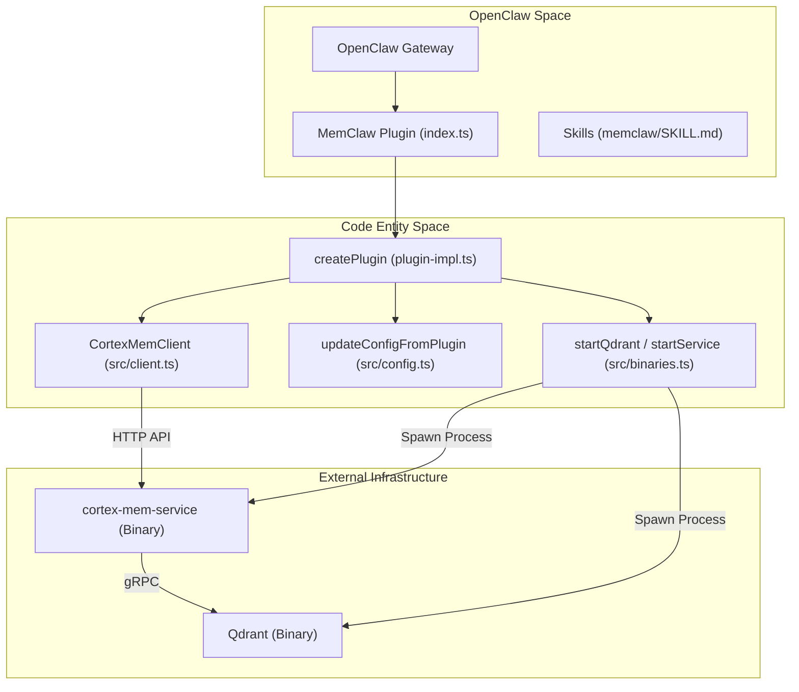
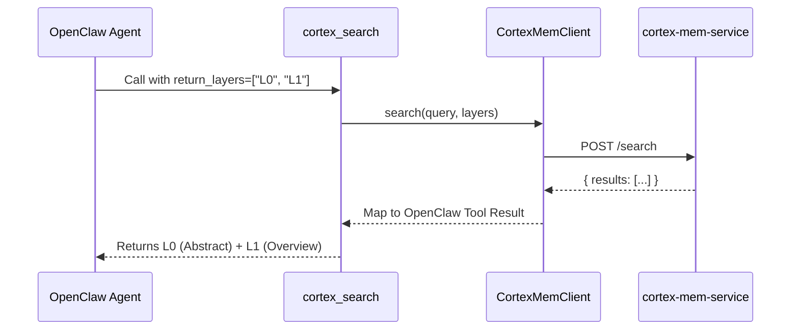

<!-- source: DeepWiki mcp.deepwiki.com · repo sopaco/cortex-mem · page 5.5 OpenClaw Plugin Integration · fetched 2026-10-27 -->

# OpenClaw Plugin Integration

Relevant source files

The following files were used as context for generating this wiki page:

- [examples/@memclaw/plugin/README.md](examples/@memclaw/plugin/README.md)
- [examples/@memclaw/plugin/README_zh.md](examples/@memclaw/plugin/README_zh.md)
- [examples/@memclaw/plugin/dist/index.js](examples/@memclaw/plugin/dist/index.js)
- [examples/@memclaw/plugin/dist/plugin-impl.d.ts](examples/@memclaw/plugin/dist/plugin-impl.d.ts)
- [examples/@memclaw/plugin/dist/plugin-impl.d.ts.map](examples/@memclaw/plugin/dist/plugin-impl.d.ts.map)
- [examples/@memclaw/plugin/dist/plugin-impl.js](examples/@memclaw/plugin/dist/plugin-impl.js)
- [examples/@memclaw/plugin/dist/plugin-impl.js.map](examples/@memclaw/plugin/dist/plugin-impl.js.map)
- [examples/@memclaw/plugin/dist/src/binaries.d.ts.map](examples/@memclaw/plugin/dist/src/binaries.d.ts.map)
- [examples/@memclaw/plugin/dist/src/binaries.js](examples/@memclaw/plugin/dist/src/binaries.js)
- [examples/@memclaw/plugin/dist/src/binaries.js.map](examples/@memclaw/plugin/dist/src/binaries.js.map)
- [examples/@memclaw/plugin/dist/src/config.d.ts](examples/@memclaw/plugin/dist/src/config.d.ts)
- [examples/@memclaw/plugin/dist/src/config.d.ts.map](examples/@memclaw/plugin/dist/src/config.d.ts.map)
- [examples/@memclaw/plugin/dist/src/config.js](examples/@memclaw/plugin/dist/src/config.js)
- [examples/@memclaw/plugin/dist/src/config.js.map](examples/@memclaw/plugin/dist/src/config.js.map)
- [examples/@memclaw/plugin/index.ts](examples/@memclaw/plugin/index.ts)
- [examples/@memclaw/plugin/openclaw.plugin.json](examples/@memclaw/plugin/openclaw.plugin.json)
- [examples/@memclaw/plugin/package.json](examples/@memclaw/plugin/package.json)
- [examples/@memclaw/plugin/plugin-impl.ts](examples/@memclaw/plugin/plugin-impl.ts)
- [examples/@memclaw/plugin/skills/memclaw-maintance/SKILL.md](examples/@memclaw/plugin/skills/memclaw-maintance/SKILL.md)
- [examples/@memclaw/plugin/skills/memclaw-maintance/references/tools.md](examples/@memclaw/plugin/skills/memclaw-maintance/references/tools.md)
- [examples/@memclaw/plugin/skills/memclaw-maintance/references/troubleshooting.md](examples/@memclaw/plugin/skills/memclaw-maintance/references/troubleshooting.md)
- [examples/@memclaw/plugin/skills/memclaw/SKILL.md](examples/@memclaw/plugin/skills/memclaw/SKILL.md)
- [examples/@memclaw/plugin/src/binaries.ts](examples/@memclaw/plugin/src/binaries.ts)
- [examples/@memclaw/plugin/src/config.ts](examples/@memclaw/plugin/src/config.ts)

The **MemClaw** plugin integrates Cortex Memory into the **OpenClaw** agent framework, providing agents with a tiered, long-term semantic memory. It automates the orchestration of the underlying `cortex-mem-service` and Qdrant vector database, exposing memory operations as standardized agent skills.

## 1. Plugin Architecture & Orchestration

MemClaw acts as a bridge between the OpenClaw Gateway and the Cortex Memory ecosystem. It handles the lifecycle of necessary binaries and manages configuration synchronization between OpenClaw's JSON-based settings and Cortex's TOML-based requirements.

### System Orchestration Flow
The plugin ensures that all dependencies are running before registering tools. If `autoStartServices` is enabled, it manages the `qdrant` and `cortex-mem-service` processes.

| Component | Responsibility | Port |
| :--- | :--- | :--- |
| **OpenClaw Gateway** | Hosts the plugin and executes agent tools | N/A |
| **MemClaw Plugin** | Orchestrates services and maps tool calls | N/A |
| **cortex-mem-service** | Core memory logic, extraction, and API | 8085 |
| **Qdrant** | Vector storage and similarity search | 6333 (HTTP) / 6334 (gRPC) |

**Orchestration Logic:**
- **Binary Management**: Platform-specific binaries (macOS arm64, Windows x64, Linux x64) are bundled via optional dependencies `[examples/@memclaw/plugin/package.json:62-66]()`.
- **Service Startup**: The `ensureAllServices` function in `[examples/@memclaw/plugin/src/binaries.ts]()` checks if ports are occupied; if not, it spawns `qdrant` and then `cortex-mem-service` `[examples/@memclaw/plugin/src/binaries.ts:177-270]()`.
- **Configuration Sync**: Values from `openclaw.json` (like `llmApiKey`) are automatically written to the local `config.toml` used by the core service `[examples/@memclaw/plugin/src/config.ts:264-285]()`.

### Data & Code Entity Mapping
The following diagram bridges the OpenClaw plugin interface to the underlying service implementation.

**Diagram: Plugin to Service Mapping**

**Sources:** `[examples/@memclaw/plugin/index.ts:63-87]()`, `[examples/@memclaw/plugin/plugin-impl.ts:13-31]()`, `[examples/@memclaw/plugin/src/binaries.ts:177-270]()`.

## 2. Tool Exposure & Skills

The plugin registers a suite of tools that agents use to interact with memory. These are defined in `[examples/@memclaw/plugin/plugin-impl.ts:80-231]()` and documented for the agent in the `memclaw` skill `[examples/@memclaw/plugin/skills/memclaw/SKILL.md:28-85]()`.

### Core Memory Tools
| Tool Name | Purpose | Key Parameters |
| :--- | :--- | :--- |
| `cortex_search` | Semantic search across L0/L1/L2 | `query`, `return_layers`, `min_score` |
| `cortex_recall` | Quick recall (L0 + L2 content) | `query`, `limit` |
| `cortex_add_memory` | Store a new message/fact | `content`, `role`, `metadata` |
| `cortex_commit_session` | Trigger the extraction pipeline | `session_id` |
| `cortex_migrate` | Import native OpenClaw memories | N/A |

### The `cortex://` URI Scheme
MemClaw introduces a virtual filesystem (VFS) metaphor for browsing memory via `cortex_ls` `[examples/@memclaw/plugin/plugin-impl.ts:235-255]()`.

*   **`cortex://session`**: Lists all available memory sessions.
*   **`cortex://session/{id}/timeline`**: Accesses the raw message history of a session.
*   **`cortex://session/{id}/memories`**: Accesses the high-level facts extracted from a session.

**Sources:** `[examples/@memclaw/plugin/skills/memclaw/SKILL.md:47-60]()`, `[examples/@memclaw/plugin/plugin-impl.ts:235-255]()`.

## 3. Tiered Retrieval (L0/L1/L2)

The plugin implements the Cortex tiered memory model to optimize token usage for OpenClaw agents.

**Data Flow: Layered Retrieval**

| Layer | Token Size | Description | Use Case |
| :--- | :--- | :--- | :--- |
| **L0 (Abstract)** | ~100 | High-level summary | Quick relevance check / Filtering |
| **L1 (Overview)** | ~2000 | Key points & context | Deep context without full history |
| **L2 (Content)** | Full | Original raw content | Precise data extraction |

**Sources:** `[examples/@memclaw/plugin/README.md:23-31]()`, `[examples/@memclaw/plugin/plugin-impl.ts:80-129]()`.

## 4. Configuration & Setup

Configuration is managed within the `openclaw.json` file under the `plugins.entries.memclaw.config` object. The plugin synchronizes these values to the local environment.

### Required Fields
The following fields must be configured in OpenClaw for the plugin to function:
- `llmApiKey`: API key for fact extraction and summarization.
- `embeddingApiKey`: API key for vector generation (defaults to `llmApiKey` if omitted).
- `llmApiBaseUrl`: Endpoint for LLM services (default: OpenAI).

### Service Defaults
| Setting | Default | Description |
| :--- | :--- | :--- |
| `serviceUrl` | `http://localhost:8085` | The endpoint for the Cortex service. |
| `tenantId` | `tenant_claw` | Isolation ID for OpenClaw data. |
| `autoStartServices` | `true` | Whether to manage Qdrant/Service processes. |

**Sources:** `[examples/@memclaw/plugin/openclaw.plugin.json:10-89]()`, `[examples/@memclaw/plugin/src/config.ts:70-117]()`.

## 5. Migration from Native Memory

The `cortex_migrate` tool allows users to transition from OpenClaw's built-in Markdown-based memory to the vector-enhanced Cortex system.

**Migration Logic:**
1.  **Discovery**: Scans the OpenClaw `memory/` directory for `.md` files and `MEMORY.md` `[examples/@memclaw/plugin/src/migrate.ts]()`.
2.  **Ingestion**: Sends content to `cortex-mem-service` as L2 content.
3.  **Processing**: The service automatically generates L0/L1 layers and vector embeddings for the imported data.

**Sources:** `[examples/@memclaw/plugin/skills/memclaw-maintance/SKILL.md:119-132]()`, `[examples/@memclaw/plugin/plugin-impl.ts:311-325]()`.

---

