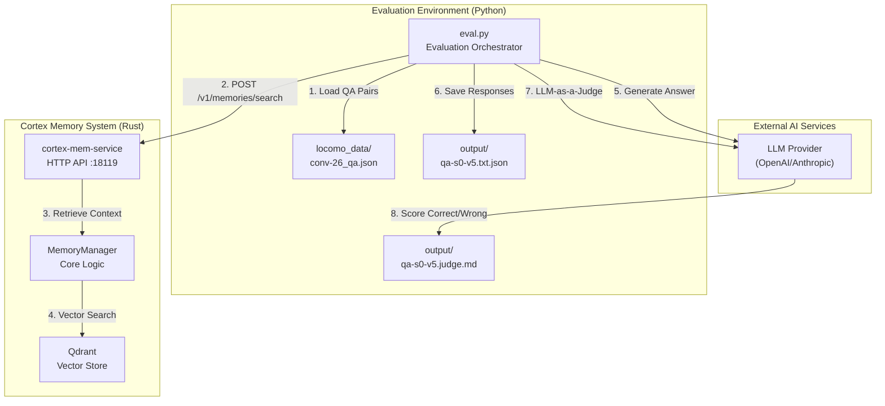

<!-- source: DeepWiki mcp.deepwiki.com · repo sopaco/cortex-mem · page 6.1 Evaluation Framework · fetched 2026-10-27 -->

# Evaluation Framework

Relevant source files

The following files were used as context for generating this wiki page:

- [assets/benchmark/cortex_mem_vs_langmem.png](assets/benchmark/cortex_mem_vs_langmem.png)
- [assets/benchmark/cortex_mem_vs_openclaw_1.png](assets/benchmark/cortex_mem_vs_openclaw_1.png)
- [assets/benchmark/cortex_mem_vs_openclaw_2.png](assets/benchmark/cortex_mem_vs_openclaw_2.png)
- [assets/benchmark/cortex_mem_vs_openclaw_3.png](assets/benchmark/cortex_mem_vs_openclaw_3.png)
- [assets/benchmark/evaluation_cortex_mem.webp](assets/benchmark/evaluation_cortex_mem.webp)
- [assets/benchmark/evaluation_langmem.webp](assets/benchmark/evaluation_langmem.webp)
- [examples/locomo-evaluation/BENCHMARK.md](examples/locomo-evaluation/BENCHMARK.md)
- [examples/locomo-evaluation/benchmark/BENCHMARK.md](examples/locomo-evaluation/benchmark/BENCHMARK.md)
- [examples/locomo-evaluation/benchmark/qa-s0-v5.judge.md](examples/locomo-evaluation/benchmark/qa-s0-v5.judge.md)

This document introduces the **lomoco-evaluation** framework, a benchmarking system designed to assess and compare AI-native memory management systems. The framework provides standardized datasets (LOCOMO), automated evaluation pipelines, and comparative metrics to measure the performance of Cortex Memory against baselines such as LangMem and Simple RAG.

For detailed execution steps, see [Running Evaluations](#6.1.1). For metric definitions and interpretation, see [Evaluation Metrics](#6.1.2).

---

## Purpose and Scope

The evaluation framework serves as the primary tool for verifying the effectiveness of Cortex Memory's AI-powered features (e.g., fact extraction and temporal reasoning). It enables:

- **Quantitative Benchmarking**: Using metrics like Recall@K, MRR, and NDCG to evaluate retrieval quality [examples/locomo-evaluation/benchmark/BENCHMARK.md:9-22]().
- **Comparative Analysis**: Side-by-side performance testing against standard vector search (LangMem) and basic RAG [examples/locomo-evaluation/benchmark/BENCHMARK.md:40-48]().
- **Reasoning Assessment**: Categorized testing for Factual Recall, Temporal Reasoning, Commonsense Inference, and Multi-hop Reasoning [examples/locomo-evaluation/benchmark/BENCHMARK.md:28-34]().
- **Efficiency Metrics**: Measuring "Score per 1K Tokens" to assess the cost-effectiveness of memory compression [examples/locomo-evaluation/benchmark/BENCHMARK.md:40-48]().

The framework is implemented primarily in Python and interacts with the Cortex Memory system via its HTTP API [examples/locomo-evaluation/eval.py:76-78]().

**Sources**: [examples/locomo-evaluation/benchmark/BENCHMARK.md:1-111](), [examples/locomo-evaluation/eval.py:1-88]()

---

## System Architecture

The evaluation framework follows a decoupled architecture where the evaluation logic (Python) is separated from the memory system (Rust).

### Evaluation Logic vs. Code Entities

**Architecture Overview**: The `eval.py` script orchestrates the two-step process: (1) The **QA phase**, where the system queries the `cortex-mem-service` to answer questions from the dataset, and (2) The **Judge phase**, where an LLM evaluates the accuracy of those answers against ground truth [examples/locomo-evaluation/eval.py:73-86]().

**Sources**: [examples/locomo-evaluation/eval.py:73-88](), [examples/locomo-evaluation/benchmark/BENCHMARK.md:73-86]()

---

## Dataset: LoCoMo10

The framework utilizes the **LoCoMo10** dataset (Long Conversation Memory), which focuses on long-term dialogue recall.

### Dataset Composition
- **Conversation Source**: `conv-26` (19 sessions, May–October 2023) [examples/locomo-evaluation/benchmark/BENCHMARK.md:95-96]().
- **Question Volume**: 152 standardized questions [examples/locomo-evaluation/benchmark/BENCHMARK.md:4]().
- **Dialogue Volume**: ~100,000 tokens of raw dialogue [examples/locomo-evaluation/benchmark/BENCHMARK.md:95]().

### Question Categories
The dataset tests four distinct cognitive capabilities:

| Category | Type | Description |
|:---:|---|---|
| **Cat 1** | Factual Recall | Direct retrieval of specific attributes (e.g., "What did Caroline research?") [examples/locomo-evaluation/benchmark/qa-s0-v5.judge.md:21-23](). |
| **Cat 2** | Temporal Reasoning | Questions involving dates, sequences, or "how long ago" [examples/locomo-evaluation/benchmark/qa-s0-v5.judge.md:36-37](). |
| **Cat 3** | Commonsense | Inference based on general knowledge and context [examples/locomo-evaluation/benchmark/BENCHMARK.md:32](). |
| **Cat 4** | Multi-hop | Reasoning across multiple disparate conversation sessions [examples/locomo-evaluation/benchmark/BENCHMARK.md:33](). |

**Sources**: [examples/locomo-evaluation/benchmark/BENCHMARK.md:28-34](), [examples/locomo-evaluation/benchmark/qa-s0-v5.judge.md:14-17]()

---

## Comparison Methodology

The framework employs an **LLM-as-a-Judge** methodology to ensure objective and scalable evaluation of natural language answers.

### The Judging Process
1. **Response Collection**: The system generates a response using retrieved memory context and a "time-aware" prompt [examples/locomo-evaluation/benchmark/BENCHMARK.md:58]().
2. **Binary Scoring**: A judge model (typically a high-capability LLM like GPT-4o) compares the generated response to the `expected` ground truth [examples/locomo-evaluation/benchmark/BENCHMARK.md:5]().
3. **Reasoning Extraction**: The judge provides a justification for why an answer was marked `CORRECT` or `WRONG` [examples/locomo-evaluation/benchmark/qa-s0-v5.judge.md:26]().

### Performance Visualization
The framework compares Cortex Memory against several industry baselines:
- **OpenViking + OpenClaw**: A reference implementation for memory-augmented agents [examples/locomo-evaluation/benchmark/BENCHMARK.md:15]().
- **OpenClaw + LanceDB**: Standard RAG using LanceDB [examples/locomo-evaluation/benchmark/BENCHMARK.md:17]().
- **Built-in Memory**: Simple short-term windowing [examples/locomo-evaluation/benchmark/BENCHMARK.md:18]().

### Token Efficiency Analysis
A key metric introduced in this framework is **Score per 1K Tokens**. This measures how effectively the system uses its context window. Cortex Memory v5 demonstrates significant efficiency gains, achieving up to **11× fewer tokens** than standard RAG while maintaining higher accuracy [examples/locomo-evaluation/benchmark/BENCHMARK.md:40-48]().

**Sources**: [examples/locomo-evaluation/benchmark/BENCHMARK.md:40-48](), [examples/locomo-evaluation/benchmark/qa-s0-v5.judge.md:1-11]()

---

## Benchmark Results (Summary)

Recent evaluations of Cortex Memory v5 show the following performance profile on the LoCoMo10 benchmark:

| Metric | Result |
|--------|--------|
| **Overall Score** | **68.42%** [examples/locomo-evaluation/benchmark/BENCHMARK.md:13]() |
| **Multi-hop Reasoning** | **84.29%** [examples/locomo-evaluation/benchmark/BENCHMARK.md:33]() |
| **Temporal Reasoning** | **62.16%** [examples/locomo-evaluation/benchmark/BENCHMARK.md:31]() |
| **Avg Input Tokens/Question** | **~2,900** [examples/locomo-evaluation/benchmark/BENCHMARK.md:42]() |

### Comparative Context
Cortex Memory v5 (Intent ON) significantly outperforms previous versions and external baselines:
- **v1 Baseline**: 19.74% [examples/locomo-evaluation/benchmark/BENCHMARK.md:22]().
- **OpenViking Baseline**: 52.08% [examples/locomo-evaluation/benchmark/BENCHMARK.md:15]().

**Sources**: [examples/locomo-evaluation/benchmark/BENCHMARK.md:9-34]()

---

## Evaluation Artifacts

The framework generates several key files during an evaluation run:

- **`qa-s0-v5.txt.json`**: Contains the raw questions, generated answers, and the specific memory contexts retrieved from the vector store [examples/locomo-evaluation/benchmark/BENCHMARK.md:58]().
- **`qa-s0-v5.judge.md`**: The final report containing category scores, judge reasoning, and a list of "Wrong Examples" for debugging [examples/locomo-evaluation/benchmark/qa-s0-v5.judge.md:1-20]().
- **`benchmark-comparison.md`**: A narrative summary comparing the current run against historical version baselines [examples/locomo-evaluation/benchmark/BENCHMARK.md:64]().

**Sources**: [examples/locomo-evaluation/benchmark/BENCHMARK.md:54-65](), [examples/locomo-evaluation/benchmark/qa-s0-v5.judge.md:1-77]()

---

