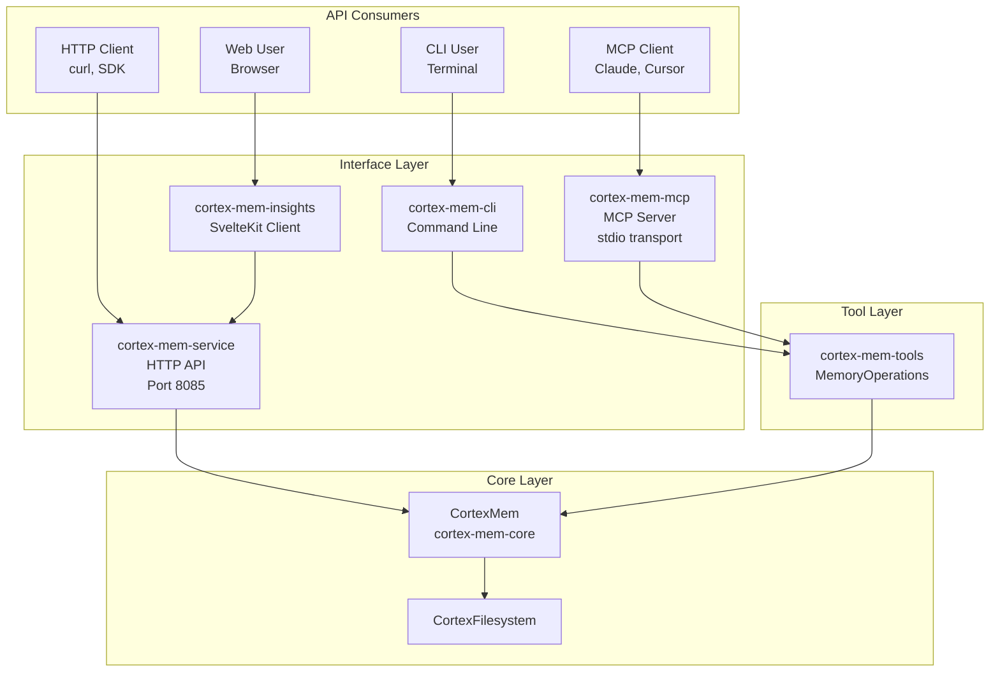
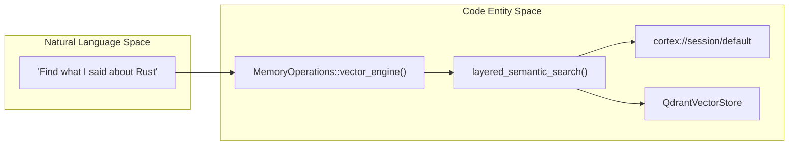
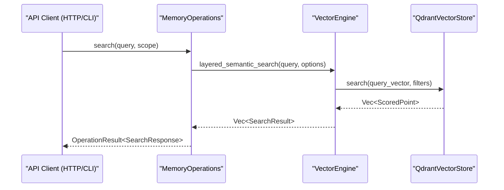

<!-- source: DeepWiki mcp.deepwiki.com · repo sopaco/cortex-mem · page 7 API Reference · fetched 2026-10-27 -->

# API Reference

Relevant source files

The following files were used as context for generating this wiki page:

- [cortex-mem-cli/Cargo.toml](cortex-mem-cli/Cargo.toml)
- [cortex-mem-cli/src/commands/add.rs](cortex-mem-cli/src/commands/add.rs)
- [cortex-mem-cli/src/commands/delete.rs](cortex-mem-cli/src/commands/delete.rs)
- [cortex-mem-cli/src/commands/get.rs](cortex-mem-cli/src/commands/get.rs)
- [cortex-mem-cli/src/commands/layers.rs](cortex-mem-cli/src/commands/layers.rs)
- [cortex-mem-cli/src/commands/list.rs](cortex-mem-cli/src/commands/list.rs)
- [cortex-mem-cli/src/commands/mod.rs](cortex-mem-cli/src/commands/mod.rs)
- [cortex-mem-cli/src/commands/search.rs](cortex-mem-cli/src/commands/search.rs)
- [cortex-mem-cli/src/commands/session.rs](cortex-mem-cli/src/commands/session.rs)
- [cortex-mem-cli/src/commands/tenant.rs](cortex-mem-cli/src/commands/tenant.rs)
- [cortex-mem-core/src/builder.rs](cortex-mem-core/src/builder.rs)
- [cortex-mem-core/src/embedding/client.rs](cortex-mem-core/src/embedding/client.rs)
- [cortex-mem-core/src/filesystem/operations.rs](cortex-mem-core/src/filesystem/operations.rs)
- [cortex-mem-insights/src/lib/api.ts](cortex-mem-insights/src/lib/api.ts)
- [cortex-mem-insights/src/lib/pages/Dashboard.svelte](cortex-mem-insights/src/lib/pages/Dashboard.svelte)
- [cortex-mem-insights/src/lib/pages/Search.svelte](cortex-mem-insights/src/lib/pages/Search.svelte)
- [cortex-mem-insights/src/lib/stores/search.ts](cortex-mem-insights/src/lib/stores/search.ts)
- [cortex-mem-insights/src/lib/stores/tenant.ts](cortex-mem-insights/src/lib/stores/tenant.ts)
- [cortex-mem-mcp/src/main.rs](cortex-mem-mcp/src/main.rs)
- [cortex-mem-service/src/main.rs](cortex-mem-service/src/main.rs)
- [cortex-mem-tools/src/errors.rs](cortex-mem-tools/src/errors.rs)
- [cortex-mem-tools/src/lib.rs](cortex-mem-tools/src/lib.rs)
- [cortex-mem-tools/src/types.rs](cortex-mem-tools/src/types.rs)
- [examples/locomo-evaluation/benchmark/index.html](examples/locomo-evaluation/benchmark/index.html)

This document provides a comprehensive reference for all public APIs exposed by the `cortex-mem` system. It covers the HTTP REST API, MCP (Model Context Protocol) tools, CLI commands, and core data types used across all interfaces.

The `cortex-mem` system exposes multiple API surfaces to support different integration patterns:
- **HTTP REST API** (`cortex-mem-service`) - Primary programmatic interface for web and external integrations. [cortex-mem-service/src/main.rs:134-140]()
- **MCP Server** (`cortex-mem-mcp`) - AI agent tool invocation via stdio transport for tools like Claude or Cursor. [cortex-mem-mcp/src/main.rs:150-153]()
- **CLI** (`cortex-mem-cli`) - Command-line interface for administrative operations and scripting. [cortex-mem-cli/src/main.rs:1-20]()
- **Web Dashboard API** (`cortex-mem-insights`) - Backend API for the monitoring and management UI. [cortex-mem-insights/src/lib/api.ts:5-15]()
- **MemoryOperations API** (`cortex-mem-tools`) - Simplified operations wrapper used by MCP and Rig. [cortex-mem-tools/src/lib.rs:9-10]()

For detailed documentation:
- [HTTP API Endpoints](#7.1) — Complete reference of HTTP endpoints: paths, methods, request/response schemas, status codes, and examples.
- [MCP Tool Definitions](#7.2) — Complete reference of MCP tools: schemas, parameters, return types, and usage from AI agents.
- [Core Types & Interfaces](#7.3) — Reference for core types: Memory, MemoryMetadata, Filters, MemoryType, ScoredMemory, and trait definitions.
- [CLI Command Reference](#7.4) — Complete reference of CLI commands: syntax, options, output formats, and usage examples.

## API Surface Overview

The `cortex-mem` system provides multiple API surfaces optimized for different use cases and integration patterns.

**System Architecture with API Layers**

**Sources:** [cortex-mem-service/src/main.rs:134-146](), [cortex-mem-mcp/src/main.rs:108-123](), [cortex-mem-core/src/builder.rs:74-82](), [cortex-mem-insights/src/lib/api.ts:15-25]()

### API Comparison Matrix

| Feature | HTTP REST API | MCP Server | CLI | Web Dashboard | MemoryOperations |
|---------|---------------|------------|-----|---------------|------------------|
| **Crate** | `cortex-mem-service` | `cortex-mem-mcp` | `cortex-mem-cli` | `cortex-mem-insights` | `cortex-mem-tools` |
| **Protocol** | HTTP/JSON | MCP (stdio) | CLI Arguments | HTTP/JSON | Rust Method Calls |
| **Port** | 8085 (default) | N/A (stdio) | N/A | 5173 (Svelte) | N/A |
| **Primary Use** | Remote Apps | AI Agents | Admin/Scripting | Human Monitoring | Library Abstraction |
| **Isolation** | Tenant-aware | Tenant-aware | Tenant-aware | Tenant-aware | Tenant-aware |

**Sources:** [cortex-mem-service/src/main.rs:39-40](), [cortex-mem-mcp/src/main.rs:24-26](), [cortex-mem-insights/src/lib/api.ts:15-20](), [cortex-mem-tools/src/operations.rs:1-20]()

## HTTP REST API (`cortex-mem-service`)

The HTTP service is the primary gateway for network-based access. It is built on `axum` and provides endpoints for health checks, tenant management, filesystem access, and memory search. [cortex-mem-service/src/main.rs:134-146]()

### Key Features
- **Tenant Management**: Support for switching between isolated memory environments. [cortex-mem-insights/src/lib/api.ts:59-70]()
- **Hierarchical Search**: Leverages `layered_semantic_search` (L0/L1/L2) for deep memory retrieval. [cortex-mem-cli/src/commands/search.rs:53-56]()
- **Filesystem API**: Direct access to the underlying `cortex://` URI scheme for reading and writing memory files. [cortex-mem-insights/src/lib/api.ts:77-101]()

For details, see [HTTP API Endpoints](#7.1).

## MCP Server (`cortex-mem-mcp`)

The MCP server implements the Model Context Protocol, allowing AI agents to use `cortex-mem` as a tool. It translates JSON-RPC tool calls into `MemoryOperations`. [cortex-mem-mcp/src/main.rs:141-153]()

### Auto-Triggering
A unique feature of the MCP server is the `AutoTriggerConfig`, which can automatically trigger memory indexing based on message thresholds or inactivity timeouts. [cortex-mem-mcp/src/main.rs:36-46]()

For details, see [MCP Tool Definitions](#7.2).

## CLI Interface (`cortex-mem-cli`)

The CLI provides a powerful set of commands for interacting with the memory system directly from the terminal. It is built using `clap` and supports commands for adding, searching, and managing memories. [cortex-mem-cli/src/main.rs:1-20]()

### Command Groups
- **Search**: Vector-based semantic search across sessions or users. [cortex-mem-cli/src/commands/search.rs:7-14]()
- **Filesystem**: Listing and reading files within the `cortex://` URI space. [cortex-mem-insights/src/lib/api.ts:77-88]()
- **Tenant**: Commands to manage and switch infrastructure isolation keys. [cortex-mem-mcp/src/main.rs:24-34]()

For details, see [CLI Command Reference](#7.4).

## Core Data Types & Interfaces

The system relies on a unified type system defined in `cortex-mem-tools` and `cortex-mem-core`. These types ensure consistency across the HTTP API, MCP tools, and CLI.

### Memory Operations Bridge

The following diagram shows how high-level requests are mapped to core code entities.

**Sources:** [cortex-mem-cli/src/commands/search.rs:31-40](), [cortex-mem-cli/src/commands/search.rs:54-56](), [cortex-mem-core/src/builder.rs:99-106]()

### Common Result Types
- `OperationResult<T>`: A standard wrapper for API responses containing success status and data/error. [cortex-mem-tools/src/types.rs:7-12]()
- `SearchResult`: Contains the URI, similarity score, and optional layer content (L0 Abstract, L1 Overview, L2 Full Content). [cortex-mem-tools/src/types.rs:80-86]()

For details, see [Core Types & Interfaces](#7.3).

## API Flow: Semantic Search

This flow illustrates the interaction between an API consumer and the core search engine.

**Sources:** [cortex-mem-cli/src/commands/search.rs:46-56](), [cortex-mem-tools/src/types.rs:89-95](), [cortex-mem-core/src/builder.rs:99-115]()

---
**Sources:**
- [cortex-mem-service/src/main.rs:1-150]()
- [cortex-mem-mcp/src/main.rs:1-164]()
- [cortex-mem-tools/src/lib.rs:1-19]()
- [cortex-mem-tools/src/types.rs:1-221]()
- [cortex-mem-cli/src/commands/search.rs:1-76]()
- [cortex-mem-insights/src/lib/api.ts:1-130]()
- [cortex-mem-core/src/builder.rs:1-146]()

---

