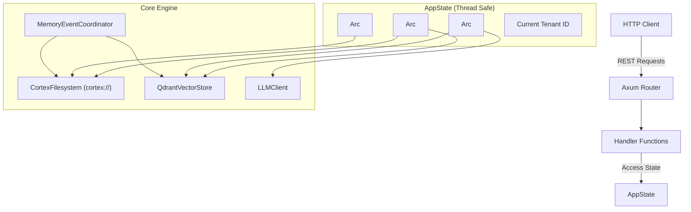
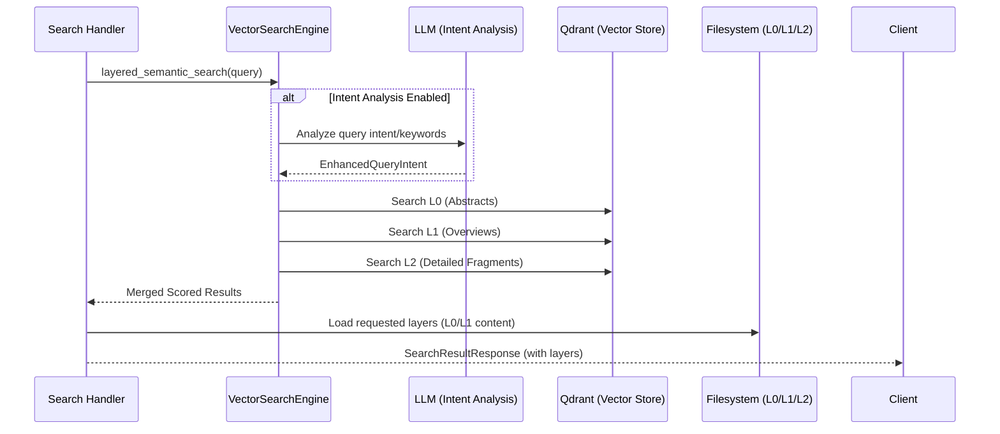

<!-- source: DeepWiki mcp.deepwiki.com · repo sopaco/cortex-mem · page 7.1 HTTP API Endpoints · fetched 2026-10-27 -->

# HTTP API Endpoints

<details>
<summary>Relevant source files</summary>

The following files were used as context for generating this wiki page:

- [README.md](README.md)
- [README_zh.md](README_zh.md)
- [cortex-mem-core/src/builder.rs](cortex-mem-core/src/builder.rs)
- [cortex-mem-core/src/embedding/client.rs](cortex-mem-core/src/embedding/client.rs)
- [cortex-mem-core/src/incremental_memory_updater.rs](cortex-mem-core/src/incremental_memory_updater.rs)
- [cortex-mem-core/src/llm/prompts.rs](cortex-mem-core/src/llm/prompts.rs)
- [cortex-mem-core/src/search/vector_engine.rs](cortex-mem-core/src/search/vector_engine.rs)
- [cortex-mem-insights/src/lib/api.ts](cortex-mem-insights/src/lib/api.ts)
- [cortex-mem-insights/src/lib/pages/Dashboard.svelte](cortex-mem-insights/src/lib/pages/Dashboard.svelte)
- [cortex-mem-insights/src/lib/pages/Search.svelte](cortex-mem-insights/src/lib/pages/Search.svelte)
- [cortex-mem-insights/src/lib/stores/search.ts](cortex-mem-insights/src/lib/stores/search.ts)
- [cortex-mem-insights/src/lib/stores/tenant.ts](cortex-mem-insights/src/lib/stores/tenant.ts)
- [cortex-mem-insights/src/lib/types.ts](cortex-mem-insights/src/lib/types.ts)
- [cortex-mem-service/src/handlers/automation.rs](cortex-mem-service/src/handlers/automation.rs)
- [cortex-mem-service/src/handlers/filesystem.rs](cortex-mem-service/src/handlers/filesystem.rs)
- [cortex-mem-service/src/handlers/mod.rs](cortex-mem-service/src/handlers/mod.rs)
- [cortex-mem-service/src/handlers/search.rs](cortex-mem-service/src/handlers/search.rs)
- [cortex-mem-service/src/handlers/sessions.rs](cortex-mem-service/src/handlers/sessions.rs)
- [cortex-mem-service/src/main.rs](cortex-mem-service/src/main.rs)
- [cortex-mem-service/src/models.rs](cortex-mem-service/src/models.rs)
- [cortex-mem-service/src/routes/automation.rs](cortex-mem-service/src/routes/automation.rs)
- [cortex-mem-service/src/routes/filesystem.rs](cortex-mem-service/src/routes/filesystem.rs)
- [cortex-mem-service/src/routes/mod.rs](cortex-mem-service/src/routes/mod.rs)
- [cortex-mem-service/src/state.rs](cortex-mem-service/src/state.rs)
- [examples/@memclaw/bin-darwin-arm64/bin/README.md](examples/@memclaw/bin-darwin-arm64/bin/README.md)
- [examples/@memclaw/plugin/skills/memclaw/references/best-practices.md](examples/@memclaw/plugin/skills/memclaw/references/best-practices.md)
- [examples/locomo-evaluation/benchmark/index.html](examples/locomo-evaluation/benchmark/index.html)
- [examples/locomo-evaluation/eval.py](examples/locomo-evaluation/eval.py)

</details>


## Purpose and Scope

This document provides a complete technical reference for the HTTP REST API exposed by `cortex-mem-service`. The API enables programmatic access to the Cortex Memory system, including session management, multi-tenant filesystem operations, layered semantic search, and automated memory extraction.

The service acts as a RESTful wrapper around the `cortex-mem-core` library, orchestrating the `MemoryManager`, `SessionManager`, and `VectorSearchEngine` components.

**Sources:** [cortex-mem-service/src/main.rs:20-49](), [cortex-mem-service/src/state.rs:15-41]()

---

## Service Architecture

The service is built using the Axum framework and maintains a global `AppState` that holds thread-safe references to the core memory components.

### Component Interaction



**Sources:** [cortex-mem-service/src/state.rs:15-41](), [cortex-mem-service/src/main.rs:134-149](), [cortex-mem-core/src/builder.rs:74-145]()

### Multi-Tenancy and State
The service supports multi-tenancy by allowing runtime switching of the data directory and vector store collection. When a tenant is switched, the `AppState` rebuilds the `CortexMem` runtime to point to the tenant-specific root and Qdrant collection.

**Sources:** [cortex-mem-service/src/state.rs:16-38](), [cortex-mem-service/src/state.rs:128-165]()

---

## Endpoint Reference

### Health and Status

#### `GET /health`
Checks the availability of the service and its backend dependencies (LLM, Vector Store).

**Response Schema:**
```json
{
  "status": "ok",
  "service": "cortex-mem-service",
  "version": "0.1.0",
  "llm_available": true
}
```
**Sources:** [cortex-mem-service/src/main.rs:135](), [cortex-mem-insights/src/lib/api.ts:45-56]()

---

### Session Management

Sessions represent conversation threads and serve as the primary entry point for new information.

| Method | Path | Description |
|:---|:---|:---|
| `POST` | `/api/v2/sessions` | Create a new session (auto-generates UUID if `thread_id` is omitted). |
| `GET` | `/api/v2/sessions` | List all sessions for the current tenant. |
| `POST` | `/api/v2/sessions/{thread_id}/messages` | Add a message to a session. Triggers `LayerUpdateNeeded` events. |
| `POST` | `/api/v2/sessions/{thread_id}/close` | Close session and trigger asynchronous memory extraction. |

**Add Message Flow:**
When a message is added via `POST /sessions/{id}/messages`, the service:
1. Appends the message to the `cortex://session/{id}/timeline` filesystem path.
2. Dispatches a `MemoryEvent::LayerUpdateNeeded` to the `MemoryEventCoordinator`.
3. The Coordinator asynchronously triggers the LLM to update L0 (Abstract) and L1 (Overview) layers.

**Sources:** [cortex-mem-service/src/handlers/sessions.rs:26-66](), [cortex-mem-service/src/handlers/sessions.rs:123-195](), [cortex-mem-service/src/handlers/automation.rs:23-50]()

---

### Layered Search API

The search endpoint implements a sophisticated multi-stage retrieval pipeline combining layered vector search, lexical fallbacks, and query expansion.

#### `POST /api/v2/search`
**Request Body:**
```json
{
  "query": "What did the user say about Python?",
  "limit": 10,
  "min_score": 0.6,
  "thread": "optional-session-id",
  "return_layers": ["L0", "L1"]
}
```

**Search Logic Flow:**


**Sources:** [cortex-mem-service/src/handlers/search.rs:17-36](), [cortex-mem-service/src/handlers/search.rs:39-145](), [cortex-mem-core/src/search/vector_engine.rs:57-132]()

---

### Filesystem Operations

Provides direct access to the `cortex://` virtual filesystem.

| Method | Path | Description |
|:---|:---|:---|
| `GET` | `/api/v2/filesystem/list?uri={uri}` | List directory contents (e.g., `cortex://user/`). |
| `GET` | `/api/v2/filesystem/read/{path}` | Read raw content of a memory file. |
| `POST` | `/api/v2/filesystem/write` | Write/Update a memory file directly. |
| `GET` | `/api/v2/filesystem/stats?uri={uri}` | Get recursive file count and size for a URI. |

**Sources:** [cortex-mem-insights/src/lib/api.ts:76-101](), [cortex-mem-service/src/routes/filesystem.rs:1-15]()

---

### Tenant and Automation

#### `POST /api/v2/tenants/switch`
Changes the active tenant context. This re-initializes the internal `MemoryManager` to point to the new tenant's data directory and vector collection.
**Sources:** [cortex-mem-service/src/state.rs:128-165]()

#### `POST /api/v2/automation/reindex`
Triggers a full background sync of the filesystem to the vector store. This is used to recover from failed indexing or to import external markdown files into the semantic search index.
**Sources:** [cortex-mem-service/src/handlers/automation.rs:56-99]()

---

## Data Models

### Search Result Schema
The search response includes the similarity score and the progressive disclosure layers.

```rust
pub struct SearchResultResponse {
    pub uri: String,           // cortex:// URI
    pub score: f32,           // 0.0 - 1.0 similarity
    pub snippet: String,       // Text preview
    pub overview: Option<String>, // L1 Layer content
    pub content: Option<String>,  // L2 Layer content
    pub layers: HashMap<String, String>, // Additional metadata layers
}
```
**Sources:** [cortex-mem-service/src/models.rs:100-111](), [cortex-mem-service/src/handlers/search.rs:185-207]()

---

## Implementation Details

### Rate Limiting (Embedding)
The service utilizes a global `RateLimiter` within the `EmbeddingClient` to prevent 429 errors from LLM providers. It uses a non-blocking CAS (Compare-And-Swap) loop to reserve time slots for API calls across all tenant threads.
**Sources:** [cortex-mem-core/src/embedding/client.rs:69-125]()

### Intent Analysis
When `enable_intent_analysis` is set to `true` (default), search queries are pre-processed by the LLM to extract keywords and constraints. This reduces search latency from ~20s to <500ms when disabled, but at the cost of retrieval precision.
**Sources:** [cortex-mem-core/src/search/vector_engine.rs:109-116](), [cortex-mem-service/src/state.rs:34-35]()

### Event-Driven Updates
The API does not block on memory extraction. Instead, it uses a `MemoryEventCoordinator` that listens for `MemoryEvent` variants (like `LayerUpdateNeeded` or `SessionClosed`) sent via an internal `UnboundedSender`.
**Sources:** [cortex-mem-service/src/state.rs:32-33](), [cortex-mem-core/src/builder.rs:122-145]()

---
**Sources:**
- [cortex-mem-service/src/main.rs:134-149]()
- [cortex-mem-service/src/state.rs:15-92]()
- [cortex-mem-service/src/handlers/sessions.rs:26-195]()
- [cortex-mem-service/src/handlers/search.rs:17-207]()
- [cortex-mem-core/src/search/vector_engine.rs:57-199]()
- [cortex-mem-core/src/embedding/client.rs:69-144]()

---

