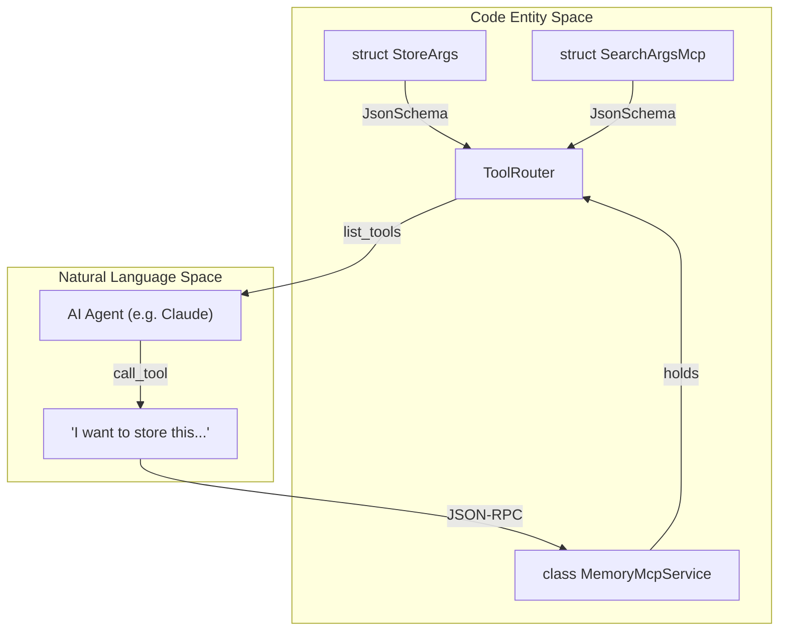
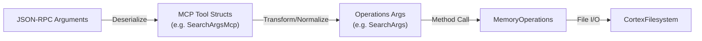

<!-- source: DeepWiki mcp.deepwiki.com · repo sopaco/cortex-mem · page 7.2 MCP Tool Definitions · fetched 2026-10-27 -->

# MCP Tool Definitions

<details>
<summary>Relevant source files</summary>

The following files were used as context for generating this wiki page:

- [cortex-mem-cli/README.md](cortex-mem-cli/README.md)
- [cortex-mem-cli/tests/cli_commands_test.rs](cortex-mem-cli/tests/cli_commands_test.rs)
- [cortex-mem-config/README.md](cortex-mem-config/README.md)
- [cortex-mem-core/README.md](cortex-mem-core/README.md)
- [cortex-mem-core/src/filesystem/operations.rs](cortex-mem-core/src/filesystem/operations.rs)
- [cortex-mem-mcp/README.md](cortex-mem-mcp/README.md)
- [cortex-mem-mcp/src/main.rs](cortex-mem-mcp/src/main.rs)
- [cortex-mem-mcp/src/service.rs](cortex-mem-mcp/src/service.rs)
- [cortex-mem-rig/README.md](cortex-mem-rig/README.md)
- [cortex-mem-service/README.md](cortex-mem-service/README.md)
- [cortex-mem-tools/README.md](cortex-mem-tools/README.md)
- [cortex-mem-tools/src/docs/commit.md](cortex-mem-tools/src/docs/commit.md)
- [cortex-mem-tools/src/docs/explore.md](cortex-mem-tools/src/docs/explore.md)
- [cortex-mem-tools/src/docs/ls.md](cortex-mem-tools/src/docs/ls.md)
- [cortex-mem-tools/src/docs/recall.md](cortex-mem-tools/src/docs/recall.md)
- [cortex-mem-tools/src/docs/search.md](cortex-mem-tools/src/docs/search.md)
- [cortex-mem-tools/src/docs/store.md](cortex-mem-tools/src/docs/store.md)
- [cortex-mem-tools/src/errors.rs](cortex-mem-tools/src/errors.rs)
- [cortex-mem-tools/src/lib.rs](cortex-mem-tools/src/lib.rs)
- [cortex-mem-tools/src/mcp/definitions.rs](cortex-mem-tools/src/mcp/definitions.rs)
- [cortex-mem-tools/src/tools/mod.rs](cortex-mem-tools/src/tools/mod.rs)
- [cortex-mem-tools/src/tools/recall.rs](cortex-mem-tools/src/tools/recall.rs)
- [cortex-mem-tools/src/tools/search.rs](cortex-mem-tools/src/tools/search.rs)
- [cortex-mem-tools/src/types.rs](cortex-mem-tools/src/types.rs)
- [examples/cortex-mem-tars/README.md](examples/cortex-mem-tars/README.md)

</details>


This page provides a complete technical reference for the Model Context Protocol (MCP) tools exposed by the `cortex-mem-mcp` server. These tools enable AI agents (such as Claude, Cursor, or TARS) to interact with the Cortex Memory system for persistent storage and retrieval using a standardized protocol.

The MCP server implementation acts as a bridge, mapping JSON-RPC tool calls to the high-level `MemoryOperations` API.

## Overview

The `cortex-mem-mcp` server provides a suite of tools for semantic search, tiered memory access (L0/L1/L2), and session management. These tools are defined in the `cortex-mem-tools` library to ensure consistency across different integration layers (MCP, RIG framework, and CLI).

| Tool Name | Purpose | Key Parameters |
|-----------|---------|----------------|
| `store_memory` | Store content into the memory system | `content`, `thread_id`, `role` |
| `query_memory` | Semantic vector search across layers | `query`, `scope`, `limit`, `return_layers` |
| `list_memories` | Browse the `cortex://` virtual filesystem | `uri`, `recursive`, `include_abstracts` |
| `get_memory` | Retrieve full content (L2) of a memory | `uri` |
| `get_abstract` | Retrieve L0 abstract (~100 tokens) | `uri` |
| `delete_memory` | Remove a specific memory entry | `uri` |

Sources: [cortex-mem-mcp/src/service.rs:68-245](), [cortex-mem-mcp/README.md:5-15]()

## Tool Definition Architecture

### Tool Schema Flow

The MCP server utilizes the `rmcp` crate to implement the Model Context Protocol. Tool definitions are generated using `schemars` for JSON Schema generation from Rust structs.



The `MemoryMcpService` encapsulates `MemoryOperations` and routes incoming JSON-RPC requests to specific handler functions.

Sources: [cortex-mem-mcp/src/service.rs:68-110](), [cortex-mem-mcp/src/service.rs:328-360](), [cortex-mem-mcp/src/main.rs:141-152]()

### Parameter Mapping Pipeline

When an agent invokes a tool, the data flows through several layers of transformation:



1. **Deserialization**: Raw JSON is parsed into tool-specific structs (e.g., `StoreArgs`) [cortex-mem-mcp/src/service.rs:70-77]().
2. **Normalization**: URIs are normalized (e.g., mapping `scope: "session"` to `cortex://session`) [cortex-mem-tools/src/tools/search.rs:80-108]().
3. **Execution**: The service calls `MemoryOperations`, which coordinates the `VectorSearchEngine` and `LayerManager` [cortex-mem-tools/src/tools/search.rs:15-47]().

Sources: [cortex-mem-mcp/src/service.rs:360-450](), [cortex-mem-tools/src/tools/search.rs:80-108]()

## Core Tool Reference

### 1. `store_memory`
Stores new content into the memory system. If `auto_trigger` is enabled, the server tracks message counts and inactivity to automatically trigger indexing.

*   **Arguments**: `content` (string), `thread_id` (optional string), `role` (optional string) [cortex-mem-mcp/src/service.rs:70-77]().
*   **Behavior**: Calls `ops.add_message` which writes to the session timeline in the `cortex://` VFS [cortex-mem-mcp/src/service.rs:360-385]().
*   **Auto-Trigger**: Tracks `SessionState` (message count and last message time) to ensure memories are processed even if the agent doesn't explicitly close the session [cortex-mem-mcp/src/service.rs:45-64]().

### 2. `query_memory`
Performs semantic vector search with tiered result enrichment.

*   **Arguments**: `query` (string), `scope` (optional URI), `limit` (default 10), `return_layers` (default `["L0"]`) [cortex-mem-mcp/src/service.rs:88-99]().
*   **Layered Retrieval**: Can return L0 (Abstract), L1 (Overview), or L2 (Full) content in a single call [cortex-mem-tools/src/tools/search.rs:138-174]().
*   **Ranking**: Uses `VectorSearchEngine` to perform `layered_semantic_search` [cortex-mem-tools/src/tools/search.rs:114-135]().

### 3. `list_memories`
Provides directory-style browsing of the memory hierarchy.

*   **Arguments**: `uri` (default `cortex://session`), `recursive` (bool), `include_abstracts` (bool) [cortex-mem-mcp/src/service.rs:132-139]().
*   **VFS Integration**: Directly queries `CortexFilesystem` via `ops.ls()` [cortex-mem-tools/src/types.rs:122-127]().

### 4. Tiered Access Tools (`get_abstract`, `get_memory`)
Direct URI-based access to specific memory layers.

*   **`get_abstract`**: Retrieves the `.abstract.md` (L0) file, typically ~100 tokens [cortex-mem-mcp/src/service.rs:188-200]().
*   **`get_memory`**: Retrieves the full L2 content [cortex-mem-mcp/src/service.rs:218-230]().

Sources: [cortex-mem-mcp/src/service.rs:68-230](), [cortex-mem-tools/src/tools/search.rs:15-47](), [cortex-mem-tools/README.md:139-145]()

## Implementation Details

### The `MemoryMcpService` Class
The central coordinator for the MCP interface.

```rust
pub struct MemoryMcpService {
    ops: Arc<MemoryOperations>,
    auto_trigger_config: AutoTriggerConfig,
    session_states: Arc<RwLock<HashMap<String, SessionState>>>,
}
```

*   **Initialization**: Created via `with_config` in `main.rs` [cortex-mem-mcp/src/main.rs:142]().
*   **Transport**: Uses `rmcp::transport::stdio` for communication with the LLM host [cortex-mem-mcp/src/main.rs:151]().
*   **Inactivity Checker**: Runs a background loop to trigger `close_session` (which indexes memories) after a period of inactivity [cortex-mem-mcp/src/service.rs:27-29]().

Sources: [cortex-mem-mcp/src/service.rs:250-270](), [cortex-mem-mcp/src/main.rs:141-155]()

### URI Normalization
The MCP server normalizes "scopes" provided by agents into valid `cortex://` URIs.

| Input Scope | Normalized URI |
|-------------|----------------|
| `session` | `cortex://session` |
| `user` | `cortex://user` |
| `agent` | `cortex://agent` |
| `my-thread` | `cortex://session/my-thread` |

Sources: [cortex-mem-tools/src/tools/search.rs:80-108](), [cortex-mem-mcp/README.md:65-73]()

## Usage Example (Agent Tool Call)

An AI agent looking for previous discussions about "OAuth" would issue the following MCP request:

```json
{
  "method": "tools/call",
  "params": {
    "name": "query_memory",
    "arguments": {
      "query": "How did we implement OAuth?",
      "scope": "session",
      "limit": 3,
      "return_layers": ["L0", "L1"]
    }
  }
}
```

The server responds with enriched results containing snippets and summaries:

```json
{
  "success": true,
  "results": [
    {
      "uri": "cortex://session/tech-auth/timeline/2024/01/10/msg_1.md",
      "score": 0.92,
      "snippet": "...using OAuth2 client library...",
      "overview": "Discussion on choosing the 'oauth2' crate for Rust implementation."
    }
  ]
}
```

Sources: [cortex-mem-mcp/src/service.rs:101-118](), [cortex-mem-mcp/README.md:87-100]()

---

