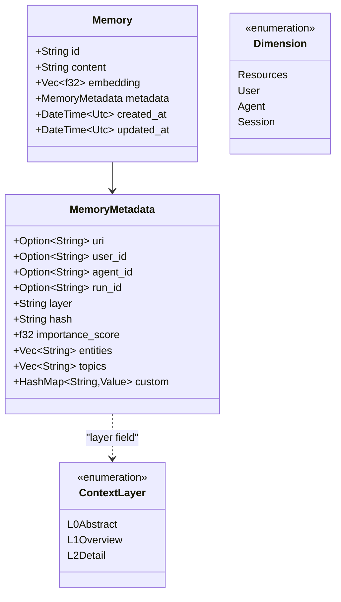
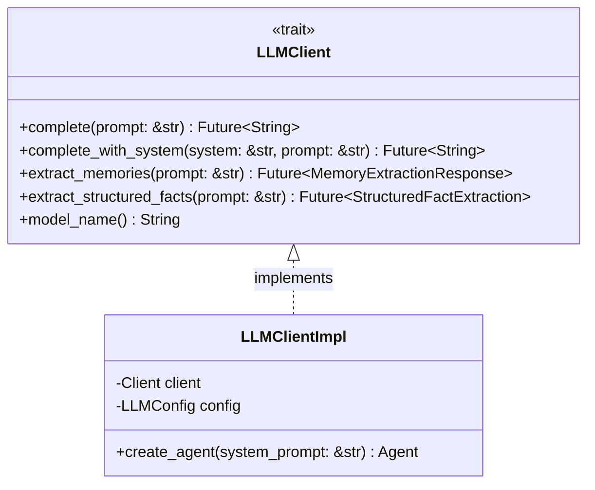
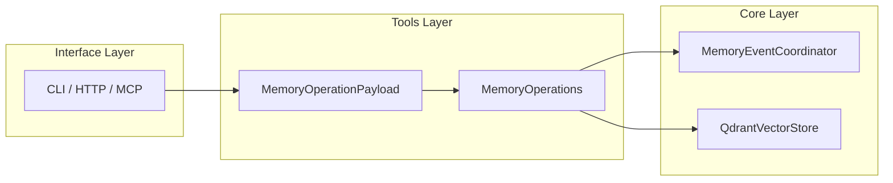

<!-- source: DeepWiki mcp.deepwiki.com · repo sopaco/cortex-mem · page 7.3 Core Types & Interfaces · fetched 2026-10-27 -->

# Core Types & Interfaces

<details>
<summary>Relevant source files</summary>

The following files were used as context for generating this wiki page:

- [cortex-mem-core/src/automation/indexer.rs](cortex-mem-core/src/automation/indexer.rs)
- [cortex-mem-core/src/automation/layer_generator.rs](cortex-mem-core/src/automation/layer_generator.rs)
- [cortex-mem-core/src/automation/manager.rs](cortex-mem-core/src/automation/manager.rs)
- [cortex-mem-core/src/automation/mod.rs](cortex-mem-core/src/automation/mod.rs)
- [cortex-mem-core/src/automation/sync.rs](cortex-mem-core/src/automation/sync.rs)
- [cortex-mem-core/src/cascade_layer_updater.rs](cortex-mem-core/src/cascade_layer_updater.rs)
- [cortex-mem-core/src/filesystem/operations.rs](cortex-mem-core/src/filesystem/operations.rs)
- [cortex-mem-core/src/layers/generator.rs](cortex-mem-core/src/layers/generator.rs)
- [cortex-mem-core/src/layers/manager.rs](cortex-mem-core/src/layers/manager.rs)
- [cortex-mem-core/src/llm/client.rs](cortex-mem-core/src/llm/client.rs)
- [cortex-mem-core/src/memory_event_coordinator.rs](cortex-mem-core/src/memory_event_coordinator.rs)
- [cortex-mem-core/src/session/extraction.rs](cortex-mem-core/src/session/extraction.rs)
- [cortex-mem-core/src/session/message.rs](cortex-mem-core/src/session/message.rs)
- [cortex-mem-core/src/types.rs](cortex-mem-core/src/types.rs)
- [cortex-mem-core/src/vector_store/qdrant.rs](cortex-mem-core/src/vector_store/qdrant.rs)
- [cortex-mem-mcp/src/main.rs](cortex-mem-mcp/src/main.rs)
- [cortex-mem-tools/src/errors.rs](cortex-mem-tools/src/errors.rs)
- [cortex-mem-tools/src/lib.rs](cortex-mem-tools/src/lib.rs)
- [cortex-mem-tools/src/types.rs](cortex-mem-tools/src/types.rs)

</details>


This page documents the fundamental data structures, traits, and types that form the API surface of `cortex-mem-core` and `cortex-mem-tools`. These types are used throughout the system for memory management, AI processing, vector storage, and inter-component communication.

---

## Memory Data Structures

### Memory

The `Memory` struct is the central data structure representing a stored memory with its content, embedding, metadata, and timestamps.



**Key Fields:**
- `id`: Unique identifier (UUID or derived from URI) [cortex-mem-core/src/types.rs:191]()
- `content`: The actual memory text content [cortex-mem-core/src/types.rs:192]()
- `embedding`: Vector representation [cortex-mem-core/src/types.rs:193]()
- `metadata`: Rich metadata including IDs, layer info, and importance [cortex-mem-core/src/types.rs:196]()

Sources: [cortex-mem-core/src/types.rs:189-197]()

### MemoryMetadata

Contains all metadata associated with a memory used for vector store filtering and synchronization:

| Field | Type | Description |
|-------|------|-------------|
| `uri` | `Option<String>` | The `cortex://` URI of the source file [cortex-mem-core/src/types.rs:90]() |
| `user_id` | `Option<String>` | User identifier for isolation [cortex-mem-core/src/types.rs:91]() |
| `layer` | `String` | Tiered memory level: "L0", "L1", or "L2" [cortex-mem-core/src/types.rs:97]() |
| `hash` | `String` | Content hash for change detection [cortex-mem-core/src/types.rs:98]() |
| `importance_score` | `f32` | Importance/salience (0.0-1.0) [cortex-mem-core/src/types.rs:99]() |
| `entities` | `Vec<String>` | Extracted named entities [cortex-mem-core/src/types.rs:100]() |
| `custom` | `HashMap<String, Value>` | Extensible metadata storage [cortex-mem-core/src/types.rs:102]() |

Sources: [cortex-mem-core/src/types.rs:88-103]()

### ContextLayer

Enumeration representing the tiered abstraction levels of the memory system:

```rust
pub enum ContextLayer {
    L0Abstract,  // High-level summary (~100 tokens)
    L1Overview,  // Mid-level summary (~500-2000 tokens)
    L2Detail,    // Full detailed content
}
```

The system uses these layers to implement tiered loading, where `L0` and `L1` files are automatically generated by the `CascadeLayerUpdater` [cortex-mem-core/src/cascade_layer_updater.rs:62-80]().

Sources: [cortex-mem-core/src/types.rs:41-48]()

---

## Filter and Query Types

### Filters

The `Filters` struct defines criteria for searching memories in the vector store:

```rust
pub struct Filters {
    pub user_id: Option<String>,
    pub agent_id: Option<String>,
    pub layer: Option<String>,
    pub created_after: Option<DateTime<Utc>>,
    pub topics: Option<Vec<String>>,
    pub entities: Option<Vec<String>>,
    pub min_importance: Option<f32>,
    pub uri_prefix: Option<String>, // For scope-based searching
    pub custom: HashMap<String, serde_json::Value>,
}
```

**Qdrant Conversion:**
The `QdrantVectorStore` implementation converts these filters into Qdrant-specific conditions. For example, `uri_prefix` is used to filter memories within a specific session or directory scope [cortex-mem-core/src/vector_store/qdrant.rs:223-240]().

Sources: [cortex-mem-core/src/types.rs:207-225](), [cortex-mem-core/src/vector_store/qdrant.rs:281-411]()

---

## Trait Interfaces

### LLMClient Trait

The `LLMClient` trait defines the interface for all LLM operations, including text generation and structured memory extraction:



**Key Responsibilities:**
- **Memory Extraction**: The `extract_memories` method returns a `MemoryExtractionResponse` containing facts, decisions, and entities [cortex-mem-core/src/llm/client.rs:74]().
- **Rig Integration**: `LLMClientImpl` uses the `rig-core` framework to create agents for interactions [cortex-mem-core/src/llm/client.rs:126-137]().

Sources: [cortex-mem-core/src/llm/client.rs:65-87](), [cortex-mem-core/src/llm/client.rs:93-112]()

### VectorStore Trait

The `VectorStore` trait abstracts the underlying vector database (e.g., Qdrant):

```rust
#[async_trait]
pub trait VectorStore: Send + Sync {
    async fn insert(&self, memory: &Memory) -> Result<()>;
    async fn search(&self, query_vector: &[f32], filters: &Filters, limit: usize) -> Result<Vec<ScoredMemory>>;
    async fn delete(&self, id: &str) -> Result<()>;
    async fn list(&self, filters: &Filters, limit: Option<usize>) -> Result<Vec<Memory>>;
}
```

The `QdrantVectorStore` implementation handles tenant isolation by appending a tenant ID to the collection name [cortex-mem-core/src/vector_store/qdrant.rs:34-48]().

Sources: [cortex-mem-core/src/vector_store/mod.rs:11-25](), [cortex-mem-core/src/vector_store/qdrant.rs:22-62]()

---

## Event Coordination Types

### MemoryEvent

The system uses an asynchronous event loop to handle background tasks like layer generation and vector synchronization:

```rust
pub enum MemoryEvent {
    MemoryCreated { file_uri: String, scope: MemoryScope, owner_id: String },
    MemoryUpdated { file_uri: String, scope: MemoryScope, owner_id: String },
    VectorSyncNeeded { file_uri: String, change_type: ChangeType },
    LayerUpdateRequested { directory_uri: String, scope: MemoryScope, owner_id: String },
}
```

These events are managed by the `MemoryEventCoordinator`, which orchestrates the flow between the filesystem and the vector store [cortex-mem-core/src/memory_event_coordinator.rs:55-68]().

Sources: [cortex-mem-core/src/memory_events.rs:25-60](), [cortex-mem-core/src/memory_event_coordinator.rs:91-115]()

---

## Shared Tool Types (`cortex-mem-tools`)

The `cortex-mem-tools` crate provides a high-level `MemoryOperations` API that is shared by the HTTP service, CLI, and MCP server.

### MemoryOperations



**MemoryOperationPayload**: A unified structure for all memory requests, containing fields for content, queries, filters, and metadata [cortex-mem-tools/src/types.rs:4-68]().

Sources: [cortex-mem-tools/src/lib.rs:9-13](), [cortex-mem-tools/src/types.rs:4-68]()

### ExtractedMemories

Used during session commits to capture structured information from conversations:

```rust
pub struct ExtractedMemories {
    pub preferences: Vec<PreferenceMemory>,
    pub entities: Vec<EntityMemory>,
    pub events: Vec<EventMemory>,
    pub cases: Vec<CaseMemory>,
    pub goals: Vec<GoalMemory>,
}
```

The `MemoryExtractor` module uses LLMs to populate this structure from raw message strings [cortex-mem-core/src/session/extraction.rs:169-200]().

Sources: [cortex-mem-core/src/session/extraction.rs:15-40](), [cortex-mem-core/src/session/extraction.rs:143-167]()

---

