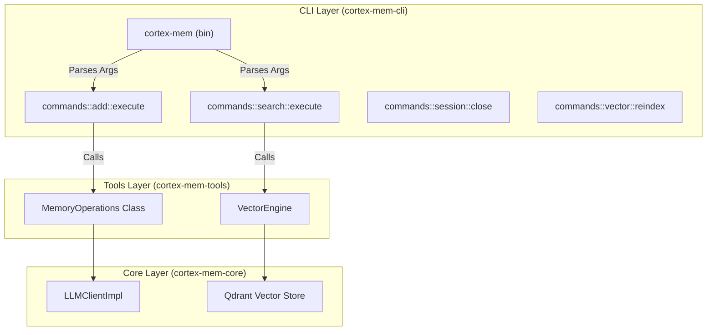
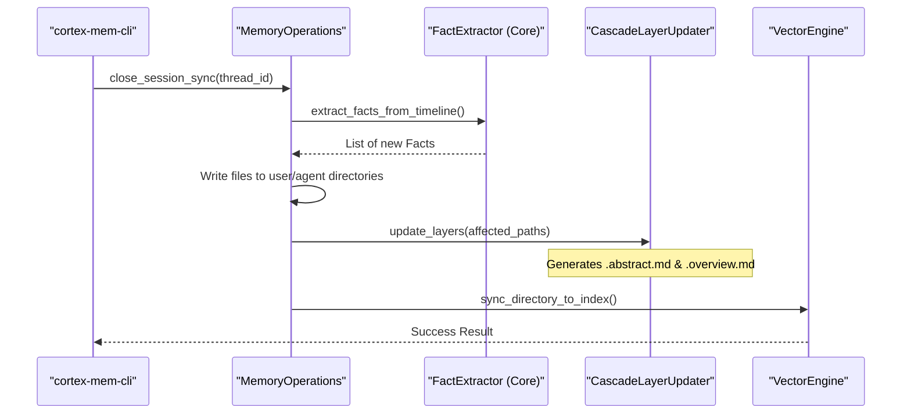

<!-- source: DeepWiki mcp.deepwiki.com · repo sopaco/cortex-mem · page 7.4 CLI Command Reference · fetched 2026-10-27 -->

# CLI Command Reference

<details>
<summary>Relevant source files</summary>

The following files were used as context for generating this wiki page:

- [cortex-mem-cli/Cargo.toml](cortex-mem-cli/Cargo.toml)
- [cortex-mem-cli/src/commands/add.rs](cortex-mem-cli/src/commands/add.rs)
- [cortex-mem-cli/src/commands/delete.rs](cortex-mem-cli/src/commands/delete.rs)
- [cortex-mem-cli/src/commands/get.rs](cortex-mem-cli/src/commands/get.rs)
- [cortex-mem-cli/src/commands/layers.rs](cortex-mem-cli/src/commands/layers.rs)
- [cortex-mem-cli/src/commands/list.rs](cortex-mem-cli/src/commands/list.rs)
- [cortex-mem-cli/src/commands/mod.rs](cortex-mem-cli/src/commands/mod.rs)
- [cortex-mem-cli/src/commands/search.rs](cortex-mem-cli/src/commands/search.rs)
- [cortex-mem-cli/src/commands/session.rs](cortex-mem-cli/src/commands/session.rs)
- [cortex-mem-cli/src/commands/tenant.rs](cortex-mem-cli/src/commands/tenant.rs)
- [cortex-mem-cli/src/main.rs](cortex-mem-cli/src/main.rs)
- [cortex-mem-config/src/lib.rs](cortex-mem-config/src/lib.rs)
- [cortex-mem-core/src/config.rs](cortex-mem-core/src/config.rs)
- [cortex-mem-rig/src/lib.rs](cortex-mem-rig/src/lib.rs)
- [examples/cortex-mem-tars/src/config.rs](examples/cortex-mem-tars/src/config.rs)
- [examples/cortex-mem-tars/src/infrastructure.rs](examples/cortex-mem-tars/src/infrastructure.rs)

</details>


## Purpose and Scope

This document provides a complete reference for the command-line interface (CLI) tools in the Cortex Memory system. It focuses on the primary `cortex-mem` CLI (implemented in the `cortex-mem-cli` crate), which provides administrative and operational access to the memory system. This reference covers syntax, subcommands, options, and data flow.

For programmatic HTTP access, see [HTTP API Endpoints](#7.1). For AI agent tool access, see [MCP Tool Definitions](#7.2).

**Sources:** [cortex-mem-cli/src/main.rs:12-31](), [cortex-mem-cli/Cargo.toml:1-13]()

---

## CLI Architecture

The `cortex-mem` CLI acts as a thin wrapper around the `MemoryOperations` facade. It translates command-line arguments into structured payloads for the core memory engine.

**CLI to Code Entity Mapping**



**Sources:** [cortex-mem-cli/src/main.rs:1-31](), [cortex-mem-cli/src/commands/mod.rs:1-11](), [cortex-mem-tools/src/lib.rs:3-5]()

---

## Global Options

The `cortex-mem` binary supports several top-level arguments that apply to all subcommands.

| Option | Short | Type | Default | Description |
|--------|-------|------|---------|-------------|
| `--config` | `-c` | `PathBuf` | `config.toml` | Path to the configuration file. |
| `--tenant` | - | `String` | `default` | Tenant identifier for data isolation. |
| `--verbose` | `-v` | flag | `false` | Enables DEBUG level tracing output. |

**Data Directory Resolution Logic:**
1. `data_dir` specified in `config.toml` (resolved relative to config file).
2. `CORTEX_DATA_DIR` environment variable.
3. Directory containing the `config.toml` file.

**Sources:** [cortex-mem-cli/src/main.rs:16-31](), [cortex-mem-cli/src/main.rs:207-228](), [cortex-mem-config/src/lib.rs:45-64]()

---

## Command Reference

### add

Adds a new message to a specific conversation thread. This triggers immediate file storage and prepares the message for later extraction.

**Syntax:**
```bash
cortex-mem add --thread <THREAD_ID> [--role <ROLE>] <CONTENT>
```

**Arguments:**
- `--thread`, `-t`: The unique identifier for the conversation session.
- `--role`, `-r`: The role of the message sender (`user`, `assistant`, or `system`). Defaults to `user`.
- `content`: The raw text content of the message.

**Example:**
```bash
cortex-mem add --thread "session-123" "Remind me to buy milk tomorrow."
```

**Sources:** [cortex-mem-cli/src/main.rs:35-47](), [cortex-mem-cli/src/commands/add.rs:6-24]()

---

### search

Performs a layered semantic search across stored memories. This uses the `VectorEngine` to find relevant content based on embedding similarity.

**Syntax:**
```bash
cortex-mem search [OPTIONS] <QUERY>
```

**Options:**
- `--thread`, `-t`: Filter search to a specific thread.
- `--limit`, `-n`: Maximum number of results (default: 10).
- `--min-score`, `-s`: Minimum relevance threshold 0.0-1.0 (default: 0.4).
- `--scope`: Search scope (`session`, `user`, or `agent`). Defaults to `session`.

**Internal Data Flow:**
The search command constructs a `cortex://` URI based on the scope and invokes `layered_semantic_search`.

**Sources:** [cortex-mem-cli/src/main.rs:49-69](), [cortex-mem-cli/src/commands/search.rs:7-56]()

---

### session

Manages conversation sessions and triggers the memory processing pipeline.

| Subcommand | Arguments | Description |
|------------|-----------|-------------|
| `list` | - | Lists all sessions with status and timestamps. |
| `create` | `<THREAD_ID>` | Initializes a new session with an optional `--title`. |
| `close` | `<THREAD_ID>` | **Synchronous Pipeline:** Closes session, extracts facts, generates L0/L1 layers, and indexes vectors. |

**Example:**
```bash
cortex-mem session close "session-123"
```

**Sources:** [cortex-mem-cli/src/main.rs:102-106](), [cortex-mem-cli/src/commands/session.rs:30-73]()

---

### get

Retrieves the content of a specific memory URI, with options to view different abstraction layers.

**Syntax:**
```bash
cortex-mem get [OPTIONS] <URI>
```

**Options:**
- `--abstract-only`, `-a`: Show the L0 layer (`.abstract.md`).
- `--overview`, `-o`: Show the L1 layer (`.overview.md`).

**Sources:** [cortex-mem-cli/src/main.rs:83-94](), [cortex-mem-cli/src/commands/get.rs:6-40]()

---

### vector

Administrative tools for managing the Qdrant vector index.

| Subcommand | Arguments | Description |
|------------|-----------|-------------|
| `status` | - | Shows index coverage and identifies stale vectors. |
| `reindex` | - | Cleans stale vectors and re-syncs all local files to the database. |
| `prune` | `[--dry-run]` | Deletes vectors whose source files no longer exist on disk. |

**Sources:** [cortex-mem-cli/src/main.rs:117-122](), [cortex-mem-cli/src/main.rs:165-178]()

---

## Data Flow: Session Closure

When `cortex-mem session close` is executed, it invokes `MemoryOperations::close_session_sync`. This is the most complex CLI operation, involving multiple system domains.

**Session Close Sequence**



**Sources:** [cortex-mem-cli/src/commands/session.rs:57-73](), [cortex-mem-tools/src/lib.rs:37-52]()

---

## Configuration & Environment

The CLI relies on the `cortex-mem-config` crate for service discovery and LLM parameters.

### LLM Configuration
The CLI uses the `model_efficient` (e.g., GPT-4o-mini) for most tasks to balance cost and speed.

**Sources:** [cortex-mem-cli/src/main.rs:240-248](), [cortex-mem-config/src/lib.rs:103-110]()

### Qdrant Configuration
Vector operations use the `url` and `collection_name`. If a `--tenant` is provided, the collection name is suffixed (e.g., `cortex_mem_tenant123`).

**Sources:** [cortex-mem-core/src/config.rs:29-37](), [cortex-mem-cli/src/main.rs:251-260]()

---

