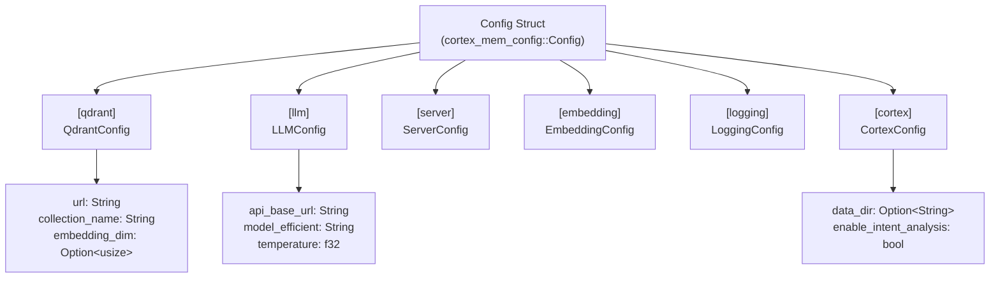
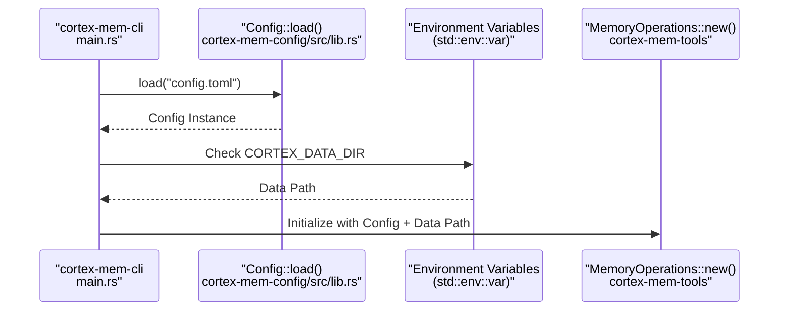

<!-- source: DeepWiki mcp.deepwiki.com · repo sopaco/cortex-mem · page 8 Configuration Reference · fetched 2026-10-27 -->

# Configuration Reference

<details>
<summary>Relevant source files</summary>

The following files were used as context for generating this wiki page:

- [Cargo.toml](Cargo.toml)
- [cortex-mem-cli/src/main.rs](cortex-mem-cli/src/main.rs)
- [cortex-mem-config/Cargo.toml](cortex-mem-config/Cargo.toml)
- [cortex-mem-config/src/lib.rs](cortex-mem-config/src/lib.rs)
- [cortex-mem-core/Cargo.toml](cortex-mem-core/Cargo.toml)
- [cortex-mem-core/src/config.rs](cortex-mem-core/src/config.rs)
- [cortex-mem-mcp/Cargo.toml](cortex-mem-mcp/Cargo.toml)
- [cortex-mem-rig/Cargo.toml](cortex-mem-rig/Cargo.toml)
- [cortex-mem-rig/src/lib.rs](cortex-mem-rig/src/lib.rs)
- [cortex-mem-service/Cargo.toml](cortex-mem-service/Cargo.toml)
- [cortex-mem-tools/Cargo.toml](cortex-mem-tools/Cargo.toml)
- [examples/cortex-mem-tars/config.example.toml](examples/cortex-mem-tars/config.example.toml)
- [examples/cortex-mem-tars/src/config.rs](examples/cortex-mem-tars/src/config.rs)
- [examples/cortex-mem-tars/src/infrastructure.rs](examples/cortex-mem-tars/src/infrastructure.rs)

</details>


## Purpose and Scope

This document provides a complete reference for all configuration options available in the `cortex-mem` system. It covers the configuration file structure, supported formats, and the relationship between configuration components. The system uses a modular monolith pattern where a central configuration crate, `cortex-mem-config`, provides shared types used by all interfaces (CLI, Service, MCP, and TARS).

For detailed documentation on specific configuration domains, see:
- **Core Configuration**: [Core Configuration](#8.1) — Detailed documentation for `[qdrant]`, `[llm]`, `[embedding]`, and `[cortex]` sections.
- **Service Configuration**: [Service Configuration](#8.2) — Documenting `[server]`, `[logging]`, and optimization settings.
- **Environment Variables**: [Environment Variables](#8.3) — Precedence and usage for `CORTEX_DATA_DIR`, `QDRANT_API_KEY`, and others.
- **Bot Configuration**: [Bot Configuration](#8.4) — Specific `bots.json` structure used by the TARS application.

Sources: [cortex-mem-config/src/lib.rs:7-14](), [Cargo.toml:1-12]()

---

## Configuration System Overview

The `cortex-mem` configuration system uses TOML files deserialized into strongly-typed Rust structs via `serde`. The root `Config` struct is defined in `cortex-mem-config/src/lib.rs` and implements `Serialize`, `Deserialize`, and `Clone`. Configuration is loaded at startup via `Config::load()` and is typically treated as immutable during the application lifecycle.

The `Config` struct aggregates subsystem configuration structs: `QdrantConfig`, `EmbeddingConfig`, `LLMConfig`, `ServerConfig`, `LoggingConfig`, and `CortexConfig`.

Sources: [cortex-mem-config/src/lib.rs:7-14](), [cortex-mem-config/src/lib.rs:130-135]()

---

## Configuration Structure Hierarchy

### Configuration Entity Mapping

The following diagram bridges the natural language configuration sections to the specific code entities defined in the `cortex-mem-config` crate.

**Diagram: Config Struct Composition and Code Entities**



Sources: [cortex-mem-config/src/lib.rs:7-14](), [cortex-mem-config/src/lib.rs:18-39](), [cortex-mem-config/src/lib.rs:68-75]()

---

### Configuration Sections Summary

| Section | Purpose | Primary Consumers |
|---------|---------|-------------------|
| `[qdrant]` | Vector database connection and collection settings | `MemoryOperations`, `QdrantVectorStore` |
| `[llm]` | Language model API configuration for processing | `LLMClientImpl`, `MemoryManager` |
| `[embedding]` | Embedding model selection and API settings | `MemoryOperations`, `LLMClient` |
| `[cortex]` | Core framework settings (data path, intent analysis) | `MemoryOperations`, `ConfigManager` |
| `[server]` | HTTP API server network and CORS settings | `cortex-mem-service`, `cortex-mem-tars` |
| `[logging]` | Logging level and output configuration | All components via `tracing` |

Sources: [cortex-mem-config/src/lib.rs:7-14](), [examples/cortex-mem-tars/src/infrastructure.rs:37-52]()

---

## Configuration Loading and Initialization

### Loading Pipeline

The configuration loading process prioritizes local files but falls back to environment variables for sensitive or path-related data. In the TARS application, the `ConfigManager` ensures that if `data_dir` is missing, it defaults to the system application data directory.

**Diagram: Configuration Initialization Flow**



Sources: [cortex-mem-cli/src/main.rs:198-228](), [examples/cortex-mem-tars/src/config.rs:66-85](), [cortex-mem-config/src/lib.rs:49-64]()

---

### Data Directory Resolution

The effective `data_dir` (where memories are stored as files) is resolved with the following priority:
1. `data_dir` specified in the `config.toml` file (relative to the config file).
2. `CORTEX_DATA_DIR` environment variable.
3. System application data directory (e.g., `~/Library/Application Support/com.cortex-mem.tars` on macOS).
4. The directory containing `config.toml`.

Sources: [cortex-mem-cli/src/main.rs:208-228](), [examples/cortex-mem-tars/src/config.rs:44-52](), [cortex-mem-config/src/lib.rs:49-64]()

---

## Component-Specific Configurations

### MemoryOperations Initialization

The `MemoryOperations` struct in `cortex-mem-tools` is the primary interface for all applications. It requires a mix of configuration from multiple sections to function.

```rust
// Example initialization from cortex-mem-cli/src/main.rs
let operations = MemoryOperations::new(
    &data_dir,
    &cli.tenant,
    llm_client,
    &config.qdrant.url,
    &config.qdrant.collection_name,
    config.qdrant.api_key.as_deref(),
    &config.embedding.api_base_url,
    &config.embedding.api_key,
    &config.embedding.model_name,
    config.qdrant.embedding_dim,
    None,
    config.cortex.enable_intent_analysis,
).await?;
```

Sources: [cortex-mem-cli/src/main.rs:251-265](), [cortex-mem-rig/src/lib.rs:119-133]()

### Bot Configuration (TARS)

The TARS application uses a secondary configuration file, `bots.json`, to manage multi-agent profiles. This file stores `BotConfig` objects including system prompts and access passwords.

Sources: [examples/cortex-mem-tars/src/config.rs:10-16](), [examples/cortex-mem-tars/src/config.rs:129-138]()

---

## Related Documentation

For detailed information on specific configuration domains:
- **Core Configuration**: See [Core Configuration](#8.1) for `[qdrant]`, `[llm]`, and `[cortex]` field descriptions.
- **Service Configuration**: See [Service Configuration](#8.2) for `[server]` and `[logging]` settings.
- **Environment Variables**: See [Environment Variables](#8.3) for variable overrides and precedence.
- **Bot Configuration**: See [Bot Configuration](#8.4) for `bots.json` structure and management.

---

