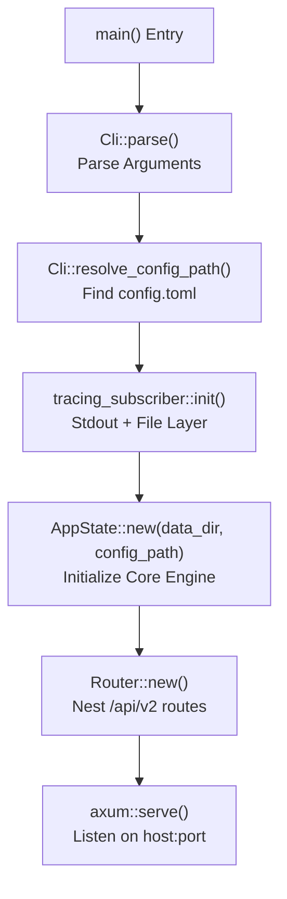
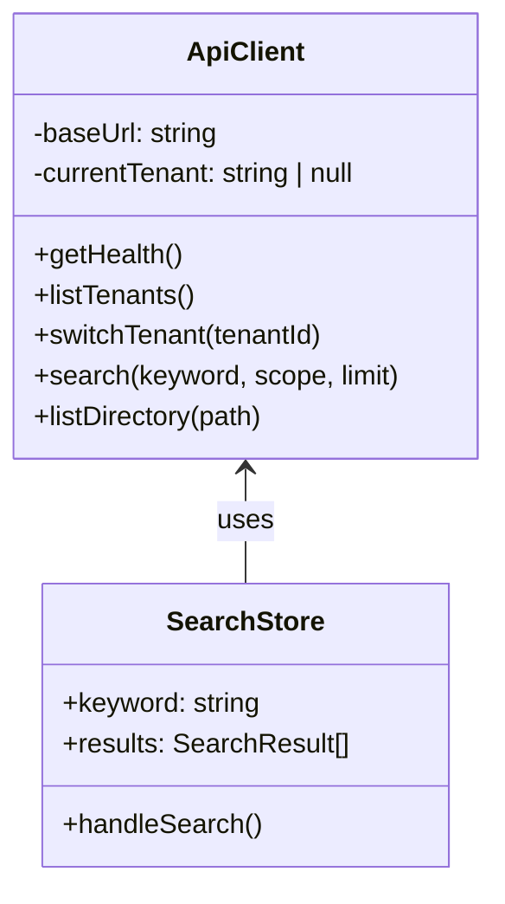
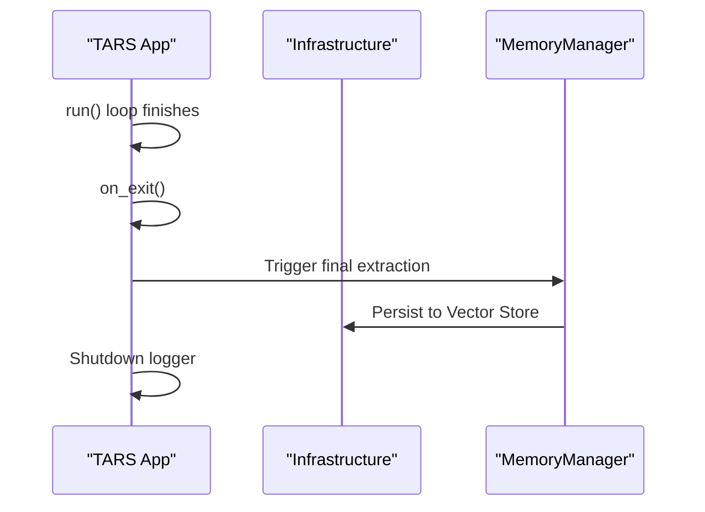

<!-- source: DeepWiki mcp.deepwiki.com · repo sopaco/cortex-mem · page 8.2 Service Configuration · fetched 2026-10-27 -->

# Service Configuration

<details>
<summary>Relevant source files</summary>

The following files were used as context for generating this wiki page:

- [Cargo.lock](Cargo.lock)
- [cortex-mem-core/src/builder.rs](cortex-mem-core/src/builder.rs)
- [cortex-mem-core/src/embedding/client.rs](cortex-mem-core/src/embedding/client.rs)
- [cortex-mem-insights/src/lib/api.ts](cortex-mem-insights/src/lib/api.ts)
- [cortex-mem-insights/src/lib/pages/Dashboard.svelte](cortex-mem-insights/src/lib/pages/Dashboard.svelte)
- [cortex-mem-insights/src/lib/pages/Search.svelte](cortex-mem-insights/src/lib/pages/Search.svelte)
- [cortex-mem-insights/src/lib/stores/search.ts](cortex-mem-insights/src/lib/stores/search.ts)
- [cortex-mem-insights/src/lib/stores/tenant.ts](cortex-mem-insights/src/lib/stores/tenant.ts)
- [cortex-mem-service/src/main.rs](cortex-mem-service/src/main.rs)
- [examples/cortex-mem-tars/.gitignore](examples/cortex-mem-tars/.gitignore)
- [examples/cortex-mem-tars/Cargo.lock](examples/cortex-mem-tars/Cargo.lock)
- [examples/cortex-mem-tars/Cargo.toml](examples/cortex-mem-tars/Cargo.toml)
- [examples/cortex-mem-tars/src/lib.rs](examples/cortex-mem-tars/src/lib.rs)
- [examples/cortex-mem-tars/src/logger.rs](examples/cortex-mem-tars/src/logger.rs)
- [examples/cortex-mem-tars/src/main.rs](examples/cortex-mem-tars/src/main.rs)
- [examples/cortex-mem-tars/src/ui.rs](examples/cortex-mem-tars/src/ui.rs)
- [examples/locomo-evaluation/benchmark/index.html](examples/locomo-evaluation/benchmark/index.html)

</details>


## Purpose and Scope

This document covers service-specific configuration settings beyond the core engine configuration. Specifically, it documents:

- **[server]** - HTTP API server binding and logging settings for `cortex-mem-service`.
- **[logging]** - Log output configuration for all components, including file and memory buffering.
- **[tars_api]** - TARS API server settings for audio integration and external message injection.
- **Optimization settings** - Memory deduplication, merging thresholds, and automated indexing.
- **Tenant Isolation** - Multi-tenant configuration and switching via the dashboard.

For core engine configuration (MemoryConfig, QdrantConfig, LLMConfig, EmbeddingConfig), see [Core Configuration](#8.1). For bot profiles (`bots.json`) used by TARS, see [Bot Configuration](#8.4).

**Sources:** [examples/cortex-mem-tars/src/config.rs:1-10](), [cortex-mem-service/src/main.rs:20-49]()

---

## HTTP Service Configuration

The `cortex-mem-service` component provides the REST API server built on the Axum web framework. It supports multi-tenant memory management and filesystem operations.

### Configuration and CLI Priority

The service resolves its configuration and data directory using a prioritized approach in the `Cli` struct [cortex-mem-service/src/main.rs:51-73]().

| Argument | Short | Default | Description |
|----------|-------|---------|-------------|
| `--data-dir` | `-d` | `./cortex-data` | Root directory for the cortex filesystem |
| `--config` | `-c` | `config.toml` | Path to config. If omitted, looks in `data_dir` then current dir |
| `--host` | | `localhost` | Server host binding |
| `--port` | `-p` | `8085` | TCP port for the HTTP API server |
| `--verbose` | `-v` | `false` | Enables DEBUG level logging |
| `--log-file` | | `None` | Path to write logs to disk |

### Service Initialization Flow

The `main` function initializes a `tracing` subscriber that supports both stdout and optional file logging [cortex-mem-service/src/main.rs:86-120]().


**Sources:** [cortex-mem-service/src/main.rs:75-149]()

### Router and Middleware

The service utilizes `axum::Router` with the following middleware [cortex-mem-service/src/main.rs:134-140]():
- **CorsLayer::permissive()**: Allows cross-origin requests, essential for the Insights dashboard.
- **TraceLayer**: Provides automated request/response logging.
- **AppState**: Shared state containing the `MemoryManager` and `CortexFilesystem`.

---

## Web Dashboard (Insights) Configuration

`cortex-mem-insights` is a SvelteKit application that communicates with the backend via a centralized `ApiClient` [cortex-mem-insights/src/lib/api.ts:15-128]().

### API Client Architecture

The `ApiClient` handles multi-tenancy by tracking `currentTenant` and providing methods for tenant switching [cortex-mem-insights/src/lib/api.ts:17-74]().


**Sources:** [cortex-mem-insights/src/lib/api.ts:15-126](), [cortex-mem-insights/src/lib/pages/Search.svelte:1-37]()

### Search Configuration
The dashboard search interface allows configuring:
- **Scope**: Filter by `all`, `user`, `session`, or `agent` [cortex-mem-insights/src/lib/pages/Search.svelte:67-78]().
- **Limit**: Number of results to return (default 10) [cortex-mem-insights/src/lib/pages/Search.svelte:81-91]().

---

## TARS Application & API Configuration

TARS is a TUI application that includes an integrated audio processing pipeline and an optional API for external integration.

### Logging and Monitoring

TARS uses a `LogManager` to provide real-time log viewing within the TUI. It captures logs from both `log` and `tracing` macros [examples/cortex-mem-tars/src/logger.rs:145-182]().

- **FileLayer**: A custom tracing layer that writes to `app.log` and a 1000-line memory buffer [examples/cortex-mem-tars/src/logger.rs:57-115]().
- **Log Level**: Defaults to `INFO`, but can be overridden by `RUST_LOG` [examples/cortex-mem-tars/src/logger.rs:169-171]().

### Audio and Transcription Configuration

TARS integrates with system audio via `cpal` and performs transcription using `whisper-rs` [examples/cortex-mem-tars/Cargo.toml:65-70]().

| Setting | Component | Description |
|---------|-----------|-------------|
| `audio_input_enabled` | `AppUi` | Toggle for microphone capture [examples/cortex-mem-tars/src/ui.rs:167]() |
| `KeyAction::EnableAudioInput` | `KeyAction` | Hotkey trigger for audio capture [examples/cortex-mem-tars/src/ui.rs:202]() |

---

## Optimization & Automation Settings

The core engine supports automated background tasks for memory maintenance, configured during the `CortexMem` build process.

### Automation Manager

The `AutomationManager` coordinates background tasks such as L2 vector indexing [cortex-mem-core/src/builder.rs:187-208]().

- **AutoIndexer**: Automatically indexes new memories into Qdrant when `MessageAdded` events are detected [cortex-mem-core/src/builder.rs:188-193]().
- **MemoryEventCoordinator**: Manages incremental updates and event-driven memory processing [cortex-mem-core/src/builder.rs:122-145]().

### Rate Limiting (Embedding)

To prevent API exhaustion, the `EmbeddingClient` uses a global rate limiter shared across all instances for the same API key [cortex-mem-core/src/embedding/client.rs:11-30]().

```rust
pub struct RateLimiter {
    next_allowed_nanos: AtomicU64,
    min_interval_nanos: u64,
}
```
**Key Features:**
- **CAS Loop**: Ensures non-blocking slot acquisition [cortex-mem-core/src/embedding/client.rs:93-124]().
- **429 Backoff**: Automatically adds a 5-second penalty upon hitting rate limits [cortex-mem-core/src/embedding/client.rs:136-143]().

**Sources:** [cortex-mem-core/src/embedding/client.rs:69-85](), [cortex-mem-core/src/builder.rs:85-95]()

---

## Service Startup and Exit

TARS manages its lifecycle by performing a final memory extraction upon exit to ensure all session context is persisted [examples/cortex-mem-tars/src/main.rs:89-105]().


**Sources:** [examples/cortex-mem-tars/src/main.rs:59-110]()

---

