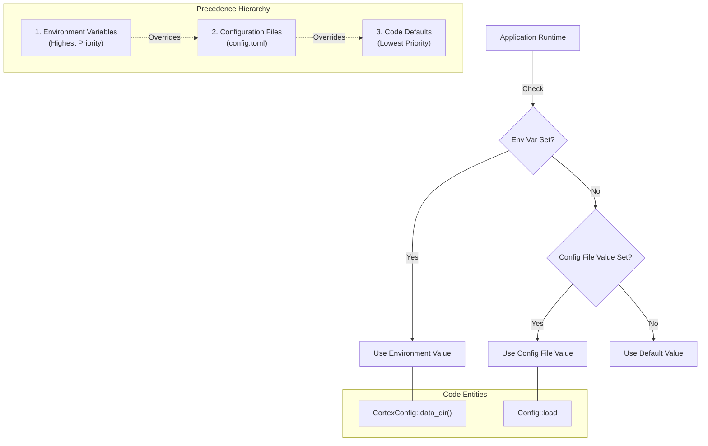
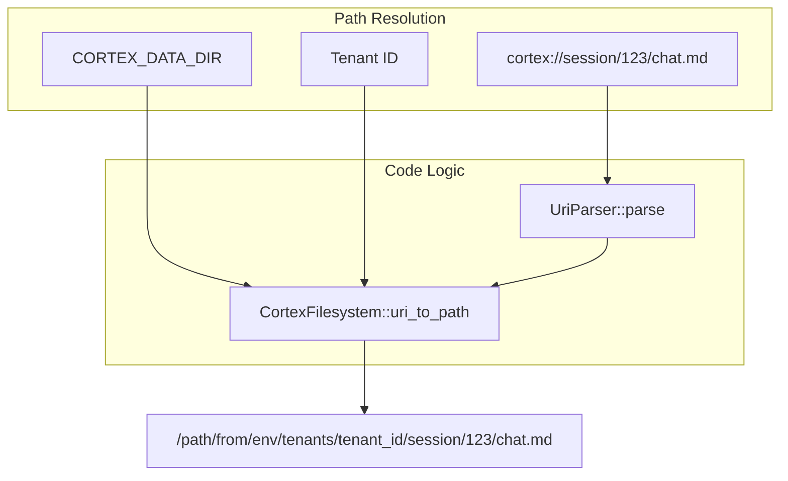

<!-- source: DeepWiki mcp.deepwiki.com · repo sopaco/cortex-mem · page 8.3 Environment Variables · fetched 2026-10-27 -->

# Environment Variables

<details>
<summary>Relevant source files</summary>

The following files were used as context for generating this wiki page:

- [cortex-mem-cli/src/main.rs](cortex-mem-cli/src/main.rs)
- [cortex-mem-config/src/lib.rs](cortex-mem-config/src/lib.rs)
- [cortex-mem-core/src/config.rs](cortex-mem-core/src/config.rs)
- [cortex-mem-core/src/filesystem/operations.rs](cortex-mem-core/src/filesystem/operations.rs)
- [cortex-mem-mcp/src/main.rs](cortex-mem-mcp/src/main.rs)
- [cortex-mem-rig/src/lib.rs](cortex-mem-rig/src/lib.rs)
- [cortex-mem-tools/src/errors.rs](cortex-mem-tools/src/errors.rs)
- [cortex-mem-tools/src/lib.rs](cortex-mem-tools/src/lib.rs)
- [cortex-mem-tools/src/types.rs](cortex-mem-tools/src/types.rs)
- [examples/cortex-mem-tars/src/config.rs](examples/cortex-mem-tars/src/config.rs)
- [examples/cortex-mem-tars/src/infrastructure.rs](examples/cortex-mem-tars/src/infrastructure.rs)

</details>


## Purpose and Scope

This document catalogs all environment variables used across the Cortex Memory system. Environment variables provide runtime configuration overrides, particularly for deployment-specific settings such as API endpoints, service URLs, data directories, and security credentials. They complement the primary TOML-based configuration system and follow a clear precedence hierarchy.

For configuration file structure and field definitions, see [8.1 Core Configuration](). For service-specific TOML configuration, see [8.2 Service Configuration](). For bot profile configuration in TARS, see [8.4 Bot Configuration]().

---

## Configuration Precedence

The Cortex Memory system follows a hierarchical configuration resolution strategy where environment variables take precedence over configuration files.

### Configuration Resolution Order

The `Config::load` method in `cortex-mem-config` handles the initial file loading, but specific fields within the application logic (like `data_dir`) implement fallback logic to environment variables.



**Sources:** [cortex-mem-config/src/lib.rs:45-64](), [cortex-mem-config/src/lib.rs:129-135]()

---

## Core System Variables

These variables affect the core memory processing and storage layers across all Rust-based components (`cortex-mem-service`, `cortex-mem-cli`, `cortex-mem-mcp`, `cortex-mem-tars`).

### CORTEX_DATA_DIR

**Component:** `cortex-mem-core`, `cortex-mem-config`

**Purpose:** Defines the root directory where the system stores tenant data, session files, and local memory indices.

**Implementation:** 
In `CortexConfig::default_data_dir`, the system checks for this variable. If absent, it defaults to the current directory `"."` [cortex-mem-config/src/lib.rs:59-63](). However, the CLI implements a more specific priority:
1. `data_dir` in `config.toml`.
2. `CORTEX_DATA_DIR` environment variable.
3. Directory containing the `config.toml` file [cortex-mem-cli/src/main.rs:214-227]().

### QDRANT_API_KEY

**Component:** `cortex-mem-core`, `cortex-mem-config`

**Purpose:** The API key used to authenticate with the Qdrant vector database.

**Implementation:**
The `QdrantConfig` default implementation automatically attempts to read this from the environment [cortex-mem-core/src/config.rs:23](). It is also used as a fallback in the TARS example configuration [examples/cortex-mem-tars/src/config.rs:94]().

### EMBEDDING_API_KEY / EMBEDDING_MODEL

**Component:** `cortex-mem-config`

**Purpose:** Configures the default embedding service credentials and model name.

**Implementation:**
The `EmbeddingConfig` struct uses `std::env::var` to provide defaults for `api_key`, `api_base_url`, and `model_name` (defaulting to `text-embedding-3-small`) [cortex-mem-config/src/lib.rs:90-98]().

---

## Service-Specific Variables

### TARS_API_PORT

**Component:** `cortex-mem-tars`

**Purpose:** Overrides the port for the optional audio integration API server.

**Usage:**
While TARS primarily uses `config.toml`, it is frequently deployed in scenarios where the port must be injected (e.g., containerized audio listeners).

### MCP Server CLI Flags as Environment Overrides

While `cortex-mem-mcp` primarily uses CLI arguments, in many MCP host environments (like Claude Desktop), these are passed via a configuration JSON which effectively acts as the environment setup for the child process [cortex-mem-mcp/src/main.rs:19-56]().

---

## Environment Variable Summary Table

| Variable | Component | Default | Purpose |
|----------|-----------|---------|---------|
| `CORTEX_DATA_DIR` | Core / CLI | `.` | Root path for all memory files and tenants |
| `QDRANT_API_KEY` | Core | `None` | Authentication for Qdrant vector store |
| `EMBEDDING_API_KEY` | Config | `""` | API Key for the embedding provider |
| `EMBEDDING_MODEL` | Config | `text-embedding-3-small` | Model used for vector generation |
| `EMBEDDING_API_BASE_URL`| Config | `https://api.openai.com/v1` | Base URL for embedding service |
| `RUST_LOG` | All Rust | `info` | Logging verbosity (standard Rust log env) |

**Sources:** [cortex-mem-config/src/lib.rs:59-63](), [cortex-mem-config/src/lib.rs:90-98](), [cortex-mem-core/src/config.rs:23]()

---

## Deployment Scenarios

### Local Development (CLI)
When running the CLI, you can override the data location without modifying the global `config.toml`:
```bash
CORTEX_DATA_DIR=/tmp/cortex-test cortex-mem-cli add --thread 123 "Testing env vars"
```

### Docker Compose
In a multi-container setup, environment variables are used to link the service to the vector database:
```yaml
services:
  cortex-service:
    image: sopaco/cortex-mem-service
    environment:
      - QDRANT_API_KEY=${PROD_QDRANT_KEY}
      - CORTEX_DATA_DIR=/var/lib/cortex
    volumes:
      - ./data:/var/lib/cortex
```

### MCP Integration
When configuring `cortex-mem-mcp` for an agent, environment variables are typically set in the host's configuration file (e.g., `claude_desktop_config.json`):
```json
{
  "mcpServers": {
    "cortex": {
      "command": "cortex-mem-mcp",
      "args": ["--tenant", "my-agent"],
      "env": {
        "CORTEX_DATA_DIR": "/absolute/path/to/memories"
      }
    }
  }
}
```

**Sources:** [cortex-mem-mcp/src/main.rs:81-93](), [cortex-mem-cli/src/main.rs:222-227]()

---

## Implementation Details: URI and Tenant Isolation

Environment variables like `CORTEX_DATA_DIR` directly influence how the `CortexFilesystem` resolves `cortex://` URIs.



**Sources:** [cortex-mem-core/src/filesystem/operations.rs:97-111](), [cortex-mem-core/src/filesystem/operations.rs:72-78]()

---

