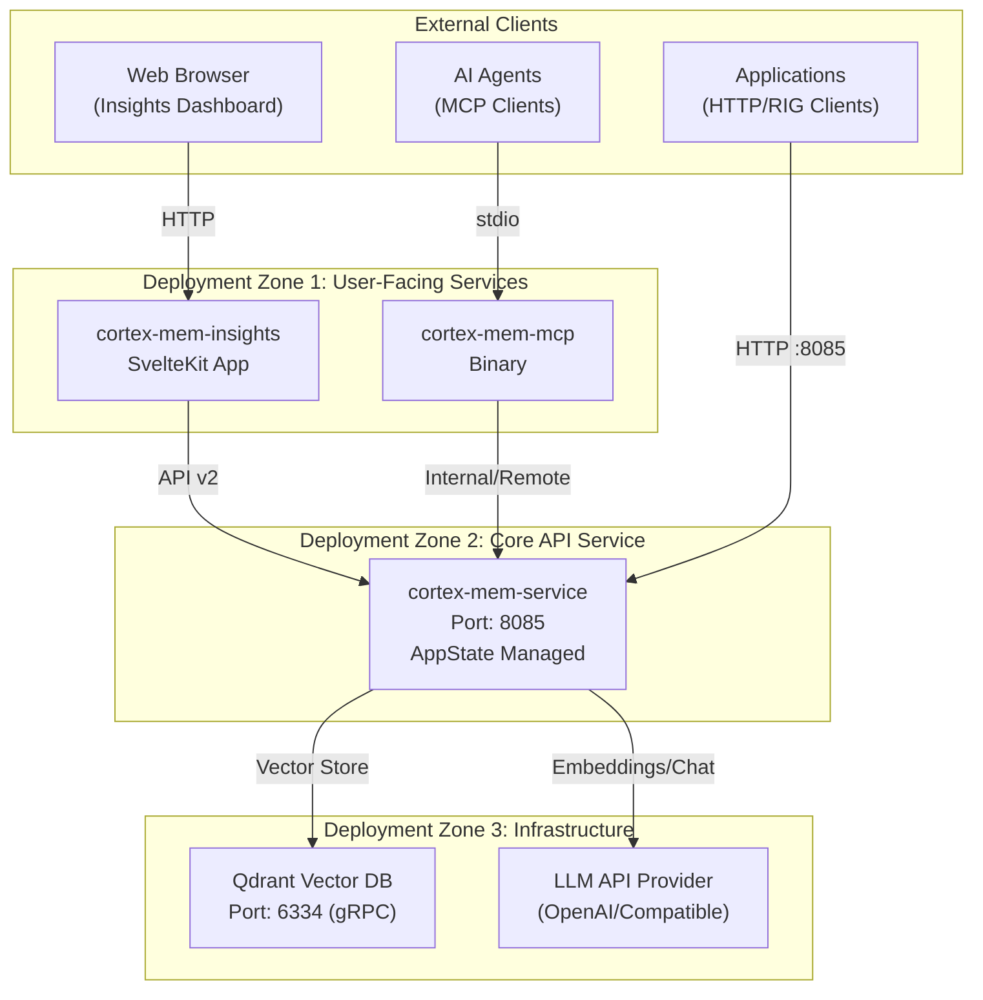
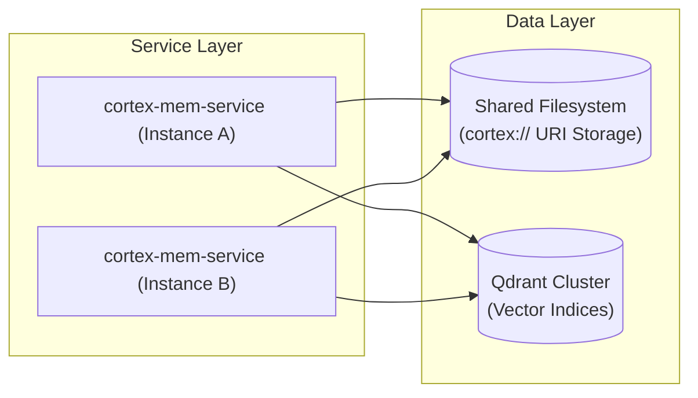

<!-- source: DeepWiki mcp.deepwiki.com · repo sopaco/cortex-mem · page 9 Deployment Guide · fetched 2026-10-27 -->

# Deployment Guide

<details>
<summary>Relevant source files</summary>

The following files were used as context for generating this wiki page:

- [README.md](README.md)
- [README_zh.md](README_zh.md)
- [cortex-mem-core/src/builder.rs](cortex-mem-core/src/builder.rs)
- [cortex-mem-core/src/embedding/client.rs](cortex-mem-core/src/embedding/client.rs)
- [cortex-mem-core/src/incremental_memory_updater.rs](cortex-mem-core/src/incremental_memory_updater.rs)
- [cortex-mem-core/src/llm/prompts.rs](cortex-mem-core/src/llm/prompts.rs)
- [cortex-mem-core/src/search/vector_engine.rs](cortex-mem-core/src/search/vector_engine.rs)
- [cortex-mem-insights/src/lib/api.ts](cortex-mem-insights/src/lib/api.ts)
- [cortex-mem-insights/src/lib/pages/Dashboard.svelte](cortex-mem-insights/src/lib/pages/Dashboard.svelte)
- [cortex-mem-insights/src/lib/pages/Search.svelte](cortex-mem-insights/src/lib/pages/Search.svelte)
- [cortex-mem-insights/src/lib/stores/search.ts](cortex-mem-insights/src/lib/stores/search.ts)
- [cortex-mem-insights/src/lib/stores/tenant.ts](cortex-mem-insights/src/lib/stores/tenant.ts)
- [cortex-mem-service/src/handlers/automation.rs](cortex-mem-service/src/handlers/automation.rs)
- [cortex-mem-service/src/handlers/search.rs](cortex-mem-service/src/handlers/search.rs)
- [cortex-mem-service/src/handlers/sessions.rs](cortex-mem-service/src/handlers/sessions.rs)
- [cortex-mem-service/src/main.rs](cortex-mem-service/src/main.rs)
- [cortex-mem-service/src/routes/automation.rs](cortex-mem-service/src/routes/automation.rs)
- [cortex-mem-service/src/state.rs](cortex-mem-service/src/state.rs)
- [examples/@memclaw/bin-darwin-arm64/bin/README.md](examples/@memclaw/bin-darwin-arm64/bin/README.md)
- [examples/@memclaw/bin-darwin-arm64/bin/cortex-mem-cli](examples/@memclaw/bin-darwin-arm64/bin/cortex-mem-cli)
- [examples/@memclaw/bin-darwin-arm64/bin/cortex-mem-service](examples/@memclaw/bin-darwin-arm64/bin/cortex-mem-service)
- [examples/@memclaw/bin-darwin-arm64/package.json](examples/@memclaw/bin-darwin-arm64/package.json)
- [examples/@memclaw/bin-linux-x64/bin/cortex-mem-cli](examples/@memclaw/bin-linux-x64/bin/cortex-mem-cli)
- [examples/@memclaw/bin-linux-x64/bin/cortex-mem-service](examples/@memclaw/bin-linux-x64/bin/cortex-mem-service)
- [examples/@memclaw/bin-linux-x64/bin/qdrant](examples/@memclaw/bin-linux-x64/bin/qdrant)
- [examples/@memclaw/bin-linux-x64/package.json](examples/@memclaw/bin-linux-x64/package.json)
- [examples/locomo-evaluation/benchmark/index.html](examples/locomo-evaluation/benchmark/index.html)
- [examples/locomo-evaluation/eval.py](examples/locomo-evaluation/eval.py)

</details>


This document provides instructions for deploying `cortex-mem` components in production environments. It covers architecture planning, service configuration, external dependencies, and operational considerations for running a stable memory framework.

For Docker-specific deployment instructions, see [Docker Deployment](#9.1). For security, scaling, and performance tuning guidance, see [Production Considerations](#9.2). For initial installation and local development setup, see [Installation](#2.1).

---

## Deployment Architecture Overview

The Cortex Memory system consists of multiple independent services that can be deployed separately or together. The core is the `cortex-mem-service`, which orchestrates the `MemoryManager` and various AI modules.

### Component Deployment Model



**Sources:** [cortex-mem-service/src/main.rs:134-146](), [cortex-mem-insights/src/lib/api.ts:5-13]()

### Service Dependencies

| Service | Primary Role | Key Code Entity | Port/Transport |
|---------|--------------|-----------------|----------------|
| `cortex-mem-service` | REST API Provider | `AppState` | 8085 (Default) |
| `cortex-mem-insights` | Web Dashboard | `apiClient` | HTTP |
| `cortex-mem-mcp` | Agent Integration | `MCP Server` | stdio |
| `cortex-mem-tars` | TUI/Multi-Agent | `AppState` | TUI / 8081 |

**Sources:** [cortex-mem-service/src/main.rs:39-41](), [cortex-mem-service/src/state.rs:15-41](), [cortex-mem-insights/src/lib/api.ts:15-21]()

---

## Prerequisites

### Qdrant Vector Database

Cortex Memory requires Qdrant for vector storage and semantic search operations. The `VectorSearchEngine` communicates with Qdrant via the `QdrantVectorStore` implementation.

**Minimum Requirements:**
- gRPC endpoint (typically port 6334).
- Collection auto-creation is handled by the `AppState::new` initialization sequence.
- Supports multi-tenancy via `tenant_id` in `QdrantConfig`.

**Sources:** [cortex-mem-service/src/state.rs:45-68](), [cortex-mem-core/src/search/vector_engine.rs:57-60]()

### LLM API Access

The system requires LLM access for the `FactExtractor`, `MemoryClassifier`, and `ImportanceEvaluator`. It also requires an embedding provider for the `EmbeddingClient`.

**Required Configuration:**
- `LLM_API_BASE_URL`
- `LLM_API_KEY`
- `LLM_MODEL`

**Sources:** [cortex-mem-service/src/handlers/automation.rs:28-34](), [cortex-mem-service/src/state.rs:50-54]()

---

## Configuration for Production

### Configuration Resolution

The `cortex-mem-service` resolves its configuration using a specific priority logic defined in `Cli::resolve_config_path`:
1. Explicit `--config` flag.
2. `config.toml` inside the `--data-dir`.
3. `config.toml` in the current working directory.

**Sources:** [cortex-mem-service/src/main.rs:56-73]()

### Service Initialization

The `AppState` struct serves as the central runtime container. It manages:
- `CortexMem`: The core memory runtime.
- `SessionManager`: For thread-based conversation tracking.
- `VectorSearchEngine`: For layered L0/L1/L2 search.
- `MemoryEventCoordinator`: For asynchronous background processing.

**Sources:** [cortex-mem-service/src/state.rs:15-41](), [cortex-mem-service/src/state.rs:102-126]()

---

## Deployment Procedures

### Service Deployment: `cortex-mem-service`

The service should be deployed as a long-running process. It supports verbose logging and file-based log rotation via the `tracing` subscriber.

```bash
# Example production start command
./cortex-mem-service \
  --data-dir /var/lib/cortex-mem \
  --config /etc/cortex-mem/config.toml \
  --port 8085 \
  --log-file /var/log/cortex-mem/service.log
```

**Sources:** [cortex-mem-service/src/main.rs:24-49](), [cortex-mem-service/src/main.rs:122-132]()

### Web Dashboard: `cortex-mem-insights`

The dashboard is a SvelteKit application. In production, it connects to the `cortex-mem-service` via the `/api/v2` prefix. It supports tenant switching via the `switchTenant` method in the `ApiClient`.

**Sources:** [cortex-mem-insights/src/lib/api.ts:5-13](), [cortex-mem-insights/src/lib/api.ts:63-70]()

---

## Health and Monitoring

### Health Check Endpoint

The service provides a dedicated health check handler at `GET /health`. This returns the status of the service and LLM availability.

**Sources:** [cortex-mem-service/src/main.rs:135](), [cortex-mem-insights/src/lib/api.ts:45-56]()

### Search Performance Monitoring

Search operations are categorized into `layered_semantic_search` and `semantic_search`. The `VectorSearchEngine` supports an `enable_intent_analysis` flag which, when disabled, reduces search latency from ~15s to <500ms by skipping LLM-based query rewriting.

**Sources:** [cortex-mem-core/src/search/vector_engine.rs:109-116](), [cortex-mem-service/src/handlers/search.rs:81-89]()

---

## Verification and Testing

### Post-Deployment Verification

| Step | Action | Expected Code Path |
|------|--------|--------------------|
| 1. Connectivity | `GET /health` | `handlers::health::health_check` |
| 2. Session Creation | `POST /api/v2/sessions` | `sessions::create_session` |
| 3. Message Ingest | `POST /api/v2/sessions/{id}/messages` | `sessions::add_message` |
| 4. Extraction | `POST /api/v2/automation/extraction/{id}` | `automation::trigger_extraction` |
| 5. Search | `POST /api/v2/search` | `search::search` |

**Sources:** [cortex-mem-service/src/main.rs:134-140](), [cortex-mem-service/src/handlers/automation.rs:23-50]()

---

## Service Orchestration

### Multi-Service Topology

In a full production deployment, multiple instances of the service can be orchestrated to handle different tenants or provide high availability.



**Sources:** [cortex-mem-service/src/state.rs:128-152](), [README.md:37-54]()

---

This deployment guide provides a high-level overview of production strategies. For detailed implementation of specific environments, refer to the child pages:
- [Docker Deployment](#9.1) — For containerized environments and orchestration.
- [Production Considerations](#9.2) — For security hardening and performance tuning.
- [Multi-Service Architecture](#9.3) — For complex, multi-tenant deployments.

---

