# Page: Overview

# Overview

<details>
<summary>Relevant source files</summary>

The following files were used as context for generating this wiki page:

- [Cargo.toml](Cargo.toml)
- [README.md](README.md)
- [README_zh.md](README_zh.md)
- [cortex-mem-config/Cargo.toml](cortex-mem-config/Cargo.toml)
- [cortex-mem-core/Cargo.toml](cortex-mem-core/Cargo.toml)
- [cortex-mem-core/src/incremental_memory_updater.rs](cortex-mem-core/src/incremental_memory_updater.rs)
- [cortex-mem-core/src/llm/prompts.rs](cortex-mem-core/src/llm/prompts.rs)
- [cortex-mem-core/src/search/vector_engine.rs](cortex-mem-core/src/search/vector_engine.rs)
- [cortex-mem-mcp/Cargo.toml](cortex-mem-mcp/Cargo.toml)
- [cortex-mem-rig/Cargo.toml](cortex-mem-rig/Cargo.toml)
- [cortex-mem-service/Cargo.toml](cortex-mem-service/Cargo.toml)
- [cortex-mem-service/src/handlers/automation.rs](cortex-mem-service/src/handlers/automation.rs)
- [cortex-mem-service/src/handlers/search.rs](cortex-mem-service/src/handlers/search.rs)
- [cortex-mem-service/src/handlers/sessions.rs](cortex-mem-service/src/handlers/sessions.rs)
- [cortex-mem-service/src/routes/automation.rs](cortex-mem-service/src/routes/automation.rs)
- [cortex-mem-service/src/state.rs](cortex-mem-service/src/state.rs)
- [cortex-mem-tools/Cargo.toml](cortex-mem-tools/Cargo.toml)
- [examples/@memclaw/bin-darwin-arm64/bin/README.md](examples/@memclaw/bin-darwin-arm64/bin/README.md)
- [examples/cortex-mem-tars/config.example.toml](examples/cortex-mem-tars/config.example.toml)
- [examples/locomo-evaluation/eval.py](examples/locomo-evaluation/eval.py)
- [litho.docs/en/2.Architecture.md](litho.docs/en/2.Architecture.md)
- [litho.docs/en/3.Workflow.md](litho.docs/en/3.Workflow.md)
- [litho.docs/en/4.Deep-Exploration/Core Infrastructure Domain.md](litho.docs/en/4.Deep-Exploration/Core Infrastructure Domain.md)
- [litho.docs/en/4.Deep-Exploration/Extraction Engine Domain.md](litho.docs/en/4.Deep-Exploration/Extraction Engine Domain.md)
- [litho.docs/en/4.Deep-Exploration/Search Engine Domain.md](litho.docs/en/4.Deep-Exploration/Search Engine Domain.md)

</details>


This document provides a high-level introduction to the **Cortex Memory** system, its purpose, main components, and architectural approach. For detailed architectural patterns and component interactions, see [System Architecture](#1.1). For specific feature capabilities, see [Key Features](#1.2). For installation and usage instructions, see [Getting Started](#2).

## Purpose and Scope

**Cortex Memory** is an AI-native memory framework built with Rust that enables AI agents to maintain persistent, context-aware long-term memory across sessions. It moves beyond simple chat history by providing a **hierarchical three-tier memory architecture** (L0 Abstract → L1 Overview → L2 Detail) that automatically extracts, organizes, and optimizes information.

The system utilizes a hybrid storage architecture combining **virtual-filesystem** durability (using the `cortex://` URI scheme) with vector-based **semantic search** via Qdrant.

**Sources:** [README.md:13-32](), [README.md:103-116]()

## What is Cortex-Mem?

Cortex Memory is a complete framework for giving AI applications a "brain" that remembers. It is organized into three architectural layers:

**Core Library Layer** - Foundational components:
| Component | Purpose | Key Modules |
|-----------|---------|-------------|
| `cortex-mem-core` | Central engine for processing, search, and events. | `CortexMem`, `VectorSearchEngine`, `SessionManager`, `MemoryEventCoordinator` |
| `cortex-mem-config` | Configuration management and validation. | `Config`, `QdrantConfig`, `LLMConfig`, `EmbeddingConfig` |
| `cortex-mem-tools` | Shared abstractions and payload structures. | `MemoryOperations`, `ContextLayer` |

**Interface Layer** - Access points:
| Component | Purpose | Protocol/Tech |
|-----------|---------|--------------|
| `cortex-mem-cli` | Command-line interface for administration. | Rust (clap) |
| `cortex-mem-service` | Multi-tenant REST API server. | Rust (axum) |
| `cortex-mem-mcp` | Model Context Protocol server for AI agents. | Rust, stdio transport |
| `cortex-mem-rig` | Integration for the Rig agent framework. | Rust (rig-core) |

**Application Layer** - Complete applications:
| Component | Purpose | Technology |
|-----------|---------|------------|
| `cortex-mem-tars` | Multi-agent TUI with audio and persistent memory. | Rust (ratatui) |
| `cortex-mem-insights` | Web dashboard for monitoring and visualization. | Svelte 5, TypeScript |
| `lomoco-evaluation` | Benchmarking framework for memory systems. | Python |

**Sources:** [Cargo.toml:1-12](), [README.md:103-132](), [litho.docs/en/2.Architecture.md:178-200]()

## Ecosystem Overview

**Cortex Memory Ecosystem Architecture**

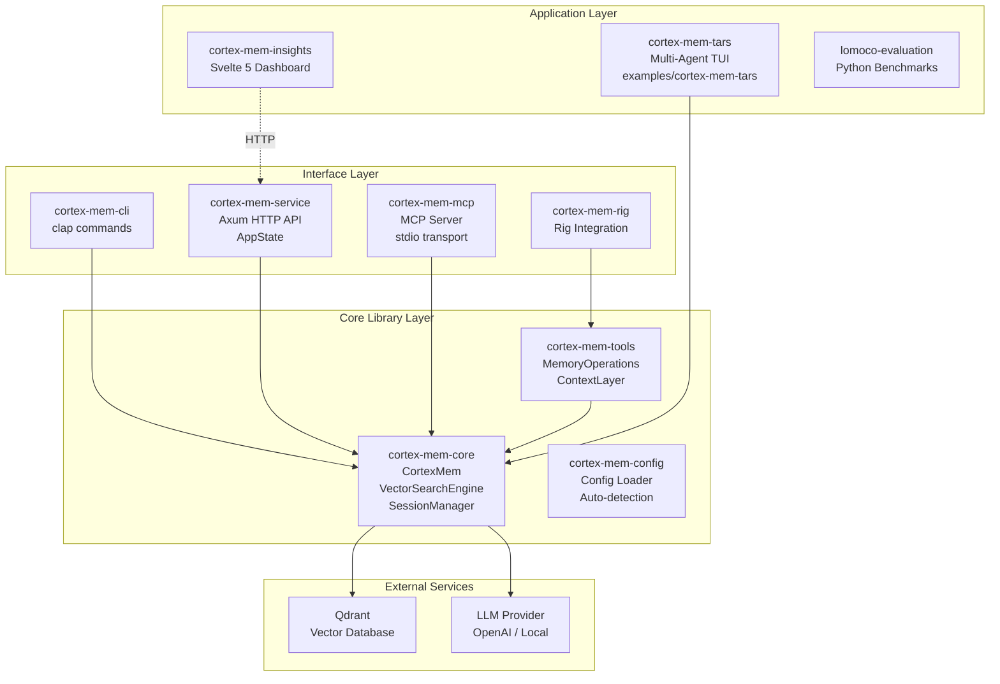

The ecosystem is built around `cortex-mem-core`, which provides the `CortexMem` runtime. All interfaces depend on this core to interact with the underlying filesystem and vector store.

**Sources:** [cortex-mem-service/src/state.rs:15-41](), [litho.docs/en/2.Architecture.md:180-210]()

## Three-Domain Architecture

Cortex Memory organizes its logic into three functional domains:

1.  **Configuration Domain**: Handled by `cortex-mem-config`, it manages `config.toml` and environment variables to initialize the system.
2.  **Core Memory Domain**: Centered in `cortex-mem-core`, this domain manages the `CortexMem` struct [cortex-mem-service/src/state.rs:17](), which orchestrates the `SessionManager`, `VectorSearchEngine`, and the event-driven `MemoryEventCoordinator`.
3.  **Tool Support Domain**: Includes `cortex-mem-tools` and `cortex-mem-rig`, providing standardized ways for external applications to invoke memory operations.

**Sources:** [litho.docs/en/2.Architecture.md:11-32](), [cortex-mem-service/src/state.rs:99-126]()

## Memory Lifecycle & Workflows

**Memory Retrieval & Search Flow**

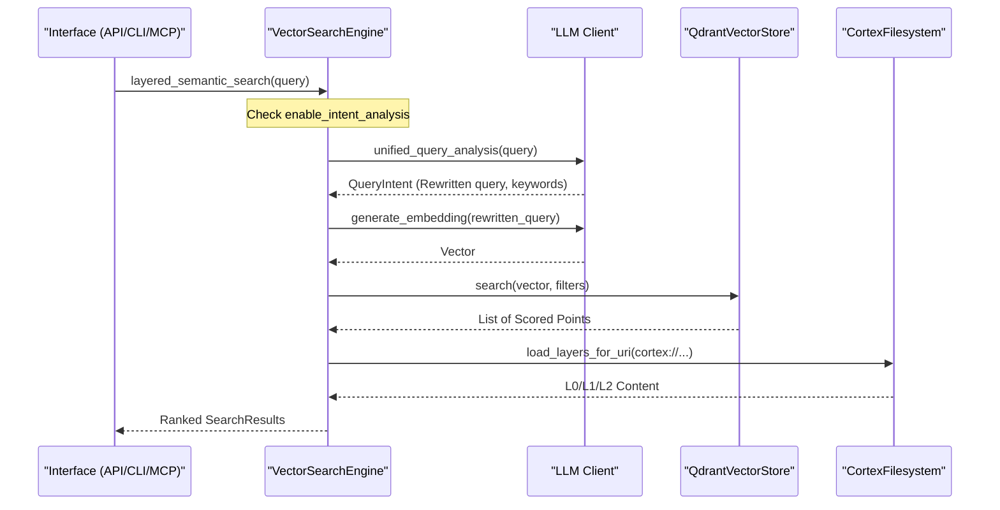

The system uses a sophisticated pipeline for both storage and retrieval:

*   **Ingestion**: When a message is added via `SessionManager::add_message` [cortex-mem-service/src/handlers/sessions.rs:156](), it triggers a `MemoryEvent`. The `MemoryEventCoordinator` handles asynchronous extraction and indexing.
*   **Search**: The `VectorSearchEngine` performs "Layered Semantic Search". It can use an LLM for `unified_query_analysis` [cortex-mem-core/src/llm/prompts.rs:136]() to rewrite queries for better recall before querying Qdrant.
*   **Optimization**: A background `MemoryCleanupService` implements the Ebbinghaus forgetting curve to archive low-strength memories [README.md:115]().

**Sources:** [cortex-mem-core/src/search/vector_engine.rs:81-116](), [cortex-mem-service/src/handlers/search.rs:81-90](), [litho.docs/en/3.Workflow.md:131-170]()

## Technology Stack

| Layer | Technologies | Purpose |
|-------|-------------|---------|
| **Runtime** | Rust 1.86+, Tokio | Performance, safety, and async I/O. |
| **Storage** | Qdrant, Local Filesystem | Hybrid Vector + Markdown (`cortex://`) storage. |
| **Web API** | Axum 0.7 | High-performance REST service. |
| **Frontend** | Svelte 5, TypeScript | Modern, reactive dashboard (Insights). |
| **AI/ML** | Rig-core, OpenAI-compatible APIs | Embeddings and structured fact extraction. |

**Sources:** [Cargo.toml:14-70](), [litho.docs/en/2.Architecture.md:33-68]()

## Integration Patterns

1.  **Direct Library**: Use `CortexMemBuilder` to embed memory directly into Rust apps.
2.  **REST API**: Connect via `cortex-mem-service` [cortex-mem-service/src/handlers/search.rs:17]().
3.  **MCP**: Use with Claude or Cursor via `cortex-mem-mcp`.
4.  **Rig Framework**: Use `cortex-mem-rig` to give Rig agents long-term memory.
5.  **OpenClaw**: Integrate via the `MemClaw` plugin.

**Sources:** [README.md:103-132](), [cortex-mem-service/src/state.rs:128-152]()

## Getting Started

1.  **Prerequisites**: Install Rust 1.86+, Qdrant (Docker recommended), and obtain an LLM API key.
2.  **Configuration**: Set up `config.toml` with your `[qdrant]`, `[llm]`, and `[embedding]` settings [cortex-mem-service/src/state.rs:52]().
3.  **Execution**: Start the service or use the CLI to begin storing and searching memories.

For detailed steps, see [Getting Started](#2).

**Sources:** [README.md:134-184]()

---

# Page: System Architecture

# System Architecture

<details>
<summary>Relevant source files</summary>

The following files were used as context for generating this wiki page:

- [Cargo.toml](Cargo.toml)
- [README.md](README.md)
- [README_zh.md](README_zh.md)
- [cortex-mem-config/Cargo.toml](cortex-mem-config/Cargo.toml)
- [cortex-mem-core/Cargo.toml](cortex-mem-core/Cargo.toml)
- [cortex-mem-core/src/incremental_memory_updater.rs](cortex-mem-core/src/incremental_memory_updater.rs)
- [cortex-mem-core/src/llm/prompts.rs](cortex-mem-core/src/llm/prompts.rs)
- [cortex-mem-core/src/search/vector_engine.rs](cortex-mem-core/src/search/vector_engine.rs)
- [cortex-mem-mcp/Cargo.toml](cortex-mem-mcp/Cargo.toml)
- [cortex-mem-rig/Cargo.toml](cortex-mem-rig/Cargo.toml)
- [cortex-mem-service/Cargo.toml](cortex-mem-service/Cargo.toml)
- [cortex-mem-service/src/handlers/automation.rs](cortex-mem-service/src/handlers/automation.rs)
- [cortex-mem-service/src/handlers/search.rs](cortex-mem-service/src/handlers/search.rs)
- [cortex-mem-service/src/handlers/sessions.rs](cortex-mem-service/src/handlers/sessions.rs)
- [cortex-mem-service/src/routes/automation.rs](cortex-mem-service/src/routes/automation.rs)
- [cortex-mem-service/src/state.rs](cortex-mem-service/src/state.rs)
- [cortex-mem-tools/Cargo.toml](cortex-mem-tools/Cargo.toml)
- [examples/@memclaw/bin-darwin-arm64/bin/README.md](examples/@memclaw/bin-darwin-arm64/bin/README.md)
- [examples/cortex-mem-tars/config.example.toml](examples/cortex-mem-tars/config.example.toml)
- [examples/locomo-evaluation/eval.py](examples/locomo-evaluation/eval.py)
- [litho.docs/en/2.Architecture.md](litho.docs/en/2.Architecture.md)
- [litho.docs/en/3.Workflow.md](litho.docs/en/3.Workflow.md)
- [litho.docs/en/4.Deep-Exploration/Core Infrastructure Domain.md](litho.docs/en/4.Deep-Exploration/Core Infrastructure Domain.md)
- [litho.docs/en/4.Deep-Exploration/Extraction Engine Domain.md](litho.docs/en/4.Deep-Exploration/Extraction Engine Domain.md)
- [litho.docs/en/4.Deep-Exploration/Search Engine Domain.md](litho.docs/en/4.Deep-Exploration/Search Engine Domain.md)

</details>


## Purpose and Scope

This document explains the three-domain architecture of Cortex Memory (Configuration Domain, Core Memory Domain, Tool Support Domain) and how components interact through a modular monolith pattern. The system provides a unified core library (`cortex-mem-core`) accessed through multiple interface layers including a REST API, MCP Server, CLI, and the TARS TUI application.

Cortex Memory implements a **hierarchical three-tier memory architecture** (L0 Abstract → L1 Overview → L2 Detail) that optimizes LLM context usage while providing deep retrieval capabilities [README.md:27-32]().

## Three-Domain Architecture Pattern

The system is organized into three functional domains to separate infrastructure, logic, and presentation:

### 1. Configuration Domain
Provides centralized configuration management, loading settings from `config.toml` and `bots.json`. It handles validation and initialization parameters for the runtime [litho.docs/en/2.Architecture.md:178-185]().

**Key Components**:
- `cortex-mem-config`: Handles TOML configuration loading [Cargo.toml:5]().
- `AppState`: Manages the global state, loading configurations for LLM, embeddings, and Qdrant during service startup [cortex-mem-service/src/state.rs:43-54]().

### 2. Core Memory Domain
The intelligence layer containing all memory management logic. It orchestrates the memory pipeline including extraction, indexing, and search [README.md:148-153]().

**Key Components**:
- `CortexMem`: The central runtime engine built via `CortexMemBuilder` [cortex-mem-service/src/state.rs:134-152]().
- `SessionManager`: Manages conversation lifecycles and triggers extraction events [cortex-mem-service/src/state.rs:18-19]().
- `VectorSearchEngine`: Orchestrates layered (L0/L1/L2) semantic search [cortex-mem-core/src/search/vector_engine.rs:56-71]().
- `MemoryEventCoordinator`: An event-driven system that keeps memory layers in sync automatically [README.md:113-114]().

### 3. Tool Support Domain
Provides multiple access interfaces for different integration scenarios, all sharing the same core engine [litho.docs/en/2.Architecture.md:17-21]().

**Key Components**:
- `cortex-mem-service`: Axum-based REST API [Cargo.toml:8]().
- `cortex-mem-mcp`: Model Context Protocol server for AI agent integration [Cargo.toml:10]().
- `cortex-mem-cli`: Command-line interface for direct operations [Cargo.toml:9]().
- `cortex-mem-tars`: Multi-agent TUI application [Cargo.toml:11]().

**Sources**: [README.md:27-32](), [cortex-mem-service/src/state.rs:13-41](), [litho.docs/en/2.Architecture.md:11-32](), [Cargo.toml:1-12]()

## Modular Monolith Pattern

Cortex Memory follows a modular monolith architecture where a shared core library provides the "Source of Truth," while specialized crates provide interface-specific logic:

1.  **Shared Core (`cortex-mem-core`)**: Contains the `VectorStore` and `LLMClient` trait abstractions [cortex-mem-service/src/state.rs:1-6]().
2.  **Hybrid Persistence**: Combines a filesystem-based source of truth using the `cortex://` URI scheme with vector-based semantic search in Qdrant [README.md:31-32]().
3.  **Event-Driven Automation**: Uses a `MemoryEventCoordinator` to handle background tasks like L0/L1 generation and vector synchronization [cortex-mem-service/src/handlers/automation.rs:13-22]().

### System Architecture Overview

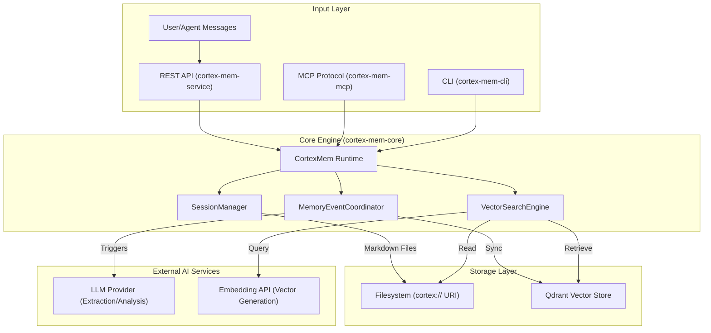

**Sources**: [README.md:138-184](), [cortex-mem-service/src/state.rs:77-91](), [litho.docs/en/2.Architecture.md:129-166]()

## Memory Hierarchy and Data Flow

Cortex Memory organizes information into three layers to optimize retrieval performance and cost [README.md:200-205]():

| Layer | Purpose | Content Type |
| :--- | :--- | :--- |
| **L0 (Abstract)** | Quick relevance checking | ~100 token concise summary |
| **L1 (Overview)** | Decision-making context | ~2K token structured markdown |
| **L2 (Detail)** | Full source of truth | Raw conversation or document |

### Semantic Search Data Flow

The `VectorSearchEngine` implements a multi-path retrieval strategy to maximize recall, especially for complex user queries [cortex-mem-service/src/handlers/search.rs:81-113]().

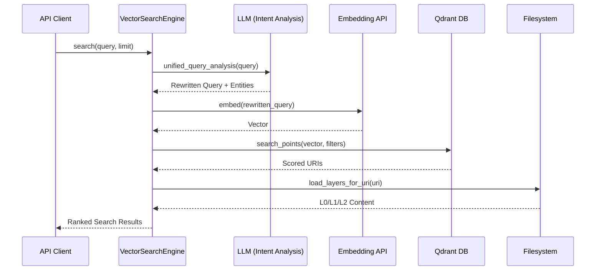

**Key Implementation Details**:
- **Intent Analysis**: The system uses `unified_query_analysis` to expand queries with synonyms and extract entities before embedding [cortex-mem-core/src/llm/prompts.rs:132-150]().
- **Layered Search**: The `layered_semantic_search` function prioritizes retrieval across the L0/L1/L2 hierarchy [cortex-mem-service/src/handlers/search.rs:81-84]().
- **Lexical Fallback**: If vector search yields insufficient results, the system falls back to a filesystem-based lexical scan [cortex-mem-service/src/handlers/search.rs:172-182]().

**Sources**: [cortex-mem-core/src/search/vector_engine.rs:56-71](), [cortex-mem-core/src/llm/prompts.rs:5-87](), [cortex-mem-service/src/handlers/search.rs:39-122](), [README.md:200-205]()

## Event-Driven Automation

The architecture relies on an asynchronous event bus to decouple heavy AI processing from the request-response cycle.

### Memory Update Pipeline

When a message is added to a session via `SessionManager::add_message`, the system triggers a chain of events [cortex-mem-service/src/handlers/sessions.rs:152-173]():

1.  **MessageAdded**: Dispatched by `SessionManager`.
2.  **LayerUpdateNeeded**: Emitted to `MemoryEventCoordinator` to regenerate L0/L1 summaries for the session timeline [cortex-mem-service/src/handlers/sessions.rs:185-191]().
3.  **VectorSyncNeeded**: Handled by `SyncManager` to ensure the new content is indexed in Qdrant [cortex-mem-service/src/state.rs:4-5]().

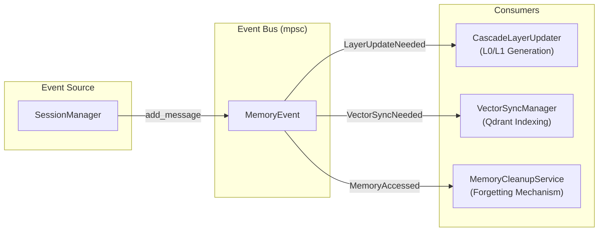

**Key Components**:
- **CascadeLayerUpdater**: Automatically keeps L0/L1 layers in sync as L2 (raw) memories change [README.md:113-114]().
- **MemoryCleanupService**: Implements the Ebbinghaus forgetting curve to archive or delete low-strength memories [README.md:115-116]().

**Sources**: [cortex-mem-service/src/handlers/sessions.rs:123-157](), [cortex-mem-service/src/state.rs:32-33](), [cortex-mem-service/src/handlers/automation.rs:13-22](), [README.md:113-116]()

---

# Page: Key Features

# Key Features

<details>
<summary>Relevant source files</summary>

The following files were used as context for generating this wiki page:

- [README.md](README.md)
- [README_zh.md](README_zh.md)
- [cortex-mem-core/src/automation/indexer.rs](cortex-mem-core/src/automation/indexer.rs)
- [cortex-mem-core/src/automation/layer_generator.rs](cortex-mem-core/src/automation/layer_generator.rs)
- [cortex-mem-core/src/automation/manager.rs](cortex-mem-core/src/automation/manager.rs)
- [cortex-mem-core/src/automation/mod.rs](cortex-mem-core/src/automation/mod.rs)
- [cortex-mem-core/src/automation/sync.rs](cortex-mem-core/src/automation/sync.rs)
- [cortex-mem-core/src/cascade_layer_updater.rs](cortex-mem-core/src/cascade_layer_updater.rs)
- [cortex-mem-core/src/incremental_memory_updater.rs](cortex-mem-core/src/incremental_memory_updater.rs)
- [cortex-mem-core/src/layers/generator.rs](cortex-mem-core/src/layers/generator.rs)
- [cortex-mem-core/src/layers/manager.rs](cortex-mem-core/src/layers/manager.rs)
- [cortex-mem-core/src/llm/client.rs](cortex-mem-core/src/llm/client.rs)
- [cortex-mem-core/src/llm/prompts.rs](cortex-mem-core/src/llm/prompts.rs)
- [cortex-mem-core/src/memory_event_coordinator.rs](cortex-mem-core/src/memory_event_coordinator.rs)
- [cortex-mem-core/src/search/vector_engine.rs](cortex-mem-core/src/search/vector_engine.rs)
- [cortex-mem-core/src/session/extraction.rs](cortex-mem-core/src/session/extraction.rs)
- [cortex-mem-core/src/session/message.rs](cortex-mem-core/src/session/message.rs)
- [cortex-mem-core/src/types.rs](cortex-mem-core/src/types.rs)
- [cortex-mem-core/src/vector_store/qdrant.rs](cortex-mem-core/src/vector_store/qdrant.rs)
- [cortex-mem-service/src/handlers/automation.rs](cortex-mem-service/src/handlers/automation.rs)
- [cortex-mem-service/src/handlers/search.rs](cortex-mem-service/src/handlers/search.rs)
- [cortex-mem-service/src/handlers/sessions.rs](cortex-mem-service/src/handlers/sessions.rs)
- [cortex-mem-service/src/routes/automation.rs](cortex-mem-service/src/routes/automation.rs)
- [cortex-mem-service/src/state.rs](cortex-mem-service/src/state.rs)
- [examples/@memclaw/bin-darwin-arm64/bin/README.md](examples/@memclaw/bin-darwin-arm64/bin/README.md)
- [examples/locomo-evaluation/eval.py](examples/locomo-evaluation/eval.py)

</details>


This document provides a comprehensive overview of Cortex Memory's core capabilities, explaining how the system transforms unstructured conversations into intelligent, persistent memory. This page focuses on **what** the system can do and **how** it accomplishes these tasks through its modular architecture.

For architectural details about the three-domain pattern, see [System Architecture](#1.1). For deployment patterns and infrastructure setup, see [Deployment Guide](#9).

---

## Core Intelligence Features

Cortex Memory employs a suite of AI-powered modules that work in concert to process, classify, and optimize memory content. These capabilities are orchestrated by the `MemoryManager` (integrated within `CortexMem`) in the `cortex-mem-core` crate.

### Automatic Fact Extraction

The system automatically converts unstructured conversation text into discrete, structured facts using LLM-powered extraction. This process is handled by the `MemoryExtractor` module, which parses messages and produces `ExtractedMemories` objects containing categorized factual content.

**Fact Extraction Pipeline**

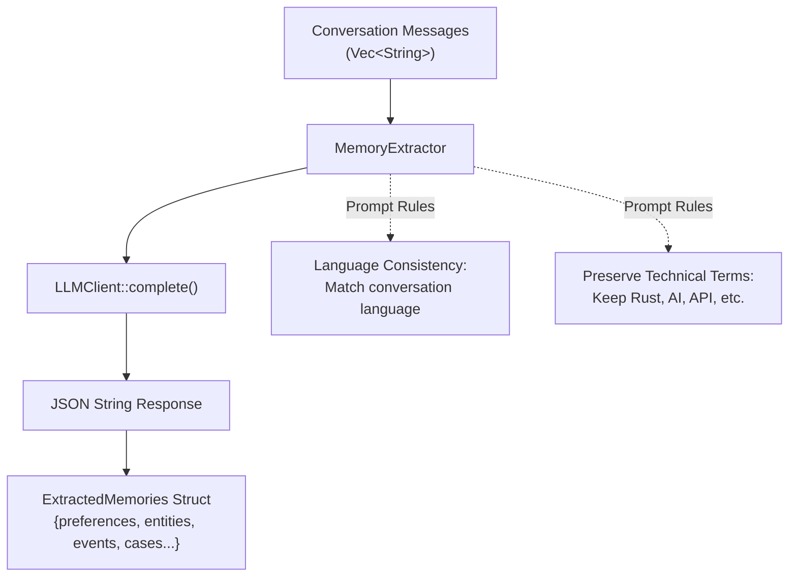

**Sources:** [cortex-mem-core/src/session/extraction.rs:143-200](), [README.md:106-107]()

**Key Characteristics:**
- **Categorized Extraction**: Automatically sorts info into `preferences`, `entities`, `events`, `cases`, `personal_info`, `work_history`, `relationships`, and `goals` [cortex-mem-core/src/session/extraction.rs:15-40]().
- **Language Awareness**: Mandates extraction in the same language as the conversation (e.g., Chinese conversation results in Chinese memories) [cortex-mem-core/src/session/extraction.rs:211-215]().
- **Confidence Scoring**: Each extracted item includes a `confidence` float to qualify the extraction quality [cortex-mem-core/src/session/extraction.rs:76-140]().

---

### Layered Memory Hierarchy (L0/L1/L2)

Cortex Memory implements a unique three-tier architecture to optimize LLM context window usage and retrieval precision.

| Layer | Type | Description | Implementation |
|-------|------|-------------|----------------|
| **L0** | **Abstract** | High-level summary of a directory/scope. | `CascadeLayerUpdater` [cortex-mem-core/src/cascade_layer_updater.rs]() |
| **L1** | **Overview** | Mid-level overview of specific memory files. | `CascadeLayerUpdater` [cortex-mem-core/src/cascade_layer_updater.rs]() |
| **L2** | **Detail** | The raw memory content or message. | `MessageStorage` / `Filesystem` [cortex-mem-core/src/session/message.rs]() |

**Incremental Update Data Flow**

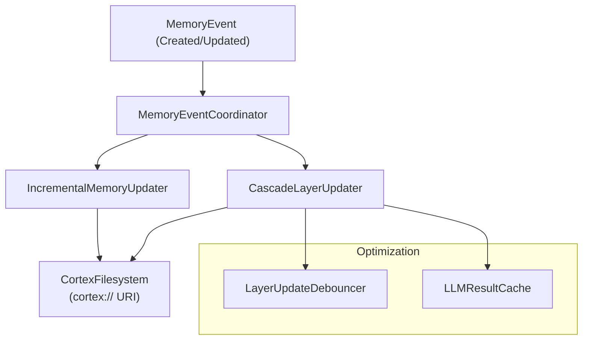

**Sources:** [cortex-mem-core/src/memory_event_coordinator.rs:62-89](), [README.md:109-114]()

**Implementation Details:**
The `MemoryEventCoordinator` listens for filesystem changes and triggers the `CascadeLayerUpdater`. To prevent "token storms," a `LayerUpdateDebouncer` batches requests for the same directory (default 30s delay) [cortex-mem-core/src/memory_event_coordinator.rs:6-12]().

---

### Memory Forgetting Mechanism

To prevent storage bloat and maintain relevance, the system implements an automated cleanup service based on the **Ebbinghaus Forgetting Curve**.

**Forgetting Logic:**
- **Access Tracking**: Every time a memory is retrieved via `VectorSearchEngine`, a `MemoryAccessed` event is emitted [cortex-mem-core/src/search/vector_engine.rs:63-64]().
- **Cleanup Service**: The `MemoryCleanupService` periodically scans memories. Low-strength memories (those not accessed frequently) are automatically archived or deleted [README.md:115-116]().
- **Archived Filtering**: The `VectorSearchEngine` uses `MemoryIndexManager` to filter out archived memories from search results, ensuring they don't surface to the LLM [cortex-mem-core/src/search/vector_engine.rs:139-199]().

---

## Storage and Retrieval Architecture

Cortex Memory implements a hybrid search system combining vector similarity with intent analysis and metadata filtering.

### Vector-Based Semantic Search

The `VectorSearchEngine` orchestrates the retrieval process. It supports standard semantic search and a specialized "layered" search that navigates the L0/L1/L2 hierarchy.

**Search Implementation Flow**

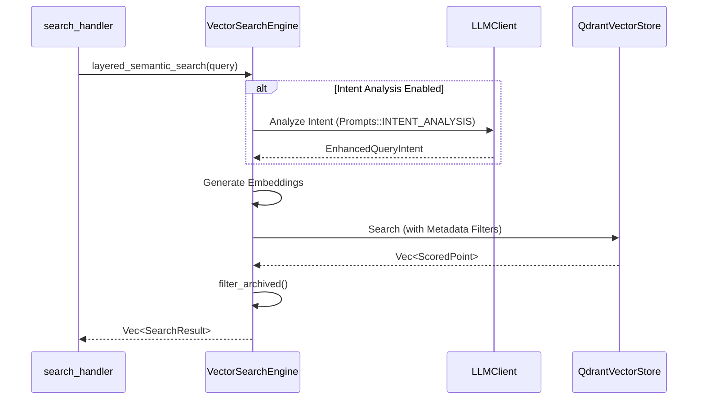

**Sources:** [cortex-mem-core/src/search/vector_engine.rs:57-132](), [cortex-mem-service/src/handlers/search.rs:39-107]()

**Intent Analysis:**
When `enable_intent_analysis` is true (default), the engine calls the LLM to rewrite the query and tune similarity thresholds before hitting the vector store [cortex-mem-core/src/search/vector_engine.rs:67-71](). This reduces search latency from ~20s to <500ms when disabled [cortex-mem-core/src/search/vector_engine.rs:112-113]().

---

### Multi-Tenancy and Isolation

The system achieves isolation through **Tenant-Aware Collection Naming** and the **Virtual Filesystem (VFS)**.

- **Qdrant Isolation**: If a `tenant_id` is provided in `QdrantConfig`, the collection name is suffixed (e.g., `cortex_mem_tenant123`) [cortex-mem-core/src/vector_store/qdrant.rs:34-48]().
- **Filesystem Isolation**: The `AppState` manages a `current_tenant_root` path. All `cortex://` URIs are resolved relative to this tenant-specific directory [cortex-mem-service/src/state.rs:29-31]().
- **Runtime Rebuilding**: On a tenant switch, the `CortexMem` runtime is rebuilt atomically to ensure no "split-brain" state between the vector store and filesystem [cortex-mem-service/src/state.rs:15-17]().

---

## Multi-Interface Access

Cortex Memory is designed as a "modular monolith," exposing its core through various specialized interfaces.

### Service Interfaces

| Interface | Component | Purpose |
|-----------|-----------|---------|
| **REST API** | `cortex-mem-service` | Standard integration for web apps and external services [cortex-mem-service/src/handlers/search.rs]() |
| **MCP Server** | `cortex-mem-mcp` | Direct tool usage for AI agents (Claude, Cursor) [README.md:108]() |
| **CLI** | `cortex-mem-cli` | Administrative tasks and manual memory management [README.md:108]() |
| **Web Dashboard** | `cortex-mem-insights` | Visual monitoring, tenant management, and search visualization [README_zh.md:132]() |
| **TUI App** | `cortex-mem-tars` | Multi-agent terminal chat application with persistent memory [README.md:44-54]() |

### Event-Driven Automation

The `AutomationManager` and `MemoryEventCoordinator` provide background synchronization that keeps the system consistent across interfaces.

**Automation Responsibilities:**
- **L2 Indexing**: `AutomationManager` listens for `MessageAdded` events and triggers `VectorSyncNeeded` [cortex-mem-core/src/automation/manager.rs:37-51]().
- **Session Extraction**: Triggered via `trigger_extraction` endpoint, which sends a `SessionClosed` event handled by the coordinator [cortex-mem-service/src/handlers/automation.rs:23-40]().
- **Full Reindexing**: `VectorSyncManager` can perform a full scan of the `cortex://` filesystem to recover missing vector indices [cortex-mem-service/src/handlers/automation.rs:72-85]().

**Sources:** [cortex-mem-core/src/automation/manager.rs](), [cortex-mem-service/src/handlers/automation.rs]()

---

## Performance and Optimization

### LLM Result Caching
To minimize API costs and latency, the system implements an `LLMResultCache` with **LRU (Least Recently Used)** eviction and **TTL (Time To Live)** expiration [README.md:113](). This is primarily used by the `CascadeLayerUpdater` to avoid re-summarizing unchanged memory blocks [cortex-mem-core/src/memory_event_coordinator.rs:142-153]().

### Search Reranking
The `search_layered` function in the service layer performs a multi-stage retrieval:
1. **Layered Search**: High-level context retrieval.
2. **Semantic Search**: Detailed fact retrieval.
3. **Lexical Fallback**: Keyword-based search when vector results are sparse [cortex-mem-service/src/handlers/search.rs:170-182]().
4. **User-Scope Supplement**: Specifically targets `cortex://user` to ensure personal facts (preferences, identity) are never missed [cortex-mem-service/src/handlers/search.rs:150-168]().

**Sources:** [cortex-mem-service/src/handlers/search.rs](), [cortex-mem-core/src/search/vector_engine.rs]()

---

# Page: Getting Started

# Getting Started

<details>
<summary>Relevant source files</summary>

The following files were used as context for generating this wiki page:

- [Cargo.toml](Cargo.toml)
- [README.md](README.md)
- [README_zh.md](README_zh.md)
- [cortex-mem-config/Cargo.toml](cortex-mem-config/Cargo.toml)
- [cortex-mem-core/Cargo.toml](cortex-mem-core/Cargo.toml)
- [cortex-mem-core/src/incremental_memory_updater.rs](cortex-mem-core/src/incremental_memory_updater.rs)
- [cortex-mem-core/src/llm/prompts.rs](cortex-mem-core/src/llm/prompts.rs)
- [cortex-mem-core/src/search/vector_engine.rs](cortex-mem-core/src/search/vector_engine.rs)
- [cortex-mem-mcp/Cargo.toml](cortex-mem-mcp/Cargo.toml)
- [cortex-mem-rig/Cargo.toml](cortex-mem-rig/Cargo.toml)
- [cortex-mem-service/Cargo.toml](cortex-mem-service/Cargo.toml)
- [cortex-mem-service/src/handlers/automation.rs](cortex-mem-service/src/handlers/automation.rs)
- [cortex-mem-service/src/handlers/search.rs](cortex-mem-service/src/handlers/search.rs)
- [cortex-mem-service/src/handlers/sessions.rs](cortex-mem-service/src/handlers/sessions.rs)
- [cortex-mem-service/src/routes/automation.rs](cortex-mem-service/src/routes/automation.rs)
- [cortex-mem-service/src/state.rs](cortex-mem-service/src/state.rs)
- [cortex-mem-tools/Cargo.toml](cortex-mem-tools/Cargo.toml)
- [examples/@memclaw/bin-darwin-arm64/bin/README.md](examples/@memclaw/bin-darwin-arm64/bin/README.md)
- [examples/cortex-mem-tars/config.example.toml](examples/cortex-mem-tars/config.example.toml)
- [examples/locomo-evaluation/eval.py](examples/locomo-evaluation/eval.py)

</details>


This guide provides a high-level overview of setting up and running the Cortex Memory system for the first time. It covers essential prerequisites, installation steps, configuration requirements, and initial verification. Built with Rust, Cortex Memory provides a hierarchical three-tier memory architecture (L0 Abstract → L1 Overview → L2 Detail) that automatically extracts and optimizes information for AI agents.

For detailed installation instructions, see [Installation](#2.1). For comprehensive configuration options, see [Configuration](#2.2). For hands-on usage examples, see [Quick Start Examples](#2.3).

## Prerequisites

Before installing Cortex Memory, ensure your development environment meets the following requirements:

| Component | Requirement | Purpose |
|-----------|-------------|---------|
| **Rust** | Version 1.86 or higher | Required for building (Edition 2024) [Cargo.toml:16-17]() |
| **Qdrant** | Running instance (ports 6333/6334) | Vector database for semantic search [examples/cortex-mem-tars/config.example.toml:11-12]() |
| **LLM API Key** | OpenAI compatible | Fact extraction, summarization, and embeddings [examples/cortex-mem-tars/config.example.toml:17-38]() |
| **Data Directory** | Write permissions | Storing `cortex://` virtual filesystem markdown files [README.md:105-106]() |

Sources: [Cargo.toml:16-17](), [examples/cortex-mem-tars/config.example.toml:11-38](), [README.md:105-106]()

## System Components Overview

The system is a modular monolith consisting of multiple crates. The central orchestrator is the `CortexMem` runtime, which coordinates the `SessionManager`, `VectorSearchEngine`, and `MemoryEventCoordinator`.

**Cortex Memory Component Architecture**

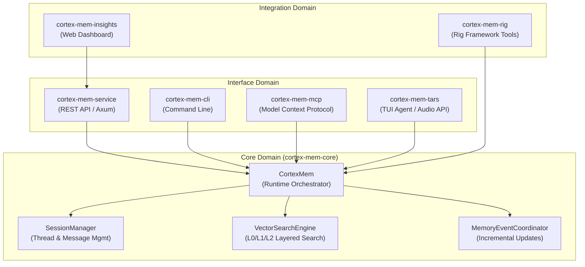

| Component | Type | Primary Role |
|-----------|------|--------------|
| `cortex-mem-core` | Library | Core logic, storage abstraction, and AI processing [Cargo.toml:4]() |
| `cortex-mem-service` | Binary | High-performance REST API for multi-tenant deployments [Cargo.toml:8]() |
| `cortex-mem-cli` | Binary | Administrative tool for manual memory management [Cargo.toml:9]() |
| `cortex-mem-tars` | App | Multi-agent TUI with persistent memory and audio support [Cargo.toml:11]() |

Sources: [Cargo.toml:4-11](), [cortex-mem-service/src/state.rs:15-35]()

## Installation Methods

Cortex Memory is typically built from source using Cargo to ensure all features are optimized for your environment.

**Installation Process and Verification**

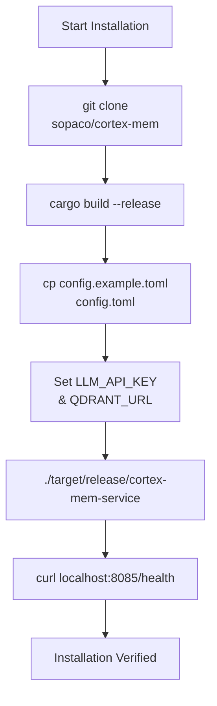

For specific installation commands and dependency setup for Qdrant, see [Installation](#2.1).

Sources: [README.md:323-334](), [examples/cortex-mem-tars/config.example.toml:1-43]()

## Configuration Structure

The system uses a hierarchical configuration approach. The `config.toml` file is the primary source, defining how the `CortexMemBuilder` assembles the runtime.

**Configuration Loading and Runtime Assembly**

```mermaid
graph LR
    subgraph "Configuration (cortex-mem-config)"
        TOML["config.toml"]
        ENV["Env Vars"]
    end

    subgraph "Runtime Builder"
        BUILDER["CortexMemBuilder"]
    end

    subgraph "Runtime (cortex-mem-core)"
        RT["CortexMem Instance"]
        LLM["LLMClient"]
        VStore["VectorStore"]
    end

    TOML --> BUILDER
    ENV --> BUILDER
    BUILDER -->|build()| RT
    RT --> LLM
    RT --> VStore
```

Key configuration sections include:
- `[qdrant]`: Connection details for the vector database [examples/cortex-mem-tars/config.example.toml:11-14]().
- `[llm]`: API base URL and keys for the reasoning engine [examples/cortex-mem-tars/config.example.toml:26-38]().
- `[embedding]`: Model selection for vector generation [examples/cortex-mem-tars/config.example.toml:17-23]().
- `[cortex]`: Global settings like `enable_intent_analysis` [cortex-mem-service/src/state.rs:34-35]().

For a full field reference, see [Configuration](#2.2).

Sources: [cortex-mem-service/src/state.rs:134-150](), [examples/cortex-mem-tars/config.example.toml:11-58]()

## First Steps & Verification

Once installed, you can verify the system by interacting with the `cortex-mem-service`.

### 1. Initialize the Runtime
The `AppState` in the service layer automatically bootstraps the vector store and ensures collections exist upon startup [cortex-mem-service/src/state.rs:67-68]().

### 2. Add a Memory
Memories are stored via the `SessionManager`. Adding a message to a session triggers the `MemoryEventCoordinator` to perform background extraction and L0/L1 layer generation [cortex-mem-service/src/handlers/sessions.rs:152-156]().

### 3. Search Memories
The `VectorSearchEngine` supports layered semantic search. It can optionally use an LLM for intent analysis to rewrite queries for better recall [cortex-mem-core/src/search/vector_engine.rs:109-116]().

```bash
# Example search request via curl
curl -X POST http://localhost:8085/memories/search \
  -H "Content-Type: application/json" \
  -d '{"query": "What did the user say about Rust?", "limit": 5}'
```

For detailed usage patterns and code snippets, see [Quick Start Examples](#2.3).

Sources: [cortex-mem-service/src/state.rs:67-68](), [cortex-mem-service/src/handlers/sessions.rs:152-156](), [cortex-mem-core/src/search/vector_engine.rs:109-116]()

---

# Page: Installation

# Installation

<details>
<summary>Relevant source files</summary>

The following files were used as context for generating this wiki page:

- [Cargo.toml](Cargo.toml)
- [README.md](README.md)
- [README_zh.md](README_zh.md)
- [cortex-mem-cli/README.md](cortex-mem-cli/README.md)
- [cortex-mem-cli/tests/cli_commands_test.rs](cortex-mem-cli/tests/cli_commands_test.rs)
- [cortex-mem-config/Cargo.toml](cortex-mem-config/Cargo.toml)
- [cortex-mem-config/README.md](cortex-mem-config/README.md)
- [cortex-mem-core/Cargo.toml](cortex-mem-core/Cargo.toml)
- [cortex-mem-core/README.md](cortex-mem-core/README.md)
- [cortex-mem-core/src/incremental_memory_updater.rs](cortex-mem-core/src/incremental_memory_updater.rs)
- [cortex-mem-core/src/llm/prompts.rs](cortex-mem-core/src/llm/prompts.rs)
- [cortex-mem-core/src/search/vector_engine.rs](cortex-mem-core/src/search/vector_engine.rs)
- [cortex-mem-mcp/Cargo.toml](cortex-mem-mcp/Cargo.toml)
- [cortex-mem-mcp/README.md](cortex-mem-mcp/README.md)
- [cortex-mem-rig/Cargo.toml](cortex-mem-rig/Cargo.toml)
- [cortex-mem-rig/README.md](cortex-mem-rig/README.md)
- [cortex-mem-service/Cargo.toml](cortex-mem-service/Cargo.toml)
- [cortex-mem-service/README.md](cortex-mem-service/README.md)
- [cortex-mem-service/src/handlers/automation.rs](cortex-mem-service/src/handlers/automation.rs)
- [cortex-mem-service/src/handlers/search.rs](cortex-mem-service/src/handlers/search.rs)
- [cortex-mem-service/src/handlers/sessions.rs](cortex-mem-service/src/handlers/sessions.rs)
- [cortex-mem-service/src/routes/automation.rs](cortex-mem-service/src/routes/automation.rs)
- [cortex-mem-service/src/state.rs](cortex-mem-service/src/state.rs)
- [cortex-mem-tools/Cargo.toml](cortex-mem-tools/Cargo.toml)
- [cortex-mem-tools/README.md](cortex-mem-tools/README.md)
- [examples/@memclaw/bin-darwin-arm64/bin/README.md](examples/@memclaw/bin-darwin-arm64/bin/README.md)
- [examples/cortex-mem-tars/README.md](examples/cortex-mem-tars/README.md)
- [examples/cortex-mem-tars/config.example.toml](examples/cortex-mem-tars/config.example.toml)
- [examples/locomo-evaluation/eval.py](examples/locomo-evaluation/eval.py)

</details>


## Purpose and Scope

This page provides technical instructions for installing the Cortex Memory framework, including all crates, applications, and their required dependencies. It covers the setup of the Rust toolchain, the Qdrant vector database, LLM API configurations, and the installation of the core ecosystem components: `cortex-mem-core`, `cortex-mem-service`, `cortex-mem-mcp`, `cortex-mem-cli`, and the `cortex-mem-tars` TUI application.

---

## Prerequisites

Cortex Memory is built with high-performance Rust and requires specific infrastructure for semantic search and AI processing.

| Requirement | Minimum Version | Purpose |
|------------|-----------------|---------|
| **Rust** | 1.86+ | Compilation and runtime [Cargo.toml:17]() |
| **Qdrant** | 1.7+ | Vector database for semantic search [README.md:107]() |
| **LLM API** | OpenAI Compatible | Fact extraction, analysis, and embeddings [README.md:161]() |

### System Dependency Mapping

The following diagram bridges the high-level system components to the specific code entities and external dependencies.

**Diagram: Natural Language to Code Entity Space (Infrastructure)**

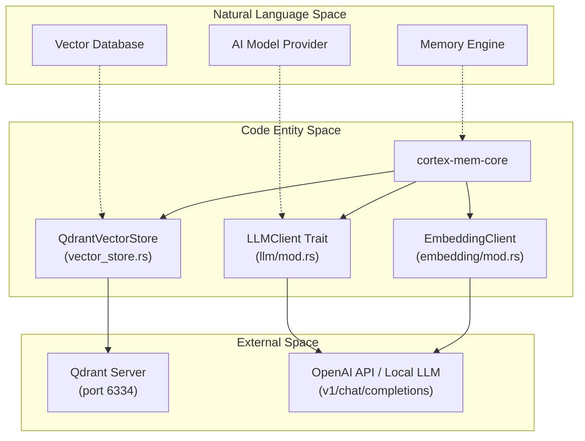

**Sources:** [README.md:148-184](), [cortex-mem-core/src/search/vector_engine.rs:57-71]()

---

## External Dependency Setup

### 1. Qdrant Vector Database
Cortex Memory uses Qdrant for high-performance similarity search. The `QdrantVectorStore` implementation interacts with Qdrant via gRPC.

**Docker Installation (Recommended):**
```bash
docker run -p 6333:6333 -p 6334:6334 \
    -v $(pwd)/qdrant_storage:/qdrant/storage \
    qdrant/qdrant
```
*   **Port 6333:** HTTP API (Dashboard)
*   **Port 6334:** gRPC API (Used by `cortex-mem-core`) [examples/cortex-mem-tars/config.example.toml:90]()

### 2. LLM and Embedding API
You must have access to an OpenAI-compatible API (OpenAI, Azure, or local providers like Ollama/vLLM).

**Required Environment Variables:**
```bash
export OPENAI_API_KEY="sk-..."
export LLM_API_BASE_URL="https://api.openai.com/v1"
```

---

## Installing Cortex Memory Components

The project is structured as a Cargo workspace containing multiple specialized crates.

### 1. Build from Source
To install all applications, clone the repository and build the release binaries.

```bash
git clone https://github.com/sopaco/cortex-mem.git
cd cortex-mem
cargo build --release
```

**Binary Locations after build:**
*   `target/release/cortex-mem-service`: The HTTP REST API server.
*   `target/release/cortex-mem-mcp`: The Model Context Protocol server.
*   `target/release/cortex-mem-cli`: The command-line management tool.
*   `target/release/cortex-mem-tars`: The interactive TUI assistant.

### 2. Component Installation Details

#### HTTP Service (`cortex-mem-service`)
The service provides a RESTful interface for memory operations. It uses `axum` for routing and maintains a shared `AppState`.

**Installation:**
```bash
cargo install --path cortex-mem-service
```
**Data Flow:**
1.  Requests hit `axum` handlers (e.g., `search` in `handlers/search.rs`).
2.  Handlers access `AppState.cortex` (an `Arc<CortexMem>`). [cortex-mem-service/src/state.rs:17]()
3.  `CortexMem` coordinates with `VectorSearchEngine` and `SessionManager`. [cortex-mem-service/src/state.rs:71-75]()

#### MCP Server (`cortex-mem-mcp`)
Enables AI agents (like Claude Desktop) to use Cortex Memory as a tool via the Model Context Protocol.

**Installation:**
```bash
cargo install --path cortex-mem-mcp
```
**Key Functions:**
*   `store_memory`: Persists conversation snippets. [cortex-mem-mcp/README.md:18]()
*   `query_memory`: Performs layered L0/L1/L2 search. [cortex-mem-mcp/README.md:52]()

#### TARS TUI (`cortex-mem-tars`)
A terminal-based interactive agent with audio support.

**System Dependencies (Linux only):**
```bash
sudo apt-get install libasound2-dev libxcb-shape0-dev libxcb-xfixes0-dev
```
**Installation:**
```bash
cd examples/cortex-mem-tars
cargo build --release
```
**Sources:** [examples/cortex-mem-tars/README.md:50-69]()

---

## Implementation & Data Flow

The installation process sets up a "Modular Monolith" where `cortex-mem-core` acts as the engine for all interfaces.

**Diagram: Code Entity Interaction & Data Flow**

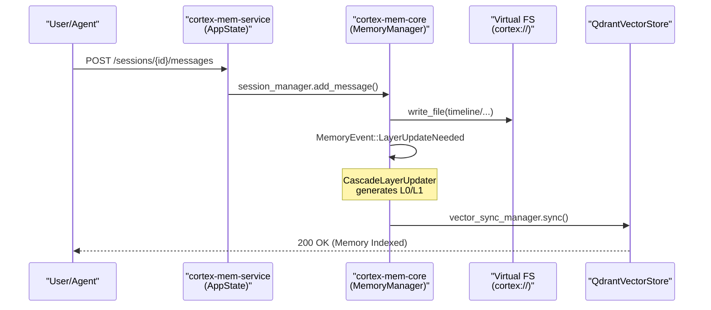

**Sources:** [cortex-mem-service/src/handlers/sessions.rs:152-192](), [cortex-mem-core/src/search/vector_engine.rs:118-122]()

---

## Verification

After installation, verify the setup by running the service and checking the health endpoint.

### 1. Initialize Configuration
Create a `config.toml` in your working directory based on the provided template. [examples/cortex-mem-tars/config.example.toml]()

### 2. Start the Service
```bash
cortex-mem-service --config config.toml
```

### 3. Verify Vector Store Connectivity
The service will log successful initialization of the `MemoryEventCoordinator` and vector store.
```text
INFO Initializing Cortex Memory with unified automation...
INFO ✅ Cortex Memory initialized with MemoryEventCoordinator
```
**Sources:** [cortex-mem-service/src/state.rs:48-69]()

### 4. Test Search Latency
If LLM intent analysis is enabled, search may take several seconds. To optimize for low-latency installation, verify the `enable_intent_analysis` flag in `config.toml`. [cortex-mem-core/src/search/vector_engine.rs:109-116]()

---

## Troubleshooting

*   **Missing LLM Config:** If the service fails to start, ensure `LLM_API_KEY` is set. [cortex-mem-service/src/handlers/automation.rs:28-34]()
*   **Port Conflicts:** `cortex-mem-service` defaults to port 8080. `cortex-mem-tars` API defaults to 8085. [examples/cortex-mem-tars/config.example.toml:113]()
*   **Vector Sync Issues:** Use the `/automation/reindex` endpoint to force a full sync of the `cortex://` filesystem to Qdrant. [cortex-mem-service/src/handlers/automation.rs:56-98]()

**Sources:** [cortex-mem-service/src/state.rs](), [cortex-mem-core/src/search/vector_engine.rs](), [README.md]()

---

# Page: Configuration

# Configuration

<details>
<summary>Relevant source files</summary>

The following files were used as context for generating this wiki page:

- [cortex-mem-cli/README.md](cortex-mem-cli/README.md)
- [cortex-mem-cli/src/main.rs](cortex-mem-cli/src/main.rs)
- [cortex-mem-cli/tests/cli_commands_test.rs](cortex-mem-cli/tests/cli_commands_test.rs)
- [cortex-mem-config/README.md](cortex-mem-config/README.md)
- [cortex-mem-config/src/lib.rs](cortex-mem-config/src/lib.rs)
- [cortex-mem-core/README.md](cortex-mem-core/README.md)
- [cortex-mem-core/src/config.rs](cortex-mem-core/src/config.rs)
- [cortex-mem-mcp/README.md](cortex-mem-mcp/README.md)
- [cortex-mem-rig/README.md](cortex-mem-rig/README.md)
- [cortex-mem-rig/src/lib.rs](cortex-mem-rig/src/lib.rs)
- [cortex-mem-service/README.md](cortex-mem-service/README.md)
- [cortex-mem-tools/README.md](cortex-mem-tools/README.md)
- [examples/cortex-mem-tars/README.md](examples/cortex-mem-tars/README.md)
- [examples/cortex-mem-tars/src/config.rs](examples/cortex-mem-tars/src/config.rs)
- [examples/cortex-mem-tars/src/infrastructure.rs](examples/cortex-mem-tars/src/infrastructure.rs)

</details>


## Purpose and Scope

This document describes the configuration system in Cortex Memory, covering the structure of `config.toml`, configuration loading mechanisms, validation, and auto-detection features. Configuration is the foundational layer that initializes all system components including the vector database connection, LLM integration, memory management policies, and service endpoints.

Cortex Memory employs a unified configuration structure across its ecosystem (Core, CLI, MCP, and TARS), allowing for shared settings while supporting application-specific overrides.

**Sources:** [cortex-mem-config/src/lib.rs:5-14](), [cortex-mem-core/README.md:47-80]()

---

## Configuration File Format

Cortex Memory uses TOML (Tom's Obvious, Minimal Language) for configuration. The main configuration file is typically named `config.toml` and contains multiple sections corresponding to different subsystems.

**Sources:** [cortex-mem-config/src/lib.rs:128-135](), [cortex-mem-cli/src/main.rs:17-19]()

---

## Configuration Structure

The configuration system is built around a hierarchical `Config` struct defined in the `cortex-mem-config` crate.

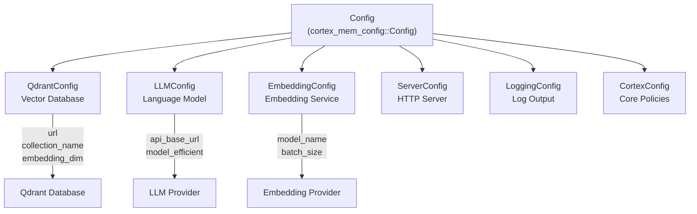

**Title:** Configuration Entity Mapping

**Sources:** [cortex-mem-config/src/lib.rs:5-14](), [examples/cortex-mem-tars/src/config.rs:88-114]()

---

## Configuration Sections

### Qdrant Configuration (`[qdrant]`)

Configures the connection to the Qdrant vector database.

| Field | Type | Required | Default | Description |
|-------|------|----------|---------|-------------|
| `url` | String | Yes | - | Qdrant server URL (e.g., `http://localhost:6334`) |
| `collection_name` | String | Yes | - | Collection name for memory vectors |
| `embedding_dim` | Integer | No | None | Dimension of vectors (e.g., 1536) |
| `timeout_secs` | Integer | No | 30 | Request timeout in seconds |
| `api_key` | String | No | None | Optional API key for Qdrant Cloud/Auth |

**Sources:** [cortex-mem-config/src/lib.rs:67-75](), [examples/cortex-mem-tars/src/config.rs:89-95]()

### LLM Configuration (`[llm]`)

Configures the Large Language Model service used for fact extraction and intent analysis.

| Field | Type | Required | Default | Description |
|-------|------|----------|---------|-------------|
| `api_base_url` | String | Yes | - | LLM service API endpoint |
| `api_key` | String | Yes | - | Authentication key |
| `model_efficient` | String | Yes | - | Model ID for extraction (e.g., `gpt-4o-mini`) |
| `temperature` | Float | No | 0.7 | Sampling temperature |
| `max_tokens` | Integer | No | 2000 | Maximum tokens per request |

**Sources:** [cortex-mem-config/src/lib.rs:103-110](), [cortex-mem-cli/src/main.rs:241-247]()

### Embedding Configuration (`[embedding]`)

Configures the embedding generation service for vector search.

| Field | Type | Required | Default | Description |
|-------|------|----------|---------|-------------|
| `api_base_url` | String | No | OpenAI V1 | API endpoint for embeddings |
| `api_key` | Yes | - | Authentication key |
| `model_name` | No | text-embedding-3-small | Embedding model identifier |
| `batch_size` | No | 10 | Texts per batch request |
| `timeout_secs` | No | 30 | Request timeout |

**Sources:** [cortex-mem-config/src/lib.rs:78-100]()

### Cortex Core Configuration (`[cortex]`)

Defines data storage and processing behavior.

| Field | Type | Required | Default | Description |
|-------|------|----------|---------|-------------|
| `data_dir` | String | No | See Hierarchy | Root directory for memory files |
| `enable_intent_analysis` | Boolean | No | true | Enable LLM-based query rewriting |

**Sources:** [cortex-mem-config/src/lib.rs:17-39]()

---

## Configuration Hierarchy and Data Directory Detection

Cortex Memory uses a multi-level hierarchy to determine the effective `data_dir` (where `cortex://` files are stored) and configuration values.

### Data Directory Priority

The `data_dir` is resolved using the following priority (highest to lowest):

1.  **Environment Variable**: `CORTEX_DATA_DIR` [cortex-mem-config/src/lib.rs:60-63]()
2.  **Explicit Config**: The `data_dir` field in `config.toml` [cortex-mem-config/src/lib.rs:49-53]()
3.  **Application Default**:
    *   **CLI**: Directory containing the `config.toml` file [cortex-mem-cli/src/main.rs:212-227]()
    *   **TARS**: System-specific application data directory (e.g., `~/Library/Application Support/com.cortex-mem.tars`) [examples/cortex-mem-tars/src/config.rs:44-48]()

### Loading Logic

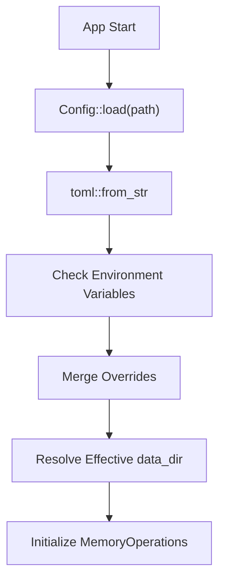

**Title:** Configuration Resolution Flow

**Sources:** [cortex-mem-config/src/lib.rs:129-135](), [cortex-mem-cli/src/main.rs:198-228](), [examples/cortex-mem-tars/src/config.rs:66-85]()

---

## Auto-Detection and Management Features

### TARS Auto-Configuration

The TARS application includes a `ConfigManager` that automatically generates a default `config.toml` if one is not found in the system application data directory. It also ensures the `data_dir` is explicitly set to the application data path to maintain consistency between the UI and the core library.

**Sources:** [examples/cortex-mem-tars/src/config.rs:86-119]()

### Bot Configuration (`bots.json`)

Specifically for the TARS application, bot profiles are managed in a separate `bots.json` file. This allows for multi-agent isolation where each bot can have its own `agent_id` (used as a tenant ID in the core system).

| Field | Description |
|-------|-------------|
| `id` | Unique UUID for the bot |
| `name` | Display name in the TUI |
| `system_prompt` | The personality/instructions for the agent |
| `access_password` | Optional protection for the bot profile |

**Sources:** [examples/cortex-mem-tars/src/config.rs:9-16](), [examples/cortex-mem-tars/src/config.rs:55-58]()

---

## Technical Implementation Details

### Key Classes

*   **`cortex_mem_config::Config`**: The primary data structure for parsing and holding settings [cortex-mem-config/src/lib.rs:7-14]().
*   **`cortex_mem_tars::ConfigManager`**: Orchestrates configuration for the TUI, handling both the core `config.toml` and the TARS-specific `bots.json` [examples/cortex-mem-tars/src/config.rs:35-39]().
*   **`cortex_mem_tools::MemoryOperations`**: The consumer of these configurations, initialized with resolved URLs, keys, and paths [cortex-mem-tools/README.md:87-98]().

### LLM Intent Analysis Toggle

The `enable_intent_analysis` flag in `CortexConfig` significantly impacts performance. When `true`, vector search includes an LLM call for query rewriting (~15-25s latency). When `false`, it uses raw query vectors (< 500ms latency).

**Sources:** [cortex-mem-config/src/lib.rs:24-38]()

---

## Configuration Example

```toml
[qdrant]
url = "http://localhost:6334"
collection_name = "cortex_mem"
embedding_dim = 1536
timeout_secs = 30

[embedding]
api_base_url = "https://api.openai.com/v1"
api_key = "sk-..."
model_name = "text-embedding-3-small"

[llm]
api_base_url = "https://api.openai.com/v1"
api_key = "sk-..."
model_efficient = "gpt-4o-mini"
temperature = 0.1
max_tokens = 4096

[cortex]
data_dir = "./my-memories"
enable_intent_analysis = false
```

**Sources:** [examples/cortex-mem-tars/README.md:87-133](), [cortex-mem-cli/README.md:225-248]()

---

# Page: Quick Start Examples

# Quick Start Examples

<details>
<summary>Relevant source files</summary>

The following files were used as context for generating this wiki page:

- [README.md](README.md)
- [README_zh.md](README_zh.md)
- [cortex-mem-cli/Cargo.toml](cortex-mem-cli/Cargo.toml)
- [cortex-mem-cli/README.md](cortex-mem-cli/README.md)
- [cortex-mem-cli/src/commands/add.rs](cortex-mem-cli/src/commands/add.rs)
- [cortex-mem-cli/src/commands/delete.rs](cortex-mem-cli/src/commands/delete.rs)
- [cortex-mem-cli/src/commands/get.rs](cortex-mem-cli/src/commands/get.rs)
- [cortex-mem-cli/src/commands/layers.rs](cortex-mem-cli/src/commands/layers.rs)
- [cortex-mem-cli/src/commands/list.rs](cortex-mem-cli/src/commands/list.rs)
- [cortex-mem-cli/src/commands/mod.rs](cortex-mem-cli/src/commands/mod.rs)
- [cortex-mem-cli/src/commands/search.rs](cortex-mem-cli/src/commands/search.rs)
- [cortex-mem-cli/src/commands/session.rs](cortex-mem-cli/src/commands/session.rs)
- [cortex-mem-cli/src/commands/tenant.rs](cortex-mem-cli/src/commands/tenant.rs)
- [cortex-mem-cli/tests/cli_commands_test.rs](cortex-mem-cli/tests/cli_commands_test.rs)
- [cortex-mem-config/README.md](cortex-mem-config/README.md)
- [cortex-mem-core/README.md](cortex-mem-core/README.md)
- [cortex-mem-core/src/incremental_memory_updater.rs](cortex-mem-core/src/incremental_memory_updater.rs)
- [cortex-mem-core/src/llm/prompts.rs](cortex-mem-core/src/llm/prompts.rs)
- [cortex-mem-core/src/search/vector_engine.rs](cortex-mem-core/src/search/vector_engine.rs)
- [cortex-mem-mcp/README.md](cortex-mem-mcp/README.md)
- [cortex-mem-rig/README.md](cortex-mem-rig/README.md)
- [cortex-mem-service/README.md](cortex-mem-service/README.md)
- [cortex-mem-service/src/handlers/automation.rs](cortex-mem-service/src/handlers/automation.rs)
- [cortex-mem-service/src/handlers/search.rs](cortex-mem-service/src/handlers/search.rs)
- [cortex-mem-service/src/handlers/sessions.rs](cortex-mem-service/src/handlers/sessions.rs)
- [cortex-mem-service/src/routes/automation.rs](cortex-mem-service/src/routes/automation.rs)
- [cortex-mem-service/src/state.rs](cortex-mem-service/src/state.rs)
- [cortex-mem-tools/README.md](cortex-mem-tools/README.md)
- [examples/@memclaw/bin-darwin-arm64/bin/README.md](examples/@memclaw/bin-darwin-arm64/bin/README.md)
- [examples/cortex-mem-tars/README.md](examples/cortex-mem-tars/README.md)
- [examples/locomo-evaluation/eval.py](examples/locomo-evaluation/eval.py)

</details>


This page provides practical, working examples for storing, searching, and managing memories using the Cortex Memory system. It covers multiple interfaces: the Rust programmatic API (`cortex-mem-core`), the Command Line Interface (`cortex-mem-cli`), the HTTP REST API (`cortex-mem-service`), and AI agent protocols (MCP).

**Prerequisites:** Ensure you have a running Qdrant instance (default port 6334) and have configured your LLM/Embedding API keys in `config.toml`.

---

## Interface Overview

The Cortex Memory framework is designed as a modular monolith where multiple interfaces consume a shared core.

Title: Cortex Memory Interface Architecture
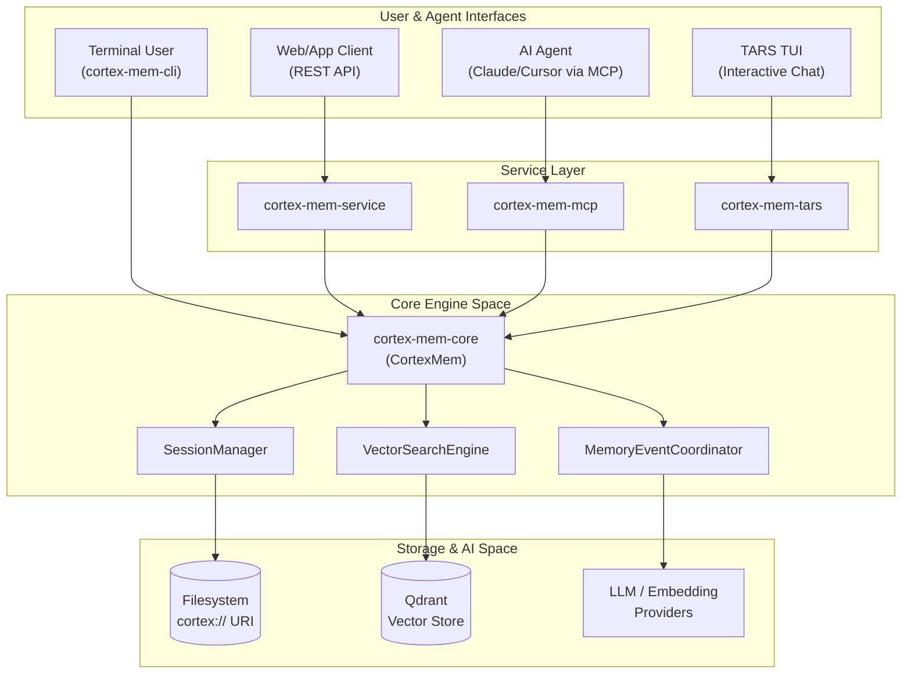
Sources: [README.md:138-184](), [cortex-mem-service/src/state.rs:15-41](), [cortex-mem-mcp/README.md:1-15]()

---

## Command Line Interface (CLI)

The `cortex-mem-cli` is the fastest way to interact with the system for debugging or manual memory management.

### Common Commands
| Action | Command | Description |
| :--- | :--- | :--- |
| **Create Session** | `cortex-mem session create my-thread` | Initializes a new conversation thread [cortex-mem-cli/README.md:31-31]() |
| **Add Message** | `cortex-mem add -t my-thread "User likes Rust"` | Stores a message in the session timeline [cortex-mem-cli/README.md:34-34]() |
| **Search** | `cortex-mem search "programming preferences"` | Semantic search across all memories [cortex-mem-cli/README.md:37-37]() |
| **Close Session** | `cortex-mem session close my-thread` | Triggers LLM fact extraction and L0/L1 generation [cortex-mem-cli/README.md:157-160]() |

### Example: Storing and Extracting a Fact
```bash
# 1. Start a session
cortex-mem session create research-session --title "AI Research"

# 2. Add context
cortex-mem add -t research-session "We are investigating vector databases like Qdrant."

# 3. Finalize and extract memories
# This triggers the MemoryEventCoordinator to run LLM extraction
cortex-mem session close research-session
```
Sources: [cortex-mem-cli/README.md:152-167]()

---

## HTTP API Usage

The `cortex-mem-service` provides a RESTful interface for web applications. It uses `axum` handlers to interact with the `CortexMem` runtime.

### Storing a Message
**Endpoint:** `POST /sessions/:thread_id/messages`
```bash
curl -X POST http://localhost:3000/sessions/dev-chat/messages \
  -H "Content-Type: application/json" \
  -d '{
    "role": "user",
    "content": "I prefer using dark mode in my IDE."
  }'
```
This call invokes `add_message` in `cortex-mem-service/src/handlers/sessions.rs`, which emits a `LayerUpdateNeeded` event to the `MemoryEventCoordinator` [cortex-mem-service/src/handlers/sessions.rs:123-193]().

### Semantic Search
**Endpoint:** `POST /search`
```bash
curl -X POST http://localhost:3000/search \
  -H "Content-Type: application/json" \
  -d '{
    "query": "What are the user IDE preferences?",
    "limit": 5,
    "min_score": 0.7
  }'
```
The service uses a multi-stage search pipeline:
1. **Intent Analysis**: LLM rewrites the query for better recall [cortex-mem-service/src/handlers/search.rs:79-79]().
2. **Layered Search**: Queries L0 (Abstract), L1 (Overview), and L2 (Detail) vectors [cortex-mem-service/src/handlers/search.rs:81-84]().
3. **Lexical Fallback**: If vector search yields few results, it performs a keyword search on the filesystem [cortex-mem-service/src/handlers/search.rs:172-182]().

Sources: [cortex-mem-service/src/handlers/sessions.rs:123-167](), [cortex-mem-service/src/handlers/search.rs:17-107]()

---

## Using with an AI Agent (MCP)

The Model Context Protocol (MCP) allows agents like Claude or Cursor to use Cortex Memory as a toolset.

Title: MCP Tool Data Flow
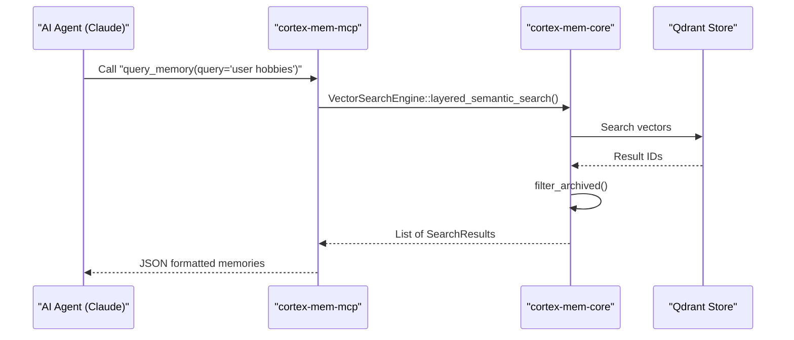
Sources: [cortex-mem-mcp/README.md:52-100](), [cortex-mem-core/src/search/vector_engine.rs:139-199]()

### Agent Tool Examples
Agents can autonomously call these tools:
- **`store_memory`**: Used by the agent to "remember" a fact during a conversation [cortex-mem-mcp/README.md:18-30]().
- **`get_abstract`**: Used to quickly scan the L0 layer (~100 tokens) to see if a session is relevant before reading the full content [cortex-mem-mcp/README.md:215-224]().
- **`query_memory`**: Performs semantic search across `user`, `agent`, or `session` scopes [cortex-mem-mcp/README.md:52-73]().

---

## Programmatic Rust Example

For developers building directly on the core library, the `CortexMem` struct is the entry point.

```rust
use cortex_mem_core::{CortexMemBuilder, MessageRole};
use std::path::Path;

#[tokio::main]
async fn main() -> anyhow::Result<()> {
    // 1. Initialize the runtime
    let cortex = CortexMemBuilder::new(Path::new("./data"))
        .with_qdrant(qdrant_config)
        .with_llm(llm_client)
        .build()
        .await?;

    let session_mgr = cortex.session_manager();
    let session_mgr = session_mgr.read().await;

    // 2. Store a memory in a session
    session_mgr.add_message(
        "session-123", 
        MessageRole::User, 
        "Remind me to check the Qdrant logs tomorrow."
    ).await?;

    // 3. Search memories via the VectorSearchEngine
    let engine = cortex.vector_engine().unwrap();
    let results = engine.semantic_search("What should I check tomorrow?", &default_options).await?;
    
    Ok(())
}
```
Sources: [cortex-mem-service/src/state.rs:128-152](), [cortex-mem-core/src/search/vector_engine.rs:73-107]()

---

## Summary of Memory Layers

When using the `search` or `get` commands, you can specify which layer of detail you need. This is critical for managing LLM context windows.

| Layer | Code Entity | Token Size | Best For |
| :--- | :--- | :--- | :--- |
| **L0 (Abstract)** | `.abstract.md` | ~100 | Relevance filtering [cortex-mem-core/src/llm/prompts.rs:5-8]() |
| **L1 (Overview)** | `.overview.md` | ~500-2000 | Decision making & planning [cortex-mem-core/src/llm/prompts.rs:34-37]() |
| **L2 (Full)** | `.md` (Original) | Varies | Deep analysis & extraction [README.md:109-109]() |

Sources: [cortex-mem-core/src/llm/prompts.rs:5-87](), [README.md:200-206]()

---

# Page: Core Architecture

# Core Architecture

<details>
<summary>Relevant source files</summary>

The following files were used as context for generating this wiki page:

- [README.md](README.md)
- [README_zh.md](README_zh.md)
- [cortex-mem-core/src/automation/indexer.rs](cortex-mem-core/src/automation/indexer.rs)
- [cortex-mem-core/src/automation/layer_generator.rs](cortex-mem-core/src/automation/layer_generator.rs)
- [cortex-mem-core/src/automation/manager.rs](cortex-mem-core/src/automation/manager.rs)
- [cortex-mem-core/src/automation/mod.rs](cortex-mem-core/src/automation/mod.rs)
- [cortex-mem-core/src/automation/sync.rs](cortex-mem-core/src/automation/sync.rs)
- [cortex-mem-core/src/cascade_layer_updater.rs](cortex-mem-core/src/cascade_layer_updater.rs)
- [cortex-mem-core/src/incremental_memory_updater.rs](cortex-mem-core/src/incremental_memory_updater.rs)
- [cortex-mem-core/src/layers/generator.rs](cortex-mem-core/src/layers/generator.rs)
- [cortex-mem-core/src/layers/manager.rs](cortex-mem-core/src/layers/manager.rs)
- [cortex-mem-core/src/llm/client.rs](cortex-mem-core/src/llm/client.rs)
- [cortex-mem-core/src/llm/prompts.rs](cortex-mem-core/src/llm/prompts.rs)
- [cortex-mem-core/src/memory_event_coordinator.rs](cortex-mem-core/src/memory_event_coordinator.rs)
- [cortex-mem-core/src/search/vector_engine.rs](cortex-mem-core/src/search/vector_engine.rs)
- [cortex-mem-core/src/session/extraction.rs](cortex-mem-core/src/session/extraction.rs)
- [cortex-mem-core/src/session/message.rs](cortex-mem-core/src/session/message.rs)
- [cortex-mem-core/src/types.rs](cortex-mem-core/src/types.rs)
- [cortex-mem-core/src/vector_store/qdrant.rs](cortex-mem-core/src/vector_store/qdrant.rs)
- [cortex-mem-service/src/handlers/automation.rs](cortex-mem-service/src/handlers/automation.rs)
- [cortex-mem-service/src/handlers/search.rs](cortex-mem-service/src/handlers/search.rs)
- [cortex-mem-service/src/handlers/sessions.rs](cortex-mem-service/src/handlers/sessions.rs)
- [cortex-mem-service/src/routes/automation.rs](cortex-mem-service/src/routes/automation.rs)
- [cortex-mem-service/src/state.rs](cortex-mem-service/src/state.rs)
- [examples/@memclaw/bin-darwin-arm64/bin/README.md](examples/@memclaw/bin-darwin-arm64/bin/README.md)
- [examples/locomo-evaluation/eval.py](examples/locomo-evaluation/eval.py)

</details>


This page provides a deep dive into the `cortex-mem-core` library, the foundational memory management engine of the Cortex Memory system. It explains the memory processing pipeline, AI-powered intelligence modules, and the hybrid storage architecture that combines a virtual filesystem with vector-based semantic search.

For information about how interfaces interact with the core, see [Service Interfaces](#4). For details on the central orchestrator, see [Memory Manager](#3.1).

## Overview

The `cortex-mem-core` library implements a modular architecture centered around the `MemoryManager` and the `MemoryEventCoordinator`. The system follows a **modular monolith** pattern, separating concerns between intelligence (fact extraction, layered generation), infrastructure (LLM clients, vector stores), and orchestration.

### Core Architecture Diagram

This diagram bridges the conceptual "Natural Language Space" of user interactions to the "Code Entity Space" within `cortex-mem-core`.

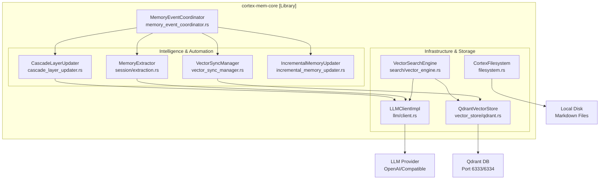

**Sources:** [cortex-mem-core/src/memory_event_coordinator.rs:62-89](), [cortex-mem-core/src/search/vector_engine.rs:57-71](), [cortex-mem-core/src/session/extraction.rs:143-151](), [README_zh.md:138-184]()

### Component Responsibilities

| Component | File Path | Primary Responsibility |
|-----------|-----------|----------------------|
| `MemoryEventCoordinator` | `memory_event_coordinator.rs` | Central hub for all memory operations; orchestrates events between extraction, indexing, and layer updates. |
| `MemoryExtractor` | `session/extraction.rs` | Converts unstructured conversations into structured facts (preferences, entities, events) using LLMs. |
| `CascadeLayerUpdater` | `cascade_layer_updater.rs` | Manages the L0/L1/L2 hierarchy; generates summaries for directories and files. |
| `VectorSearchEngine` | `search/vector_engine.rs` | Handles layered semantic search, intent analysis, and result re-ranking. |
| `VectorSyncManager` | `vector_sync_manager.rs` | Ensures the vector database (Qdrant) stays in sync with the filesystem-based memories. |
| `CortexFilesystem` | `filesystem.rs` | Manages the `cortex://` URI scheme and physical storage of memories as Markdown. |

**Sources:** [cortex-mem-core/src/memory_event_coordinator.rs:55-61](), [cortex-mem-core/src/search/vector_engine.rs:57-71](), [cortex-mem-core/src/session/extraction.rs:1-7]()

## Memory Manager & Event Coordination

The `MemoryManager` (and the lower-level `MemoryEventCoordinator`) acts as the central orchestrator. It listens for `MemoryEvent` signals—such as `MemoryCreated`, `SessionClosed`, or `LayerUpdateNeeded`—to trigger background processing.

### Event-Driven Pipeline

When a session is closed or a message is added, the following flow occurs:

1. **Event Dispatch**: A `SessionClosed` event is sent to the `MemoryEventCoordinator` [cortex-mem-service/src/handlers/automation.rs:36-40]().
2. **Extraction**: `MemoryExtractor` uses an LLM to pull facts and entities from the conversation [cortex-mem-core/src/session/extraction.rs:170-185]().
3. **Layer Update**: `CascadeLayerUpdater` updates the L1 (Overview) and L0 (Abstract) layers for the affected directory [cortex-mem-core/src/memory_event_coordinator.rs:148-153]().
4. **Vector Sync**: `VectorSyncManager` generates embeddings and upserts the new data into Qdrant [cortex-mem-core/src/vector_sync_manager.rs:24-28]().

For details on orchestration, see [Memory Manager](#3.1).

**Sources:** [cortex-mem-core/src/memory_event_coordinator.rs:91-198](), [cortex-mem-service/src/handlers/automation.rs:23-50]()

## Hybrid Storage: Filesystem & Vector Store

Cortex Memory uses a unique hybrid storage approach. All "truth" is stored as Markdown files on a filesystem using the `cortex://` URI scheme, while a vector database provides fast semantic indexing.

### The `cortex://` URI Scheme
The system organizes data into dimensions:
- `cortex://session/{id}`: Conversation history and timelines.
- `cortex://user/{id}`: Preferences, entities, and personal facts.
- `cortex://agent/{id}`: Skills and case studies.

### Vector Store Integration
The `VectorStore` trait abstracts the underlying database. The primary implementation is `QdrantVectorStore`, which handles:
- **Tenant Isolation**: Collection names are suffixed with `_{tenant_id}` to ensure data separation [cortex-mem-core/src/vector_store/qdrant.rs:34-36]().
- **Automatic Schema Management**: The store can auto-detect embedding dimensions and create collections at runtime [cortex-mem-core/src/vector_store/qdrant.rs:109-114]().

For details, see [Vector Store Integration](#3.2).

**Sources:** [README.md:37-54](), [cortex-mem-core/src/vector_store/qdrant.rs:22-62]()

## AI Processing & Search Engine

The intelligence of the system is powered by the `LLMClient` and the `VectorSearchEngine`.

### Layered Semantic Search
The `VectorSearchEngine` performs "Layered Search," which optimizes context window usage by retrieving data across three tiers:
- **L0 (Abstract)**: Broad summaries for quick orientation.
- **L1 (Overview)**: Mid-level directory summaries.
- **L2 (Detail)**: Raw memory content or message history.

### Intent Analysis
Before performing a search, the engine can optionally use an LLM to perform **Intent Analysis** [cortex-mem-core/src/search/vector_engine.rs:67-70](). This rewrites the user's raw query into a more effective search string and determines if specific filters (like time constraints) should be applied.

For details, see [LLM Client & AI Processing](#3.3).

**Sources:** [cortex-mem-core/src/search/vector_engine.rs:81-116](), [README_zh.md:200-210]()

## Memory Operations & Automation

Cortex Memory is designed to be "hands-off" for the developer. Automation is baked into the core via the `AutomationManager` and the `MemoryCleanupService`.

### Automation Features
- **Incremental Updates**: The `IncrementalMemoryUpdater` keeps L0/L1 layers in sync as memories change, avoiding full re-summarization [cortex-mem-core/src/memory_event_coordinator.rs:114-115]().
- **Debouncing**: To save on API costs, the `LayerUpdateDebouncer` batches multiple file changes into a single summary update, reducing LLM calls by 70-90% [cortex-mem-core/src/memory_event_coordinator.rs:6-9]().
- **Forgetting Mechanism**: The `MemoryCleanupService` implements an Ebbinghaus forgetting curve, archiving low-strength memories to prevent storage bloat [README.md:115-116]().

For details, see [Memory Operations & Shared Tools](#3.4) and [Optimization Engine](#3.5).

**Sources:** [cortex-mem-core/src/memory_event_coordinator.rs:162-173](), [cortex-mem-core/src/automation/manager.rs:51-59]()

---

# Page: Memory Manager

# Memory Manager

<details>
<summary>Relevant source files</summary>

The following files were used as context for generating this wiki page:

- [cortex-mem-core/src/automation/layer_generator.rs](cortex-mem-core/src/automation/layer_generator.rs)
- [cortex-mem-core/src/automation/manager.rs](cortex-mem-core/src/automation/manager.rs)
- [cortex-mem-core/src/cascade_layer_updater.rs](cortex-mem-core/src/cascade_layer_updater.rs)
- [cortex-mem-core/src/layers/generator.rs](cortex-mem-core/src/layers/generator.rs)
- [cortex-mem-core/src/layers/manager.rs](cortex-mem-core/src/layers/manager.rs)
- [cortex-mem-core/src/lib.rs](cortex-mem-core/src/lib.rs)
- [cortex-mem-core/src/llm/client.rs](cortex-mem-core/src/llm/client.rs)
- [cortex-mem-core/src/memory_event_coordinator.rs](cortex-mem-core/src/memory_event_coordinator.rs)
- [cortex-mem-core/src/session/extraction.rs](cortex-mem-core/src/session/extraction.rs)
- [cortex-mem-core/src/session/manager.rs](cortex-mem-core/src/session/manager.rs)
- [cortex-mem-core/src/session/message.rs](cortex-mem-core/src/session/message.rs)
- [cortex-mem-tools/src/operations.rs](cortex-mem-tools/src/operations.rs)
- [cortex-mem-tools/src/tools/storage.rs](cortex-mem-tools/src/tools/storage.rs)
- [examples/cortex-mem-tars/src/agent.rs](examples/cortex-mem-tars/src/agent.rs)
- [examples/cortex-mem-tars/src/app.rs](examples/cortex-mem-tars/src/app.rs)

</details>


## Purpose and Scope

The `MemoryManager` (often accessed via the `MemoryOperations` facade in higher-level tools) is the central orchestrator of the Cortex Memory system. It coordinates all memory operations including session management, multi-layered storage (L0/L1/L2), semantic search, and AI-powered background processing. It manages the interaction between the virtual filesystem, vector stores, and the asynchronous event system that handles memory evolution.

This page documents the implementation details of the orchestration layer, the lifecycle of memory events, and how specialized modules like the `MemoryEventCoordinator` ensure data consistency and intelligence.

Sources: [cortex-mem-core/src/lib.rs:48-53](), [cortex-mem-tools/src/operations.rs:23-51]()

## Component Architecture

The system follows a modular architecture where high-level operations are decoupled from low-level storage and AI processing through an event-driven core.

### MemoryManager Orchestration (Code Entity Space)

The following diagram bridges the conceptual "Memory Management" with the actual Rust structs and traits used in the codebase.

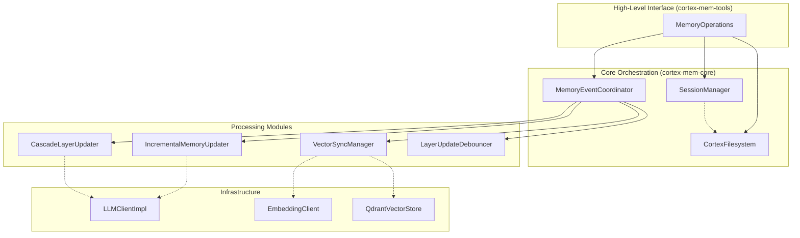
Sources: [cortex-mem-tools/src/operations.rs:29-51](), [cortex-mem-core/src/memory_event_coordinator.rs:62-89](), [cortex-mem-core/src/lib.rs:90-121]()

### The MemoryOperations Facade
In the `cortex-mem-tools` crate, `MemoryOperations` acts as the primary entry point for all interfaces (CLI, MCP, TARS). It encapsulates the `SessionManager` for conversation handling and the `MemoryEventCoordinator` for background tasks.

**Key Components in `MemoryOperations`:**
- `filesystem`: The `CortexFilesystem` providing `cortex://` URI abstraction [cortex-mem-tools/src/operations.rs:30]().
- `session_manager`: Handles active chat threads and message persistence [cortex-mem-tools/src/operations.rs:31]().
- `event_coordinator`: Manages the background event loop for indexing and layer generation [cortex-mem-tools/src/operations.rs:50]().

Sources: [cortex-mem-tools/src/operations.rs:29-51]()

## Memory Lifecycle and Event Flow

The system uses an asynchronous event-driven model to ensure that heavy AI operations (like embedding or summarization) do not block the user-facing chat interface.

### Data Flow: From Message to Long-Term Memory

When a message is stored, it triggers a cascade of events managed by the `MemoryEventCoordinator`.

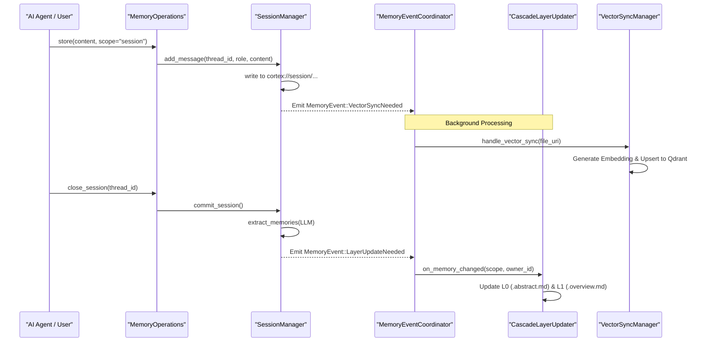

Sources: [cortex-mem-tools/src/tools/storage.rs:75-147](), [cortex-mem-core/src/memory_event_coordinator.rs:215-260](), [cortex-mem-core/src/automation/manager.rs:152-168]()

### Memory Event Coordinator (MEC)
The `MemoryEventCoordinator` is the "brain" of the background system. It listens on an `mpsc::unbounded_channel` for `MemoryEvent` variants [cortex-mem-core/src/memory_event_coordinator.rs:129]().

**Core Responsibilities:**
1. **Debouncing**: Uses `LayerUpdateDebouncer` to batch multiple file changes in the same directory, reducing LLM calls by up to 90% [cortex-mem-core/src/memory_event_coordinator.rs:7-9]().
2. **Incremental Updates**: Dispatches to `IncrementalMemoryUpdater` for granular changes [cortex-mem-core/src/memory_event_coordinator.rs:134]().
3. **Layer Cascading**: Triggers `CascadeLayerUpdater` to refresh summaries (L0/L1) from the leaf file up to the root directory [cortex-mem-core/src/cascade_layer_updater.rs:183-202]().
4. **Vector Synchronization**: Coordinates with `VectorSyncManager` to ensure the Qdrant vector store matches the filesystem state [cortex-mem-core/src/memory_event_coordinator.rs:156]().

Sources: [cortex-mem-core/src/memory_event_coordinator.rs:55-89](), [cortex-mem-core/src/memory_event_coordinator.rs:163-173]()

## Key Implementation Details

### Multi-Layer Memory Management
The `MemoryManager` coordinates three distinct layers of memory granularity:
- **L2 (Original)**: Full text stored as Markdown files in the filesystem.
- **L1 (Overview)**: Structured summaries (~2000 tokens) generated by the `OverviewGenerator` [cortex-mem-core/src/automation/layer_generator.rs:35-40]().
- **L0 (Abstract)**: Concise multi-topic abstracts (~100 tokens) for broad context, generated by the `AbstractGenerator` [cortex-mem-core/src/automation/layer_generator.rs:25-32]().

### Session Management & Extraction
The `SessionManager` tracks `SessionMetadata` (thread ID, participants, message counts) [cortex-mem-core/src/session/manager.rs:19-33](). Upon session closure, it utilizes the `MemoryExtractor` to distill raw chat logs into structured `ExtractedMemories` including:
- **Preferences**: User habits and likes [cortex-mem-core/src/session/extraction.rs:72-77]().
- **Entities**: People, projects, and tools mentioned [cortex-mem-core/src/session/extraction.rs:80-86]().
- **Events/Cases**: Important decisions or solved problems [cortex-mem-core/src/session/extraction.rs:89-104]().

Sources: [cortex-mem-core/src/session/manager.rs:187-214](), [cortex-mem-core/src/session/extraction.rs:15-40]()

### Initialization Example
Initializing the `MemoryManager` (via `MemoryOperations`) requires setting up the infrastructure stack:

```rust
// From cortex-mem-tools/src/operations.rs:100-113
let ops = MemoryOperations::new(
    data_dir,
    tenant_id,
    llm_client,
    qdrant_url,
    qdrant_collection,
    qdrant_api_key,
    embedding_api_base_url,
    embedding_api_key,
    embedding_model_name,
    embedding_dim,
    user_id,
    enable_intent_analysis,
).await?;
```
This constructor internally initializes the `CortexFilesystem`, connects to `QdrantVectorStore`, sets up the `EmbeddingClient`, and starts the `MemoryEventCoordinator` background loop [cortex-mem-tools/src/operations.rs:114-190]().

Sources: [cortex-mem-tools/src/operations.rs:100-190]()

## Optimization Mechanisms

The `MemoryManager` employs several strategies to maintain performance and reduce costs:

| Optimization | Module | Description |
| :--- | :--- | :--- |
| **Debouncing** | `LayerUpdateDebouncer` | Batches L0/L1 updates for 30s to prevent redundant LLM calls [cortex-mem-core/src/memory_event_coordinator.rs:7-9](). |
| **Content Hashing** | `CascadeLayerUpdater` | Skips regeneration if the source content hash hasn't changed [cortex-mem-core/src/cascade_layer_updater.rs:158-177](). |
| **LLM Caching** | `LlmResultCache` | Reuses LLM outputs for identical prompts/content (Phase 3) [cortex-mem-core/src/cascade_layer_updater.rs:9-10](). |
| **Batch Indexing** | `AutomationManager` | Collects session updates and indexes them in batches rather than per-message [cortex-mem-core/src/automation/manager.rs:105-108](). |

Sources: [cortex-mem-core/src/memory_event_coordinator.rs:33-42](), [cortex-mem-core/src/cascade_layer_updater.rs:126-130](), [cortex-mem-core/src/automation/manager.rs:15-24]()

---

# Page: Vector Store Integration

# Vector Store Integration

<details>
<summary>Relevant source files</summary>

The following files were used as context for generating this wiki page:

- [cortex-mem-core/src/automation/indexer.rs](cortex-mem-core/src/automation/indexer.rs)
- [cortex-mem-core/src/automation/mod.rs](cortex-mem-core/src/automation/mod.rs)
- [cortex-mem-core/src/automation/sync.rs](cortex-mem-core/src/automation/sync.rs)
- [cortex-mem-core/src/builder.rs](cortex-mem-core/src/builder.rs)
- [cortex-mem-core/src/embedding/client.rs](cortex-mem-core/src/embedding/client.rs)
- [cortex-mem-core/src/types.rs](cortex-mem-core/src/types.rs)
- [cortex-mem-core/src/vector_store/qdrant.rs](cortex-mem-core/src/vector_store/qdrant.rs)
- [cortex-mem-insights/src/lib/api.ts](cortex-mem-insights/src/lib/api.ts)
- [cortex-mem-insights/src/lib/pages/Dashboard.svelte](cortex-mem-insights/src/lib/pages/Dashboard.svelte)
- [cortex-mem-insights/src/lib/pages/Search.svelte](cortex-mem-insights/src/lib/pages/Search.svelte)
- [cortex-mem-insights/src/lib/stores/search.ts](cortex-mem-insights/src/lib/stores/search.ts)
- [cortex-mem-insights/src/lib/stores/tenant.ts](cortex-mem-insights/src/lib/stores/tenant.ts)
- [cortex-mem-service/src/main.rs](cortex-mem-service/src/main.rs)
- [examples/locomo-evaluation/benchmark/index.html](examples/locomo-evaluation/benchmark/index.html)

</details>


## Purpose and Scope

The Vector Store Integration provides the persistent storage and semantic retrieval layer for Cortex Memory. It abstracts vector database operations behind the `VectorStore` trait [cortex-mem-core/src/vector_store/mod.rs:1-20](), allowing the core system to remain decoupled from specific database implementations. The primary implementation uses **Qdrant**, a high-performance vector database that supports complex metadata filtering and multi-tenant isolation [cortex-mem-core/src/vector_store/qdrant.rs:21-26]().

This component handles:
*   **Schema Management**: Automatic collection creation and dimension verification [cortex-mem-core/src/vector_store/qdrant.rs:109-152]().
*   **Data Mapping**: Converting internal `Memory` structures to vector database points [cortex-mem-core/src/vector_store/qdrant.rs:276-320]().
*   **Semantic Search**: Executing similarity queries with advanced metadata filtering [cortex-mem-core/src/vector_store/qdrant.rs:370-420]().
*   **Tenant Isolation**: Managing separate collections or namespaces for different users/applications [cortex-mem-core/src/vector_store/qdrant.rs:34-48]().

Sources: [cortex-mem-core/src/vector_store/mod.rs:1-20](), [cortex-mem-core/src/vector_store/qdrant.rs:21-62]()

---

## Architecture and Trait Abstraction

The system uses a trait-based repository pattern. The `MemoryManager` (or `AutoIndexer`) interacts with an `Arc<dyn VectorStore>` [cortex-mem-core/src/builder.rs:99-115](), ensuring that the underlying storage can be swapped without changing business logic.

### System Entity Mapping: Logic to Storage

The following diagram bridges the Natural Language concepts (Memories, Sessions) to the Code Entities and their storage representations.

**Natural Language to Code Entity Space**
```mermaid
graph TD
    subgraph "Natural Language / User Space"
        UserQuery["'What did I say about Project X?'"]
        NewFact["'User prefers Python over Rust'"]
    end

    subgraph "Code Entity Space (cortex-mem-core)"
        MemObj["Memory Struct<br/>(types.rs)"]
        VS_Trait["VectorStore Trait<br/>(vector_store/mod.rs)"]
        QdrantImpl["QdrantVectorStore<br/>(vector_store/qdrant.rs)"]
    end

    subgraph "Storage Space (Qdrant DB)"
        Collection["Collection: 'cortex_mem_default'"]
        Point["PointStruct<br/>{id, vector, payload}"]
    end

    UserQuery -->|"search()"| VS_Trait
    NewFact -->|"insert()"| VS_Trait
    VS_Trait -.->|"Implemented by"| QdrantImpl
    MemObj -->|"Mapped to"| Point
    QdrantImpl -->|"upsert_points()"| Collection
```
Sources: [cortex-mem-core/src/types.rs:189-197](), [cortex-mem-core/src/vector_store/mod.rs:1-20](), [cortex-mem-core/src/vector_store/qdrant.rs:276-320]()

### The VectorStore Trait
The `VectorStore` trait defines the core contract for the system [cortex-mem-core/src/vector_store/mod.rs:1-20]():

| Method | Description | Source |
| :--- | :--- | :--- |
| `insert(memory)` | Upserts a memory point and its embedding. | [cortex-mem-core/src/vector_store/mod.rs:12-12]() |
| `search(vector, filters, limit)` | Returns top-K similar memories. | [cortex-mem-core/src/vector_store/mod.rs:13-13]() |
| `get(id)` | Retrieves a specific memory by its unique ID. | [cortex-mem-core/src/vector_store/mod.rs:15-15]() |
| `delete(id)` | Removes a memory point from the store. | [cortex-mem-core/src/vector_store/mod.rs:17-17]() |
| `list(filters)` | Scans points matching specific metadata. | [cortex-mem-core/src/vector_store/mod.rs:16-16]() |

---

## Qdrant Implementation Details

The `QdrantVectorStore` utilizes the `qdrant-client` crate to communicate with a Qdrant instance via gRPC/HTTP [cortex-mem-core/src/vector_store/qdrant.rs:2-10]().

### Initialization and Schema Sync
During startup, the store ensures the target collection exists and matches the required embedding dimension [cortex-mem-core/src/vector_store/qdrant.rs:155-198]().

1.  **Tenant Awareness**: If a `tenant_id` is provided in the `QdrantConfig`, the collection name is suffixed (e.g., `cortex_mem_user123`) [cortex-mem-core/src/vector_store/qdrant.rs:34-48]().
2.  **Dimension Probing**: If `embedding_dim` is missing from the config, the system can attempt to probe it at runtime, though it currently requires explicit configuration for safety [cortex-mem-core/src/vector_store/qdrant.rs:91-101]().
3.  **Collection Setup**: Collections are created with **Cosine Distance** and **HNSW indexing** for optimized semantic search [cortex-mem-core/src/vector_store/qdrant.rs:131-137]().

Sources: [cortex-mem-core/src/vector_store/qdrant.rs:28-62](), [cortex-mem-core/src/vector_store/qdrant.rs:109-152]()

### Data Flow: Memory to Vector Point
When a memory is stored, it undergoes a transformation from a high-level Rust struct to a Qdrant `PointStruct` [cortex-mem-core/src/vector_store/qdrant.rs:276-320]().

**Memory Persistence Data Flow**
```mermaid
sequenceDiagram
    participant MM as MemoryManager
    participant QVS as QdrantVectorStore
    participant EC as EmbeddingClient
    participant QDB as Qdrant Database

    MM->>EC: embed(content)
    EC-->>MM: Vec<f32>
    MM->>QVS: insert(Memory { content, embedding, metadata })
    Note over QVS: Map Memory to PointStruct
    QVS->>QVS: memory_to_point()
    Note right of QVS: Payload includes: uri, layer,<br/>importance_score, entities
    QVS->>QDB: upsert_points(collection, [point])
    QDB-->>QVS: Ok
    QVS-->>MM: Result<()>
```
Sources: [cortex-mem-core/src/vector_store/qdrant.rs:276-320](), [cortex-mem-core/src/automation/indexer.rs:78-113]()

---

## Schema and Metadata Management

Cortex Memory stores significant context in the Qdrant "Payload". This allows for highly granular filtering during retrieval without needing to query a separate relational database.

### Payload Structure
The following metadata fields are indexed and searchable [cortex-mem-core/src/types.rs:89-103]():

| Field | Description | Type |
| :--- | :--- | :--- |
| `uri` | The unique resource identifier (e.g., `cortex://session/...`). | String |
| `layer` | The memory tier: `L0` (Abstract), `L1` (Overview), or `L2` (Detail). | String |
| `importance_score` | LLM-evaluated score (0.0 to 1.0). | Float |
| `entities` | List of extracted named entities. | List<String> |
| `topics` | Categorized topics for the memory. | List<String> |
| `run_id` | Typically the `thread_id` for session-based memories. | String |

Sources: [cortex-mem-core/src/types.rs:89-103](), [cortex-mem-core/src/vector_store/qdrant.rs:335-368]()

### Filtering Logic
The `Filters` struct [cortex-mem-core/src/types.rs:208-225]() is converted into Qdrant `Filter` objects using `Must` and `Should` conditions [cortex-mem-core/src/vector_store/qdrant.rs:422-520](). This supports:
*   **Layer Filtering**: Searching only `L1Overview` for quick summaries [cortex-mem-core/src/types.rs:234-240]().
*   **Temporal Filtering**: Finding memories created within a specific time range [cortex-mem-core/src/vector_store/qdrant.rs:480-498]().
*   **Semantic Scope**: Using `uri_prefix` to limit search to a specific session or user directory [cortex-mem-core/src/types.rs:223-223]().

Sources: [cortex-mem-core/src/vector_store/qdrant.rs:422-520](), [cortex-mem-core/src/types.rs:208-241]()

---

## Automated Indexing Patterns

Vector storage is often populated automatically by the `AutomationManager` and `SyncManager`.

### The AutoIndexer
The `AutoIndexer` listens for `MessageAdded` events and performs real-time indexing of conversation history [cortex-mem-core/src/automation/indexer.rs:48-59]().
*   **Batch Indexing**: Supports re-indexing entire threads [cortex-mem-core/src/automation/indexer.rs:116-120]().
*   **Deduplication**: Checks `get_indexed_message_ids` before processing to avoid redundant embeddings [cortex-mem-core/src/automation/indexer.rs:144-148]().

### SyncManager
The `SyncManager` performs bulk synchronization of the `CortexFilesystem` to the vector store [cortex-mem-core/src/automation/sync.rs:25-31](). It recursively scans directories like `cortex://user` and `cortex://agent`, generating embeddings for any `.md` files that are missing from the vector index [cortex-mem-core/src/automation/sync.rs:98-147]().

Sources: [cortex-mem-core/src/automation/indexer.rs:48-75](), [cortex-mem-core/src/automation/sync.rs:25-46](), [cortex-mem-core/src/automation/sync.rs:98-147]()

---

# Page: LLM Client & AI Processing

# LLM Client & AI Processing

<details>
<summary>Relevant source files</summary>

The following files were used as context for generating this wiki page:

- [README.md](README.md)
- [README_zh.md](README_zh.md)
- [cortex-mem-core/src/automation/layer_generator.rs](cortex-mem-core/src/automation/layer_generator.rs)
- [cortex-mem-core/src/automation/manager.rs](cortex-mem-core/src/automation/manager.rs)
- [cortex-mem-core/src/cascade_layer_updater.rs](cortex-mem-core/src/cascade_layer_updater.rs)
- [cortex-mem-core/src/incremental_memory_updater.rs](cortex-mem-core/src/incremental_memory_updater.rs)
- [cortex-mem-core/src/layers/generator.rs](cortex-mem-core/src/layers/generator.rs)
- [cortex-mem-core/src/layers/manager.rs](cortex-mem-core/src/layers/manager.rs)
- [cortex-mem-core/src/llm/client.rs](cortex-mem-core/src/llm/client.rs)
- [cortex-mem-core/src/llm/prompts.rs](cortex-mem-core/src/llm/prompts.rs)
- [cortex-mem-core/src/memory_event_coordinator.rs](cortex-mem-core/src/memory_event_coordinator.rs)
- [cortex-mem-core/src/search/vector_engine.rs](cortex-mem-core/src/search/vector_engine.rs)
- [cortex-mem-core/src/session/extraction.rs](cortex-mem-core/src/session/extraction.rs)
- [cortex-mem-core/src/session/message.rs](cortex-mem-core/src/session/message.rs)
- [cortex-mem-service/src/handlers/automation.rs](cortex-mem-service/src/handlers/automation.rs)
- [cortex-mem-service/src/handlers/search.rs](cortex-mem-service/src/handlers/search.rs)
- [cortex-mem-service/src/handlers/sessions.rs](cortex-mem-service/src/handlers/sessions.rs)
- [cortex-mem-service/src/routes/automation.rs](cortex-mem-service/src/routes/automation.rs)
- [cortex-mem-service/src/state.rs](cortex-mem-service/src/state.rs)
- [examples/@memclaw/bin-darwin-arm64/bin/README.md](examples/@memclaw/bin-darwin-arm64/bin/README.md)
- [examples/locomo-evaluation/eval.py](examples/locomo-evaluation/eval.py)

</details>


## Purpose and Scope

The LLM Client and AI Processing layer serves as the intelligence backbone of the Cortex Memory system. It handles all interactions with external Large Language Models for tasks including semantic embedding generation, structured fact extraction, memory classification, and hierarchical layer summarization.

This module is primarily implemented in `cortex-mem-core` and is orchestrated by the `MemoryEventCoordinator` to ensure that as memories are added or updated, the corresponding AI processing (indexing, extraction, and summarization) happens automatically and efficiently.

## Architecture & Data Flow

The AI processing pipeline bridges raw natural language input to structured code entities and storage.

### AI Processing Orchestration

The `MemoryEventCoordinator` acts as the central hub, receiving events and dispatching them to specialized AI modules.

```mermaid
graph TD
    subgraph "Event Source"
        SessionMgr["SessionManager"]
        FSWatcher["Filesystem Watcher"]
    end

    subgraph "Orchestrator [memory_event_coordinator.rs]"
        Coordinator["MemoryEventCoordinator"]
    end

    subgraph "AI Processing Modules"
        Extractor["FactExtractor / MemoryExtractor"]
        LayerUpdater["CascadeLayerUpdater"]
        VectorSync["VectorSyncManager"]
    end

    subgraph "External AI Services"
        LLM["LLMClient (OpenAI/Rig)"]
        Embed["EmbeddingClient"]
    end

    SessionMgr -- "MemoryEvent" --> Coordinator
    FSWatcher -- "MemoryEvent" --> Coordinator

    Coordinator --> Extractor
    Coordinator --> LayerUpdater
    Coordinator --> VectorSync

    Extractor --> LLM
    LayerUpdater --> LLM
    VectorSync --> Embed
```
**Sources:** [cortex-mem-core/src/memory_event_coordinator.rs:62-89](), [cortex-mem-core/src/automation/manager.rs:51-59]()

### LLM Client Implementation

The system utilizes the `rig` framework to interface with LLMs. The `LLMClient` trait defines the contract for all AI operations, while `LLMClientImpl` provides the concrete implementation.

| Component | Code Entity | Role |
| :--- | :--- | :--- |
| **Trait** | `LLMClient` | Defines methods for completion, fact extraction, and structured analysis. |
| **Implementation** | `LLMClientImpl` | Wraps `rig::providers::openai::Client` to execute calls. |
| **Config** | `LLMConfig` | Stores `api_base_url`, `api_key`, and `model_efficient`. |
| **Extraction Model** | `MemoryExtractionResponse` | The schema for raw LLM memory extraction (facts, decisions, entities). |

**Sources:** [cortex-mem-core/src/llm/client.rs:6-13](), [cortex-mem-core/src/llm/client.rs:66-87](), [cortex-mem-core/src/llm/client.rs:93-96]()

## Fact Extraction

Fact extraction is the process of converting unstructured conversation logs into structured memory objects. This is handled by the `MemoryExtractor`.

### Extraction Logic
When a session is closed or a trigger is received, the `MemoryExtractor` performs the following:
1.  **Prompt Construction**: Joins messages and applies "Critical Language Rules" to ensure the output matches the conversation's dominant language. [cortex-mem-core/src/session/extraction.rs:203-216]()
2.  **LLM Call**: Invokes `llm_client.complete()` with the constructed prompt. [cortex-mem-core/src/session/extraction.rs:183-183]()
3.  **Parsing**: Deserializes the JSON response into an `ExtractedMemories` struct containing preferences, entities, events, cases, and personal info. [cortex-mem-core/src/session/extraction.rs:15-40]()

### Memory Schema Mapping

```mermaid
classDiagram
    class ExtractedMemories {
        +Vec~PreferenceMemory~ preferences
        +Vec~EntityMemory~ entities
        +Vec~EventMemory~ events
        +Vec~CaseMemory~ cases
        +Vec~PersonalInfoMemory~ personal_info
    }
    class PreferenceMemory {
        +String topic
        +String preference
        +f32 confidence
    }
    class EntityMemory {
        +String name
        +String entity_type
        +String description
    }
    ExtractedMemories *-- PreferenceMemory
    ExtractedMemories *-- EntityMemory
```
**Sources:** [cortex-mem-core/src/session/extraction.rs:15-40](), [cortex-mem-core/src/session/extraction.rs:73-86]()

## Hierarchical Layer Processing (L0/L1)

Cortex Memory uses a three-tier architecture (L0 Abstract, L1 Overview, L2 Detail). The AI processing layer is responsible for generating the L0 and L1 summaries from L2 (raw) data.

### Cascade Layer Update
The `CascadeLayerUpdater` handles the generation of these summaries. To minimize costs and latency, it implements:
*   **Debouncing**: The `LayerUpdateDebouncer` batches multiple file changes in the same directory, reducing LLM calls by 70-90%. [cortex-mem-core/src/memory_event_coordinator.rs:6-9]()
*   **Caching**: The `LLMResultCache` stores recent summary results to avoid redundant processing of unchanged content. [cortex-mem-core/src/memory_event_coordinator.rs:38-42]()

### Layer Generators
*   **AbstractGenerator (L0)**: Generates highly condensed summaries (~100 tokens) for quick context loading. [cortex-mem-core/src/automation/layer_generator.rs:48-52]()
*   **OverviewGenerator (L1)**: Generates medium-length summaries (~1500 tokens) providing a thematic overview of a directory or session. [cortex-mem-core/src/automation/layer_generator.rs:53-56]()

**Sources:** [cortex-mem-core/src/cascade_layer_updater.rs:148-153](), [cortex-mem-core/src/automation/layer_generator.rs:72-78]()

## Search & Intent Analysis

Before performing a vector search, the system can use the LLM to analyze the user's intent.

### VectorSearchEngine Intent Logic
The `VectorSearchEngine` can be configured with `with_intent_analysis(true)`. [cortex-mem-core/src/search/vector_engine.rs:109-116]()
1.  **Query Rewriting**: The LLM rewrites the user's raw query into an `EnhancedQueryIntent`.
2.  **Threshold Tuning**: Based on the intent (e.g., "Personal" vs "Factual"), the engine adjusts the similarity threshold.
3.  **Layer Selection**: Determines whether to search L0, L1, or L2 layers based on the query's breadth.

**Sources:** [cortex-mem-core/src/search/vector_engine.rs:57-71](), [cortex-mem-service/src/state.rs:99-126]()

## Configuration and Tuning

AI processing is tuned via the `config.toml` file, which maps to internal configuration structs.

| Config Struct | Key Fields | Impact |
| :--- | :--- | :--- |
| `LLMConfig` | `temperature`, `max_tokens` | Controls LLM creativity and response length. [cortex-mem-core/src/llm/client.rs:6-13]() |
| `CoordinatorConfig` | `enable_debounce`, `enable_cache` | Toggles optimization features for layer updates. [cortex-mem-core/src/memory_event_coordinator.rs:32-42]() |
| `LayerGenerationConfig`| `batch_size`, `delay_ms` | Controls the pace of background layer generation. [cortex-mem-core/src/automation/layer_generator.rs:11-22]() |

**Sources:** [cortex-mem-core/src/llm/client.rs:15-28](), [cortex-mem-core/src/memory_event_coordinator.rs:44-53]()

---

# Page: Memory Operations & Shared Tools

# Memory Operations & Shared Tools

<details>
<summary>Relevant source files</summary>

The following files were used as context for generating this wiki page:

- [cortex-mem-core/src/lib.rs](cortex-mem-core/src/lib.rs)
- [cortex-mem-core/src/llm/mod.rs](cortex-mem-core/src/llm/mod.rs)
- [cortex-mem-core/src/session/manager.rs](cortex-mem-core/src/session/manager.rs)
- [cortex-mem-mcp/src/service.rs](cortex-mem-mcp/src/service.rs)
- [cortex-mem-tools/src/docs/commit.md](cortex-mem-tools/src/docs/commit.md)
- [cortex-mem-tools/src/docs/explore.md](cortex-mem-tools/src/docs/explore.md)
- [cortex-mem-tools/src/docs/ls.md](cortex-mem-tools/src/docs/ls.md)
- [cortex-mem-tools/src/docs/recall.md](cortex-mem-tools/src/docs/recall.md)
- [cortex-mem-tools/src/docs/search.md](cortex-mem-tools/src/docs/search.md)
- [cortex-mem-tools/src/docs/store.md](cortex-mem-tools/src/docs/store.md)
- [cortex-mem-tools/src/mcp/definitions.rs](cortex-mem-tools/src/mcp/definitions.rs)
- [cortex-mem-tools/src/operations.rs](cortex-mem-tools/src/operations.rs)
- [cortex-mem-tools/src/tools/mod.rs](cortex-mem-tools/src/tools/mod.rs)
- [cortex-mem-tools/src/tools/recall.rs](cortex-mem-tools/src/tools/recall.rs)
- [cortex-mem-tools/src/tools/search.rs](cortex-mem-tools/src/tools/search.rs)
- [cortex-mem-tools/src/tools/storage.rs](cortex-mem-tools/src/tools/storage.rs)
- [examples/cortex-mem-tars/src/agent.rs](examples/cortex-mem-tars/src/agent.rs)
- [examples/cortex-mem-tars/src/app.rs](examples/cortex-mem-tars/src/app.rs)
- [litho.docs/en/1.Overview.md](litho.docs/en/1.Overview.md)
- [litho.docs/en/5.Boundary-Interfaces.md](litho.docs/en/5.Boundary-Interfaces.md)

</details>


## Purpose and Scope

The `cortex-mem-tools` library serves as the high-level orchestration layer for the Cortex Memory ecosystem. It provides the `MemoryOperations` API, which abstracts the complexities of the core engine into a unified interface for memory storage, semantic search, and tiered content access. This shared abstraction ensures consistent behavior across different interfaces, including the **HTTP API Service**, **MCP Server**, **CLI**, and **RIG Framework** integration.

By centralizing operation logic, `cortex-mem-tools` manages the coordination between the virtual filesystem, vector search engines, session management, and the asynchronous background processing pipeline.

---

## Architectural Context

### Design Rationale

The `cortex-mem-tools` layer sits between the low-level `cortex-mem-core` components and the high-level boundary interfaces. It provides a "Modular Monolith" pattern where core logic is implemented once and exposed through multiple protocols.

**Key Responsibilities:**
- **Unified API**: Providing a single `MemoryOperations` struct that handles all high-level requests. [cortex-mem-tools/src/operations.rs:29-51]()
- **Asynchronous Orchestration**: Offloading heavy tasks like embedding generation and LLM-based layer creation to the `MemoryEventCoordinator`. [cortex-mem-tools/src/operations.rs:178-193]()
- **Tenant Isolation**: Ensuring that filesystem paths and vector store queries are scoped to specific tenants. [cortex-mem-tools/src/operations.rs:114-116]()
- **Schema Standardization**: Defining tool schemas (search, store, ls) used by both MCP and RIG. [cortex-mem-tools/src/mcp/definitions.rs:24-25]()

### Component Interaction

The following diagram illustrates how `MemoryOperations` bridges the gap between AI agents (via MCP/RIG) and the core memory infrastructure.

**Diagram: Memory Operations Bridge**

```mermaid
graph TD
    subgraph "Interface Space (Natural Language / Tools)"
        MCP["cortex-mem-mcp"]
        RIG["cortex-mem-rig"]
        CLI["cortex-mem-cli"]
    end

    subgraph "Shared Tools Layer (cortex-mem-tools)"
        MOPS["MemoryOperations Struct"]
        DEFS["mcp::definitions::get_mcp_tool_definitions"]
        ARGS["types::StoreArgs / SearchArgs"]
    end

    subgraph "Core Entity Space (cortex-mem-core)"
        MEC["MemoryEventCoordinator"]
        VSE["VectorSearchEngine"]
        SM["SessionManager"]
        CFS["CortexFilesystem"]
    end

    MCP -- "calls" --> MOPS
    RIG -- "calls" --> MOPS
    CLI -- "calls" --> MOPS
    
    MOPS -- "uses schemas from" --> DEFS
    MOPS -- "parses" --> ARGS
    
    MOPS -- "triggers async events" --> MEC
    MOPS -- "executes search" --> VSE
    MOPS -- "manages threads" --> SM
    MOPS -- "IO operations" --> CFS
```

Sources: [cortex-mem-tools/src/operations.rs:29-51](), [cortex-mem-mcp/src/service.rs:1-10](), [examples/cortex-mem-tars/src/agent.rs:83-106]()

---

## The MemoryOperations API

The `MemoryOperations` struct is the primary entry point for any application integrating Cortex Memory. It is typically initialized with a tenant ID and a set of LLM/Vector configurations.

### Initialization

Initialization involves setting up the `CortexFilesystem` for the specific tenant and establishing a connection to the Qdrant vector store. [cortex-mem-tools/src/operations.rs:100-113]()

```rust
pub async fn new(
    data_dir: &str,
    tenant_id: impl Into<String>,
    llm_client: Arc<dyn LLMClient>,
    qdrant_url: &str,
    // ... embedding & vector params
) -> Result<Self>
```

During initialization, it also creates the `MemoryEventCoordinator`, which starts a background event loop to process memory updates (indexing and layer generation) without blocking the main request thread. [cortex-mem-tools/src/operations.rs:178-193]()

### Core Methods

| Method | Purpose | Key Dependency |
|--------|---------|----------------|
| `store` | Persists content to a URI and triggers async layer generation. | `SessionManager`, `MemoryEventCoordinator` |
| `search` | Performs layered semantic search (L0->L1->L2). | `VectorSearchEngine`, `LayerManager` |
| `find` | Simplified search returning only L0 abstracts. | `VectorSearchEngine` |
| `ls` | Lists memories in the `cortex://` virtual filesystem. | `CortexFilesystem` |

Sources: [cortex-mem-tools/src/tools/storage.rs:16-17](), [cortex-mem-tools/src/tools/search.rs:15-16](), [cortex-mem-tools/src/tools/search.rs:50-51]()

---

## Memory Storage & Asynchronous Processing

When the `store` method is called, the system prioritizes low latency for the caller (the AI agent) by offloading processing.

### Storage Logic Flow

1. **URI Generation**: Based on the scope (`user`, `session`, or `agent`), a `cortex://` URI is generated. [cortex-mem-tools/src/tools/storage.rs:24-81]()
2. **Persistence**:
    - For `session` scope: Content is added to the `SessionManager` as a message. [cortex-mem-tools/src/tools/storage.rs:127-133]()
    - For `user`/`agent` scope: Content is written directly to the `CortexFilesystem`. [cortex-mem-tools/src/tools/storage.rs:151-154]()
3. **Event Triggering**: Instead of generating L0/L1 layers immediately, a `MemoryEvent` of type `LayerUpdateNeeded` is sent to the `memory_event_tx` channel. [cortex-mem-tools/src/tools/storage.rs:166-173]()

**Diagram: Asynchronous Storage Pipeline**

```mermaid
sequenceDiagram
    participant Agent as AI Agent (MCP/RIG)
    participant Ops as MemoryOperations::store
    participant CFS as CortexFilesystem
    participant MEC as MemoryEventCoordinator
    participant VS as VectorStore (Qdrant)

    Agent->>Ops: store(content, scope="user")
    Ops->>CFS: write("cortex://user/memories/...")
    Ops->>MEC: send(MemoryEvent::LayerUpdateNeeded)
    Ops-->>Agent: return StoreResponse (Success)
    
    Note over MEC: Background Processing Starts
    MEC->>MEC: Generate L0 Abstract (LLM)
    MEC->>MEC: Generate L1 Overview (LLM)
    MEC->>VS: Upsert Vector Embeddings
```

Sources: [cortex-mem-tools/src/tools/storage.rs:156-175](), [cortex-mem-core/src/memory_event_coordinator.rs:179-193]()

---

## Semantic Search & Tiered Retrieval

The `search` operation implements a layered retrieval strategy. It does not just return raw text; it provides context at different granularities (L0, L1, L2).

### Layered Search Strategy

The search process follows these steps:
1. **Normalization**: The `scope` (e.g., `cortex://user`) is normalized to ensure valid URI structures. [cortex-mem-tools/src/tools/search.rs:17-23]()
2. **Vector Search**: The `VectorSearchEngine` executes a query against Qdrant, returning URIs and similarity scores. [cortex-mem-tools/src/tools/search.rs:114-126]()
3. **Enrichment**: For each result, the `LayerManager` loads the requested layers (e.g., L0 abstracts for quick browsing). [cortex-mem-tools/src/tools/search.rs:138-177]()

### Data Structures for Search

The `SearchArgs` structure allows agents to control the depth of information retrieved. [cortex-mem-tools/src/mcp/definitions.rs:51-59]()

| Parameter | Type | Description |
|-----------|------|-------------|
| `query` | `String` | Natural language search string. |
| `scope` | `String` | URI prefix to limit search (e.g., `cortex://session/{id}`). |
| `return_layers` | `Vec<String>` | List of layers to return: `["L0"]`, `["L1"]`, or `["L2"]`. |
| `limit` | `usize` | Maximum number of results (default: 10). |

Sources: [cortex-mem-tools/src/tools/search.rs:15-47](), [cortex-mem-tools/src/mcp/definitions.rs:27-63]()

---

## Shared Tool Definitions

Cortex Memory provides a set of unified tool definitions via `get_mcp_tool_definitions`. This ensures that an AI agent sees the same tool descriptions and parameter schemas whether it is connecting via **MCP** (Model Context Protocol) or using **RIG** (Rust Integrated Graph). [cortex-mem-tools/src/mcp/definitions.rs:24-25]()

### Standard Tools Table

| Tool Name | Purpose | Implementation File |
|-----------|---------|---------------------|
| `search` | Semantic vector search across all layers. | [cortex-mem-tools/src/tools/search.rs]() |
| `store` | Save new information into long-term memory. | [cortex-mem-tools/src/tools/storage.rs]() |
| `ls` | Browse the memory hierarchy like a filesystem. | [cortex-mem-tools/src/tools/filesystem.rs]() |
| `abstract` | Retrieve only the L0 (~100 token) summary. | [cortex-mem-tools/src/tools/tiered.rs]() |
| `overview` | Retrieve the L1 (~2000 token) structured overview. | [cortex-mem-tools/src/tools/tiered.rs]() |
| `recall` | Convenience tool for full content retrieval (L0 + L2). | [cortex-mem-tools/src/tools/recall.rs]() |

Sources: [cortex-mem-tools/src/mcp/definitions.rs:24-180](), [cortex-mem-tools/src/tools/mod.rs:1-8]()

---

## Integration Patterns

### MCP Server Integration
The `cortex-mem-mcp` service maps MCP tool calls directly to `MemoryOperations`. It includes an `AutoTriggerConfig` to handle clients that do not explicitly close sessions, ensuring memories are eventually extracted and indexed based on message counts or inactivity. [cortex-mem-mcp/src/service.rs:21-32]()

### RIG Framework Integration
The `cortex-mem-rig` library provides a `create_memory_tools_with_config` helper. It instantiates `MemoryOperations` and wraps it in Rig's `Tool` trait, allowing agents to call these tools autonomously during a conversation. [examples/cortex-mem-tars/src/agent.rs:83-97]()

### TARS Application Usage
In the TARS TUI application, `MemoryOperations` is used to manage "Tenant Isolation." Each bot in TARS can have its own isolated memory space by passing a unique `agent_id` and `user_id` to the `MemoryOperations` constructor. [examples/cortex-mem-tars/src/agent.rs:57-64]()

Sources: [cortex-mem-mcp/src/service.rs:15-43](), [examples/cortex-mem-tars/src/agent.rs:108-119](), [cortex-mem-tools/src/operations.rs:100-113]()

---

# Page: Optimization Engine

# Optimization Engine

<details>
<summary>Relevant source files</summary>

The following files were used as context for generating this wiki page:

- [cortex-mem-core/src/cascade_layer_debouncer.rs](cortex-mem-core/src/cascade_layer_debouncer.rs)
- [cortex-mem-core/src/llm_result_cache.rs](cortex-mem-core/src/llm_result_cache.rs)
- [cortex-mem-core/src/memory_cleanup.rs](cortex-mem-core/src/memory_cleanup.rs)
- [cortex-mem-core/src/memory_index_manager.rs](cortex-mem-core/src/memory_index_manager.rs)

</details>


The Optimization Engine is responsible for detecting memory quality issues and executing optimization operations to maintain system health. It analyzes stored memories for duplicates, low-quality content, outdated information, misclassifications, and space inefficiency, then generates and executes remediation plans.

In addition to proactive quality analysis, the engine handles the lifecycle of memories through automated cleanup and debounced layer updates to ensure the long-term sustainability of the memory space.

## System Architecture

The Optimization Engine consists of several primary components that work together to maintain memory quality and manage the "forgetting" process:

```mermaid
graph TB
    subgraph "cortex-mem-core"
        MM["MemoryManager<br/>(Arc reference)"]
        MIM["MemoryIndexManager<br/>(Index IO & Cache)"]
        
        subgraph "Optimization System"
            OD["OptimizationDetector"]
            OP["OptimizationPlan"]
            EE["ExecutionEngine"]
        end
        
        subgraph "Maintenance Services"
            MCS["MemoryCleanupService<br/>(Ebbinghaus Curve)"]
            CLD["CascadeLayerDebouncer<br/>(Update Batching)"]
            LRC["LllmResultCache<br/>(Cost Reduction)"]
        end
    end
    
    MM -->|provides context| OD
    MM -->|provides context| EE
    
    MIM -->|loads/saves| MCS
    MIM -->|index data| OD
    
    MCS -->|archives/deletes| MIM
    CLD -->|batches updates| LRC
    LRC -->|cached L0/L1| MM
```

**Sources:** [cortex-mem-core/src/memory_cleanup.rs:75-80](), [cortex-mem-core/src/cascade_layer_debouncer.rs:68-76](), [cortex-mem-core/src/llm_result_cache.rs:113-125]()

## Memory Cleanup & Forgetting

The `MemoryCleanupService` implements a "forgetting" mechanism based on the **Ebbinghaus Forgetting Curve**. It scans memory indices to identify low-strength memories for archiving or permanent deletion.

### Forgetting Logic
Memory strength is computed using metadata (access frequency and recency). The service transitions memories through states based on configurable thresholds:

| Threshold | Default Value | Action |
|-----------|---------------|--------|
| `archive_threshold` | 0.1 | Memory strength below this marks `archived = true` |
| `delete_threshold` | 0.02 | Archived memory strength below this triggers permanent deletion |

**Sources:** [cortex-mem-core/src/memory_cleanup.rs:21-38](), [cortex-mem-core/src/memory_cleanup.rs:113-121]()

### Vector Synchronization
When a memory is deleted during cleanup, the `MemoryCleanupService` uses the `VectorSyncManager` to ensure all associated vectors (across L0, L1, and L2 layers) are removed from the vector store (e.g., Qdrant). This prevents "ghost" memories from appearing in semantic search results.

**Sources:** [cortex-mem-core/src/memory_cleanup.rs:6-8](), [cortex-mem-core/src/memory_cleanup.rs:158-175]()

## Cascade Layer Debouncing

To reduce LLM API costs and redundant processing, the `CascadeLayerDebouncer` manages the timing of layer updates (L0/L1 synthesis).

### How Debouncing Works
When a file change occurs, instead of immediately triggering an LLM-heavy layer update, the request is registered with the debouncer.

1.  **Request Merging**: Multiple updates for the same directory URI within the `debounce_secs` window (default 30s) are merged into one.
2.  **Force Update**: If updates continue to arrive, a `max_delay_secs` (default 120s) forces execution to ensure the index eventually reflects changes.
3.  **Batch Execution**: The `process_due_updates` function is called periodically to execute all "due" requests.

**Sources:** [cortex-mem-core/src/cascade_layer_debouncer.rs:7-22](), [cortex-mem-core/src/cascade_layer_debouncer.rs:45-52](), [cortex-mem-core/src/cascade_layer_debouncer.rs:128-156]()

## LLM Result Cache

The `LlmResultCache` provides an additional layer of optimization by caching LLM-generated content for L0/L1 layers.

-   **Keying**: Uses content hashes as cache keys.
-   **Eviction**: Implements **LRU (Least Recently Used)** eviction when the cache reaches `max_entries` (default 1000).
-   **Expiration**: Supports **TTL (Time-To-Live)** (default 1 hour) to ensure content doesn't become stale.

**Sources:** [cortex-mem-core/src/llm_result_cache.rs:3-9](), [cortex-mem-core/src/llm_result_cache.rs:37-45](), [cortex-mem-core/src/llm_result_cache.rs:192-212]()

## OptimizationDetector

`OptimizationDetector` scans the memory store to identify various quality and efficiency issues. It requires an `Arc<MemoryManager>` reference to access memory operations and LLM capabilities.

### Issue Detection Methods

The detector implements specialized detection strategies:

| Detection Method | Issue Type | Key Algorithm | Threshold |
|------------------|------------|---------------|-----------|
| `detect_duplicates` | `IssueKind::Duplicate` | Semantic similarity via embeddings | 0.85 cosine similarity |
| `detect_quality_issues` | `IssueKind::LowQuality` | Multi-factor quality scoring | 0.4 quality score |
| `detect_outdated_issues` | `IssueKind::Outdated` | Time-based decay analysis | 180 days |
| `detect_classification_issues` | `IssueKind::PoorClassification` | LLM-based type verification | N/A |
| `detect_space_inefficiency` | `IssueKind::SpaceInefficient` | Size/importance ratio analysis | 10KB + 0.3 importance |

**Sources:** [cortex-mem-core/src/memory/optimization_detector.rs:115-496]()

#### Quality Evaluation Algorithm

The quality evaluator uses a weighted scoring system based on content length, structural quality (sentences/paragraphs), and importance scores.

```mermaid
graph TB
    Memory["Memory Object"]
    
    Memory -->|30%| Length["Content Length"]
    Memory -->|20%| Structure["Structural Quality"]
    Memory -->|20%| Importance["Importance Score"]
    Memory -->|15%| Metadata["Metadata Completeness"]
    Memory -->|15%| Recency["Update Recency"]
    
    Length --> Score["Quality Score"]
    Structure --> Score
    Importance --> Score
    Metadata --> Score
    Recency --> Score
    
    Score -->|< 0.4| Issue["LowQuality Issue"]
```

**Sources:** [cortex-mem-core/src/memory/optimization_detector.rs:543-602]()

## ExecutionEngine

`ExecutionEngine` translates optimization plans into concrete memory operations. It batches actions and provides retry logic for resilience.

### Action Implementations

#### Merge Action
The merge operation combines duplicate memories using LLM-generated content synthesis. It builds a prompt containing all duplicate contents and asks the LLM to create a coherent, consolidated version while preserving key facts.

**Sources:** [cortex-mem-core/src/memory/execution_engine.rs:173-226](), [cortex-mem-core/src/memory/execution_engine.rs:325-353]()

#### Reclassify Action
Type reclassification uses the `LLMClient::classify_memory` method to verify if a memory is correctly categorized (e.g., as a "Fact", "Entity", or "Relationship").

**Sources:** [cortex-mem-core/src/memory/execution_engine.rs:266-293](), [cortex-mem-core/src/memory/execution_engine.rs:391-452]()

## Memory Index Management

The `MemoryIndexManager` serves as the persistence layer for optimization metadata. It handles the `load_index` and `save_index` operations for `.memory_index.json` files.

-   **Caching**: Maintains an in-memory cache of indices to speed up frequent access during optimization scans.
-   **Consistency**: Includes an `invalidate_cache` method to ensure that if one service (like `MemoryCleanupService`) modifies the index, other services see the changes.
-   **Hashing**: Provides `calculate_content_hash` using SHA-256 for stable change detection across platforms.

**Sources:** [cortex-mem-core/src/memory_index_manager.rs:20-24](), [cortex-mem-core/src/memory_index_manager.rs:103-107](), [cortex-mem-core/src/memory_index_manager.rs:185-190]()

---

# Page: Service Interfaces

# Service Interfaces

<details>
<summary>Relevant source files</summary>

The following files were used as context for generating this wiki page:

- [cortex-mem-cli/Cargo.toml](cortex-mem-cli/Cargo.toml)
- [cortex-mem-cli/src/commands/add.rs](cortex-mem-cli/src/commands/add.rs)
- [cortex-mem-cli/src/commands/delete.rs](cortex-mem-cli/src/commands/delete.rs)
- [cortex-mem-cli/src/commands/get.rs](cortex-mem-cli/src/commands/get.rs)
- [cortex-mem-cli/src/commands/layers.rs](cortex-mem-cli/src/commands/layers.rs)
- [cortex-mem-cli/src/commands/list.rs](cortex-mem-cli/src/commands/list.rs)
- [cortex-mem-cli/src/commands/mod.rs](cortex-mem-cli/src/commands/mod.rs)
- [cortex-mem-cli/src/commands/search.rs](cortex-mem-cli/src/commands/search.rs)
- [cortex-mem-cli/src/commands/session.rs](cortex-mem-cli/src/commands/session.rs)
- [cortex-mem-cli/src/commands/tenant.rs](cortex-mem-cli/src/commands/tenant.rs)
- [cortex-mem-core/src/builder.rs](cortex-mem-core/src/builder.rs)
- [cortex-mem-core/src/embedding/client.rs](cortex-mem-core/src/embedding/client.rs)
- [cortex-mem-core/src/filesystem/operations.rs](cortex-mem-core/src/filesystem/operations.rs)
- [cortex-mem-insights/src/lib/api.ts](cortex-mem-insights/src/lib/api.ts)
- [cortex-mem-insights/src/lib/pages/Dashboard.svelte](cortex-mem-insights/src/lib/pages/Dashboard.svelte)
- [cortex-mem-insights/src/lib/pages/Search.svelte](cortex-mem-insights/src/lib/pages/Search.svelte)
- [cortex-mem-insights/src/lib/stores/search.ts](cortex-mem-insights/src/lib/stores/search.ts)
- [cortex-mem-insights/src/lib/stores/tenant.ts](cortex-mem-insights/src/lib/stores/tenant.ts)
- [cortex-mem-mcp/src/main.rs](cortex-mem-mcp/src/main.rs)
- [cortex-mem-service/src/main.rs](cortex-mem-service/src/main.rs)
- [cortex-mem-tools/src/errors.rs](cortex-mem-tools/src/errors.rs)
- [cortex-mem-tools/src/lib.rs](cortex-mem-tools/src/lib.rs)
- [cortex-mem-tools/src/types.rs](cortex-mem-tools/src/types.rs)
- [examples/locomo-evaluation/benchmark/index.html](examples/locomo-evaluation/benchmark/index.html)

</details>


## Purpose and Scope

This document provides an overview of the primary service interfaces that expose Cortex Memory functionality. Each interface provides access to the same core memory management capabilities through different protocols and interaction models, allowing for integration with AI agents, web applications, command-line scripts, and interactive terminal environments.

For detailed documentation on specific interfaces, see:
- **HTTP API Service**: [HTTP API Service](#4.1) — RESTful access for web and mobile integrations.
- **MCP Server**: [MCP Server](#4.2) — Standardized tool access for LLM agents (Claude, Cursor).
- **CLI**: [Command Line Interface](#4.3) — Local management and shell scripting.
- **Web Dashboard**: [Web Dashboard](#4.4) — Visual monitoring and memory browsing.
- **TARS Application**: [TARS Application](#4.5) — Interactive multi-agent TUI with audio support.

---

## Interface Architecture

The Cortex Memory ecosystem is designed as a modular monolith where multiple front-end interfaces interact with a shared logic layer. This layer is primarily encapsulated in `cortex-mem-core` and the `cortex-mem-tools` abstraction.

### System Interface Topology

```mermaid
graph TB
    subgraph "External Actors"
        DevUser["Developer/Admin<br/>(Terminal)"]
        AIAgent["AI Agent<br/>(Claude/Cursor)"]
        WebUser["System Admin<br/>(Browser)"]
        AppUser["End User<br/>(TUI/Audio)"]
    end
    
    subgraph "Interface Layer"
        CLI["cortex-mem-cli<br/>'cortex-mem' binary"]
        Service["cortex-mem-service<br/>Axum HTTP Server"]
        MCP["cortex-mem-mcp<br/>MCP Server"]
        Insights["cortex-mem-insights<br/>SvelteKit Web UI"]
        TARS["cortex-mem-tars<br/>TUI Application"]
    end
    
    subgraph "Shared Abstraction"
        MemOps["cortex-mem-tools<br/>MemoryOperations"]
    end
    
    subgraph "Core Engine"
        Core["cortex-mem-core<br/>CortexMem / MemoryManager"]
        FS["cortex-mem-core<br/>CortexFilesystem"]
    end
    
    subgraph "Infrastructure"
        Qdrant["Qdrant<br/>VectorStore"]
        LLM["LLM Provider<br/>(OpenAI/Local)"]
    end
    
    DevUser -->|"Commands"| CLI
    DevUser -->|"REST"| Service
    AIAgent -->|"stdio/JSON-RPC"| MCP
    WebUser -->|"HTTP"| Insights
    AppUser -->|"Keyboard/Voice"| TARS
    
    CLI --> MemOps
    Service --> Core
    MCP --> MemOps
    TARS --> Core
    Insights --> Service
    
    MemOps --> Core
    Core --> FS
    Core --> Qdrant
    Core --> LLM
```

**Sources:** [cortex-mem-mcp/src/main.rs:108-121](), [cortex-mem-service/src/main.rs:134-140](), [cortex-mem-core/src/builder.rs:74-83]()

---

## Interface Comparison

Each interface is optimized for specific latency, protocol, and user requirements.

| Interface | Protocol | Primary Use Case | Entry Point |
|-----------|----------|------------------|-------------|
| **CLI** | CLI Args | Batch imports, local debugging, shell scripts | `cortex-mem-cli/src/main.rs` |
| **HTTP API** | REST / JSON | Custom web apps, remote service integration | `cortex-mem-service/src/main.rs` |
| **MCP** | JSON-RPC (stdio) | Direct tool usage by LLMs (Claude Desktop) | `cortex-mem-mcp/src/main.rs` |
| **Insights** | Web (HTTP) | Visualizing memory clusters and system health | `cortex-mem-insights/src/lib/api.ts` |
| **TARS** | TUI / API | Multi-agent chat with persistent context | `cortex-mem-tars/src/main.rs` |

### Code Entity Mapping

The following diagram bridges the high-level interface concepts to specific code entities within the repository.

```mermaid
graph LR
    subgraph "Entry Points"
        MCP_Main["cortex_mem_mcp::main"]
        SVC_Main["cortex_mem_service::main"]
        CLI_Search["cortex_mem_cli::commands::search::execute"]
    end

    subgraph "Orchestration"
        Ops["cortex_mem_tools::MemoryOperations"]
        Builder["cortex_mem_core::builder::CortexMemBuilder"]
    end

    subgraph "Data Access"
        VStore["cortex_mem_core::vector_store::QdrantVectorStore"]
        CFS["cortex_mem_core::filesystem::CortexFilesystem"]
    end

    MCP_Main --> Ops
    CLI_Search --> Ops
    SVC_Main --> Builder
    Builder --> CFS
    Ops --> VStore
    Ops --> CFS
```

**Sources:** [cortex-mem-mcp/src/main.rs:108-110](), [cortex-mem-service/src/main.rs:130-132](), [cortex-mem-cli/src/commands/search.rs:7-14](), [cortex-mem-core/src/builder.rs:20-28]()

---

## Shared Core Integration

All interfaces rely on `MemoryOperations` or `CortexMemBuilder` to initialize the underlying memory engine. This ensures that features like **Automatic Layer Generation (L0/L1/L2)** and **Semantic Search** behave identically across all platforms.

### Common Capabilities Matrix

| Feature | CLI | HTTP | MCP | Insights | TARS |
|---------|-----|------|-----|----------|------|
| **Semantic Search** | ✅ | ✅ | ✅ | ✅ | ✅ |
| **Layered Read (L0-L2)** | ✅ | ✅ | ✅ | ✅ | ✅ |
| **Tenant Switching** | ✅ | ✅ | ❌ | ✅ | ✅ |
| **Auto-triggering** | ❌ | ❌ | ✅ | ❌ | ✅ |
| **Health Monitoring** | ❌ | ✅ | ❌ | ✅ | ✅ |

---

## Interface Selection Guidelines

### Decision Tree

```mermaid
graph TD
    Start["Which Interface to use?"] --> User{"Who is the user?"}
    
    User -->|"AI Agent"| MCP["cortex-mem-mcp<br/>(Use for Claude/Cursor)"]
    User -->|"Developer"| Action{"What is the task?"}
    User -->|"End User"| TARS["cortex-mem-tars<br/>(Interactive TUI)"]
    
    Action -->|"Automation"| CLI["cortex-mem-cli<br/>(Shell scripts)"]
    Action -->|"Web Integration"| Service["cortex-mem-service<br/>(REST API)"]
    Action -->|"Analysis"| Dashboard["cortex-mem-insights<br/>(Visual UI)"]
```

### Key Considerations

1.  **Multi-Tenancy**: The HTTP Service and CLI support explicit tenant isolation via `--tenant` or URL paths [cortex-mem-service/src/main.rs:26-27]().
2.  **Protocol Overhead**: Use the CLI or direct library integration for high-performance local tasks; use the HTTP API for distributed systems.
3.  **Agentic Workflow**: The MCP server is the recommended way to give "long-term memory" to LLMs, as it provides standardized tool definitions [cortex-mem-mcp/src/main.rs:15-18]().
4.  **Persistent Sessions**: TARS and the HTTP Service manage session lifecycles, making them ideal for long-running conversations [cortex-mem-tools/src/types.rs:213-220]().

**Sources:** [cortex-mem-mcp/src/main.rs:19-56](), [cortex-mem-service/src/main.rs:20-49](), [cortex-mem-tools/src/types.rs:175-191]()

---

# Page: HTTP API Service

# HTTP API Service

<details>
<summary>Relevant source files</summary>

The following files were used as context for generating this wiki page:

- [README.md](README.md)
- [README_zh.md](README_zh.md)
- [cortex-mem-core/src/builder.rs](cortex-mem-core/src/builder.rs)
- [cortex-mem-core/src/embedding/client.rs](cortex-mem-core/src/embedding/client.rs)
- [cortex-mem-core/src/incremental_memory_updater.rs](cortex-mem-core/src/incremental_memory_updater.rs)
- [cortex-mem-core/src/llm/prompts.rs](cortex-mem-core/src/llm/prompts.rs)
- [cortex-mem-core/src/search/vector_engine.rs](cortex-mem-core/src/search/vector_engine.rs)
- [cortex-mem-insights/src/lib/api.ts](cortex-mem-insights/src/lib/api.ts)
- [cortex-mem-insights/src/lib/pages/Dashboard.svelte](cortex-mem-insights/src/lib/pages/Dashboard.svelte)
- [cortex-mem-insights/src/lib/pages/Search.svelte](cortex-mem-insights/src/lib/pages/Search.svelte)
- [cortex-mem-insights/src/lib/stores/search.ts](cortex-mem-insights/src/lib/stores/search.ts)
- [cortex-mem-insights/src/lib/stores/tenant.ts](cortex-mem-insights/src/lib/stores/tenant.ts)
- [cortex-mem-insights/src/lib/types.ts](cortex-mem-insights/src/lib/types.ts)
- [cortex-mem-service/src/handlers/automation.rs](cortex-mem-service/src/handlers/automation.rs)
- [cortex-mem-service/src/handlers/filesystem.rs](cortex-mem-service/src/handlers/filesystem.rs)
- [cortex-mem-service/src/handlers/mod.rs](cortex-mem-service/src/handlers/mod.rs)
- [cortex-mem-service/src/handlers/search.rs](cortex-mem-service/src/handlers/search.rs)
- [cortex-mem-service/src/handlers/sessions.rs](cortex-mem-service/src/handlers/sessions.rs)
- [cortex-mem-service/src/main.rs](cortex-mem-service/src/main.rs)
- [cortex-mem-service/src/models.rs](cortex-mem-service/src/models.rs)
- [cortex-mem-service/src/routes/automation.rs](cortex-mem-service/src/routes/automation.rs)
- [cortex-mem-service/src/routes/filesystem.rs](cortex-mem-service/src/routes/filesystem.rs)
- [cortex-mem-service/src/routes/mod.rs](cortex-mem-service/src/routes/mod.rs)
- [cortex-mem-service/src/state.rs](cortex-mem-service/src/state.rs)
- [examples/@memclaw/bin-darwin-arm64/bin/README.md](examples/@memclaw/bin-darwin-arm64/bin/README.md)
- [examples/@memclaw/plugin/skills/memclaw/references/best-practices.md](examples/@memclaw/plugin/skills/memclaw/references/best-practices.md)
- [examples/locomo-evaluation/benchmark/index.html](examples/locomo-evaluation/benchmark/index.html)
- [examples/locomo-evaluation/eval.py](examples/locomo-evaluation/eval.py)

</details>


The HTTP API Service (`cortex-mem-service`) provides a RESTful interface for memory operations, serving as the primary programmatic access point for external applications. It wraps the `cortex-mem-core` library into a high-performance, asynchronous server built with the Axum framework, exposing endpoints for session management, semantic search, and filesystem access.

## Architecture and State Management

The service is designed around a shared `AppState` that manages the lifecycle of the `CortexMem` runtime. A key feature is the support for multi-tenancy through dynamic tenant switching, which rebuilds the core runtime components to ensure isolation.

### Code Entity Mapping

```mermaid
graph TB
    subgraph "HTTP Service Layer (cortex-mem-service)"
        Main["main.rs"]
        Router["routes/mod.rs"]
        State["AppState (state.rs)"]
        Handlers["handlers/*.rs"]
    end
    
    subgraph "Core Entity Space (cortex-mem-core)"
        CortexMem["CortexMem (builder.rs)"]
        SessionMgr["SessionManager (session/mod.rs)"]
        VectorEngine["VectorSearchEngine (search/vector_engine.rs)"]
        EventCoord["MemoryEventCoordinator (memory_event_coordinator.rs)"]
    end

    Main -->|"initializes"| State
    Main -->|"builds"| Router
    Router -->|"delegates to"| Handlers
    Handlers -->|"interacts with"| State
    State -->|"encapsulates"| CortexMem
    CortexMem -->|"provides"| SessionMgr
    CortexMem -->|"provides"| VectorEngine
    CortexMem -->|"spawns"| EventCoord
```
**Sources:** [cortex-mem-service/src/main.rs:122-139](), [cortex-mem-service/src/state.rs:15-41](), [cortex-mem-core/src/builder.rs:74-145]()

### Application State (`AppState`)
The `AppState` struct holds thread-safe references to core components. It is wrapped in an `Arc` and shared across all Axum handlers.
- `cortex`: An `Arc<RwLock<Arc<CortexMem>>>` allowing atomic updates to the runtime [cortex-mem-service/src/state.rs:17]().
- `vector_engine`: Supports layered search (L0/L1/L2) and intent analysis [cortex-mem-service/src/state.rs:25]().
- `memory_event_tx`: A channel sender used to dispatch events like `LayerUpdateNeeded` to the background coordinator [cortex-mem-service/src/state.rs:33]().

**Sources:** [cortex-mem-service/src/state.rs:15-41]()

## Endpoint Reference

The service organizes endpoints into logical groups nested under `/api/v2`.

### Session Management
| Endpoint | Method | Function |
|----------|--------|----------|
| `/sessions` | `GET` | Lists all sessions by scanning the `.session.json` metadata files [cortex-mem-service/src/handlers/sessions.rs:69-120](). |
| `/sessions` | `POST` | Creates a new session with optional `thread_id`, `user_id`, and `agent_id` [cortex-mem-service/src/handlers/sessions.rs:26-66](). |
| `/sessions/:id/messages` | `POST` | Adds a message to a session. This triggers a `LayerUpdateNeeded` event [cortex-mem-service/src/handlers/sessions.rs:123-205](). |

**Sources:** [cortex-mem-service/src/handlers/sessions.rs:1-205]()

### Semantic Search
The `/search` endpoint implements a sophisticated multi-stage retrieval pipeline.

```mermaid
sequenceDiagram
    participant Client
    participant SearchHandler as "handlers/search.rs"
    participant Engine as "VectorSearchEngine"
    participant Qdrant as "QdrantStore"

    Client->>SearchHandler: POST /search { query, limit, min_score }
    SearchHandler->>Engine: layered_semantic_search()
    Engine->>Qdrant: Vector Similarity (L0/L1/L2)
    SearchHandler->>Engine: semantic_search() (Global L2)
    SearchHandler->>SearchHandler: merge_search_results()
    alt Results < Limit
        SearchHandler->>SearchHandler: lexical_fallback_search() (Fuzzy Match)
    end
    SearchHandler-->>Client: Json<ApiResponse<Vec<SearchResultResponse>>>
```
**Sources:** [cortex-mem-service/src/handlers/search.rs:17-113](), [cortex-mem-core/src/search/vector_engine.rs:202-230]()

### Filesystem & Automation
- **Filesystem**: Provides `read`, `write`, and `list` operations for the `cortex://` URI scheme [cortex-mem-service/src/routes/filesystem.rs:1-15]().
- **Automation**: Allows manual triggering of memory extraction and vector reindexing [cortex-mem-service/src/handlers/automation.rs:23-99]().

## Core Processing Logic

### Intent Analysis & Search Optimization
The `VectorSearchEngine` can be configured with `enable_intent_analysis`. When active, it uses an LLM to rewrite queries before searching [cortex-mem-core/src/search/vector_engine.rs:109-116]().
- **Latency Trade-off**: Intent analysis adds ~15-25s but improves recall. Disabling it reduces latency to <500ms [cortex-mem-core/src/search/vector_engine.rs:112-113]().
- **Archived Filtering**: The engine automatically filters out memories marked as `archived` in the `MemoryIndex` to prevent stale data from surfacing [cortex-mem-core/src/search/vector_engine.rs:139-199]().

**Sources:** [cortex-mem-core/src/search/vector_engine.rs:57-199]()

### Event-Driven Updates
When a message is added via the API, the service doesn't just write a file. It emits a `MemoryEvent` [cortex-mem-service/src/handlers/sessions.rs:185-191]().
1. `SessionManager::add_message` is called [cortex-mem-service/src/handlers/sessions.rs:156]().
2. A `LayerUpdateNeeded` event is dispatched to the `MemoryEventCoordinator` [cortex-mem-service/src/handlers/sessions.rs:185]().
3. The coordinator asynchronously regenerates L0 (Abstract) and L1 (Overview) layers using the LLM [cortex-mem-core/src/builder.rs:122-141]().

**Sources:** [cortex-mem-service/src/handlers/sessions.rs:152-195](), [cortex-mem-core/src/builder.rs:122-145]()

## Usage Examples

### Starting the Service
The service can be started via CLI with configurable data directories and ports.
```bash
cortex-mem-service --data-dir ./my-data --port 8085 --verbose
```
**Sources:** [cortex-mem-service/src/main.rs:20-49]()

### API Request: Semantic Search
```bash
curl -X POST http://localhost:8085/api/v2/search \
  -H "Content-Type: application/json" \
  -d '{
    "query": "What are the user preferences for dark mode?",
    "limit": 5,
    "min_score": 0.7,
    "return_layers": ["l0", "l1"]
  }'
```
**Sources:** [cortex-mem-service/src/handlers/search.rs:17-36](), [cortex-mem-insights/src/lib/api.ts:109-125]()

### Error Handling
The service uses a unified `AppError` enum that maps internal errors to appropriate HTTP status codes [cortex-mem-service/src/error.rs]().
- `400 Bad Request`: Missing configuration or invalid parameters [cortex-mem-service/src/handlers/automation.rs:28-34]().
- `500 Internal Server Error`: Vector store unavailability or runtime failures [cortex-mem-service/src/handlers/automation.rs:61-63]().

**Sources:** [cortex-mem-service/src/error.rs:1-20](), [cortex-mem-service/src/handlers/automation.rs:28-68]()

---

# Page: MCP Server

# MCP Server

<details>
<summary>Relevant source files</summary>

The following files were used as context for generating this wiki page:

- [cortex-mem-cli/README.md](cortex-mem-cli/README.md)
- [cortex-mem-cli/tests/cli_commands_test.rs](cortex-mem-cli/tests/cli_commands_test.rs)
- [cortex-mem-config/README.md](cortex-mem-config/README.md)
- [cortex-mem-core/README.md](cortex-mem-core/README.md)
- [cortex-mem-core/src/filesystem/operations.rs](cortex-mem-core/src/filesystem/operations.rs)
- [cortex-mem-mcp/README.md](cortex-mem-mcp/README.md)
- [cortex-mem-mcp/skill/SKILL.md](cortex-mem-mcp/skill/SKILL.md)
- [cortex-mem-mcp/src/main.rs](cortex-mem-mcp/src/main.rs)
- [cortex-mem-mcp/src/service.rs](cortex-mem-mcp/src/service.rs)
- [cortex-mem-rig/README.md](cortex-mem-rig/README.md)
- [cortex-mem-service/README.md](cortex-mem-service/README.md)
- [cortex-mem-tools/README.md](cortex-mem-tools/README.md)
- [cortex-mem-tools/src/docs/commit.md](cortex-mem-tools/src/docs/commit.md)
- [cortex-mem-tools/src/docs/explore.md](cortex-mem-tools/src/docs/explore.md)
- [cortex-mem-tools/src/docs/ls.md](cortex-mem-tools/src/docs/ls.md)
- [cortex-mem-tools/src/docs/recall.md](cortex-mem-tools/src/docs/recall.md)
- [cortex-mem-tools/src/docs/search.md](cortex-mem-tools/src/docs/search.md)
- [cortex-mem-tools/src/docs/store.md](cortex-mem-tools/src/docs/store.md)
- [cortex-mem-tools/src/errors.rs](cortex-mem-tools/src/errors.rs)
- [cortex-mem-tools/src/lib.rs](cortex-mem-tools/src/lib.rs)
- [cortex-mem-tools/src/mcp/definitions.rs](cortex-mem-tools/src/mcp/definitions.rs)
- [cortex-mem-tools/src/tools/mod.rs](cortex-mem-tools/src/tools/mod.rs)
- [cortex-mem-tools/src/tools/recall.rs](cortex-mem-tools/src/tools/recall.rs)
- [cortex-mem-tools/src/tools/search.rs](cortex-mem-tools/src/tools/search.rs)
- [cortex-mem-tools/src/types.rs](cortex-mem-tools/src/types.rs)
- [examples/cortex-mem-tars/README.md](examples/cortex-mem-tars/README.md)

</details>


This document covers the `cortex-mem-mcp` crate, which provides a Model Context Protocol (MCP) server for exposing memory management capabilities to AI agents through stdio transport. The MCP server enables AI agents like Claude and Cursor to store, query, and manage memories using standardized tool invocations.

## Architecture Overview

The MCP server acts as a bridge between AI agents and the core memory management system, translating MCP tool calls into memory operations. It operates as a standalone process communicating via stdin/stdout, making it compatible with MCP-aware applications.

### System Context Diagram

```mermaid
graph TB
    subgraph "AI Agent Applications"
        Claude["Claude Desktop"]
        Cursor["Cursor IDE"]
        Agent["Custom AI Agent"]
    end
    
    subgraph "cortex-mem-mcp Process"
        Main["main.rs<br/>Entry Point"]
        Service["MemoryMcpService<br/>rmcp::Service"]
        Tools["Tool Handlers<br/>store/query/list/get"]
    end
    
    subgraph "Shared Libraries"
        MemOps["MemoryOperations<br/>(cortex-mem-tools)"]
    end
    
    subgraph "Infrastructure"
        Config["Config<br/>config.toml"]
        Qdrant["Qdrant<br/>Vector Store"]
        LLM["LLMClientImpl<br/>(cortex-mem-core)"]
    end
    
    Claude -->|"stdio"| Main
    Cursor -->|"stdio"| Main
    Agent -->|"stdio"| Main
    
    Main --> Service
    Service --> Tools
    Tools --> MemOps
    
    Main --> Config
    MemOps --> Qdrant
    MemOps --> LLM
```

Sources: [cortex-mem-mcp/src/main.rs:1-164](), [cortex-mem-mcp/src/service.rs:1-350]()

### Core Components

The MCP server consists of three primary components:

| Component | File | Purpose |
|-----------|------|---------|
| **`main.rs`** | [cortex-mem-mcp/src/main.rs:59-164]() | CLI argument parsing, logging initialization, and service startup. |
| **`MemoryMcpService`** | [cortex-mem-mcp/src/service.rs:242-260]() | Routes MCP tool calls to `MemoryOperations`. |
| **`MemoryOperations`** | [cortex-mem-tools/src/operations.rs:1-100]() | Unified API for memory operations with payload conversion. |

Sources: [cortex-mem-mcp/src/main.rs:1-164](), [cortex-mem-mcp/src/service.rs:1-260]()

## Service Implementation

### Initialization Process

The server is initialized by loading a `Config` object and setting up the `MemoryOperations` orchestrator.

```mermaid
graph TD
    A["Cli::parse()<br/>--config, --tenant, --user"] --> B["Config::load(path)"]
    B --> C["LLMClientImpl::new()"]
    C --> D["MemoryOperations::new()"]
    D --> E["MemoryMcpService::with_config()"]
    
    E --> F["service.serve(stdio())"]
    F --> G["tokio::main loop"]
```

Sources: [cortex-mem-mcp/src/main.rs:59-151]()

### Auto-Trigger Mechanism

The MCP server includes an `AutoTriggerConfig` to handle clients (like Zed) that do not explicitly close sessions. This mechanism triggers memory processing (extraction and indexing) based on message counts or inactivity.

| Parameter | Default | Description |
|-----------|---------|-------------|
| `message_count_threshold` | `10` | Trigger after N messages are stored. |
| `min_process_interval_secs` | `300` | Minimum time between triggers. |
| `inactivity_timeout_secs` | `120` | Trigger if no activity for N seconds. |

Sources: [cortex-mem-mcp/src/service.rs:22-43](), [cortex-mem-mcp/src/main.rs:127-147]()

### Tool Execution Flow

The server uses the `rmcp` crate to route JSON-RPC requests to specific tool handlers.

```mermaid
sequenceDiagram
    participant Agent as "MCP Client (Claude/Cursor)"
    participant Service as "MemoryMcpService"
    participant Ops as "MemoryOperations"
    participant Core as "Cortex Core"
    
    Agent->>Service: "call_tool: store_memory"
    Service->>Ops: "store(StoreArgs)"
    Ops->>Core: "Filesystem Write"
    Core-->>Ops: "Success"
    Ops-->>Service: "StoreResponse"
    Service-->>Agent: "JSON-RPC Result"
```

Sources: [cortex-mem-mcp/src/service.rs:262-350](), [cortex-mem-mcp/src/main.rs:150-161]()

## Tool Definitions

The MCP server exposes a set of tools that allow agents to interact with the tiered memory system (L0 Abstract, L1 Overview, L2 Full Content).

### Available Tools

| Tool Name | Handler | Purpose |
|-----------|---------|---------|
| `store_memory` | `store_memory` | Store new content in a session/thread. |
| `query_memory` | `query_memory` | Semantic vector search across layers. |
| `list_memories` | `ls_memories` | Browse memory URIs (cortex://). |
| `get_memory` | `get_content` | Retrieve full L2 content. |
| `get_abstract` | `get_abstract` | Retrieve L0 summary (~100 tokens). |
| `get_overview` | `get_overview` | Retrieve L1 structured overview. |

Sources: [cortex-mem-mcp/src/service.rs:262-350](), [cortex-mem-mcp/README.md:16-160]()

### Parameter Mapping and Defaults

The server maps MCP arguments to internal tool structures. A key feature is the handling of `tenant` and `user` IDs:

*   **Tenant ID**: Used for infrastructure isolation (e.g., `local-agent`). Set via CLI `--tenant`. [cortex-mem-mcp/src/main.rs:24-26]()
*   **User ID**: The identity for the memory URI (`cortex://user/{user_id}/...`). If not provided via CLI `--user`, it defaults to `"default"` within `MemoryOperations`. [cortex-mem-mcp/src/main.rs:28-34](), [cortex-mem-mcp/src/main.rs:119-119]()

## Configuration

### CLI Arguments

| Argument | Default | Description |
|----------|---------|-------------|
| `--config` | `config.toml` | Path to the system configuration. |
| `--tenant` | `default` | Tenant ID for memory isolation. |
| `--user` | `None` | Default user ID for storage. |
| `--log-file` | `None` | File path for logs (stdio is reserved for MCP). |
| `--no-auto-trigger`| `false` | Disable automatic background processing. |

Sources: [cortex-mem-mcp/src/main.rs:19-56]()

### Logging and Diagnostics

Because MCP uses `stdio` for JSON-RPC communication, standard output (`stdout`) cannot be used for logging.
*   **Logging to File**: If `--log-file` is provided, the server initializes `tracing_subscriber` to write to that file. [cortex-mem-mcp/src/main.rs:64-79]()
*   **Standard Error**: If no log file is provided, logging is effectively disabled or redirected to `stderr` depending on the environment. [cortex-mem-mcp/src/main.rs:52-54]()

## Integration Patterns

### Claude Desktop Integration

To use Cortex Memory with Claude Desktop, add the following to `claude_desktop_config.json`:

```json
{
  "mcpServers": {
    "cortex-memory": {
      "command": "cortex-mem-mcp",
      "args": [
        "--config", "/path/to/config.toml",
        "--tenant", "my-tenant-id",
        "--log-file", "/path/to/mcp.log"
      ]
    }
  }
}
```

Sources: [cortex-mem-mcp/README.md:275-290]()

### Memory URI Scoping

Agents can use URIs to scope their operations. The MCP server supports standard patterns:
*   `cortex://session`: All session-related memories.
*   `cortex://user/{user-id}`: Memories specific to a user.
*   `cortex://agent/{agent-id}`: Memories specific to an agent.

Sources: [cortex-mem-mcp/README.md:116-124]()

---

# Page: Command Line Interface

# Command Line Interface

<details>
<summary>Relevant source files</summary>

The following files were used as context for generating this wiki page:

- [cortex-mem-cli/Cargo.toml](cortex-mem-cli/Cargo.toml)
- [cortex-mem-cli/src/commands/add.rs](cortex-mem-cli/src/commands/add.rs)
- [cortex-mem-cli/src/commands/delete.rs](cortex-mem-cli/src/commands/delete.rs)
- [cortex-mem-cli/src/commands/get.rs](cortex-mem-cli/src/commands/get.rs)
- [cortex-mem-cli/src/commands/layers.rs](cortex-mem-cli/src/commands/layers.rs)
- [cortex-mem-cli/src/commands/list.rs](cortex-mem-cli/src/commands/list.rs)
- [cortex-mem-cli/src/commands/mod.rs](cortex-mem-cli/src/commands/mod.rs)
- [cortex-mem-cli/src/commands/search.rs](cortex-mem-cli/src/commands/search.rs)
- [cortex-mem-cli/src/commands/session.rs](cortex-mem-cli/src/commands/session.rs)
- [cortex-mem-cli/src/commands/tenant.rs](cortex-mem-cli/src/commands/tenant.rs)
- [cortex-mem-cli/src/main.rs](cortex-mem-cli/src/main.rs)
- [cortex-mem-config/src/lib.rs](cortex-mem-config/src/lib.rs)
- [cortex-mem-core/src/config.rs](cortex-mem-core/src/config.rs)
- [cortex-mem-rig/src/lib.rs](cortex-mem-rig/src/lib.rs)
- [examples/cortex-mem-tars/src/config.rs](examples/cortex-mem-tars/src/config.rs)
- [examples/cortex-mem-tars/src/infrastructure.rs](examples/cortex-mem-tars/src/infrastructure.rs)

</details>


## Purpose and Scope

The `cortex-mem-cli` (compiled as the `cortex-mem` binary) provides a powerful terminal-based interface for managing the Cortex Memory system. It allows developers and administrators to interact directly with the memory filesystem, perform semantic searches, manage multi-tenant environments, and trigger session processing pipelines.

Unlike the high-level TARS TUI or the Web Dashboard, the CLI is designed for precision operations, scripting, and system maintenance. It interfaces with the core logic through the `MemoryOperations` abstraction [cortex-mem-cli/src/main.rs:5-5]().

---

## Overview

The CLI is built using the `clap` library for robust argument parsing [cortex-mem-cli/src/main.rs:2-2](). It serves as a thin wrapper around `cortex_mem_tools::MemoryOperations`, which orchestrates the interaction between the local file-based storage and the vector database [cortex-mem-cli/src/main.rs:251-267]().

**Key Capabilities:**
- **Hierarchical Access**: Supports tiered retrieval (L0 Abstract, L1 Overview, L2 Full Content) [cortex-mem-cli/src/main.rs:83-94]().
- **Session Lifecycle**: Manual control over session creation and synchronous closing/indexing [cortex-mem-cli/src/commands/session.rs:57-73]().
- **Vector Maintenance**: Tools for reindexing, pruning stale vectors, and checking index status [cortex-mem-cli/src/main.rs:165-178]().
- **Multi-Tenancy**: Built-in support for tenant isolation and listing [cortex-mem-cli/src/main.rs:181-184]().

**Sources:** [cortex-mem-cli/src/main.rs:1-128](), [cortex-mem-cli/Cargo.toml:1-35]()

---

## Architecture and Data Flow

### System Integration Diagram
The CLI bridges user commands to the underlying memory infrastructure by initializing a `MemoryOperations` instance with configuration loaded from `config.toml`.

```mermaid
graph TD
    User["User Terminal"]
    CLI_Bin["cortex-mem (Binary)"]
    Clap["Clap Parser"]
    Config["Config (cortex-mem-config)"]
    MemOps["MemoryOperations (cortex-mem-tools)"]
    
    subgraph "Core Engines"
        VE["VectorEngine"]
        LLM["LLMClientImpl"]
    end
    
    subgraph "External Services"
        Qdrant[("Qdrant DB")]
        OpenAI["LLM/Embedding API"]
    end

    User -->|"cortex-mem search ..."| CLI_Bin
    CLI_Bin --> Clap
    CLI_Bin --> Config
    Config -->|"Load config.toml"| MemOps
    MemOps --> VE
    MemOps --> LLM
    VE --> Qdrant
    LLM --> OpenAI
```
**Sources:** [cortex-mem-cli/src/main.rs:187-267](), [cortex-mem-config/src/lib.rs:7-14]()

### Search Execution Flow
When a user executes a `search` command, the CLI utilizes the `layered_semantic_search` capability of the `VectorEngine`.

```mermaid
sequenceDiagram
    participant U as User
    participant C as CLI Command
    participant MO as MemoryOperations
    participant VE as VectorEngine
    participant QD as Qdrant

    U->>C: search "user preferences"
    C->>MO: vector_engine()
    MO->>VE: layered_semantic_search(query, options)
    VE->>QD: Search L0 (Abstracts)
    QD-->>VE: Top Matches
    VE->>QD: Search L1 (Overviews)
    QD-->>VE: Top Matches
    VE-->>C: ScoredMemory[]
    C->>U: Display results with scores
```
**Sources:** [cortex-mem-cli/src/commands/search.rs:46-56](), [cortex-mem-cli/src/commands/search.rs:60-72]()

---

## Command Reference

### Global Arguments
Every command supports these global flags [cortex-mem-cli/src/main.rs:16-31]():
- `--config`, `-c`: Path to the configuration file (defaults to `config.toml`).
- `--tenant`: Tenant identifier for data isolation (defaults to `default`).
- `--verbose`, `-v`: Enables DEBUG level logging.

### Core Commands

#### `add`
Adds a message to a specific thread.
- **Usage**: `cortex-mem add --thread <ID> --role <user|assistant|system> <CONTENT>`
- **Implementation**: Calls `operations.add_message` which returns the unique URI [cortex-mem-cli/src/commands/add.rs:16-16]().

#### `search`
Performs semantic vector search across tiered memory layers.
- **Usage**: `cortex-mem search <QUERY> --limit 10 --min-score 0.4 --scope <session|user|agent>`
- **Behavior**: Constructs a `cortex://` scope URI and executes a `layered_semantic_search` [cortex-mem-cli/src/commands/search.rs:31-56]().

#### `get`
Retrieves a specific memory file or its generated layers.
- **Usage**: `cortex-mem get <URI> [--abstract-only | --overview]`
- **Tiered Access**:
    - `--abstract-only`: Returns the L0 `.abstract.md` [cortex-mem-cli/src/commands/get.rs:25-25]().
    - `--overview`: Returns the L1 `.overview.md` [cortex-mem-cli/src/commands/get.rs:16-16]().
    - Default: Returns the full L2 content [cortex-mem-cli/src/commands/get.rs:34-34]().

#### `session`
Manages conversation sessions and their processing pipeline.
- `list`: Lists all sessions in the current tenant [cortex-mem-cli/src/commands/session.rs:9-9]().
- `create`: Initializes a new thread [cortex-mem-cli/src/commands/session.rs:30-34]().
- `close`: **Synchronously** triggers the extraction, layer generation, and indexing pipeline [cortex-mem-cli/src/commands/session.rs:57-67]().

#### `vector`
Administrative tools for the vector database.
- `reindex`: Cleans stale vectors and re-syncs all local files to Qdrant [cortex-mem-cli/src/main.rs:170-170]().
- `prune`: Removes vectors that no longer have corresponding files on disk [cortex-mem-cli/src/main.rs:173-178]().

**Sources:** [cortex-mem-cli/src/main.rs:34-128](), [cortex-mem-cli/src/commands/search.rs:7-75](), [cortex-mem-cli/src/commands/session.rs:1-73]()

---

## Configuration Management

The CLI follows a specific hierarchy to determine the `data_dir` (where memory files are stored) [cortex-mem-cli/src/main.rs:214-227]():
1. `data_dir` field in the provided `config.toml`.
2. `CORTEX_DATA_DIR` environment variable.
3. The directory containing the `config.toml` file.

### Example `config.toml`
```toml
[cortex]
data_dir = "./storage"
enable_intent_analysis = true

[qdrant]
url = "http://localhost:6334"
collection_name = "cortex_mem"
embedding_dim = 1536

[llm]
api_base_url = "https://api.openai.com/v1"
api_key = "sk-..."
model_efficient = "gpt-4o-mini"
```
**Sources:** [cortex-mem-config/src/lib.rs:7-39](), [examples/cortex-mem-tars/src/config.rs:88-114]()

---

## Scripting Examples

### Batch Indexing
To ensure a newly populated data directory is fully indexed in the vector store:
```bash
# Force a full re-sync of the default tenant
cortex-mem --tenant default vector reindex
```

### Automated Session Closing
A cron job can be used to close inactive sessions, triggering the LLM-powered memory extraction:
```bash
# Close a specific thread and wait for indexing
cortex-mem session close "thread_abc_123"
```

### Searching from External Scripts
The CLI output can be parsed by other tools for integration:
```bash
# Search for user preferences and extract URIs
cortex-mem search "What does the user like?" --limit 5 | grep "cortex://"
```

**Sources:** [cortex-mem-cli/src/main.rs:165-178](), [cortex-mem-cli/src/commands/session.rs:57-73]()

---

# Page: Web Dashboard

# Web Dashboard

<details>
<summary>Relevant source files</summary>

The following files were used as context for generating this wiki page:

- [cortex-mem-insights/README.md](cortex-mem-insights/README.md)
- [cortex-mem-insights/bun.lock](cortex-mem-insights/bun.lock)
- [cortex-mem-insights/package.json](cortex-mem-insights/package.json)
- [cortex-mem-insights/svelte.config.js](cortex-mem-insights/svelte.config.js)
- [cortex-mem-insights/vite.config.ts](cortex-mem-insights/vite.config.ts)

</details>


The **cortex-mem-insights** application is a web-based observability dashboard built with **Svelte 5** and **Vite**. It provides a graphical interface for monitoring and managing the Cortex Memory system, allowing users to browse stored memories, perform vector searches, and monitor service health in real-time.

This page covers the high-level architecture, the API client implementation, and a feature overview. For detailed documentation on specific dashboard modules, see:
- [Memory Browser](#4.4.1) — File browsing, editing, and vector search.
- [Dashboard & Monitoring](#4.4.2) — Service health, tenant statistics, and storage metrics.
- [Analytics & Statistics](#4.4.3) — Data distribution and system usage trends.

---

## System Architecture

The dashboard is designed as a modern reactive frontend that communicates with the `cortex-mem-service` backend. It can be run as a standard Vite development server or compiled into a standalone native executable using **Bun**.

### Component Hierarchy

```mermaid
graph TB
    subgraph "cortex-mem-insights (Frontend)"
        App["App.svelte<br/>(Router)"]
        
        subgraph "Pages (src/lib/pages/)"
            DashboardPage["Dashboard.svelte<br/>(Overview & Stats)"]
            MemoriesPage["Memories.svelte<br/>(File Browser)"]
            SearchPage["Search.svelte<br/>(Vector Search)"]
        end
        
        subgraph "State & Data"
            TenantStore["tenant.ts<br/>(Global Tenant State)"]
            APIClient["api.ts<br/>(HTTP Client)"]
        end
        
        subgraph "Components"
            TenantSelector["TenantSelector.svelte"]
        end
    end

    subgraph "Backend Services"
        CoreService["cortex-mem-service<br/>(Port 8085)"]
    end

    App --> DashboardPage
    App --> MemoriesPage
    App --> SearchPage
    
    DashboardPage --> TenantSelector
    MemoriesPage --> APIClient
    SearchPage --> APIClient
    
    APIClient -->|"/api/v2/*"| CoreService
    TenantStore --> TenantSelector

    style CoreService fill:transparent,stroke-dasharray: 5 5
```

**Sources**: [cortex-mem-insights/README.md:98-118](), [cortex-mem-insights/package.json:1-29](), [cortex-mem-insights/vite.config.ts:1-19]()

### Technical Stack
| Layer | Technology | Purpose |
| :--- | :--- | :--- |
| **UI Framework** | Svelte 5 | Reactive UI using Runes (`$state`, `$derived`) |
| **Build Tool** | Vite | Development server and production bundling |
| **Runtime** | Bun | Package management and standalone server execution |
| **Routing** | svelte-routing | Client-side navigation |
| **Proxy** | Vite Proxy | Redirects `/api/v2` and `/health` to backend |

**Sources**: [cortex-mem-insights/package.json:19-28](), [cortex-mem-insights/vite.config.ts:9-18](), [cortex-mem-insights/README.md:120-125]()

---

## API Client & Integration

The dashboard interacts with the core service through a centralized API client located in `src/lib/api.ts`. This client abstracts the HTTP communication, providing type-safe methods for the UI components.

### Service Mapping

```mermaid
graph LR
    subgraph "Insights API Client (src/lib/api.ts)"
        getHealth["getHealth()"]
        listTenants["listTenants()"]
        search["search()"]
        readFile["readFile()"]
    end

    subgraph "Cortex Service Endpoints"
        HealthEP["GET /health"]
        TenantsEP["GET /api/v2/tenants/tenants"]
        SearchEP["POST /api/v2/search"]
        FSReadEP["GET /api/v2/filesystem/read/"]
    end

    getHealth --> HealthEP
    listTenants --> TenantsEP
    search --> SearchEP
    readFile --> FSReadEP
```

**Sources**: [cortex-mem-insights/README.md:146-159](), [cortex-mem-insights/src/lib/api.ts:1-160]() (implied by README documentation)

### Core Data Structures
The client handles several key TypeScript interfaces that mirror the backend's domain models:
- `HealthStatus`: Service version, status, and LLM availability [cortex-mem-insights/README.md:163-168]().
- `TenantInfo`: Statistics including memory counts and storage size [cortex-mem-insights/README.md:186-193]().
- `FileEntryResponse`: Metadata for the memory filesystem browser [cortex-mem-insights/README.md:170-176]().
- `SearchResult`: Vector search matches with relevance scores [cortex-mem-insights/README.md:178-184]().

---

## Dashboard Features

### 1. System Overview & Tenants
The main dashboard provides a high-level view of the entire system. It monitors the `cortex-mem-service` health status and provides a **Tenants Overview** table showing resource usage (memories, sessions, agents) across different tenants.
For details, see [Dashboard & Monitoring](#4.4.2).

### 2. Memory & File Browser
The insights tool includes a dual-panel layout for exploring the memory filesystem. Users can navigate through `User`, `Session`, `Agent`, and `Resources` roots to view, edit, and save memory files directly in the browser.
For details, see [Memory Browser](#4.4.1).

### 3. Vector Search Interface
A dedicated search page allows for semantic queries against the vector database. It supports:
- **Scope Selection**: Filtering by All, User, Session, or Agent.
- **Limit Control**: Adjusting the number of returned results.
- **Relevance Visualization**: Displaying scores and content snippets.
For details, see [Memory Browser](#4.4.1).

### 4. Standalone Server
Beyond a standard web app, `cortex-mem-insights` includes a `server.ts` file that allows it to run as a standalone binary. This server supports CLI arguments for port configuration and API target overrides.

**Example Command**:
```bash
# Run standalone server on custom port
bun run serve --port 8159 --api-target http://localhost:8085
```

**Sources**: [cortex-mem-insights/README.md:127-142](), [cortex-mem-insights/package.json:10-17]()

---

# Page: Dashboard & Monitoring

# Dashboard & Monitoring

<details>
<summary>Relevant source files</summary>

The following files were used as context for generating this wiki page:

- [cortex-mem-insights/server.ts](cortex-mem-insights/server.ts)
- [litho.docs/en/4.Deep-Exploration/Automation Management Domain.md](litho.docs/en/4.Deep-Exploration/Automation Management Domain.md)
- [litho.docs/en/4.Deep-Exploration/Layer Management Domain.md](litho.docs/en/4.Deep-Exploration/Layer Management Domain.md)

</details>


This document describes the dashboard and monitoring capabilities of `cortex-mem-insights`, covering the home dashboard page (`/`) and dedicated monitoring page (`/monitor`). These pages provide system administrators with real-time visibility into service health, performance metrics, resource usage, and operational logs.

## Overview

The `cortex-mem-insights` dashboard serves two primary interfaces:
- **Dashboard Page** (`/`): Overview of memory statistics, service health, and recent activity.
- **Monitor Page** (`/monitor`): Detailed real-time monitoring with performance metrics, resource usage, alerts, and logs.

Both pages rely on a shared `ServiceStatus` component for service health detection and the `/api/system` backend routes for retrieving system information. The standalone host (`server.ts`) facilitates this by serving the static frontend and proxying API requests to the `cortex-mem-service` [cortex-mem-insights/server.ts:5-13]().

## Dashboard Page Architecture

The dashboard page provides a high-level overview with four key sections: statistics cards, service status, recent memories, and quick actions.

```mermaid
graph TB
    subgraph "Dashboard Page (+page.svelte)"
        DashboardRoute["+page.svelte<br/>Route Component"]
        StatsCards["Statistics Cards<br/>totalMemories, averageQuality<br/>qualityDistribution"]
        ServiceStatusComp["ServiceStatus Component<br/>Auto-detect services"]
        RecentMemories["Recent Memories List<br/>Last 5 memories"]
        QuickActions["Quick Action Buttons<br/>Optimization, Export, Reports"]
    end
    
    subgraph "Data Loading Functions"
        LoadBasicData["loadBasicData()"]
        CalcQuality["calculateQualityDistribution()"]
    end
    
    subgraph "API Client Layer"
        MemoryListAPI["api.memory.list()<br/>Get all memories"]
    end
    
    subgraph "Backend Services"
        MemoryRoutes["/api/memories<br/>cortex-mem-service proxy"]
        SystemRoutes["/api/system<br/>system.ts"]
    end
    
    DashboardRoute --> StatsCards
    DashboardRoute --> ServiceStatusComp
    DashboardRoute --> RecentMemories
    DashboardRoute --> QuickActions
    
    DashboardRoute --> LoadBasicData
    LoadBasicData --> CalcQuality
    LoadBasicData --> MemoryListAPI
    
    MemoryListAPI --> MemoryRoutes
    ServiceStatusComp --> SystemRoutes
```

**Sources:** [cortex-mem-insights/src/routes/+page.svelte:1-479]()

### Statistics Calculation

The dashboard calculates memory statistics on mount by fetching all memories and computing aggregations. The quality distribution logic categorizes memories based on their `importance_score`:

| Statistic | Calculation Method | Thresholds |
|-----------|-------------------|------------|
| `high` | `importance_score >= 0.8` | High quality/importance |
| `medium` | `0.6 <= importance_score < 0.8` | Standard quality |
| `low` | `importance_score < 0.6` | Low importance |

**Sources:** [cortex-mem-insights/src/routes/+page.svelte:143-172]()

## Monitor Page Architecture

The monitor page provides comprehensive real-time system monitoring with automatic refresh capabilities. It integrates with the `cortex-mem-service` to track the status of core infrastructure, including the vector store and LLM clients.

```mermaid
graph TB
    subgraph "Monitor Page (monitor/+page.svelte)"
        MonitorRoute["/monitor/+page.svelte<br/>Route Component"]
        
        subgraph "Service Status Section"
            ServiceStatusMon["ServiceStatus Component<br/>Auto-detect: true"]
        end
        
        subgraph "Resource Usage Section"
            MemoryUsage["Memory Usage Bar<br/>Percentage, Used/Total"]
            CPUUsage["CPU Usage Bar<br/>Percentage"]
        end
        
        subgraph "Performance Metrics Section"
            APIResponseTime["API Response Time<br/>Threshold: 500ms"]
            SearchLatency["Search Latency<br/>Threshold: 1000ms"]
        end
        
        subgraph "Alerts & Logs Section"
            AlertsList["System Alerts<br/>Error/Warning/Info"]
            RealtimeLogs["Realtime Logs<br/>Last 12 entries"]
        end
    end
    
    subgraph "Data Loading & Update"
        LoadPerformanceMetrics["loadPerformanceMetrics()"]
        UpdateMetrics["updateMetrics()"]
        AutoRefresh["Auto-refresh<br/>10-second interval"]
    end
    
    subgraph "API Endpoints"
        HealthEndpoint["/api/system/health"]
        SystemStatus["/api/system/status"]
    end
    
    MonitorRoute --> ServiceStatusMon
    MonitorRoute --> MemoryUsage
    MonitorRoute --> CPUUsage
    MonitorRoute --> APIResponseTime
    MonitorRoute --> SearchLatency
    MonitorRoute --> AlertsList
    MonitorRoute --> RealtimeLogs
    
    LoadPerformanceMetrics --> HealthEndpoint
    AutoRefresh --> UpdateMetrics
    UpdateMetrics --> LoadPerformanceMetrics
```

**Sources:** [cortex-mem-insights/src/routes/monitor/+page.svelte:1-793](), [cortex-mem-insights/src/server/api/system.ts:1-355]()

### Performance Metrics Calculation

The monitor page calculates real-time performance metrics by measuring actual API latencies and comparing them against defined thresholds:

| Metric | Target | Threshold |
|--------|--------|-----------|
| API Response Time | `/api/memories` | 500ms |
| Search Latency | `api.memory.search` | 1000ms |
| Health Check | `/api/system/health` | 300ms |

**Sources:** [cortex-mem-insights/src/routes/monitor/+page.svelte:190-238]()

### Resource Usage Monitoring

The monitor page estimates resource usage based on system state:
- **Memory Usage**: Estimated based on the number of memory records (approx. 2.5 KB per record) against a 1 GB capacity [cortex-mem-insights/src/routes/monitor/+page.svelte:139-155]().
- **CPU Usage**: Calculated using a base system load plus a variable factor proportional to the total memory count [cortex-mem-insights/src/routes/monitor/+page.svelte:158-171]().

## ServiceStatus Component

The `ServiceStatus` component is a reusable health detector that monitors three critical system tiers:
1. **Cortex Memory Service**: The primary HTTP interface.
2. **Vector Store**: The Qdrant database backend.
3. **LLM Service**: The AI provider (e.g., OpenAI, Anthropic) for embeddings and completions.

```mermaid
sequenceDiagram
    participant UI as ServiceStatus Component
    participant API as /api/system/status
    participant CMS as cortex-mem-service
    participant VS as Vector Store (Qdrant)
    participant LLM as LLM Provider
    
    UI->>API: GET Request
    API->>CMS: Check Health
    CMS->>VS: Ping Connection
    VS-->>CMS: OK
    CMS->>LLM: Check Model Availability
    LLM-->>CMS: OK
    CMS-->>API: { "cortex_mem_service": true, "vector_store": true, "llm_service": true }
    API-->>UI: Status Data
```

**Sources:** [cortex-mem-insights/src/lib/components/ServiceStatus.svelte:1-473](), [cortex-mem-insights/src/server/api/system.ts:54-114]()

### Detailed LLM Monitoring

The backend `/api/system/llm/status` route provides granular details about the LLM integration, which are surfaced in the monitoring views:
- **Completion Model**: Provider, model name, and current latency [cortex-mem-insights/src/server/api/system.ts:148-154]().
- **Embedding Model**: Provider and model name used for vectorization [cortex-mem-insights/src/server/api/system.ts:155-161]().

**Sources:** [cortex-mem-insights/src/server/api/system.ts:146-167]()

## Standalone Host & Proxying

The `cortex-mem-insights` application is designed to run as a standalone host using Bun. It serves static assets and proxies requests to the backend service.

| Component | Code Entity | Role |
|-----------|-------------|------|
| Static Server | `getDistPath()` | Locates and serves the Vite-built `dist/` directory [cortex-mem-insights/server.ts:158-174](). |
| API Proxy | `proxyRequest()` | Forwards `/api/*` requests to the `API_TARGET` (default: `http://localhost:8085`) [cortex-mem-insights/server.ts:203-251](). |
| CLI Parser | `parseArgs()` | Handles `--port`, `--api-target`, and `--no-browser` flags [cortex-mem-insights/server.ts:67-117](). |

**Sources:** [cortex-mem-insights/server.ts:15-117](), [cortex-mem-insights/server.ts:203-251]()

---

# Page: Analytics & Statistics

# Analytics & Statistics

<details>
<summary>Relevant source files</summary>

The following files were used as context for generating this wiki page:

- [cortex-mem-insights/.gitignore](cortex-mem-insights/.gitignore)

</details>


This page documents the analytics and statistics interface within the `cortex-mem-insights` web dashboard, which provides comprehensive data analysis and visualization capabilities for memory system usage, quality, and trends. The analytics page enables administrators and researchers to understand memory distribution patterns, assess system health, and identify optimization opportunities.

---

## Overview

The Analytics & Statistics page (`/analytics`) provides a multi-dimensional view of memory data through calculated metrics, interactive charts, and statistical breakdowns. The interface performs client-side analysis on memory data retrieved from the API to generate insights without requiring backend processing for every chart update.

**Key Capabilities:**
- **Summary statistics**: Total memories, average quality, active users, and optimization counts. [cortex-mem-insights/src/routes/analytics/+page.svelte:234-269]()
- **Type distribution**: Analysis of memory categories with percentage breakdowns. [cortex-mem-insights/src/routes/analytics/+page.svelte:281-299]()
- **Quality metrics**: Distribution across defined importance ranges (90-100%, 70-89%, 50-69%, 0-49%). [cortex-mem-insights/src/routes/analytics/+page.svelte:301-328]()
- **Time trends**: Visualization of memory creation trends for the last 7 days. [cortex-mem-insights/src/routes/analytics/+page.svelte:330-351]()
- **User statistics**: Aggregated metrics per `user_id`. [cortex-mem-insights/src/routes/analytics/+page.svelte:353-375]()

Sources: [cortex-mem-insights/src/routes/analytics/+page.svelte:1-744]()

---

## Architecture and Data Flow

### Component Structure

The analytics dashboard follows a reactive data flow where the frontend fetches a large sample of memories and computes derived statistics locally.

```mermaid
graph TD
    AnalyticsPage["analytics/+page.svelte"]
    APIClient["lib/api/client.ts<br/>api.memory.list()"]
    MemoryAPI["server/api/memory.ts<br/>/api/memories"]
    CoreService["cortex-mem-service<br/>HTTP API"]
    
    AnalyticsPage -->|"loadAnalyticsData()"| APIClient
    APIClient -->|"GET /api/memories?limit=1000"| MemoryAPI
    MemoryAPI -->|"Proxy request"| CoreService
    CoreService -->|"MemoryResponse[]"| MemoryAPI
    MemoryAPI -->|"ListResponse"| APIClient
    APIClient -->|"memories array"| AnalyticsPage
    
    AnalyticsPage -->|"Calculate metrics"| CalcFunctions["Calculation Functions:<br/>- calculateTypeDistribution()<br/>- calculateQualityDistribution()<br/>- calculateTimeTrends()<br/>- calculateUserStats()"]
    
    CalcFunctions -->|"Computed data"| ChartData["Chart.js Data Objects"]
    CalcFunctions -->|"Statistics"| SummaryStats["summaryStats object"]
    
    ChartData -->|"Render"| ChartJS["svelte-chartjs<br/>Line Chart Component"]
    SummaryStats -->|"Display"| StatsCards["Summary Cards UI"]
```

Sources: [cortex-mem-insights/src/routes/analytics/+page.svelte:136-185](), [cortex-mem-insights/src/server/api/memory.ts:49-77]()

### Data Loading Sequence

The `onMount` lifecycle hook triggers the data retrieval process, fetching up to 1,000 memories to ensure a representative statistical sample. [cortex-mem-insights/src/routes/analytics/+page.svelte:151]()

```mermaid
sequenceDiagram
    participant User
    participant AnalyticsPage as "+page.svelte"
    participant APIClient as "api.memory.list()"
    participant MemoryAPI as "/api/memories"
    participant CoreService as "cortex-mem-service"
    
    User->>AnalyticsPage: Navigate to /analytics
    activate AnalyticsPage
    
    AnalyticsPage->>AnalyticsPage: onMount()
    AnalyticsPage->>AnalyticsPage: loadAnalyticsData()
    AnalyticsPage->>APIClient: list({limit: 1000})
    
    APIClient->>MemoryAPI: GET /api/memories?limit=1000
    MemoryAPI->>CoreService: Forward request
    CoreService-->>MemoryAPI: {total, memories[]}
    MemoryAPI-->>APIClient: ListResponse
    APIClient-->>AnalyticsPage: memoriesResponse
    
    AnalyticsPage->>AnalyticsPage: calculateTypeDistribution(memories)
    AnalyticsPage->>AnalyticsPage: calculateQualityDistribution(memories)
    AnalyticsPage->>AnalyticsPage: calculateTimeTrends(memories)
    AnalyticsPage->>AnalyticsPage: calculateUserStats(memories)
    AnalyticsPage->>AnalyticsPage: generateChartData()
    
    AnalyticsPage-->>User: Render analytics UI
    deactivate AnalyticsPage
```

Sources: [cortex-mem-insights/src/routes/analytics/+page.svelte:136-185](), [cortex-mem-insights/src/server/api/memory.ts:49-77]()

---

## Statistics Calculation Engine

### Summary Statistics

The page computes key summary metrics from the loaded memory array:

| Metric | Calculation Function | Description |
|--------|---------------------|-------------|
| `totalMemories` | `memories.length` | Total count of memories in the sample. |
| `averageQuality` | `calculateAverageQuality(memories)` | Mean importance score across all memories. |
| `activeUsers` | `calculateActiveUsers(memories)` | Count of unique `user_id` values in metadata. |
| `optimizationCount` | Static/Placeholder | Number of optimization operations performed. |

**Quality Score Calculation:**
The `calculateImportanceScore()` function implements a weighted scoring algorithm used for visualization:
- **Base score**: 0.5 [cortex-mem-insights/src/routes/analytics/+page.svelte:243]()
- **Type Weights**: Procedural/Workflow (+0.3), Personal (+0.2), Conversational (+0.1). [cortex-mem-insights/src/routes/analytics/+page.svelte:246-253]()
- **Role Weights**: Admin/System (+0.2), User (+0.1). [cortex-mem-insights/src/routes/analytics/+page.svelte:255-260]()
- **Custom Importance**: Adds `custom.importance * 0.3` if available. [cortex-mem-insights/src/routes/analytics/+page.svelte:262-264]()

Sources: [cortex-mem-insights/src/routes/analytics/+page.svelte:234-269]()

### Distribution and Trend Analysis

- **Type Distribution**: Aggregates memories by `metadata.memory_type`. If missing, it defaults to "Unknown". [cortex-mem-insights/src/routes/analytics/+page.svelte:281-299]()
- **Quality Bins**: Categorizes memories into four color-coded ranges: High (>=0.9, Green), Good (0.7-0.9, Blue), Medium (0.5-0.7, Yellow), and Low (<0.5, Red). [cortex-mem-insights/src/routes/analytics/+page.svelte:301-328]()
- **Time Trends**: Generates a 7-day histogram by parsing the `created_at` timestamp of each memory. [cortex-mem-insights/src/routes/analytics/+page.svelte:330-351]()
- **User Stats**: Groups memories by `user_id` to calculate per-user memory counts and average importance. [cortex-mem-insights/src/routes/analytics/+page.svelte:353-375]()

---

## Visualization Components

### Chart.js Integration

The dashboard uses `svelte-chartjs` with Chart.js 4.4.1. [cortex-mem-insights/src/routes/analytics/+page.svelte:4-27]()

**Time Trend Line Chart:**
The `generateChartData()` function creates a Chart.js dataset with a blue gradient area fill. [cortex-mem-insights/src/routes/analytics/+page.svelte:206-232]()

**Fallback Visualization:**
If Chart.js fails to load, a custom CSS-based bar chart is rendered as a fallback to ensure the UI remains functional. [cortex-mem-insights/src/routes/analytics/+page.svelte:544-575]()

### Distribution Visuals

- **Type Distribution Bars**: Horizontal progress bars showing the percentage of each memory type. Colors transition from Blue (>=30%) to Gray (<10%). [cortex-mem-insights/src/routes/analytics/+page.svelte:458-494]()
- **Quality Distribution Visual**: Displays proportion bars for each quality tier with count labels. [cortex-mem-insights/src/routes/analytics/+page.svelte:498-524]()

---

## User Interface Layout

The page is organized into a modular grid:

1.  **Summary Statistics Grid**: Four cards at the top for high-level metrics. [cortex-mem-insights/src/routes/analytics/+page.svelte:420-454]()
2.  **Charts Grid**: A 2x2 layout containing Type Distribution, Quality Distribution, Time Trends, and User Statistics. [cortex-mem-insights/src/routes/analytics/+page.svelte:456-685]()
3.  **User Statistics Table**: Displays top 5 users with memory counts and quality badges. [cortex-mem-insights/src/routes/analytics/+page.svelte:586-683]()
4.  **Analysis Tools**: Placeholder buttons for "Quality Analysis Report", "Trend Prediction", and "Comparison Analysis". [cortex-mem-insights/src/routes/analytics/+page.svelte:687-742]()

### Loading and Error States
The page manages its state using `isLoading` and `error` variables. During data retrieval, skeleton cards are displayed. [cortex-mem-insights/src/routes/analytics/+page.svelte:392-418]()

---

## Integration Points

### API Endpoints
The analytics page primarily consumes the memory list endpoint:
- `GET /api/memories?limit=1000`: Used for client-side aggregation. [cortex-mem-insights/src/server/api/memory.ts:49-77]()

The backend also provides specialized statistics endpoints that can be used for future performance optimizations:
- `/api/memories/stats/summary`: Provides server-side counts and distributions. [cortex-mem-insights/src/server/api/memory.ts:173-205]()
- `/api/memories/stats/types`: Provides specific type distribution data. [cortex-mem-insights/src/server/api/memory.ts:207-229]()

Sources: [cortex-mem-insights/src/server/api/memory.ts:49-229]()

---

# Page: TARS Application

# TARS Application

<details>
<summary>Relevant source files</summary>

The following files were used as context for generating this wiki page:

- [Cargo.lock](Cargo.lock)
- [cortex-mem-cli/src/main.rs](cortex-mem-cli/src/main.rs)
- [cortex-mem-config/src/lib.rs](cortex-mem-config/src/lib.rs)
- [cortex-mem-core/src/config.rs](cortex-mem-core/src/config.rs)
- [cortex-mem-core/src/lib.rs](cortex-mem-core/src/lib.rs)
- [cortex-mem-core/src/session/manager.rs](cortex-mem-core/src/session/manager.rs)
- [cortex-mem-rig/src/lib.rs](cortex-mem-rig/src/lib.rs)
- [cortex-mem-tools/src/operations.rs](cortex-mem-tools/src/operations.rs)
- [cortex-mem-tools/src/tools/storage.rs](cortex-mem-tools/src/tools/storage.rs)
- [examples/cortex-mem-tars/.gitignore](examples/cortex-mem-tars/.gitignore)
- [examples/cortex-mem-tars/Cargo.lock](examples/cortex-mem-tars/Cargo.lock)
- [examples/cortex-mem-tars/Cargo.toml](examples/cortex-mem-tars/Cargo.toml)
- [examples/cortex-mem-tars/src/agent.rs](examples/cortex-mem-tars/src/agent.rs)
- [examples/cortex-mem-tars/src/app.rs](examples/cortex-mem-tars/src/app.rs)
- [examples/cortex-mem-tars/src/config.rs](examples/cortex-mem-tars/src/config.rs)
- [examples/cortex-mem-tars/src/infrastructure.rs](examples/cortex-mem-tars/src/infrastructure.rs)
- [examples/cortex-mem-tars/src/lib.rs](examples/cortex-mem-tars/src/lib.rs)
- [examples/cortex-mem-tars/src/logger.rs](examples/cortex-mem-tars/src/logger.rs)
- [examples/cortex-mem-tars/src/main.rs](examples/cortex-mem-tars/src/main.rs)
- [examples/cortex-mem-tars/src/ui.rs](examples/cortex-mem-tars/src/ui.rs)

</details>


## Purpose and Scope

This document provides a comprehensive technical guide to **cortex-mem-tars**, a terminal-based demonstration application for the Cortex Memory framework. TARS (Thinking And Reasoning System) features a multi-agent TUI (Terminal User Interface) with persistent memory, tenant isolation, and optional audio integration. It serves as a reference implementation for integrating `cortex-mem-core` and `cortex-mem-rig` into interactive applications.

For specific details on the interface components, see [TUI Interface & State Management](#4.5.1). For details on agent configuration and the multi-bot system, see [Multi-Agent System](#4.5.2). For details on the audio transcription server, see [Audio Integration API](#4.5.3).

**Sources:** [examples/cortex-mem-tars/src/main.rs:20-25](), [examples/cortex-mem-tars/Cargo.toml:1-8]()

---

## Architecture Overview

TARS is built as a modular application that directly consumes the Cortex Memory stack. Unlike the standalone service mode, TARS embeds the memory engine to provide a low-latency, self-contained experience.

### System Components

```mermaid
graph TB
    subgraph "TARS Process (examples/cortex-mem-tars)"
        Main["main.rs<br/>Entry Point"]
        App["App (app.rs)<br/>Orchestrator"]
        UI["AppUi (ui.rs)<br/>State & Rendering"]
        
        subgraph "Logic Layer"
            AgentHandler["AgentChatHandler<br/>(app.rs)"]
            RigAgent["RigAgent<br/>(rig-core)"]
            MemTools["MemoryTools<br/>(cortex-mem-rig)"]
        end
        
        subgraph "Data & Infra"
            Infra["Infrastructure<br/>(infrastructure.rs)"]
            MemOps["MemoryOperations<br/>(cortex-mem-tools)"]
            Config["ConfigManager<br/>(config.rs)"]
        end
    end
    
    subgraph "External Dependencies"
        Qdrant[("Qdrant DB")]
        LLM["LLM Provider<br/>(OpenAI/Local)"]
    end

    Main --> App
    App --> UI
    App --> Infra
    App --> Config
    
    UI -->|"User Input"| App
    App --> AgentHandler
    AgentHandler --> RigAgent
    RigAgent --> MemTools
    MemTools --> MemOps
    
    MemOps --> Qdrant
    MemOps --> LLM
    Infra --> MemOps
```

**Key Architectural Entities:**

| Entity | File | Role |
|:---|:---|:---|
| `App` | [examples/cortex-mem-tars/src/app.rs:28-51]() | Holds the application state, message channels, and infrastructure references. |
| `AppUi` | [examples/cortex-mem-tars/src/ui.rs:120-168]() | Manages the Ratatui-based TUI state, including message history, input buffers, and modals. |
| `Infrastructure` | [examples/cortex-mem-tars/src/infrastructure.rs:7-10]() | Initializes global `MemoryOperations` and validates service connectivity. |
| `ConfigManager` | [examples/cortex-mem-tars/src/config.rs:35-39]() | Manages `config.toml` (system) and `bots.json` (agent profiles). |
| `MemoryOperations` | [cortex-mem-tools/src/operations.rs:29-51]() | The primary interface used by TARS for tenant-isolated memory management. |

**Sources:** [examples/cortex-mem-tars/src/app.rs:28-51](), [examples/cortex-mem-tars/src/ui.rs:120-168](), [examples/cortex-mem-tars/src/infrastructure.rs:7-10](), [examples/cortex-mem-tools/src/operations.rs:29-51]()

---

## Application Lifecycle

TARS follows a strict lifecycle to ensure memory is properly indexed and extracted, especially during shutdown.

### Initialization and Execution Flow

```mermaid
sequenceDiagram
    participant M as main.rs
    participant C as ConfigManager
    participant I as Infrastructure
    participant A as App
    
    M->>C: new()
    C->>C: Load bots.json & config.toml
    M->>I: new(config)
    I->>I: Connect Qdrant & LLM
    M->>A: new(config, infra)
    A->>A: check_service_status()
    M->>A: run()
    Note over A: TUI Event Loop (Ratatui)
    
    A->>A: on_exit()
    Note over A: Trigger Memory Extraction
    A-->>M: Shutdown
```

1.  **Bootstrapping**: The `main` function initializes the `ConfigManager` to locate data directories and bot profiles [examples/cortex-mem-tars/src/main.rs:33-41]().
2.  **Infrastructure Validation**: `Infrastructure::new` establishes connections to the vector database and LLM provider [examples/cortex-mem-tars/src/infrastructure.rs:16-52]().
3.  **Service Check**: Before starting the TUI, `App::check_service_status` verifies the LLM API is responsive [examples/cortex-mem-tars/src/app.rs:117-155]().
4.  **Graceful Exit**: On shutdown, `App::on_exit` is called to ensure session memories are extracted and layers are generated [examples/cortex-mem-tars/src/main.rs:89-105]().

**Sources:** [examples/cortex-mem-tars/src/main.rs:28-110](), [examples/cortex-mem-tars/src/infrastructure.rs:16-52](), [examples/cortex-mem-tars/src/app.rs:117-155]()

---

## Memory Integration Strategy

TARS utilizes a "Tenant-per-Bot" isolation strategy. While the `Infrastructure` layer initializes a global context, each specific bot session creates a unique `MemoryOperations` instance.

### Bot-Specific Agent Construction

When a user selects a bot, TARS constructs a `RigAgent` using `create_memory_agent`. This function performs the following:
- Configures a `cortex_mem_core::llm::LLMClient` [examples/cortex-mem-tars/src/agent.rs:66-74]().
- Initializes `MemoryTools` via `cortex-mem-rig` with the bot's unique `agent_id` [examples/cortex-mem-tars/src/agent.rs:83-97]().
- Sets up a system prompt that includes the `cortex://` URI schema documentation [examples/cortex-mem-tars/src/agent.rs:155-183]().

**Sources:** [examples/cortex-mem-tars/src/agent.rs:57-106](), [examples/cortex-mem-tars/src/agent.rs:155-183]()

---

## Child Pages

For deep technical dives into specific TARS subsystems, refer to the following pages:

*   **[TUI Interface & State Management](#4.5.1)**: Explains the `AppUi` state machine, Markdown rendering via `tui-markdown`, and the custom theme system.
*   **[Multi-Agent System](#4.5.2)**: Details how `BotConfig` objects are managed in `bots.json` and how the `agent_id` provides logical isolation in the vector store.
*   **[Audio Integration API](#4.5.3)**: Documents the optional Whisper-based transcription listener and the TARS API server modes.

**Sources:** [examples/cortex-mem-tars/src/ui.rs:18-24](), [examples/cortex-mem-tars/src/config.rs:9-16](), [examples/cortex-mem-tars/src/app.rs:45-51]()

---

# Page: TUI Interface & State Management

# TUI Interface & State Management

<details>
<summary>Relevant source files</summary>

The following files were used as context for generating this wiki page:

- [Cargo.lock](Cargo.lock)
- [cortex-mem-core/src/lib.rs](cortex-mem-core/src/lib.rs)
- [cortex-mem-core/src/session/manager.rs](cortex-mem-core/src/session/manager.rs)
- [cortex-mem-tools/src/operations.rs](cortex-mem-tools/src/operations.rs)
- [cortex-mem-tools/src/tools/storage.rs](cortex-mem-tools/src/tools/storage.rs)
- [examples/cortex-mem-tars/.gitignore](examples/cortex-mem-tars/.gitignore)
- [examples/cortex-mem-tars/Cargo.lock](examples/cortex-mem-tars/Cargo.lock)
- [examples/cortex-mem-tars/Cargo.toml](examples/cortex-mem-tars/Cargo.toml)
- [examples/cortex-mem-tars/src/agent.rs](examples/cortex-mem-tars/src/agent.rs)
- [examples/cortex-mem-tars/src/app.rs](examples/cortex-mem-tars/src/app.rs)
- [examples/cortex-mem-tars/src/lib.rs](examples/cortex-mem-tars/src/lib.rs)
- [examples/cortex-mem-tars/src/logger.rs](examples/cortex-mem-tars/src/logger.rs)
- [examples/cortex-mem-tars/src/main.rs](examples/cortex-mem-tars/src/main.rs)
- [examples/cortex-mem-tars/src/ui.rs](examples/cortex-mem-tars/src/ui.rs)

</details>


## Purpose and Scope

This document details the Terminal User Interface (TUI) implementation for the `cortex-mem-tars` application, focusing on the `AppState` machine, event handling, and rendering pipeline. The TUI is built using the `ratatui` library and provides an interactive multi-agent chat interface with persistent memory integration via `cortex-mem-core` and `rig`.

**Sources**: [examples/cortex-mem-tars/src/ui.rs:1-157](), [examples/cortex-mem-tars/src/app.rs:24-46]()

---

## State Machine Architecture

The TUI implements a hierarchical state machine that controls the user experience flow and interaction modes.

### Primary State Machine

```mermaid
stateDiagram-v2
    [*] --> BotSelection: "App::new()"
    
    BotSelection --> PasswordInput: "Select bot with password"
    BotSelection --> Chat: "Select bot without password"
    BotSelection --> BotSelection: "Navigate list (Up/Down)"
    BotSelection --> [*]: "Quit (q/Ctrl-C)"
    
    PasswordInput --> Chat: "Correct password"
    PasswordInput --> BotSelection: "Cancel (Esc)"
    
    Chat --> Chat: "Send messages / Scroll"
    Chat --> Chat: "Show help/themes (F1/F2)"
    Chat --> BotSelection: "Exit chat (/exit)"
```

**Sources**: [examples/cortex-mem-tars/src/ui.rs:18-24](), [examples/cortex-mem-tars/src/app.rs:334-395]()

### Code Entity Mapping: State Enums

| Enum Type | Variants | Purpose |
|-----------|----------|---------|
| `AppState` | `BotSelection`, `PasswordInput`, `Chat` | Primary application flow control |
| `ServiceStatus` | `Initing`, `Active`, `Inactive` | LLM service availability indicator |
| `ChatState` | `Normal`, `LogPanel`, `Selection` | Chat interface sub-states |
| `BotManagementState` | `List`, `Creating`, `Editing`, `ConfirmDelete` | Bot management modal states |
| `BotInputField` | `Name`, `Prompt`, `Password` | Active input field in bot management |

**Sources**: [examples/cortex-mem-tars/src/ui.rs:18-42](), [examples/cortex-mem-tars/src/ui.rs:171-185]()

---

## UI Component Structure

The `AppUi` struct is the central state container for all UI elements, maintaining separation between visual state and application logic.

### AppUi Component Diagram

```mermaid
graph TB
    AppUi["AppUi (examples/cortex-mem-tars/src/ui.rs)"]
    
    subgraph "State"
        State["state: AppState"]
        SrvStatus["service_status: ServiceStatus"]
    end
    
    subgraph "Chat Logic"
        Msgs["messages: Vec&lt;ChatMessage&gt;"]
        RenderCache["message_render_cache: Vec&lt;Option&lt;Vec&lt;String&gt;&gt;&gt;"]
        Input["input_textarea: TextArea"]
    end
    
    subgraph "Modals"
        Help["help_modal_visible: bool"]
        Theme["theme_modal_visible: bool"]
        BotMgmt["bot_management_modal_visible: bool"]
    end
    
    subgraph "Theme System"
        CurrentTheme["current_theme: Theme"]
        ThemeList["theme_list_state: ListState"]
    end
    
    AppUi --> State
    AppUi --> SrvStatus
    AppUi --> Msgs
    AppUi --> RenderCache
    AppUi --> Input
    AppUi --> Help
    AppUi --> Theme
    AppUi --> BotMgmt
    AppUi --> CurrentTheme
    AppUi --> ThemeList
```

**Sources**: [examples/cortex-mem-tars/src/ui.rs:120-168]()

### Key Implementation Details

*   **Markdown Rendering**: Uses `tui-markdown` via `from_str` to convert chat content into Ratatui spans. [examples/cortex-mem-tars/src/ui.rs:15]()
*   **Input Handling**: Uses `tui-textarea` for multi-line input support with custom block styling based on the current theme. [examples/cortex-mem-tars/src/ui.rs:211-219]()
*   **Render Caching**: `message_render_cache` stores parsed Markdown lines to avoid re-parsing the entire history during streaming updates. [examples/cortex-mem-tars/src/ui.rs:144-146]()

---

## Event Loop & Message Passing

The application uses an asynchronous event loop in `App::run` to coordinate between the UI thread and background agent tasks.

### Data Flow: Natural Language to Code Entities

```mermaid
graph LR
    UserMsg["User Input (Natural Language)"]
    KeyEv["crossterm::event::KeyEvent"]
    AppMsg["AppMessage::StreamingChunk"]
    RigAgent["rig::agent::Agent"]
    MemOps["cortex_mem_tools::MemoryOperations"]
    
    UserMsg -->|Typed into| KeyEv
    KeyEv -->|Processed by| AppUi["AppUi::handle_key_event"]
    AppUi -->|Triggers| App["App::handle_send_message"]
    App -->|Calls| RigAgent
    RigAgent -->|Uses| MemOps
    RigAgent -->|Produces| AppMsg
    AppMsg -->|Received by| AppLoop["App::run loop"]
    AppLoop -->|Updates| ChatMsgs["ChatMessage in AppUi"]
```

**Sources**: [examples/cortex-mem-tars/src/app.rs:186-243](), [examples/cortex-mem-tars/src/agent.rs:138-149]()

### Message Types

The `AppMessage` enum facilitates communication between the main UI loop and background tasks:

```rust
pub enum AppMessage {
    Log(String),
    StreamingChunk { user: String, chunk: String },
    StreamingComplete { user: String, full_response: String },
}
```

**Sources**: [examples/cortex-mem-tars/src/app.rs:55-68]()

---

## Keyboard & Mouse Handling

### Keyboard Event Routing

Keyboard events are routed based on the current `AppState` and modal visibility.

| Priority | Handler | Condition |
|----------|---------|-----------|
| 1 | `handle_password_input_key` | `state == AppState::PasswordInput` |
| 2 | `handle_bot_management_key` | `bot_management_modal_visible == true` |
| 3 | `handle_help_modal_key` | `help_modal_visible == true` |
| 4 | `handle_chat_key` | `state == AppState::Chat` |

**Sources**: [examples/cortex-mem-tars/src/ui.rs:306-338]()

### Mouse Interaction

The TUI supports mouse scrolling and text selection. `AppUi` caches the `messages_area` Rect during the render pass to accurately map mouse coordinates to chat lines.

*   **Scrolling**: `MouseEventKind::ScrollUp/Down` modifies `scroll_offset` and disables `auto_scroll`. [examples/cortex-mem-tars/src/ui.rs:870-890]()
*   **Selection**: Tracks `selection_start` and `selection_end` as `(line_index, char_index)` tuples. [examples/cortex-mem-tars/src/ui.rs:900-940]()
*   **Clipboard**: Right-clicking copies the selected text to the system clipboard using the `clipboard` crate. [examples/cortex-mem-tars/src/ui.rs:945-957]()

---

## Theme System

The theme system defines visual styles through the `Theme` struct, providing consistent colors for borders, text, and highlights.

| Theme Name | Primary Color | Background (RGB) |
|------------|---------------|------------------|
| `DEFAULT` | Cyan | (20, 30, 40) |
| `DARK` | Gray | (10, 10, 15) |
| `FOREST` | Green | (20, 40, 20) |
| `OCEAN` | Blue | (20, 30, 50) |
| `SUNSET` | Orange | (40, 20, 10) |

**Sources**: [examples/cortex-mem-tars/src/ui.rs:45-117]()

---

## Summary of Key Functions

| Function | File | Role |
|----------|------|------|
| `App::run` | `app.rs` | Main event loop, handles polling and rendering. |
| `AppUi::render` | `ui.rs` | Entry point for drawing the UI based on current state. |
| `AppUi::handle_key_event` | `ui.rs` | Routes keyboard input to specific handlers. |
| `create_memory_agent` | `agent.rs` | Initializes the Rig agent with Cortex Memory tools. |
| `init_logger` | `logger.rs` | Sets up the tracing subscriber and file-based logging. |

**Sources**: [examples/cortex-mem-tars/src/app.rs:158](), [examples/cortex-mem-tars/src/ui.rs:993](), [examples/cortex-mem-tars/src/agent.rs:57](), [examples/cortex-mem-tars/src/logger.rs:154]()

---

# Page: Multi-Agent System

# Multi-Agent System

<details>
<summary>Relevant source files</summary>

The following files were used as context for generating this wiki page:

- [Cargo.lock](Cargo.lock)
- [cortex-mem-cli/src/main.rs](cortex-mem-cli/src/main.rs)
- [cortex-mem-config/src/lib.rs](cortex-mem-config/src/lib.rs)
- [cortex-mem-core/src/config.rs](cortex-mem-core/src/config.rs)
- [cortex-mem-rig/src/lib.rs](cortex-mem-rig/src/lib.rs)
- [examples/cortex-mem-tars/.gitignore](examples/cortex-mem-tars/.gitignore)
- [examples/cortex-mem-tars/Cargo.lock](examples/cortex-mem-tars/Cargo.lock)
- [examples/cortex-mem-tars/Cargo.toml](examples/cortex-mem-tars/Cargo.toml)
- [examples/cortex-mem-tars/src/config.rs](examples/cortex-mem-tars/src/config.rs)
- [examples/cortex-mem-tars/src/infrastructure.rs](examples/cortex-mem-tars/src/infrastructure.rs)
- [examples/cortex-mem-tars/src/lib.rs](examples/cortex-mem-tars/src/lib.rs)
- [examples/cortex-mem-tars/src/logger.rs](examples/cortex-mem-tars/src/logger.rs)
- [examples/cortex-mem-tars/src/main.rs](examples/cortex-mem-tars/src/main.rs)
- [examples/cortex-mem-tars/src/ui.rs](examples/cortex-mem-tars/src/ui.rs)

</details>


This document describes the multi-agent system in **cortex-mem-tars**, which enables multiple AI agents (called "bots") to coexist with isolated memory spaces. Each bot has its own identity, system prompt, and password-protected access. The system ensures memory isolation through tenant and agent metadata scoping and provides a comprehensive bot management interface within the TUI.

---

## Bot Configuration Structure

Each bot is represented by a `BotConfig` structure that stores identity, behavior, and access control information. Bot configurations are persisted in `bots.json` and managed by the `ConfigManager`.

### BotConfig Schema

```mermaid
classDiagram
    class BotConfig {
        +String id
        +String name
        +String system_prompt
        +String access_password
        +DateTime~Utc~ created_at
        +new(name, system_prompt, access_password) BotConfig
    }
    
    class ConfigManager {
        -PathBuf config_dir
        -PathBuf bots_file
        -CortexConfig cortex_config
        +new() Result~ConfigManager~
        +get_bots() Result~Vec~BotConfig~~
        +add_bot(bot) Result~()~
        +remove_bot(bot_id) Result~bool~
        +update_bot(bot_id, updated_bot) Result~bool~
        +get_bot(bot_id) Result~Option~BotConfig~~
    }
    
    ConfigManager --> BotConfig : manages
```

**Sources:** [examples/cortex-mem-tars/src/config.rs:8-32]()

### Configuration Persistence (`bots.json`)

The `ConfigManager` handles the lifecycle of the `bots.json` file, typically located in the system application data directory (e.g., `~/Library/Application Support/com.cortex-mem.tars` on macOS).

| Method | Logic | Source |
|--------|-------|--------|
| `get_bots` | Reads and deserializes `bots.json` into `Vec<BotConfig>` | [examples/cortex-mem-tars/src/config.rs:129-138]() |
| `add_bot` | Appends a new bot and calls `save_bots` | [examples/cortex-mem-tars/src/config.rs:148-156]() |
| `update_bot` | Finds bot by ID and replaces its configuration | [examples/cortex-mem-tars/src/config.rs:176-187]() |
| `remove_bot` | Filters out the bot by ID and saves the remainder | [examples/cortex-mem-tars/src/config.rs:160-172]() |

**Sources:** [examples/cortex-mem-tars/src/config.rs:45-55](), [examples/cortex-mem-tars/src/config.rs:129-187]()

---

## Bot Lifecycle and State Management

The application uses an `AppState` machine to manage bot selection, authentication, and active chat sessions.

### State Machine Diagram

```mermaid
stateDiagram-v2
    [*] --> BotSelection : App::run()
    
    BotSelection --> PasswordInput : Select bot\n(if access_password set)
    BotSelection --> Chat : Select bot\n(if no password)
    BotSelection --> [*] : Quit (q)
    
    PasswordInput --> Chat : Password verified
    PasswordInput --> BotSelection : Esc pressed
    
    Chat --> BotSelection : Back to selection
    Chat --> [*] : Quit (q)
    
    note right of BotSelection
        UI: List of bots from bots.json
        Key: 'm' to manage bots
    end note
    
    note right of Chat
        Initializes MemoryOperations
        using bot.id as tenant/agent_id
    end note
```

**Sources:** [examples/cortex-mem-tars/src/ui.rs:19-24](), [examples/cortex-mem-tars/src/ui.rs:121-126]()

### Agent Initialization

When a bot is selected and authenticated, the `App` initializes the AI infrastructure. Unlike the global infrastructure used for system checks, each bot session creates its own `MemoryOperations` instance.

```mermaid
sequenceDiagram
    participant UI as AppUi
    participant App as App Instance
    participant Ops as MemoryOperations
    participant Rig as Rig Framework
    
    UI->>App: Bot Selected (ID: uuid-123)
    App->>Ops: new(data_dir, tenant="uuid-123", ...)
    Ops-->>App: bot_specific_ops
    App->>Rig: create_memory_tools(bot_specific_ops)
    Rig-->>App: tools
    App->>App: Initialize Chat Agent with tools
```

**Sources:** [examples/cortex-mem-tars/src/infrastructure.rs:12-16](), [examples/cortex-mem-tars/src/app.rs:60-65]()

---

## Agent Isolation and Memory Scoping

Isolation is enforced at the `MemoryOperations` level. When TARS initializes a bot, it uses the bot's unique ID as the `tenant_id`.

### Isolation Implementation

In `Infrastructure::new`, a "global" tenant is used for system-wide tasks, but the documentation explicitly notes that bots should use isolated instances.

| Level | Identifier | Scope |
|-------|------------|-------|
| **Tenant** | `BotConfig.id` | File system directory: `data_dir/tenants/{bot_id}/` |
| **Vector** | `tenant_id` | Qdrant point metadata filtering |
| **User** | `tars_user` | (Default) Secondary filtering within tenant |

**Sources:** [examples/cortex-mem-tars/src/infrastructure.rs:12-52](), [examples/cortex-mem-tars/src/config.rs:61-64]()

---

## Bot Management UI

The TARS TUI provides a dedicated interface for managing bots, accessible via the `BotSelection` state.

### UI Components

The `AppUi` struct maintains separate `TextArea` widgets for bot creation and editing to ensure clean input handling.

```mermaid
classDiagram
    class AppUi {
        +bool bot_management_modal_visible
        +BotManagementState bot_management_state
        +TextArea bot_name_input
        +TextArea bot_prompt_input
        +TextArea bot_password_input
        +BotInputField active_input_field
    }
    class BotManagementState {
        List
        Creating
        Editing
        ConfirmDelete
    }
    class BotInputField {
        Name
        Prompt
        Password
    }
    AppUi --> BotManagementState
    AppUi --> BotInputField
```

**Sources:** [examples/cortex-mem-tars/src/ui.rs:155-162](), [examples/cortex-mem-tars/src/ui.rs:171-185]()

### Keyboard Interaction (`KeyAction`)

The management interface responds to specific keys to trigger bot persistence:
- **`CreateBot`**: Initiates the creation flow.
- **`EditBot`**: Loads existing bot data into the input fields.
- **`SaveBot`**: Triggers `ConfigManager::add_bot` or `update_bot`.
- **`DeleteBot`**: Triggers `ConfigManager::remove_bot`.

**Sources:** [examples/cortex-mem-tars/src/ui.rs:188-204]()

---

## Password Protection

Access control is implemented via a simple password verification state. If a `BotConfig` has a non-empty `access_password`, the UI forces a transition to `AppState::PasswordInput`.

### Implementation Details

1. **Storage**: Passwords are stored in the `access_password` field of `BotConfig` within `bots.json`. [examples/cortex-mem-tars/src/config.rs:14]()
2. **Verification**: The `AppUi` captures input in `password_input` (a `TextArea`). [examples/cortex-mem-tars/src/ui.rs:164]()
3. **Session Masking**: While the TUI renders the password input, the `pending_bot` field in `AppUi` holds the target bot until verification is successful. [examples/cortex-mem-tars/src/ui.rs:165]()

**Sources:** [examples/cortex-mem-tars/src/ui.rs:22](), [examples/cortex-mem-tars/src/ui.rs:164-165]()

---

## Default Bot Provisioning

To ensure a smooth "out-of-the-box" experience, TARS automatically creates default bots if no configuration is found.

```rust
// Logic located in app::create_default_bots
// Called during main.rs execution
create_default_bots(&config_manager).context("无法创建默认机器人")?;
```

This ensures that even on a fresh installation, the `BotSelection` screen is populated with functional examples (e.g., a "Cortex Assistant").

**Sources:** [examples/cortex-mem-tars/src/main.rs:40-41](), [examples/cortex-mem-tars/src/app.rs:13]()

---

# Page: Audio Integration API

# Audio Integration API

<details>
<summary>Relevant source files</summary>

The following files were used as context for generating this wiki page:

- [Cargo.lock](Cargo.lock)
- [examples/cortex-mem-tars/.gitignore](examples/cortex-mem-tars/.gitignore)
- [examples/cortex-mem-tars/Cargo.lock](examples/cortex-mem-tars/Cargo.lock)
- [examples/cortex-mem-tars/Cargo.toml](examples/cortex-mem-tars/Cargo.toml)
- [examples/cortex-mem-tars/src/audio_input.rs](examples/cortex-mem-tars/src/audio_input.rs)
- [examples/cortex-mem-tars/src/audio_transcription.rs](examples/cortex-mem-tars/src/audio_transcription.rs)
- [examples/cortex-mem-tars/src/lib.rs](examples/cortex-mem-tars/src/lib.rs)
- [examples/cortex-mem-tars/src/logger.rs](examples/cortex-mem-tars/src/logger.rs)
- [examples/cortex-mem-tars/src/main.rs](examples/cortex-mem-tars/src/main.rs)
- [examples/cortex-mem-tars/src/ui.rs](examples/cortex-mem-tars/src/ui.rs)

</details>


## Purpose and Scope

This document describes the TARS application's audio integration capabilities, including its embedded API server and local audio capture system. These features enable TARS to function as an AI-native interface that can perceive and remember spoken interactions.

The system supports two primary audio workflows:
1.  **Local Audio Capture**: Direct microphone input with local transcription using Whisper.
2.  **Remote Audio API**: An embedded Axum-based HTTP server that accepts transcriptions from external listeners (e.g., mobile apps or dedicated hardware).

For information about the core TUI interface and event handling, see [4.5.1 TUI Interface & State Management](). For details on bot configuration and agent isolation, see [4.5.2 Multi-Agent System]().

---

## Local Audio Capture System

TARS includes a built-in audio pipeline that captures microphone input and transcribes it locally. This system is managed by the `AudioStreamManager` and `WhisperTranscriber` components.

**Diagram: Local Audio Processing Pipeline**

```mermaid
graph TB
    subgraph "Hardware Layer"
        Mic["Microphone"]
    end
    
    subgraph "Audio Capture (audio_input.rs)"
        CPAL["CPAL Stream"]
        Gain["Audio Gain (2.0x)"]
        SampleSender["mpsc::Sender<Vec<f32>>"]
    end
    
    subgraph "Transcription (audio_transcription.rs)"
        Whisper["WhisperTranscriber"]
        Resampler["Rubato Resampler<br/>(to 16kHz)"]
        Context["WhisperContext<br/>(Arc)"]
        Model["whisper-ggml.bin"]
    end
    
    subgraph "Application Logic (app.rs)"
        AppLoop["App Event Loop"]
        ProcessMsg["handle_external_message()"]
    end
    
    Mic --> CPAL
    CPAL --> Gain
    Gain --> SampleSender
    SampleSender -->|Audio Buffer| Resampler
    Resampler --> Whisper
    Whisper -->|Load| Context
    Context -->|Read| Model
    Whisper -->|Transcribed Text| AppLoop
    AppLoop --> ProcessMsg
```

### Audio Capture Implementation
The `AudioStreamManager` uses the `cpal` crate to interface with the system's default input device [examples/cortex-mem-tars/src/audio_input.rs:42-47](). It applies a constant gain of `2.0` to improve sensitivity [examples/cortex-mem-tars/src/audio_input.rs:8-9]() and sends audio buffers via an asynchronous channel [examples/cortex-mem-tars/src/audio_input.rs:71-81]().

### Local Transcription (Whisper)
Transcription is handled by `WhisperTranscriber`, which wraps the `whisper-rs` bindings [examples/cortex-mem-tars/src/audio_transcription.rs:98-101]().
- **Sampling Rate**: Whisper requires exactly 16kHz [examples/cortex-mem-tars/src/audio_transcription.rs:18](). If the hardware provides a different rate, the `rubato` crate is used for high-quality resamping [examples/cortex-mem-tars/src/audio_transcription.rs:209-231]().
- **Model Resolution**: The system searches for `whisper-ggml.bin` in the executable directory and the current working directory [examples/cortex-mem-tars/src/audio_transcription.rs:28-72]().
- **Performance**: Transcriptions are executed in a `tokio::task::spawn_blocking` pool to prevent UI freezes [examples/cortex-mem-tars/src/audio_transcription.rs:174-178]().

**Sources:** [examples/cortex-mem-tars/src/audio_input.rs:1-108](), [examples/cortex-mem-tars/src/audio_transcription.rs:1-260]()

---

## API Server Architecture

The TARS API server is an embedded service that allows external devices to push transcriptions into the memory system. It operates on port 8080 by default and shares state with the TUI application.

**Diagram: API Server Component Architecture**

```mermaid
graph TB
    subgraph "External Services"
        AudioListener["External Audio Listener"]
        ExternalClient["External HTTP Client"]
    end
    
    subgraph "TARS API Server :8080"
        Router["Axum Router"]
        HealthEndpoint["/api/memory/health"]
        StoreEndpoint["/api/memory/store"]
        RetrieveEndpoint["/api/memory/retrieve"]
        ListEndpoint["/api/memory/list"]
    end
    
    subgraph "Shared Application State"
        MemoryManager["MemoryManager (Arc)"]
        CurrentBotId["current_bot_id (Arc<RwLock>)"]
        ExternalMsgChannel["external_message_sender (mpsc)"]
    end
    
    subgraph "Main Application"
        AppLoop["App Event Loop"]
        ChatUI["Chat UI"]
    end
    
    AudioListener -->|POST| StoreEndpoint
    ExternalClient -->|GET| RetrieveEndpoint
    ExternalClient -->|GET| ListEndpoint
    ExternalClient -->|GET| HealthEndpoint
    
    StoreEndpoint --> MemoryManager
    StoreEndpoint --> CurrentBotId
    StoreEndpoint --> ExternalMsgChannel
    
    ExternalMsgChannel -->|Chat Mode| AppLoop
    MemoryManager -->|Store Mode| AppLoop
    
    AppLoop --> ChatUI
```

**Sources:** [examples/cortex-mem-tars/src/app.rs:38-45](), [examples/cortex-mem-tars/src/main.rs:43-57]()

---

## Operating Modes

The API server supports two distinct operating modes:

### Store Mode
In **Store Mode**, incoming transcriptions are processed and stored directly into the long-term memory system using the `MemoryManager`. This is used for passive recording of conversations or ambient context.

**Flow:**
1. External service POSTs transcription to `/api/memory/store`.
2. API validates the request and extracts metadata (speaker type, confidence).
3. Content is formatted using a temporal context template: `"当前我所处的办公与会议环境中，时间是{timestamp}，能听到这样的声音：{content}"`.
4. `MemoryManager.add_memory()` is called to extract facts and store them in the vector database.

### Chat Mode
In **Chat Mode**, transcriptions are treated as simulated user input. They are injected into the TUI's message queue and trigger an immediate response from the active AI agent.

**Flow:**
1. External service POSTs transcription to `/api/memory/store`.
2. API sends the content to the `external_message_sender` channel.
3. The main application event loop receives the message and processes it via `handle_external_message()`.
4. The active agent generates a response as if the user had typed the message.

**Sources:** [examples/cortex-mem-tars/src/app.rs:246-252](), [examples/cortex-mem-tars/src/app.rs:768-837]()

---

## API Endpoints

### Health Check
**Endpoint:** `GET /api/memory/health`
Returns the status of the API service and infrastructure.

### Store Memory
**Endpoint:** `POST /api/memory/store`
Stores audio transcription as a memory or injects it as user input.

| Field | Type | Required | Description |
|-------|------|----------|-------------|
| `content` | string | Yes | Transcribed audio text |
| `source` | string | Yes | Must be `"audio_listener"` |
| `timestamp` | string | Yes | RFC 3339 format timestamp |
| `speaker_type` | string | No | `"user"` or `"other"` |
| `speaker_confidence` | float | No | 0.0 to 1.0 confidence score |

### Retrieve Memory
**Endpoint:** `GET /api/memory/retrieve`
Performs semantic search on stored memories using a natural language query.

### List Memory
**Endpoint:** `GET /api/memory/list`
Lists memories with optional filtering by `speaker_type` and pagination (`limit`/`offset`).

---

## Bot ID Management and Memory Isolation

The API server relies on the `current_bot_id` shared state to determine which agent's memory space should receive stored memories. This ensures that memories recorded via audio are isolated to the specific context of the active agent.

**State Management Flow:**

```mermaid
stateDiagram-v2
    [*] --> BotSelection: App Starts
    BotSelection --> PasswordInput: User Selects Bot
    PasswordInput --> ChatMode: Password Valid
    
    state ChatMode {
        [*] --> UpdateBotId: enter_chat_mode()
        UpdateBotId --> APIActive: current_bot_id.write(Some(id))
        
        note right of UpdateBotId
            Sets shared bot ID
            used by API endpoints
        end note
    }
```

If a storage request arrives but no bot is selected (`current_bot_id` is `None`), the API will return an error, as it cannot determine the correct memory partition.

**Sources:** [examples/cortex-mem-tars/src/app.rs:469-474](), [examples/cortex-mem-tars/src/app.rs:776-779](), [examples/cortex-mem-tars/src/app.rs:38-45]()

---

## Logging and Monitoring

TARS uses a centralized logging system that bridges standard `log` calls to the `tracing` ecosystem [examples/cortex-mem-tars/src/logger.rs:154-162]().
- **File Logging**: All logs are written to `app.log` in the application's data directory [examples/cortex-mem-tars/src/logger.rs:20-32]().
- **Memory Buffer**: The last 1000 log lines are kept in an in-memory buffer [examples/cortex-mem-tars/src/logger.rs:108-114]().
- **UI Integration**: The `AppUi` component can display these logs in a dedicated panel within the TUI [examples/cortex-mem-tars/src/ui.rs:131-133]().

**Sources:** [examples/cortex-mem-tars/src/logger.rs:1-182](), [examples/cortex-mem-tars/src/ui.rs:119-168]()

---

# Page: Integration Guides

# Integration Guides

<details>
<summary>Relevant source files</summary>

The following files were used as context for generating this wiki page:

- [cortex-mem-cli/README.md](cortex-mem-cli/README.md)
- [cortex-mem-cli/tests/cli_commands_test.rs](cortex-mem-cli/tests/cli_commands_test.rs)
- [cortex-mem-config/README.md](cortex-mem-config/README.md)
- [cortex-mem-core/README.md](cortex-mem-core/README.md)
- [cortex-mem-core/src/filesystem/operations.rs](cortex-mem-core/src/filesystem/operations.rs)
- [cortex-mem-mcp/README.md](cortex-mem-mcp/README.md)
- [cortex-mem-mcp/src/main.rs](cortex-mem-mcp/src/main.rs)
- [cortex-mem-rig/README.md](cortex-mem-rig/README.md)
- [cortex-mem-service/README.md](cortex-mem-service/README.md)
- [cortex-mem-tools/README.md](cortex-mem-tools/README.md)
- [cortex-mem-tools/src/errors.rs](cortex-mem-tools/src/errors.rs)
- [cortex-mem-tools/src/lib.rs](cortex-mem-tools/src/lib.rs)
- [cortex-mem-tools/src/types.rs](cortex-mem-tools/src/types.rs)
- [examples/cortex-mem-tars/README.md](examples/cortex-mem-tars/README.md)

</details>


This page provides integration guides for developers building applications with Cortex Memory. The system exposes its memory management capabilities through five primary integration methods, each optimized for different development scenarios and frameworks.

## Integration Methods Overview

| Method | Best For | Protocol | Language Support |
|--------|----------|----------|------------------|
| **RIG Framework** | Rust AI agents with autonomous memory | Native Rust library | Rust |
| **MCP Protocol** | AI agents (Claude, Cursor, etc.) | stdio JSON-RPC | Language-agnostic |
| **HTTP API** | Web services, microservices | REST over HTTP | Any (client libraries available) |
| **Direct Library** | Custom Rust applications | In-process function calls | Rust |
| **OpenClaw Plugin** | OpenClaw agent framework | Plugin architecture | Rust / Python |

For detailed implementation guides:
- [RIG Framework Integration](#5.1) — Building memory-enabled agents with RIG.
- [MCP Client Integration](#5.2) — Connecting AI tools via Model Context Protocol.
- [HTTP Client Integration](#5.3) — REST API integration for web services.
- [Direct Library Integration](#5.4) — Using `cortex-mem-core` directly in Rust.
- [OpenClaw Plugin Integration](#5.5) — Integrating via the MemClaw plugin.

For the underlying operations API, see [Memory Operations & Shared Tools](#3.4).

---

## Integration Architecture

### Architecture Diagram: Code Entity Mapping

```mermaid
graph TB
    subgraph "Interface Layer"
        RigCrate["cortex-mem-rig<br/>MemoryTools::new()"]
        McpCrate["cortex-mem-mcp<br/>MemoryMcpService"]
        ServiceCrate["cortex-mem-service<br/>Axum HTTP handlers"]
        DirectUse["Direct Usage<br/>CortexMemBuilder"]
    end
    
    subgraph "Shared Operations"
        ToolsCrate["cortex-mem-tools"]
        MemOps["MemoryOperations"]
        TypesMod["types.rs:<br/>SearchArgs<br/>StoreArgs<br/>LsArgs"]
        McpMod["mcp.rs:<br/>get_mcp_tool_definitions()"]
        OpsMod["operations.rs:<br/>store()<br/>search()<br/>ls()<br/>get_abstract()"]
    end
    
    subgraph "Core Library"
        CoreCrate["cortex-mem-core"]
        MemMgr["MemoryManager"]
        FS["CortexFilesystem"]
        VectorStore["VectorStore trait"]
        LLMClient["LLMClient trait"]
    end
    
    RigCrate -->|"wraps"| MemOps
    McpCrate -->|"uses"| MemOps
    ServiceCrate -->|"calls"| MemOps
    DirectUse -->|"builds"| MemMgr
    
    MemOps --> TypesMod
    MemOps --> FS
    MemOps --> MemMgr
    McpCrate --> McpMod
    RigCrate --> McpMod
    
    MemMgr --> VectorStore
    MemMgr --> LLMClient
```

**Sources:** [cortex-mem-tools/src/lib.rs:1-19](), [cortex-mem-rig/src/lib.rs:90-117](), [cortex-mem-mcp/src/main.rs:108-142](), [cortex-mem-core/src/builder/mod.rs:1-100]()

### Key Architectural Components

| Component | Module Path | Purpose |
|-----------|-------------|---------|
| `MemoryOperations` | `cortex_mem_tools::operations` | High-level interface for unified access to tiered memory (L0/L1/L2) |
| `StoreArgs` / `SearchArgs` | `cortex_mem_tools::types` | Type-safe argument structures for memory operations |
| `get_mcp_tool_definitions()` | `cortex_mem_tools::mcp` | Generates standard tool schemas for MCP and RIG |
| `MemoryMcpService` | `cortex_mem_mcp::service` | MCP server implementing tool execution and auto-triggering |
| `MemoryTools` | `cortex_mem_rig` | Factory providing Rig-compatible tool implementations |
| `CortexMemBuilder` | `cortex_mem_core::builder` | Unified initialization API for core library components |

**Sources:** [cortex-mem-tools/src/operations.rs:1-200](), [cortex-mem-tools/src/types.rs:1-220](), [cortex-mem-mcp/src/main.rs:127-143](), [cortex-mem-rig/src/lib.rs:85-117](), [cortex-mem-core/README.md:47-80]()

---

## The Shared Tools Layer

The `cortex-mem-tools` crate provides the foundation for all integrations. It implements tiered access (L0/L1/L2) and ensures identical behavior across all interfaces.

### Tiered Access Architecture

| Layer | Size | Purpose | Primary Method |
|-------|------|---------|----------------|
| **L0 Abstract** | ~100 tokens | Quick relevance judgment | `get_abstract()` |
| **L1 Overview** | ~2000 tokens | Partial context understanding | `get_overview()` |
| **L2 Full** | Complete | Deep analysis and processing | `read_file()` |

**Sources:** [cortex-mem-tools/README.md:139-146](), [cortex-mem-rig/README.md:9-16]()

### Standard Operation Flow

```mermaid
sequenceDiagram
    participant Agent as "AI Agent<br/>(Rig/MCP/HTTP)"
    participant Ops as "MemoryOperations"
    participant FS as "CortexFilesystem"
    participant MM as "MemoryManager"
    participant VS as "VectorStore (Qdrant)"
    
    Agent->>Ops: store(StoreArgs)
    Ops->>FS: write("cortex://...")
    Ops->>MM: Trigger Extraction/Indexing
    MM->>VS: upsert(embedding)
    VS-->>Agent: StoreResponse { uri, success }
    
    Agent->>Ops: search(SearchArgs)
    Ops->>VS: semantic_search(query)
    VS-->>Ops: Raw results
    Ops->>FS: Read L0/L1 layers
    Ops-->>Agent: SearchResponse { results: [SearchResult] }
```

**Sources:** [cortex-mem-tools/src/operations.rs:50-150](), [cortex-mem-tools/README.md:147-188](), [cortex-mem-core/README.md:148-183]()

---

## Choosing an Integration Method

### Decision Matrix

```mermaid
graph TD
    Start["Integration Choice"]
    
    Start --> Q1{"Environment?"}
    Q1 -->|"Rust App"| Q2{"Agent Framework?"}
    Q1 -->|"External Agent"| Q3{"Protocol?"}
    
    Q2 -->|"Rig"| RIG["cortex-mem-rig"]
    Q2 -->|"OpenClaw"| CLAW["MemClaw Plugin"]
    Q2 -->|"Custom"| CORE["cortex-mem-core"]
    
    Q3 -->|"MCP"| MCP["cortex-mem-mcp"]
    Q3 -->|"REST"| HTTP["cortex-mem-service"]
```

### Integration Comparison

| Aspect | RIG Framework | MCP Protocol | HTTP API | Direct Library |
|--------|---------------|--------------|----------|----------------|
| **Primary Use** | Rig-based Agents | Claude/Cursor | Web/Mobile Apps | Custom Rust Logic |
| **Protocol** | Native Rust | stdio JSON-RPC | REST / JSON | Function Calls |
| **Isolation** | Tenant-based | Tenant-based | Multi-tenant | Manual |
| **Auto-Extraction** | On Close | Inactivity/Threshold | Triggered | Manual |

**Sources:** [cortex-mem-rig/README.md:1-24](), [cortex-mem-mcp/README.md:1-16](), [cortex-mem-service/README.md:1-14](), [cortex-mem-mcp/src/main.rs:126-140]()

---

## Common Integration Concepts

### Tenant and User Isolation
All integrations utilize the `tenant_id` for infrastructure isolation (mapping to physical directories and vector collections) and `user_id` for logical identity within the `cortex://user/{user_id}` URI scheme.

- **Tenant ID**: Configured at startup via `--tenant` or `Config`. [cortex-mem-mcp/src/main.rs:24-32]()
- **User ID**: Optional per-operation identifier. If omitted, defaults to "default". [cortex-mem-mcp/src/main.rs:33-35]()

### URI Scheme (`cortex://`)
All interfaces interact with the virtual filesystem using standard URIs:
- `cortex://session/{thread_id}/timeline` — Conversational history.
- `cortex://user/{user_id}/` — User-specific long-term facts.
- `cortex://agent/{agent_id}/` — Agent-specific knowledge.

**Sources:** [cortex-mem-core/README.md:185-200](), [cortex-mem-mcp/README.md:117-124]()

---

## Next Steps

- To integrate with the **Rig** framework, see [RIG Framework Integration](#5.1).
- To connect **Claude Desktop** or **Cursor**, see [MCP Client Integration](#5.2).
- To build a **Web Dashboard**, see [HTTP Client Integration](#5.3).
- To embed memory in a **CLI tool**, see [Direct Library Integration](#5.4).

---

# Page: RIG Framework Integration

# RIG Framework Integration

<details>
<summary>Relevant source files</summary>

The following files were used as context for generating this wiki page:

- [cortex-mem-cli/src/main.rs](cortex-mem-cli/src/main.rs)
- [cortex-mem-config/src/lib.rs](cortex-mem-config/src/lib.rs)
- [cortex-mem-core/src/config.rs](cortex-mem-core/src/config.rs)
- [cortex-mem-core/src/filesystem/operations.rs](cortex-mem-core/src/filesystem/operations.rs)
- [cortex-mem-mcp/src/main.rs](cortex-mem-mcp/src/main.rs)
- [cortex-mem-rig/src/lib.rs](cortex-mem-rig/src/lib.rs)
- [cortex-mem-tools/src/errors.rs](cortex-mem-tools/src/errors.rs)
- [cortex-mem-tools/src/lib.rs](cortex-mem-tools/src/lib.rs)
- [cortex-mem-tools/src/types.rs](cortex-mem-tools/src/types.rs)
- [examples/cortex-mem-tars/src/config.rs](examples/cortex-mem-tars/src/config.rs)
- [examples/cortex-mem-tars/src/infrastructure.rs](examples/cortex-mem-tars/src/infrastructure.rs)

</details>


This document provides a comprehensive guide for integrating `cortex-mem` with the RIG AI agent framework. It covers the architecture of the `cortex-mem-rig` crate, tool registration, the `MemoryTools` collection, and autonomous memory usage within RIG agents.

## Purpose and Architecture

The `cortex-mem-rig` crate provides RIG-compatible tools that enable AI agents to interact with the Cortex Memory system. It acts as an integration layer between the RIG framework's `Tool` trait and the `cortex-mem-tools` shared operations layer. This ensures that RIG agents can leverage semantic memory, tiered access (L0/L1/L2), and multi-tenant isolation while maintaining consistency with other interfaces like the MCP server.

### Integration Layer Architecture

```mermaid
graph TB
    subgraph "RIG Agent Application"
        AGENT["rig::agent::Agent"]
        COMPLETION["Completion Model"]
        APP_CODE["Application Logic"]
    end
    
    subgraph "cortex-mem-rig"
        MT["MemoryTools"]
        TOOLS["Individual Tools"]
        
        subgraph "Tool Implementation"
            ST["StoreTool"]
            SET["SearchTool"]
            FT["FindTool"]
            AT["AbstractTool"]
            OT["OverviewTool"]
            RT["ReadTool"]
            LT["LsTool"]
            EXT["ExploreTool"]
        end
    end
    
    subgraph "cortex-mem-tools"
        MO["MemoryOperations"]
        TYPES["Shared Types (StoreArgs, SearchArgs, etc.)"]
    end
    
    subgraph "cortex-mem-core"
        MM["MemoryManager"]
        FS["CortexFilesystem"]
        VS["VectorStore"]
    end

    APP_CODE -->|"create_memory_tools()"| MT
    MT --> TOOLS
    TOOLS --> ST & SET & FT & AT & OT & RT & LT & EXT
    
    ST & SET & FT & AT & OT & RT & LT & EXT --> MO
    MO --> MM
    MM --> FS & VS
    
    AGENT -->|".tool(MT.search_tool())"| SET
    AGENT -->|".tool(MT.store_tool())"| ST
    AGENT --> COMPLETION
```

**Sources:** [cortex-mem-rig/src/lib.rs:1-135](), [cortex-mem-tools/src/lib.rs:1-19]()

### Code Entity Mapping

| Component | Code Entity | Location |
|-----------|-------------|----------|
| Tool Collection | `MemoryTools` struct | [cortex-mem-rig/src/lib.rs:10-12]() |
| Operations Orchestrator | `MemoryOperations` | [cortex-mem-tools/src/operations.rs:9-9]() |
| RIG Tool Factory | `create_memory_tools` | [cortex-mem-rig/src/lib.rs:66-68]() |
| Multi-tenant Init | `create_memory_tools_with_config` | [cortex-mem-rig/src/lib.rs:105-118]() |
| Shared Argument Types | `StoreArgs`, `SearchArgs`, `LsArgs` | [cortex-mem-tools/src/types.rs:68-191]() |

**Sources:** [cortex-mem-rig/src/lib.rs:1-135](), [cortex-mem-tools/src/types.rs:1-221]()

## MemoryTools Collection

The `MemoryTools` struct serves as a factory for generating RIG-compatible tool instances. It holds an `Arc<MemoryOperations>` to share state and connection pools (like Qdrant and LLM clients) across all tools registered to an agent.

### Available Tools

| Tool Method | Return Type | Purpose |
|-------------|-------------|---------|
| `abstract_tool()` | `AbstractTool` | Retrieves L0 (Abstract) layer of a memory |
| `overview_tool()` | `OverviewTool` | Retrieves L1 (Overview) layer of a memory |
| `read_tool()` | `ReadTool` | Retrieves L2 (Full Content) layer of a memory |
| `search_tool()` | `SearchTool` | Full semantic search with optional intent analysis |
| `find_tool()` | `FindTool` | Simple semantic search returning only L0 snippets |
| `ls_tool()` | `LsTool` | Lists memories at a specific URI (VFS style) |
| `explore_tool()` | `ExploreTool` | Graph-like exploration of related memories |
| `store_tool()` | `StoreTool` | Persists new content into the memory system |

**Sources:** [cortex-mem-rig/src/lib.rs:24-63]()

## Initialization and Configuration

To integrate with RIG, you must first initialize the underlying `MemoryOperations`. This requires configuration for the vector store (Qdrant), embedding models, and the LLM used for fact extraction.

### Initialization Sequence

```mermaid
sequenceDiagram
    participant App as "Main Application"
    participant Config as "cortex_mem_config::Config"
    participant RigLib as "cortex_mem_rig"
    participant MemOps as "MemoryOperations"
    participant Agent as "rig::agent::Agent"

    App->>Config: load("config.toml")
    Config-->>App: config object
    App->>RigLib: create_memory_tools_with_config(...)
    RigLib->>MemOps: new(data_dir, tenant_id, llm_client, ...)
    MemOps-->>RigLib: operations instance
    RigLib-->>App: MemoryTools instance
    App->>Agent: builder().tool(tools.search_tool()).build()
```

**Sources:** [cortex-mem-rig/src/lib.rs:105-135](), [examples/cortex-mem-tars/src/infrastructure.rs:12-60]()

### Multi-Tenant Setup

The `cortex-mem-rig` crate supports tenant isolation, allowing a single application to manage separate memory spaces for different users or bots. This is achieved by passing a `tenant_id` during tool creation.

```rust
// Example of creating tools for a specific tenant
let tools = create_memory_tools_with_config(
    data_dir,
    "user_tenant_123", // tenant_id for isolation
    llm_client,
    &qdrant_url,
    &collection_name,
    None, // api_key
    &emb_url,
    &emb_key,
    &emb_model,
    Some(1536), // dimension
    Some("user_123".to_string()), // user_id for metadata
    true, // enable_intent_analysis
).await?;
```

**Sources:** [cortex-mem-rig/src/lib.rs:105-118](), [cortex-mem-core/src/filesystem/operations.rs:47-52]()

## Tool Registration and Usage

Once the `MemoryTools` instance is created, individual tools can be registered with a RIG agent.

### Agent Registration

RIG agents use the `.tool()` method to register capabilities. The `cortex-mem-rig` tools implement the necessary traits to be used directly.

```mermaid
graph LR
    subgraph "Tool Mapping"
        RIG_TOOL["rig::tool::Tool"]
        CM_TOOL["cortex_mem_rig::StoreTool"]
        CM_ARGS["cortex_mem_tools::StoreArgs"]
    end
    
    CM_TOOL -- "implements" --> RIG_TOOL
    CM_TOOL -- "consumes" --> CM_ARGS
```

**Sources:** [cortex-mem-rig/src/lib.rs:60-62](), [cortex-mem-tools/src/types.rs:174-191]()

### Shared Argument Structures

The tools use standardized argument structures defined in `cortex-mem-tools`. These structures are designed to be easily serialized/deserialized by the LLM during tool calling.

- **SearchArgs**: Includes `query`, `recursive` (bool), `scope` (URI), and `limit`. [cortex-mem-tools/src/types.rs:70-76]()
- **StoreArgs**: Includes `content`, `thread_id`, `scope` ("session", "user", "agent"), and `auto_generate_layers`. [cortex-mem-tools/src/types.rs:174-191]()
- **LsArgs**: Includes `uri` and `recursive`. [cortex-mem-tools/src/types.rs:122-127]()

## Data Flow: From Agent to Memory

When an agent decides to use a memory tool, the data flows through several layers of abstraction before reaching the disk or vector database.

1. **LLM Decision**: The LLM generates a tool call with arguments (e.g., `StoreArgs`).
2. **RIG Dispatch**: The RIG framework calls the `call()` method on the registered tool (e.g., `StoreTool`).
3. **Operations Layer**: The tool delegates to `MemoryOperations::store_memory()`. [cortex-mem-tools/src/operations.rs:9-9]()
4. **Core Processing**: `MemoryManager` orchestrates fact extraction and embedding generation.
5. **VFS Persistence**: The `CortexFilesystem` writes the raw content and generated layers (L0/L1) to the tenant-isolated directory structure. [cortex-mem-core/src/filesystem/operations.rs:189-199]()
6. **Vector Indexing**: The embedding is stored in Qdrant, associated with the file URI.

**Sources:** [cortex-mem-rig/src/lib.rs:1-68](), [cortex-mem-core/src/filesystem/operations.rs:97-111]()

## Autonomous Memory Usage

The integration enables agents to autonomously manage their long-term memory. By providing the agent with the `search_tool` and `store_tool`, the agent can:

- **Recall**: Search for past interactions or facts when a user asks a question.
- **Learn**: Explicitly store important information discovered during a conversation.
- **Organize**: Use the `ls_tool` and `explore_tool` to browse their own memory hierarchy.

The `enable_intent_analysis` flag in `CortexConfig` determines if the system uses an additional LLM call to rewrite queries and detect search intent before performing vector lookups. [cortex-mem-config/src/lib.rs:18-39]()

**Sources:** [cortex-mem-config/src/lib.rs:18-39](), [cortex-mem-rig/src/lib.rs:117-117]()

---

# Page: MCP Client Integration

# MCP Client Integration

<details>
<summary>Relevant source files</summary>

The following files were used as context for generating this wiki page:

- [cortex-mem-cli/README.md](cortex-mem-cli/README.md)
- [cortex-mem-cli/tests/cli_commands_test.rs](cortex-mem-cli/tests/cli_commands_test.rs)
- [cortex-mem-config/README.md](cortex-mem-config/README.md)
- [cortex-mem-core/README.md](cortex-mem-core/README.md)
- [cortex-mem-core/src/filesystem/operations.rs](cortex-mem-core/src/filesystem/operations.rs)
- [cortex-mem-mcp/README.md](cortex-mem-mcp/README.md)
- [cortex-mem-mcp/skill/SKILL.md](cortex-mem-mcp/skill/SKILL.md)
- [cortex-mem-mcp/src/main.rs](cortex-mem-mcp/src/main.rs)
- [cortex-mem-rig/README.md](cortex-mem-rig/README.md)
- [cortex-mem-service/README.md](cortex-mem-service/README.md)
- [cortex-mem-tools/README.md](cortex-mem-tools/README.md)
- [cortex-mem-tools/src/errors.rs](cortex-mem-tools/src/errors.rs)
- [cortex-mem-tools/src/lib.rs](cortex-mem-tools/src/lib.rs)
- [cortex-mem-tools/src/types.rs](cortex-mem-tools/src/types.rs)
- [examples/cortex-mem-tars/README.md](examples/cortex-mem-tars/README.md)

</details>


This guide explains how AI agents (Claude, Cursor, and custom MCP clients) connect to the Cortex Memory system through the Model Context Protocol (MCP). It covers stdio transport configuration, tool schemas, and usage patterns for autonomous memory operations.

---

## Overview

The `cortex-mem-mcp` binary implements an MCP server that exposes memory operations through stdio transport. AI agents invoke the server as a subprocess and communicate via JSON-RPC messages over stdin/stdout.

**Architecture:**
- **Transport**: stdio (standard input/output) [cortex-mem-mcp/src/main.rs:150-153]()
- **Protocol**: MCP v2024-11-05 over JSON-RPC 2.0
- **Server Implementation**: `MemoryMcpService` [cortex-mem-mcp/src/main.rs:142-143]()
- **Tools**: Six core memory tools for AI assistants [cortex-mem-mcp/README.md:7-15]()

**Target Clients:**
- Claude Desktop
- Cursor IDE
- Custom MCP implementations

Sources: [cortex-mem-mcp/src/main.rs:59-164](), [cortex-mem-mcp/README.md:1-15]()

---

## Server Configuration

### Command-Line Arguments

The `cortex-mem-mcp` binary is configured primarily through CLI arguments defined in the `Cli` struct [cortex-mem-mcp/src/main.rs:19-56]().

| Argument | Default | Description |
|----------|---------|-------------|
| `--config` / `-c` | `config.toml` | Path to configuration file [cortex-mem-mcp/src/main.rs:21-22]() |
| `--tenant` | `default` | Tenant ID for memory isolation [cortex-mem-mcp/src/main.rs:25-26]() |
| `--user` | `None` | Default user identity for memories [cortex-mem-mcp/src/main.rs:33-34]() |
| `--auto-trigger-threshold`| `10` | Messages before auto-extraction [cortex-mem-mcp/src/main.rs:37-38]() |
| `--auto-trigger-interval` | `300` | Min seconds between extractions [cortex-mem-mcp/src/main.rs:41-42]() |
| `--no-auto-trigger` | `false` | Disable the auto-trigger feature [cortex-mem-mcp/src/main.rs:49-50]() |
| `--log-file` | `None` | Path to write logs (stdio is for MCP) [cortex-mem-mcp/src/main.rs:54-55]() |

Sources: [cortex-mem-mcp/src/main.rs:14-56]()

---

### Initialization Sequence

The server initializes by loading the configuration and setting up `MemoryOperations`, which acts as the high-level API for all memory tasks [cortex-mem-mcp/src/main.rs:108-121]().

```mermaid
graph TD
    Start["main()"]
    Parse["Cli::parse()"]
    LoadCfg["Config::load(cli.config)"]
    
    subgraph "Core Initialization"
        LLM["LLMClientImpl::new()"]
        Ops["MemoryOperations::new()"]
    end
    
    subgraph "MCP Layer"
        Service["MemoryMcpService::with_config()"]
        Serve["service.serve(stdio())"]
    end
    
    Start --> Parse
    Parse --> LoadCfg
    LoadCfg --> LLM
    LLM --> Ops
    Ops --> Service
    Service --> Serve
```

**Server Initialization Flow**

Sources: [cortex-mem-mcp/src/main.rs:60-153]()

---

## stdio Transport Protocol

MCP clients communicate with the server through standard input/output streams using JSON-RPC 2.0 messages.

**Process Lifecycle:**

```mermaid
graph TD
    Client["MCP Client<br/>(Claude/Cursor)"]
    
    subgraph "Server Process: cortex-mem-mcp"
        Main["main()"]
        CLI["Cli::parse()"]
        Init["MemoryMcpService"]
        Serve["service.serve(stdio())"]
    end
    
    Client -->|"spawn subprocess"| Main
    Main --> CLI
    CLI --> Init
    Init --> Serve
    Serve -->|"stdin/stdout"| Client
    
    style Client fill:#f9f9f9
```

**stdio Message Exchange**

Sources: [cortex-mem-mcp/src/main.rs:59-164]()

---

## MCP Tool Definitions

The server exposes tools defined in `MemoryOperations` [cortex-mem-tools/src/operations.rs:9](). These tools map directly to AI agent capabilities.

### Tool-to-Code Mapping

The following diagram bridges the Natural Language Space (Tools) to the Code Entity Space (Implementation).

```mermaid
graph TB
    subgraph "Natural Language Space (MCP Tools)"
        T1["store_memory"]
        T2["query_memory"]
        T3["list_memories"]
        T4["get_memory"]
        T5["get_abstract"]
    end
    
    subgraph "Code Entity Space (cortex-mem-tools)"
        Ops["MemoryOperations"]
        M1["Ops.store()"]
        M2["Ops.search()"]
        M3["Ops.ls()"]
        M4["Ops.read_file()"]
        M5["Ops.get_abstract()"]
    end
    
    subgraph "Core Infrastructure"
        FS["CortexFilesystem"]
        VS["VectorSearchEngine"]
    end
    
    T1 --> M1
    T2 --> M2
    T3 --> M3
    T4 --> M4
    T5 --> M5
    
    M1 --> FS
    M2 --> VS
    M3 --> FS
    M4 --> FS
    M5 --> FS
```

**MCP Tool Mapping**

Sources: [cortex-mem-mcp/README.md:7-15](), [cortex-mem-tools/src/operations.rs:36-217](), [cortex-mem-tools/README.md:16-54]()

---

## Tool Details & Schemas

### 1. store_memory
Stores new content into the memory system [cortex-mem-mcp/README.md:18-29]().

| Parameter | Type | Required | Default | Description |
|-----------|------|----------|---------|-------------|
| `content` | string | Yes | - | Content to store |
| `thread_id`| string | No | `"default"` | Session identifier |
| `role` | string | No | `"user"` | user, assistant, or system |

**Implementation:** Calls `MemoryOperations::store()` [cortex-mem-tools/src/operations.rs:177-185]().

### 2. query_memory
Performs semantic vector search across tiered layers (L0/L1/L2) [cortex-mem-mcp/README.md:52-64]().

| Parameter | Type | Required | Default | Description |
|-----------|------|----------|---------|-------------|
| `query` | string | Yes | - | Search string |
| `thread_id`| string | No | - | Filter by session |
| `scope` | string | No | `"session"`| session, user, or agent |
| `limit` | number | No | `10` | Max results |

**Implementation:** Calls `MemoryOperations::search()` [cortex-mem-tools/src/operations.rs:153-159]().

### 3. get_abstract
Retrieves the L0 summary (~100 tokens) for quick relevance checking [cortex-mem-mcp/README.md:215-224]().

**Implementation:** Calls `MemoryOperations::get_abstract()` [cortex-mem-tools/src/operations.rs:109-113]().

Sources: [cortex-mem-mcp/README.md:16-241](), [cortex-mem-tools/src/types.rs:35-203]()

---

## Request Processing Pipeline

The flow of data from an MCP request to the underlying storage:

```mermaid
sequenceDiagram
    participant Client as "MCP Client"
    participant MCP as "MemoryMcpService"
    participant Ops as "MemoryOperations"
    participant Core as "CortexFilesystem / VectorStore"
    
    Client->>MCP: JSON-RPC tools/call (store_memory)
    MCP->>Ops: store(StoreArgs)
    Ops->>Core: write(uri, content)
    Core-->>Ops: Success
    Ops-->>MCP: StoreResponse { uri }
    MCP-->>Client: Result { success, uri }
```

**Data Flow Sequence**

Sources: [cortex-mem-mcp/src/main.rs:141-153](), [cortex-mem-tools/src/operations.rs:177-185](), [cortex-mem-core/src/filesystem/operations.rs:189-199]()

---

## Client Integration Examples

### Claude Desktop Configuration
To integrate with Claude Desktop, edit the `claude_desktop_config.json` file [cortex-mem-mcp/README.md:275-277]().

```json
{
  "mcpServers": {
    "cortex-memory": {
      "command": "cortex-mem-mcp",
      "args": [
        "--config", "/path/to/config.toml",
        "--tenant", "my-project-tenant",
        "--log-file", "/path/to/mcp.log"
      ]
    }
  }
}
```

### Cursor IDE Configuration
In Cursor settings, add a new MCP server with the command:
`cortex-mem-mcp --config /path/to/config.toml` [cortex-mem-mcp/skill/SKILL.md:163-174]().

---

## Usage Patterns

### Autonomous Memory Extraction
The `cortex-mem-mcp` server includes an `AutoTriggerConfig` [cortex-mem-mcp/src/main.rs:127-132](). This allows the server to automatically trigger memory processing based on:
1. **Message Count**: When a threshold of messages is reached [cortex-mem-mcp/src/main.rs:37-38]().
2. **Inactivity**: When the agent has been idle for a specific duration [cortex-mem-mcp/src/main.rs:45-46]().

This is managed by the `start_inactivity_checker()` method in `MemoryMcpService` [cortex-mem-mcp/src/main.rs:146]().

### Tiered Access (L0/L1/L2)
Agents are encouraged to follow a tiered retrieval pattern:
1. **L0 (Abstract)**: Use `get_abstract` or `list_memories` with `include_abstracts: true` to quickly scan relevance [cortex-mem-tools/README.md:143]().
2. **L1 (Overview)**: Use `get_overview` for a structured summary (~2000 tokens) [cortex-mem-tools/README.md:144]().
3. **L2 (Full)**: Use `get_memory` only when deep analysis of the original content is required [cortex-mem-tools/README.md:145]().

Sources: [cortex-mem-mcp/src/main.rs:126-147](), [cortex-mem-tools/README.md:139-146]()

---

# Page: HTTP Client Integration

# HTTP Client Integration

<details>
<summary>Relevant source files</summary>

The following files were used as context for generating this wiki page:

- [cortex-mem-core/src/builder.rs](cortex-mem-core/src/builder.rs)
- [cortex-mem-core/src/embedding/client.rs](cortex-mem-core/src/embedding/client.rs)
- [cortex-mem-insights/src/lib/api.ts](cortex-mem-insights/src/lib/api.ts)
- [cortex-mem-insights/src/lib/pages/Dashboard.svelte](cortex-mem-insights/src/lib/pages/Dashboard.svelte)
- [cortex-mem-insights/src/lib/pages/Search.svelte](cortex-mem-insights/src/lib/pages/Search.svelte)
- [cortex-mem-insights/src/lib/stores/search.ts](cortex-mem-insights/src/lib/stores/search.ts)
- [cortex-mem-insights/src/lib/stores/tenant.ts](cortex-mem-insights/src/lib/stores/tenant.ts)
- [cortex-mem-insights/src/lib/types.ts](cortex-mem-insights/src/lib/types.ts)
- [cortex-mem-service/src/handlers/filesystem.rs](cortex-mem-service/src/handlers/filesystem.rs)
- [cortex-mem-service/src/handlers/mod.rs](cortex-mem-service/src/handlers/mod.rs)
- [cortex-mem-service/src/main.rs](cortex-mem-service/src/main.rs)
- [cortex-mem-service/src/models.rs](cortex-mem-service/src/models.rs)
- [cortex-mem-service/src/routes/filesystem.rs](cortex-mem-service/src/routes/filesystem.rs)
- [cortex-mem-service/src/routes/mod.rs](cortex-mem-service/src/routes/mod.rs)
- [examples/@memclaw/plugin/skills/memclaw/references/best-practices.md](examples/@memclaw/plugin/skills/memclaw/references/best-practices.md)
- [examples/locomo-evaluation/benchmark/index.html](examples/locomo-evaluation/benchmark/index.html)

</details>


This document provides a technical guide for building HTTP clients to interact with the Cortex Memory system via the `cortex-mem-service`. It covers authentication, request formats, error handling patterns, and language-specific implementation details.

The `cortex-mem-service` acts as a RESTful wrapper around the `cortex-mem-core` library, exposing memory management capabilities over HTTP using the Axum framework.

## Connection Setup

The service is initialized in `cortex-mem-service/src/main.rs` and provides a multi-tenant capable API.

### Service Configuration
The service is typically started with a data directory and an optional configuration file.
- **Default Port**: 8085 [cortex-mem-service/src/main.rs:39-40]()
- **Default Host**: localhost [cortex-mem-service/src/main.rs:35-36]()
- **Base API Path**: `/api/v2` [cortex-mem-service/src/main.rs:136-136]()

### System Entity Mapping
The following diagram bridges the high-level HTTP concepts to the specific code entities in the `cortex-mem-service` crate.

```mermaid
graph TD
    subgraph "Client Space"
        JS["api.ts (ApiClient)"]
        CURL["cURL / External"]
    end

    subgraph "Code Entity Space (cortex-mem-service)"
        Router["Router (main.rs)"]
        State["AppState (state.rs)"]
        Handlers["Handlers (handlers/*.rs)"]
        Models["Models (models.rs)"]
    end

    subgraph "Core Space (cortex-mem-core)"
        MM["CortexMem (builder.rs)"]
        FS["CortexFilesystem"]
    end

    JS -->|"/api/v2/*"| Router
    Router -->|"/health"| Handlers
    Router -->|"/filesystem/*"| Handlers
    Handlers --> State
    State --> MM
    State --> FS
    Handlers -.->|Serialize/Deserialize| Models
```
**Diagram: Entity Mapping from Client to Core Service**  
Sources: [cortex-mem-service/src/main.rs:129-139](), [cortex-mem-service/src/state.rs:1-20](), [cortex-mem-insights/src/lib/api.ts:15-21]()

## Authentication and Multi-Tenancy

Cortex Memory implements tenant isolation through directory-based scoping. While the current service uses permissive CORS for development, it supports switching between different tenant contexts.

### Tenant Management
Clients can list and switch tenants to scope their filesystem and memory operations.
- **List Tenants**: `GET /api/v2/tenants` [cortex-mem-insights/src/lib/api.ts:59-61]()
- **Switch Tenant**: `POST /api/v2/tenants/switch` with body `{"tenant_id": "string"}` [cortex-mem-insights/src/lib/api.ts:63-70]()

### Security Configuration
The service applies a permissive CORS layer by default to facilitate integration with web dashboards like `cortex-mem-insights`.
Sources: [cortex-mem-service/src/main.rs:137-137]()

## Request and Response Formats

All API interactions use JSON. The service employs a standard response envelope to ensure consistent error handling across clients.

### Standard Response Envelope
Defined in `cortex-mem-service/src/models.rs`, the `ApiResponse<T>` structure is used for all successful and failed requests.

| Field | Type | Description |
| :--- | :--- | :--- |
| `success` | Boolean | Indicates if the operation completed without errors. |
| `data` | T \| null | The payload of the response (generic). |
| `error` | String \| null | Error message if `success` is false. |
| `timestamp` | DateTime | RFC3339 timestamp of the response. |

Sources: [cortex-mem-service/src/models.rs:5-11](), [cortex-mem-insights/src/lib/api.ts:8-13]()

## Core API Operations

### 1. Semantic Search
Semantic search allows querying memories using natural language. It requires both an Embedding service and a Vector Store (Qdrant) to be configured.

**Endpoint**: `POST /api/v2/search`  
**Request Model**: `SearchRequest` [cortex-mem-service/src/models.rs:111-120]()
- `query`: The search string.
- `limit`: Max results (default 10).
- `return_layers`: Array of layers to return (e.g., `["L0", "L1"]`). Defaults to `["L0"]`. [cortex-mem-service/src/models.rs:118-124]()

**Response**: `SearchResultResponse` [cortex-mem-service/src/models.rs:128-142]()

### 2. Filesystem Operations
Cortex uses a virtual filesystem scheme (`cortex://`).

- **List Directory**: `GET /api/v2/filesystem/list?uri=cortex://session` [cortex-mem-service/src/handlers/filesystem.rs:18-21]()
- **Read File**: `GET /api/v2/filesystem/read/{path}` [cortex-mem-service/src/handlers/filesystem.rs:128-131]()
- **Write File**: `POST /api/v2/filesystem/write` [cortex-mem-service/src/handlers/filesystem.rs:155-158]()

### 3. Session Management
- **List Sessions**: `GET /api/v2/sessions` [cortex-mem-insights/src/lib/api.ts:104-106]()
- **Close and Wait**: `POST /api/v2/sessions/{id}/close-and-wait` - Used to ensure background extraction and indexing are complete before returning. [cortex-mem-service/src/models.rs:62-69]()

## Error Handling

The service uses a custom `AppError` enum to map internal logic failures to HTTP status codes.

| Error Scenario | HTTP Status | Response `error` field |
| :--- | :--- | :--- |
| Vector Store not configured | 500 | "Search service is not configured..." |
| File not found | 404 | "Failed to read file..." |
| Internal Task Failure | 500 | "Failed to list directory..." |

Sources: [cortex-mem-insights/src/lib/pages/Search.svelte:29-33](), [cortex-mem-service/src/handlers/filesystem.rs:57-57]()

## Implementation Examples

### TypeScript (Axios/Fetch Pattern)
The `ApiClient` in the insights dashboard provides a robust pattern for handling the standard envelope and tenant switching.

```typescript
// Example search implementation
async search(keyword: string, scope: string = 'all', limit: number = 10) {
    const body = {
        query: keyword,
        limit: limit,
        thread: scope === 'all' ? null : scope
    };
    
    const response = await fetch('/api/v2/search', {
        method: 'POST',
        headers: { 'Content-Type': 'application/json' },
        body: JSON.stringify(body)
    });
    
    const json = await response.json();
    if (!json.success) throw new Error(json.error);
    return json.data;
}
```
Sources: [cortex-mem-insights/src/lib/api.ts:109-125]()

### Rust (Direct Integration via Core)
If building a Rust-based service, use the `CortexMemBuilder` to initialize the core logic directly instead of calling the HTTP API.

```rust
let memory = CortexMemBuilder::new("./data")
    .with_qdrant(qdrant_config)
    .with_llm(llm_client)
    .build()
    .await?;
```
Sources: [cortex-mem-core/src/builder.rs:20-74]()

## Data Flow: Search Request
The following diagram illustrates the flow of a search request from the HTTP client through the service layers to the vector database.

```mermaid
sequenceDiagram
    participant Client as HTTP Client
    participant Router as axum::Router
    participant Handler as handlers::search
    participant State as AppState
    participant Core as cortex_mem_core::CortexMem
    participant Qdrant as QdrantVectorStore

    Client->>Router: POST /api/v2/search {query}
    Router->>Handler: search(State, Json<SearchRequest>)
    Handler->>State: Access memory instance
    State->>Core: search(query, limit, filters)
    Core->>Qdrant: search_similarity(vector)
    Qdrant-->>Core: ScoredPoints
    Core-->>Handler: Vec<SearchResult>
    Handler-->>Client: ApiResponse<Vec<SearchResultResponse>>
```
Sources: [cortex-mem-service/src/main.rs:134-139](), [cortex-mem-core/src/builder.rs:99-115](), [cortex-mem-insights/src/lib/api.ts:109-125]()

---

# Page: Direct Library Integration

# Direct Library Integration

<details>
<summary>Relevant source files</summary>

The following files were used as context for generating this wiki page:

- [Cargo.toml](Cargo.toml)
- [cortex-mem-cli/src/main.rs](cortex-mem-cli/src/main.rs)
- [cortex-mem-config/Cargo.toml](cortex-mem-config/Cargo.toml)
- [cortex-mem-config/src/lib.rs](cortex-mem-config/src/lib.rs)
- [cortex-mem-core/Cargo.toml](cortex-mem-core/Cargo.toml)
- [cortex-mem-core/src/config.rs](cortex-mem-core/src/config.rs)
- [cortex-mem-core/src/lib.rs](cortex-mem-core/src/lib.rs)
- [cortex-mem-core/src/session/manager.rs](cortex-mem-core/src/session/manager.rs)
- [cortex-mem-mcp/Cargo.toml](cortex-mem-mcp/Cargo.toml)
- [cortex-mem-rig/Cargo.toml](cortex-mem-rig/Cargo.toml)
- [cortex-mem-rig/src/lib.rs](cortex-mem-rig/src/lib.rs)
- [cortex-mem-service/Cargo.toml](cortex-mem-service/Cargo.toml)
- [cortex-mem-tools/Cargo.toml](cortex-mem-tools/Cargo.toml)
- [cortex-mem-tools/src/operations.rs](cortex-mem-tools/src/operations.rs)
- [cortex-mem-tools/src/tools/storage.rs](cortex-mem-tools/src/tools/storage.rs)
- [examples/cortex-mem-tars/config.example.toml](examples/cortex-mem-tars/config.example.toml)
- [examples/cortex-mem-tars/src/agent.rs](examples/cortex-mem-tars/src/agent.rs)
- [examples/cortex-mem-tars/src/app.rs](examples/cortex-mem-tars/src/app.rs)
- [examples/cortex-mem-tars/src/config.rs](examples/cortex-mem-tars/src/config.rs)
- [examples/cortex-mem-tars/src/infrastructure.rs](examples/cortex-mem-tars/src/infrastructure.rs)

</details>


## Purpose and Scope

This guide covers using the `cortex-mem-core` and `cortex-mem-tools` libraries directly in Rust applications. While `cortex-mem-core` provides the foundational logic for filesystem operations, session management, and vector syncing, `cortex-mem-tools` offers a high-level `MemoryOperations` orchestrator that simplifies initialization and provides a unified API for common memory tasks.

Direct integration is the preferred method for high-performance Rust applications, such as the TARS TUI or custom agent frameworks, where low latency and deep control over the memory lifecycle are required.

Sources: [cortex-mem-core/src/lib.rs:1-53](), [cortex-mem-tools/src/operations.rs:23-51]()

---

## Initialization Architecture

The system uses a multi-layered initialization approach. High-level operations depend on a configured `LLMClient`, a `VectorStore` (Qdrant), and an `EmbeddingClient`.

### Component Relationship

```mermaid
graph TD
    subgraph "Application Layer"
        App["Rust Application"]
    end

    subgraph "Orchestration Layer (cortex-mem-tools)"
        Ops["MemoryOperations"]
    end

    subgraph "Core Domain (cortex-mem-core)"
        FS["CortexFilesystem"]
        SM["SessionManager"]
        MEC["MemoryEventCoordinator"]
        VSE["VectorSearchEngine"]
    end

    subgraph "Infrastructure Layer"
        Qdrant["QdrantVectorStore"]
        Embed["EmbeddingClient"]
        LLM["LLMClientImpl"]
    end

    App --> Ops
    Ops --> MEC
    Ops --> SM
    Ops --> VSE
    MEC --> FS
    MEC --> LLM
    MEC --> Embed
    MEC --> Qdrant
    VSE --> Qdrant
    SM --> FS
```

Sources: [cortex-mem-tools/src/operations.rs:29-51](), [cortex-mem-core/src/memory_event_coordinator.rs:20-45]()

### Initialization Sequence

The `MemoryOperations::new` constructor handles the complex wiring of background event loops and infrastructure connections.

```mermaid
sequenceDiagram
    participant App as "Rust App"
    participant Ops as "MemoryOperations"
    participant Q as "QdrantVectorStore"
    participant E as "EmbeddingClient"
    participant MEC as "MemoryEventCoordinator"

    App->>Ops: "new(data_dir, tenant_id, llm_client, ...)"
    Ops->>Q: "new(qdrant_config)"
    Q-->>Ops: "vector_store"
    Ops->>E: "new(embedding_config)"
    E-->>Ops: "embedding_client"
    
    Note over Ops: "Probe embedding dim if None"
    
    Ops->>MEC: "new(fs, llm, embed, vector_store)"
    MEC-->>Ops: "(coordinator, event_tx, event_rx)"
    
    Ops->>App: "Arc<MemoryOperations>"
    
    Note right of App: "Ready for store/search/session ops"
```

Sources: [cortex-mem-tools/src/operations.rs:100-185](), [cortex-mem-core/src/memory_event_coordinator.rs:48-80]()

---

## Core Usage Patterns

### Initializing MemoryOperations

To use the library, you must first initialize the `MemoryOperations` struct. This requires providing configuration for both the LLM (for reasoning/extraction) and the Embedding/Vector store (for retrieval).

```rust
use cortex_mem_tools::MemoryOperations;
use cortex_mem_core::llm::{LLMClientImpl, LLMConfig};
use std::sync::Arc;

// 1. Setup LLM Client
let llm_config = LLMConfig {
    api_base_url: "https://api.openai.com/v1".to_string(),
    api_key: "your-key".to_string(),
    model_efficient: "gpt-4o-mini".to_string(),
    temperature: 0.1,
    max_tokens: 4096,
};
let llm_client = Arc::new(LLMClientImpl::new(llm_config)?);

// 2. Initialize Operations
let operations = MemoryOperations::new(
    "./data",               // Base data directory
    "my_tenant",            // Tenant ID for isolation
    llm_client,             // Shared LLM client
    "http://localhost:6334",// Qdrant URL
    "cortex_mem",           // Collection name
    None,                   // Qdrant API Key
    "https://api.openai.com/v1", // Embedding API Base
    "your-key",             // Embedding API Key
    "text-embedding-3-small",// Embedding Model
    Some(1536),             // Dimension (Optional, will probe if None)
    Some("user_1".into()),  // Default User ID
    true,                   // Enable Intent Analysis
).await?;
```

Sources: [cortex-mem-tools/src/operations.rs:100-154](), [examples/cortex-mem-tars/src/agent.rs:64-97]()

### Storing Memories (Asynchronous Layering)

Storing content via `MemoryOperations::store` triggers an asynchronous pipeline. The content is written to the `CortexFilesystem` immediately, while L0 (Abstract) and L1 (Overview) layers are generated in the background by the `MemoryEventCoordinator`.

```rust
use cortex_mem_tools::types::StoreArgs;

let args = StoreArgs {
    content: "The project deadline is set for next Friday.".to_string(),
    scope: "user".to_string(), // "user", "session", or "agent"
    user_id: Some("user_1".to_string()),
    agent_id: None,
    thread_id: "".to_string(),
    auto_generate_layers: Some(true),
};

let response = operations.store(args).await?;
println!("Memory stored at URI: {}", response.uri);
```

Sources: [cortex-mem-tools/src/tools/storage.rs:16-44](), [cortex-mem-tools/src/tools/storage.rs:156-170]()

### Semantic Search

The `VectorSearchEngine` is used to perform semantic queries across different scopes.

```rust
use cortex_mem_core::search::SearchOptions;

let options = SearchOptions {
    limit: 5,
    min_score: 0.4,
    scope: Some("cortex://user/user_1".to_string()),
    include_layers: vec!["L0".to_string(), "L1".to_string()],
    ..Default::default()
};

let results = operations.vector_engine().search("project deadlines", options).await?;
for result in results {
    println!("Found [{}]: {}", result.uri, result.content);
}
```

Sources: [cortex-mem-tools/src/operations.rs:59-62](), [cortex-mem-core/src/search/mod.rs:99-104]()

---

## Session Management

Direct integration allows for fine-grained control over conversation sessions. Sessions are stored in a specific hierarchy: `cortex://session/{thread_id}/timeline/`.

```rust
let sm = operations.session_manager().write().await;

// Create or update a session
sm.create_session_with_ids(
    "thread_123",
    Some("user_1".to_string()),
    Some("agent_1".to_string())
).await?;

// Add a message (triggers event for background indexing)
sm.add_message(
    "thread_123",
    cortex_mem_core::MessageRole::User,
    "Hello, can you remember my favorite color is blue?"
).await?;
```

Sources: [cortex-mem-core/src/session/manager.rs:201-214](), [cortex-mem-tools/src/tools/storage.rs:85-133]()

---

## Advanced Integration: TARS Pattern

The TARS application demonstrates a "Shared Infrastructure" pattern where a global `MemoryOperations` instance is used for system-level tasks, while individual bots create their own tenant-isolated operations.

### Multi-Tenant Re-initialization

When switching bots or users, you can rebuild the agent without re-initializing the entire infrastructure (Qdrant connections, etc.) by reusing the `MemoryOperations` or its components.

```rust
// Rebuilding a Rig Agent on top of existing operations
pub fn rebuild_rig_agent(
    config: &cortex_mem_config::Config,
    tenant_operations: Arc<MemoryOperations>,
    agent_id: &str,
) -> Result<RigAgent<CompletionModel>> {
    // Wrap operations in Rig-compatible tools
    let memory_tools = cortex_mem_rig::MemoryTools::new(tenant_operations);

    // Build Rig Agent with specific tools
    let agent = llm_client
        .agent(&config.llm.model_efficient)
        .tool(memory_tools.search_tool())
        .tool(memory_tools.read_tool())
        .build();

    Ok(agent)
}
```

Sources: [examples/cortex-mem-tars/src/agent.rs:113-152](), [examples/cortex-mem-tars/src/infrastructure.rs:16-52]()

---

## Configuration Reference

When integrating directly, you typically use `cortex-mem-config` to load settings from a `config.toml` file.

| Section | Key | Description |
| :--- | :--- | :--- |
| `[cortex]` | `data_dir` | Root path for the `cortex://` filesystem. |
| `[qdrant]` | `url` | Endpoint for the Qdrant vector database. |
| `[embedding]` | `model_name` | The model used for generating vectors (e.g., `text-embedding-3-small`). |
| `[llm]` | `model_efficient` | The model used for background layer generation (L0/L1). |

Sources: [examples/cortex-mem-tars/src/config.rs:88-114](), [cortex-mem-core/src/config.rs:55-80]()

---

## Summary of Key Functions

| Entity | Function | Purpose |
| :--- | :--- | :--- |
| `MemoryOperations` | `new()` | Main entry point; initializes all core services and background loops. |
| `MemoryOperations` | `store()` | High-level API to save content and trigger async layer generation. |
| `CortexFilesystem` | `write()` | Low-level direct file write to the virtual filesystem. |
| `SessionManager` | `add_message()` | Appends a message to a session timeline and notifies the indexer. |
| `MemoryEventCoordinator` | `new()` | Coordinates the background workers for embedding and LLM processing. |

Sources: [cortex-mem-tools/src/operations.rs:100-113](), [cortex-mem-core/src/memory_event_coordinator.rs:48-60](), [cortex-mem-core/src/session/manager.rs:236-250]()

---

# Page: OpenClaw Plugin Integration

# OpenClaw Plugin Integration

<details>
<summary>Relevant source files</summary>

The following files were used as context for generating this wiki page:

- [examples/@memclaw/plugin/README.md](examples/@memclaw/plugin/README.md)
- [examples/@memclaw/plugin/README_zh.md](examples/@memclaw/plugin/README_zh.md)
- [examples/@memclaw/plugin/dist/index.js](examples/@memclaw/plugin/dist/index.js)
- [examples/@memclaw/plugin/dist/plugin-impl.d.ts](examples/@memclaw/plugin/dist/plugin-impl.d.ts)
- [examples/@memclaw/plugin/dist/plugin-impl.d.ts.map](examples/@memclaw/plugin/dist/plugin-impl.d.ts.map)
- [examples/@memclaw/plugin/dist/plugin-impl.js](examples/@memclaw/plugin/dist/plugin-impl.js)
- [examples/@memclaw/plugin/dist/plugin-impl.js.map](examples/@memclaw/plugin/dist/plugin-impl.js.map)
- [examples/@memclaw/plugin/dist/src/binaries.d.ts.map](examples/@memclaw/plugin/dist/src/binaries.d.ts.map)
- [examples/@memclaw/plugin/dist/src/binaries.js](examples/@memclaw/plugin/dist/src/binaries.js)
- [examples/@memclaw/plugin/dist/src/binaries.js.map](examples/@memclaw/plugin/dist/src/binaries.js.map)
- [examples/@memclaw/plugin/dist/src/config.d.ts](examples/@memclaw/plugin/dist/src/config.d.ts)
- [examples/@memclaw/plugin/dist/src/config.d.ts.map](examples/@memclaw/plugin/dist/src/config.d.ts.map)
- [examples/@memclaw/plugin/dist/src/config.js](examples/@memclaw/plugin/dist/src/config.js)
- [examples/@memclaw/plugin/dist/src/config.js.map](examples/@memclaw/plugin/dist/src/config.js.map)
- [examples/@memclaw/plugin/index.ts](examples/@memclaw/plugin/index.ts)
- [examples/@memclaw/plugin/openclaw.plugin.json](examples/@memclaw/plugin/openclaw.plugin.json)
- [examples/@memclaw/plugin/package.json](examples/@memclaw/plugin/package.json)
- [examples/@memclaw/plugin/plugin-impl.ts](examples/@memclaw/plugin/plugin-impl.ts)
- [examples/@memclaw/plugin/skills/memclaw-maintance/SKILL.md](examples/@memclaw/plugin/skills/memclaw-maintance/SKILL.md)
- [examples/@memclaw/plugin/skills/memclaw-maintance/references/tools.md](examples/@memclaw/plugin/skills/memclaw-maintance/references/tools.md)
- [examples/@memclaw/plugin/skills/memclaw-maintance/references/troubleshooting.md](examples/@memclaw/plugin/skills/memclaw-maintance/references/troubleshooting.md)
- [examples/@memclaw/plugin/skills/memclaw/SKILL.md](examples/@memclaw/plugin/skills/memclaw/SKILL.md)
- [examples/@memclaw/plugin/src/binaries.ts](examples/@memclaw/plugin/src/binaries.ts)
- [examples/@memclaw/plugin/src/config.ts](examples/@memclaw/plugin/src/config.ts)

</details>


The **MemClaw** plugin integrates Cortex Memory into the **OpenClaw** agent framework, providing agents with a tiered, long-term semantic memory. It automates the orchestration of the underlying `cortex-mem-service` and Qdrant vector database, exposing memory operations as standardized agent skills.

## 1. Plugin Architecture & Orchestration

MemClaw acts as a bridge between the OpenClaw Gateway and the Cortex Memory ecosystem. It handles the lifecycle of necessary binaries and manages configuration synchronization between OpenClaw's JSON-based settings and Cortex's TOML-based requirements.

### System Orchestration Flow
The plugin ensures that all dependencies are running before registering tools. If `autoStartServices` is enabled, it manages the `qdrant` and `cortex-mem-service` processes.

| Component | Responsibility | Port |
| :--- | :--- | :--- |
| **OpenClaw Gateway** | Hosts the plugin and executes agent tools | N/A |
| **MemClaw Plugin** | Orchestrates services and maps tool calls | N/A |
| **cortex-mem-service** | Core memory logic, extraction, and API | 8085 |
| **Qdrant** | Vector storage and similarity search | 6333 (HTTP) / 6334 (gRPC) |

**Orchestration Logic:**
- **Binary Management**: Platform-specific binaries (macOS arm64, Windows x64, Linux x64) are bundled via optional dependencies `[examples/@memclaw/plugin/package.json:62-66]()`.
- **Service Startup**: The `ensureAllServices` function in `[examples/@memclaw/plugin/src/binaries.ts]()` checks if ports are occupied; if not, it spawns `qdrant` and then `cortex-mem-service` `[examples/@memclaw/plugin/src/binaries.ts:177-270]()`.
- **Configuration Sync**: Values from `openclaw.json` (like `llmApiKey`) are automatically written to the local `config.toml` used by the core service `[examples/@memclaw/plugin/src/config.ts:264-285]()`.

### Data & Code Entity Mapping
The following diagram bridges the OpenClaw plugin interface to the underlying service implementation.

**Diagram: Plugin to Service Mapping**
```mermaid
graph TD
    subgraph "OpenClaw Space"
        OC["OpenClaw Gateway"]
        PL["MemClaw Plugin (index.ts)"]
        SK["Skills (memclaw/SKILL.md)"]
    end

    subgraph "Code Entity Space"
        CI["createPlugin (plugin-impl.ts)"]
        CL["CortexMemClient (src/client.ts)"]
        CM["updateConfigFromPlugin (src/config.ts)"]
        BM["startQdrant / startService (src/binaries.ts)"]
    end

    subgraph "External Infrastructure"
        CMS["cortex-mem-service (Binary)"]
        QD["Qdrant (Binary)"]
    end

    OC --> PL
    PL --> CI
    CI --> CL
    CI --> CM
    CI --> BM
    CL -- "HTTP API" --> CMS
    BM -- "Spawn Process" --> CMS
    BM -- "Spawn Process" --> QD
    CMS -- "gRPC" --> QD
```
**Sources:** `[examples/@memclaw/plugin/index.ts:63-87]()`, `[examples/@memclaw/plugin/plugin-impl.ts:13-31]()`, `[examples/@memclaw/plugin/src/binaries.ts:177-270]()`.

## 2. Tool Exposure & Skills

The plugin registers a suite of tools that agents use to interact with memory. These are defined in `[examples/@memclaw/plugin/plugin-impl.ts:80-231]()` and documented for the agent in the `memclaw` skill `[examples/@memclaw/plugin/skills/memclaw/SKILL.md:28-85]()`.

### Core Memory Tools
| Tool Name | Purpose | Key Parameters |
| :--- | :--- | :--- |
| `cortex_search` | Semantic search across L0/L1/L2 | `query`, `return_layers`, `min_score` |
| `cortex_recall` | Quick recall (L0 + L2 content) | `query`, `limit` |
| `cortex_add_memory` | Store a new message/fact | `content`, `role`, `metadata` |
| `cortex_commit_session` | Trigger the extraction pipeline | `session_id` |
| `cortex_migrate` | Import native OpenClaw memories | N/A |

### The `cortex://` URI Scheme
MemClaw introduces a virtual filesystem (VFS) metaphor for browsing memory via `cortex_ls` `[examples/@memclaw/plugin/plugin-impl.ts:235-255]()`.

*   **`cortex://session`**: Lists all available memory sessions.
*   **`cortex://session/{id}/timeline`**: Accesses the raw message history of a session.
*   **`cortex://session/{id}/memories`**: Accesses the high-level facts extracted from a session.

**Sources:** `[examples/@memclaw/plugin/skills/memclaw/SKILL.md:47-60]()`, `[examples/@memclaw/plugin/plugin-impl.ts:235-255]()`.

## 3. Tiered Retrieval (L0/L1/L2)

The plugin implements the Cortex tiered memory model to optimize token usage for OpenClaw agents.

**Data Flow: Layered Retrieval**
```mermaid
sequenceDiagram
    participant Agent as OpenClaw Agent
    participant Tool as cortex_search
    participant Client as CortexMemClient
    participant Svc as cortex-mem-service

    Agent->>Tool: Call with return_layers=["L0", "L1"]
    Tool->>Client: search(query, layers)
    Client->>Svc: POST /search
    Svc-->>Client: { results: [...] }
    Client-->>Tool: Map to OpenClaw Tool Result
    Tool-->>Agent: Returns L0 (Abstract) + L1 (Overview)
```

| Layer | Token Size | Description | Use Case |
| :--- | :--- | :--- | :--- |
| **L0 (Abstract)** | ~100 | High-level summary | Quick relevance check / Filtering |
| **L1 (Overview)** | ~2000 | Key points & context | Deep context without full history |
| **L2 (Content)** | Full | Original raw content | Precise data extraction |

**Sources:** `[examples/@memclaw/plugin/README.md:23-31]()`, `[examples/@memclaw/plugin/plugin-impl.ts:80-129]()`.

## 4. Configuration & Setup

Configuration is managed within the `openclaw.json` file under the `plugins.entries.memclaw.config` object. The plugin synchronizes these values to the local environment.

### Required Fields
The following fields must be configured in OpenClaw for the plugin to function:
- `llmApiKey`: API key for fact extraction and summarization.
- `embeddingApiKey`: API key for vector generation (defaults to `llmApiKey` if omitted).
- `llmApiBaseUrl`: Endpoint for LLM services (default: OpenAI).

### Service Defaults
| Setting | Default | Description |
| :--- | :--- | :--- |
| `serviceUrl` | `http://localhost:8085` | The endpoint for the Cortex service. |
| `tenantId` | `tenant_claw` | Isolation ID for OpenClaw data. |
| `autoStartServices` | `true` | Whether to manage Qdrant/Service processes. |

**Sources:** `[examples/@memclaw/plugin/openclaw.plugin.json:10-89]()`, `[examples/@memclaw/plugin/src/config.ts:70-117]()`.

## 5. Migration from Native Memory

The `cortex_migrate` tool allows users to transition from OpenClaw's built-in Markdown-based memory to the vector-enhanced Cortex system.

**Migration Logic:**
1.  **Discovery**: Scans the OpenClaw `memory/` directory for `.md` files and `MEMORY.md` `[examples/@memclaw/plugin/src/migrate.ts]()`.
2.  **Ingestion**: Sends content to `cortex-mem-service` as L2 content.
3.  **Processing**: The service automatically generates L0/L1 layers and vector embeddings for the imported data.

**Sources:** `[examples/@memclaw/plugin/skills/memclaw-maintance/SKILL.md:119-132]()`, `[examples/@memclaw/plugin/plugin-impl.ts:311-325]()`.

---

# Page: Development & Testing

# Development & Testing

<details>
<summary>Relevant source files</summary>

The following files were used as context for generating this wiki page:

- [.github/workflows/rust.yml](.github/workflows/rust.yml)
- [scripts/publish-crates.js](scripts/publish-crates.js)

</details>


This section provides resources for developers contributing to Cortex Memory and researchers evaluating memory system performance. It covers the evaluation framework, architecture decisions, and contribution guidelines.

For integration with external frameworks, see [Integration Guides](#5). For API usage, see [API Reference](#7).

## Overview

Cortex Memory includes a comprehensive evaluation framework for benchmarking memory system performance against industry standards. The system enables:

- **Comparative Benchmarking**: Test Cortex Memory against LangMem, Simple RAG, and other memory systems.
- **Standard Metrics**: Recall@K, Precision@K, MRR, NDCG, semantic similarity, and keyword F1 scores.
- **Multiple Datasets**: Small (10 conversations, 40 questions) and full (50 conversations, 150 questions) test sets.
- **HTML Reports**: Visual comparison reports with statistical analysis and confidence intervals.

The evaluation framework is located in `examples/lomoco-evaluation/` and is Python-based to facilitate interoperability with multiple memory system implementations.

**Sources:** [examples/lomoco-evaluation/README.md:1-50]()

## Evaluation Framework Architecture

The `lomoco-evaluation` framework is designed for cross-system comparison, enabling benchmarking of Cortex Memory against other memory management systems using identical test datasets and evaluation metrics.

**Evaluation Framework Architecture**

```mermaid
graph TB
    subgraph "Entry Points"
        CORTEX_SCRIPT["run_cortex_mem_evaluation.py"]
        LANGMEM_SCRIPT["run_langmem_evaluation.py"]
        RAG_SCRIPT["baselines/simple_rag.py"]
    end
    
    subgraph "System-Specific Modules"
        CORTEX_ADD["cortex_mem/add.py<br/>Memory Addition via CLI"]
        CORTEX_SEARCH["cortex_mem/search.py<br/>Memory Search via CLI"]
        
        LANGMEM_ADD["langmem_eval/add.py<br/>LangMemAdd class"]
        LANGMEM_SEARCH["langmem_eval/search.py<br/>LangMemSearch class"]
        
        RAG_BASELINE["simple_rag.py<br/>Baseline Implementation"]
    end
    
    subgraph "Shared Infrastructure"
        QDRANT_CLIENT["QdrantClient<br/>Vector Database"]
        OPENAI_CLIENT["OpenAI Client<br/>Embeddings & Completions"]
        CONFIG["config.toml<br/>Shared Configuration"]
        RATE_LIMITER["RateLimiter<br/>Token Bucket (30/min)"]
    end
    
    subgraph "Datasets"
        LOCOMO10["locomo10.json<br/>10 conversations, 40 questions"]
        LOCOMO50["locomo50.json<br/>50 conversations, 150 questions"]
    end
    
    subgraph "Evaluation"
        MEMORY_EVAL["metrics/memory_evaluation.py<br/>MemorySystemEvaluator"]
        LLM_JUDGE["metrics/improved_llm_judge.py<br/>0-5 Score Evaluation"]
    end
    
    subgraph "Output"
        RESULTS_JSON["results/*.json<br/>Evaluation Results"]
        REPORT_GEN["generate_report.py"]
        HTML_REPORT["results/*.html<br/>Visual Reports"]
    end
    
    CORTEX_SCRIPT --> CORTEX_ADD
    CORTEX_SCRIPT --> CORTEX_SEARCH
    LANGMEM_SCRIPT --> LANGMEM_ADD
    LANGMEM_SCRIPT --> LANGMEM_SEARCH
    
    CORTEX_ADD --> CONFIG
    CORTEX_SEARCH --> CONFIG
    LANGMEM_ADD --> QDRANT_CLIENT
    LANGMEM_ADD --> OPENAI_CLIENT
    LANGMEM_ADD --> RATE_LIMITER
    LANGMEM_SEARCH --> QDRANT_CLIENT
    LANGMEM_SEARCH --> OPENAI_CLIENT
    LANGMEM_SEARCH --> RATE_LIMITER
    RAG_BASELINE --> OPENAI_CLIENT
    
    CORTEX_ADD --> LOCOMO10
    CORTEX_ADD --> LOCOMO50
    LANGMEM_ADD --> LOCOMO10
    LANGMEM_ADD --> LOCOMO50
    RAG_BASELINE --> LOCOMO10
    RAG_BASELINE --> LOCOMO50
    
    CORTEX_SEARCH --> RESULTS_JSON
    LANGMEM_SEARCH --> RESULTS_JSON
    RAG_BASELINE --> RESULTS_JSON
    
    RESULTS_JSON --> MEMORY_EVAL
    MEMORY_EVAL --> RESULTS_JSON
    RESULTS_JSON --> REPORT_GEN
    REPORT_GEN --> HTML_REPORT
```

**Sources:** [examples/lomoco-evaluation/README.md:17-45](), [examples/lomoco-evaluation/src/langmem_eval/add.py:1-68](), [examples/lomoco-evaluation/src/langmem_eval/search.py:1-104]()

## CI/CD and Publishing

Cortex Memory utilizes GitHub Actions for continuous integration and custom Node.js scripts for managing workspace-wide crate publishing to crates.io.

**CI and Publishing Workflow**

```mermaid
graph LR
    subgraph "GitHub Actions"
        RUST_YML[".github/workflows/rust.yml"]
        BUILD["cargo build --verbose"]
        TEST["cargo test --verbose"]
    end

    subgraph "Publishing Tool"
        PUBLISH_JS["scripts/publish-crates.js"]
        DEP_ORDER["Dependency Order Resolution"]
        PATH_CONV["Path to Version Conversion"]
        CARGO_PUB["cargo publish --allow-dirty"]
    end

    subgraph "Crates.io"
        REGISTRY["Crates Registry"]
    end

    RUST_YML --> BUILD
    BUILD --> TEST
    PUBLISH_JS --> DEP_ORDER
    DEP_ORDER --> PATH_CONV
    PATH_CONV --> CARGO_PUB
    CARGO_PUB --> REGISTRY
```

### Automated Testing
The project maintains a Rust CI workflow [`.github/workflows/rust.yml:1-27`]() that triggers on every push and pull request to the `main` branch. It installs necessary system dependencies like `libasound2-dev` and `libxcb1-dev` [`.github/workflows/rust.yml:19-22`]() before executing `cargo build` and `cargo test` [`.github/workflows/rust.yml:23-26`]().

### Workspace Publishing
The `scripts/publish-crates.js` utility automates the release of the modular monolith crates in a specific dependency order to satisfy registry requirements [`scripts/publish-crates.js:27-38`]().

1.  **Dependency Ordering**: Crates are published in the order: `config` -> `core` -> `tools` -> `rig` -> (`service`, `cli`, `mcp`) [`scripts/publish-crates.js:28-38`]().
2.  **Path Dependency Conversion**: The script dynamically converts local path dependencies (e.g., `{ path = "../cortex-mem-core" }`) into versioned dependencies (e.g., `{ version = "0.1.0" }`) before publishing [`scripts/publish-crates.js:87-130`]().
3.  **Registry Verification**: It polls the crates.io API to ensure a crate is fully available before attempting to publish its dependents [`scripts/publish-crates.js:179-205`]().

**Sources:** [scripts/publish-crates.js:27-38](), [scripts/publish-crates.js:87-130](), [scripts/publish-crates.js:179-205](), [.github/workflows/rust.yml:1-27]()

## Child Pages

For deep technical details on specific development areas, refer to the following sub-pages:

- **[Evaluation Framework](#6.1)**: Detailed architecture of the `lomoco-evaluation` framework, dataset schemas, and performance comparison methodology.
- **[Architecture Decisions](#6.2)**: Documentation of key design choices including the use of MCP, the modular monolith pattern, and lazy agent loading.
- **[Contributing Guidelines](#6.3)**: Comprehensive guide for contributors, covering code style, PR processes, and detailed usage of the `scripts/publish-crates.js` tool.

**Sources:** [scripts/publish-crates.js:220-223](), [examples/lomoco-evaluation/README.md:431-456]()

---

# Page: Evaluation Framework

# Evaluation Framework

<details>
<summary>Relevant source files</summary>

The following files were used as context for generating this wiki page:

- [assets/benchmark/cortex_mem_vs_langmem.png](assets/benchmark/cortex_mem_vs_langmem.png)
- [assets/benchmark/cortex_mem_vs_openclaw_1.png](assets/benchmark/cortex_mem_vs_openclaw_1.png)
- [assets/benchmark/cortex_mem_vs_openclaw_2.png](assets/benchmark/cortex_mem_vs_openclaw_2.png)
- [assets/benchmark/cortex_mem_vs_openclaw_3.png](assets/benchmark/cortex_mem_vs_openclaw_3.png)
- [assets/benchmark/evaluation_cortex_mem.webp](assets/benchmark/evaluation_cortex_mem.webp)
- [assets/benchmark/evaluation_langmem.webp](assets/benchmark/evaluation_langmem.webp)
- [examples/locomo-evaluation/BENCHMARK.md](examples/locomo-evaluation/BENCHMARK.md)
- [examples/locomo-evaluation/benchmark/BENCHMARK.md](examples/locomo-evaluation/benchmark/BENCHMARK.md)
- [examples/locomo-evaluation/benchmark/qa-s0-v5.judge.md](examples/locomo-evaluation/benchmark/qa-s0-v5.judge.md)

</details>


This document introduces the **lomoco-evaluation** framework, a benchmarking system designed to assess and compare AI-native memory management systems. The framework provides standardized datasets (LOCOMO), automated evaluation pipelines, and comparative metrics to measure the performance of Cortex Memory against baselines such as LangMem and Simple RAG.

For detailed execution steps, see [Running Evaluations](#6.1.1). For metric definitions and interpretation, see [Evaluation Metrics](#6.1.2).

---

## Purpose and Scope

The evaluation framework serves as the primary tool for verifying the effectiveness of Cortex Memory's AI-powered features (e.g., fact extraction and temporal reasoning). It enables:

- **Quantitative Benchmarking**: Using metrics like Recall@K, MRR, and NDCG to evaluate retrieval quality [examples/locomo-evaluation/benchmark/BENCHMARK.md:9-22]().
- **Comparative Analysis**: Side-by-side performance testing against standard vector search (LangMem) and basic RAG [examples/locomo-evaluation/benchmark/BENCHMARK.md:40-48]().
- **Reasoning Assessment**: Categorized testing for Factual Recall, Temporal Reasoning, Commonsense Inference, and Multi-hop Reasoning [examples/locomo-evaluation/benchmark/BENCHMARK.md:28-34]().
- **Efficiency Metrics**: Measuring "Score per 1K Tokens" to assess the cost-effectiveness of memory compression [examples/locomo-evaluation/benchmark/BENCHMARK.md:40-48]().

The framework is implemented primarily in Python and interacts with the Cortex Memory system via its HTTP API [examples/locomo-evaluation/eval.py:76-78]().

**Sources**: [examples/locomo-evaluation/benchmark/BENCHMARK.md:1-111](), [examples/locomo-evaluation/eval.py:1-88]()

---

## System Architecture

The evaluation framework follows a decoupled architecture where the evaluation logic (Python) is separated from the memory system (Rust).

### Evaluation Logic vs. Code Entities

```mermaid
graph TB
    subgraph "Evaluation Environment (Python)"
        EvalScript["eval.py<br/>Evaluation Orchestrator"]
        Dataset["locomo_data/<br/>conv-26_qa.json"]
        Output["output/<br/>qa-s0-v5.txt.json"]
        JudgeReport["output/<br/>qa-s0-v5.judge.md"]
    end
    
    subgraph "Cortex Memory System (Rust)"
        Service["cortex-mem-service<br/>HTTP API :18119"]
        MemMgr["MemoryManager<br/>Core Logic"]
        VectorDB["Qdrant<br/>Vector Store"]
    end
    
    subgraph "External AI Services"
        LLM["LLM Provider<br/>(OpenAI/Anthropic)"]
    end

    EvalScript -- "1. Load QA Pairs" --> Dataset
    EvalScript -- "2. POST /v1/memories/search" --> Service
    Service -- "3. Retrieve Context" --> MemMgr
    MemMgr -- "4. Vector Search" --> VectorDB
    EvalScript -- "5. Generate Answer" --> LLM
    EvalScript -- "6. Save Responses" --> Output
    EvalScript -- "7. LLM-as-a-Judge" --> LLM
    LLM -- "8. Score Correct/Wrong" --> JudgeReport
```

**Architecture Overview**: The `eval.py` script orchestrates the two-step process: (1) The **QA phase**, where the system queries the `cortex-mem-service` to answer questions from the dataset, and (2) The **Judge phase**, where an LLM evaluates the accuracy of those answers against ground truth [examples/locomo-evaluation/eval.py:73-86]().

**Sources**: [examples/locomo-evaluation/eval.py:73-88](), [examples/locomo-evaluation/benchmark/BENCHMARK.md:73-86]()

---

## Dataset: LoCoMo10

The framework utilizes the **LoCoMo10** dataset (Long Conversation Memory), which focuses on long-term dialogue recall.

### Dataset Composition
- **Conversation Source**: `conv-26` (19 sessions, May–October 2023) [examples/locomo-evaluation/benchmark/BENCHMARK.md:95-96]().
- **Question Volume**: 152 standardized questions [examples/locomo-evaluation/benchmark/BENCHMARK.md:4]().
- **Dialogue Volume**: ~100,000 tokens of raw dialogue [examples/locomo-evaluation/benchmark/BENCHMARK.md:95]().

### Question Categories
The dataset tests four distinct cognitive capabilities:

| Category | Type | Description |
|:---:|---|---|
| **Cat 1** | Factual Recall | Direct retrieval of specific attributes (e.g., "What did Caroline research?") [examples/locomo-evaluation/benchmark/qa-s0-v5.judge.md:21-23](). |
| **Cat 2** | Temporal Reasoning | Questions involving dates, sequences, or "how long ago" [examples/locomo-evaluation/benchmark/qa-s0-v5.judge.md:36-37](). |
| **Cat 3** | Commonsense | Inference based on general knowledge and context [examples/locomo-evaluation/benchmark/BENCHMARK.md:32](). |
| **Cat 4** | Multi-hop | Reasoning across multiple disparate conversation sessions [examples/locomo-evaluation/benchmark/BENCHMARK.md:33](). |

**Sources**: [examples/locomo-evaluation/benchmark/BENCHMARK.md:28-34](), [examples/locomo-evaluation/benchmark/qa-s0-v5.judge.md:14-17]()

---

## Comparison Methodology

The framework employs an **LLM-as-a-Judge** methodology to ensure objective and scalable evaluation of natural language answers.

### The Judging Process
1. **Response Collection**: The system generates a response using retrieved memory context and a "time-aware" prompt [examples/locomo-evaluation/benchmark/BENCHMARK.md:58]().
2. **Binary Scoring**: A judge model (typically a high-capability LLM like GPT-4o) compares the generated response to the `expected` ground truth [examples/locomo-evaluation/benchmark/BENCHMARK.md:5]().
3. **Reasoning Extraction**: The judge provides a justification for why an answer was marked `CORRECT` or `WRONG` [examples/locomo-evaluation/benchmark/qa-s0-v5.judge.md:26]().

### Performance Visualization
The framework compares Cortex Memory against several industry baselines:
- **OpenViking + OpenClaw**: A reference implementation for memory-augmented agents [examples/locomo-evaluation/benchmark/BENCHMARK.md:15]().
- **OpenClaw + LanceDB**: Standard RAG using LanceDB [examples/locomo-evaluation/benchmark/BENCHMARK.md:17]().
- **Built-in Memory**: Simple short-term windowing [examples/locomo-evaluation/benchmark/BENCHMARK.md:18]().

### Token Efficiency Analysis
A key metric introduced in this framework is **Score per 1K Tokens**. This measures how effectively the system uses its context window. Cortex Memory v5 demonstrates significant efficiency gains, achieving up to **11× fewer tokens** than standard RAG while maintaining higher accuracy [examples/locomo-evaluation/benchmark/BENCHMARK.md:40-48]().

**Sources**: [examples/locomo-evaluation/benchmark/BENCHMARK.md:40-48](), [examples/locomo-evaluation/benchmark/qa-s0-v5.judge.md:1-11]()

---

## Benchmark Results (Summary)

Recent evaluations of Cortex Memory v5 show the following performance profile on the LoCoMo10 benchmark:

| Metric | Result |
|--------|--------|
| **Overall Score** | **68.42%** [examples/locomo-evaluation/benchmark/BENCHMARK.md:13]() |
| **Multi-hop Reasoning** | **84.29%** [examples/locomo-evaluation/benchmark/BENCHMARK.md:33]() |
| **Temporal Reasoning** | **62.16%** [examples/locomo-evaluation/benchmark/BENCHMARK.md:31]() |
| **Avg Input Tokens/Question** | **~2,900** [examples/locomo-evaluation/benchmark/BENCHMARK.md:42]() |

### Comparative Context
Cortex Memory v5 (Intent ON) significantly outperforms previous versions and external baselines:
- **v1 Baseline**: 19.74% [examples/locomo-evaluation/benchmark/BENCHMARK.md:22]().
- **OpenViking Baseline**: 52.08% [examples/locomo-evaluation/benchmark/BENCHMARK.md:15]().

**Sources**: [examples/locomo-evaluation/benchmark/BENCHMARK.md:9-34]()

---

## Evaluation Artifacts

The framework generates several key files during an evaluation run:

- **`qa-s0-v5.txt.json`**: Contains the raw questions, generated answers, and the specific memory contexts retrieved from the vector store [examples/locomo-evaluation/benchmark/BENCHMARK.md:58]().
- **`qa-s0-v5.judge.md`**: The final report containing category scores, judge reasoning, and a list of "Wrong Examples" for debugging [examples/locomo-evaluation/benchmark/qa-s0-v5.judge.md:1-20]().
- **`benchmark-comparison.md`**: A narrative summary comparing the current run against historical version baselines [examples/locomo-evaluation/benchmark/BENCHMARK.md:64]().

**Sources**: [examples/locomo-evaluation/benchmark/BENCHMARK.md:54-65](), [examples/locomo-evaluation/benchmark/qa-s0-v5.judge.md:1-77]()

---

# Page: Evaluation Metrics

# Evaluation Metrics

<details>
<summary>Relevant source files</summary>

The following files were used as context for generating this wiki page:

- [assets/benchmark/cortex_mem_vs_openclaw_1.png](assets/benchmark/cortex_mem_vs_openclaw_1.png)
- [assets/benchmark/cortex_mem_vs_openclaw_2.png](assets/benchmark/cortex_mem_vs_openclaw_2.png)
- [assets/benchmark/cortex_mem_vs_openclaw_3.png](assets/benchmark/cortex_mem_vs_openclaw_3.png)
- [examples/locomo-evaluation/BENCHMARK.md](examples/locomo-evaluation/BENCHMARK.md)
- [examples/locomo-evaluation/benchmark/BENCHMARK.md](examples/locomo-evaluation/benchmark/BENCHMARK.md)
- [examples/locomo-evaluation/benchmark/qa-s0-v5.judge.md](examples/locomo-evaluation/benchmark/qa-s0-v5.judge.md)

</details>


## Purpose and Scope

This page documents the evaluation metrics used by the Cortex Memory system to measure retrieval accuracy, memory processing quality, and overall reasoning capabilities. The metrics are derived from two primary sources: the `cortex-mem-evaluation` framework (using `RealRecallEvaluator` and `RealEffectivenessEvaluator`) and the **LoCoMo10 Benchmark** (using LLM-as-a-Judge methodology).

---

## LoCoMo10 Benchmark Metrics

The LoCoMo10 benchmark evaluates the system's performance on long-conversation memory QA using a dataset of 152 questions across 19 conversation sessions.

### LLM-as-a-Judge Scoring
The primary metric is a binary **CORRECT/WRONG** score assigned by a judge model to the system's response based on a "gold" expected answer.

**Overall Score Calculation:**
```
Score = (Number of Correct Answers) / (Total Questions)
```
As of v5, Cortex Memory achieves an overall score of **68.42%** [examples/locomo-evaluation/benchmark/BENCHMARK.md:13]().

### Category Breakdown
Questions are divided into four categories to measure specific cognitive capabilities:

| Category | Description | v5 Score |
|:---:|---|:---:|
| **Cat 1** | **Factual Recall**: Direct retrieval of specific facts. | 37.50% |
| **Cat 2** | **Temporal Reasoning**: Understanding when events occurred relative to dates. | 62.16% |
| **Cat 3** | **Commonsense Inference**: Drawing logical conclusions from context. | 76.92% |
| **Cat 4** | **Multi-hop Reasoning**: Linking multiple pieces of information across sessions. | 84.29% |

Sources: [examples/locomo-evaluation/benchmark/BENCHMARK.md:28-34](), [examples/locomo-evaluation/benchmark/qa-s0-v5.judge.md:14-17]()

### Efficiency Metrics
Cortex Memory tracks token usage to measure the cost-effectiveness of retrieval:
*   **Avg Input Tokens / Question**: Total tokens sent to the LLM to generate an answer.
*   **Score per 1K Tokens**: A normalized efficiency metric.

Cortex Memory v5 uses ~2,900 tokens per question, achieving an 18× better score-per-token ratio than traditional RAG baselines like OpenClaw+LanceDB [examples/locomo-evaluation/benchmark/BENCHMARK.md:40-48]().

---

## Recall Metrics (Retrieval Accuracy)

Recall metrics measure how effectively the `MemoryManager` retrieves relevant items from the `VectorStore`. These are computed by `RealRecallEvaluator`.

### Precision and Recall at K
*   **Precision@K**: Proportion of retrieved results in the top K that are relevant.
*   **Recall@K**: Proportion of all relevant items that appear in the top K.

The framework evaluates these at K values of 1, 3, 5, and 10 [examples/cortex-mem-evaluation/src/evaluator/real_recall_evaluator.rs:481-522]().

### Ranking Metrics
*   **Mean Average Precision (MAP)**: Averages the precision at each point a relevant memory is found. [examples/cortex-mem-evaluation/src/evaluator/real_recall_evaluator.rs:524-538]()
*   **NDCG (Normalized Discounted Cumulative Gain)**: Weights relevant results higher if they appear earlier in the list. [examples/cortex-mem-evaluation/src/evaluator/real_recall_evaluator.rs:541-568]()

### Recall Metrics Calculation Flow

```mermaid
graph TB
    Dataset["RecallTestDataset<br/>(test_cases + memories)"]
    Evaluator["RealRecallEvaluator"]
    
    subgraph "For Each Threshold"
        Threshold["evaluate_with_threshold()"]
        
        subgraph "For Each TestCase"
            Search["MemoryManager.search_with_threshold()"]
            Compute["Compute precision, recall, AP"]
            QueryResult["QueryResult"]
        end
        
        Aggregate["Aggregate query results"]
        ThresholdMetrics["ThresholdMetrics"]
    end
    
    AtK["calculate_precision_recall_at_k()"]
    MAP["calculate_mean_average_precision()"]
    
    Final["RecallMetrics"]
    
    Dataset --> Evaluator
    Evaluator --> Threshold
    Threshold --> Search
    Search --> Compute
    Compute --> QueryResult
    QueryResult --> Aggregate
    Aggregate --> ThresholdMetrics
    
    ThresholdMetrics --> AtK
    ThresholdMetrics --> MAP
    
    AtK --> Final
    MAP --> Final
```

Sources: [examples/cortex-mem-evaluation/src/evaluator/real_recall_evaluator.rs:79-154](), [examples/cortex-mem-evaluation/src/evaluator/metrics.rs]()

---

## Effectiveness Metrics (Processing Quality)

Effectiveness metrics evaluate the "intelligence" of the system's background processing modules.

### Fact Extraction & Classification
*   **Fact Precision/Recall**: Evaluates the `FactExtractor` by comparing extracted facts against a ground-truth list. [examples/cortex-mem-evaluation/src/evaluator/real_effectiveness_evaluator.rs:536-579]()
*   **Classification Accuracy**: Measures the `MemoryClassifier`'s ability to assign correct `MemoryType` (e.g., `Fact`, `Event`, `Preference`). [examples/cortex-mem-evaluation/src/evaluator/real_effectiveness_evaluator.rs:581-650]()

### Importance & Deduplication
*   **Importance Correlation**: Measures the Pearson correlation between the `ImportanceEvaluator`'s predicted score (1-10) and the expected score. [examples/cortex-mem-evaluation/src/evaluator/real_effectiveness_evaluator.rs:652-727]()
*   **Deduplication Recall**: Measures the system's ability to trigger `MemoryEvent::Update` instead of creating new entries when duplicate information is ingested. [examples/cortex-mem-evaluation/src/evaluator/real_effectiveness_evaluator.rs:729-781]()

### Natural Language to Code Entity Mapping

The following diagram bridges the evaluation of "Natural Language Facts" to the internal "Code Entities" that process them.

```mermaid
graph LR
    subgraph "Natural Language Space"
        Input["User Conversation Text"]
        Facts["Extracted Facts (JSON)"]
    end

    subgraph "Code Entity Space"
        FE["FactExtractor"]
        MC["MemoryClassifier"]
        IE["ImportanceEvaluator"]
        MM["MemoryManager"]
        VS["VectorStore (Qdrant)"]
    end

    Input --> MM
    MM --> FE
    FE --> Facts
    MM --> MC
    MM --> IE
    MM --> VS
    
    subgraph "Evaluation Metrics"
        FE -- "Precision/Recall" --> EvalFact["FactExtractionMetrics"]
        MC -- "Accuracy" --> EvalClass["ClassificationMetrics"]
        IE -- "MAE/RMSE" --> EvalImp["ImportanceMetrics"]
    end
```

Sources: [examples/cortex-mem-evaluation/src/evaluator/real_effectiveness_evaluator.rs:82-186](), [examples/cortex-mem-evaluation/src/evaluator/effectiveness_evaluator.rs:331-374]()

---

## Overall Scoring Weights

The evaluation framework computes a weighted overall score to provide a single quality indicator for the system.

| Component | Weight | Source Code Entity |
|-----------|--------|-------------------|
| Fact Extraction | 0.3 | `FactExtractor` |
| Classification | 0.2 | `MemoryClassifier` |
| Importance | 0.2 | `ImportanceEvaluator` |
| Deduplication | 0.15 | `MemoryManager` (Update logic) |
| Memory Update | 0.15 | `MemoryManager` (Conflict resolution) |

Sources: [examples/cortex-mem-evaluation/src/evaluator/real_effectiveness_evaluator.rs:810-866]()

## Interpretation of Results

When interpreting evaluation artifacts (such as `qa-s0-v5.judge.md`), look for patterns in **Wrong Examples**:
1.  **Missing Context**: If the model states it "cannot determine" an answer that exists in the dataset, the issue lies in retrieval (Recall@K).
2.  **Granularity Issues**: If the model captures the general topic but misses a specific detail (e.g., missing "for Transgender people" in a career path question), the issue lies in the `FactExtractor`'s precision [examples/locomo-evaluation/benchmark/qa-s0-v5.judge.md:71-76]().
3.  **Temporal Errors**: Incorrect dates usually indicate a failure in the system's time-aware prompting or metadata handling [examples/locomo-evaluation/benchmark/qa-s0-v5.judge.md:35-41]().

Sources: [examples/locomo-evaluation/benchmark/qa-s0-v5.judge.md:21-77]()

---

# Page: Architecture Decisions

# Architecture Decisions

<details>
<summary>Relevant source files</summary>

The following files were used as context for generating this wiki page:

- [README.md](README.md)
- [README_zh.md](README_zh.md)
- [cortex-mem-core/src/incremental_memory_updater.rs](cortex-mem-core/src/incremental_memory_updater.rs)
- [cortex-mem-core/src/llm/prompts.rs](cortex-mem-core/src/llm/prompts.rs)
- [cortex-mem-core/src/search/vector_engine.rs](cortex-mem-core/src/search/vector_engine.rs)
- [cortex-mem-service/src/handlers/automation.rs](cortex-mem-service/src/handlers/automation.rs)
- [cortex-mem-service/src/handlers/search.rs](cortex-mem-service/src/handlers/search.rs)
- [cortex-mem-service/src/handlers/sessions.rs](cortex-mem-service/src/handlers/sessions.rs)
- [cortex-mem-service/src/routes/automation.rs](cortex-mem-service/src/routes/automation.rs)
- [cortex-mem-service/src/state.rs](cortex-mem-service/src/state.rs)
- [examples/@memclaw/bin-darwin-arm64/bin/README.md](examples/@memclaw/bin-darwin-arm64/bin/README.md)
- [examples/locomo-evaluation/eval.py](examples/locomo-evaluation/eval.py)
- [litho.docs/en/2.Architecture.md](litho.docs/en/2.Architecture.md)
- [litho.docs/en/3.Workflow.md](litho.docs/en/3.Workflow.md)
- [litho.docs/en/4.Deep-Exploration/Core Infrastructure Domain.md](litho.docs/en/4.Deep-Exploration/Core Infrastructure Domain.md)
- [litho.docs/en/4.Deep-Exploration/Extraction Engine Domain.md](litho.docs/en/4.Deep-Exploration/Extraction Engine Domain.md)
- [litho.docs/en/4.Deep-Exploration/Search Engine Domain.md](litho.docs/en/4.Deep-Exploration/Search Engine Domain.md)

</details>


## Purpose and Scope

This document explains the key architectural decisions made in the Cortex Memory system, including the rationale behind design patterns, trade-offs considered, and structural choices. It focuses on **why** certain approaches were taken rather than **how** the system works. For information about the overall system structure, see [System Architecture](). For implementation details of specific components, see [Core Architecture]().

---

## 1. Modular Monolith & Crate Architecture

### Decision: Multi-Crate Workspace Structure

The Cortex Memory project is organized as a Cargo workspace with specialized crates. While it functions as a "modular monolith" in deployment (often running as a single process), the code is strictly partitioned to enforce boundaries.

```mermaid
graph TB
    subgraph "Foundation Layer"
        CONFIG["cortex-mem-config<br/>Configuration types"]
        CORE["cortex-mem-core<br/>Memory engine & Logic"]
    end
    
    subgraph "Shared Abstractions"
        TOOLS["cortex-mem-tools<br/>Shared operations & Payloads"]
    end
    
    subgraph "Interface Adapters"
        CLI["cortex-mem-cli<br/>Command line"]
        SERVICE["cortex-mem-service<br/>REST API (Axum)"]
        MCP["cortex-mem-mcp<br/>MCP protocol server"]
        RIG["cortex-mem-rig<br/>RIG framework adapter"]
    end
    
    subgraph "Supporting Tools"
        EVAL["lomoco-evaluation<br/>Benchmarking"]
        INSIGHTS["cortex-mem-insights<br/>Svelte Dashboard"]
        TARS["cortex-mem-tars<br/>TUI Application"]
    end
    
    CONFIG --> CORE
    CORE --> TOOLS
    CORE --> CLI
    CORE --> SERVICE
    
    TOOLS --> MCP
    TOOLS --> RIG
    
    CORE --> EVAL
    SERVICE --> INSIGHTS
    CORE --> TARS
    
    style CORE fill:#f9f,stroke:#333,stroke-width:3px
```

**Rationale:**
1. **Separation of Concerns**: `cortex-mem-core` contains the business logic (extraction, indexing), while `cortex-mem-service` handles HTTP concerns [litho.docs/en/2.Architecture.md:17-21]().
2. **Independent Deployment**: Users can choose to deploy only the MCP server (`cortex-mem-mcp`) or the full TUI (`cortex-mem-tars`).
3. **Build Velocity**: Rust's incremental compilation benefits from smaller, decoupled crates.

**Sources:** [litho.docs/en/2.Architecture.md:175-180](), [cortex-mem-service/src/state.rs:1-11]()

---

## 2. Model Context Protocol (MCP) Integration

### Decision: Native MCP Support

Cortex Memory implements the Model Context Protocol (MCP) to serve as a standardized memory provider for AI agents (like Claude Desktop or Cursor).

**Rationale:**
1. **Interoperability**: MCP allows any compliant AI client to use Cortex Memory as a "tool" without custom integration code.
2. **Standardized Tooling**: Tools like `query_memory` and `store_memory` are exposed via JSON-RPC over stdio, making the memory system "agent-native" [litho.docs/en/2.Architecture.md:150-153]().

**Sources:** [litho.docs/en/2.Architecture.md:103-104](), [README.md:108-109]()

---

## 3. Layered Retrieval & Intent Analysis

### Decision: Token-Efficient Tiered Search (L0/L1/L2)

To solve the "context window" problem, the system uses a three-tier hierarchy:
- **L0 (Abstract)**: ~100 tokens for quick relevance [cortex-mem-core/src/llm/prompts.rs:8-10]().
- **L1 (Overview)**: ~500-2000 tokens structured markdown [cortex-mem-core/src/llm/prompts.rs:38-42]().
- **L2 (Detail)**: Full original content.

```mermaid
graph TD
    subgraph "Code Entity Space"
        VSE["VectorSearchEngine"]
        LLM["LLMClient (Intent Analysis)"]
        QDR["QdrantVectorStore"]
    end

    subgraph "Natural Language Space"
        QUERY["'What did Caroline study?'"]
        REWRITE["'Caroline research investigated explored topic adoption agencies'"]
    end

    QUERY -->|unified_query_analysis| LLM
    LLM -->|rewritten_query| REWRITE
    REWRITE -->|layered_semantic_search| VSE
    VSE -->|search| QDR
```

**Rationale:**
1. **Cost Reduction**: By searching L0/L1 first, the system avoids feeding massive L2 documents into the LLM unless necessary, saving up to 95% in token costs [README_zh.md:57-60]().
2. **Intent Analysis**: The `VectorSearchEngine` uses an LLM to rewrite queries before searching to improve recall (e.g., adding synonyms) [cortex-mem-core/src/llm/prompts.rs:132-136]().
3. **Lazy Loading**: L0/L1 layers are generated only when needed or triggered by events [cortex-mem-service/src/handlers/sessions.rs:169-172]().

**Sources:** [cortex-mem-core/src/search/vector_engine.rs:56-71](), [cortex-mem-service/src/handlers/search.rs:38-55](), [cortex-mem-core/src/llm/prompts.rs:152-158]()

---

## 4. Event-Driven Incremental Updates

### Decision: Decoupled Background Processing

Memory extraction and indexing are handled asynchronously via a `MemoryEventCoordinator`.

**Rationale:**
1. **User Experience**: When a session closes, the API returns immediately while background tasks handle the heavy LLM extraction [cortex-mem-service/src/handlers/automation.rs:36-40]().
2. **Reliability**: If an LLM call fails during extraction, the system can retry without blocking the main interaction thread.
3. **Consistency**: The `CascadeLayerUpdater` ensures that when an L2 memory is added, the corresponding L1 overview and L0 abstract are automatically refreshed [README.md:114-115]().

**Sources:** [cortex-mem-service/src/state.rs:68-70](), [cortex-mem-service/src/handlers/sessions.rs:152-157]()

---

## 5. Generic Memory Processing

### Decision: Trait-Based Memory Items

To avoid boilerplate for different memory types (Preferences, Entities, Events), the system uses a `MemoryItem` trait.

**Rationale:**
1. **Extensibility**: Adding a new memory type only requires implementing the `MemoryItem` trait [cortex-mem-core/src/incremental_memory_updater.rs:35-53]().
2. **Uniform Pipeline**: All items follow the same `find_existing → hash → should_update?` logic [cortex-mem-core/src/incremental_memory_updater.rs:8-11]().

**Sources:** [cortex-mem-core/src/incremental_memory_updater.rs:57-178]()

---

## 6. Multi-Tenancy & Isolation

### Decision: Directory and Collection Partitioning

Cortex Memory supports multiple tenants (users/agents) within a single instance.

**Rationale:**
1. **Security**: Data is isolated at the filesystem level (tenant root directories) and vector level (tenant-specific collection suffixes) [litho.docs/en/2.Architecture.md:19-20]().
2. **Dynamic Switching**: The `AppState` allows switching tenants at runtime, rebuilding the `CortexMem` runtime for the specific tenant [cortex-mem-service/src/state.rs:16-19]().

**Sources:** [cortex-mem-service/src/state.rs:128-150](), [litho.docs/en/3.Workflow.md:32-33]()

---

## 7. Memory Forgetting Mechanism

### Decision: Ebbinghaus-Based Retention

To prevent "memory bloat" in long-running agents, the system implements an automated forgetting mechanism.

**Rationale:**
1. **Relevance**: Low-strength memories (rarely accessed or low importance) are archived [README.md:115-116]().
2. **Performance**: Searching through millions of irrelevant memories slows down retrieval; `filter_archived` ensures only active memories surface [cortex-mem-core/src/search/vector_engine.rs:139-144]().

**Sources:** [cortex-mem-core/src/search/vector_engine.rs:175-180](), [README_zh.md:130-131]()

---

## 8. Technology Stack Decisions

| Component | Choice | Rationale |
|-----------|--------|-----------|
| **Language** | Rust | Memory safety, performance, and concurrency [litho.docs/en/2.Architecture.md:71-72](). |
| **Vector DB** | Qdrant | Native Rust client, metadata filtering, and multi-tenant support [litho.docs/en/2.Architecture.md:72-73](). |
| **Web Framework** | Axum | Built on the Tower ecosystem; excellent for middleware and async [litho.docs/en/2.Architecture.md:73-74](). |
| **Frontend** | Svelte 5 | Reactive UI with minimal bundle size for the Insights dashboard [litho.docs/en/2.Architecture.md:74-75](). |
| **Storage** | Hybrid (FS + Vector) | Filesystem (`cortex://` URI) is the source of truth; Qdrant is the index [litho.docs/en/2.Architecture.md:20-21](). |

**Sources:** [litho.docs/en/2.Architecture.md:36-68](), [README.md:37-41]()

---

# Page: Contributing Guidelines

# Contributing Guidelines

<details>
<summary>Relevant source files</summary>

The following files were used as context for generating this wiki page:

- [.github/workflows/rust.yml](.github/workflows/rust.yml)
- [cortex-mem-core/src/llm/mod.rs](cortex-mem-core/src/llm/mod.rs)
- [litho.docs/en/1.Overview.md](litho.docs/en/1.Overview.md)
- [litho.docs/en/5.Boundary-Interfaces.md](litho.docs/en/5.Boundary-Interfaces.md)
- [scripts/.gitignore](scripts/.gitignore)
- [scripts/README.md](scripts/README.md)
- [scripts/package.json](scripts/package.json)
- [scripts/publish-crates.js](scripts/publish-crates.js)
- [scripts/update-versions.js](scripts/update-versions.js)

</details>


This document provides technical guidelines for contributing code, documentation, and tests to the `cortex-mem` project. It covers the development workflow, automation tooling for releases, and testing requirements.

---

## Repository Structure

The `cortex-mem` codebase is organized as a Cargo workspace. The system follows a modular monolith pattern where core logic is centralized in `cortex-mem-core` and exposed through specialized interfaces.

### Dependency Flow and Crate Hierarchy

The following diagram illustrates the internal dependency graph. This order is critical for the automated publishing process.

**Crate Dependency and Publishing Order**

```mermaid
graph TD
    subgraph "Foundation"
        CONFIG["cortex-mem-config<br/>(Base Configuration)"]
    end
    
    subgraph "Core Domain"
        CORE["cortex-mem-core<br/>(MemoryManager, VectorStore)"]
    end
    
    subgraph "Abstraction Layer"
        TOOLS["cortex-mem-tools<br/>(MemoryOperations Trait)"]
    end
    
    subgraph "Integrations & Services"
        RIG["cortex-mem-rig<br/>(Rig Framework)"]
        SERVICE["cortex-mem-service<br/>(HTTP API)"]
        CLI["cortex-mem-cli<br/>(Command Line)"]
        MCP["cortex-mem-mcp<br/>(MCP Server)"]
        TARS["cortex-mem-tars<br/>(TUI Application)"]
    end

    CONFIG --> CORE
    CORE --> TOOLS
    CORE --> SERVICE
    CORE --> CLI
    CORE --> MCP
    TOOLS --> RIG
    TOOLS --> CLI
    TOOLS --> MCP
    RIG --> TARS
    CORE --> TARS
    
    style CORE stroke-width:4px
    style TOOLS stroke-width:2px
```

**Sources:** [scripts/publish-crates.js:27-38](), [scripts/README.md:93-102]()

---

## Development Automation Tools

The project includes a suite of Node.js scripts in the `scripts/` directory to manage workspace-wide versions and the `crates.io` publishing pipeline.

### 1. Version Management (`update-versions.js`)

This script synchronizes version numbers across all `Cargo.toml` files in the workspace. It reads the master version from the root `Cargo.toml` (`[workspace.package].version`) and applies it to all sub-crates.

*   **Key Functions**:
    *   `getWorkspaceVersion()`: Extracts the source of truth version [scripts/update-versions.js:11-20]().
    *   `updateVersionInCargoToml(filePath)`: Updates the `[package].version` field unless `version.workspace = true` is set [scripts/update-versions.js:71-105]().
    *   `updateInternalDependencies(filePath)`: Updates the version strings for internal crate references (e.g., `cortex-mem-core = { version = "X.X.X" }`) [scripts/update-versions.js:108-152]().

**Usage**:
```bash
cd scripts && npm install
npm run update-versions
```

### 2. Publishing Pipeline (`publish-crates.js`)

The publishing tool automates the sequential release of crates to `crates.io`. Because crates depend on each other, they must be published in a specific order, waiting for each to become available on the registry before proceeding.

*   **Path Dependency Conversion**: `crates.io` does not allow path dependencies (e.g., `path = "../core"`). The script `prepareForPublishing` temporarily converts these to version dependencies before running `cargo publish` [scripts/publish-crates.js:88-130]().
*   **Availability Polling**: The `waitForCrateAvailability` function polls the `crates.io` API to ensure a crate is indexable before the next dependent crate attempts to publish [scripts/publish-crates.js:180-205]().
*   **Dependency Order**: The sequence is strictly: `config` -> `core` -> `tools` -> `rig` -> `service` -> `cli` -> `mcp` [scripts/publish-crates.js:30-38]().

**Sources:** [scripts/publish-crates.js:1-220](), [scripts/README.md:15-22]()

---

## Code Standards & CI

### Rust Standards

*   **Formatting**: All code must be formatted via `rustfmt`. The CI environment checks this using `cargo fmt --check` [.github/workflows/rust.yml:23-24]().
*   **Linting**: Use `cargo clippy`. PRs should not introduce new warnings.
*   **Testing**: Unit tests are required for all core logic. The CI pipeline executes `cargo test --verbose` on every push to `main` and on pull requests [.github/workflows/rust.yml:25-26]().

### Mocking for Tests

When writing tests that involve AI logic, use the `MockLLMClient` provided in the core library to avoid external API calls and costs.

*   **Location**: `cortex-mem-core/src/llm/mod.rs`
*   **Usage**: `MockLLMClient::with_response("expected output")` allows you to simulate specific LLM behaviors for unit testing [cortex-mem-core/src/llm/mod.rs:16-34]().

---

## Testing Frameworks

### Rust Unit & Integration Tests
Rust tests are located within the respective crate directories. For the `cortex-mem-service`, integration tests cover HTTP endpoints defined in `main.rs` and the various handlers [litho.docs/en/5.Boundary-Interfaces.md:69-216]().

### Evaluation Framework (`lomoco-evaluation`)
For performance and accuracy benchmarking, the system uses a Python-based evaluation suite.
*   **Data Flow**: The framework takes datasets (e.g., `locomo50.json`), processes them through system adapters (like `cortex_mem/add.py`), and calculates metrics such as Recall@K and MRR using `metrics/memory_evaluation.py`.
*   **Visual Reporting**: `generate_report.py` transforms raw JSON metrics into HTML visualizations for comparison between `cortex-mem` and baselines.

**Sources:** [litho.docs/en/1.Overview.md:107-108](), [scripts/README.md:125-127]()

---

## PR Process

1.  **Branching**: Create a feature branch from `main`.
2.  **Local Validation**:
    *   Run `cargo test --all`.
    *   Run `cargo clippy --all`.
3.  **Documentation**: If changing public interfaces, update the relevant `.md` files in `litho.docs/en/`.
4.  **Submission**: Open a PR. Ensure the GitHub Actions "Rust" workflow passes [.github/workflows/rust.yml:1-27]().
5.  **Review**: Address maintainer feedback.
6.  **Version Bump**: If the PR is ready for release, a maintainer will run the `update-versions.js` script to increment the workspace version.

**Sources:** [scripts/README.md:117-128](), [.github/workflows/rust.yml:3-8]()

---

# Page: API Reference

# API Reference

<details>
<summary>Relevant source files</summary>

The following files were used as context for generating this wiki page:

- [cortex-mem-cli/Cargo.toml](cortex-mem-cli/Cargo.toml)
- [cortex-mem-cli/src/commands/add.rs](cortex-mem-cli/src/commands/add.rs)
- [cortex-mem-cli/src/commands/delete.rs](cortex-mem-cli/src/commands/delete.rs)
- [cortex-mem-cli/src/commands/get.rs](cortex-mem-cli/src/commands/get.rs)
- [cortex-mem-cli/src/commands/layers.rs](cortex-mem-cli/src/commands/layers.rs)
- [cortex-mem-cli/src/commands/list.rs](cortex-mem-cli/src/commands/list.rs)
- [cortex-mem-cli/src/commands/mod.rs](cortex-mem-cli/src/commands/mod.rs)
- [cortex-mem-cli/src/commands/search.rs](cortex-mem-cli/src/commands/search.rs)
- [cortex-mem-cli/src/commands/session.rs](cortex-mem-cli/src/commands/session.rs)
- [cortex-mem-cli/src/commands/tenant.rs](cortex-mem-cli/src/commands/tenant.rs)
- [cortex-mem-core/src/builder.rs](cortex-mem-core/src/builder.rs)
- [cortex-mem-core/src/embedding/client.rs](cortex-mem-core/src/embedding/client.rs)
- [cortex-mem-core/src/filesystem/operations.rs](cortex-mem-core/src/filesystem/operations.rs)
- [cortex-mem-insights/src/lib/api.ts](cortex-mem-insights/src/lib/api.ts)
- [cortex-mem-insights/src/lib/pages/Dashboard.svelte](cortex-mem-insights/src/lib/pages/Dashboard.svelte)
- [cortex-mem-insights/src/lib/pages/Search.svelte](cortex-mem-insights/src/lib/pages/Search.svelte)
- [cortex-mem-insights/src/lib/stores/search.ts](cortex-mem-insights/src/lib/stores/search.ts)
- [cortex-mem-insights/src/lib/stores/tenant.ts](cortex-mem-insights/src/lib/stores/tenant.ts)
- [cortex-mem-mcp/src/main.rs](cortex-mem-mcp/src/main.rs)
- [cortex-mem-service/src/main.rs](cortex-mem-service/src/main.rs)
- [cortex-mem-tools/src/errors.rs](cortex-mem-tools/src/errors.rs)
- [cortex-mem-tools/src/lib.rs](cortex-mem-tools/src/lib.rs)
- [cortex-mem-tools/src/types.rs](cortex-mem-tools/src/types.rs)
- [examples/locomo-evaluation/benchmark/index.html](examples/locomo-evaluation/benchmark/index.html)

</details>


This document provides a comprehensive reference for all public APIs exposed by the `cortex-mem` system. It covers the HTTP REST API, MCP (Model Context Protocol) tools, CLI commands, and core data types used across all interfaces.

The `cortex-mem` system exposes multiple API surfaces to support different integration patterns:
- **HTTP REST API** (`cortex-mem-service`) - Primary programmatic interface for web and external integrations. [cortex-mem-service/src/main.rs:134-140]()
- **MCP Server** (`cortex-mem-mcp`) - AI agent tool invocation via stdio transport for tools like Claude or Cursor. [cortex-mem-mcp/src/main.rs:150-153]()
- **CLI** (`cortex-mem-cli`) - Command-line interface for administrative operations and scripting. [cortex-mem-cli/src/main.rs:1-20]()
- **Web Dashboard API** (`cortex-mem-insights`) - Backend API for the monitoring and management UI. [cortex-mem-insights/src/lib/api.ts:5-15]()
- **MemoryOperations API** (`cortex-mem-tools`) - Simplified operations wrapper used by MCP and Rig. [cortex-mem-tools/src/lib.rs:9-10]()

For detailed documentation:
- [HTTP API Endpoints](#7.1) — Complete reference of HTTP endpoints: paths, methods, request/response schemas, status codes, and examples.
- [MCP Tool Definitions](#7.2) — Complete reference of MCP tools: schemas, parameters, return types, and usage from AI agents.
- [Core Types & Interfaces](#7.3) — Reference for core types: Memory, MemoryMetadata, Filters, MemoryType, ScoredMemory, and trait definitions.
- [CLI Command Reference](#7.4) — Complete reference of CLI commands: syntax, options, output formats, and usage examples.

## API Surface Overview

The `cortex-mem` system provides multiple API surfaces optimized for different use cases and integration patterns.

**System Architecture with API Layers**

```mermaid
graph TB
    subgraph Consumers["API Consumers"]
        CLI_USER["CLI User<br/>Terminal"]
        HTTP_CLIENT["HTTP Client<br/>curl, SDK"]
        MCP_CLIENT["MCP Client<br/>Claude, Cursor"]
        WEB_USER["Web User<br/>Browser"]
    end
    
    subgraph Interfaces["Interface Layer"]
        CLI["cortex-mem-cli<br/>Command Line"]
        HTTP_API["cortex-mem-service<br/>HTTP API<br/>Port 8085"]
        MCP_SERVER["cortex-mem-mcp<br/>MCP Server<br/>stdio transport"]
        INSIGHTS_API["cortex-mem-insights<br/>SvelteKit Client"]
    end
    
    subgraph Tools["Tool Layer"]
        MEM_OPS["cortex-mem-tools<br/>MemoryOperations"]
    end
    
    subgraph Core["Core Layer"]
        CORTEX_MEM["CortexMem<br/>cortex-mem-core"]
        FS["CortexFilesystem"]
    end
    
    CLI_USER --> CLI
    HTTP_CLIENT --> HTTP_API
    MCP_CLIENT --> MCP_SERVER
    WEB_USER --> INSIGHTS_API
    
    CLI --> MEM_OPS
    HTTP_API --> CORTEX_MEM
    INSIGHTS_API --> HTTP_API
    
    MCP_SERVER --> MEM_OPS
    MEM_OPS --> CORTEX_MEM
    CORTEX_MEM --> FS
```
**Sources:** [cortex-mem-service/src/main.rs:134-146](), [cortex-mem-mcp/src/main.rs:108-123](), [cortex-mem-core/src/builder.rs:74-82](), [cortex-mem-insights/src/lib/api.ts:15-25]()

### API Comparison Matrix

| Feature | HTTP REST API | MCP Server | CLI | Web Dashboard | MemoryOperations |
|---------|---------------|------------|-----|---------------|------------------|
| **Crate** | `cortex-mem-service` | `cortex-mem-mcp` | `cortex-mem-cli` | `cortex-mem-insights` | `cortex-mem-tools` |
| **Protocol** | HTTP/JSON | MCP (stdio) | CLI Arguments | HTTP/JSON | Rust Method Calls |
| **Port** | 8085 (default) | N/A (stdio) | N/A | 5173 (Svelte) | N/A |
| **Primary Use** | Remote Apps | AI Agents | Admin/Scripting | Human Monitoring | Library Abstraction |
| **Isolation** | Tenant-aware | Tenant-aware | Tenant-aware | Tenant-aware | Tenant-aware |

**Sources:** [cortex-mem-service/src/main.rs:39-40](), [cortex-mem-mcp/src/main.rs:24-26](), [cortex-mem-insights/src/lib/api.ts:15-20](), [cortex-mem-tools/src/operations.rs:1-20]()

## HTTP REST API (`cortex-mem-service`)

The HTTP service is the primary gateway for network-based access. It is built on `axum` and provides endpoints for health checks, tenant management, filesystem access, and memory search. [cortex-mem-service/src/main.rs:134-146]()

### Key Features
- **Tenant Management**: Support for switching between isolated memory environments. [cortex-mem-insights/src/lib/api.ts:59-70]()
- **Hierarchical Search**: Leverages `layered_semantic_search` (L0/L1/L2) for deep memory retrieval. [cortex-mem-cli/src/commands/search.rs:53-56]()
- **Filesystem API**: Direct access to the underlying `cortex://` URI scheme for reading and writing memory files. [cortex-mem-insights/src/lib/api.ts:77-101]()

For details, see [HTTP API Endpoints](#7.1).

## MCP Server (`cortex-mem-mcp`)

The MCP server implements the Model Context Protocol, allowing AI agents to use `cortex-mem` as a tool. It translates JSON-RPC tool calls into `MemoryOperations`. [cortex-mem-mcp/src/main.rs:141-153]()

### Auto-Triggering
A unique feature of the MCP server is the `AutoTriggerConfig`, which can automatically trigger memory indexing based on message thresholds or inactivity timeouts. [cortex-mem-mcp/src/main.rs:36-46]()

For details, see [MCP Tool Definitions](#7.2).

## CLI Interface (`cortex-mem-cli`)

The CLI provides a powerful set of commands for interacting with the memory system directly from the terminal. It is built using `clap` and supports commands for adding, searching, and managing memories. [cortex-mem-cli/src/main.rs:1-20]()

### Command Groups
- **Search**: Vector-based semantic search across sessions or users. [cortex-mem-cli/src/commands/search.rs:7-14]()
- **Filesystem**: Listing and reading files within the `cortex://` URI space. [cortex-mem-insights/src/lib/api.ts:77-88]()
- **Tenant**: Commands to manage and switch infrastructure isolation keys. [cortex-mem-mcp/src/main.rs:24-34]()

For details, see [CLI Command Reference](#7.4).

## Core Data Types & Interfaces

The system relies on a unified type system defined in `cortex-mem-tools` and `cortex-mem-core`. These types ensure consistency across the HTTP API, MCP tools, and CLI.

### Memory Operations Bridge

The following diagram shows how high-level requests are mapped to core code entities.

```mermaid
graph LR
    subgraph NL_Space["Natural Language Space"]
        REQ["'Find what I said about Rust'"]
    end
    
    subgraph Code_Space["Code Entity Space"]
        OPS["MemoryOperations::vector_engine()"]
        SEARCH["layered_semantic_search()"]
        URI["cortex://session/default"]
        VS["QdrantVectorStore"]
    end
    
    REQ --> OPS
    OPS --> SEARCH
    SEARCH --> URI
    SEARCH --> VS
```
**Sources:** [cortex-mem-cli/src/commands/search.rs:31-40](), [cortex-mem-cli/src/commands/search.rs:54-56](), [cortex-mem-core/src/builder.rs:99-106]()

### Common Result Types
- `OperationResult<T>`: A standard wrapper for API responses containing success status and data/error. [cortex-mem-tools/src/types.rs:7-12]()
- `SearchResult`: Contains the URI, similarity score, and optional layer content (L0 Abstract, L1 Overview, L2 Full Content). [cortex-mem-tools/src/types.rs:80-86]()

For details, see [Core Types & Interfaces](#7.3).

## API Flow: Semantic Search

This flow illustrates the interaction between an API consumer and the core search engine.

```mermaid
sequenceDiagram
    participant Client as "API Client (HTTP/CLI)"
    participant Ops as "MemoryOperations"
    participant Engine as "VectorEngine"
    participant Qdrant as "QdrantVectorStore"
    
    Client->>Ops: search(query, scope)
    Ops->>Engine: layered_semantic_search(query, options)
    Engine->>Qdrant: search(query_vector, filters)
    Qdrant-->>Engine: Vec<ScoredPoint>
    Engine-->>Ops: Vec<SearchResult>
    Ops-->>Client: OperationResult<SearchResponse>
```
**Sources:** [cortex-mem-cli/src/commands/search.rs:46-56](), [cortex-mem-tools/src/types.rs:89-95](), [cortex-mem-core/src/builder.rs:99-115]()

---
**Sources:**
- [cortex-mem-service/src/main.rs:1-150]()
- [cortex-mem-mcp/src/main.rs:1-164]()
- [cortex-mem-tools/src/lib.rs:1-19]()
- [cortex-mem-tools/src/types.rs:1-221]()
- [cortex-mem-cli/src/commands/search.rs:1-76]()
- [cortex-mem-insights/src/lib/api.ts:1-130]()
- [cortex-mem-core/src/builder.rs:1-146]()

---

# Page: HTTP API Endpoints

# HTTP API Endpoints

<details>
<summary>Relevant source files</summary>

The following files were used as context for generating this wiki page:

- [README.md](README.md)
- [README_zh.md](README_zh.md)
- [cortex-mem-core/src/builder.rs](cortex-mem-core/src/builder.rs)
- [cortex-mem-core/src/embedding/client.rs](cortex-mem-core/src/embedding/client.rs)
- [cortex-mem-core/src/incremental_memory_updater.rs](cortex-mem-core/src/incremental_memory_updater.rs)
- [cortex-mem-core/src/llm/prompts.rs](cortex-mem-core/src/llm/prompts.rs)
- [cortex-mem-core/src/search/vector_engine.rs](cortex-mem-core/src/search/vector_engine.rs)
- [cortex-mem-insights/src/lib/api.ts](cortex-mem-insights/src/lib/api.ts)
- [cortex-mem-insights/src/lib/pages/Dashboard.svelte](cortex-mem-insights/src/lib/pages/Dashboard.svelte)
- [cortex-mem-insights/src/lib/pages/Search.svelte](cortex-mem-insights/src/lib/pages/Search.svelte)
- [cortex-mem-insights/src/lib/stores/search.ts](cortex-mem-insights/src/lib/stores/search.ts)
- [cortex-mem-insights/src/lib/stores/tenant.ts](cortex-mem-insights/src/lib/stores/tenant.ts)
- [cortex-mem-insights/src/lib/types.ts](cortex-mem-insights/src/lib/types.ts)
- [cortex-mem-service/src/handlers/automation.rs](cortex-mem-service/src/handlers/automation.rs)
- [cortex-mem-service/src/handlers/filesystem.rs](cortex-mem-service/src/handlers/filesystem.rs)
- [cortex-mem-service/src/handlers/mod.rs](cortex-mem-service/src/handlers/mod.rs)
- [cortex-mem-service/src/handlers/search.rs](cortex-mem-service/src/handlers/search.rs)
- [cortex-mem-service/src/handlers/sessions.rs](cortex-mem-service/src/handlers/sessions.rs)
- [cortex-mem-service/src/main.rs](cortex-mem-service/src/main.rs)
- [cortex-mem-service/src/models.rs](cortex-mem-service/src/models.rs)
- [cortex-mem-service/src/routes/automation.rs](cortex-mem-service/src/routes/automation.rs)
- [cortex-mem-service/src/routes/filesystem.rs](cortex-mem-service/src/routes/filesystem.rs)
- [cortex-mem-service/src/routes/mod.rs](cortex-mem-service/src/routes/mod.rs)
- [cortex-mem-service/src/state.rs](cortex-mem-service/src/state.rs)
- [examples/@memclaw/bin-darwin-arm64/bin/README.md](examples/@memclaw/bin-darwin-arm64/bin/README.md)
- [examples/@memclaw/plugin/skills/memclaw/references/best-practices.md](examples/@memclaw/plugin/skills/memclaw/references/best-practices.md)
- [examples/locomo-evaluation/benchmark/index.html](examples/locomo-evaluation/benchmark/index.html)
- [examples/locomo-evaluation/eval.py](examples/locomo-evaluation/eval.py)

</details>


## Purpose and Scope

This document provides a complete technical reference for the HTTP REST API exposed by `cortex-mem-service`. The API enables programmatic access to the Cortex Memory system, including session management, multi-tenant filesystem operations, layered semantic search, and automated memory extraction.

The service acts as a RESTful wrapper around the `cortex-mem-core` library, orchestrating the `MemoryManager`, `SessionManager`, and `VectorSearchEngine` components.

**Sources:** [cortex-mem-service/src/main.rs:20-49](), [cortex-mem-service/src/state.rs:15-41]()

---

## Service Architecture

The service is built using the Axum framework and maintains a global `AppState` that holds thread-safe references to the core memory components.

### Component Interaction

```mermaid
graph TD
    Client["HTTP Client"]
    Router["Axum Router"]
    Handlers["Handler Functions"]
    
    subgraph "AppState (Thread Safe)"
        Cortex["Arc<CortexMem>"]
        SessionMgr["Arc<SessionManager>"]
        VectorEngine["Arc<VectorSearchEngine>"]
        TenantID["Current Tenant ID"]
    end

    subgraph "Core Engine"
        FS["CortexFilesystem (cortex://)"]
        Qdrant["QdrantVectorStore"]
        LLM["LLMClient"]
        Coordinator["MemoryEventCoordinator"]
    end
    
    Client -->|"REST Requests"| Router
    Router --> Handlers
    Handlers -->|"Access State"| AppState
    Cortex --> FS
    Cortex --> Qdrant
    VectorEngine --> Qdrant
    VectorEngine --> LLM
    SessionMgr --> FS
    Coordinator --> FS
    Coordinator --> Qdrant
```

**Sources:** [cortex-mem-service/src/state.rs:15-41](), [cortex-mem-service/src/main.rs:134-149](), [cortex-mem-core/src/builder.rs:74-145]()

### Multi-Tenancy and State
The service supports multi-tenancy by allowing runtime switching of the data directory and vector store collection. When a tenant is switched, the `AppState` rebuilds the `CortexMem` runtime to point to the tenant-specific root and Qdrant collection.

**Sources:** [cortex-mem-service/src/state.rs:16-38](), [cortex-mem-service/src/state.rs:128-165]()

---

## Endpoint Reference

### Health and Status

#### `GET /health`
Checks the availability of the service and its backend dependencies (LLM, Vector Store).

**Response Schema:**
```json
{
  "status": "ok",
  "service": "cortex-mem-service",
  "version": "0.1.0",
  "llm_available": true
}
```
**Sources:** [cortex-mem-service/src/main.rs:135](), [cortex-mem-insights/src/lib/api.ts:45-56]()

---

### Session Management

Sessions represent conversation threads and serve as the primary entry point for new information.

| Method | Path | Description |
|:---|:---|:---|
| `POST` | `/api/v2/sessions` | Create a new session (auto-generates UUID if `thread_id` is omitted). |
| `GET` | `/api/v2/sessions` | List all sessions for the current tenant. |
| `POST` | `/api/v2/sessions/{thread_id}/messages` | Add a message to a session. Triggers `LayerUpdateNeeded` events. |
| `POST` | `/api/v2/sessions/{thread_id}/close` | Close session and trigger asynchronous memory extraction. |

**Add Message Flow:**
When a message is added via `POST /sessions/{id}/messages`, the service:
1. Appends the message to the `cortex://session/{id}/timeline` filesystem path.
2. Dispatches a `MemoryEvent::LayerUpdateNeeded` to the `MemoryEventCoordinator`.
3. The Coordinator asynchronously triggers the LLM to update L0 (Abstract) and L1 (Overview) layers.

**Sources:** [cortex-mem-service/src/handlers/sessions.rs:26-66](), [cortex-mem-service/src/handlers/sessions.rs:123-195](), [cortex-mem-service/src/handlers/automation.rs:23-50]()

---

### Layered Search API

The search endpoint implements a sophisticated multi-stage retrieval pipeline combining layered vector search, lexical fallbacks, and query expansion.

#### `POST /api/v2/search`
**Request Body:**
```json
{
  "query": "What did the user say about Python?",
  "limit": 10,
  "min_score": 0.6,
  "thread": "optional-session-id",
  "return_layers": ["L0", "L1"]
}
```

**Search Logic Flow:**
```mermaid
sequenceDiagram
    participant API as Search Handler
    participant VE as VectorSearchEngine
    participant LLM as LLM (Intent Analysis)
    participant Q as Qdrant (Vector Store)
    participant FS as Filesystem (L0/L1/L2)

    API->>VE: layered_semantic_search(query)
    alt Intent Analysis Enabled
        VE->>LLM: Analyze query intent/keywords
        LLM-->>VE: EnhancedQueryIntent
    end
    VE->>Q: Search L0 (Abstracts)
    VE->>Q: Search L1 (Overviews)
    VE->>Q: Search L2 (Detailed Fragments)
    VE-->>API: Merged Scored Results
    API->>FS: Load requested layers (L0/L1 content)
    API-->>Client: SearchResultResponse (with layers)
```

**Sources:** [cortex-mem-service/src/handlers/search.rs:17-36](), [cortex-mem-service/src/handlers/search.rs:39-145](), [cortex-mem-core/src/search/vector_engine.rs:57-132]()

---

### Filesystem Operations

Provides direct access to the `cortex://` virtual filesystem.

| Method | Path | Description |
|:---|:---|:---|
| `GET` | `/api/v2/filesystem/list?uri={uri}` | List directory contents (e.g., `cortex://user/`). |
| `GET` | `/api/v2/filesystem/read/{path}` | Read raw content of a memory file. |
| `POST` | `/api/v2/filesystem/write` | Write/Update a memory file directly. |
| `GET` | `/api/v2/filesystem/stats?uri={uri}` | Get recursive file count and size for a URI. |

**Sources:** [cortex-mem-insights/src/lib/api.ts:76-101](), [cortex-mem-service/src/routes/filesystem.rs:1-15]()

---

### Tenant and Automation

#### `POST /api/v2/tenants/switch`
Changes the active tenant context. This re-initializes the internal `MemoryManager` to point to the new tenant's data directory and vector collection.
**Sources:** [cortex-mem-service/src/state.rs:128-165]()

#### `POST /api/v2/automation/reindex`
Triggers a full background sync of the filesystem to the vector store. This is used to recover from failed indexing or to import external markdown files into the semantic search index.
**Sources:** [cortex-mem-service/src/handlers/automation.rs:56-99]()

---

## Data Models

### Search Result Schema
The search response includes the similarity score and the progressive disclosure layers.

```rust
pub struct SearchResultResponse {
    pub uri: String,           // cortex:// URI
    pub score: f32,           // 0.0 - 1.0 similarity
    pub snippet: String,       // Text preview
    pub overview: Option<String>, // L1 Layer content
    pub content: Option<String>,  // L2 Layer content
    pub layers: HashMap<String, String>, // Additional metadata layers
}
```
**Sources:** [cortex-mem-service/src/models.rs:100-111](), [cortex-mem-service/src/handlers/search.rs:185-207]()

---

## Implementation Details

### Rate Limiting (Embedding)
The service utilizes a global `RateLimiter` within the `EmbeddingClient` to prevent 429 errors from LLM providers. It uses a non-blocking CAS (Compare-And-Swap) loop to reserve time slots for API calls across all tenant threads.
**Sources:** [cortex-mem-core/src/embedding/client.rs:69-125]()

### Intent Analysis
When `enable_intent_analysis` is set to `true` (default), search queries are pre-processed by the LLM to extract keywords and constraints. This reduces search latency from ~20s to <500ms when disabled, but at the cost of retrieval precision.
**Sources:** [cortex-mem-core/src/search/vector_engine.rs:109-116](), [cortex-mem-service/src/state.rs:34-35]()

### Event-Driven Updates
The API does not block on memory extraction. Instead, it uses a `MemoryEventCoordinator` that listens for `MemoryEvent` variants (like `LayerUpdateNeeded` or `SessionClosed`) sent via an internal `UnboundedSender`.
**Sources:** [cortex-mem-service/src/state.rs:32-33](), [cortex-mem-core/src/builder.rs:122-145]()

---
**Sources:**
- [cortex-mem-service/src/main.rs:134-149]()
- [cortex-mem-service/src/state.rs:15-92]()
- [cortex-mem-service/src/handlers/sessions.rs:26-195]()
- [cortex-mem-service/src/handlers/search.rs:17-207]()
- [cortex-mem-core/src/search/vector_engine.rs:57-199]()
- [cortex-mem-core/src/embedding/client.rs:69-144]()

---

# Page: MCP Tool Definitions

# MCP Tool Definitions

<details>
<summary>Relevant source files</summary>

The following files were used as context for generating this wiki page:

- [cortex-mem-cli/README.md](cortex-mem-cli/README.md)
- [cortex-mem-cli/tests/cli_commands_test.rs](cortex-mem-cli/tests/cli_commands_test.rs)
- [cortex-mem-config/README.md](cortex-mem-config/README.md)
- [cortex-mem-core/README.md](cortex-mem-core/README.md)
- [cortex-mem-core/src/filesystem/operations.rs](cortex-mem-core/src/filesystem/operations.rs)
- [cortex-mem-mcp/README.md](cortex-mem-mcp/README.md)
- [cortex-mem-mcp/src/main.rs](cortex-mem-mcp/src/main.rs)
- [cortex-mem-mcp/src/service.rs](cortex-mem-mcp/src/service.rs)
- [cortex-mem-rig/README.md](cortex-mem-rig/README.md)
- [cortex-mem-service/README.md](cortex-mem-service/README.md)
- [cortex-mem-tools/README.md](cortex-mem-tools/README.md)
- [cortex-mem-tools/src/docs/commit.md](cortex-mem-tools/src/docs/commit.md)
- [cortex-mem-tools/src/docs/explore.md](cortex-mem-tools/src/docs/explore.md)
- [cortex-mem-tools/src/docs/ls.md](cortex-mem-tools/src/docs/ls.md)
- [cortex-mem-tools/src/docs/recall.md](cortex-mem-tools/src/docs/recall.md)
- [cortex-mem-tools/src/docs/search.md](cortex-mem-tools/src/docs/search.md)
- [cortex-mem-tools/src/docs/store.md](cortex-mem-tools/src/docs/store.md)
- [cortex-mem-tools/src/errors.rs](cortex-mem-tools/src/errors.rs)
- [cortex-mem-tools/src/lib.rs](cortex-mem-tools/src/lib.rs)
- [cortex-mem-tools/src/mcp/definitions.rs](cortex-mem-tools/src/mcp/definitions.rs)
- [cortex-mem-tools/src/tools/mod.rs](cortex-mem-tools/src/tools/mod.rs)
- [cortex-mem-tools/src/tools/recall.rs](cortex-mem-tools/src/tools/recall.rs)
- [cortex-mem-tools/src/tools/search.rs](cortex-mem-tools/src/tools/search.rs)
- [cortex-mem-tools/src/types.rs](cortex-mem-tools/src/types.rs)
- [examples/cortex-mem-tars/README.md](examples/cortex-mem-tars/README.md)

</details>


This page provides a complete technical reference for the Model Context Protocol (MCP) tools exposed by the `cortex-mem-mcp` server. These tools enable AI agents (such as Claude, Cursor, or TARS) to interact with the Cortex Memory system for persistent storage and retrieval using a standardized protocol.

The MCP server implementation acts as a bridge, mapping JSON-RPC tool calls to the high-level `MemoryOperations` API.

## Overview

The `cortex-mem-mcp` server provides a suite of tools for semantic search, tiered memory access (L0/L1/L2), and session management. These tools are defined in the `cortex-mem-tools` library to ensure consistency across different integration layers (MCP, RIG framework, and CLI).

| Tool Name | Purpose | Key Parameters |
|-----------|---------|----------------|
| `store_memory` | Store content into the memory system | `content`, `thread_id`, `role` |
| `query_memory` | Semantic vector search across layers | `query`, `scope`, `limit`, `return_layers` |
| `list_memories` | Browse the `cortex://` virtual filesystem | `uri`, `recursive`, `include_abstracts` |
| `get_memory` | Retrieve full content (L2) of a memory | `uri` |
| `get_abstract` | Retrieve L0 abstract (~100 tokens) | `uri` |
| `delete_memory` | Remove a specific memory entry | `uri` |

Sources: [cortex-mem-mcp/src/service.rs:68-245](), [cortex-mem-mcp/README.md:5-15]()

## Tool Definition Architecture

### Tool Schema Flow

The MCP server utilizes the `rmcp` crate to implement the Model Context Protocol. Tool definitions are generated using `schemars` for JSON Schema generation from Rust structs.

```mermaid
graph TB
    subgraph "Code Entity Space"
        StoreArgs["struct StoreArgs"]
        SearchArgsMcp["struct SearchArgsMcp"]
        MemoryMcpService["class MemoryMcpService"]
        Router["ToolRouter"]
    end

    subgraph "Natural Language Space"
        Agent["AI Agent (e.g. Claude)"]
        ToolCall["'I want to store this...'"]
    end

    StoreArgs -- "JsonSchema" --> Router
    SearchArgsMcp -- "JsonSchema" --> Router
    MemoryMcpService -- "holds" --> Router
    Router -- "list_tools" --> Agent
    Agent -- "call_tool" --> ToolCall
    ToolCall -- "JSON-RPC" --> MemoryMcpService
```

The `MemoryMcpService` encapsulates `MemoryOperations` and routes incoming JSON-RPC requests to specific handler functions.

Sources: [cortex-mem-mcp/src/service.rs:68-110](), [cortex-mem-mcp/src/service.rs:328-360](), [cortex-mem-mcp/src/main.rs:141-152]()

### Parameter Mapping Pipeline

When an agent invokes a tool, the data flows through several layers of transformation:

```mermaid
graph LR
    JSON["JSON-RPC Arguments"]
    McpArgs["MCP Tool Structs<br/>(e.g. SearchArgsMcp)"]
    OpsArgs["Operations Args<br/>(e.g. SearchArgs)"]
    CoreOps["MemoryOperations"]
    VFS["CortexFilesystem"]

    JSON -->|Deserialize| McpArgs
    McpArgs -->|Transform/Normalize| OpsArgs
    OpsArgs -->|Method Call| CoreOps
    CoreOps -->|File I/O| VFS
```

1. **Deserialization**: Raw JSON is parsed into tool-specific structs (e.g., `StoreArgs`) [cortex-mem-mcp/src/service.rs:70-77]().
2. **Normalization**: URIs are normalized (e.g., mapping `scope: "session"` to `cortex://session`) [cortex-mem-tools/src/tools/search.rs:80-108]().
3. **Execution**: The service calls `MemoryOperations`, which coordinates the `VectorSearchEngine` and `LayerManager` [cortex-mem-tools/src/tools/search.rs:15-47]().

Sources: [cortex-mem-mcp/src/service.rs:360-450](), [cortex-mem-tools/src/tools/search.rs:80-108]()

## Core Tool Reference

### 1. `store_memory`
Stores new content into the memory system. If `auto_trigger` is enabled, the server tracks message counts and inactivity to automatically trigger indexing.

*   **Arguments**: `content` (string), `thread_id` (optional string), `role` (optional string) [cortex-mem-mcp/src/service.rs:70-77]().
*   **Behavior**: Calls `ops.add_message` which writes to the session timeline in the `cortex://` VFS [cortex-mem-mcp/src/service.rs:360-385]().
*   **Auto-Trigger**: Tracks `SessionState` (message count and last message time) to ensure memories are processed even if the agent doesn't explicitly close the session [cortex-mem-mcp/src/service.rs:45-64]().

### 2. `query_memory`
Performs semantic vector search with tiered result enrichment.

*   **Arguments**: `query` (string), `scope` (optional URI), `limit` (default 10), `return_layers` (default `["L0"]`) [cortex-mem-mcp/src/service.rs:88-99]().
*   **Layered Retrieval**: Can return L0 (Abstract), L1 (Overview), or L2 (Full) content in a single call [cortex-mem-tools/src/tools/search.rs:138-174]().
*   **Ranking**: Uses `VectorSearchEngine` to perform `layered_semantic_search` [cortex-mem-tools/src/tools/search.rs:114-135]().

### 3. `list_memories`
Provides directory-style browsing of the memory hierarchy.

*   **Arguments**: `uri` (default `cortex://session`), `recursive` (bool), `include_abstracts` (bool) [cortex-mem-mcp/src/service.rs:132-139]().
*   **VFS Integration**: Directly queries `CortexFilesystem` via `ops.ls()` [cortex-mem-tools/src/types.rs:122-127]().

### 4. Tiered Access Tools (`get_abstract`, `get_memory`)
Direct URI-based access to specific memory layers.

*   **`get_abstract`**: Retrieves the `.abstract.md` (L0) file, typically ~100 tokens [cortex-mem-mcp/src/service.rs:188-200]().
*   **`get_memory`**: Retrieves the full L2 content [cortex-mem-mcp/src/service.rs:218-230]().

Sources: [cortex-mem-mcp/src/service.rs:68-230](), [cortex-mem-tools/src/tools/search.rs:15-47](), [cortex-mem-tools/README.md:139-145]()

## Implementation Details

### The `MemoryMcpService` Class
The central coordinator for the MCP interface.

```rust
pub struct MemoryMcpService {
    ops: Arc<MemoryOperations>,
    auto_trigger_config: AutoTriggerConfig,
    session_states: Arc<RwLock<HashMap<String, SessionState>>>,
}
```

*   **Initialization**: Created via `with_config` in `main.rs` [cortex-mem-mcp/src/main.rs:142]().
*   **Transport**: Uses `rmcp::transport::stdio` for communication with the LLM host [cortex-mem-mcp/src/main.rs:151]().
*   **Inactivity Checker**: Runs a background loop to trigger `close_session` (which indexes memories) after a period of inactivity [cortex-mem-mcp/src/service.rs:27-29]().

Sources: [cortex-mem-mcp/src/service.rs:250-270](), [cortex-mem-mcp/src/main.rs:141-155]()

### URI Normalization
The MCP server normalizes "scopes" provided by agents into valid `cortex://` URIs.

| Input Scope | Normalized URI |
|-------------|----------------|
| `session` | `cortex://session` |
| `user` | `cortex://user` |
| `agent` | `cortex://agent` |
| `my-thread` | `cortex://session/my-thread` |

Sources: [cortex-mem-tools/src/tools/search.rs:80-108](), [cortex-mem-mcp/README.md:65-73]()

## Usage Example (Agent Tool Call)

An AI agent looking for previous discussions about "OAuth" would issue the following MCP request:

```json
{
  "method": "tools/call",
  "params": {
    "name": "query_memory",
    "arguments": {
      "query": "How did we implement OAuth?",
      "scope": "session",
      "limit": 3,
      "return_layers": ["L0", "L1"]
    }
  }
}
```

The server responds with enriched results containing snippets and summaries:

```json
{
  "success": true,
  "results": [
    {
      "uri": "cortex://session/tech-auth/timeline/2024/01/10/msg_1.md",
      "score": 0.92,
      "snippet": "...using OAuth2 client library...",
      "overview": "Discussion on choosing the 'oauth2' crate for Rust implementation."
    }
  ]
}
```

Sources: [cortex-mem-mcp/src/service.rs:101-118](), [cortex-mem-mcp/README.md:87-100]()

---

# Page: Core Types & Interfaces

# Core Types & Interfaces

<details>
<summary>Relevant source files</summary>

The following files were used as context for generating this wiki page:

- [cortex-mem-core/src/automation/indexer.rs](cortex-mem-core/src/automation/indexer.rs)
- [cortex-mem-core/src/automation/layer_generator.rs](cortex-mem-core/src/automation/layer_generator.rs)
- [cortex-mem-core/src/automation/manager.rs](cortex-mem-core/src/automation/manager.rs)
- [cortex-mem-core/src/automation/mod.rs](cortex-mem-core/src/automation/mod.rs)
- [cortex-mem-core/src/automation/sync.rs](cortex-mem-core/src/automation/sync.rs)
- [cortex-mem-core/src/cascade_layer_updater.rs](cortex-mem-core/src/cascade_layer_updater.rs)
- [cortex-mem-core/src/filesystem/operations.rs](cortex-mem-core/src/filesystem/operations.rs)
- [cortex-mem-core/src/layers/generator.rs](cortex-mem-core/src/layers/generator.rs)
- [cortex-mem-core/src/layers/manager.rs](cortex-mem-core/src/layers/manager.rs)
- [cortex-mem-core/src/llm/client.rs](cortex-mem-core/src/llm/client.rs)
- [cortex-mem-core/src/memory_event_coordinator.rs](cortex-mem-core/src/memory_event_coordinator.rs)
- [cortex-mem-core/src/session/extraction.rs](cortex-mem-core/src/session/extraction.rs)
- [cortex-mem-core/src/session/message.rs](cortex-mem-core/src/session/message.rs)
- [cortex-mem-core/src/types.rs](cortex-mem-core/src/types.rs)
- [cortex-mem-core/src/vector_store/qdrant.rs](cortex-mem-core/src/vector_store/qdrant.rs)
- [cortex-mem-mcp/src/main.rs](cortex-mem-mcp/src/main.rs)
- [cortex-mem-tools/src/errors.rs](cortex-mem-tools/src/errors.rs)
- [cortex-mem-tools/src/lib.rs](cortex-mem-tools/src/lib.rs)
- [cortex-mem-tools/src/types.rs](cortex-mem-tools/src/types.rs)

</details>


This page documents the fundamental data structures, traits, and types that form the API surface of `cortex-mem-core` and `cortex-mem-tools`. These types are used throughout the system for memory management, AI processing, vector storage, and inter-component communication.

---

## Memory Data Structures

### Memory

The `Memory` struct is the central data structure representing a stored memory with its content, embedding, metadata, and timestamps.

```mermaid
classDiagram
    class Memory {
        +String id
        +String content
        +Vec~f32~ embedding
        +MemoryMetadata metadata
        +DateTime~Utc~ created_at
        +DateTime~Utc~ updated_at
    }
    
    class MemoryMetadata {
        +Option~String~ uri
        +Option~String~ user_id
        +Option~String~ agent_id
        +Option~String~ run_id
        +String layer
        +String hash
        +f32 importance_score
        +Vec~String~ entities
        +Vec~String~ topics
        +HashMap~String,Value~ custom
    }
    
    class Dimension {
        <<enumeration>>
        Resources
        User
        Agent
        Session
    }

    class ContextLayer {
        <<enumeration>>
        L0Abstract
        L1Overview
        L2Detail
    }
    
    Memory --> MemoryMetadata
    MemoryMetadata ..> ContextLayer : "layer field"
```

**Key Fields:**
- `id`: Unique identifier (UUID or derived from URI) [cortex-mem-core/src/types.rs:191]()
- `content`: The actual memory text content [cortex-mem-core/src/types.rs:192]()
- `embedding`: Vector representation [cortex-mem-core/src/types.rs:193]()
- `metadata`: Rich metadata including IDs, layer info, and importance [cortex-mem-core/src/types.rs:196]()

Sources: [cortex-mem-core/src/types.rs:189-197]()

### MemoryMetadata

Contains all metadata associated with a memory used for vector store filtering and synchronization:

| Field | Type | Description |
|-------|------|-------------|
| `uri` | `Option<String>` | The `cortex://` URI of the source file [cortex-mem-core/src/types.rs:90]() |
| `user_id` | `Option<String>` | User identifier for isolation [cortex-mem-core/src/types.rs:91]() |
| `layer` | `String` | Tiered memory level: "L0", "L1", or "L2" [cortex-mem-core/src/types.rs:97]() |
| `hash` | `String` | Content hash for change detection [cortex-mem-core/src/types.rs:98]() |
| `importance_score` | `f32` | Importance/salience (0.0-1.0) [cortex-mem-core/src/types.rs:99]() |
| `entities` | `Vec<String>` | Extracted named entities [cortex-mem-core/src/types.rs:100]() |
| `custom` | `HashMap<String, Value>` | Extensible metadata storage [cortex-mem-core/src/types.rs:102]() |

Sources: [cortex-mem-core/src/types.rs:88-103]()

### ContextLayer

Enumeration representing the tiered abstraction levels of the memory system:

```rust
pub enum ContextLayer {
    L0Abstract,  // High-level summary (~100 tokens)
    L1Overview,  // Mid-level summary (~500-2000 tokens)
    L2Detail,    // Full detailed content
}
```

The system uses these layers to implement tiered loading, where `L0` and `L1` files are automatically generated by the `CascadeLayerUpdater` [cortex-mem-core/src/cascade_layer_updater.rs:62-80]().

Sources: [cortex-mem-core/src/types.rs:41-48]()

---

## Filter and Query Types

### Filters

The `Filters` struct defines criteria for searching memories in the vector store:

```rust
pub struct Filters {
    pub user_id: Option<String>,
    pub agent_id: Option<String>,
    pub layer: Option<String>,
    pub created_after: Option<DateTime<Utc>>,
    pub topics: Option<Vec<String>>,
    pub entities: Option<Vec<String>>,
    pub min_importance: Option<f32>,
    pub uri_prefix: Option<String>, // For scope-based searching
    pub custom: HashMap<String, serde_json::Value>,
}
```

**Qdrant Conversion:**
The `QdrantVectorStore` implementation converts these filters into Qdrant-specific conditions. For example, `uri_prefix` is used to filter memories within a specific session or directory scope [cortex-mem-core/src/vector_store/qdrant.rs:223-240]().

Sources: [cortex-mem-core/src/types.rs:207-225](), [cortex-mem-core/src/vector_store/qdrant.rs:281-411]()

---

## Trait Interfaces

### LLMClient Trait

The `LLMClient` trait defines the interface for all LLM operations, including text generation and structured memory extraction:

```mermaid
classDiagram
    class LLMClient {
        <<trait>>
        +complete(prompt: &str) Future~String~
        +complete_with_system(system: &str, prompt: &str) Future~String~
        +extract_memories(prompt: &str) Future~MemoryExtractionResponse~
        +extract_structured_facts(prompt: &str) Future~StructuredFactExtraction~
        +model_name() String
    }
    
    class LLMClientImpl {
        -Client client
        -LLMConfig config
        +create_agent(system_prompt: &str) Agent
    }
    
    LLMClient <|.. LLMClientImpl : implements
```

**Key Responsibilities:**
- **Memory Extraction**: The `extract_memories` method returns a `MemoryExtractionResponse` containing facts, decisions, and entities [cortex-mem-core/src/llm/client.rs:74]().
- **Rig Integration**: `LLMClientImpl` uses the `rig-core` framework to create agents for interactions [cortex-mem-core/src/llm/client.rs:126-137]().

Sources: [cortex-mem-core/src/llm/client.rs:65-87](), [cortex-mem-core/src/llm/client.rs:93-112]()

### VectorStore Trait

The `VectorStore` trait abstracts the underlying vector database (e.g., Qdrant):

```rust
#[async_trait]
pub trait VectorStore: Send + Sync {
    async fn insert(&self, memory: &Memory) -> Result<()>;
    async fn search(&self, query_vector: &[f32], filters: &Filters, limit: usize) -> Result<Vec<ScoredMemory>>;
    async fn delete(&self, id: &str) -> Result<()>;
    async fn list(&self, filters: &Filters, limit: Option<usize>) -> Result<Vec<Memory>>;
}
```

The `QdrantVectorStore` implementation handles tenant isolation by appending a tenant ID to the collection name [cortex-mem-core/src/vector_store/qdrant.rs:34-48]().

Sources: [cortex-mem-core/src/vector_store/mod.rs:11-25](), [cortex-mem-core/src/vector_store/qdrant.rs:22-62]()

---

## Event Coordination Types

### MemoryEvent

The system uses an asynchronous event loop to handle background tasks like layer generation and vector synchronization:

```rust
pub enum MemoryEvent {
    MemoryCreated { file_uri: String, scope: MemoryScope, owner_id: String },
    MemoryUpdated { file_uri: String, scope: MemoryScope, owner_id: String },
    VectorSyncNeeded { file_uri: String, change_type: ChangeType },
    LayerUpdateRequested { directory_uri: String, scope: MemoryScope, owner_id: String },
}
```

These events are managed by the `MemoryEventCoordinator`, which orchestrates the flow between the filesystem and the vector store [cortex-mem-core/src/memory_event_coordinator.rs:55-68]().

Sources: [cortex-mem-core/src/memory_events.rs:25-60](), [cortex-mem-core/src/memory_event_coordinator.rs:91-115]()

---

## Shared Tool Types (`cortex-mem-tools`)

The `cortex-mem-tools` crate provides a high-level `MemoryOperations` API that is shared by the HTTP service, CLI, and MCP server.

### MemoryOperations

```mermaid
graph LR
    subgraph "Interface Layer"
        CLI["CLI / HTTP / MCP"]
    end
    
    subgraph "Tools Layer"
        Ops["MemoryOperations"]
        Payload["MemoryOperationPayload"]
    end
    
    subgraph "Core Layer"
        Coordinator["MemoryEventCoordinator"]
        VStore["QdrantVectorStore"]
    end
    
    CLI --> Payload
    Payload --> Ops
    Ops --> Coordinator
    Ops --> VStore
```

**MemoryOperationPayload**: A unified structure for all memory requests, containing fields for content, queries, filters, and metadata [cortex-mem-tools/src/types.rs:4-68]().

Sources: [cortex-mem-tools/src/lib.rs:9-13](), [cortex-mem-tools/src/types.rs:4-68]()

### ExtractedMemories

Used during session commits to capture structured information from conversations:

```rust
pub struct ExtractedMemories {
    pub preferences: Vec<PreferenceMemory>,
    pub entities: Vec<EntityMemory>,
    pub events: Vec<EventMemory>,
    pub cases: Vec<CaseMemory>,
    pub goals: Vec<GoalMemory>,
}
```

The `MemoryExtractor` module uses LLMs to populate this structure from raw message strings [cortex-mem-core/src/session/extraction.rs:169-200]().

Sources: [cortex-mem-core/src/session/extraction.rs:15-40](), [cortex-mem-core/src/session/extraction.rs:143-167]()

---

# Page: CLI Command Reference

# CLI Command Reference

<details>
<summary>Relevant source files</summary>

The following files were used as context for generating this wiki page:

- [cortex-mem-cli/Cargo.toml](cortex-mem-cli/Cargo.toml)
- [cortex-mem-cli/src/commands/add.rs](cortex-mem-cli/src/commands/add.rs)
- [cortex-mem-cli/src/commands/delete.rs](cortex-mem-cli/src/commands/delete.rs)
- [cortex-mem-cli/src/commands/get.rs](cortex-mem-cli/src/commands/get.rs)
- [cortex-mem-cli/src/commands/layers.rs](cortex-mem-cli/src/commands/layers.rs)
- [cortex-mem-cli/src/commands/list.rs](cortex-mem-cli/src/commands/list.rs)
- [cortex-mem-cli/src/commands/mod.rs](cortex-mem-cli/src/commands/mod.rs)
- [cortex-mem-cli/src/commands/search.rs](cortex-mem-cli/src/commands/search.rs)
- [cortex-mem-cli/src/commands/session.rs](cortex-mem-cli/src/commands/session.rs)
- [cortex-mem-cli/src/commands/tenant.rs](cortex-mem-cli/src/commands/tenant.rs)
- [cortex-mem-cli/src/main.rs](cortex-mem-cli/src/main.rs)
- [cortex-mem-config/src/lib.rs](cortex-mem-config/src/lib.rs)
- [cortex-mem-core/src/config.rs](cortex-mem-core/src/config.rs)
- [cortex-mem-rig/src/lib.rs](cortex-mem-rig/src/lib.rs)
- [examples/cortex-mem-tars/src/config.rs](examples/cortex-mem-tars/src/config.rs)
- [examples/cortex-mem-tars/src/infrastructure.rs](examples/cortex-mem-tars/src/infrastructure.rs)

</details>


## Purpose and Scope

This document provides a complete reference for the command-line interface (CLI) tools in the Cortex Memory system. It focuses on the primary `cortex-mem` CLI (implemented in the `cortex-mem-cli` crate), which provides administrative and operational access to the memory system. This reference covers syntax, subcommands, options, and data flow.

For programmatic HTTP access, see [HTTP API Endpoints](#7.1). For AI agent tool access, see [MCP Tool Definitions](#7.2).

**Sources:** [cortex-mem-cli/src/main.rs:12-31](), [cortex-mem-cli/Cargo.toml:1-13]()

---

## CLI Architecture

The `cortex-mem` CLI acts as a thin wrapper around the `MemoryOperations` facade. It translates command-line arguments into structured payloads for the core memory engine.

**CLI to Code Entity Mapping**

```mermaid
graph TD
    subgraph "CLI Layer (cortex-mem-cli)"
        CLI_Bin["cortex-mem (bin)"]
        Cmd_Add["commands::add::execute"]
        Cmd_Search["commands::search::execute"]
        Cmd_Session["commands::session::close"]
        Cmd_Vector["commands::vector::reindex"]
    end

    subgraph "Tools Layer (cortex-mem-tools)"
        MemOps["MemoryOperations Class"]
        VecEngine["VectorEngine"]
    end

    subgraph "Core Layer (cortex-mem-core)"
        LLM["LLMClientImpl"]
        Qdrant["Qdrant Vector Store"]
    end

    CLI_Bin -->|Parses Args| Cmd_Add
    CLI_Bin -->|Parses Args| Cmd_Search
    
    Cmd_Add -->|Calls| MemOps
    Cmd_Search -->|Calls| VecEngine
    
    MemOps --> LLM
    VecEngine --> Qdrant
```

**Sources:** [cortex-mem-cli/src/main.rs:1-31](), [cortex-mem-cli/src/commands/mod.rs:1-11](), [cortex-mem-tools/src/lib.rs:3-5]()

---

## Global Options

The `cortex-mem` binary supports several top-level arguments that apply to all subcommands.

| Option | Short | Type | Default | Description |
|--------|-------|------|---------|-------------|
| `--config` | `-c` | `PathBuf` | `config.toml` | Path to the configuration file. |
| `--tenant` | - | `String` | `default` | Tenant identifier for data isolation. |
| `--verbose` | `-v` | flag | `false` | Enables DEBUG level tracing output. |

**Data Directory Resolution Logic:**
1. `data_dir` specified in `config.toml` (resolved relative to config file).
2. `CORTEX_DATA_DIR` environment variable.
3. Directory containing the `config.toml` file.

**Sources:** [cortex-mem-cli/src/main.rs:16-31](), [cortex-mem-cli/src/main.rs:207-228](), [cortex-mem-config/src/lib.rs:45-64]()

---

## Command Reference

### add

Adds a new message to a specific conversation thread. This triggers immediate file storage and prepares the message for later extraction.

**Syntax:**
```bash
cortex-mem add --thread <THREAD_ID> [--role <ROLE>] <CONTENT>
```

**Arguments:**
- `--thread`, `-t`: The unique identifier for the conversation session.
- `--role`, `-r`: The role of the message sender (`user`, `assistant`, or `system`). Defaults to `user`.
- `content`: The raw text content of the message.

**Example:**
```bash
cortex-mem add --thread "session-123" "Remind me to buy milk tomorrow."
```

**Sources:** [cortex-mem-cli/src/main.rs:35-47](), [cortex-mem-cli/src/commands/add.rs:6-24]()

---

### search

Performs a layered semantic search across stored memories. This uses the `VectorEngine` to find relevant content based on embedding similarity.

**Syntax:**
```bash
cortex-mem search [OPTIONS] <QUERY>
```

**Options:**
- `--thread`, `-t`: Filter search to a specific thread.
- `--limit`, `-n`: Maximum number of results (default: 10).
- `--min-score`, `-s`: Minimum relevance threshold 0.0-1.0 (default: 0.4).
- `--scope`: Search scope (`session`, `user`, or `agent`). Defaults to `session`.

**Internal Data Flow:**
The search command constructs a `cortex://` URI based on the scope and invokes `layered_semantic_search`.

**Sources:** [cortex-mem-cli/src/main.rs:49-69](), [cortex-mem-cli/src/commands/search.rs:7-56]()

---

### session

Manages conversation sessions and triggers the memory processing pipeline.

| Subcommand | Arguments | Description |
|------------|-----------|-------------|
| `list` | - | Lists all sessions with status and timestamps. |
| `create` | `<THREAD_ID>` | Initializes a new session with an optional `--title`. |
| `close` | `<THREAD_ID>` | **Synchronous Pipeline:** Closes session, extracts facts, generates L0/L1 layers, and indexes vectors. |

**Example:**
```bash
cortex-mem session close "session-123"
```

**Sources:** [cortex-mem-cli/src/main.rs:102-106](), [cortex-mem-cli/src/commands/session.rs:30-73]()

---

### get

Retrieves the content of a specific memory URI, with options to view different abstraction layers.

**Syntax:**
```bash
cortex-mem get [OPTIONS] <URI>
```

**Options:**
- `--abstract-only`, `-a`: Show the L0 layer (`.abstract.md`).
- `--overview`, `-o`: Show the L1 layer (`.overview.md`).

**Sources:** [cortex-mem-cli/src/main.rs:83-94](), [cortex-mem-cli/src/commands/get.rs:6-40]()

---

### vector

Administrative tools for managing the Qdrant vector index.

| Subcommand | Arguments | Description |
|------------|-----------|-------------|
| `status` | - | Shows index coverage and identifies stale vectors. |
| `reindex` | - | Cleans stale vectors and re-syncs all local files to the database. |
| `prune` | `[--dry-run]` | Deletes vectors whose source files no longer exist on disk. |

**Sources:** [cortex-mem-cli/src/main.rs:117-122](), [cortex-mem-cli/src/main.rs:165-178]()

---

## Data Flow: Session Closure

When `cortex-mem session close` is executed, it invokes `MemoryOperations::close_session_sync`. This is the most complex CLI operation, involving multiple system domains.

**Session Close Sequence**

```mermaid
sequenceDiagram
    participant CLI as "cortex-mem-cli"
    participant MO as "MemoryOperations"
    participant FE as "FactExtractor (Core)"
    participant CLU as "CascadeLayerUpdater"
    participant VE as "VectorEngine"

    CLI->>MO: close_session_sync(thread_id)
    MO->>FE: extract_facts_from_timeline()
    FE-->>MO: List of new Facts
    MO->>MO: Write files to user/agent directories
    MO->>CLU: update_layers(affected_paths)
    Note over CLU: Generates .abstract.md & .overview.md
    MO->>VE: sync_directory_to_index()
    VE-->>CLI: Success Result
```

**Sources:** [cortex-mem-cli/src/commands/session.rs:57-73](), [cortex-mem-tools/src/lib.rs:37-52]()

---

## Configuration & Environment

The CLI relies on the `cortex-mem-config` crate for service discovery and LLM parameters.

### LLM Configuration
The CLI uses the `model_efficient` (e.g., GPT-4o-mini) for most tasks to balance cost and speed.

**Sources:** [cortex-mem-cli/src/main.rs:240-248](), [cortex-mem-config/src/lib.rs:103-110]()

### Qdrant Configuration
Vector operations use the `url` and `collection_name`. If a `--tenant` is provided, the collection name is suffixed (e.g., `cortex_mem_tenant123`).

**Sources:** [cortex-mem-core/src/config.rs:29-37](), [cortex-mem-cli/src/main.rs:251-260]()

---

# Page: Configuration Reference

# Configuration Reference

<details>
<summary>Relevant source files</summary>

The following files were used as context for generating this wiki page:

- [Cargo.toml](Cargo.toml)
- [cortex-mem-cli/src/main.rs](cortex-mem-cli/src/main.rs)
- [cortex-mem-config/Cargo.toml](cortex-mem-config/Cargo.toml)
- [cortex-mem-config/src/lib.rs](cortex-mem-config/src/lib.rs)
- [cortex-mem-core/Cargo.toml](cortex-mem-core/Cargo.toml)
- [cortex-mem-core/src/config.rs](cortex-mem-core/src/config.rs)
- [cortex-mem-mcp/Cargo.toml](cortex-mem-mcp/Cargo.toml)
- [cortex-mem-rig/Cargo.toml](cortex-mem-rig/Cargo.toml)
- [cortex-mem-rig/src/lib.rs](cortex-mem-rig/src/lib.rs)
- [cortex-mem-service/Cargo.toml](cortex-mem-service/Cargo.toml)
- [cortex-mem-tools/Cargo.toml](cortex-mem-tools/Cargo.toml)
- [examples/cortex-mem-tars/config.example.toml](examples/cortex-mem-tars/config.example.toml)
- [examples/cortex-mem-tars/src/config.rs](examples/cortex-mem-tars/src/config.rs)
- [examples/cortex-mem-tars/src/infrastructure.rs](examples/cortex-mem-tars/src/infrastructure.rs)

</details>


## Purpose and Scope

This document provides a complete reference for all configuration options available in the `cortex-mem` system. It covers the configuration file structure, supported formats, and the relationship between configuration components. The system uses a modular monolith pattern where a central configuration crate, `cortex-mem-config`, provides shared types used by all interfaces (CLI, Service, MCP, and TARS).

For detailed documentation on specific configuration domains, see:
- **Core Configuration**: [Core Configuration](#8.1) — Detailed documentation for `[qdrant]`, `[llm]`, `[embedding]`, and `[cortex]` sections.
- **Service Configuration**: [Service Configuration](#8.2) — Documenting `[server]`, `[logging]`, and optimization settings.
- **Environment Variables**: [Environment Variables](#8.3) — Precedence and usage for `CORTEX_DATA_DIR`, `QDRANT_API_KEY`, and others.
- **Bot Configuration**: [Bot Configuration](#8.4) — Specific `bots.json` structure used by the TARS application.

Sources: [cortex-mem-config/src/lib.rs:7-14](), [Cargo.toml:1-12]()

---

## Configuration System Overview

The `cortex-mem` configuration system uses TOML files deserialized into strongly-typed Rust structs via `serde`. The root `Config` struct is defined in `cortex-mem-config/src/lib.rs` and implements `Serialize`, `Deserialize`, and `Clone`. Configuration is loaded at startup via `Config::load()` and is typically treated as immutable during the application lifecycle.

The `Config` struct aggregates subsystem configuration structs: `QdrantConfig`, `EmbeddingConfig`, `LLMConfig`, `ServerConfig`, `LoggingConfig`, and `CortexConfig`.

Sources: [cortex-mem-config/src/lib.rs:7-14](), [cortex-mem-config/src/lib.rs:130-135]()

---

## Configuration Structure Hierarchy

### Configuration Entity Mapping

The following diagram bridges the natural language configuration sections to the specific code entities defined in the `cortex-mem-config` crate.

**Diagram: Config Struct Composition and Code Entities**

```mermaid
graph TD
    Config["Config Struct<br/>(cortex_mem_config::Config)"]
    
    Config --> QdrantConfig["[qdrant]<br/>QdrantConfig"]
    Config --> LLMConfig["[llm]<br/>LLMConfig"]
    Config --> ServerConfig["[server]<br/>ServerConfig"]
    Config --> EmbeddingConfig["[embedding]<br/>EmbeddingConfig"]
    Config --> LoggingConfig["[logging]<br/>LoggingConfig"]
    Config --> CortexConfig["[cortex]<br/>CortexConfig"]
    
    QdrantConfig --> Q_Fields["url: String<br/>collection_name: String<br/>embedding_dim: Option&lt;usize&gt;"]
    LLMConfig --> L_Fields["api_base_url: String<br/>model_efficient: String<br/>temperature: f32"]
    CortexConfig --> C_Fields["data_dir: Option&lt;String&gt;<br/>enable_intent_analysis: bool"]
```

Sources: [cortex-mem-config/src/lib.rs:7-14](), [cortex-mem-config/src/lib.rs:18-39](), [cortex-mem-config/src/lib.rs:68-75]()

---

### Configuration Sections Summary

| Section | Purpose | Primary Consumers |
|---------|---------|-------------------|
| `[qdrant]` | Vector database connection and collection settings | `MemoryOperations`, `QdrantVectorStore` |
| `[llm]` | Language model API configuration for processing | `LLMClientImpl`, `MemoryManager` |
| `[embedding]` | Embedding model selection and API settings | `MemoryOperations`, `LLMClient` |
| `[cortex]` | Core framework settings (data path, intent analysis) | `MemoryOperations`, `ConfigManager` |
| `[server]` | HTTP API server network and CORS settings | `cortex-mem-service`, `cortex-mem-tars` |
| `[logging]` | Logging level and output configuration | All components via `tracing` |

Sources: [cortex-mem-config/src/lib.rs:7-14](), [examples/cortex-mem-tars/src/infrastructure.rs:37-52]()

---

## Configuration Loading and Initialization

### Loading Pipeline

The configuration loading process prioritizes local files but falls back to environment variables for sensitive or path-related data. In the TARS application, the `ConfigManager` ensures that if `data_dir` is missing, it defaults to the system application data directory.

**Diagram: Configuration Initialization Flow**

```mermaid
sequenceDiagram
    participant CLI as "cortex-mem-cli<br/>main.rs"
    participant Cfg as "Config::load()<br/>cortex-mem-config/src/lib.rs"
    participant Env as "Environment Variables<br/>(std::env::var)"
    participant Ops as "MemoryOperations::new()<br/>cortex-mem-tools"

    CLI->>Cfg: load("config.toml")
    Cfg-->>CLI: Config Instance
    CLI->>Env: Check CORTEX_DATA_DIR
    Env-->>CLI: Data Path
    CLI->>Ops: Initialize with Config + Data Path
```

Sources: [cortex-mem-cli/src/main.rs:198-228](), [examples/cortex-mem-tars/src/config.rs:66-85](), [cortex-mem-config/src/lib.rs:49-64]()

---

### Data Directory Resolution

The effective `data_dir` (where memories are stored as files) is resolved with the following priority:
1. `data_dir` specified in the `config.toml` file (relative to the config file).
2. `CORTEX_DATA_DIR` environment variable.
3. System application data directory (e.g., `~/Library/Application Support/com.cortex-mem.tars` on macOS).
4. The directory containing `config.toml`.

Sources: [cortex-mem-cli/src/main.rs:208-228](), [examples/cortex-mem-tars/src/config.rs:44-52](), [cortex-mem-config/src/lib.rs:49-64]()

---

## Component-Specific Configurations

### MemoryOperations Initialization

The `MemoryOperations` struct in `cortex-mem-tools` is the primary interface for all applications. It requires a mix of configuration from multiple sections to function.

```rust
// Example initialization from cortex-mem-cli/src/main.rs
let operations = MemoryOperations::new(
    &data_dir,
    &cli.tenant,
    llm_client,
    &config.qdrant.url,
    &config.qdrant.collection_name,
    config.qdrant.api_key.as_deref(),
    &config.embedding.api_base_url,
    &config.embedding.api_key,
    &config.embedding.model_name,
    config.qdrant.embedding_dim,
    None,
    config.cortex.enable_intent_analysis,
).await?;
```

Sources: [cortex-mem-cli/src/main.rs:251-265](), [cortex-mem-rig/src/lib.rs:119-133]()

### Bot Configuration (TARS)

The TARS application uses a secondary configuration file, `bots.json`, to manage multi-agent profiles. This file stores `BotConfig` objects including system prompts and access passwords.

Sources: [examples/cortex-mem-tars/src/config.rs:10-16](), [examples/cortex-mem-tars/src/config.rs:129-138]()

---

## Related Documentation

For detailed information on specific configuration domains:
- **Core Configuration**: See [Core Configuration](#8.1) for `[qdrant]`, `[llm]`, and `[cortex]` field descriptions.
- **Service Configuration**: See [Service Configuration](#8.2) for `[server]` and `[logging]` settings.
- **Environment Variables**: See [Environment Variables](#8.3) for variable overrides and precedence.
- **Bot Configuration**: See [Bot Configuration](#8.4) for `bots.json` structure and management.

---

# Page: Core Configuration

# Core Configuration

<details>
<summary>Relevant source files</summary>

The following files were used as context for generating this wiki page:

- [cortex-mem-cli/src/main.rs](cortex-mem-cli/src/main.rs)
- [cortex-mem-config/src/lib.rs](cortex-mem-config/src/lib.rs)
- [cortex-mem-core/src/config.rs](cortex-mem-core/src/config.rs)
- [cortex-mem-rig/src/lib.rs](cortex-mem-rig/src/lib.rs)
- [examples/cortex-mem-tars/src/config.rs](examples/cortex-mem-tars/src/config.rs)
- [examples/cortex-mem-tars/src/infrastructure.rs](examples/cortex-mem-tars/src/infrastructure.rs)

</details>


This page documents the core configuration sections of `config.toml` that define how `cortex-mem-core` connects to external services and manages memory operations. These sections are required for all deployments and interfaces (CLI, HTTP API, MCP, TARS application).

The configuration system is designed to be flexible, supporting local development via relative paths and production deployments via environment variables.

## Configuration File Structure

The configuration is stored in a TOML file conventionally named `config.toml`. The system searches for this file based on the application context:

1.  **CLI/Service**: Defaults to `config.toml` in the current directory but can be overridden via the `--config` flag [cortex-mem-cli/src/main.rs:18-19]().
2.  **TARS Application**: Uses system application data directories (e.g., `~/Library/Application Support/com.cortex-mem.tars` on macOS) to ensure persistence across sessions [examples/cortex-mem-tars/src/config.rs:44-48]().

The configuration is parsed into a `Config` struct defined in `cortex-mem-config` that aggregates subsystem configurations:

**Configuration Schema Mapping**

```mermaid
graph LR
    subgraph "File System"
        ConfigFile["config.toml"]
    end

    subgraph "Code Entity Space (cortex-mem-config)"
        ConfigStruct["struct Config"]
        QdrantConfig["struct QdrantConfig"]
        LLMConfig["struct LLMConfig"]
        EmbeddingConfig["struct EmbeddingConfig"]
        CortexConfig["struct CortexConfig"]
    end
    
    ConfigFile -- "parsed by toml::from_str" --> ConfigStruct
    
    ConfigStruct --> QdrantConfig
    ConfigStruct --> LLMConfig
    ConfigStruct --> EmbeddingConfig
    ConfigStruct --> CortexConfig
    
    subgraph "Infrastructure Initialization"
        MemOps["MemoryOperations::new()"]
    end

    QdrantConfig --> MemOps
    LLMConfig --> MemOps
    EmbeddingConfig --> MemOps
    CortexConfig --> MemOps
```

Sources: [cortex-mem-config/src/lib.rs:7-14](), [examples/cortex-mem-tars/src/config.rs:88-114](), [cortex-mem-cli/src/main.rs:197-205]()

## [qdrant] Section

The `[qdrant]` section configures the connection to the Qdrant vector database, which stores all memory embeddings and metadata.

### Fields

| Field | Type | Required | Default | Description |
|-------|------|----------|---------|-------------|
| `url` | string | Yes | `http://localhost:6334` | URL of Qdrant instance (gRPC or HTTP) |
| `collection_name` | string | Yes | `cortex_mem` | Base name of the collection |
| `timeout_secs` | integer | Yes | `30` | Timeout for database operations |
| `embedding_dim` | integer | No | `None` | Vector dimension (e.g., 1536) |
| `api_key` | string | No | `None` | API key for cloud/protected instances |

### Field Details

**`url`**: The endpoint for Qdrant. While HTTP usually runs on 6333, the system defaults to 6334 (gRPC) for better performance [cortex-mem-core/src/config.rs:19]().

**`collection_name`**: The base identifier for the vector collection. Note that when using tenant isolation, the system automatically suffixes this name: `{collection_name}_{tenant_id}` [cortex-mem-core/src/config.rs:31-37]().

**`embedding_dim`**: If provided, it enforces a specific vector size. If omitted, the system typically relies on the embedding model's output [cortex-mem-config/src/lib.rs:71]().

Sources: [cortex-mem-config/src/lib.rs:68-75](), [cortex-mem-core/src/config.rs:5-14](), [examples/cortex-mem-tars/src/config.rs:89-95]()

## [llm] Section

The `[llm]` section configures the Large Language Model service used for reasoning tasks including fact extraction and intent analysis.

### Fields

| Field | Type | Required | Default | Description |
|-------|------|----------|---------|-------------|
| `api_base_url` | string | Yes | - | Base URL of the LLM API (OpenAI compatible) |
| `api_key` | string | Yes | - | API key for authentication |
| `model_efficient` | string | Yes | - | Model for extraction (e.g., `gpt-4o-mini`) |
| `temperature` | float | Yes | `0.7` | Sampling randomness |
| `max_tokens` | integer | Yes | `2000` | Maximum generation length |

### Field Details

**`model_efficient`**: This model is used by the `FactExtractor` and `MemoryClassifier` in the core pipeline. It should be a fast, instruction-following model [cortex-mem-config/src/lib.rs:107]().

Sources: [cortex-mem-config/src/lib.rs:103-110](), [examples/cortex-mem-tars/src/config.rs:97-103]()

## [embedding] Section

The `[embedding]` section configures the service used to convert text into vector representations for semantic search.

### Fields

| Field | Type | Required | Default | Description |
|-------|------|----------|---------|-------------|
| `api_base_url` | string | Yes | `https://api.openai.com/v1` | Embedding API endpoint |
| `api_key` | string | Yes | `""` | API key |
| `model_name` | string | Yes | `text-embedding-3-small` | Embedding model identifier |
| `batch_size` | integer | Yes | `10` | Records per request |
| `timeout_secs` | integer | Yes | `30` | Request timeout |

### Field Details

**`batch_size`**: Controls how many text segments are sent to the embedding provider in a single round-trip. Increasing this can improve throughput during re-indexing [cortex-mem-config/src/lib.rs:96]().

Sources: [cortex-mem-config/src/lib.rs:78-85](), [cortex-mem-config/src/lib.rs:87-100]()

## [cortex] Section

The `[cortex]` section (referred to as `[memory]` in some contexts) manages the high-level behavior of the memory engine and data storage.

### Fields

| Field | Type | Required | Default | Description |
|-------|------|----------|---------|-------------|
| `data_dir` | string | No | `.` | Root directory for file-based memory storage |
| `enable_intent_analysis` | boolean | No | `true` | Enable LLM-based query rewriting |

### Field Details

**`data_dir`**: This is the most critical path setting. It determines where the "Natural Language Space" (the `.md` files) is stored. 
- In the CLI, it resolves relative to the `config.toml` location [cortex-mem-cli/src/main.rs:212-221]().
- It can be overridden by the `CORTEX_DATA_DIR` environment variable [cortex-mem-config/src/lib.rs:60-61]().

**`enable_intent_analysis`**: When `true`, every search request first goes to the LLM to rewrite the query and detect intent (e.g., temporal vs. factual). Disabling this reduces latency from ~20s to <500ms but may reduce recall quality [cortex-mem-config/src/lib.rs:24-38]().

Sources: [cortex-mem-config/src/lib.rs:18-39](), [cortex-mem-config/src/lib.rs:49-64](), [cortex-mem-cli/src/main.rs:214-227]()

## Data Flow & Component Initialization

The configuration is used to instantiate the `MemoryOperations` orchestrator, which bridges the file system and the vector database.

**Component Interaction Diagram**

```mermaid
sequenceDiagram
    participant Config as "Config (cortex-mem-config)"
    participant Ops as "MemoryOperations (cortex-mem-tools)"
    participant LLM as "LLMClientImpl (cortex-mem-core)"
    participant Qdrant as "Qdrant Client"
    participant FS as "Local Filesystem"

    Note over Config, Ops: Initialization Phase
    Config->>LLM: "new(LLMConfig)"
    Config->>Ops: "new(data_dir, tenant_id, llm_client, qdrant_url, ...)"
    Ops->>FS: "Ensure directory structure exists"
    Ops->>Qdrant: "Check/Create collection (with tenant suffix)"
    
    Note over Ops, FS: Memory Addition Flow
    Ops->>FS: "Write memory as Markdown file"
    Ops->>LLM: "Extract facts/importance"
    LLM-->>Ops: "Fact metadata"
    Ops->>Qdrant: "Store vector + metadata"
```

Sources: [cortex-mem-tools/src/lib.rs] (referenced via [cortex-mem-cli/src/main.rs:251-267]()), [examples/cortex-mem-tars/src/infrastructure.rs:37-52](), [cortex-mem-rig/src/lib.rs:119-133]()

## Summary of Defaults

If a section is missing, the following defaults are applied via the `Default` implementation:

- **Qdrant**: `http://localhost:6334`, collection `cortex-mem` [cortex-mem-core/src/config.rs:16-27]().
- **Embedding**: OpenAI endpoint, `text-embedding-3-small`, batch size 10 [cortex-mem-config/src/lib.rs:87-100]().
- **Cortex**: `data_dir` = current directory, `enable_intent_analysis` = `true` [cortex-mem-config/src/lib.rs:147-154]().
- **Logging**: Disabled, level `info`, directory `logs` [cortex-mem-config/src/lib.rs:137-145]().

Sources: [cortex-mem-config/src/lib.rs:128-155](), [cortex-mem-core/src/config.rs:16-27]()

---

# Page: Service Configuration

# Service Configuration

<details>
<summary>Relevant source files</summary>

The following files were used as context for generating this wiki page:

- [Cargo.lock](Cargo.lock)
- [cortex-mem-core/src/builder.rs](cortex-mem-core/src/builder.rs)
- [cortex-mem-core/src/embedding/client.rs](cortex-mem-core/src/embedding/client.rs)
- [cortex-mem-insights/src/lib/api.ts](cortex-mem-insights/src/lib/api.ts)
- [cortex-mem-insights/src/lib/pages/Dashboard.svelte](cortex-mem-insights/src/lib/pages/Dashboard.svelte)
- [cortex-mem-insights/src/lib/pages/Search.svelte](cortex-mem-insights/src/lib/pages/Search.svelte)
- [cortex-mem-insights/src/lib/stores/search.ts](cortex-mem-insights/src/lib/stores/search.ts)
- [cortex-mem-insights/src/lib/stores/tenant.ts](cortex-mem-insights/src/lib/stores/tenant.ts)
- [cortex-mem-service/src/main.rs](cortex-mem-service/src/main.rs)
- [examples/cortex-mem-tars/.gitignore](examples/cortex-mem-tars/.gitignore)
- [examples/cortex-mem-tars/Cargo.lock](examples/cortex-mem-tars/Cargo.lock)
- [examples/cortex-mem-tars/Cargo.toml](examples/cortex-mem-tars/Cargo.toml)
- [examples/cortex-mem-tars/src/lib.rs](examples/cortex-mem-tars/src/lib.rs)
- [examples/cortex-mem-tars/src/logger.rs](examples/cortex-mem-tars/src/logger.rs)
- [examples/cortex-mem-tars/src/main.rs](examples/cortex-mem-tars/src/main.rs)
- [examples/cortex-mem-tars/src/ui.rs](examples/cortex-mem-tars/src/ui.rs)
- [examples/locomo-evaluation/benchmark/index.html](examples/locomo-evaluation/benchmark/index.html)

</details>


## Purpose and Scope

This document covers service-specific configuration settings beyond the core engine configuration. Specifically, it documents:

- **[server]** - HTTP API server binding and logging settings for `cortex-mem-service`.
- **[logging]** - Log output configuration for all components, including file and memory buffering.
- **[tars_api]** - TARS API server settings for audio integration and external message injection.
- **Optimization settings** - Memory deduplication, merging thresholds, and automated indexing.
- **Tenant Isolation** - Multi-tenant configuration and switching via the dashboard.

For core engine configuration (MemoryConfig, QdrantConfig, LLMConfig, EmbeddingConfig), see [Core Configuration](#8.1). For bot profiles (`bots.json`) used by TARS, see [Bot Configuration](#8.4).

**Sources:** [examples/cortex-mem-tars/src/config.rs:1-10](), [cortex-mem-service/src/main.rs:20-49]()

---

## HTTP Service Configuration

The `cortex-mem-service` component provides the REST API server built on the Axum web framework. It supports multi-tenant memory management and filesystem operations.

### Configuration and CLI Priority

The service resolves its configuration and data directory using a prioritized approach in the `Cli` struct [cortex-mem-service/src/main.rs:51-73]().

| Argument | Short | Default | Description |
|----------|-------|---------|-------------|
| `--data-dir` | `-d` | `./cortex-data` | Root directory for the cortex filesystem |
| `--config` | `-c` | `config.toml` | Path to config. If omitted, looks in `data_dir` then current dir |
| `--host` | | `localhost` | Server host binding |
| `--port` | `-p` | `8085` | TCP port for the HTTP API server |
| `--verbose` | `-v` | `false` | Enables DEBUG level logging |
| `--log-file` | | `None` | Path to write logs to disk |

### Service Initialization Flow

The `main` function initializes a `tracing` subscriber that supports both stdout and optional file logging [cortex-mem-service/src/main.rs:86-120]().

```mermaid
flowchart TD
    Start["main() Entry"]
    ParseCLI["Cli::parse()<br/>Parse Arguments"]
    ResolveConfig["Cli::resolve_config_path()<br/>Find config.toml"]
    InitTracing["tracing_subscriber::init()<br/>Stdout + File Layer"]
    InitState["AppState::new(data_dir, config_path)<br/>Initialize Core Engine"]
    BuildRouter["Router::new()<br/>Nest /api/v2 routes"]
    Serve["axum::serve()<br/>Listen on host:port"]
    
    Start --> ParseCLI
    ParseCLI --> ResolveConfig
    ResolveConfig --> InitTracing
    InitTracing --> InitState
    InitState --> BuildRouter
    BuildRouter --> Serve
```
**Sources:** [cortex-mem-service/src/main.rs:75-149]()

### Router and Middleware

The service utilizes `axum::Router` with the following middleware [cortex-mem-service/src/main.rs:134-140]():
- **CorsLayer::permissive()**: Allows cross-origin requests, essential for the Insights dashboard.
- **TraceLayer**: Provides automated request/response logging.
- **AppState**: Shared state containing the `MemoryManager` and `CortexFilesystem`.

---

## Web Dashboard (Insights) Configuration

`cortex-mem-insights` is a SvelteKit application that communicates with the backend via a centralized `ApiClient` [cortex-mem-insights/src/lib/api.ts:15-128]().

### API Client Architecture

The `ApiClient` handles multi-tenancy by tracking `currentTenant` and providing methods for tenant switching [cortex-mem-insights/src/lib/api.ts:17-74]().

```mermaid
classDiagram
    class ApiClient {
        -baseUrl: string
        -currentTenant: string | null
        +getHealth()
        +listTenants()
        +switchTenant(tenantId)
        +search(keyword, scope, limit)
        +listDirectory(path)
    }
    class SearchStore {
        +keyword: string
        +results: SearchResult[]
        +handleSearch()
    }
    ApiClient <-- SearchStore : uses
```
**Sources:** [cortex-mem-insights/src/lib/api.ts:15-126](), [cortex-mem-insights/src/lib/pages/Search.svelte:1-37]()

### Search Configuration
The dashboard search interface allows configuring:
- **Scope**: Filter by `all`, `user`, `session`, or `agent` [cortex-mem-insights/src/lib/pages/Search.svelte:67-78]().
- **Limit**: Number of results to return (default 10) [cortex-mem-insights/src/lib/pages/Search.svelte:81-91]().

---

## TARS Application & API Configuration

TARS is a TUI application that includes an integrated audio processing pipeline and an optional API for external integration.

### Logging and Monitoring

TARS uses a `LogManager` to provide real-time log viewing within the TUI. It captures logs from both `log` and `tracing` macros [examples/cortex-mem-tars/src/logger.rs:145-182]().

- **FileLayer**: A custom tracing layer that writes to `app.log` and a 1000-line memory buffer [examples/cortex-mem-tars/src/logger.rs:57-115]().
- **Log Level**: Defaults to `INFO`, but can be overridden by `RUST_LOG` [examples/cortex-mem-tars/src/logger.rs:169-171]().

### Audio and Transcription Configuration

TARS integrates with system audio via `cpal` and performs transcription using `whisper-rs` [examples/cortex-mem-tars/Cargo.toml:65-70]().

| Setting | Component | Description |
|---------|-----------|-------------|
| `audio_input_enabled` | `AppUi` | Toggle for microphone capture [examples/cortex-mem-tars/src/ui.rs:167]() |
| `KeyAction::EnableAudioInput` | `KeyAction` | Hotkey trigger for audio capture [examples/cortex-mem-tars/src/ui.rs:202]() |

---

## Optimization & Automation Settings

The core engine supports automated background tasks for memory maintenance, configured during the `CortexMem` build process.

### Automation Manager

The `AutomationManager` coordinates background tasks such as L2 vector indexing [cortex-mem-core/src/builder.rs:187-208]().

- **AutoIndexer**: Automatically indexes new memories into Qdrant when `MessageAdded` events are detected [cortex-mem-core/src/builder.rs:188-193]().
- **MemoryEventCoordinator**: Manages incremental updates and event-driven memory processing [cortex-mem-core/src/builder.rs:122-145]().

### Rate Limiting (Embedding)

To prevent API exhaustion, the `EmbeddingClient` uses a global rate limiter shared across all instances for the same API key [cortex-mem-core/src/embedding/client.rs:11-30]().

```rust
pub struct RateLimiter {
    next_allowed_nanos: AtomicU64,
    min_interval_nanos: u64,
}
```
**Key Features:**
- **CAS Loop**: Ensures non-blocking slot acquisition [cortex-mem-core/src/embedding/client.rs:93-124]().
- **429 Backoff**: Automatically adds a 5-second penalty upon hitting rate limits [cortex-mem-core/src/embedding/client.rs:136-143]().

**Sources:** [cortex-mem-core/src/embedding/client.rs:69-85](), [cortex-mem-core/src/builder.rs:85-95]()

---

## Service Startup and Exit

TARS manages its lifecycle by performing a final memory extraction upon exit to ensure all session context is persisted [examples/cortex-mem-tars/src/main.rs:89-105]().

```mermaid
sequenceDiagram
    participant App as "TARS App"
    participant Inf as "Infrastructure"
    participant MM as "MemoryManager"
    
    App->>App: run() loop finishes
    App->>App: on_exit()
    App->>MM: Trigger final extraction
    MM->>Inf: Persist to Vector Store
    App->>App: Shutdown logger
```
**Sources:** [examples/cortex-mem-tars/src/main.rs:59-110]()

---

# Page: Environment Variables

# Environment Variables

<details>
<summary>Relevant source files</summary>

The following files were used as context for generating this wiki page:

- [cortex-mem-cli/src/main.rs](cortex-mem-cli/src/main.rs)
- [cortex-mem-config/src/lib.rs](cortex-mem-config/src/lib.rs)
- [cortex-mem-core/src/config.rs](cortex-mem-core/src/config.rs)
- [cortex-mem-core/src/filesystem/operations.rs](cortex-mem-core/src/filesystem/operations.rs)
- [cortex-mem-mcp/src/main.rs](cortex-mem-mcp/src/main.rs)
- [cortex-mem-rig/src/lib.rs](cortex-mem-rig/src/lib.rs)
- [cortex-mem-tools/src/errors.rs](cortex-mem-tools/src/errors.rs)
- [cortex-mem-tools/src/lib.rs](cortex-mem-tools/src/lib.rs)
- [cortex-mem-tools/src/types.rs](cortex-mem-tools/src/types.rs)
- [examples/cortex-mem-tars/src/config.rs](examples/cortex-mem-tars/src/config.rs)
- [examples/cortex-mem-tars/src/infrastructure.rs](examples/cortex-mem-tars/src/infrastructure.rs)

</details>


## Purpose and Scope

This document catalogs all environment variables used across the Cortex Memory system. Environment variables provide runtime configuration overrides, particularly for deployment-specific settings such as API endpoints, service URLs, data directories, and security credentials. They complement the primary TOML-based configuration system and follow a clear precedence hierarchy.

For configuration file structure and field definitions, see [8.1 Core Configuration](). For service-specific TOML configuration, see [8.2 Service Configuration](). For bot profile configuration in TARS, see [8.4 Bot Configuration]().

---

## Configuration Precedence

The Cortex Memory system follows a hierarchical configuration resolution strategy where environment variables take precedence over configuration files.

### Configuration Resolution Order

The `Config::load` method in `cortex-mem-config` handles the initial file loading, but specific fields within the application logic (like `data_dir`) implement fallback logic to environment variables.

```mermaid
graph TD
    subgraph "Precedence Hierarchy"
        ENV["1. Environment Variables<br/>(Highest Priority)"]
        FILE["2. Configuration Files<br/>(config.toml)"]
        DEF["3. Code Defaults<br/>(Lowest Priority)"]
    end

    ENV -.->|Overrides| FILE
    FILE -.->|Overrides| DEF

    APP["Application Runtime"] -->|Check| ENV_VAL{"Env Var Set?"}
    ENV_VAL -->|Yes| USE_ENV["Use Environment Value"]
    ENV_VAL -->|No| FILE_VAL{"Config File Value Set?"}
    FILE_VAL -->|Yes| USE_FILE["Use Config File Value"]
    FILE_VAL -->|No| USE_DEF["Use Default Value"]

    subgraph "Code Entities"
        C_LOAD["Config::load"]
        C_DATA["CortexConfig::data_dir()"]
    end

    USE_FILE --- C_LOAD
    USE_ENV --- C_DATA
```

**Sources:** [cortex-mem-config/src/lib.rs:45-64](), [cortex-mem-config/src/lib.rs:129-135]()

---

## Core System Variables

These variables affect the core memory processing and storage layers across all Rust-based components (`cortex-mem-service`, `cortex-mem-cli`, `cortex-mem-mcp`, `cortex-mem-tars`).

### CORTEX_DATA_DIR

**Component:** `cortex-mem-core`, `cortex-mem-config`

**Purpose:** Defines the root directory where the system stores tenant data, session files, and local memory indices.

**Implementation:** 
In `CortexConfig::default_data_dir`, the system checks for this variable. If absent, it defaults to the current directory `"."` [cortex-mem-config/src/lib.rs:59-63](). However, the CLI implements a more specific priority:
1. `data_dir` in `config.toml`.
2. `CORTEX_DATA_DIR` environment variable.
3. Directory containing the `config.toml` file [cortex-mem-cli/src/main.rs:214-227]().

### QDRANT_API_KEY

**Component:** `cortex-mem-core`, `cortex-mem-config`

**Purpose:** The API key used to authenticate with the Qdrant vector database.

**Implementation:**
The `QdrantConfig` default implementation automatically attempts to read this from the environment [cortex-mem-core/src/config.rs:23](). It is also used as a fallback in the TARS example configuration [examples/cortex-mem-tars/src/config.rs:94]().

### EMBEDDING_API_KEY / EMBEDDING_MODEL

**Component:** `cortex-mem-config`

**Purpose:** Configures the default embedding service credentials and model name.

**Implementation:**
The `EmbeddingConfig` struct uses `std::env::var` to provide defaults for `api_key`, `api_base_url`, and `model_name` (defaulting to `text-embedding-3-small`) [cortex-mem-config/src/lib.rs:90-98]().

---

## Service-Specific Variables

### TARS_API_PORT

**Component:** `cortex-mem-tars`

**Purpose:** Overrides the port for the optional audio integration API server.

**Usage:**
While TARS primarily uses `config.toml`, it is frequently deployed in scenarios where the port must be injected (e.g., containerized audio listeners).

### MCP Server CLI Flags as Environment Overrides

While `cortex-mem-mcp` primarily uses CLI arguments, in many MCP host environments (like Claude Desktop), these are passed via a configuration JSON which effectively acts as the environment setup for the child process [cortex-mem-mcp/src/main.rs:19-56]().

---

## Environment Variable Summary Table

| Variable | Component | Default | Purpose |
|----------|-----------|---------|---------|
| `CORTEX_DATA_DIR` | Core / CLI | `.` | Root path for all memory files and tenants |
| `QDRANT_API_KEY` | Core | `None` | Authentication for Qdrant vector store |
| `EMBEDDING_API_KEY` | Config | `""` | API Key for the embedding provider |
| `EMBEDDING_MODEL` | Config | `text-embedding-3-small` | Model used for vector generation |
| `EMBEDDING_API_BASE_URL`| Config | `https://api.openai.com/v1` | Base URL for embedding service |
| `RUST_LOG` | All Rust | `info` | Logging verbosity (standard Rust log env) |

**Sources:** [cortex-mem-config/src/lib.rs:59-63](), [cortex-mem-config/src/lib.rs:90-98](), [cortex-mem-core/src/config.rs:23]()

---

## Deployment Scenarios

### Local Development (CLI)
When running the CLI, you can override the data location without modifying the global `config.toml`:
```bash
CORTEX_DATA_DIR=/tmp/cortex-test cortex-mem-cli add --thread 123 "Testing env vars"
```

### Docker Compose
In a multi-container setup, environment variables are used to link the service to the vector database:
```yaml
services:
  cortex-service:
    image: sopaco/cortex-mem-service
    environment:
      - QDRANT_API_KEY=${PROD_QDRANT_KEY}
      - CORTEX_DATA_DIR=/var/lib/cortex
    volumes:
      - ./data:/var/lib/cortex
```

### MCP Integration
When configuring `cortex-mem-mcp` for an agent, environment variables are typically set in the host's configuration file (e.g., `claude_desktop_config.json`):
```json
{
  "mcpServers": {
    "cortex": {
      "command": "cortex-mem-mcp",
      "args": ["--tenant", "my-agent"],
      "env": {
        "CORTEX_DATA_DIR": "/absolute/path/to/memories"
      }
    }
  }
}
```

**Sources:** [cortex-mem-mcp/src/main.rs:81-93](), [cortex-mem-cli/src/main.rs:222-227]()

---

## Implementation Details: URI and Tenant Isolation

Environment variables like `CORTEX_DATA_DIR` directly influence how the `CortexFilesystem` resolves `cortex://` URIs.

```mermaid
graph TD
    subgraph "Path Resolution"
        URI["cortex://session/123/chat.md"]
        ENV_DIR["CORTEX_DATA_DIR"]
        TENANT["Tenant ID"]
    end

    subgraph "Code Logic"
        U_PARSER["UriParser::parse"]
        C_FS["CortexFilesystem::uri_to_path"]
    end

    ENV_DIR --> C_FS
    TENANT --> C_FS
    URI --> U_PARSER
    U_PARSER --> C_FS
    C_FS --> FINAL_PATH["/path/from/env/tenants/tenant_id/session/123/chat.md"]
```

**Sources:** [cortex-mem-core/src/filesystem/operations.rs:97-111](), [cortex-mem-core/src/filesystem/operations.rs:72-78]()

---

# Page: Bot Configuration

# Bot Configuration

<details>
<summary>Relevant source files</summary>

The following files were used as context for generating this wiki page:

- [Cargo.lock](Cargo.lock)
- [cortex-mem-cli/src/main.rs](cortex-mem-cli/src/main.rs)
- [cortex-mem-config/src/lib.rs](cortex-mem-config/src/lib.rs)
- [cortex-mem-core/src/config.rs](cortex-mem-core/src/config.rs)
- [cortex-mem-rig/src/lib.rs](cortex-mem-rig/src/lib.rs)
- [examples/cortex-mem-tars/.gitignore](examples/cortex-mem-tars/.gitignore)
- [examples/cortex-mem-tars/Cargo.lock](examples/cortex-mem-tars/Cargo.lock)
- [examples/cortex-mem-tars/Cargo.toml](examples/cortex-mem-tars/Cargo.toml)
- [examples/cortex-mem-tars/src/config.rs](examples/cortex-mem-tars/src/config.rs)
- [examples/cortex-mem-tars/src/infrastructure.rs](examples/cortex-mem-tars/src/infrastructure.rs)
- [examples/cortex-mem-tars/src/lib.rs](examples/cortex-mem-tars/src/lib.rs)
- [examples/cortex-mem-tars/src/logger.rs](examples/cortex-mem-tars/src/logger.rs)
- [examples/cortex-mem-tars/src/main.rs](examples/cortex-mem-tars/src/main.rs)
- [examples/cortex-mem-tars/src/ui.rs](examples/cortex-mem-tars/src/ui.rs)

</details>


## Purpose and Scope

This document describes the bot configuration system used by the **cortex-mem-tars** application. Bot configuration defines the profiles of AI agents (referred to as "bots") that users can interact with through the TARS Terminal User Interface (TUI). Each bot has a unique identity, system prompt, and optional password protection, enabling multi-agent conversations with persistent memory isolation via tenant-based data partitioning.

This page covers the structure of `bots.json`, the `BotConfig` data model, file location logic managed by `ConfigManager`, and UI-driven management operations. For general system configuration (Qdrant, LLM, memory settings), see **8.1 Core Configuration**.

**Sources:** [examples/cortex-mem-tars/src/config.rs](), [examples/cortex-mem-tars/src/ui.rs](), [examples/cortex-mem-tars/src/main.rs]()

---

## Configuration File Location

Bot profiles are stored in a JSON file named `bots.json`. The `ConfigManager` handles the resolution of this file path and the associated `config.toml` for the underlying Cortex framework.

### File Search and Initialization Logic

```mermaid
graph TD
    Start["ConfigManager::new()"] --> ProjectDirs["Get ProjectDirs: com.cortex-mem.tars"]
    ProjectDirs --> DataDir["Resolve data_dir (OS specific)"]
    DataDir --> BotsPath["bots_file = data_dir/bots.json"]
    DataDir --> ConfigPath["cortex_config_file = data_dir/config.toml"]
    
    BotsPath --> CheckBots["bots_file.exists()?"]
    CheckBots -->|No| EmptyList["Return Empty Vec"]
    CheckBots -->|Yes| LoadBots["fs::read_to_string() & serde_json::from_str()"]
    
    ConfigPath --> CheckConfig["config.toml exists?"]
    CheckConfig -->|No| CreateDefault["Create & Save Default config.toml"]
    CheckConfig -->|Yes| LoadConfig["CortexConfig::load(path)"]
    
    LoadConfig --> SyncDataDir["Force config.cortex.data_dir = app_data_dir"]
    SyncDataDir --> Final["Return ConfigManager instance"]
    CreateDefault --> Final
```

**Sources:** [examples/cortex-mem-tars/src/config.rs:43-126]()

### Location Logic

The `ConfigManager` uses the `directories` crate to ensure cross-platform compatibility for application data:

1. **Base Directory**: Determined by `ProjectDirs::from("com", "cortex-mem", "tars")`.
   - **macOS**: `~/Library/Application Support/com.cortex-mem.tars` [examples/cortex-mem-tars/src/config.rs:44-48]()
   - **Linux**: `~/.local/share/cortex-mem/tars`
   - **Windows**: `C:\Users\<User>\AppData\Roaming\cortex-mem\tars`
2. **Persistence**: The directory is created automatically via `fs::create_dir_all` if it does not exist [examples/cortex-mem-tars/src/config.rs:51]().
3. **Unified Storage**: TARS forces the `cortex.data_dir` in `config.toml` to match this application data directory to ensure memory files and bot profiles stay together [examples/cortex-mem-tars/src/config.rs:72-78]().

### Git Exclusion

The `bots.json` file is explicitly excluded from the repository to prevent accidental leakage of system prompts or passwords:

| File | Exclusion Rule |
|------|----------------|
| `examples/cortex-mem-tars/.gitignore` | `/target`, `bots.json` [examples/cortex-mem-tars/.gitignore:1-3]() |

---

## BotConfig Structure

Bot profiles are defined by the `BotConfig` struct. This struct serves as the template for individual agent identities within the TARS ecosystem.

### Data Model

```mermaid
classDiagram
    class BotConfig {
        +String id
        +String name
        +String system_prompt
        +String access_password
        +DateTime~Utc~ created_at
        +new(name, prompt, password) BotConfig
    }
    
    class ConfigManager {
        -PathBuf config_dir
        -PathBuf bots_file
        -CortexConfig cortex_config
        +get_bots() Result~Vec~BotConfig~~
        +add_bot(bot) Result~()~
        +remove_bot(id) Result~bool~
        +update_bot(id, bot) Result~bool~
    }
    
    ConfigManager "1" *-- "many" BotConfig : manages
```

**Sources:** [examples/cortex-mem-tars/src/config.rs:9-32](), [examples/cortex-mem-tars/src/config.rs:35-39]()

### Field Definitions

| Field | Type | Description |
|-------|------|-------------|
| `id` | `String` | Unique UUID v4 generated automatically upon creation [examples/cortex-mem-tars/src/config.rs:25](). |
| `name` | `String` | Display name used in the TUI selection list. |
| `system_prompt` | `String` | The core instructions provided to the LLM defining the bot's persona. |
| `access_password` | `String` | Optional string used for simple TUI-level access control. |
| `created_at` | `DateTime<Utc>` | Timestamp of creation [examples/cortex-mem-tars/src/config.rs:29](). |

### Default Bot Generation

On the first run, `main.rs` calls `create_default_bots`, which populates `bots.json` with a standard "TARS" profile if the file is missing.

**Sources:** [examples/cortex-mem-tars/src/main.rs:41](), [examples/cortex-mem-tars/src/app.rs:37-64]()

---

## ConfigManager Operations

The `ConfigManager` provides the CRUD interface for bot profiles, ensuring that every change is serialized back to the file system.

| Method | Logic |
|--------|-------|
| `get_bots()` | Reads `bots_file`, uses `serde_json::from_str` to return a `Vec<BotConfig>` [examples/cortex-mem-tars/src/config.rs:129-138](). |
| `add_bot()` | Appends a new `BotConfig` to the list and calls `save_bots` [examples/cortex-mem-tars/src/config.rs:148-156](). |
| `remove_bot()` | Filters the bot list by ID and persists the result [examples/cortex-mem-tars/src/config.rs:160-172](). |
| `update_bot()` | Finds a bot by ID in the list, replaces its fields, and saves [examples/cortex-mem-tars/src/config.rs:176-187](). |

**Sources:** [examples/cortex-mem-tars/src/config.rs:128-206]()

---

## Bot Lifecycle Management (TUI)

The TARS TUI implements a dedicated state machine for managing bots without leaving the terminal interface.

### UI State Integration

```mermaid
stateDiagram-v2
    [*] --> BotSelection: App Start
    BotSelection --> PasswordInput: Select Bot (with password)
    BotSelection --> Chat: Select Bot (no password)
    
    BotSelection --> BotManagement: Press 'm'
    state BotManagement {
        [*] --> List
        List --> Creating: Press 'c'
        List --> Editing: Press 'e'
        List --> ConfirmDelete: Press 'd'
        Creating --> List: KeyAction::SaveBot
        Editing --> List: KeyAction::SaveBot
        ConfirmDelete --> List: KeyAction::DeleteBot
    }
    BotManagement --> BotSelection: Esc / Close
```

**Sources:** [examples/cortex-mem-tars/src/ui.rs:170-177](), [examples/cortex-mem-tars/src/ui.rs:180-185]()

### UI Components for Management

The `AppUi` struct contains specific fields for the management modal:
- `bot_management_state`: Tracks if the user is listing, creating, or editing [examples/cortex-mem-tars/src/ui.rs:157]().
- `active_input_field`: Determines which `TextArea` (`bot_name_input`, `bot_prompt_input`, `bot_password_input`) receives keyboard focus [examples/cortex-mem-tars/src/ui.rs:162]().
- `bot_management_list_state`: Manages the selection index within the management modal's list [examples/cortex-mem-tars/src/ui.rs:161]().

**Sources:** [examples/cortex-mem-tars/src/ui.rs:156-162]()

---

## Password Protection

TARS provides a basic password verification layer before allowing a user to enter a chat session with a specific bot.

### Implementation Flow

1. **Detection**: When a bot is selected in `AppState::BotSelection`, the UI checks if `access_password` is non-empty [examples/cortex-mem-tars/src/ui.rs:22]().
2. **State Shift**: If a password is required, the app enters `AppState::PasswordInput` [examples/cortex-mem-tars/src/ui.rs:22]().
3. **Verification**: The `AppUi::handle_password_input_key` function compares the `password_input` buffer with the bot's stored password [examples/cortex-mem-tars/src/ui.rs:164-165]().
4. **Access**: Upon match, the state transitions to `AppState::Chat`.

**Sources:** [examples/cortex-mem-tars/src/ui.rs:20-24](), [examples/cortex-mem-tars/src/ui.rs:164-165]()

---

## Integration with Cortex Memory

The bot configuration is the primary driver for **Tenant Isolation** in the Cortex Memory framework.

### From Bot ID to Memory Isolation

When a bot is selected, TARS initializes the memory tools using the bot's unique ID as the `tenant_id`. This ensures that search and storage operations are strictly partitioned.

```mermaid
sequenceDiagram
    participant UI as "AppUi"
    participant App as "App"
    participant CM as "ConfigManager"
    participant MO as "MemoryOperations"

    UI->>App: Bot Selected (id: "bot_123")
    App->>CM: get_bot("bot_123")
    CM-->>App: BotConfig { id, system_prompt, ... }
    App->>MO: new(data_dir, tenant_id: "bot_123", ...)
    Note over MO: All Qdrant points tagged with<br/>tenant_id: "bot_123"
    MO-->>App: MemoryOperations Instance
    App->>App: Initialize Rig Agent with bot.system_prompt
```

**Sources:** [examples/cortex-mem-tars/src/app.rs:466-510](), [examples/cortex-mem-tars/src/infrastructure.rs:37-52]()

### Infrastructure vs. Bot Tenants
- **Global Infrastructure**: TARS uses a "global" tenant for general system checks [examples/cortex-mem-tars/src/infrastructure.rs:39]().
- **Bot Sessions**: Each bot uses its own UUID as the tenant, ensuring that "Bot A" cannot retrieve memories created by "Bot B" [examples/cortex-mem-tars/src/config.rs:25]().

**Sources:** [examples/cortex-mem-tars/src/infrastructure.rs:36-40](), [examples/cortex-mem-tars/src/config.rs:11-16]()

---

# Page: Deployment Guide

# Deployment Guide

<details>
<summary>Relevant source files</summary>

The following files were used as context for generating this wiki page:

- [README.md](README.md)
- [README_zh.md](README_zh.md)
- [cortex-mem-core/src/builder.rs](cortex-mem-core/src/builder.rs)
- [cortex-mem-core/src/embedding/client.rs](cortex-mem-core/src/embedding/client.rs)
- [cortex-mem-core/src/incremental_memory_updater.rs](cortex-mem-core/src/incremental_memory_updater.rs)
- [cortex-mem-core/src/llm/prompts.rs](cortex-mem-core/src/llm/prompts.rs)
- [cortex-mem-core/src/search/vector_engine.rs](cortex-mem-core/src/search/vector_engine.rs)
- [cortex-mem-insights/src/lib/api.ts](cortex-mem-insights/src/lib/api.ts)
- [cortex-mem-insights/src/lib/pages/Dashboard.svelte](cortex-mem-insights/src/lib/pages/Dashboard.svelte)
- [cortex-mem-insights/src/lib/pages/Search.svelte](cortex-mem-insights/src/lib/pages/Search.svelte)
- [cortex-mem-insights/src/lib/stores/search.ts](cortex-mem-insights/src/lib/stores/search.ts)
- [cortex-mem-insights/src/lib/stores/tenant.ts](cortex-mem-insights/src/lib/stores/tenant.ts)
- [cortex-mem-service/src/handlers/automation.rs](cortex-mem-service/src/handlers/automation.rs)
- [cortex-mem-service/src/handlers/search.rs](cortex-mem-service/src/handlers/search.rs)
- [cortex-mem-service/src/handlers/sessions.rs](cortex-mem-service/src/handlers/sessions.rs)
- [cortex-mem-service/src/main.rs](cortex-mem-service/src/main.rs)
- [cortex-mem-service/src/routes/automation.rs](cortex-mem-service/src/routes/automation.rs)
- [cortex-mem-service/src/state.rs](cortex-mem-service/src/state.rs)
- [examples/@memclaw/bin-darwin-arm64/bin/README.md](examples/@memclaw/bin-darwin-arm64/bin/README.md)
- [examples/@memclaw/bin-darwin-arm64/bin/cortex-mem-cli](examples/@memclaw/bin-darwin-arm64/bin/cortex-mem-cli)
- [examples/@memclaw/bin-darwin-arm64/bin/cortex-mem-service](examples/@memclaw/bin-darwin-arm64/bin/cortex-mem-service)
- [examples/@memclaw/bin-darwin-arm64/package.json](examples/@memclaw/bin-darwin-arm64/package.json)
- [examples/@memclaw/bin-linux-x64/bin/cortex-mem-cli](examples/@memclaw/bin-linux-x64/bin/cortex-mem-cli)
- [examples/@memclaw/bin-linux-x64/bin/cortex-mem-service](examples/@memclaw/bin-linux-x64/bin/cortex-mem-service)
- [examples/@memclaw/bin-linux-x64/bin/qdrant](examples/@memclaw/bin-linux-x64/bin/qdrant)
- [examples/@memclaw/bin-linux-x64/package.json](examples/@memclaw/bin-linux-x64/package.json)
- [examples/locomo-evaluation/benchmark/index.html](examples/locomo-evaluation/benchmark/index.html)
- [examples/locomo-evaluation/eval.py](examples/locomo-evaluation/eval.py)

</details>


This document provides instructions for deploying `cortex-mem` components in production environments. It covers architecture planning, service configuration, external dependencies, and operational considerations for running a stable memory framework.

For Docker-specific deployment instructions, see [Docker Deployment](#9.1). For security, scaling, and performance tuning guidance, see [Production Considerations](#9.2). For initial installation and local development setup, see [Installation](#2.1).

---

## Deployment Architecture Overview

The Cortex Memory system consists of multiple independent services that can be deployed separately or together. The core is the `cortex-mem-service`, which orchestrates the `MemoryManager` and various AI modules.

### Component Deployment Model

```mermaid
graph TB
    subgraph "External Clients"
        BROWSER["Web Browser<br/>(Insights Dashboard)"]
        AGENT["AI Agents<br/>(MCP Clients)"]
        APP["Applications<br/>(HTTP/RIG Clients)"]
    end
    
    subgraph "Deployment Zone 1: User-Facing Services"
        INSIGHTS["cortex-mem-insights<br/>SvelteKit App"]
        MCP_SERVER["cortex-mem-mcp<br/>Binary"]
    end
    
    subgraph "Deployment Zone 2: Core API Service"
        API_SERVICE["cortex-mem-service<br/>Port: 8085<br/>AppState Managed"]
    end
    
    subgraph "Deployment Zone 3: Infrastructure"
        QDRANT["Qdrant Vector DB<br/>Port: 6334 (gRPC)"]
        LLM_PROVIDER["LLM API Provider<br/>(OpenAI/Compatible)"]
    end
    
    BROWSER -->|"HTTP"| INSIGHTS
    INSIGHTS -->|"API v2"| API_SERVICE
    
    AGENT -->|"stdio"| MCP_SERVER
    MCP_SERVER -->|"Internal/Remote"| API_SERVICE
    
    APP -->|"HTTP :8085"| API_SERVICE
    
    API_SERVICE -->|"Vector Store"| QDRANT
    API_SERVICE -->|"Embeddings/Chat"| LLM_PROVIDER
```

**Sources:** [cortex-mem-service/src/main.rs:134-146](), [cortex-mem-insights/src/lib/api.ts:5-13]()

### Service Dependencies

| Service | Primary Role | Key Code Entity | Port/Transport |
|---------|--------------|-----------------|----------------|
| `cortex-mem-service` | REST API Provider | `AppState` | 8085 (Default) |
| `cortex-mem-insights` | Web Dashboard | `apiClient` | HTTP |
| `cortex-mem-mcp` | Agent Integration | `MCP Server` | stdio |
| `cortex-mem-tars` | TUI/Multi-Agent | `AppState` | TUI / 8081 |

**Sources:** [cortex-mem-service/src/main.rs:39-41](), [cortex-mem-service/src/state.rs:15-41](), [cortex-mem-insights/src/lib/api.ts:15-21]()

---

## Prerequisites

### Qdrant Vector Database

Cortex Memory requires Qdrant for vector storage and semantic search operations. The `VectorSearchEngine` communicates with Qdrant via the `QdrantVectorStore` implementation.

**Minimum Requirements:**
- gRPC endpoint (typically port 6334).
- Collection auto-creation is handled by the `AppState::new` initialization sequence.
- Supports multi-tenancy via `tenant_id` in `QdrantConfig`.

**Sources:** [cortex-mem-service/src/state.rs:45-68](), [cortex-mem-core/src/search/vector_engine.rs:57-60]()

### LLM API Access

The system requires LLM access for the `FactExtractor`, `MemoryClassifier`, and `ImportanceEvaluator`. It also requires an embedding provider for the `EmbeddingClient`.

**Required Configuration:**
- `LLM_API_BASE_URL`
- `LLM_API_KEY`
- `LLM_MODEL`

**Sources:** [cortex-mem-service/src/handlers/automation.rs:28-34](), [cortex-mem-service/src/state.rs:50-54]()

---

## Configuration for Production

### Configuration Resolution

The `cortex-mem-service` resolves its configuration using a specific priority logic defined in `Cli::resolve_config_path`:
1. Explicit `--config` flag.
2. `config.toml` inside the `--data-dir`.
3. `config.toml` in the current working directory.

**Sources:** [cortex-mem-service/src/main.rs:56-73]()

### Service Initialization

The `AppState` struct serves as the central runtime container. It manages:
- `CortexMem`: The core memory runtime.
- `SessionManager`: For thread-based conversation tracking.
- `VectorSearchEngine`: For layered L0/L1/L2 search.
- `MemoryEventCoordinator`: For asynchronous background processing.

**Sources:** [cortex-mem-service/src/state.rs:15-41](), [cortex-mem-service/src/state.rs:102-126]()

---

## Deployment Procedures

### Service Deployment: `cortex-mem-service`

The service should be deployed as a long-running process. It supports verbose logging and file-based log rotation via the `tracing` subscriber.

```bash
# Example production start command
./cortex-mem-service \
  --data-dir /var/lib/cortex-mem \
  --config /etc/cortex-mem/config.toml \
  --port 8085 \
  --log-file /var/log/cortex-mem/service.log
```

**Sources:** [cortex-mem-service/src/main.rs:24-49](), [cortex-mem-service/src/main.rs:122-132]()

### Web Dashboard: `cortex-mem-insights`

The dashboard is a SvelteKit application. In production, it connects to the `cortex-mem-service` via the `/api/v2` prefix. It supports tenant switching via the `switchTenant` method in the `ApiClient`.

**Sources:** [cortex-mem-insights/src/lib/api.ts:5-13](), [cortex-mem-insights/src/lib/api.ts:63-70]()

---

## Health and Monitoring

### Health Check Endpoint

The service provides a dedicated health check handler at `GET /health`. This returns the status of the service and LLM availability.

**Sources:** [cortex-mem-service/src/main.rs:135](), [cortex-mem-insights/src/lib/api.ts:45-56]()

### Search Performance Monitoring

Search operations are categorized into `layered_semantic_search` and `semantic_search`. The `VectorSearchEngine` supports an `enable_intent_analysis` flag which, when disabled, reduces search latency from ~15s to <500ms by skipping LLM-based query rewriting.

**Sources:** [cortex-mem-core/src/search/vector_engine.rs:109-116](), [cortex-mem-service/src/handlers/search.rs:81-89]()

---

## Verification and Testing

### Post-Deployment Verification

| Step | Action | Expected Code Path |
|------|--------|--------------------|
| 1. Connectivity | `GET /health` | `handlers::health::health_check` |
| 2. Session Creation | `POST /api/v2/sessions` | `sessions::create_session` |
| 3. Message Ingest | `POST /api/v2/sessions/{id}/messages` | `sessions::add_message` |
| 4. Extraction | `POST /api/v2/automation/extraction/{id}` | `automation::trigger_extraction` |
| 5. Search | `POST /api/v2/search` | `search::search` |

**Sources:** [cortex-mem-service/src/main.rs:134-140](), [cortex-mem-service/src/handlers/automation.rs:23-50]()

---

## Service Orchestration

### Multi-Service Topology

In a full production deployment, multiple instances of the service can be orchestrated to handle different tenants or provide high availability.

```mermaid
graph LR
    subgraph "Service Layer"
        S1["cortex-mem-service (Instance A)"]
        S2["cortex-mem-service (Instance B)"]
    end
    
    subgraph "Data Layer"
        FS[("Shared Filesystem<br/>(cortex:// URI Storage)")]
        QD[("Qdrant Cluster<br/>(Vector Indices)")]
    end
    
    S1 --> FS
    S1 --> QD
    S2 --> FS
    S2 --> QD
```

**Sources:** [cortex-mem-service/src/state.rs:128-152](), [README.md:37-54]()

---

This deployment guide provides a high-level overview of production strategies. For detailed implementation of specific environments, refer to the child pages:
- [Docker Deployment](#9.1) — For containerized environments and orchestration.
- [Production Considerations](#9.2) — For security hardening and performance tuning.
- [Multi-Service Architecture](#9.3) — For complex, multi-tenant deployments.

---

# Page: Docker Deployment

# Docker Deployment

<details>
<summary>Relevant source files</summary>

The following files were used as context for generating this wiki page:

- [README.md](README.md)
- [README_zh.md](README_zh.md)
- [cortex-mem-core/src/builder.rs](cortex-mem-core/src/builder.rs)
- [cortex-mem-core/src/embedding/client.rs](cortex-mem-core/src/embedding/client.rs)
- [cortex-mem-core/src/incremental_memory_updater.rs](cortex-mem-core/src/incremental_memory_updater.rs)
- [cortex-mem-core/src/llm/prompts.rs](cortex-mem-core/src/llm/prompts.rs)
- [cortex-mem-core/src/search/vector_engine.rs](cortex-mem-core/src/search/vector_engine.rs)
- [cortex-mem-insights/src/lib/api.ts](cortex-mem-insights/src/lib/api.ts)
- [cortex-mem-insights/src/lib/pages/Dashboard.svelte](cortex-mem-insights/src/lib/pages/Dashboard.svelte)
- [cortex-mem-insights/src/lib/pages/Search.svelte](cortex-mem-insights/src/lib/pages/Search.svelte)
- [cortex-mem-insights/src/lib/stores/search.ts](cortex-mem-insights/src/lib/stores/search.ts)
- [cortex-mem-insights/src/lib/stores/tenant.ts](cortex-mem-insights/src/lib/stores/tenant.ts)
- [cortex-mem-service/src/handlers/automation.rs](cortex-mem-service/src/handlers/automation.rs)
- [cortex-mem-service/src/handlers/search.rs](cortex-mem-service/src/handlers/search.rs)
- [cortex-mem-service/src/handlers/sessions.rs](cortex-mem-service/src/handlers/sessions.rs)
- [cortex-mem-service/src/main.rs](cortex-mem-service/src/main.rs)
- [cortex-mem-service/src/routes/automation.rs](cortex-mem-service/src/routes/automation.rs)
- [cortex-mem-service/src/state.rs](cortex-mem-service/src/state.rs)
- [examples/@memclaw/bin-darwin-arm64/bin/README.md](examples/@memclaw/bin-darwin-arm64/bin/README.md)
- [examples/locomo-evaluation/benchmark/index.html](examples/locomo-evaluation/benchmark/index.html)
- [examples/locomo-evaluation/eval.py](examples/locomo-evaluation/eval.py)

</details>


## Purpose and Scope

This document provides technical guidance for deploying the **Cortex Memory** framework in containerized environments using Docker and Docker Compose. It details the multi-service architecture, containerization of the Rust-based core services, networking between components, and persistent storage requirements for the vector database and virtual filesystem.

For production scaling and security hardening, see [Production Considerations](#9.2). For general installation without Docker, see [Installation](#2.1).

---

## Deployment Architecture Overview

The Cortex Memory system follows a modular monolith pattern where multiple interfaces can share a common core. In a Docker deployment, the system typically consists of:

- **Qdrant**: High-performance vector database for semantic search [cortex-mem-core/src/builder.rs:97-115]().
- **cortex-mem-service**: The Axum-based HTTP REST API server [cortex-mem-service/src/main.rs:134-140]().
- **cortex-mem-insights**: SvelteKit-based web dashboard for memory visualization [cortex-mem-insights/src/lib/api.ts:15-21]().
- **Filesystem**: A persistent volume for the `cortex://` virtual filesystem [cortex-mem-core/src/builder.rs:77-82]().

### Multi-Service Docker Architecture

The following diagram bridges the high-level services to their specific code entities and data flow.

```mermaid
graph TB
    subgraph "Docker_Host"["Docker Host"]
        subgraph "cortex_network"["cortex-mem-network"]
            SERVICE["cortex-mem-service<br/>(Axum Server)<br/>Port 8085"]
            QDRANT["qdrant<br/>(Vector DB)<br/>Port 6333/6334"]
            INSIGHTS["cortex-mem-insights<br/>(SvelteKit Dashboard)<br/>Port 3000"]
        end
        
        subgraph "Volumes"
            QDRANT_DATA[("qdrant_storage")]
            CORTEX_DATA[("cortex_data<br/>(Virtual FS)")]
        end
    end
    
    subgraph "External_APIs"["External APIs"]
        LLM["LLM Provider<br/>(OpenAI/DeepSeek)"]
        EMBED["Embedding API"]
    end
    
    USER["User / Browser"] -->|"HTTP :3000"| INSIGHTS
    INSIGHTS -->|"API Calls"| SERVICE
    SERVICE -->|"gRPC :6334"| QDRANT
    
    SERVICE -->|"Fact Extraction"| LLM
    SERVICE -->|"Vector Generation"| EMBED
    
    SERVICE -->|"Read/Write"| CORTEX_DATA
    QDRANT -->|"Persistence"| QDRANT_DATA
```
**Sources:** [README.md:138-184](), [cortex-mem-service/src/main.rs:39-40](), [cortex-mem-core/src/builder.rs:77-115]()

---

## Docker Compose Configuration

### Complete Setup Example

A standard `docker-compose.yml` orchestrates the API service, the dashboard, and the vector store. Note that the `cortex-mem-service` requires access to a `config.toml` file and a data directory for the virtual filesystem.

```yaml
version: '3.8'

services:
  # Vector Database
  qdrant:
    image: qdrant/qdrant:latest
    container_name: qdrant
    ports:
      - "6333:6333"
      - "6334:6334"
    volumes:
      - qdrant_storage:/qdrant/storage
    healthcheck:
      test: ["CMD", "curl", "-f", "http://localhost:6333/healthz"]
      interval: 5s
      timeout: 5s
      retries: 5

  # HTTP API Service
  cortex-mem-service:
    build: 
      context: .
      dockerfile: ./cortex-mem-service/Dockerfile
    container_name: cortex-mem-service
    ports:
      - "8085:8085"
    environment:
      - RUST_LOG=info
      - LLM_API_KEY=${LLM_API_KEY}
    volumes:
      - ./cortex-data:/app/cortex-data
      - ./config.toml:/app/config.toml:ro
    depends_on:
      qdrant:
        condition: service_healthy
    command: ["/app/cortex-mem-service", "--data-dir", "/app/cortex-data", "--config", "/app/config.toml", "--host", "0.0.0.0"]

  # Web Dashboard
  cortex-mem-insights:
    build:
      context: ./cortex-mem-insights
    container_name: cortex-mem-insights
    ports:
      - "3000:3000"
    environment:
      - PUBLIC_API_BASE=http://cortex-mem-service:8085
    depends_on:
      - cortex-mem-service

volumes:
  qdrant_storage:
  cortex_data:
```

**Sources:** [cortex-mem-service/src/main.rs:24-49](), [cortex-mem-insights/src/lib/api.ts:5-13]()

---

## Service Container Configuration

### cortex-mem-service Runtime State

When the service container starts, it initializes the `AppState` which encapsulates the core engine components.

```mermaid
graph LR
    subgraph "AppState_Initialization"["AppState::new()"]
        CONFIG["load_configs()"]
        RUNTIME["build_runtime()"]
        V_ENGINE["build_vector_engine()"]
    end

    subgraph "CortexMem_Entities"["CortexMem Core Entities"]
        CM["CortexMem"]
        SM["SessionManager"]
        EC["EmbeddingClient"]
        VS["VectorStore"]
        VSE["VectorSearchEngine"]
    end

    CONFIG --> RUNTIME
    RUNTIME --> CM
    CM --> SM
    CM --> EC
    CM --> VS
    CM --> V_ENGINE
    V_ENGINE --> VSE
```
**Sources:** [cortex-mem-service/src/state.rs:43-92](), [cortex-mem-service/src/state.rs:128-166]()

### Configuration Resolution
The service resolves its configuration path with the following priority [cortex-mem-service/src/main.rs:56-73]():
1. Explicit `--config` argument.
2. `config.toml` inside the `--data-dir`.
3. `config.toml` in the current working directory.

In Docker, it is recommended to mount the configuration at `/app/config.toml` and the data directory at `/app/cortex-data` [cortex-mem-service/src/main.rs:26-32]().

---

## Network and Service Discovery

Within the Docker network, services use hostnames defined in the compose file.

| Source | Target | Endpoint | Purpose |
| :--- | :--- | :--- | :--- |
| `cortex-mem-insights` | `cortex-mem-service` | `http://cortex-mem-service:8085/api/v2` | UI Data Fetching [cortex-mem-insights/src/lib/api.ts:5-13]() |
| `cortex-mem-service` | `qdrant` | `http://qdrant:6333` | Vector Operations [cortex-mem-core/src/builder.rs:100-107]() |
| `cortex-mem-service` | `LLM Provider` | `https://api.openai.com/v1` | AI Processing [cortex-mem-core/src/embedding/client.rs:220-222]() |

### Health Checks
The service provides a `/health` endpoint [cortex-mem-service/src/main.rs:135]() that returns the status of the service and LLM availability [cortex-mem-insights/src/lib/api.ts:45-56](). This should be used by Docker to ensure the service is ready before starting the dashboard.

---

## Volume Management and Persistence

Cortex Memory relies on two distinct storage types that must be persisted via Docker volumes:

1.  **Virtual Filesystem (`cortex_data`)**: Stores the raw memory content as Markdown files and metadata as JSON. This directory contains the `session/`, `user/`, and `agent/` dimensions [README.md:37-54]().
2.  **Vector Store (`qdrant_storage`)**: Stores the high-dimensional embeddings and point metadata for semantic retrieval.

### Data Directory Structure
When mounted at `/app/cortex-data`, the structure follows the `cortex://` URI scheme [README.md:37-54]():
- `/app/cortex-data/session/{thread_id}/`
- `/app/cortex-data/user/preferences/`
- `/app/cortex-data/agent/cases/`

**Sources:** [cortex-mem-service/src/handlers/sessions.rs:72-81](), [cortex-mem-core/src/builder.rs:77-82]()

---

## Environment Variables and Secrets

The following environment variables are commonly used to override `config.toml` settings or provide secrets in containerized environments:

| Variable | Description | Source |
| :--- | :--- | :--- |
| `LLM_API_KEY` | API key for the LLM provider (OpenAI/DeepSeek) | [cortex-mem-core/src/embedding/client.rs:221]() |
| `LLM_API_BASE_URL` | Base URL for the LLM provider | [cortex-mem-core/src/embedding/client.rs:220]() |
| `RUST_LOG` | Logging level (e.g., `info`, `debug`) | [cortex-mem-service/src/main.rs:80-84]() |
| `CORTEX_DATA_DIR` | Path to the data directory | [cortex-mem-service/src/main.rs:26-27]() |

### Rate Limiting
The `EmbeddingClient` uses a global rate limiter to prevent `429 Too Many Requests` errors from LLM providers [cortex-mem-core/src/embedding/client.rs:11-19](). In a Docker environment with multiple tenants, the system ensures that all `EmbeddingClient` instances sharing the same API key coordinate their requests [cortex-mem-core/src/embedding/client.rs:32-57]().

---

## Troubleshooting Docker Deployments

### Common Connection Issues
If the service cannot reach Qdrant, check the `qdrant` section in `config.toml`. The URL must use the container name:
```toml
[qdrant]
url = "http://qdrant:6333"
```
**Sources:** [cortex-mem-core/src/builder.rs:100-107]()

### Reindexing Memories
If the vector store becomes out of sync with the filesystem (e.g., after a crash), use the reindex endpoint:
- **Endpoint**: `POST /api/v2/automation/reindex`
- **Function**: `trigger_reindex` [cortex-mem-service/src/handlers/automation.rs:56-99]()
- **Behavior**: Scans the filesystem and updates the vector store in the background.

### Memory Event Coordination
The `MemoryEventCoordinator` handles incremental updates asynchronously [cortex-mem-core/src/builder.rs:122-145](). If memories are not appearing in search immediately, ensure the coordinator is started and the `memory_event_tx` is correctly wired in `AppState` [cortex-mem-service/src/state.rs:33]().

**Sources:** [cortex-mem-service/src/state.rs:69](), [cortex-mem-core/src/builder.rs:138-139]()

---

# Page: Production Considerations

# Production Considerations

<details>
<summary>Relevant source files</summary>

The following files were used as context for generating this wiki page:

- [README.md](README.md)
- [README_zh.md](README_zh.md)
- [cortex-mem-core/src/incremental_memory_updater.rs](cortex-mem-core/src/incremental_memory_updater.rs)
- [cortex-mem-core/src/llm/prompts.rs](cortex-mem-core/src/llm/prompts.rs)
- [cortex-mem-core/src/memory_cleanup.rs](cortex-mem-core/src/memory_cleanup.rs)
- [cortex-mem-core/src/memory_index_manager.rs](cortex-mem-core/src/memory_index_manager.rs)
- [cortex-mem-core/src/search/vector_engine.rs](cortex-mem-core/src/search/vector_engine.rs)
- [cortex-mem-service/src/handlers/automation.rs](cortex-mem-service/src/handlers/automation.rs)
- [cortex-mem-service/src/handlers/search.rs](cortex-mem-service/src/handlers/search.rs)
- [cortex-mem-service/src/handlers/sessions.rs](cortex-mem-service/src/handlers/sessions.rs)
- [cortex-mem-service/src/routes/automation.rs](cortex-mem-service/src/routes/automation.rs)
- [cortex-mem-service/src/state.rs](cortex-mem-service/src/state.rs)
- [examples/@memclaw/bin-darwin-arm64/bin/README.md](examples/@memclaw/bin-darwin-arm64/bin/README.md)
- [examples/locomo-evaluation/eval.py](examples/locomo-evaluation/eval.py)

</details>


This document provides technical guidance for deploying and operating Cortex Memory in production environments. It covers security hardening, resource planning, monitoring strategies, and the implementation of automated memory management services like the Ebbinghaus-based forgetting mechanism and multi-tenant isolation.

---

## 1. System State & Initialization

The production runtime is centered around the `AppState` struct in `cortex-mem-service`, which orchestrates the `CortexMem` core, `SessionManager`, and `VectorSearchEngine`.

### Tenant Isolation Implementation
In production, multi-tenancy is handled by rebuilding the runtime atomically on tenant switches to avoid split-brain states [cortex-mem-service/src/state.rs:15-17](). The system ensures that vector collections exist for each tenant by probing dimensions during bootstrap [cortex-mem-service/src/state.rs:66-68]().

### Component Lifecycle
The `AppState::new` function initializes the following pipeline:
1. **Config Loading**: Loads `llm`, `embedding`, and `qdrant` sections [cortex-mem-service/src/state.rs:50-54]().
2. **Runtime Building**: Constructing `CortexMem` via `CortexMemBuilder` [cortex-mem-service/src/state.rs:138-152]().
3. **Engine Wiring**: Connecting the `MemoryEventCoordinator` to the `VectorSearchEngine` to enable automated indexing and layer updates [cortex-mem-service/src/state.rs:107-122]().

**Sources:** [cortex-mem-service/src/state.rs:15-126](), [cortex-mem-service/src/state.rs:138-166]()

---

## 2. Search & Retrieval Optimization

Production search performance is a balance between latency and recall accuracy.

### Intent Analysis vs. Latency
The `VectorSearchEngine` supports an `enable_intent_analysis` flag. 
- **Enabled (Default)**: Uses LLM to rewrite queries and tune thresholds. Latency: ~15-25s [cortex-mem-core/src/search/vector_engine.rs:67-71]().
- **Disabled**: Skips LLM round-trip, using raw queries directly. Latency: <500ms [cortex-mem-core/src/search/vector_engine.rs:109-115]().

### Layered Search Logic
The `search_layered` function in the service layer implements a multi-stage retrieval strategy to ensure high recall for production AI agents:
1. **Layered Vector Search**: Queries L0/L1/L2 tiers [cortex-mem-service/src/handlers/search.rs:81-84]().
2. **Expanded Semantic Search**: If intent analysis provides an expanded query, a second vector pass is performed [cortex-mem-service/src/handlers/search.rs:91-98]().
3. **User-Scope Supplement**: If results are insufficient, a targeted search in `cortex://user` is triggered to catch personal facts [cortex-mem-service/src/handlers/search.rs:150-168]().
4. **Lexical Fallback**: A final grep-based search acts as a safety net if vector search returns <3 results [cortex-mem-service/src/handlers/search.rs:172-182]().

**Sources:** [cortex-mem-core/src/search/vector_engine.rs:56-132](), [cortex-mem-service/src/handlers/search.rs:39-207]()

---

## 3. Automated Memory Management

### Incremental Updates
Production environments use the `IncrementalMemoryUpdater` to handle memory extraction without full re-indexing. It uses the `MemoryItem` trait to unify different memory types (Preferences, Entities, Events, etc.) into a single processing flow: `find_existing → format_content → hash → should_update? → create/update` [cortex-mem-core/src/incremental_memory_updater.rs:8-11]().

### The Forgetting Mechanism
To prevent storage bloat in long-running agents, the `MemoryCleanupService` implements a mechanism based on the Ebbinghaus forgetting curve [README.md:115-116]().
- **Archiving**: Low-strength memories are marked as `archived: true` in the `MemoryMetadata` [cortex-mem-core/src/search/vector_engine.rs:124-128]().
- **Search Filtering**: The `VectorSearchEngine` filters out these archived memories during retrieval to prevent stale information from surfacing [cortex-mem-core/src/search/vector_engine.rs:139-199]().

### Event-Driven Architecture
Production reliability relies on the `MemoryEventCoordinator`.
- **Session Closure**: Triggering `/extract/:thread_id` sends a `SessionClosed` event [cortex-mem-service/src/handlers/automation.rs:36-40]().
- **Async Processing**: The coordinator handles extraction, L0/L1 generation, and vector sync asynchronously to avoid blocking the API response [cortex-mem-service/src/handlers/automation.rs:42-47]().

**Sources:** [cortex-mem-core/src/incremental_memory_updater.rs:1-53](), [cortex-mem-core/src/search/vector_engine.rs:139-199](), [cortex-mem-service/src/handlers/automation.rs:13-50]()

---

## 4. Production Entity Mapping

The following diagram bridges the high-level production concepts to specific code entities.

### Logic Flow: Memory Ingestion to Retrieval
```mermaid
graph TD
    subgraph "Ingestion Pipeline"
        A["POST /sessions/:id/messages"] --> B["SessionManager::add_message"]
        B --> C["MemoryEvent::LayerUpdateNeeded"]
        C --> D["MemoryEventCoordinator"]
        D --> E["IncrementalMemoryUpdater::process_items"]
    end

    subgraph "Storage Entities"
        E --> F["CortexFilesystem (cortex://)"]
        E --> G["QdrantVectorStore"]
    end

    subgraph "Retrieval Pipeline"
        H["POST /search"] --> I["VectorSearchEngine::layered_semantic_search"]
        I --> J["VectorSearchEngine::filter_archived"]
        J --> K["MemoryIndexManager::load_index"]
    end

    F -.-> K
    G -.-> I
```
**Sources:** [cortex-mem-service/src/handlers/sessions.rs:152-192](), [cortex-mem-core/src/incremental_memory_updater.rs:31-53](), [cortex-mem-core/src/search/vector_engine.rs:139-150]()

### Multi-Tenant State Management
```mermaid
graph LR
    subgraph "AppState (cortex-mem-service)"
        AS["AppState"] --> CM["Arc&lt;RwLock&lt;CortexMem&gt;&gt;"]
        AS --> SM["Arc&lt;RwLock&lt;SessionManager&gt;&gt;"]
        AS --> VE["Arc&lt;RwLock&lt;VectorSearchEngine&gt;&gt;"]
    end

    subgraph "Tenant Context"
        CM --> TID["current_tenant_id"]
        CM --> TR["current_tenant_root"]
    end

    subgraph "Core Components"
        VE --> QS["QdrantVectorStore"]
        VE --> EC["EmbeddingClient"]
        SM --> MS["MessageStorage"]
    end
```
**Sources:** [cortex-mem-service/src/state.rs:15-41](), [cortex-mem-service/src/state.rs:99-126]()

---

## 5. Operations & Maintenance

### Reindexing
If vector sync fails (e.g., due to 429 rate limits), the `/reindex` endpoint triggers a `VectorSyncManager::sync_all()` job in the background [cortex-mem-service/src/handlers/automation.rs:56-91]().

### Evaluation (LoCoMo)
Production deployments should be validated using the `locomo-evaluation` framework. The `CortexEvalClient` in `eval.py` automates the `ingest → close-and-wait → qa` workflow to measure recall and precision [examples/locomo-evaluation/eval.py:137-198]().

### Key Prompt Templates
Production LLM performance depends on the templates in `Prompts`:
- **L0 Abstract**: Max 100 tokens for quick filtering [cortex-mem-core/src/llm/prompts.rs:8-32]().
- **L1 Overview**: Structured markdown (Summary, Entities, Timeline) [cortex-mem-core/src/llm/prompts.rs:38-87]().
- **Unified Intent**: Single-pass JSON extraction for rewritten queries and time constraints [cortex-mem-core/src/llm/prompts.rs:136-160]().

**Sources:** [cortex-mem-service/src/handlers/automation.rs:56-98](), [examples/locomo-evaluation/eval.py:137-198](), [cortex-mem-core/src/llm/prompts.rs:1-160]()

---

# Page: Multi-Service Architecture

# Multi-Service Architecture

<details>
<summary>Relevant source files</summary>

The following files were used as context for generating this wiki page:

- [cortex-mem-core/src/builder.rs](cortex-mem-core/src/builder.rs)
- [cortex-mem-core/src/embedding/client.rs](cortex-mem-core/src/embedding/client.rs)
- [cortex-mem-core/src/lib.rs](cortex-mem-core/src/lib.rs)
- [cortex-mem-core/src/session/manager.rs](cortex-mem-core/src/session/manager.rs)
- [cortex-mem-insights/bun.lock](cortex-mem-insights/bun.lock)
- [cortex-mem-insights/src/lib/api.ts](cortex-mem-insights/src/lib/api.ts)
- [cortex-mem-insights/src/lib/pages/Dashboard.svelte](cortex-mem-insights/src/lib/pages/Dashboard.svelte)
- [cortex-mem-insights/src/lib/pages/Search.svelte](cortex-mem-insights/src/lib/pages/Search.svelte)
- [cortex-mem-insights/src/lib/stores/search.ts](cortex-mem-insights/src/lib/stores/search.ts)
- [cortex-mem-insights/src/lib/stores/tenant.ts](cortex-mem-insights/src/lib/stores/tenant.ts)
- [cortex-mem-insights/svelte.config.js](cortex-mem-insights/svelte.config.js)
- [cortex-mem-insights/vite.config.ts](cortex-mem-insights/vite.config.ts)
- [cortex-mem-service/src/main.rs](cortex-mem-service/src/main.rs)
- [cortex-mem-tools/src/operations.rs](cortex-mem-tools/src/operations.rs)
- [cortex-mem-tools/src/tools/storage.rs](cortex-mem-tools/src/tools/storage.rs)
- [examples/cortex-mem-tars/src/agent.rs](examples/cortex-mem-tars/src/agent.rs)
- [examples/cortex-mem-tars/src/app.rs](examples/cortex-mem-tars/src/app.rs)
- [examples/locomo-evaluation/benchmark/index.html](examples/locomo-evaluation/benchmark/index.html)

</details>


This document describes the deployment and coordination of multiple services within the Cortex Memory ecosystem. It covers the interaction between the TARS multi-agent TUI, the HTTP REST API service, and the Insights dashboard, all while utilizing shared infrastructure.

---

## Service Topology and Interaction

Cortex Memory is designed as a modular system where different interfaces can coexist, sharing the same underlying data and AI infrastructure.

### System Architecture Overview

```mermaid
graph TB
    subgraph "Interface Layer"
        TARS["cortex-mem-tars<br/>(TUI + Audio API)"]
        Service["cortex-mem-service<br/>(REST API)"]
        Insights["cortex-mem-insights<br/>(SvelteKit Web UI)"]
    end
    
    subgraph "Logic Layer (cortex-mem-tools)"
        MemOps["MemoryOperations<br/>(Unified API)"]
    end

    subgraph "Core Layer (cortex-mem-core)"
        MM["MemoryEventCoordinator"]
        SM["SessionManager"]
        FS["CortexFilesystem"]
    end

    subgraph "Infrastructure"
        Qdrant["Qdrant Vector DB"]
        LLM["LLM / Embedding Provider"]
    end

    TARS --> MemOps
    Service --> MemOps
    Insights -- "HTTP/JSON" --> Service
    MemOps --> MM
    MemOps --> SM
    MM --> Qdrant
    MM --> LLM
    SM --> FS
```

**Sources:** [cortex-mem-tools/src/operations.rs:29-51](), [cortex-mem-service/src/main.rs:133-139](), [examples/cortex-mem-tars/src/app.rs:28-51]()

---

## Service Components

### 1. HTTP API Service (`cortex-mem-service`)
The primary gateway for external applications and the Insights dashboard. It encapsulates `MemoryOperations` into a networked service.

*   **Host/Port:** Defaults to `localhost:8085`. [cortex-mem-service/src/main.rs:39-40]()
*   **State Management:** Uses `AppState` to share the memory engine across Axum handlers. [cortex-mem-service/src/main.rs:130-131]()
*   **CORS:** Permissive by default to allow the Insights dashboard to connect. [cortex-mem-service/src/main.rs:137]()

**Sources:** [cortex-mem-service/src/main.rs:34-40](), [cortex-mem-service/src/main.rs:130-143]()

### 2. TARS Application (`cortex-mem-tars`)
A terminal-based multi-agent environment that integrates persistent memory and audio processing.

*   **Agent Management:** Uses `rebuild_rig_agent` to create Rig agents with specialized memory tools (`search`, `find`, `read`, etc.). [examples/cortex-mem-tars/src/agent.rs:113-149]()
*   **Infrastructure Check:** Periodically pings the LLM `api_base_url` to ensure service availability. [examples/cortex-mem-tars/src/app.rs:117-155]()
*   **Audio Integration:** Supports Whisper-based transcription that feeds directly into the memory system. [examples/cortex-mem-tars/src/app.rs:45-50]()

**Sources:** [examples/cortex-mem-tars/src/app.rs:117-155](), [examples/cortex-mem-tars/src/agent.rs:138-149]()

### 3. Insights Dashboard (`cortex-mem-insights`)
A SvelteKit-based visualization tool for browsing and managing memories.

*   **API Proxy:** Configured via Vite to proxy requests from `/api/v2` to the `cortex-mem-service` at `localhost:8085`. [cortex-mem-insights/vite.config.ts:9-13]()
*   **Tenant Support:** Allows switching between different isolated memory tenants. [cortex-mem-insights/src/lib/api.ts:63-70]()
*   **Search Interface:** Provides a frontend for the semantic search capabilities of the core engine. [cortex-mem-insights/src/lib/api.ts:109-125]()

**Sources:** [cortex-mem-insights/vite.config.ts:7-19](), [cortex-mem-insights/src/lib/api.ts:109-125]()

---

## Shared Infrastructure Coordination

When running multiple services, the `MemoryOperations` class acts as the central orchestrator, ensuring that background tasks like layer generation and vector indexing are handled consistently.

### The Memory Event Pipeline

The following diagram illustrates how a memory stored via TARS or the HTTP API is processed asynchronously across the system.

```mermaid
graph LR
    subgraph "Input Site"
        Store["MemoryOperations::store()"]
    end

    subgraph "Async Processing (cortex-mem-core)"
        MEC["MemoryEventCoordinator"]
        CLU["CascadeLayerUpdater"]
        VSM["VectorSyncManager"]
    end

    Store -- "MemoryEvent" --> MEC
    MEC -- "Generate L0/L1" --> CLU
    CLU -- "Vectorize" --> VSM
    VSM --> Qdrant[("Qdrant DB")]
```

*   **Asynchronous Storage:** When `MemoryOperations::store` is called, it immediately writes the content to the `CortexFilesystem` and dispatches a `MemoryEvent` to the `MemoryEventCoordinator`. [cortex-mem-tools/src/tools/storage.rs:151-166]()
*   **Background Tasks:** The `MemoryEventCoordinator` runs in a background task, handling LLM-intensive layer generation (L0/L1) without blocking the user interface or API response. [cortex-mem-tools/src/operations.rs:189-195]()

**Sources:** [cortex-mem-tools/src/tools/storage.rs:151-166](), [cortex-mem-tools/src/operations.rs:178-195]()

---

## Configuration and Deployment

### Shared Configuration
All services rely on a unified `config.toml`. The `cortex-mem-service` resolves this path with a specific priority:
1.  Explicit `--config` flag.
2.  `config.toml` inside the specified `--data-dir`.
3.  `config.toml` in the current working directory.

**Sources:** [cortex-mem-service/src/main.rs:56-73]()

### Port Allocation

| Service | Default Port | Protocol | Configuration Key |
| :--- | :--- | :--- | :--- |
| **HTTP API** | `8085` | HTTP/JSON | `--port` |
| **Insights** | `8082` | HTTP/Web | `server.port` (Vite) |
| **Qdrant** | `6333` | HTTP/REST | `[qdrant].url` |
| **TARS API** | `8080` | HTTP/JSON | TARS internal config |

**Sources:** [cortex-mem-service/src/main.rs:39-40](), [cortex-mem-insights/vite.config.ts:8]()

---

## Code Entity Bridge: Multi-Service Interaction

This diagram maps system behaviors to specific code entities across the service boundary.

```mermaid
classDiagram
    class AppState {
        +Arc~MemoryOperations~ memory_engine
    }
    class MemoryOperations {
        +Arc~CortexFilesystem~ filesystem
        +Arc~MemoryEventCoordinator~ event_coordinator
        +store(args: StoreArgs)
    }
    class ApiClient {
        +getHealth()
        +search(keyword, scope)
    }
    class AppUi {
        +ServiceStatus service_status
    }

    AppState *-- MemoryOperations : "Wraps for Service"
    ApiClient ..> AppState : "Calls via HTTP"
    AppUi ..> AppState : "Monitors via health check"
    MemoryOperations --|> MemoryEventCoordinator : "Dispatches events to"
```

*   **`AppState`**: Located in `cortex-mem-service`, it holds the shared `MemoryOperations` instance. [cortex-mem-service/src/state.rs]()
*   **`ApiClient`**: Located in `cortex-mem-insights`, it defines the frontend's interaction with the backend handlers. [cortex-mem-insights/src/lib/api.ts:15-126]()
*   **`AppUi`**: In TARS, this tracks the `service_status` based on connectivity to the configured LLM endpoint. [examples/cortex-mem-tars/src/app.rs:138-146]()

**Sources:** [cortex-mem-service/src/main.rs:130-131](), [cortex-mem-insights/src/lib/api.ts:15-126](), [examples/cortex-mem-tars/src/app.rs:138-146]()

---

# Page: Performance Optimization

# Performance Optimization

<details>
<summary>Relevant source files</summary>

The following files were used as context for generating this wiki page:

- [cortex-mem-core/src/cascade_layer_debouncer.rs](cortex-mem-core/src/cascade_layer_debouncer.rs)
- [cortex-mem-core/src/llm_result_cache.rs](cortex-mem-core/src/llm_result_cache.rs)

</details>


This document provides technical guidance on optimizing the performance of Cortex Memory deployments. It covers configuration tuning, LLM call reduction via debouncing and caching, vector search parameters, and batch processing strategies to achieve optimal throughput and latency.

---

## 1. Overview

Cortex Memory's performance is primarily bound by external I/O: LLM API calls (embeddings/completions) and vector database operations in Qdrant. The system implements several advanced mechanisms to minimize these bottlenecks:

- **Request Debouncing**: Merging multiple filesystem or memory updates into single operations.
- **Result Caching**: Storing LLM-generated layer content to avoid redundant expensive calls.
- **Batch Processing**: Amortizing overhead across multiple embedding operations.
- **Vector Search Tuning**: Balancing precision and recall through similarity thresholds.

---

## 2. LLM Call Optimization

LLM calls are the most expensive part of the pipeline in terms of both latency (2-5 seconds) and cost. Cortex Memory uses two primary strategies to optimize this: debouncing and caching.

### 2.1 Cascade Layer Debouncing

The `LayerUpdateDebouncer` implements a "quiet period" strategy for directory updates. When multiple entities within a directory change rapidly, the system waits for activity to settle before regenerating the L0/L1 summary layers.

```mermaid
sequenceDiagram
    participant VFS as "VirtualFileSystem"
    participant DB as "LayerUpdateDebouncer"
    participant CLU as "CascadeLayerUpdater"
    participant LLM as "LLM API"

    VFS->+DB: request_update(dir_uri)
    Note over DB: Start debounce timer
    VFS->+DB: request_update(dir_uri)
    Note over DB: Reset timer (Merged)
    
    rect rgb(240, 240, 240)
    Note over DB: Timer Expires (debounce_secs)
    DB->+CLU: update_directory_layers()
    CLU->+LLM: Generate L0/L1 Content
    LLM-->>-CLU: Result
    CLU-->>-DB: Done
    end
```

**Implementation Details:**
- **Debounce Window**: Controlled by `debounce_secs` (default 30s) [cortex-mem-core/src/cascade_layer_debouncer.rs:48]().
- **Force Update**: `max_delay_secs` (default 120s) ensures updates aren't delayed indefinitely by constant activity [cortex-mem-core/src/cascade_layer_debouncer.rs:49]().
- **Key Function**: `process_due_updates` filters pending requests where `since_last >= debounce_threshold` [cortex-mem-core/src/cascade_layer_debouncer.rs:128-146]().

**Sources:** [cortex-mem-core/src/cascade_layer_debouncer.rs:35-52](), [cortex-mem-core/src/cascade_layer_debouncer.rs:128-186]()

### 2.2 LLM Result Caching

The `LlmResultCache` provides an LRU (Least Recently Used) cache with TTL (Time-To-Live) for generated content. This is highly effective when the same set of entities is summarized repeatedly across different sessions.

| Feature | Implementation | Source |
|---------|----------------|--------|
| **Eviction** | LRU (Least Recently Used) | [cortex-mem-core/src/llm_result_cache.rs:215-234]() |
| **Expiration** | TTL-based (default 3600s) | [cortex-mem-core/src/llm_result_cache.rs:42]() |
| **Capacity** | Default 1000 entries | [cortex-mem-core/src/llm_result_cache.rs:41]() |

**Data Flow:**
1. Before calling the LLM, the system checks `LlmResultCache::get(key)` [cortex-mem-core/src/llm_result_cache.rs:149]().
2. If a hit occurs, `access_count` is incremented and the result is returned [cortex-mem-core/src/llm_result_cache.rs:172-182]().
3. On a miss, the LLM is called, and the result is stored via `LlmResultCache::put(key, content)` [cortex-mem-core/src/llm_result_cache.rs:192]().

**Sources:** [cortex-mem-core/src/llm_result_cache.rs:26-45](), [cortex-mem-core/src/llm_result_cache.rs:149-189]()

---

## 3. Embedding and Vector Store Tuning

### 3.1 Embedding Batch Configuration

The `EmbeddingConfig` controls how text is vectorized. Batching is critical for high-throughput ingestion.

```toml
[embedding]
batch_size = 100          # Number of texts per API call
timeout_secs = 30         # API timeout
```

**Tuning Impact:**
- **Latency**: Smaller batches (1-10) reduce the time to the first vector but increase total overhead.
- **Throughput**: Larger batches (100+) maximize tokens-per-second by minimizing HTTP handshake overhead.

**Sources:** [litho.docs/4.Deep-Exploration/Configuration Domain.md:84-90]()

### 3.2 Vector Search Parameters

Search performance and quality are balanced through the following parameters in `config.toml`:

| Parameter | Section | Role |
|-----------|---------|------|
| `max_search_results` | `[memory]` | Limits the `top_k` returned by Qdrant. [litho.docs/4.Deep-Exploration/Configuration Domain.md:93]() |
| `search_similarity_threshold` | `[memory]` | Filters results below this cosine similarity. [litho.docs/4.Deep-Exploration/Configuration Domain.md:94]() |
| `merge_threshold` | `[memory]` | Similarity required to trigger a duplicate merge. [litho.docs/4.Deep-Exploration/Configuration Domain.md:125]() |

**Search Execution Flow:**
```mermaid
graph LR
    Query["Query Text"] --> Embed["LLM Embedding"]
    Embed --> Qdrant["Qdrant Search (top_k)"]
    Qdrant --> Filter["Threshold Filter"]
    Filter --> Rank["Reranking/Scoring"]
    Rank --> Final["Memory Results"]
```

**Sources:** [litho.docs/4.Deep-Exploration/Configuration Domain.md:93-135](), [litho.docs/4.Deep-Exploration/Core Memory Domain.md:212-222]()

---

## 4. Batch Processing Strategies

The system supports bulk operations, particularly useful during initial data ingestion or evaluation runs.

### 4.1 Memory Addition Batching

In the evaluation framework, messages are batched before processing to reduce the number of individual "add" requests.

```python
# From langmem_eval/add.py
def add_memories_for_speaker(self, speaker, messages, timestamp, desc):
    # Calculate total batches based on configured batch_size
    for i in range(0, len(messages), self.batch_size):
        batch_messages = messages[i : i + self.batch_size]
        # Concatenate content for single processing
        content = "\n".join([msg.get("content", "") for msg in batch_messages])
        self.add_memory(speaker, content, timestamp)
```

**Sources:** [examples/lomoco-evaluation/src/langmem_eval/add.py:36-37](), [examples/lomoco-evaluation/src/langmem_eval/add.py:256-283]()

### 4.2 Rate Limiting

To prevent `429 Too Many Requests` from LLM providers, a token-bucket-style rate limiter is used in client-side tools.

**Implementation:**
The `RateLimiter` ensures that the time between calls is at least `60 / max_calls_per_minute`. If a call is made too soon, the thread sleeps for the remaining duration.

**Sources:** [examples/lomoco-evaluation/src/langmem_eval/rate_limiter.py:10-52]()

---

## 5. Performance Monitoring and Benchmarking

### 5.1 Cache Statistics

The `LlmResultCache` tracks its own efficiency, which can be inspected to tune `max_entries` and `ttl_secs`.

| Metric | Description | Source |
|--------|-------------|--------|
| `lookups` | Total search attempts | [cortex-mem-core/src/llm_result_cache.rs:88]() |
| `hits` | Successful cache retrievals | [cortex-mem-core/src/llm_result_cache.rs:91]() |
| `evictions` | Entries removed due to LRU | [cortex-mem-core/src/llm_result_cache.rs:97]() |
| `expirations` | Entries removed due to TTL | [cortex-mem-core/src/llm_result_cache.rs:100]() |

### 5.2 Evaluation Framework

The `lomoco-evaluation` framework provides the standard way to measure system performance under load.

```bash
# Run performance evaluation for memory addition
python3 run_langmem_evaluation.py --method add --data dataset/locomo10.json
```

**Key Metrics Captured:**
- **Total Memories**: Count of successfully processed items.
- **Success Rate**: Percentage of operations completing without API or DB errors.
- **Processing Time**: Total wall-clock time for the batch.

**Sources:** [examples/lomoco-evaluation/src/langmem_eval/add.py:46-54](), [examples/lomoco-evaluation/README.md:112-163]()

---

# Page: Glossary

# Glossary

<details>
<summary>Relevant source files</summary>

The following files were used as context for generating this wiki page:

- [README.md](README.md)
- [README_zh.md](README_zh.md)
- [cortex-mem-core/src/automation/layer_generator.rs](cortex-mem-core/src/automation/layer_generator.rs)
- [cortex-mem-core/src/automation/manager.rs](cortex-mem-core/src/automation/manager.rs)
- [cortex-mem-core/src/cascade_layer_updater.rs](cortex-mem-core/src/cascade_layer_updater.rs)
- [cortex-mem-core/src/filesystem/operations.rs](cortex-mem-core/src/filesystem/operations.rs)
- [cortex-mem-core/src/incremental_memory_updater.rs](cortex-mem-core/src/incremental_memory_updater.rs)
- [cortex-mem-core/src/layers/generator.rs](cortex-mem-core/src/layers/generator.rs)
- [cortex-mem-core/src/layers/manager.rs](cortex-mem-core/src/layers/manager.rs)
- [cortex-mem-core/src/lib.rs](cortex-mem-core/src/lib.rs)
- [cortex-mem-core/src/llm/client.rs](cortex-mem-core/src/llm/client.rs)
- [cortex-mem-core/src/llm/prompts.rs](cortex-mem-core/src/llm/prompts.rs)
- [cortex-mem-core/src/memory_event_coordinator.rs](cortex-mem-core/src/memory_event_coordinator.rs)
- [cortex-mem-core/src/search/vector_engine.rs](cortex-mem-core/src/search/vector_engine.rs)
- [cortex-mem-core/src/session/extraction.rs](cortex-mem-core/src/session/extraction.rs)
- [cortex-mem-core/src/session/manager.rs](cortex-mem-core/src/session/manager.rs)
- [cortex-mem-core/src/session/message.rs](cortex-mem-core/src/session/message.rs)
- [cortex-mem-mcp/src/main.rs](cortex-mem-mcp/src/main.rs)
- [cortex-mem-service/src/handlers/automation.rs](cortex-mem-service/src/handlers/automation.rs)
- [cortex-mem-service/src/handlers/search.rs](cortex-mem-service/src/handlers/search.rs)
- [cortex-mem-service/src/handlers/sessions.rs](cortex-mem-service/src/handlers/sessions.rs)
- [cortex-mem-service/src/routes/automation.rs](cortex-mem-service/src/routes/automation.rs)
- [cortex-mem-service/src/state.rs](cortex-mem-service/src/state.rs)
- [cortex-mem-tools/src/errors.rs](cortex-mem-tools/src/errors.rs)
- [cortex-mem-tools/src/lib.rs](cortex-mem-tools/src/lib.rs)
- [cortex-mem-tools/src/operations.rs](cortex-mem-tools/src/operations.rs)
- [cortex-mem-tools/src/tools/storage.rs](cortex-mem-tools/src/tools/storage.rs)
- [cortex-mem-tools/src/types.rs](cortex-mem-tools/src/types.rs)
- [examples/@memclaw/bin-darwin-arm64/bin/README.md](examples/@memclaw/bin-darwin-arm64/bin/README.md)
- [examples/@memclaw/plugin/README.md](examples/@memclaw/plugin/README.md)
- [examples/@memclaw/plugin/README_zh.md](examples/@memclaw/plugin/README_zh.md)
- [examples/@memclaw/plugin/skills/memclaw-maintance/SKILL.md](examples/@memclaw/plugin/skills/memclaw-maintance/SKILL.md)
- [examples/@memclaw/plugin/skills/memclaw-maintance/references/tools.md](examples/@memclaw/plugin/skills/memclaw-maintance/references/tools.md)
- [examples/@memclaw/plugin/skills/memclaw-maintance/references/troubleshooting.md](examples/@memclaw/plugin/skills/memclaw-maintance/references/troubleshooting.md)
- [examples/@memclaw/plugin/skills/memclaw/SKILL.md](examples/@memclaw/plugin/skills/memclaw/SKILL.md)
- [examples/cortex-mem-tars/src/agent.rs](examples/cortex-mem-tars/src/agent.rs)
- [examples/cortex-mem-tars/src/app.rs](examples/cortex-mem-tars/src/app.rs)
- [examples/locomo-evaluation/eval.py](examples/locomo-evaluation/eval.py)

</details>


This glossary defines the technical terms, architectural layers, and domain-specific jargon used within the Cortex Memory framework. It is intended for onboarding engineers to bridge the gap between high-level concepts and the concrete implementation in the Rust codebase.

## Architectural Layers (L0, L1, L2)

Cortex Memory employs a **Three-Tier Memory Hierarchy** designed to optimize the LLM context window by providing progressive disclosure of information.

| Layer | Technical Term | Token Size | Purpose | Implementation Pointer |
| :--- | :--- | :--- | :--- | :--- |
| **L0** | Abstract | ~100 | High-level summary for quick relevance filtering. | `cortex_mem_core::layers::Layer::L0` [cortex-mem-core/src/lib.rs:186-188]() |
| **L1** | Overview | ~2000 | Structured key points and context for deep refinement. | `cortex_mem_core::layers::Layer::L1` [cortex-mem-core/src/lib.rs:190-192]() |
| **L2** | Detail | Original | The raw, unedited content (Markdown). | `cortex_mem_core::layers::Layer::L2` [cortex-mem-core/src/lib.rs:194-196]() |

**Sources:** [README.md:29-33](), [cortex-mem-core/src/lib.rs:180-200](), [examples/@memclaw/plugin/README.md:23-32]()

---

## Virtual File System (VFS) & `cortex://`

The system treats memory as a structured filesystem. All memories are addressed via a unique URI scheme that allows for logical organization across different dimensions.

### URI Structure
`cortex://{dimension}/{tenant_id}/{category}/{id}.md`

*   **Dimensions**:
    *   `session/`: Ephemeral conversation history and timelines [README.md:44]().
    *   `user/`: Long-term user preferences, entities, and events [README.md:45]().
    *   `agent/`: Agent-specific experiences and solved cases [README.md:46]().
    *   `resources/`: Shared knowledge base files [README.md:47]().

### Code Entity Space: VFS Components
The following diagram illustrates how the `cortex://` URI strings are resolved to physical paths and managed by code entities.

**VFS Resolution Logic**
```mermaid
graph TD
    URI["cortex://session/123/timeline/msg.md"] --> FS["CortexFilesystem"]
    FS --> Resolver["FilesystemOperations::resolve_path"]
    Resolver --> Disk["/data/tenants/{tenant_id}/session/123/timeline/msg.md"]
    
    subgraph "Code Entities"
        FS["CortexFilesystem (cortex_mem_core::filesystem::CortexFilesystem)"]
        Resolver["FilesystemOperations (cortex_mem_core::filesystem::FilesystemOperations)"]
    end
```

**Sources:** [README.md:37-54](), [cortex-mem-core/src/filesystem/mod.rs:1-50](), [cortex-mem-tools/src/operations.rs:114-117]()

---

## Core Components

### MemoryEventCoordinator
The central hub for reactive memory processing. It listens for `MemoryEvent` (Created, Updated, Deleted) and orchestrates background tasks like vector synchronization and layer updates.
*   **Implementation**: [cortex-mem-core/src/memory_event_coordinator.rs:62-89]()
*   **Key Function**: `start()` begins the event loop that dispatches events to sub-updaters [cortex-mem-core/src/memory_event_coordinator.rs:200-220]().

### CascadeLayerUpdater
Responsible for the "Cascading Update" logic. When an L2 (raw) file is modified, this component triggers the LLM to regenerate the L1 (Overview) and L0 (Abstract) layers to ensure consistency.
*   **Implementation**: [cortex-mem-core/src/cascade_layer_updater.rs:10-25]()
*   **Optimization**: Uses a `LayerUpdateDebouncer` to prevent redundant LLM calls when multiple files in a directory change rapidly [cortex-mem-core/src/memory_event_coordinator.rs:6-9]().

### Tenant Isolation
A security and organizational pattern where each "tenant" (e.g., a specific user or application instance) has a completely isolated storage directory and vector collection.
*   **Logic**: `QdrantVectorStore` uses `tenant_id` to prefix collection names or filter results [cortex-mem-tools/src/operations.rs:131-137]().

**Sources:** [cortex-mem-core/src/memory_event_coordinator.rs:1-150](), [cortex-mem-tools/src/operations.rs:100-140]()

---

## Domain Concepts

### Ebbinghaus Forgetting Curve
A mechanism implemented in the `MemoryCleanupService` to manage storage growth. Memories are assigned a "strength" score; low-strength memories are automatically archived or deleted over time to simulate human-like forgetting and maintain system performance.
*   **Implementation Pointer**: `MemoryCleanupService` (referenced in [README.md:115]()).

### Intent Analysis
An LLM-powered pre-processing step for searches. Instead of searching for the raw user query, the system analyzes the user's *intent* to generate more effective search parameters.
*   **Flag**: `enable_intent_analysis` in `VectorSearchEngine` [cortex-mem-service/src/state.rs:121-122]().

### MCP (Model Context Protocol)
A standard protocol used to expose Cortex Memory tools to AI agents (like Claude or Cursor).
*   **Server**: `cortex-mem-mcp` [cortex-mem-mcp/src/main.rs:15-18]().
*   **Service**: `MemoryMcpService` [cortex-mem-mcp/src/service.rs]().

### RIG Framework
The "Rust Integrated Graph" framework used by `cortex-mem-tars` to build agentic workflows.
*   **Integration**: `cortex-mem-rig` provides the `MemoryTools` wrapper for RIG agents [examples/cortex-mem-tars/src/agent.rs:121-149]().

---

## Data Flow: From Interaction to Persistence

This diagram bridges the **Natural Language Space** (what the user/agent does) to the **Code Entity Space** (what classes handle the data).

**Memory Processing Pipeline**
```mermaid
sequenceDiagram
    participant U as "User/Agent (Natural Language)"
    participant MO as "MemoryOperations (Code)"
    participant SM as "SessionManager (Code)"
    participant MEC as "MemoryEventCoordinator (Code)"
    participant VS as "VectorSyncManager (Code)"
    participant CLU as "CascadeLayerUpdater (Code)"

    U->>MO: "add_memory(content)"
    MO->>SM: "add_message()"
    SM->>MEC: "emit(MemoryCreated)"
    
    par Background Processing
        MEC->>VS: "sync_vector(L2_Path)"
        VS-->>VS: "Generate Embedding"
        VS-->>VS: "Upsert to Qdrant"
    and Layer Generation
        MEC->>CLU: "trigger_cascade(L2_Path)"
        CLU-->>CLU: "LLM: Summarize L2 -> L1"
        CLU-->>CLU: "LLM: Summarize L1 -> L0"
    end
```

**Sources:** [cortex-mem-tools/src/operations.rs:53-120](), [cortex-mem-core/src/memory_event_coordinator.rs:130-160](), [README_zh.md:138-184]()