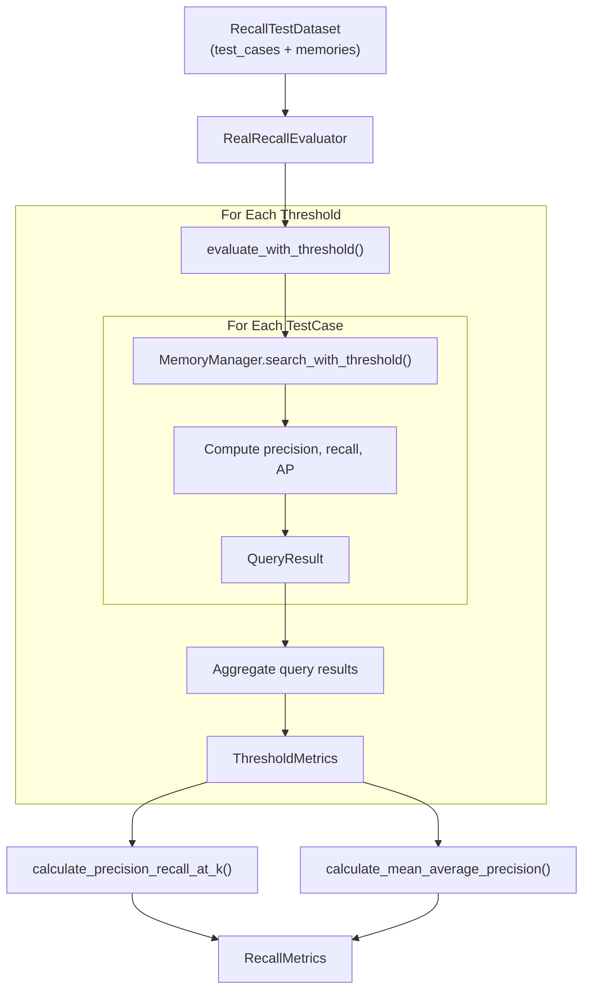
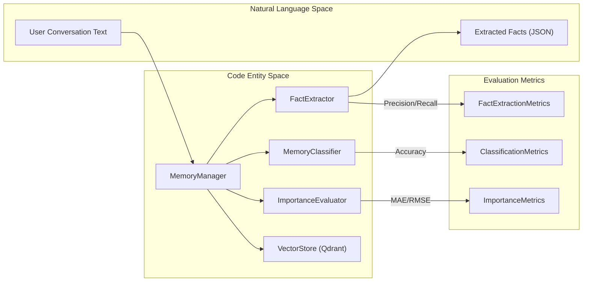

<!-- source: DeepWiki mcp.deepwiki.com · repo sopaco/cortex-mem · extra page Evaluation Metrics · fetched 2026-10-27 -->

# Evaluation Metrics

<details>
<summary>Relevant source files</summary>

The following files were used as context for generating this wiki page:

- [assets/benchmark/cortex_mem_vs_openclaw_1.png](assets/benchmark/cortex_mem_vs_openclaw_1.png)
- [assets/benchmark/cortex_mem_vs_openclaw_2.png](assets/benchmark/cortex_mem_vs_openclaw_2.png)
- [assets/benchmark/cortex_mem_vs_openclaw_3.png](assets/benchmark/cortex_mem_vs_openclaw_3.png)
- [examples/locomo-evaluation/BENCHMARK.md](examples/locomo-evaluation/BENCHMARK.md)
- [examples/locomo-evaluation/benchmark/BENCHMARK.md](examples/locomo-evaluation/benchmark/BENCHMARK.md)
- [examples/locomo-evaluation/benchmark/qa-s0-v5.judge.md](examples/locomo-evaluation/benchmark/qa-s0-v5.judge.md)

</details>


## Purpose and Scope

This page documents the evaluation metrics used by the Cortex Memory system to measure retrieval accuracy, memory processing quality, and overall reasoning capabilities. The metrics are derived from two primary sources: the `cortex-mem-evaluation` framework (using `RealRecallEvaluator` and `RealEffectivenessEvaluator`) and the **LoCoMo10 Benchmark** (using LLM-as-a-Judge methodology).

---

## LoCoMo10 Benchmark Metrics

The LoCoMo10 benchmark evaluates the system's performance on long-conversation memory QA using a dataset of 152 questions across 19 conversation sessions.

### LLM-as-a-Judge Scoring
The primary metric is a binary **CORRECT/WRONG** score assigned by a judge model to the system's response based on a "gold" expected answer.

**Overall Score Calculation:**
```
Score = (Number of Correct Answers) / (Total Questions)
```
As of v5, Cortex Memory achieves an overall score of **68.42%** [examples/locomo-evaluation/benchmark/BENCHMARK.md:13]().

### Category Breakdown
Questions are divided into four categories to measure specific cognitive capabilities:

| Category | Description | v5 Score |
|:---:|---|:---:|
| **Cat 1** | **Factual Recall**: Direct retrieval of specific facts. | 37.50% |
| **Cat 2** | **Temporal Reasoning**: Understanding when events occurred relative to dates. | 62.16% |
| **Cat 3** | **Commonsense Inference**: Drawing logical conclusions from context. | 76.92% |
| **Cat 4** | **Multi-hop Reasoning**: Linking multiple pieces of information across sessions. | 84.29% |

Sources: [examples/locomo-evaluation/benchmark/BENCHMARK.md:28-34](), [examples/locomo-evaluation/benchmark/qa-s0-v5.judge.md:14-17]()

### Efficiency Metrics
Cortex Memory tracks token usage to measure the cost-effectiveness of retrieval:
*   **Avg Input Tokens / Question**: Total tokens sent to the LLM to generate an answer.
*   **Score per 1K Tokens**: A normalized efficiency metric.

Cortex Memory v5 uses ~2,900 tokens per question, achieving an 18× better score-per-token ratio than traditional RAG baselines like OpenClaw+LanceDB [examples/locomo-evaluation/benchmark/BENCHMARK.md:40-48]().

---

## Recall Metrics (Retrieval Accuracy)

Recall metrics measure how effectively the `MemoryManager` retrieves relevant items from the `VectorStore`. These are computed by `RealRecallEvaluator`.

### Precision and Recall at K
*   **Precision@K**: Proportion of retrieved results in the top K that are relevant.
*   **Recall@K**: Proportion of all relevant items that appear in the top K.

The framework evaluates these at K values of 1, 3, 5, and 10 [examples/cortex-mem-evaluation/src/evaluator/real_recall_evaluator.rs:481-522]().

### Ranking Metrics
*   **Mean Average Precision (MAP)**: Averages the precision at each point a relevant memory is found. [examples/cortex-mem-evaluation/src/evaluator/real_recall_evaluator.rs:524-538]()
*   **NDCG (Normalized Discounted Cumulative Gain)**: Weights relevant results higher if they appear earlier in the list. [examples/cortex-mem-evaluation/src/evaluator/real_recall_evaluator.rs:541-568]()

### Recall Metrics Calculation Flow



Sources: [examples/cortex-mem-evaluation/src/evaluator/real_recall_evaluator.rs:79-154](), [examples/cortex-mem-evaluation/src/evaluator/metrics.rs]()

---

## Effectiveness Metrics (Processing Quality)

Effectiveness metrics evaluate the "intelligence" of the system's background processing modules.

### Fact Extraction & Classification
*   **Fact Precision/Recall**: Evaluates the `FactExtractor` by comparing extracted facts against a ground-truth list. [examples/cortex-mem-evaluation/src/evaluator/real_effectiveness_evaluator.rs:536-579]()
*   **Classification Accuracy**: Measures the `MemoryClassifier`'s ability to assign correct `MemoryType` (e.g., `Fact`, `Event`, `Preference`). [examples/cortex-mem-evaluation/src/evaluator/real_effectiveness_evaluator.rs:581-650]()

### Importance & Deduplication
*   **Importance Correlation**: Measures the Pearson correlation between the `ImportanceEvaluator`'s predicted score (1-10) and the expected score. [examples/cortex-mem-evaluation/src/evaluator/real_effectiveness_evaluator.rs:652-727]()
*   **Deduplication Recall**: Measures the system's ability to trigger `MemoryEvent::Update` instead of creating new entries when duplicate information is ingested. [examples/cortex-mem-evaluation/src/evaluator/real_effectiveness_evaluator.rs:729-781]()

### Natural Language to Code Entity Mapping

The following diagram bridges the evaluation of "Natural Language Facts" to the internal "Code Entities" that process them.



Sources: [examples/cortex-mem-evaluation/src/evaluator/real_effectiveness_evaluator.rs:82-186](), [examples/cortex-mem-evaluation/src/evaluator/effectiveness_evaluator.rs:331-374]()

---

## Overall Scoring Weights

The evaluation framework computes a weighted overall score to provide a single quality indicator for the system.

| Component | Weight | Source Code Entity |
|-----------|--------|-------------------|
| Fact Extraction | 0.3 | `FactExtractor` |
| Classification | 0.2 | `MemoryClassifier` |
| Importance | 0.2 | `ImportanceEvaluator` |
| Deduplication | 0.15 | `MemoryManager` (Update logic) |
| Memory Update | 0.15 | `MemoryManager` (Conflict resolution) |

Sources: [examples/cortex-mem-evaluation/src/evaluator/real_effectiveness_evaluator.rs:810-866]()

## Interpretation of Results

When interpreting evaluation artifacts (such as `qa-s0-v5.judge.md`), look for patterns in **Wrong Examples**:
1.  **Missing Context**: If the model states it "cannot determine" an answer that exists in the dataset, the issue lies in retrieval (Recall@K).
2.  **Granularity Issues**: If the model captures the general topic but misses a specific detail (e.g., missing "for Transgender people" in a career path question), the issue lies in the `FactExtractor`'s precision [examples/locomo-evaluation/benchmark/qa-s0-v5.judge.md:71-76]().
3.  **Temporal Errors**: Incorrect dates usually indicate a failure in the system's time-aware prompting or metadata handling [examples/locomo-evaluation/benchmark/qa-s0-v5.judge.md:35-41]().

Sources: [examples/locomo-evaluation/benchmark/qa-s0-v5.judge.md:21-77]()

---

